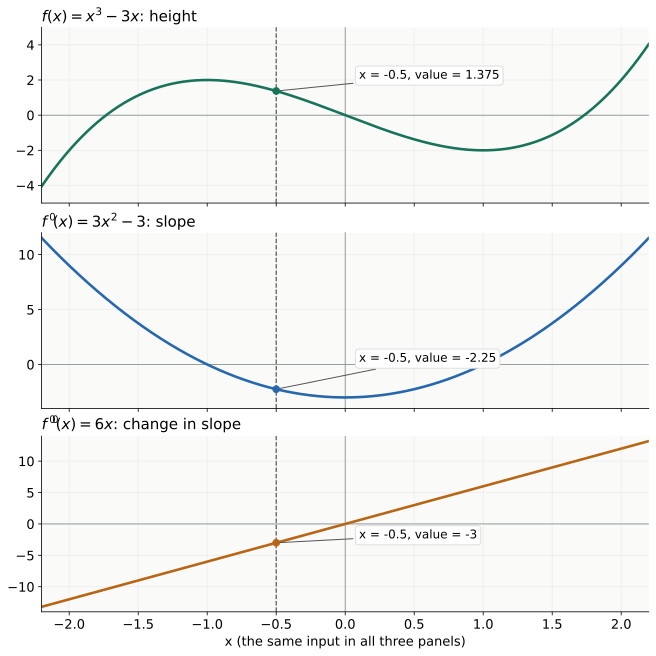
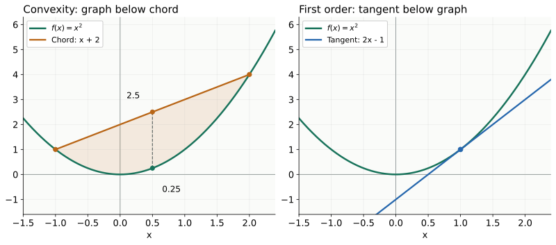
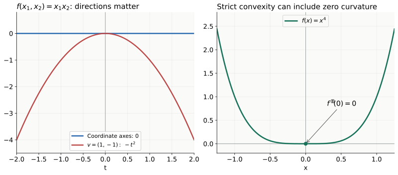

Convex function을 이해할 때 출발점은, 부등식보다 미분이었다. <strong>$f$는 높이, $f'$는 기울기, $f''$는 기울기의 변화</strong>다. 이 세 가지를 구분하고 나면, 왜 그래프가 chord 아래에 놓이는지, 왜 접선은 함수 전체의 하한이 되는지, 왜 다변수에서는 Hessian을 보는지가 하나의 흐름으로 이어진다.

이 글은 직접 작성한 <strong>「4 Convex Function」 손글씨 노트 4페이지</strong>와 <strong>ENAI601 Module 3 — Convex Functions 교안</strong>을 바탕으로 작성했다. 필기에서 이해를 쌓아 간 순서를 본문의 중심에 두었다. 미분식과 예제 수치는 직접 검산했고, 원본에 삽입되어 있던 그래프는 함수식으로 새로 그렸다.

[앞 글의 convex set](/enai601-convex-sets/)은 두 점 사이의 선분이 <strong>집합 안에 있는가</strong>를 물었다. 이번에는 그 선분 위에서 <strong>함수값이 두 끝의 값에 비해 얼마나 높은가</strong>를 묻는다. 마지막의 extended value·sublevel set·볼록성 보존 연산은 교안에서 이어지는 내용을 보충한 부분이다.

| 필기의 흐름 | 이 글에서 연결할 질문 |
| --- | --- |
| 1쪽: $f$, $f'$, $f''$ | 높이·증감·휘어짐은 왜 서로 다른가? |
| 2쪽: convexity와 직선 제한 | 다변수 함수를 한 방향의 1차원 함수로 보면 무엇이 쉬워지는가? |
| 3쪽: first-order / second-order condition | chord 아래라는 정의가 접선과 곡률의 조건으로 어떻게 바뀌는가? |
| 4쪽: gradient와 Hessian | 여러 방향의 기울기 변화와 교차항을 어떻게 묶어 판단하는가? |

## 1. f, f′, f″는 같은 x에서 서로 다른 것을 말한다

필기 첫 페이지의 핵심은 <strong>같은 $x$를 세 그래프에서 읽는 것</strong>이다. $f'$ 그래프를 볼 때는 $f'$ 자체가 증가하는지와 $f$가 증가하는지를 구별해야 한다.

| 그 점에서 보는 값 | 해석 |
| --- | --- |
| $f(x)>0$ | 함수의 높이가 $x$축 위에 있다 |
| $f(x)<0$ | 함수의 높이가 $x$축 아래에 있다 |
| $f'(x)>0$ | 그 점에서 오른쪽으로 움직일 때 함수값이 증가하는 방향이다 |
| $f'(x)<0$ | 그 점에서 오른쪽으로 움직일 때 함수값이 감소하는 방향이다 |
| $f''(x)>0$ | 그 점에서 기울기 $f'$가 증가하는 방향이다 |
| $f''(x)<0$ | 그 점에서 기울기 $f'$가 감소하는 방향이다 |

한 점에서의 미분값은 그 점의 국소 변화율이다. 구간 전체에서 증가·감소나 볼록성을 말하려면 그 구간 전체의 조건을 확인한다.

예를 들어 함수가 음수여도 증가할 수 있다. 또 감소하는 함수의 기울기가 증가할 수도 있다. −5, −3, −1처럼 기울기가 바뀐다면 여전히 음수지만 <strong>덜 가파르게 감소하는 중</strong>이다.

## 2. Concave up은 “함수가 증가한다”가 아니다

필기에서 concave up/down을 먼저 정리한 이유는 $f'$의 부호와 $f''$의 부호를 분리하기 위해서다.

미분 가능한 함수의 볼록성은 1차원에서 기울기가 <strong>감소하지 않는 것</strong>과 연결된다. 두 번 미분 가능하면 $f''\ge0$으로 판정할 수 있다. $f''>0$이면 기울기가 엄격하게 증가하는 방향의 곡률이 있다.

| $f'$ | $f''$ | 원래 함수의 움직임 |
| --- | --- | --- |
| 음수 | 음수 | 감소하면서 더 가파르게 내려간다 |
| 음수 | 양수 | 감소하지만 내려가는 속도가 완만해진다 |
| 양수 | 음수 | 증가하지만 올라가는 속도가 완만해진다 |
| 양수 | 양수 | 증가하면서 더 가파르게 올라간다 |

영어 미적분에서 <strong>concave up</strong>은 기울기가 증가하는 쪽의 휘어짐이고, convex optimization에서 말하는 convex와 연결된다. <strong>Concave down</strong>은 기울기가 감소하는 쪽이며 concave와 연결된다. U-shape/cap-shape는 직관을 위한 표현이지, 함수가 반드시 대칭이거나 최소·최댓값을 가져야 한다는 조건은 아니다.

예를 들어 $e^{-x}$는 모든 $x$에서 감소하지만 convex다. 직선은 기울기가 일정해서 convex이면서 concave다. 볼록성의 핵심은 <strong>기울기의 부호가 아니라 기울기가 어떻게 바뀌는가</strong>다.

## 3. 필기의 예제: x³−3x를 세 그래프에서 읽기

$$
f(x)=x^3-3x,\qquad f'(x)=3x^2-3,\qquad f''(x)=6x
$$

같은 $x=-0.5$를 대입하면

$$
f(-0.5)=1.375,\qquad f'(-0.5)=-2.25,\qquad f''(-0.5)=-3
$$

이다. 그래프는 $x$축 위에 있지만, 내려가는 중이고, 기울기가 더 작아지는 방향으로 휘어 있다. 세 값이 동시에 다른 정보를 준다.

$x=0.5$에서는 $f'=-2.25$로 같지만 $f''=3$이다. 이쪽은 내려가면서도 기울기가 덜 음수가 되어 완만해진다. <strong>같은 음의 기울기라도 휘어지는 방향은 다를 수 있다.</strong>

이 함수는 $x<0$에서 $f''<0$, $x>0$에서 $f''>0$이다. 따라서 $\mathbb R$ 전체에서 convex인 함수가 아니다. 한 점에서 $f''$가 양수라고 전체 함수가 convex가 되는 것은 아니다.

또 $f'(-1)=f'(1)=0$이지만 두 점의 역할은 다르다. −1은 local maximum, 1은 local minimum이다. $f''(0)=0$인 $x=0$은 이 예제에서 inflection point이며 극값이 아니다. <strong>$f'=0$, $f''=0$이라는 숫자만 떼어서 모든 경우의 결론으로 외우지 않는다.</strong>

## 4. Convex function의 정의: domain과 chord를 함께 본다

함수 $f$가 유한한 실수값으로 정의되는 입력들의 집합을 <strong>domain</strong>이라 쓰자.

$$
D=\operatorname{dom}f
$$

convex function에는 두 조건이 필요하다.

1. $D$가 convex set이다.
2. 모든 $x,y\in D$와 $t\in [0,1]$에 대해 다음 부등식이 성립한다.

$$
\boxed{f((1-t)x+ty)\le(1-t)f(x)+tf(y)}
$$

domain이 convex여야 섞은 입력 $(1-t)x+ty$도 domain 안에 남는다. 그 위에서 실제 함수값을 두 끝 함수값의 가중평균과 비교한다.

### 두 항은 서로 다른 것을 섞는다

$$
z=(1-t)x+ty
$$

는 <strong>입력 좌표</strong>를 섞은 점이다. 반면

$$
(1-t)f(x)+tf(y)
$$

는 <strong>함수의 높이</strong>를 섞은 값이다. 그래프 위의 두 점 $(x,f(x))$, $(y,f(y))$를 직선으로 이은 chord에서, 입력 좌표가 $z$인 지점의 높이가 된다.

따라서 convexity는 <strong>실제 그래프가 chord보다 높게 올라가지 않는다</strong>는 뜻이다.

예를 들어 $f(x)=x^2$, $x=-1$, $y=2$, $t=1/2$이면 $z=0.5$다.

$$
f(0.5)=0.25\le\frac{f(-1)+f(2)}2=2.5
$$

이다. 왼쪽은 “입력을 평균한 뒤 함숫값을 계산”, 오른쪽은 “각 함숫값을 계산한 뒤 평균”이다.

### Domain은 단순한 형식 조건이 아니다

$\exp(x)$의 domain은 $\mathbb R$, $\log(x)$의 domain은 $(0,\infty)$다. 둘 다 convex set이다. 반면 $1/x$를 자연스러운 domain $\mathbb R\setminus\{0\}$ 전체에서 보면 domain 자체가 convex가 아니다. $x>0$으로 제한하면 그 구간에서 $1/x$의 convexity를 따로 검토할 수 있다.

수식이 같아도 <strong>어떤 domain에서 보는가</strong>에 따라 함수의 볼록성에 관한 주장이 달라진다.

## 5. Convex set과 convex function을 연결하는 그림

convex function이라고 해서 <strong>그래프 자체가 convex set</strong>인 것은 아니다. $x^2$의 그래프 위 두 점을 이으면 선분 대부분이 그래프에서 떨어져 있다.

보충해서 보면, convex function과 직접 연결되는 집합은 그래프 <strong>위쪽 영역까지 채운 epigraph</strong>다.

$$
\operatorname{epi}f=\{(x,s):x\in D,\ s\ge f(x)\}
$$

$f$가 convex라는 것과 epi $f$가 convex set이라는 것은 동치다. 위쪽 영역의 두 점을 섞어도 실제 함수 그래프 아래로 빠지지 않는다는 것을, 앞 절의 부등식이 보장한다.

필기의 “convex set은 선분 전체가 안에 있고, convex function은 그래프가 선분 아래에 있다”는 구분을 이 관점으로 함께 이해할 수 있다.

### Strictly convex와 concave

서로 다른 $x,y$와 $0<t<1$에 대해 부등식이 엄격하면 <strong>strictly convex</strong>다.

$$
f((1-t)x+ty)<(1-t)f(x)+tf(y)
$$

$x=y$이거나 $t$가 0 또는 1이면 양쪽이 같아지므로 엄격 부등식의 조건에서 제외한다.

<strong>Concave</strong>는 $-f$가 convex라는 뜻이다. chord 부등호가 반대가 된다. affine function $a^Tx+b$는 양쪽이 항상 같아서 convex이면서 concave다. 두 점 이상을 포함하는 domain에서 affine function은 strictly convex가 아니다.

## 6. Restriction to a line: 다변수를 한 방향씩 잘라 보기

필기에서 다변수 함수로 넘어갈 때 잡은 핵심 아이디어다. 시작점 $x_{0}$와 방향 $v$를 정하고 그 직선 위에서만 함수를 본다.

$$
x(t)=x_0+tv,\qquad g(t)=f(x_0+tv)
$$

여기서 $t$는 <strong>스칼라</strong>다. $x_{0}$와 $v$는 고정했고, $t$만 움직이므로 $g$는 한 변수 함수다. 단, 원래 $f$가 $g$와 같은 함수가 된 것이 아니라 <strong>특정 직선 위로 제한한 함수</strong>를 새로 정의한 것이다.

$g$의 domain은

$$
I=\{t:x_0+tv\in D\}
$$

다. $D$가 convex이면 $I$는 구간 또는 공집합이다.

<strong>$f$는 $D$에서 convex ⇔ $D$가 convex이고, domain과 만나는 모든 직선에 대한 $g$가 그 구간에서 convex</strong>다. 임의의 두 입력점은 하나의 직선 위에 있으므로, 모든 선분의 chord 조건을 모든 직선 제한으로 검사할 수 있다.

### 필기의 예제: x₁²+x₂²

$$
f(x_1,x_2)=x_1^2+x_2^2,\quad
x_0=\begin{bmatrix}a\\b\end{bmatrix},\quad
v=\begin{bmatrix}p\\q\end{bmatrix}
$$

$$
g(t)=(a+tp)^2+(b+tq)^2
$$

미분할 때 $a,b,p,q$는 고정된 상수이고 $t$만 변수다.

$$
g'(t)=2p(a+tp)+2q(b+tq)
$$

$$
g''(t)=2p^2+2q^2\ge0
$$

어떤 시작점·방향을 고르더라도 이계도함수가 음수가 되지 않는다. 따라서 $f$는 convex다. 이 계산을 모든 방향에서 한 번에 표현하는 도구가 뒤에서 등장할 Hessian이다.

## 7. 접선 공식은 점과 기울기로 만든 affine function이다

필기는 first-order condition으로 넘어가기 전에 직선의 방정식을 다시 확인한다. 점 $(x_{0},y_{0})$를 지나고 기울기가 $m$인 직선은

$$
y=y_0+m(x-x_0)
$$

이다. 함수 그래프의 점이라면 $y_{0}=f(x_{0})$, 그 점의 접선 기울기는 $f'(x_0)$다.

$$
\ell_{x_0}(y)=f(x_0)+f'(x_0)(y-x_0)
$$

여기서 $y$는 새 <strong>입력 좌표</strong>, $\ell$의 값은 접선의 <strong>높이</strong>다. 기호가 겹쳐 혼동되지 않도록 구분한다.

예를 들어 $f(x_{0})=5$, $x_{0}=2$, $f'(x_0)=3$이라면 접선은 $\ell(y)=5+3(y-2)$다. $y=3$에서 접선 높이는 8이다. <strong>실제 $f(3)$이 정확히 8이라는 뜻은 아니다.</strong> 접선은 우선 국소적인 1차 근사다.

## 8. First-order condition: 국소 근사가 전역 하한이 된다

$f$가 <strong>열린 convex domain에서 미분 가능</strong>하다고 하자. 그러면 convexity는 다음 조건과 동치다.

$$
\boxed{f(y)\ge f(x)+\nabla f(x)^T(y-x)
\quad\text{for all }x,y\in D}
$$

1차원에서는 gradient가 $f'(x)$로 바뀐다. 어떤 점에서 만든 접선·접평면도 <strong>domain 전체에서 함수보다 위로 올라가지 않는다.</strong> 이것이 global underestimator라는 말의 뜻이다.

### 왜 chord 아래라는 정의에서 접선 아래라는 조건이 나올까?

convexity에 $z=x+t(y- x)$, $0<t\le 1$을 넣으면

$$
f(x+t(y-x))\le(1-t)f(x)+tf(y)
$$

다. 정리하면

$$
\frac{f(x+t(y-x))-f(x)}{t}\le f(y)-f(x)
$$

이고 $t\to0^+$ 극한을 취한 왼쪽이 $\nabla f(x)^T(y-x)$가 된다. 접선은 두 점 사이 chord를 극한으로 좁혀 얻는 하한이다.

반대 방향도 확인할 수 있다. $z=(1-t)x+ty$에서의 접평면 하한을 $x$와 $y$에 각각 적용하고 가중합하면, gradient 항이

$$
\nabla f(z)^T((1-t)x+ty-z)=0
$$

으로 사라진다. 남는 식이 $f(z)\le(1-t)f(x)+tf(y)$다.

### x²에서 오차까지 직접 계산하기

$x=1$에서 $f'$(1)=2이므로 접선은 $\ell(y)=2y-1$이다.

$$
f(y)-\ell(y)=y^2-(2y-1)=(y-1)^2\ge0
$$

어느 $y$에서도 실제 값이 접선보다 작아지지 않는다. chord는 그래프의 <strong>위</strong>, tangent는 그래프의 <strong>아래</strong>에 놓인다는 두 그림을 구별한다.

### Gradient가 0이면 왜 전역 최소일까?

convex $f$에서 $\nabla f(x^*)=0$이면 first-order condition으로 모든 $y\in D$에 대해 $f(y)\ge f(x^*)$다. 따라서 $x^*$는 전역 최소점이다.

이것은 임의 함수에서 “미분이 0이면 최소”라고 말하는 것과 다르다. 앞의 $x^{3}- 3x$는 미분이 0인 지점에 local maximum도 있었다. 별도의 제약집합에서 최소화하는 문제라면 경계의 최적점에서 gradient가 0일 필요도 없다. 지금의 결론은 위 부등식과 stationary point를 함께 사용한 것이다.

## 9. Gradient는 여러 방향의 1차 변화율을 묶는다

다변수 함수에서는 한 개의 기울기만으로 충분하지 않다. 각 좌표 방향으로 조금 움직였을 때의 변화율을 모은 것이 <strong>gradient</strong>다.

$$
\nabla f(x)=\begin{bmatrix}
\frac{\partial f}{\partial x_1}\\
\vdots\\
\frac{\partial f}{\partial x_n}
\end{bmatrix}\in\mathbb R^n
$$

작은 이동 $d$에 대한 1차 근사는

$$
f(x+d)\approx f(x)+\nabla f(x)^Td
$$

이다. gradient의 성분은 각 좌표축의 기울기이고, $d$와 내적하면 그 이동 방향에서의 1차 변화량을 얻는다.

직선 제한 $g(t)=f(x_0+tv)$에서는 chain rule로

$$
g'(t)=\nabla f(x_0+tv)^Tv
$$

다. $v$를 단위벡터로 선택하면 그 방향의 단위 길이당 변화율을 읽는다. $v$의 길이를 바꾸면 $t$ 한 단위의 실제 이동량도 달라진다.

## 10. Hessian: 기울기가 여러 방향으로 어떻게 바뀌는가?

필기 마지막 페이지는 “1차원에서 $f''$를 보던 것을 다변수에서는 어떻게 할까?”라는 질문으로 이어진다. 각 gradient 성분을 다시 각 좌표로 미분한다.

$$
H(x)=\nabla^2f(x),\qquad
H_{ij}(x)=\frac{\partial}{\partial x_j}
\left(\frac{\partial f}{\partial x_i}\right)
$$

2변수에서는

$$
\nabla^2f(x)=\begin{bmatrix}
f_{x_1x_1}&f_{x_1x_2}\\
f_{x_2x_1}&f_{x_2x_2}
\end{bmatrix}
$$

이다. 혼합편미분 기호는 위의 “gradient의 $i$번째 성분을 $x_{j}$로 미분”이라는 정의에 맞추어 읽는다.

| 항 | 필기의 질문으로 읽기 |
| --- | --- |
| $H_{11}$ | $x_{1}$ 방향의 기울기가 $x_{1}$ 방향으로 움직일 때 어떻게 바뀌는가? |
| $H_{22}$ | $x_{2}$ 방향의 기울기가 $x_{2}$ 방향으로 움직일 때 어떻게 바뀌는가? |
| $H_{12}$ | $x_{1}$ 방향의 기울기가 $x_{2}$ 방향으로 움직일 때 어떻게 바뀌는가? |
| $H_{21}$ | $x_{2}$ 방향의 기울기가 $x_{1}$ 방향으로 움직일 때 어떻게 바뀌는가? |

순수 이계편미분은 좌표 방향의 곡률을, 혼합편미분은 <strong>한 방향의 기울기가 다른 방향의 이동에 반응하는 부분</strong>을 담는다. 이 글의 Hessian 판정에서는 $f$가 $C^{2}$, 즉 이계편미분까지 연속이라고 가정한다. 그러면 혼합편미분이 같아 Hessian이 실수 대칭행렬이다.

Hessian이 그 점 주변의 곡률을 표현하는 것은 2차 Taylor 근사에서도 보인다.

$$
f(x+d)=f(x)+\nabla f(x)^Td
+\frac12d^TH(x)d+o(\|d\|_2^2)
$$

곡률의 부호를 정하는 것은 행렬의 원소를 따로 보는 대신, <strong>모든 이동 방향 $d$에 대한 이차형식 $d^THd$</strong>를 보는 것이다. [행렬 글의 PSD](/enai601-matrices-and-psd/)가 여기서 다시 등장한다.

## 11. Second-order condition은 모든 직선 방향의 곡률 조건이다

직선 제한을 한 번 더 미분하면

$$
g''(t)=v^T\nabla^2f(x_0+tv)v
$$

를 얻는다. 1차원 함수의 이계도함수에 해당하는 값이 다변수에서는 방향 $v$에 대한 Hessian의 이차형식이다.

따라서 <strong>열린 convex domain에서 $C^{2}$인 함수</strong>에 대해

$$
\boxed{
f\text{ convex}\quad\Longleftrightarrow\quad
\nabla^2f(x)\succeq0\text{ for every }x\in D
}
$$

다. PSD의 정의가 모든 $v$에 대해 $v^THv\ge0$라는 것이므로, 모든 직선 제한의 기울기가 감소하지 않는다는 조건과 일치한다.

여기에는 두 종류의 <strong>모든</strong>이 있다.

1. domain 안의 <strong>모든 점 $x$</strong>에서 검사한다.
2. 그 점에서의 <strong>모든 방향 $v$</strong>에 대해 음의 곡률이 없어야 한다.

한 점에서 Hessian이 PSD인 것만으로 전체 convexity를 결론 내릴 수 없다. 좌표축 방향의 이계편미분만 검사해도 부족하다.

### 필기의 합제곱 예제는 Hessian이 2I다

$$
f(x_1,x_2)=x_1^2+x_2^2,\qquad
\nabla f=\begin{bmatrix}2x_1\\2x_2\end{bmatrix},\qquad
\nabla^2f=\begin{bmatrix}2&0\\0&2\end{bmatrix}
$$

$$
v^T\nabla^2f\,v=2p^2+2q^2
\quad\text{when}\quad v=\begin{bmatrix}p\\q\end{bmatrix}
$$

앞에서 직선 제한으로 길게 계산했던 $g''$가 그대로 나온다. Hessian은 새로운 별개의 조건을 추가한 것이 아니라, <strong>그 계산을 모든 방향에 대해 행렬로 묶은 표현</strong>이다.

## 12. 대각선이 음수가 아니어도 부족하다: 혼합항의 역할

다음 함수는 좌표별로만 보면 직선이다.

$$
f(x_1,x_2)=x_1x_2,\qquad
H=\begin{bmatrix}0&1\\1&0\end{bmatrix}
$$

$x$축에서는 $f(t,0)=0$이고 $y$축에서도 $f(0,t)=0$이다. 두 순수 이계편미분은 모두 0이다. 하지만 $v=(1,-1)$ 방향에서는

$$
g(t)=f(t,-t)=-t^2,\qquad
g''(t)=-2<0
$$

이므로 convex가 아니다. 이때

$$
v^THv=2v_1v_2=-2
$$

이며 Hessian의 고유값도 1과 −1이다. 좌표축에서는 드러나지 않았던 아래로 휘는 방향을 혼합항이 만든다.

## 13. PD이면 strictly convex지만, 역은 성립하지 않는다

교안에서 주의하는 조건이다. 열린 convex domain에서 $C^{2}$인 함수에 대해

$$
\nabla^2f(x)\succ0\text{ for every }x\in D
\quad\Longrightarrow\quad f\text{ strictly convex}
$$

다. 어떤 점에서든 0이 아닌 모든 방향에 양의 곡률이 있으므로 충분하다.

그러나 strictly convex라서 Hessian이 <strong>모든 점에서</strong> PD여야 하는 것은 아니다. 반례는

$$
f(x)=x^4,\qquad f'(x)=4x^3,\qquad f''(x)=12x^2
$$

다. $f'$는 $\mathbb R$에서 엄격히 증가하므로 $f$는 strictly convex지만 $f''(0)=0$이다. 원점 한 점에서 순간 곡률이 0인 것과 어떤 구간 전체가 직선처럼 평평한 것은 다르다.

따라서 “Hessian이 PSD이지만 PD가 아닌 점을 찾았다”는 이유만으로 strictly convex가 아니라고 결론 내리지 않는다. 반대로 affine 함수는 Hessian이 모든 곳에서 0이고 strictly convex가 아니다.

## 14. 이차함수와 최소제곱을 한 번에 판정하기

실수 대칭행렬 $P$를 사용하는 교안의 이차함수는

$$
f(x)=\frac12x^TPx+q^Tx+r
$$

다. gradient와 Hessian은

$$
\nabla f(x)=Px+q,\qquad \nabla^2f(x)=P
$$

이므로 $P$가 PSD이면 convex, PD이면 strictly convex다. <strong>이 이차함수에서는</strong> 반대로 strictly convex이면 $P$가 PD다. 일반 함수의 $x^4$ 반례와, Hessian이 일정한 이차함수를 구별한다.

또 앞 글에서 만난 최소제곱은

$$
f(x)=\|Ax-b\|_2^2,\quad
\nabla f(x)=2A^T(Ax-b),\quad
\nabla^2f(x)=2A^TA\succeq0
$$

라서 convex다. $A$가 full column rank이면 $A^TA$가 PD여서 strictly convex이고 최소제곱 계수는 유일하다. rank가 부족하면 null space 방향으로 움직여도 $Ax$가 같아 목적함수 값이 변하지 않는다.

첫 식의 1/2 때문에 Hessian이 $P$이고, 최소제곱 식에는 1/2가 없어서 $2A^TA$라는 계수가 붙는다. 식의 정규화 계수를 함께 확인한다.

## 15. 교안 보충: domain 밖을 +∞로 표현하기

여기부터는 필기의 미분·곡률 흐름을 바탕으로 교안의 뒤쪽 내용을 연결한다.

domain $D$에서 정의된 convex $f$를 전체 공간으로 확장할 때, domain 밖의 값을 $+\infty$로 놓을 수 있다.

$$
\tilde f(x)=\begin{cases}
f(x),&x\in D,\\
+\infty,&x\notin D.
\end{cases}
$$

이것은 domain 밖에서도 실제 미분을 하겠다는 뜻이 아니라, <strong>허용되지 않는 입력은 유한한 목적값을 가질 수 없다</strong>고 표시하는 방법이다. 예를 들어 $-\log x$는 $x>0$에서 convex이고, $x\le0$에 $+\infty$를 부여하여 domain 제약을 함께 표현할 수 있다.

이후 convex function을 볼 때는 유한한 값을 갖는 domain이 어디인지부터 확인한다. $+\infty$를 보통의 실수처럼 취급해서 Taylor 전개나 미분을 적용하지 않는다.

## 16. Sublevel set은 convex지만, 이것만으로는 충분하지 않다

$\alpha$보다 함수값이 높지 않은 입력들의 집합을 <strong>α-sublevel set</strong>이라 한다.

$$
C_\alpha=\{x\in D:f(x)\le\alpha\}
$$

$f$가 convex이면 모든 $C_{\alpha}$는 convex다. $x,y\in C_{\alpha}$이면

$$
f((1-t)x+ty)\le(1-t)f(x)+tf(y)\le\alpha
$$

이기 때문이다. convex function의 부등식 제약이 convex feasible set을 만든다는 연결이다.

하지만 역은 성립하지 않는다. 교안의 반례 $f(x)=-e^x$는 $f''(x)=-e^x<0$이라 convex가 아니다. 그럼에도 sublevel set은

$$
C_\alpha=\begin{cases}
[\log(-\alpha),\infty),&\alpha<0,\\
\mathbb R,&\alpha\ge0
\end{cases}
$$

여서 모두 convex다. “모든 sublevel set이 convex”인 성질은 <strong>quasiconvex</strong>라고 하며, convex보다 약하다. 그래프의 높이를 섞는 원래 부등식까지 보장하지는 않는다.

## 17. 교안 보충: 미분 없이 볼록성을 만드는 연산

정의나 Hessian을 직접 계산하기 어렵다면, 이미 아는 convex function들을 볼록성을 보존하는 방식으로 조합할 수 있다. domain 조건도 함께 확인한다.

### 비음수 가중합

공통의 convex domain에서 $f_{i}$가 convex이고 $w_i\ge0$이면

$$
F(x)=\sum_{i=1}^m w_i f_i(x)
$$

도 convex다. 정의의 부등식들을 음수가 아닌 가중치로 더하면 된다. 음의 가중치를 임의로 넣으면 보존되지 않는다. $x^2$에 −1을 곱한 −$x^2$가 반례다.

### Affine function과의 합성

$f$가 convex이면

$$
g(x)=f(Ax+b),\qquad
\operatorname{dom}g=\{x:Ax+b\in\operatorname{dom}f\}
$$

는 convex다. 앞 글에서 affine preimage가 convex임을 배웠으므로 domain 조건도 연결된다. 예를 들어 norm은 convex이므로 $\|Ax+b\|$도 convex다.

### Pointwise maximum과 supremum

각 $f_{i}$가 convex이면

$$
F(x)=\max_i f_i(x)
$$

도 convex다. 예를 들어 $|x|=\max(x,-x)$는 두 affine 함수의 최대여서 convex다. $x=0$에서 미분되지 않아도 정의로는 문제가 없다. 미분 가능성이 convexity의 필수 조건은 아니라는 예다.

임의의 비어 있지 않은 함수족에 대한 pointwise supremum에도 같은 볼록성 보존이 성립한다. 다만 값이 $+\infty$가 되는 입력이 있을 수 있으므로 유한한 domain을 확인한다.

교안은 이를 실수 대칭행렬 $X$의 최대 고유값에도 적용한다.

$$
\lambda_{\max}(X)=\sup_{\|v\|_2=1}v^TXv
$$

$v$를 고정하면 $v^TXv$는 <strong>행렬 변수 $X$에 대해 선형</strong>이다. 그 함수들의 supremum이므로 $\lambda_{\max}$는 $X$에 대해 convex다. 같은 이차형식도 무엇을 변수로 두느냐에 따라 역할이 달라진다.

## 18. 합성과 최소화에서는 조건을 더 살펴야 한다

### Convex 함수 둘을 합성한다고 항상 convex는 아니다

$h(u)=u^{2}$와 $g(x)=x^2-1$은 각각 convex지만

$$
(h\circ g)(x)=(x^2-1)^2,\qquad
(h\circ g)''(0)=-4
$$

여서 합성은 convex가 아니다. $h$는 $g$의 값이 움직이는 범위 전체에서 증가하는 함수가 아니었다.

교안의 대표적인 <strong>충분조건</strong>은 다음과 같다. 합성 domain이 convex이고 관련 값들이 각 함수의 domain 안에 들어가는 조건을 함께 확인한다.

| $h$의 성질 | $g$의 성질 | $h(g(x))$ |
| --- | --- | --- |
| convex이고 nondecreasing | convex | convex |
| convex이고 nonincreasing | concave | convex |

예를 들어 $\exp(g(x))$는 convex $g$에 대해 convex다. $-\log(g(x))$는 $g$가 concave이고 양수인 적절한 convex domain에서 convex다. “외부 함수가 증가하는지 감소하는지”에 따라 안쪽 부등호를 어떻게 전달하는지가 달라진다.

### 최소값을 취하는 연산은 max와 다르다

$$
F(x)=\min\{x^2,(x-2)^2\}
$$

의 양쪽 함수는 convex지만 $F(0)=F(2)=0$, $F(1)=1$이라 chord 조건을 어긴다. <strong>Pointwise minimum은 일반적으로 convexity를 보존하지 않는다.</strong>

교안의 보존 정리는 다른 형태다. $F(x,y)$가 <strong>$(x,y)$에 대해 jointly convex</strong>이고, $y$를 움직이는 집합 $C$가 비어 있지 않은 convex set일 때

$$
g(x)=\inf_{y\in C}F(x,y)
$$

는 적절한 유한성 조건 아래 convex다. 여기서는 $F$가 전체 곱공간에서 정의되고 $g(x)$가 모든 $x$에서 유한하다고 하자. 각 $x$에서 거의 최소인 두 $y$를 고른 뒤, 그 $(x,y)$ 쌍들을 함께 볼록결합하면 이 결과를 이해할 수 있다. infimum이 실제로 달성되어야만 하는 정리는 아니다.

교안의 예제를 완전제곱으로 정리하면

$$
F(x,y)=x^2+xy+2y^2
=2\left(y+\frac x4\right)^2+\frac78x^2
$$

이다. Hessian은 [[2,1],[1,4]]로 PD이고, 각 $x$에서 $y^*=-x/4$가 최소를 달성한다. 따라서

$$
g(x)=\inf_y F(x,y)=\frac78x^2
$$

로 convex다. 이 정리는 “convex 함수 여러 개 중 작은 것만 고른다”는 앞의 연산과 구별한다.

## 19. 실제로 판정할 때의 순서

1. <strong>Domain부터 확인한다.</strong> 섞은 입력이 허용되는지, 미분 조건을 쓰려면 열린 domain인지 본다.
2. <strong>간단하면 정의를 쓴다.</strong> 모든 두 점과 비율에 대한 chord 부등식을 확인한다.
3. <strong>직선으로 제한한다.</strong> 특정 방향에서만 위반해도 convex가 아님을 보일 수 있다. 증명하려면 모든 방향을 다룬다.
4. <strong>미분 가능하면 first-order condition을 본다.</strong> 접평면이 전역 하한인지 확인한다.
5. <strong>$C^{2}$이면 Hessian을 본다.</strong> 모든 점에서 PSD인지, 모든 방향의 이차형식이 음수가 아닌지 확인한다.
6. <strong>이미 아는 함수와 보존 연산을 찾는다.</strong> norm, affine, exp, max 등으로 분해할 수 있는지 살핀다.

이들은 모든 함수에 똑같이 적용하는 한 가지 절차가 아니라, 사용할 수 있는 조건에 따라 선택하는 방법들이다. $\lvert x\rvert$처럼 미분되지 않는 convex function에는 미분 판정이 적용되지 않아도 정의나 max 표현을 사용할 수 있다.

## 20. 필기의 흐름을 다시 확인하는 문제

1. $f'<0$이고 $f''>0$이면 함수가 증가한다는 뜻인가?
2. $x^{3}- 3x$에서 $x=-0.5$일 때 $f'$와 $f''$는 각각 얼마인가?
3. Convexity 부등식의 왼쪽과 오른쪽은 각각 무엇을 섞는가?
4. $x^2$의 그래프 자체는 convex set인가? epigraph는 어떤가?
5. $x^2$의 $x=1$에서의 접선은? 실제 함수값과 접선값의 차이는?
6. $g(t)=f(x_0+tv)$에서 $t$와 $v$ 중 무엇을 변수로 미분하는가?
7. Hessian의 대각선이 모두 0 이상이면 PSD라고 결론 내릴 수 있는가?
8. $f$가 strictly convex이면 모든 점의 Hessian이 PD인가?
9. 모든 sublevel set이 convex이면 $f$도 반드시 convex인가?
10. 두 convex 함수의 max와 min은 각각 볼록성을 보존하는가?

<strong>해설</strong>

1. 아니다. 감소하면서 기울기가 덜 음수가 되어 완만해진다.
2. $f'=-2.25$, $f''=-3$이다. 기울기가 음수이고 더 감소하는 방향이다.
3. 왼쪽은 입력을 섞은 뒤 계산한 실제 높이, 오른쪽은 끝점의 함수값을 섞은 chord 높이다.
4. 그래프 자체는 아니다. 그래프 위쪽을 채운 epigraph는 convex다.
5. $\ell(y)=2y-1$이고 $f(y)-\ell(y)=(y-1)^2\ge0$이다.
6. $x_{0}$와 $v$를 고정하고 스칼라 $t$로 미분한다.
7. 아니다. $f(x_1,x_2)=x_1x_2$의 Hessian과 $v=(1,-1)$이 반례다.
8. 아니다. $x^4$는 strictly convex지만 $f''(0)=0$이다.
9. 아니다. $-e^x$는 convex가 아니지만 모든 sublevel set이 convex다.
10. Max는 보존한다. Min은 일반적으로 보존하지 않으며, 본문의 두 제곱함수가 반례다.

## 참고한 자료와 정리 범위

- 개인 손글씨 노트 <strong>「4 Convex Function」 1–4페이지</strong>: 함수·도함수·이계도함수를 같은 $x$에서 읽는 방법, slope의 증감, chord의 정의, 직선 제한, first/second-order condition, Hessian의 대각·혼합항 해석.
- ENAI601, <strong>Module 3 — Convex Functions</strong> 접근성 버전 교안: domain, convex/strictly convex/concave의 정의, 직선 제한, gradient·Hessian, first/second-order condition, $x^4$ 반례, 이차함수·최소제곱, extended value, sublevel set, convexity를 보존하는 연산과 예제.

필기의 이해 순서를 유지하면서 미분값과 부등식의 조건을 확인했다. Epigraph 연결, first-order 조건의 유도, xy 방향 반례와 비교표·확인 문제는 이해를 돕기 위해 보강했다. 교안의 log-barrier·log-sum-exp 등 추가 응용을 모두 나열하기보다, 필기의 곡률 흐름과 보존 연산의 핵심을 연결하는 데 집중했다. 그림은 명시한 함수식으로 새로 계산한 결과다.
