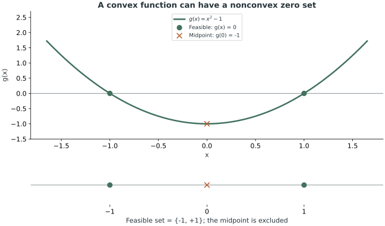
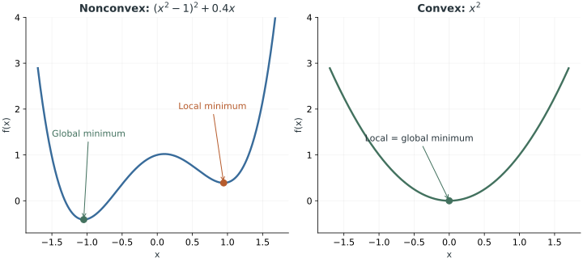
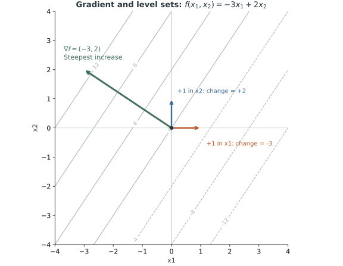

[앞 글의 Basic Optimization](/enai601-basic-optimization/)에서는 무엇을 최소화하고 어디에서 선택하는지 구분했다. 이제 그 문제에 볼록성이 있으면 무엇이 달라지는지 살펴본다. 일반적인 문제에서는 주변에서 좋은 점을 찾아도 전체에서 가장 좋다고 할 수 없지만, Convex Optimization에서는 Local Minimum이 Global Minimum이다. [Convex Set](/enai601-convex-sets/)과 [Convex Function](/enai601-convex-functions/)의 기초 정의는 알고 있다는 전제다.

<strong>왜 등식은 Affine이어야 할까? 왜 Local Minimum이 Global Minimum일까? Gradient에 음수 성분이 있는데도 증가 방향이라고 할 수 있을까?</strong> 그 답을 따라 최적성 조건까지 연결한다.

## 1. Convex Optimization은 무엇을 더 요구할까?

Convex Set과 Convex Function을 배운 뒤, 다음 문제는 <strong>최적화 문제 전체</strong>가 Convex Optimization인지 판별하는 것이다.

표준 최소화 문제에서 다음 조건들을 확인한다.

1. 공통 <strong>Domain</strong>이 Convex인가?
2. <strong>Objective Function</strong>이 Convex인가?
3. 각 <strong>Inequality Constraint Function</strong>이 Convex인가?
4. 각 <strong>Equality Constraint Function</strong>이 Affine인가?

이 조건들을 만족하면 Feasible Set이 Convex이고, 표준적인 Convex Optimization Problem이 된다.

### 왜 Inequality는 Convex인데 Equality는 Affine일까?

부등식과 등식은 두 점 사이의 값을 제한하는 방식이 다르다. <strong>Affine은 Convex Function보다 더 제한적인 형태</strong>이며, Convex이면서 동시에 Concave인 함수다.

Convex Function은 두 점 사이의 함수값에 대해 다음을 보장한다.

$$
f(\theta x+(1-\theta)y)\leq\theta f(x)+(1-\theta)f(y),\qquad 0\leq\theta\leq1
$$

부등식 제약조건을 만족하는 두 점을 잡으면 다음과 같다.

$$
f(x)\leq0,\qquad f(y)\leq0
$$

$$
\begin{aligned}
f(\theta x+(1-\theta)y)
&\leq\theta f(x)+(1-\theta)f(y)\\
&\leq0
\end{aligned}
$$

즉, 두 점 사이의 점도 <strong>0 이하</strong>이므로 Feasible하다. 그래서 Convex Function의 <strong>Sublevel Set</strong>은 Convex이다.

그런데 Equality Constraint에서는 두 점이 다음을 만족할 뿐이다.

$$
f(x)=0,\qquad f(y)=0
$$

Convexity를 적용하면

$$
f(\theta x+(1-\theta)y)\leq0
$$

밖에 얻지 못한다. <strong>Equality Constraint에서는 정확히 0이어야 하는데, 0 이하라는 정보는 부족하다.</strong> 기존 두 점이 문제가 아니라 *두 점 사이에 새로 만든 점*이 문제다.

실제 반례를 보자.

$$
f(x)=x^2-1
$$

$$
f(-1)=0,\qquad f(1)=0,\qquad f(0)=-1
$$

함수는 Convex이지만 등식 제약조건을 만족하는 양끝 두 점의 중점은 등식 제약조건을 만족하지 않는다.

그렇다면 Affine Function은 무엇이 다를까?

$$
f(x)=Ax+b
$$

Affine Function에서는 정확한 <strong>등식</strong>이 성립한다.

$$
\begin{aligned}
f(\theta x+(1-\theta)y)
&=A(\theta x+(1-\theta)y)+b\\
&=\theta Ax+(1-\theta)Ay+\theta b+(1-\theta)b\\
&=\theta(Ax+b)+(1-\theta)(Ay+b)\\
&=\theta f(x)+(1-\theta)f(y)
\end{aligned}
$$

여기서 상수항이 두 번 등장한 것처럼 보이지만, 두 가중치의 합이 1이므로 정확히 하나의 상수항이 된다.

$$
\theta b+(1-\theta)b=b
$$

따라서 두 끝점의 함수값이 0이면 선분 위에서도 정확히 0이다.

$$
f(\theta x+(1-\theta)y)=\theta\cdot0+(1-\theta)\cdot0=0
$$

<strong>정리:</strong> Convex Inequality는 `≤ 0`을 보장하면 충분하지만, Equality는 반드시 `= 0`을 보장해야 한다. 표준 Convex Optimization에서 Affine Equality를 요구하는 이유다. <strong>비선형 등식이 언제나 비볼록 집합을 만든다는 뜻은 아니다.</strong> 다만 비선형 등식의 볼록성은 일반적으로 보장되지 않는다.

함수의 볼록성과 그 함수의 영점 집합의 볼록성은 다르다. 아래 패널에서 양끝의 허용점 사이에 있는 중점은 허용되지 않는다.

### 교안 보충: 같은 Feasible Set도 표현에 따라 다르게 보인다

<blockquote class="lecture-excerpt">

교안 발췌 · Module 5 — Example (2)

Constructing an equivalent convex problem

</blockquote>

Convex Optimization의 <strong>표준형 판별</strong>과 <strong>동등한 문제로의 재정식화(Reformulation)</strong>는 구별해야 한다. 예를 들어 다음 문제를 보자.

$$
\begin{aligned}
\operatorname{minimize}_{x\in\mathbb R^2}\quad &x_1^2+x_2^2\\
\text{subject to}\quad
&\frac{x_1}{1+x_2^2}\leq0\\
&(x_1+x_2)^2=0
\end{aligned}
$$

목적함수는 Convex이지만, 첫 제약함수는 전체 공간에서 Convex가 아니고 두 번째 등식은 Affine이 아니다. 따라서 <strong>적힌 형태 그대로는 수업의 Convex Standard Form 판별을 통과하지 못한다.</strong> 그렇다고 Feasible Set 자체가 반드시 비볼록이라는 뜻은 아니다.

분모는 항상 양수이므로 첫 조건은 단순한 반공간이다. 두 번째 조건도 실수의 제곱이 0일 조건으로 바꿀 수 있다.

$$
\frac{x_1}{1+x_2^2}\leq0\iff x_1\leq0,
\qquad
(x_1+x_2)^2=0\iff x_1+x_2=0
$$

같은 목적함수에 이 두 조건을 쓰면 Affine Inequality와 Affine Equality가 되고, 원래 Feasible Set을 그대로 보존하는 Convex Optimization 문제를 얻는다. 이는 앞에서 본 <strong>비선형 등식이 언제나 비볼록 집합을 만드는 것은 아니다</strong>라는 주장의 실제 예이기도 하다.

### 최소제곱은 왜 Convex일까?

앞 글의 회귀 예제를 Hessian으로 다시 읽으면 [PSD와 Convex Function의 연결](/enai601-convex-functions/)이 구체적으로 드러난다.

$$
g(w)=\|Xw-y\|_2^2,
\qquad\nabla g(w)=2X^T(Xw-y),
\qquad\nabla^2g(w)=2X^TX
$$

$$
z^T\nabla^2g(w)z=2\|Xz\|_2^2\geq0
$$

<blockquote class="lecture-excerpt">

교안 발췌 · Module 5 — Example (1) — Linear regression

$$
\nabla^2g(\bar w)=2\sum_{i=1}^p\bar u_i\bar u_i^T\succeq0
$$

</blockquote>

위 인용의 $\bar u_i$는 절편을 위한 1을 붙인 데이터 벡터이고, $\bar w$는 절편을 포함한 계수 벡터다. 행렬 $X$의 각 행이 $\bar u_i^T$이므로, 이 합은 본문의 $2X^TX$와 같다.

데이터 행렬이 Full Column Rank이면 Hessian은 PD가 되어 Strictly Convex하다. Rank가 부족하면 같은 예측값을 만드는 파라미터가 여러 개일 수 있다. 여기서도 <strong>Convex와 Strictly Convex의 차이</strong>를 구별해야 한다.

### SVM을 Convex Optimization으로 바꾸기

앞 글의 SVM은 가장 가까운 점까지의 거리를 최대화했다. 학습 데이터는 고정되어 있고 최적화 변수는 법선벡터와 절편이다. 여기서는 <strong>두 라벨이 모두 존재하고 선형 분리 가능한 유한한 데이터</strong>를 가정한다.

$$
\operatorname{maximize}_{w\ne0,b}\quad
\min_i\frac{v_i(w^Tu_i+b)}{\|w\|_2}
$$

각 점의 <strong>Signed Score</strong>에 공통 하한을 하나 도입하자.

$$
\begin{aligned}
\operatorname{maximize}_{w,b,r}\quad&\frac{r}{\|w\|_2}\\
\text{subject to}\quad&v_i(w^Tu_i+b)\geq r\quad\forall i,\qquad r>0
\end{aligned}
$$

고정된 분리면에서 가장 작은 점수보다 하한을 크게 잡을 수 없으므로, 최대로 고른 하한은 그 최소 점수가 된다. 다음으로 세 변수를 같은 양수로 나누면 분리면과 거리 비율은 변하지 않는다.

$$
\bar w=\frac{w}{r},\qquad\bar b=\frac{b}{r},
\qquad
v_i(\bar w^Tu_i+\bar b)\geq1,
\qquad
\frac{r}{\|w\|_2}=\frac1{\|\bar w\|_2}
$$

<blockquote class="lecture-excerpt">

교안 발췌 · Module 5 — Example (3) — SVM

Scaling w, b and r by the same scaling factor does not change the optimal value of the problem

</blockquote>

즉, 점수의 척도를 1로 고정할 수 있다. 양의 노름의 역수를 최대화하는 것은 노름의 제곱을 최소화하는 것과 <strong>같은 최적 분리면을 선택한다</strong>. 최적 목적함수값 자체는 서로 다르다. 바뀐 변수 위의 막대를 생략하면 다음 최소화 문제를 얻는다.

$$
\begin{aligned}
\operatorname{minimize}_{w,b}\quad&\frac12\|w\|_2^2\\
\text{subject to}\quad&1-v_i(w^Tu_i+b)\leq0\quad(i=1,\ldots,N)
\end{aligned}
$$

목적함수는 Convex이고 각 제약은 변수에 대한 Affine Inequality다. 따라서 Convex Optimization이다. 앞의 계수 1/2은 최적점을 바꾸지 않고 미분을 간단하게 만든다. 이 절에서는 이 재정식화까지만 확인하고, 별도의 문제 유형이나 풀이 알고리즘으로 확장하지 않는다.

수업에서는 원래 식의 올바른 분류 조건을 따로 적지 않아도 되는지도 질문했다. <strong>분리 가능한 경우에는 양의 최소 Signed Margin을 만드는 분리면이 존재한다.</strong> 한 점이라도 잘못 분류하거나 분리면 위에 놓으면 최소 Signed Margin이 0 이하이므로, 전역 최적해가 될 수 없다. 다만 이런 최적해 보존과, 제약을 지워도 Feasible Set 전체가 같은 <strong>Redundant Constraint의 정의</strong>는 구별해야 한다. 또한 분모 때문에 법선벡터가 0인 경우는 여전히 제외해야 한다.

## 2. Convex Optimization이 특별한 이유: Local = Global

일반적인 최적화 문제에서는 여러 개의 골짜기가 존재할 수 있다. 주변에서는 가장 작지만 전체에서는 가장 작지 않은 점이 있을 수 있다는 뜻이다.

- <strong>Local Minimum:</strong> 충분히 가까운 Feasible Point들과 비교했을 때 최솟값.
- <strong>Global Minimum:</strong> 모든 Feasible Point와 비교했을 때 최솟값.

하지만 <strong>Convex Optimization에서는 모든 Local Minimum이 Global Minimum이다.</strong>

이 성질은 단순한 그래프 모양의 직감이 아니라, 앞에서 배운 Convexity로 증명할 수 있다.

### 귀류법(Proof by Contradiction)

어떤 Feasible Point가 Local Minimum이라고 하자.

$$
\tilde x
$$

그런데 이 점이 Global Minimum은 아니라고 가정하면, 더 좋은 Feasible Point가 존재한다.

$$
f_0(y)<f_0(\tilde x)
$$

두 점이 Feasible하고 Feasible Set이 Convex이므로 다음 새 점도 Feasible하다.

$$
z_\theta=(1-\theta)\tilde x+\theta y,\qquad0<\theta<1
$$

Theta를 아주 작게 선택하면 새 점은 Local Minimum 후보와 얼마든지 가까워진다. 목적함수의 Convexity를 사용하면

$$
\begin{aligned}
f_0(z_\theta)
&\leq(1-\theta)f_0(\tilde x)+\theta f_0(y)\\
&<(1-\theta)f_0(\tilde x)+\theta f_0(\tilde x)\\
&=f_0(\tilde x)
\end{aligned}
$$

즉, <strong>Local Minimum이라고 주장한 점의 아주 가까운 곳에 더 좋은 Feasible Point를 만들었다.</strong> Local Minimum의 정의와 모순이다.

이 증명에서 Feasible Set의 Convexity는 *새 점도 허용되는지*를 보장하고, Objective Function의 Convexity는 *새 점의 목적함수값이 더 작아지는지*를 보장한다.

> <strong>주의:</strong> Local Minimum이 Global Minimum이라는 성질과, 최적해가 <strong>존재한다</strong>거나 <strong>유일하다</strong>는 주장은 서로 다르다. 연속함수가 비어 있지 않은 Compact Feasible Set 위에서 최솟값을 달성한다는 Weierstrass 정리에는 Compactness가 필요하다. Convexity만으로 존재성이나 유일성이 자동 보장되지는 않는다.

<blockquote class="lecture-excerpt">

교안 발췌 · Module 5 — Benefits of convex optimizations

For a feasible problem, an optimal point exists (follows from Weierstrass extreme value theorem )

</blockquote>

<strong>조건 보충:</strong> 위 문장에는 존재성을 보장할 추가 가정이 필요하다. <strong>Convexity 자체는 최적점의 존재를 보장하지 않는다.</strong> 예를 들어 전체 실수 공간에서 지수함수를 최소화하면 Convex이면서 아래로 유계이지만, 최적값 0에 도달하는 점은 없다.

$$
\inf_{x\in\mathbb R}e^x=0,
\qquad e^x>0\quad\forall x\in\mathbb R
$$

연속함수와 비어 있지 않은 Compact Feasible Set은 존재성을 보장하는 <strong>충분조건</strong>이다. 이 조건이 모든 문제에서 반드시 필요한 것은 아니다. Strict Convexity도 <strong>최적점이 존재한다면 최대 하나</strong>라는 의미이며, 존재성까지 자동으로 주지는 않는다. 반대로 최적점이 여럿일 때, 두 최적점을 잇는 선분도 Convexity에 의해 모두 최적점이 된다.

왼쪽 곡선은 `(x²−1)² + 0.4x`, 오른쪽은 `x²`다. 왼쪽의 오른편 골짜기도 Local Minimum이지만 더 낮은 왼편 골짜기가 있어 Global Minimum은 아니다. 오른쪽은 유일한 최솟값을 가진 예시이며, 모든 Convex Function이 반드시 최적점을 하나만 가진다는 뜻은 아니다.

## 3. Gradient가 왜 가장 빠른 증가 방향일까?

Optimality Criterion을 이해하기 전에 이 질문을 분명히 해결해야 한다.

> "Gradient는 편미분들을 모은 벡터일 뿐인데, 왜 가장 빠르게 증가하는 방향이 되는가? 음수 성분이 있으면 반대로 이동하는 것이 아닌가?"

### 3-1. 편미분은 좌표별 변화율이다

예를 들어 다음 함수를 보자.

$$
f(x_1,x_2)=2x_1+x_2
$$

편미분은

$$
\frac{\partial f}{\partial x_1}=2,\qquad\frac{\partial f}{\partial x_2}=1
$$

이다. 즉 첫 번째 좌표를 양의 방향으로 단위 거리 움직이면 함수값이 2 증가하고, 두 번째 좌표를 같은 방식으로 움직이면 1 증가한다. 이 예제는 Affine Function이어서 변화량이 정확하지만, 일반적인 미분 가능한 함수에서는 <strong>아주 작은 변화에 대한 국소 근사</strong>로 이해해야 한다.

Gradient는 이 편미분을 묶은 벡터다.

$$
\nabla f(x)=
\begin{bmatrix}
\partial f/\partial x_1\\
\partial f/\partial x_2
\end{bmatrix}
$$

$$
\nabla f=\begin{bmatrix}2\\1\end{bmatrix}
$$

### 3-2. 작은 이동의 함수값 변화는 좌표별 효과의 합이다

이동 벡터가 주어졌다고 하자.

$$
\Delta x=\begin{bmatrix}\Delta x_1\\\Delta x_2\end{bmatrix}
$$

미분 가능한 함수의 변화량은 작은 이동에 대해 다음과 같이 근사한다.

$$
\Delta f\approx
\frac{\partial f}{\partial x_1}\Delta x_1+
\frac{\partial f}{\partial x_2}\Delta x_2
=\nabla f(x)^T\Delta x
$$

여기서 내적은 '방향을 강제로 바꾸는 연산'이 아니다. <strong>각 좌표의 이동량에 그 좌표의 변화율을 곱해 합산하는 계산</strong>이다.

실제로 이동 길이가 1인 다음 벡터를 사용해 보자.

$$
\Delta x=\begin{bmatrix}0.8\\0.6\end{bmatrix},\qquad\|\Delta x\|=1
$$

$$
\Delta f=2(0.8)+1(0.6)=2.2
$$

x축으로만 1 움직이면 2, y축으로만 1 움직이면 1 증가한다. 하지만 두 좌표를 적절히 함께 움직이면 단위 거리당 더 많이 증가할 수 있다.

### 3-3. 방향도함수와 내적

길이가 1인 단위벡터를 임의의 이동 방향으로 정하자.

$$
\|u\|=1
$$

해당 방향의 <strong>Directional Derivative</strong>는

$$
\boxed{D_uf(x)=\nabla f(x)^Tu}
$$

이다. 내적의 기하학적 공식을 적용하면

$$
D_uf(x)=\|\nabla f(x)\|\|u\|\cos\phi
=\|\nabla f(x)\|\cos\phi
$$

가 된다. 여기서는 이동 길이를 Euclidean Norm, 즉 L2 Norm으로 잰다. 이 길이를 같게 두었으므로 남은 변수는 두 벡터 사이의 각도다. 코사인은 같은 방향일 때 최대값 1을 가지므로, <strong>Gradient가 0이 아닌 점에서는 Gradient와 나란한 단위벡터 방향이 가장 빠른 순간 증가 방향</strong>이다.

$$
\boxed{u_{\max}=\frac{\nabla f(x)}{\|\nabla f(x)\|}}
$$

$$
\max_{\|u\|=1}D_uf(x)=\|\nabla f(x)\|
$$

여기서 말하는 '가장 빠르다'는 것은 <strong>같은 거리만큼, 현재 점에서 아주 조금 이동할 때의 증가율</strong>이라는 뜻이다. 멀리 이동해도 항상 증가한다는 뜻은 아니다.

### 3-4. Gradient 성분이 음수면 어떻게 될까?

가장 중요한 부호의 함정을 1차원부터 보자.

$$
f(x)=-3x,\qquad f'(x)=-3
$$

미분계수가 -3이라는 뜻은 <strong>양의 x 방향으로 가면 함수값이 감소한다</strong>는 것이다. 함수값을 증가시키려면 반대인 음의 x 방향으로 움직여야 한다.

$$
f(0)=0,\qquad f(1)=-3,\qquad f(-1)=3
$$

그런데 Gradient 자체가 -3이므로 이미 <strong>왼쪽</strong>을 가리키고 있다. 왼쪽 방향의 단위벡터도 -1이다.

$$
D_{-1}f=(-3)(-1)=3>0
$$

반면 오른쪽 방향에서는

$$
D_{+1}f=(-3)(+1)=-3<0
$$

이다. <strong>Gradient 성분이 음수라는 것</strong>과 <strong>Gradient 방향으로 움직였을 때 함수값이 감소한다는 것</strong>을 혼동해서는 안 된다. Gradient의 음수 성분은 해당 좌표를 <strong>감소시키는 방향이 증가 방향의 일부</strong>임을 알려준다.

2차원에서도 마찬가지다.

$$
f(x_1,x_2)=-3x_1+2x_2,
\qquad
\nabla f=\begin{bmatrix}-3\\2\end{bmatrix}
$$

최대 증가 방향은 왼쪽 위이고, 정규화한 단위벡터는 다음과 같다.

$$
u_{\max}=\frac1{\sqrt{13}}\begin{bmatrix}-3\\2\end{bmatrix}
$$

$$
D_{u_{\max}}f=\sqrt{13}>0
$$

등고선은 함수값이 같은 점들을 잇는다. Gradient는 등고선에 수직이고, 더 큰 함수값을 향한다. 음수인 첫 성분이 이미 왼쪽을 가리키므로 부호를 다시 뒤집을 필요가 없다.

### 3-5. Gradient Descent에서는 왜 부호를 반대로 사용할까?

AI 모델에서는 대개 Loss를 최대화하지 않고 <strong>최소화</strong>한다. 따라서 현재 점에서 가장 빠른 순간 감소 방향인 Negative Gradient를 사용한다.

$$
-\nabla f(x)
$$

Gradient Descent의 기본 업데이트는 다음과 같다.

$$
x_{k+1}=x_k-\alpha\nabla f(x_k),\qquad\alpha>0
$$

여기서 `α`는 <strong>Learning Rate / Step Size</strong>다. Gradient가 음수인 좌표라면 업데이트에서 그 좌표는 오히려 증가할 수 있다. 중요한 것은 숫자의 부호 하나가 아니라 <strong>최종 이동 벡터의 방향</strong>이다. Learning Rate가 지나치게 크면 실제 함수값이 증가할 수도 있다는 점도 기억해야 한다.

## 4. Optimality Criterion: Gradient를 이용해 최적점을 검증하기

Convex Optimization의 Local → Global 성질을 실제로 활용하려면, 주어진 후보점이 최적점인지 판별할 수 있어야 한다.

> "이미 찾은 후보 Feasible Point가 정말 Global Minimum인지 어떻게 확인할까?"

미분 가능한 Convex Objective Function과 Convex Feasible Set에 대해 다음 조건은 후보점이 Global Minimum이기 위한 <strong>필요충분조건(Necessary and Sufficient Condition)</strong>이다.

$$
\boxed{
\nabla f_0(x^*)^T(y-x^*)\geq0
\quad\forall y\in D
}
$$

벡터의 뺄셈을 기억하면 이 식은 직관적이다.

$$
y-x^*
$$

는 후보점에서 다른 Feasible Point를 향해 이동하는 벡터다. 이 방향 벡터와 Gradient를 내적하면 그쪽으로 <strong>아주 조금 이동할 때 목적함수가 증가하는지 감소하는지</strong> 알 수 있다.

이 값이 모든 Feasible Point 방향에 대해 0 이상이라면, <strong>허용된 방향에서 목적함수를 감소시키는 방향이 없다</strong>는 뜻이다. Convexity가 있기 때문에 이런 국소적인 조건으로 Global Optimality까지 판별할 수 있다.

> <strong>주의:</strong> 내적이 양수이면 그 방향의 *순간 변화율*이 양수라는 뜻이다. 내적이 0이면 1차 변화율이 0이다. 멀리 이동했을 때 함수값이 항상 계속 커진다는 뜻은 아니다.

### 4-1. 접선(Tangent Line)과 연결해 엄밀하게 보기

다변수 Convex Function에 대한 <strong>First-order Condition</strong>은 다음과 같다.

$$
f_0(y)\geq f_0(x)+\nabla f_0(x)^T(y-x)
$$

이는 함수 그래프가 한 점에서 만든 접선/접평면보다 아래로 내려가지 않는다는 의미다. 후보점에 적용해 보면

$$
f_0(y)\geq f_0(x^*)+\nabla f_0(x^*)^T(y-x^*)
$$

이다. 이제 Optimality Criterion의 내적 항이 0 이상이라면

$$
f_0(y)\geq f_0(x^*)
$$

가 된다. 모든 Feasible Point에 대해 목적함수값이 후보점보다 작지 않으므로 후보점은 Global Minimum이다. 이 논리가 조건의 <strong>충분성(Sufficiency)</strong>이다.

필요성(Necessity)도 방향도함수 관점에서 이해할 수 있다. 어떤 점이 최적점인데 Feasible Point를 향하는 방향에서 내적이 음수라면, Feasible Set이 Convex이므로 그 선분을 따라 아주 조금 움직이는 것이 가능하고 목적함수가 처음부터 감소한다. 이는 최적점이라는 주장과 모순이다.

따라서 표준 가정 아래 이 기준은 <strong>Necessary and Sufficient</strong>다.

### 4-2. 직접 계산해 본 예제

다음 문제에서 후보점을 검증하자.

$$
\begin{aligned}
\operatorname{minimize}\quad& (x_1-4)^2+(x_2-5)^2\\
\text{subject to}\quad&x_1\leq2\\
&x_2\leq3
\end{aligned}
$$

$$
x^*=\begin{bmatrix}2\\3\end{bmatrix}
$$

목적함수는 Convex이고, 제약조건도 Affine Inequality이므로 Convex Optimization이다. Gradient는 각 변수를 편미분하여 구한다.

$$
\nabla f_0(x)=
\begin{bmatrix}
2(x_1-4)\\2(x_2-5)
\end{bmatrix}
$$

후보점을 대입하면

$$
\nabla f_0(x^*)=\begin{bmatrix}-4\\-4\end{bmatrix}
$$

이다. 임의의 Feasible Point에 대해 내적을 전개하자.

$$
y=\begin{bmatrix}y_1\\y_2\end{bmatrix},\qquad y_1\leq2,\quad y_2\leq3
$$

$$
\begin{aligned}
\nabla f_0(x^*)^T(y-x^*)
&=\begin{bmatrix}-4&-4\end{bmatrix}
\begin{bmatrix}y_1-2\\y_2-3\end{bmatrix}\\
&=-4(y_1-2)-4(y_2-3)\\
&=4(2-y_1)+4(3-y_2)\\
&\geq0
\end{aligned}
$$

마지막 부등식의 근거는 <strong>Feasible Point가 만족하는 제약조건</strong>이다. 두 괄호가 각각 0 이상이기 때문이다.

따라서 모든 Feasible Point에 대해 Optimality Criterion이 성립하고, 후보점은 <strong>Global Minimum</strong>이다.

이 유형에서 중요한 것은 Gradient의 계산만이 아니다. <strong>계산 결과를 문제의 제약조건과 연결하여 부등식을 증명하는 것</strong>이다.

### 4-3. 경계에서는 Gradient가 0이 아니어도 최적점이다

방금 예제에서 Gradient는 0이 아니었다. Negative Gradient가 오른쪽 위로 향해 목적함수를 더 줄이고 싶어 하지만, 그 방향으로 가면 상한 제약을 위반한다. <strong>움직일 수 있는 방향이 제한되므로, 모든 방향에 대한 기울기가 0일 필요가 없다.</strong>

Gradient가 0이 아니라면 최적성 조건을 다음처럼 다시 쓸 수 있다.

$$
(-\nabla f_0(x^*))^Ty\leq
(-\nabla f_0(x^*))^Tx^*
\quad\forall y\in D
$$

등호를 만족하는 Hyperplane이 후보점을 지나고 Feasible Set 전체가 한쪽에 놓인다. 수업에서 설명한 <strong>Supporting Hyperplane(지지 초평면)</strong>의 해석이다. Negative Gradient를 법선으로 보았을 때, 목적함수를 1차적으로 줄이는 쪽으로는 나갈 수 없는 것이다. Gradient가 0이면 이 식은 자명해지므로, 0벡터로 지지 초평면을 정의하지는 않는다.

<blockquote class="lecture-excerpt">

교안 발췌 · Module 5 — Optimality Criterion (2)

$$
\begin{aligned}\text{Unconstrained: }&\nabla f_0(x^*)=0\\\text{Equality constrained: }&\nabla f_0(x^*)+A^T\nu=0\\\text{Nonnegative orthant: }&x^*\geq0,\quad\nabla f_0(x^*)\geq0,\quad x_i^*(\nabla f_0(x^*))_i=0\end{aligned}
$$

</blockquote>

### 4-4. 교안의 세 가지 특수한 경우

아래는 앞의 일반 최적성 조건을 Feasible Set의 모양에 맞춰 쓴 결과다. <strong>Convex이고 미분 가능하다는 가정은 계속 유지한다.</strong> 여기서는 수업과 같이 결과를 연결해 읽고, 별도의 Duality나 KKT 이론은 도입하지 않는다.

<strong>① Unconstrained: 모든 방향으로 움직일 수 있을 때</strong>

Feasible Set이 전체 실수 공간이면, Gradient가 0이 아닌 점에서는 Negative Gradient로 조금 움직여 값을 줄일 수 있다. 따라서 다음이 필요충분조건이다.

$$
D=\mathbb R^n,
\qquad\nabla f_0(x^*)=0
$$

열린 Domain의 내부 최적점에도 같은 논리를 적용할 수 있다. 경계 제약이 있는 경우와 혼동하지 않는다.

<strong>② Equality Constrained: Affine 공간 안에서 움직일 때</strong>

등식 제약을 만족하는 두 점의 차이는 행렬의 Null Space에 속한다. 가능한 방향은 양쪽 부호로 모두 움직일 수 있으므로 Gradient는 그 모든 방향과 직교해야 한다.

$$
Ax=b,\qquad Ad=0,
\qquad\nabla f_0(x^*)^Td=0\quad\forall d\in\mathcal N(A)
$$

Null Space의 직교여공간은 행공간이므로, Gradient가 그 행공간에 속한다는 것을 다음과 같이 쓴다.

$$
Ax^*=b,
\qquad\exists\nu\in\mathbb R^p:
\nabla f_0(x^*)+A^T\nu=0
$$

여기서 새로운 벡터는 Gradient를 제약식의 법선벡터들로 표현하는 계수다. 앞서 행렬에서 공부한 Null Space와 Row Space가 최적화의 허용 방향을 설명하는 데 다시 쓰인다. 이 식은 Domain의 다른 경계 제한 없이 등식만 주어진 경우를 다룬다.

<strong>③ Nonnegative Orthant: 각 좌표가 0 이상일 때</strong>

양수인 좌표에서는 작은 양·음의 이동이 모두 가능하므로 그 좌표의 편미분은 0이어야 한다. 0인 좌표에서는 양의 방향만 허용되므로 편미분은 0 이상이면 된다.

$$
x^*\geq0,\qquad\nabla f_0(x^*)\geq0,
\qquad x_i^*\bigl(\nabla f_0(x^*)\bigr)_i=0
\quad(i=1,\ldots,n)
$$

이 부등식은 성분별 비교다. 예를 들어 다음 문제는 경계 0에서 최적이고 그 점의 미분은 2다.

$$
\operatorname{minimize}_{x\geq0}(x+1)^2,
\qquad x^*=0,\qquad f'(0)=2
$$

음의 방향으로 가면 값을 줄일 수 있지만 허용되지 않는다. 이 간단한 예제가 <strong>제약 최적점의 Gradient가 반드시 0인 것은 아니다</strong>라는 사실을 다시 보여준다.

## 5. 여기까지 이해한 내용을 하나로 연결하면

1. <strong>Basic Optimization:</strong> Objective와 Constraints를 구분하고 Feasible Set에서 가장 좋은 점을 찾는다.
2. <strong>Domain:</strong> 함수가 정의된 영역도 허용 가능한 점들을 제한한다.
3. <strong>Convex Optimization 판별:</strong> Convex Objective, Convex Inequalities, Affine Equalities, Convex Domain을 확인한다. 필요하면 같은 문제를 더 적절한 형태로 표현한다.
4. <strong>Local → Global:</strong> Feasible Set이 새 점의 허용 여부를, Objective의 볼록성이 그 점의 목적함수값을 보장한다.
5. <strong>Gradient의 의미:</strong> 이동 벡터와의 내적으로 현재 점의 국소적인 함수값 변화를 계산한다. 음수 성분은 해당 좌표를 줄이는 쪽이 증가 방향의 일부라는 뜻이다.
6. <strong>Optimality Criterion:</strong> 모든 Feasible Point로 향하는 방향에서 1차 감소가 없음을 확인한다. Convexity가 이 조건을 Global Optimality와 연결한다.

다음 주제는 <strong>Linear Programming / Linear Optimization(LP)</strong>이다. 이번 글에서 이해한 Feasible Region과 목적함수의 변화 방향을, Affine Function으로 이루어진 문제에서 읽게 된다. LP의 구체적인 형태와 풀이는 다음 복습에서 다룬다.

### 참고 자료

- ENAI601, Richard J. La, *Module 5 — Convex Optimization*, Fall 2026 교안. 연결되는 SVM의 최초 설정은 *Module 4 — Basic Optimization*을 함께 참고했다.
- ENAI601 2026년 9월 30일 수업의 Convex Standard Form·재정식화 설명과 10월 7일 수업의 Local/Global Optima·Optimality Criterion 설명.
- 학습 노트: Affine Equality, Local = Global 증명, Gradient의 음수 성분, 최적성 직접 검증. 최소제곱·재정식화·SVM·특수한 최적성 조건은 교안·수업을 참고했다.
- 그림은 본문의 함수식으로 새로 그린 예제이며 강의 도판을 복제한 것이 아니다. 최적해의 존재성에 대한 가정과 비교 예제는 혼동을 피하기 위한 보충 설명이다.
