최적화는 가능한 선택 중에서 가장 좋은 $x$를 찾는 문제다. 여기에는 두 질문이 함께 있다. <strong>무엇을 좋다고 평가할까? 어떤 $x$를 선택해도 될까?</strong> 첫 질문은 objective function, 두 번째 질문은 feasible set이 담당한다.

[앞 글의 행렬](/enai601-matrices-and-psd/)이 벡터를 변환하는 규칙이었다면, 이번에는 조건을 만족하는 벡터들을 모아 <strong>공간의 모양</strong>으로 읽는다. 여러 제약조건이 만드는 영역은 어떤 집합이고, 그 안의 두 점을 섞어도 여전히 조건을 만족할까? 이것이 convex set을 공부하는 출발점이다.

ENAI601에서 최적화 문제를 풀려면 먼저 제약조건이 허용하는 영역을 읽을 수 있어야 한다. 두 허용점 사이로 움직여도 되는지, 경계에 접근했을 때 그 점이 실제로 허용되는지, 변환 후에 어떤 영역이 남는지는 해를 찾고 해석하는 데 필요한 정보다. 이 단원은 그 공간의 성질을 설명하는 언어를 준비하고, 다음 단원의 convex function과 최적성 조건으로 연결한다.

처음 읽을 때는 용어를 한꺼번에 외우기보다 세 가지 동작을 구별하면 좋다. <strong>제약조건의 교집합</strong>은 허용되는 점만 남기는 일, <strong>hull</strong>은 주어진 점들을 일정한 규칙으로 섞어 만들 수 있는 점을 모두 모으는 일, <strong>image·preimage</strong>는 변환을 통해 입력과 출력을 연결하는 일이다. 그림에서 점·선·색칠된 영역 중 무엇을 집합에 포함하는지 먼저 보고, 그다음 식을 읽는다.

그림의 <strong>채운 점은 포함, 빈 점은 제외</strong>를 뜻한다. 화살표가 달린 직선은 그 방향으로 계속 이어지고, 무한한 영역의 색칠은 화면 안에 보이는 일부만 나타낸다. 그림은 개념을 보여 주는 예제이며, 모든 경우에 성립하는 주장은 이어지는 정의와 증명으로 확인한다.

이 글의 공간은 유한차원 실수 공간 $\mathbb{R}^{n}$이다. interior·boundary·open·closed는 별도로 말하지 않으면 <strong>주변 공간 $\mathbb{R}^{n}$을 기준</strong>으로 한다. 내적과 거리는 표준 내적과 유클리드 노름을 사용한다.

| 먼저 확인할 질문 | 이어지는 개념 |
| --- | --- |
| 집합에 경계가 포함되는가? 끝없이 뻗는가? | open, closed, bounded, compact |
| 점들을 어떤 계수로 섞는가? | affine, convex, conic combination과 hull |
| 등식과 부등식은 어떤 모양을 만드는가? | hyperplane, halfspace, polyhedron, norm ball |
| 집합을 바꾸거나 제약을 결합해도 볼록한가? | intersection, affine image와 preimage |
| 경계를 한쪽에서 받치는 평면은 무엇인가? | supporting hyperplane과 최적점 |

## 1. Objective function과 feasible set은 따로 확인한다

다음은 최적화 문제의 기본 형태다.

$$
\underset{x\in C}{\operatorname{minimize}}\ f_0(x)
$$

$f_{0}(x)$는 평가할 값이고 $C$는 선택이 허용되는 $x$의 집합이다. 예를 들어

$$
C=\{(x_1,x_2):x_1\ge0,\ x_2\ge0,\ x_1+x_2\le6\}
$$

이면 두 변수는 음수가 될 수 없고 합이 6을 넘을 수 없다. 제약 세 개를 동시에 만족하는 점들이 feasible set을 만든다.

이 집합에서 $f_{0}(x)=x_{1}^{2}+x_{2}^{2}$를 최소화하는 문제와 $f_{0}(x)=- x_{1}- x_{2}$를 최소화하는 문제는 <strong>같은 feasible set, 다른 objective function</strong>을 갖는다. 첫 번째는 원점에서 최소가 되고, 두 번째는 $x_{1}+x_{2}=6$인 경계 선분 전체에서 같은 최소값 −6을 갖는다.

따라서 feasible set의 볼록성만으로 최적점의 유일성이나 목적함수의 볼록성까지 결론 내릴 수 없다. 수업에서 같은 단어 convex를 집합과 함수에 각각 사용한다고 주의를 준 이유다. 이 글에서는 우선 <strong>집합의 볼록성</strong>을 다룬다.

## 2. Open set: 모든 점 주변에 작은 여유가 있다

1차원 구간 $C=(0,1)$에서 $x=0.5$라면 $\varepsilon =0.1$을 선택할 수 있다. $x=0.001$처럼 끝에 가까운 점에서도 더 작은 $\varepsilon =0.0005$를 쓰면 된다. 끝점 0과 1은 집합에 없으므로 그 점들에서 공을 넣을 필요는 없다.

이처럼 <strong>집합 안의 어느 점에서도, 충분히 조금은 모든 방향으로 움직일 수 있다</strong>는 것이 open의 뜻이다. 다만 허용되는 이동 거리는 점마다 달라도 된다. 이 생각을 수식으로 쓰기 위해 중심 $x$와 반지름 $\varepsilon >0$인 열린 공을 다음과 같이 쓰자.

$$
B_\varepsilon(x)=\{z\in\mathbb R^n:\|z-x\|_2<\varepsilon\}
$$

집합 $C$가 <strong>open(열린집합)</strong>이라는 것은 다음 뜻이다.

$$
\forall x\in C,\quad\exists\varepsilon>0
\quad\text{such that}\quad B_\varepsilon(x)\subseteq C
$$

집합 안의 점을 <strong>어느 것으로 골라도</strong>, 그 점을 중심으로 충분히 작은 공을 그려 집합 안에 넣을 수 있어야 한다. 반지름 $\varepsilon$는 점마다 달라도 된다. 모든 점에서 같은 $\varepsilon$ 하나를 쓸 필요는 없다.

반대로 $[0,1]$에서는 $x=0$ 주변의 어떤 양의 반지름 구간도 음수를 포함한다. 따라서 $\mathbb R$에서 열린집합이 아니다.

<blockquote class="lecture-excerpt">

교안 발췌 · Module 2 — Open and Closed Sets

Definition: A set $C\subseteq\mathbb R^n$ is said to be &quot;open&quot; if, for every point $x\in C$, there exists $\epsilon>0$ such that $B_\epsilon(x)\subset C$.

$$
\forall x\in C,\quad\exists\epsilon>0:\ B_\epsilon(x)\subset C,\qquad B_\epsilon(x)=\{z\in\mathbb R^n:\|x-z\|_2\leq\epsilon\}
$$

</blockquote>

이 인용의 공은 거리 $\le \varepsilon$인 닫힌 공이다. 여기서는 표준적인 열린 공 표기를 사용했다. <strong>적당한 양의 반지름이 존재한다</strong>는 조건에서는 두 방식이 동치다. 열린 공이 들어가면 반지름을 절반으로 줄인 닫힌 공도 들어간다.

## 3. Closed set: 극한으로 도달하는 점을 빠뜨리지 않는다

열린 구간 `(0,1)` 안에서 `1/2, 1/3, 1/4, …`를 따라가면 0에 가까워지지만 0은 빠져 있다. 닫힌 구간 `[0,1]`은 그 도착점도 포함한다. <strong>Closed는 이런 식으로 집합 안에서 접근해 도달하는 유한한 극한점을 빠뜨리지 않는다는 성질</strong>이다. 내부가 채워져 있다는 뜻은 아니므로, 원 둘레만 있는 집합도 closed일 수 있다.

집합 $C$가 <strong>closed(닫힌집합)</strong>라는 정의는 여집합이 열린집합이라는 것이다.

$$
C\text{ is closed}\quad\Longleftrightarrow\quad
\mathbb R^n\setminus C\text{ is open}
$$

$\mathbb{R}^{n}$에서는 수열로도 이해할 수 있다. $C$ 안의 점들로 이루어진 수열이 어떤 점으로 수렴하면 그 극한점도 $C$ 안에 있어야 한다.

$$
x_k\in C,\quad x_k\to x\quad\Longrightarrow\quad x\in C
$$

$[0,1]$은 이 성질을 만족한다. $(0,1)$은 $x_{k}=1/(k+1)$이 0으로 수렴하지만 0을 포함하지 않으므로 닫혀 있지 않다.

### Open과 closed는 양자택일이 아니다

| $\mathbb R$의 부분집합 | open | closed | 이유 |
| --- | --- | --- | --- |
| $(0,1)$ | O | X | 모든 점에 작은 여유가 있고, 끝점 극한은 빠짐 |
| $[0,1]$ | X | O | 끝점은 내부점이 아니지만 극한을 모두 포함 |
| [0,1) | X | X | 0 때문에 open이 아니고 1을 빠뜨려 closed도 아님 |
| $\mathbb R$, $\varnothing$ | O | O | 둘 다 open이고 closed |

수업에서는 단위원 내부와 원 둘레를 구별했다. <strong>원 둘레만 있는 집합도 closed</strong>다. 원 내부를 채워야 closed가 되는 것이 아니다. closed는 집합의 두께나 구멍의 유무를 뜻하지 않는다.

## 4. Interior, closure, boundary를 한 예제로 정리하기

### 먼저 괄호를 읽는 법부터

여기서는 실수들을 왼쪽에서 오른쪽으로 늘어놓은 <strong>수직선</strong>을 생각한다. `0.2`, `0.5`, `0.999`처럼 0과 1 사이에 있는 수도 모두 점 하나씩으로 표시할 수 있다.

<strong>구간(interval)은 두 끝 사이의 수들을 전부 모은 집합</strong>이다. 양끝의 괄호는 <strong>끝점까지 포함하는지</strong>를 알려 준다.

| 괄호 | 그 끝점의 뜻 | 예 |
| --- | --- | --- |
| 대괄호 `[` 또는 `]` | 끝점을 포함한다 | `[0,1]`은 0과 1을 모두 포함 |
| 소괄호 `(` 또는 `)` | 끝점을 제외한다 | `(0,1)`은 0과 1을 모두 제외 |
| 중괄호 `{`와 `}` | 집합을 적는 바깥 괄호 | `{0,1}`은 나열한 두 수 0과 1만 포함 |

따라서 `[0,1)`은 <strong>왼쪽 0은 포함하고, 오른쪽 1은 제외하면서 그 사이 수들은 모두 포함</strong>한다. 0, 0.2, 0.5, 0.999는 들어가지만 −0.1과 1은 들어가지 않는다. 이 집합에 `C`라는 이름을 붙이자.

$$
C=[0,1)=\{x:0\leq x<1\}
$$

오른쪽의 중괄호 식은 “<strong>0 이상이고 1 미만이라는 조건을 만족하는 모든 수 x의 집합</strong>”이라고 읽는다. 콜론 `:` 뒤에 조건을 적은 것이다. 중괄호가 언제나 유한한 점만 뜻하는 것은 아니다. `{0,1}`처럼 원소를 나열하는 방법과 `{x:조건}`처럼 조건을 적는 방법을 구별한다.

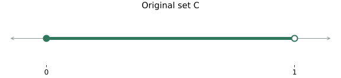

그림의 <strong>초록색 부분이 집합에 포함되는 점들</strong>이다. 채운 끝점은 포함, 빈 끝점은 제외다. 가는 회색 선은 비교를 위한 수직선이고 초록색 집합에 포함된다는 표시가 아니다.

특히 <strong>`(0,1)`과 `{0,1}`은 전혀 다르다.</strong> 앞의 것은 0.5 같은 사이의 수들을 전부 포함하고 양끝을 뺀 구간, 뒤의 것은 0과 1이라는 두 점뿐이다. 여기의 `(0,1)`은 수직선의 구간 표기이며, 2차원 점의 좌표를 적는 `(0,1)`과는 문맥이 다르다.

### Interior: 작은 공을 넣을 수 있는 점들

<strong>Interior(내부)는 그 점에서 충분히 조금 움직이면 양쪽 모두 집합 안에 남을 수 있는 점들</strong>이다. 지금은 1차원 수직선이므로 “작은 공”은 그 점을 중심으로 한 작은 열린 구간을 뜻한다.

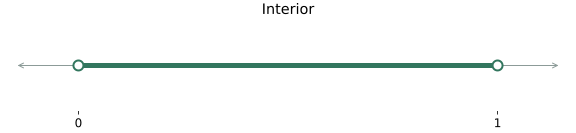

0.5에서 왼쪽과 오른쪽으로 각각 0.1보다 적게 움직이면 0.4와 0.6 사이에 남는다. 이 구간은 전부 C에 있으므로 0.5는 내부점이다. 1에 가까운 0.999에서도 더 작은 이동 폭을 고르면 된다.

반면 <strong>0은 C에 속하지만 내부점은 아니다.</strong> 이동 폭을 아무리 작게 골라도 왼쪽으로 움직이면 음수가 나와 C 밖으로 나간다. 1은 애초에 C에 없다. 따라서 내부는 양끝을 모두 제외한 구간이다.

$$
\operatorname{int}C=(0,1)
$$

이를 “C의 interior는 0보다 크고 1보다 작은 모든 수”라고 읽는다. <strong>집합에 속한다는 것과 내부점이라는 것은 다른 조건</strong>이다.

### Closure: C 안의 점들로 임의로 가깝게 접근할 수 있는 점들

<strong>Closure(폐포)는 원래 점들에, C 안에서 얼마든지 가깝게 접근할 수 있는 점까지 포함한 집합</strong>이다. 이 예제에서는 빠져 있던 오른쪽 끝점 1이 추가된다.

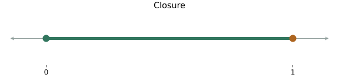

0.9, 0.99, 0.999, …는 모두 C 안에 있고 1에 한없이 가까워진다. <strong>1은 원래 C에는 없지만 closure에는 들어간다.</strong> 반면 2에는 그런 식으로 접근할 수 없다. C의 점은 모두 1보다 작아 2와의 간격을 마음대로 작게 만들 수 없기 때문이다.

원래 있던 점도 빠지지 않는다. 예를 들어 0.5에 계속 머무르는 수열도 0.5로 수렴한다. 따라서 폐포는 C를 버리고 경계만 고르는 연산이 아니다.

$$
\operatorname{cl}C=[0,1]
$$

이를 “C의 closure는 0 이상 1 이하인 모든 수”라고 읽는다. 두 끝 모두 대괄호인 이유는 0과 1을 모두 포함하기 때문이다.

### Boundary: 작은 공마다 안과 밖을 모두 만나는 점들

<strong>Boundary(경계)는 그 점 주변을 아무리 작게 살펴봐도 C의 점과 C 밖의 점이 함께 나타나는 지점</strong>이다. 이 예제에서는 양끝 0과 1만 해당한다.

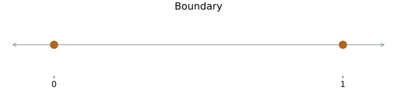

0 주변에는 오른쪽의 작은 양수처럼 C에 속하는 점과, 왼쪽의 음수처럼 C 밖의 점이 함께 있다. 1 주변에도 왼쪽에는 C의 점, 오른쪽에는 C 밖의 점이 있다. 이 사실은 주변을 아무리 좁혀도 바뀌지 않는다.

반면 0.5 주변은 충분히 좁히면 C의 점들만 남기므로 경계점이 아니다. 2 주변도 충분히 좁히면 C 밖의 점들만 남기므로 경계점이 아니다. 따라서 <strong>C 밖이라는 이유만으로 모두 경계인 것도 아니다.</strong>

$$
\partial C=\{0,1\}
$$

이를 “C의 boundary는 0과 1이라는 두 점의 집합”이라고 읽는다. 여기서는 <strong>그 사이 0.5 같은 점이 포함되지 않으므로 구간 괄호가 아니라 중괄호</strong>를 쓴다. 경계의 0은 C에 포함되지만 경계의 1은 C에 포함되지 않는다. 경계점인지와 원래 집합에 속하는지도 따로 판단한다.

### 네 집합을 말로 비교하면

| 집합 | 포함하는 점을 말로 읽기 | 표기 |
| --- | --- | --- |
| 원래 집합 C | 0 이상 1 미만인 모든 수 | `[0,1)` |
| Interior | 0보다 크고 1보다 작은 모든 수 | `(0,1)` |
| Closure | 0 이상 1 이하인 모든 수 | `[0,1]` |
| Boundary | 0과 1, 두 점만 | `{0,1}` |

<strong>Interior는 안쪽을 고르고, closure는 원래 점들과 접근 가능한 극한점을 모으고, boundary는 안과 밖이 함께 나타나는 지점을 고른다.</strong> 셋은 같은 연산이 아니다.

### 일반적인 정의식을 읽어 보기

이제 위의 설명을 다른 집합에도 적용할 수 있도록 수식으로 쓰자. 다음 기호를 먼저 읽으면 된다.

| 기호 | 읽는 뜻 |
| --- | --- |
| `x ∈ C` | x가 C에 속한다 |
| `∃ ε > 0` | 어떤 양수 ε가 존재한다 |
| `Bε(x)` | x를 중심으로 하고 반지름이 ε인 열린 공 |
| `A ⊆ C` | A의 모든 점이 C에도 속한다 |
| `xₖ → x` | 점들의 수열 xₖ가 x로 수렴한다 |
| `A ∖ B` | A의 점들 중 B에 속하는 점을 뺀 집합 |

$$
\operatorname{int}C
=\{x\in C:\exists\varepsilon>0,\ B_\varepsilon(x)\subseteq C\}
$$

첫 식은 “C의 점들 중, 충분히 작은 공을 C 안에 통째로 넣을 수 있는 점들을 모은다”는 뜻이다.

$$
\operatorname{cl}C
=\{x:\text{there exists }x_k\in C\text{ with }x_k\to x\}
$$

둘째 식은 “C 안의 점들로 이루어진 수열로 접근할 수 있는 점들을 모은다”는 뜻이다. 수열의 모든 항이 C에 있어야 한다.

$$
\partial C=\operatorname{cl}C\setminus\operatorname{int}C
$$

셋째 식은 “폐포에서 내부점을 빼면 경계가 남는다”는 뜻이다. 이 예제에서는 양끝을 포함한 구간에서 양끝을 뺀 구간을 제거하므로 0과 1만 남는다.

원래 집합을 바꾸어 비교하면 다음과 같다. 세 집합 모두 interior·closure·boundary는 같지만, <strong>원래 어느 끝점을 포함했는지는 다르다.</strong>

| 원래 집합 | Interior | Closure | Boundary |
| --- | --- | --- | --- |
| `(0,1)` | `(0,1)` | `[0,1]` | `{0,1}` |
| `[0,1]` | `(0,1)` | `[0,1]` | `{0,1}` |
| `[0,1)` | `(0,1)` | `[0,1]` | `{0,1}` |

Open은 모든 점이 내부점인 경우, closed는 폐포에 추가되는 점이 없는 경우다. 그래서 다음 식으로 연결된다.

$$
C\text{ open}\iff C=\operatorname{int}C,\qquad
C\text{ closed}\iff C=\operatorname{cl}C
$$

### 낮은 차원의 집합에서는 “안쪽”의 기준이 중요하다

$\mathbb{R}^{2}$ 안의 선분 $L=\{(t,0):0\le t\le1\}$을 생각하자. 중간점 $(0.5,0)$ 주변에 아무리 작은 <strong>2차원 공</strong>을 그려도 선분 밖으로 나간다. 따라서 $\mathbb{R}^{2}$ 기준 int $L=\varnothing$다. $L$은 닫혀 있으므로 $\partial L=L$이다.

그렇다고 선분이 볼록하지 않다는 뜻은 아니다. 선분이 놓인 직선 안에서만 여유를 따지는 <strong>relative interior(상대적 내부)</strong>는 $\{(t,0):0<t<1\}$이다. 일반적으로 상대적 내부는 그 집합의 affine hull을 주변 공간으로 삼아 내부를 구한다. 상대적 내부는 보충 개념이며, 이후 “차원”과 “경계”를 혼동하지 않기 위해 함께 기억해 두면 좋다.

## 5. Bounded와 compact: 최솟값을 실제로 얻을 수 있을까?

$C$가 <strong>bounded(유계)</strong>라는 것은 어떤 유한한 반지름의 공 안에 $C$ 전체를 넣을 수 있다는 뜻이다.

$$
\exists R<\infty\quad\text{such that}\quad
C\subseteq\{x:\|x\|_2\le R\}
$$

중심이 다른 공으로 정의해도 동치다. 모든 방향으로 무한히 뻗지 않는다고 이해할 수 있다.

$\mathbb{R}^{n}$에서는 <strong>compact ⇔ closed이고 bounded</strong>가 성립한다. 이 동치는 유한차원 유클리드 공간을 전제로 한다.

| 집합 | closed | bounded | compact |
| --- | --- | --- | --- |
| $(0,1)$ | X | O | X |
| $[0,1]$ | O | O | O |
| [0,∞) | O | X | X |
| 단위원 둘레 | O | O | O |
| 원점을 지나는 전체 직선 | O | X | X |

### 보충: continuous + nonempty compact가 주는 보장

<strong>연속인 실수값 함수는 비어 있지 않은 compact 집합에서 최솟값과 최댓값을 실제로 갖는다.</strong> 점들을 더 좋은 값으로 계속 접근시키는 것과, 그 값을 달성하는 점이 존재하는 것은 다르다.

예를 들어 $f(x)=x$를 $(0,1)$에서 최소화하면 0에 한없이 가까워질 수 있지만 $x=0$은 허용되지 않는다. infimum은 0이지만 minimum은 없다. 집합을 $[0,1]$로 바꾸면 $x=0$에서 최소값 0을 얻는다.

closed만으로도 부족하다. [0,∞)에서 $f(x)=e^{-x}$는 0으로 가까워지지만 어떤 유한한 $x$에서도 0이 되지 않는다.

반대로 compact가 최솟값 존재의 필요조건인 것은 아니다. $f(x)=x^{2}$는 compact가 아닌 $\mathbb R$ 전체에서도 $x=0$에서 최소값을 갖는다. 또 compact하다고 최적점이 유일한 것도 아니다. 상수함수는 집합의 모든 점에서 같은 값을 갖는다.

## 6. Affine combination: 점 하나에서 출발해 방향으로 이동하기

두 점 사이의 중간점을 구할 때 각 점에 1/2을 곱해서 더한다. 한 점에 더 가까이 가려면 가중치를 1/4과 3/4처럼 바꿀 수 있다. <strong>Affine combination(아핀 결합)은 이 가중치의 합을 1로 유지하면서, 음수 가중치까지 허용하는 계산</strong>이다. 음수를 허용하면 두 점 사이를 벗어나 같은 직선 위로 더 나아갈 수 있다.

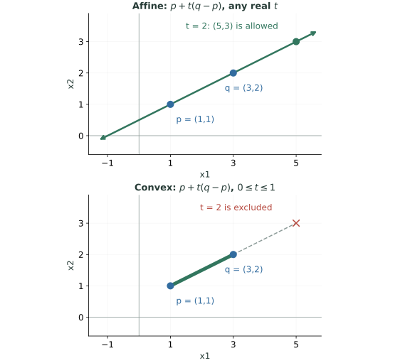

그림의 위아래는 같은 두 점과 같은 계산식을 사용한다. 다른 것은 <strong>이동 비율 t를 어디까지 허용하는가</strong>다. 이제 이 계산을 여러 점으로 일반화하면 다음과 같다.

$$
x=\sum_{i=1}^k\theta_i x_i,\qquad
\sum_{i=1}^k\theta_i=1,\qquad\theta_i\in\mathbb R
$$

계수는 음수여도 된다. 두 점에서는 다음과 같이 쓸 수 있다.

$$
x=(1-t)x_1+tx_2=x_1+t(x_2-x_1),\qquad t\in\mathbb R
$$

<strong>기준점 $x_{1}$에서 방향 $x_{2}- x_{1}$로 $t$배 이동한다</strong>는 뜻이다. 두 점이 다르면 $t$를 모든 실수로 바꾸어 두 점을 지나는 직선 전체를 얻는다.

예를 들어 $x_{1}=(1,1)$, $x_{2}=(3,2)$이면

$$
x=(1+2t,\ 1+t)
$$

이다. $t=0$이면 (1,1), $t=1$이면 (3,2), $t=1/2$이면 중간점 (2,1.5), $t=2$이면 선분 밖의 (5,3)을 얻는다.

계수 합 1의 의미는 좌표 원점을 옮길 때도 드러난다. 모든 점에 같은 벡터 $c$를 더하면

$$
\sum_i\theta_i(x_i+c)
=\sum_i\theta_i x_i+c
$$

이다. 각 점을 $c$만큼 옮긴 조합은 원래 조합을 $c$만큼 옮긴 것과 같다. affine geometry가 원점을 꼭 지나야 할 필요가 없는 이유다.

세 점도 기준점을 분리하면 이해하기 쉽다.

$$
x=x_1+\theta_2(x_2-x_1)+\theta_3(x_3-x_1)
$$

세 점이 한 직선에 있지 않으면 두 차이 벡터가 독립이어서 평면을 만든다. 한 직선에 있으면 affine hull은 여전히 직선이다.

## 7. Convex combination과 convex set

앞 그림에서 두 점 사이를 벗어나지 않으려면 이동 비율을 0부터 1 사이로 제한한다. 이때 두 가중치는 모두 0 이상이고 합은 1이다. 이렇게 <strong>음수 없이 가중평균을 내는 계산</strong>이 convex combination이다. 여러 점에서도 affine combination에 <strong>모든 계수가 0 이상</strong>이라는 조건을 더한다.

$$
x=\sum_{i=1}^k\theta_i x_i,\qquad
\theta_i\ge0,\quad\sum_{i=1}^k\theta_i=1
$$

이것이 <strong>convex combination(볼록결합)</strong>이다. 두 점에서는

$$
x=(1-t)x_1+tx_2,\qquad 0\le t\le1
$$

이므로 두 점 사이의 <strong>끝점을 포함한 선분</strong>만 얻는다. affine combination은 직선 전체, convex combination은 선분이다.

집합 $C$가 convex라는 정의는 다음과 같다.

$$
\boxed{
x_1,x_2\in C,\quad t\in[0,1]
\quad\Longrightarrow\quad (1-t)x_1+tx_2\in C
}
$$

어떤 두 점을 골라도, 선분 위의 어떤 비율을 골라도 $C$ 안에 남아 있어야 한다. 두 점의 조건을 반복 적용하면 임의의 <strong>유한 개 점</strong>의 볼록결합도 $C$ 안에 들어간다.

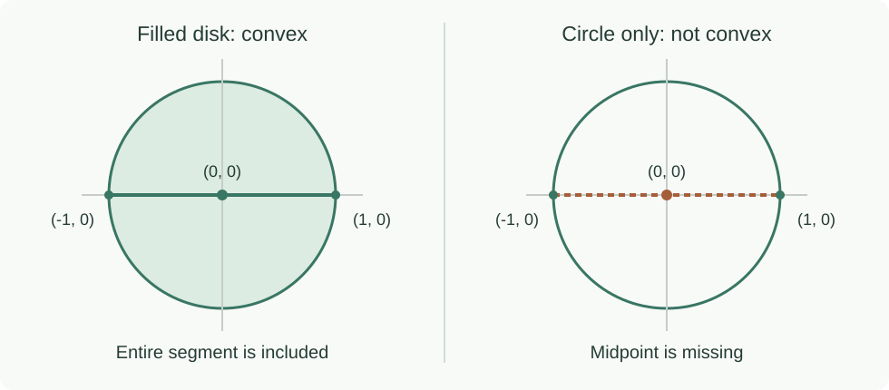

### 볼록성을 증명할 때와 반증할 때

증명하려면 <strong>임의의</strong> $x_{1},x_{2}$와 $t$를 잡고 정의를 만족함을 보여야 한다. 몇 쌍의 점이나 중간점만 확인해서는 증명이 되지 않는다.

반증은 단 하나의 반례로 충분하다. 단위원 둘레에서 (1,0), (−1,0)을 고르면 중간점 (0,0)은 원 둘레에 없다. 따라서 원 둘레는 nonconvex다. 원 내부를 채운 원판은 convex다.

### Open/closed와 convexity는 다른 성질이다

$(0,1)$, $[0,1]$, [0,1)은 모두 convex다. 경계를 포함하는 방식은 달라도, 두 허용점 사이가 빠져 있지 않기 때문이다.

반면 원 둘레는 closed이고 bounded여서 compact지만 convex는 아니다. 서로 떨어진 두 열린 원판의 합집합은 open이지만 일반적으로 nonconvex다. <strong>경계의 포함 여부와 선분의 포함 여부를 따로 확인한다.</strong>

## 8. Conic combination과 세 가지 hull

<blockquote class="lecture-excerpt">

교안 발췌 · Module 2 — Combinations and Hulls

Affine hull - set of all affine combinations of points in C

Conic hull - set of all conic combinations of points in C

Convex hull - set of all convex combinations of points in C

</blockquote>

### Hull은 무엇을 모은 집합일까?

<strong>Hull(헐)은 주어진 점들을 재료로, 정해진 결합 규칙에 따라 만들 수 있는 모든 점을 모은 집합</strong>이다. 이름만으로 어떤 규칙인지는 정해지지 않으므로 앞에 convex, affine, conic을 붙인다.

두 점 `(1,0)`, `(0,1)`을 재료로 생각해 보자. 각각에 1/4, 3/4을 곱해서 더하면 `(1/4,3/4)`이라는 <strong>점 하나</strong>를 만든다. 두 가중치는 음수가 아니고 합이 1이므로 convex combination이다.

$$
\tfrac14(1,0)+\tfrac34(0,1)=(\tfrac14,\tfrac34)
$$

이제 가중치를 1/2과 1/2, 3/4과 1/4처럼 가능한 모든 값으로 바꾸어 본다. <strong>그렇게 나오는 점을 빠짐없이 모으면 두 점 사이의 선분 전체</strong>가 된다. 이것이 이 두 점의 convex hull이다. 재료는 두 점뿐이지만 결과는 두 점에 그치지 않는다.

<strong>Combination은 한 번의 계산 또는 그 결과인 점이고, hull은 그 규칙으로 가능한 결과를 전부 모은 집합</strong>이라고 구별하면 된다. 아래 그림은 재료를 똑같이 두고 결합 규칙만 바꾼 것이다.

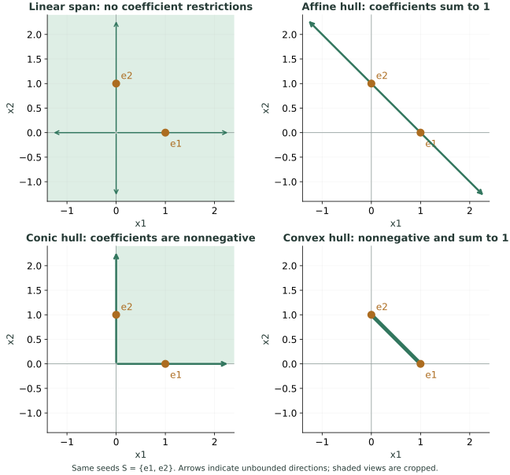

### 같은 두 점인데 왜 모양이 네 가지일까?

두 재료점이 좌표축의 단위벡터이므로, 두 점에 곱한 계수가 그대로 결과의 좌표가 된다.

$$
\theta_1(1,0)+\theta_2(0,1)=(\theta_1,\theta_2)
$$

그래서 계수에 주는 조건을 좌표의 조건으로 그대로 읽을 수 있다.

| 결합 규칙 | 계수에 허용하는 것 | 그림에서 얻는 집합 |
| --- | --- | --- |
| Linear | 아무 실수나 가능 | 모든 좌표를 만들 수 있으므로 평면 전체: linear span |
| Affine | 합이 1, 음수도 가능 | 좌표 합이 1인 직선 전체: affine hull |
| Conic | 각각 0 이상, 합은 자유 | 좌표가 모두 0 이상인 사분면: conic hull |
| Convex | 각각 0 이상이고 합이 1 | 그 직선 중 사분면 안의 닫힌 선분: convex hull |

<strong>Conic combination(원뿔 결합)</strong>은 다음 계산이다. 음수 계수는 쓰지 않지만, 합을 1로 묶지 않으므로 전체 크기도 자유롭게 바꿀 수 있다.

$$
x=\sum_{i=1}^k\theta_i x_i,\qquad\theta_i\geq0
$$

예를 들어 두 계수를 모두 0으로 두면 원점, 둘 다 2로 두면 `(2,2)`를 얻는다. 원점과 `(2,2)`는 위 그림의 conic hull에는 있지만 affine hull에는 없다. 반대로 `(-1,2)`는 계수 합이 1이어서 affine hull에는 있지만, 음수 좌표 때문에 conic hull에는 없다. <strong>Affine hull과 conic hull 중 하나가 항상 더 크다고 생각하면 안 된다.</strong>

### “가장 작은 집합”이라는 정의는 무슨 뜻일까?

두 재료점을 모두 포함하는 convex set을 만든다고 하자. Convex의 정의상 두 점 사이의 선분을 빼놓을 수 없다. 그런데 <strong>그 선분 자체가 이미 convex</strong>이므로, 그보다 바깥의 점을 추가할 필요는 없다. 그래서 이 선분을 “두 점을 포함하는 가장 작은 convex set”이라고 부른다.

여기서 작다는 것은 길이나 넓이를 최소화한다는 뜻이 아니라 <strong>집합의 포함관계</strong>를 뜻한다. 재료점을 포함하는 다른 모든 convex set 안에 그 convex hull이 들어간다는 뜻이다. Affine hull도 같은 방식으로 이해한다. 두 점을 포함하는 affine set은 그 직선 전체를 포함해야 하고, 그 직선 자체가 affine이므로 그것이 가장 작은 affine set이다.

재료가 세 점이고 한 직선 위에 있지 않다면 convex hull은 <strong>세 점을 꼭짓점으로 하는 채워진 삼각형</strong>이다. 세 변만 모은 테두리가 아니다. 예를 들어 세 점을 같은 비율로 섞은 무게중심도 만들어지므로 내부의 점들이 포함된다. Affine hull은 같은 세 점이 놓이는 평면 전체다.

### 일반적인 정의식으로 옮기기

이제 `S`를 재료점들의 집합이라고 하자. 아래 식들은 <strong>S에서 유한 개 점을 골라, 해당 규칙으로 만들 수 있는 모든 결과</strong>를 모은다는 뜻이다. 점을 고르는 방법, 개수, 계수 모두 가능한 범위에서 바뀐다.

$$
\operatorname{aff}S=\left\{\sum_{i=1}^k\theta_i x_i:
k\in\mathbb N,\ x_i\in S,\ \sum_{i=1}^k\theta_i=1,\ \theta_i\in\mathbb R\right\}
$$

$$
\operatorname{cone}S=\left\{\sum_{i=1}^k\theta_i x_i:
k\in\mathbb N,\ x_i\in S,\ \theta_i\geq0\right\}
$$

$$
\operatorname{conv}S=\left\{\sum_{i=1}^k\theta_i x_i:
k\in\mathbb N,\ x_i\in S,\ \theta_i\geq0,\ \sum_{i=1}^k\theta_i=1\right\}
$$

여기서는 `S`가 비어 있지 않다고 하자. Affine hull은 S를 포함하는 가장 작은 affine set, convex hull은 S를 포함하는 가장 작은 convex set, conic hull은 S를 포함하는 가장 작은 <strong>convex cone</strong>이다.

계수 조건을 비교하면 convex combination은 affine combination이기도 하고 conic combination이기도 하므로 다음이 성립한다.

$$
\operatorname{conv}S\subseteq\operatorname{aff}S,
\qquad\operatorname{conv}S\subseteq\operatorname{cone}S
$$

Hull은 무조건 2차원 내부를 채우는 연산도, 무조건 경계를 추가해 닫힌집합을 만드는 연산도 아니다. 두 점의 convex hull은 선분이고, 이미 convex인 열린 구간 `(0,1)`의 convex hull은 그 열린 구간 자체다. <strong>어떤 점이 추가되는지는 결합 규칙과 재료점에 달려 있다.</strong>

또한 제약조건의 <strong>교집합은 공통으로 허용되는 점만 남기는 방향</strong>이고, <strong>hull은 원래 재료점들을 포함하면서 해당 결합 규칙을 만족하도록 넓히는 방향</strong>이다. 서로 다른 일을 하는 개념이다.

## 9. Affine set, subspace, dimension을 연결하기

앞 절의 affine hull은 재료점들에서 집합을 <strong>만드는 방법</strong>이었다. 여기서는 이미 주어진 집합이 affine인지 <strong>판정하는 조건</strong>을 본다.

<strong>Affine set</strong>은 그 안의 서로 다른 두 점을 지나는 <strong>직선 전체</strong>를 포함한다. 두 점 사이만 포함하면 convex에는 충분하지만 affine에는 부족하다. 따라서 유한한 선분은 두 끝을 넘어가는 점들을 포함하지 못해 affine이 아니다.

$$
x_1,x_2\in C,\quad t\in\mathbb R
\quad\Longrightarrow\quad(1-t)x_1+tx_2\in C
$$

convex set보다 $t$의 범위가 넓다. 따라서 <strong>affine set은 convex지만, convex set이 모두 affine인 것은 아니다.</strong> 선분과 원판은 convex지만 affine은 아니다.

원점을 지나는 직선을 위로 평행이동해도, 두 점을 골라 양쪽으로 끝없이 연장할 수 있다는 성질은 그대로다. 따라서 <strong>원점을 지나야 한다는 조건은 affine set에 없다.</strong> 반면 linear subspace에는 원점이 반드시 포함된다.

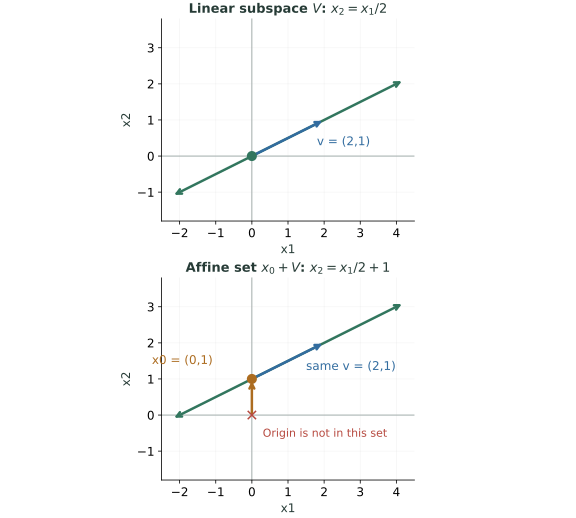

위 그림에서 파란 화살표는 허용되는 이동 방향이다. 아래에서는 주황색 기준점에서 출발하지만 같은 파란 방향을 따라 양쪽으로 계속 이동할 수 있다. <strong>위치는 달라져도 이동 가능한 방향은 같다</strong>는 사실을 수식으로 쓴 것이 다음 표현이다.

비어 있지 않은 affine set은 어떤 부분공간 $V$와 점 $x_{0}$에 대해 $x_{0}+V$로 나타낼 수 있다. 선형방정식의 해집합이 대표적이다.

$$
C=\{x:Ax=b\}
$$

해 $x_{0}$가 하나 있으면 다른 모든 해는 $x_{0}$에 null space 벡터를 더한 형태다.

$$
C=x_0+\mathcal N(A)
$$

앞 글의 null space가 여기서는 <strong>해집합 안에서 움직일 수 있는 방향</strong>을 뜻한다. $b=0$이면 해집합이 null space 자체여서 원점을 포함하는 subspace다. $b\ne 0$인 해집합은 원점을 지나지 않을 수 있다. 해가 없으면 집합은 공집합이다.

### Convex set의 차원은 affine hull의 차원이다

$\mathbb{R}^{3}$ 속 삼각형은 성분을 세 개로 적지만, 한 평면 안에서만 움직이므로 자체 차원은 2다.

$$
\dim C=\dim(\operatorname{aff}C)
$$

점들이 주어졌다면 기준점 하나를 빼서 만든 차이 벡터들의 rank로 affine hull의 차원을 구할 수 있다. 두 점이 다르면 1차원, 세 점이 비공선이면 2차원이다. 이 정의는 비어 있지 않은 집합을 기준으로 사용한다.

## 10. Hyperplane: 선형 등식 하나가 만드는 집합

2차원에서 `x₁+x₂=6`은 합이 정확히 6인 점들만 남기는 직선이다. 3차원에서는 선형 등식 하나가 보통 평면을 남긴다. <strong>Hyperplane은 이런 “주변 공간보다 차원이 하나 낮은 선형 등식의 해집합”을 통일해서 부르는 이름</strong>이다.

0이 아닌 벡터 $a$와 실수 $b$에 대해

$$
H=\{x\in\mathbb R^n:a^Tx=b\},\qquad a\ne0
$$

를 <strong>hyperplane(초평면)</strong>이라고 한다. $\mathbb{R}^{2}$에서는 직선, $\mathbb{R}^{3}$에서는 평면이며 일반적으로 차원은 n−1이다. $\mathbb{R}^{1}$에서는 점 하나다.

필기의 예제는

$$
x_1+x_2=6,\qquad a=\begin{bmatrix}1\\1\end{bmatrix},\quad b=6
$$

이다. (0,6), (2,4), (3,3), (6,0)은 모두 이 직선 위에 있다.

### 왜 a가 normal vector일까?

$p,q$가 같은 초평면 위에 있으면 $a^{T}p=b$, $a^{T}q=b$다. 두 식을 빼면

$$
a^T(p-q)=0
$$

이다. p−q는 초평면을 따라 이동하는 방향이다. 따라서 <strong>$a$는 초평면 안의 모든 이동 방향에 수직</strong>이다. 이것이 normal vector(법선벡터)의 의미다.

(2,4)에서 (3,3)으로 가는 방향은 (1,−1)이고 (1,1)과의 내적은 0이다. $a$가 초평면 위의 점이라는 뜻이 아니라, 초평면에 수직인 방향을 나타낸다는 뜻이다.

### 왜 hyperplane은 affine이고 convex일까?

$p,q\in H$이면, 모든 실수 $t$에 대해

$$
a^T((1-t)p+tq)=(1-t)b+tb=b
$$

다. 직선 전체가 $H$에 있으므로 affine이고, 특히 $0\le t\le 1$에서도 성립하므로 convex다. 등식 오른쪽에 $b$가 남는 것은 <strong>계수의 합이 1</strong>이기 때문이다.

$a=0$은 정의에서 제외한다. 이때 식은 $b=0$이면 전체 공간, $b\ne 0$이면 공집합을 나타내므로 보통의 초평면이 아니다.

### 초평면을 여러 개 교차시키면 내부가 채워질까?

<strong>교집합은 각 집합에 공통으로 속하는 점만 남기는 연산이다.</strong> 얇은 경계들을 겹쳐서 그 사이 공간을 채우는 연산이 아니다. 예를 들어 다음 두 직선을 동시에 만족하는 점은 원점 하나뿐이다.

$$
\{x:x_1=0\}\cap\{x:x_2=0\}=\{(0,0)\}
$$

같은 직선을 반복하면 그대로 그 직선이 남고, 서로 다른 평행선을 교차시키면 공집합이다. 따라서 등식을 추가할 때마다 반드시 차원이 하나씩 줄어드는 것도 아니다. <strong>독립적인 제약인지, 중복인지, 서로 모순되는지</strong>에 따라 결과가 달라진다.

여러 선형 등식을 행렬로 묶어 보면 구조가 더 분명해진다. 해가 하나라도 존재하고 그중 하나를 기준점으로 잡으면,

$$
Cx=d,\qquad Cx_0=d
\quad\Longrightarrow\quad
\{x:Cx=d\}=x_0+\mathcal N(C)
$$

이다. 해집합은 Null Space를 기준점만큼 평행이동한 <strong>affine set</strong>이고, 차원은 입력 차원에서 행렬의 rank를 뺀 값이다.

$$
\dim\{x:Cx=d\}=n-\operatorname{rank}(C)
\qquad\text{(해집합이 비어 있지 않을 때)}
$$

방향 하나가 허용되면 그 방향으로 양쪽 끝없이 이동할 수 있으므로, 이 집합은 유한한 길이의 선분이나 채워진 삼각형이 될 수 없다. 비어 있지 않은 bounded affine set은 점 하나뿐이다. 또한 <strong>원점을 지나지 않는 affine set을 선형 subspace라고 부르면 안 된다.</strong> 예를 들어 `x₁+x₂=6`은 affine set이지만 원점이 없어 선형 부분공간은 아니다.

다음에 배울 부등식 제약은 경계 위만 남기는 대신, <strong>경계의 한쪽에 있는 점들도 허용</strong>한다. 이것이 초평면과 halfspace의 중요한 차이다.

## 11. a와 b는 방향과 위치를 정하지만, b 자체가 거리는 아니다

필기에서 “원점에서 이 초평면까지 얼마나 떨어져 있을까?”라는 질문이 이어진다. $a$는 법선 방향을 정하고, <strong>고정된 $a$에 대해</strong> $b$가 법선 방향의 위치를 정한다. 실제 거리를 얻으려면 $a$의 길이도 보정해야 한다.

원점에서 가장 가까운 점 $x^*$는 $a$ 방향에 있다. $x^*=\alpha a$를 $a^Tx^*=b$에 넣으면

$$
\alpha\|a\|_2^2=b
\quad\Longrightarrow\quad
\boxed{x^*=\frac{b}{\|a\|_2^2}a}
$$

이다. 그 점에서 초평면 안의 다른 점으로 가는 방향은 $a$에 수직이므로, 피타고라스 정리에 의해 $x^*$가 가장 가깝다. 따라서 거리는

$$
\boxed{\operatorname{dist}(0,H)=\|x^*\|_2=\frac{|b|}{\|a\|_2}}
$$

다. $b$가 음수일 수도 있으므로 거리는 절댓값을 쓴다. $a$를 단위 법선으로 정규화했을 때만 $b$를 부호 있는 거리로 바로 읽을 수 있다.

$x_{1}+x_{2}=6$에서는 $a$의 노름이 $\sqrt{2}$이므로

$$
x^*=\begin{bmatrix}3\\3\end{bmatrix},\qquad
\operatorname{dist}(0,H)=\frac6{\sqrt2}=3\sqrt2
$$

다. 거리 6이 아니다. 식을 $2x_{1}+2x_{2}=12$로 바꾸어도 같은 초평면이고 거리는 변하지 않는다. $a$와 $b$를 함께 같은 0이 아닌 배수로 바꾸면 같은 등식을 나타내기 때문이다.

보충으로, 임의의 점 $q$에서 초평면으로의 정사영과 거리는 다음과 같다.

$$
\operatorname{proj}_H(q)=q-\frac{a^Tq-b}{\|a\|_2^2}a,
\qquad\operatorname{dist}(q,H)=\frac{|a^Tq-b|}{\|a\|_2}
$$

이동량이 법선 방향이고, 결과를 $a$와 내적하면 $b$가 되는지 확인하면 공식을 검산할 수 있다.

## 12. Halfspace와 polyhedron: 선형 부등식들을 동시에 만족하기

초평면의 등식을 부등식으로 바꾸면 한쪽 영역 전체를 얻는다.

$$
H_-=\{x:a^Tx\le b\},\qquad
H_+=\{x:a^Tx\ge b\},\qquad a\ne0
$$

이것이 경계를 포함하는 <strong>closed halfspace(닫힌 반공간)</strong>다. 등식은 경계 위의 점만, 부등식은 경계와 한쪽 영역의 점들을 허용한다. 경계를 제외하고 엄격한 부등호를 쓰면 open halfspace가 되지만, 아래 polyhedron의 정의에는 닫힌 반공간을 사용한다.

예를 들어 `x₁+x₂=6`은 직선 하나이고, `x₁+x₂≤6`은 그 직선과 합이 6보다 작은 모든 점이다. <strong>Halfspace가 내부를 나중에 채우는 것이 아니라, 처음부터 한쪽 영역 전체를 포함하는 집합</strong>인 것이다. 어느 쪽이 원점을 포함하는지는 부등호와 $b$의 부호에 따라 달라진다. 원점을 직접 대입해서 판단한다.

$H$₋ 안의 $p,q$를 볼록결합하면

$$
a^T((1-t)p+tq)
\le(1-t)b+tb=b,\qquad0\le t\le1
$$

이므로 halfspace는 convex다. (1−t),t가 음수가 아니어야 부등식 방향을 유지할 수 있다는 점이 중요하다. 일반적으로 affine set은 아니다.

### Polyhedron의 정의: 부피가 있어야 하는 것은 아니다

최적화에서 <strong>polyhedron(다면체)</strong>은 유한 개 선형 부등식과 선형 등식의 공통 해집합이다. [Boyd·Vandenberghe §2.2.4](https://web.stanford.edu/~boyd/cvxbook/bv_cvxbook.pdf#page=45)에서도 이 정의를 사용한다. 여기서 다면체는 일상적으로 떠올리는 입체 덩어리보다 넓은 용어다. <strong>직선·초평면·점·선분·반공간도 polyhedron에 포함</strong>되며, 내부나 부피가 반드시 존재해야 하는 것은 아니다.

$$
P=\{x:Ax\preceq b,\ Cx=d\}
$$

여기서 ≼는 성분별 부등식이다. 행벡터가 0이 아닌 경우, `Ax≼b`의 각 행은 halfspace를, `Cx=d`의 각 행은 hyperplane을 나타낸다. 0인 행은 항상 참인 조건이거나 불가능한 조건으로 따로 처리한다. 모든 조건을 동시에 만족시키므로 <strong>이 집합들의 교집합</strong>을 취한다. 부등식이나 등식 중 어느 한 종류의 제약은 없어도 된다.

이 표현에서는 두 종류의 역할을 다음처럼 읽으면 된다.

- <strong>등식:</strong> 점이 놓일 수 있는 affine 공간을 지정한다. 예를 들어 평면 전체에서 특정 직선 위로 선택을 제한한다.
- <strong>부등식:</strong> 각 경계의 어느 쪽을 허용할지 정한다. 여러 조건을 동시에 적용해 선택 가능한 영역을 제한한다.

다만 부등식끼리 맞물려 차원을 줄일 수도 있으므로, 이것을 두 종류의 절대적인 역할 분담으로 외우면 안 된다. 다음 예제들을 비교해 보자.

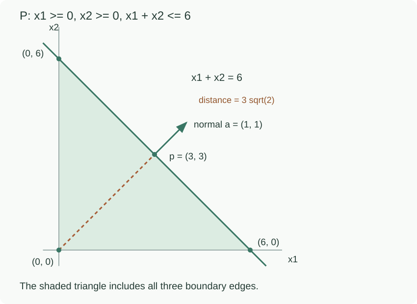

$$
P=\{x:x_1\ge0,\ x_2\ge0,\ x_1+x_2\le6\}
$$

는 꼭짓점 (0,0), (6,0), (0,6)을 포함하는 채워진 삼각형이다. 예를 들어 (1,1)은 세 부등식을 모두 엄격하게 만족하고, 그 주변의 충분히 작은 원판도 삼각형 안에 들어간다. 따라서 2차원 공간에서 interior가 존재하고 넓이가 양수다. closed이고 bounded이므로 compact이며 convex다.

반대로 세 경계선을 모두 <strong>등식</strong>으로 바꾸면 어떻게 될까?

$$
x_1=0,\qquad x_2=0,\qquad x_1+x_2=6
$$

앞의 두 식은 원점을 요구하지만, 원점은 마지막 식을 만족하지 않는다. 결과는 삼각형도, 삼각형의 테두리도 아닌 <strong>공집합</strong>이다. 삼각형의 세 변을 모아 놓은 테두리는 또 다른 집합이며, 이는 변들의 합집합으로 표현한다. 경계들의 교집합과 혼동하지 않는다.

### 같은 경계라도 등호와 부등호에 따라 결과가 달라진다

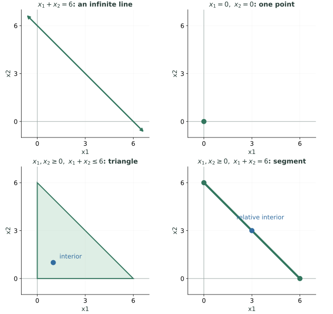

그림은 모두 같은 축척이다. 왼쪽 아래에는 작은 원판을 넣을 수 있는 2차원 내부가 있지만, 오른쪽 아래 선분에는 그런 원판을 넣을 수 없다. 선분 가운데의 파란 점은 <strong>직선 안에서 보는 상대적 내부</strong>의 예다.

| 동시에 적용하는 조건 | 남는 집합 | 2차원 공간에서 interior |
| --- | --- | --- |
| `x₁+x₂=6` | 끝없이 이어지는 직선 | 없음 |
| `x₁=0`, `x₂=0` | 원점 하나 | 없음 |
| `x₁≥0`, `x₂≥0`, `x₁+x₂≤6` | 채워진 삼각형 | 있음 |
| `x₁≥0`, `x₂≥0`, `x₁+x₂=6` | (0,6)과 (6,0)을 잇는 선분 | 없음 |

마지막 선분은 길이가 0이 아니지만, 선분 위의 어느 점 주위에도 2차원 원판을 넣을 수 없다. 그래서 <strong>주변 공간에서의 interior</strong>는 비어 있다. 선분이 놓인 직선 안에서만 주변을 보면 양 끝을 제외한 점들은 <strong>relative interior(상대적 내부)</strong>에 속한다. “내부가 없다”는 말은 집합이 비어 있다는 뜻이 아니며, 어느 공간에서 내부를 보는지 구별해야 한다.

### Halfspace가 있어도 내부가 반드시 생기지는 않는다

반대 방향의 두 부등식을 동시에 만족시키면 등식이 된다.

$$
\{x:x_2\leq0\}\cap\{x:-x_2\leq0\}
=\{x:x_2=0\}
$$

왼쪽 두 집합은 각각 한쪽 영역 전체를 가진 halfspace지만, 교집합은 직선 하나다. 즉, <strong>halfspace 제약이 있다는 사실만으로 interior나 부피를 보장할 수는 없다.</strong> 교집합을 취하면 허용되는 점은 추가되지 않고 유지되거나 줄어든다.

더 일반적으로, 선형 등식 하나는 다음처럼 반대 방향의 선형 부등식 두 개와 완전히 동등하다.

$$
a^Tx=b
\quad\Longleftrightarrow\quad
\begin{cases}
a^Tx\leq b,\\
(-a)^Tx\leq-b.
\end{cases}
$$

따라서 모든 polyhedron은 <strong>유한 개 닫힌 halfspace만의 교집합</strong>으로도 표현할 수 있다. 등식을 함께 적는 정의는 다른 집합을 정의하는 것이 아니라, 같은 제약을 읽기 쉽게 표현한 것이다.

질문에 대한 정확한 답은 이렇다. <strong>채워진 삼각형 같은 영역을 초평면들의 교집합만으로 만들 수는 없다. 하지만 모든 polyhedron이 그런 영역이어야 하는 것은 아니므로, 다면체의 정의에 부등식이 반드시 하나 이상 있어야 한다고 요구하지는 않는다.</strong> 한편 halfspace들만 사용하더라도 결과가 직선·점·공집합으로 줄어들 수 있다.

모든 polyhedron이 bounded인 것은 아니다. $x_{1}\ge 0,x_{2}\ge 0$만 남기면 사분면 전체여서 unbounded다. 제약들이 모순이면 공집합일 수도 있고, 등식 때문에 직선이나 점만 남을 수도 있다.

또한 비선형 제약이라고 반드시 nonconvex인 것은 아니다. 다음 절의 노름 공도 convex다. 반대로 “등식이니까 affine”이라는 결론은 <strong>선형 등식</strong>일 때의 이야기다. $\lVert x\rVert_{2}=1$은 원 둘레여서 convex가 아니다.

## 13. Euclidean ball과 norm ball은 왜 convex일까?

여기서 ball(공)은 경계 표면만이 아니라 <strong>중심에서 정해진 거리 이내인 점 전체</strong>를 뜻한다. 또 거리를 재는 규칙인 norm을 바꾸면 같은 반지름 1의 공도 다른 모양이 된다. 아래는 중심이 원점인 2차원 예제다.

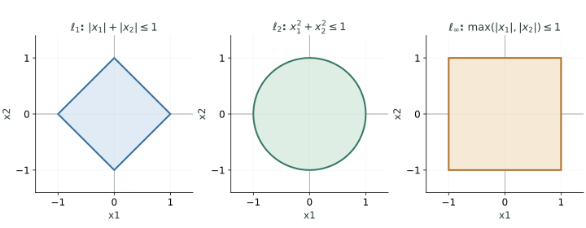

L1은 두 좌표의 절댓값을 더하고, L2는 피타고라스 방식으로 거리를 재고, L∞는 두 좌표의 절댓값 중 큰 값을 본다. 그림에서 색칠한 모든 점이 해당 조건을 만족하며 테두리만을 뜻하지 않는다.

중심 $c$와 반지름 $r>0$인 유클리드 닫힌 공은

$$
B(c,r)=\{x:\|x-c\|_2\le r\}
$$

이다. $\mathbb{R}^{2}$에서는 내부가 채워진 원판이고 $\mathbb{R}^{3}$에서는 내부를 채운 구다. 표면만 뜻하지 않는다.

$p,q\in B(c,r)$, $0\le t\le 1$이면 노름의 삼각부등식과 동차성으로

$$
\begin{aligned}
\|(1-t)p+tq-c\|
&=\|(1-t)(p-c)+t(q-c)\|\\
&\le(1-t)\|p-c\|+t\|q-c\|\\
&\le(1-t)r+tr=r
\end{aligned}
$$

이다. 따라서 convex다. 이 증명은 L2에만 의존하지 않는다. <strong>어떤 노름으로 정의한 공도 convex</strong>다.

| $\mathbb{R}^{2}$의 단위 norm ball | 조건 | 모양 |
| --- | --- | --- |
| L1 | $\lvert x_{1}\rvert+\lvert x_{2}\rvert\le 1$ | 꼭짓점이 축 위에 있는 마름모 |
| L2 | $\sqrt{x_{1}^{2}+x_{2}^{2}}\le 1$ | 채워진 원판 |
| $L_\infty$ | $\max (\lvert x_{1}\rvert,\lvert x_{2}\rvert)\le 1$ | $[- 1,1]^{2}$ 정사각형 |

거리 $<r$인 열린 공도 convex다. 반면 거리 $=r$인 표면은 차원에 따라 원 둘레나 구면이 되며, 일반적으로 두 점 사이의 선분을 포함하지 않는다.

## 14. Convexity를 보존하는 연산: 교집합

$C_{1},C_{2}$가 convex이고 $p,q\in C_1\cap C_2$이면 $p,q$는 두 집합 각각에도 속한다. 따라서 볼록결합은 각각의 집합에 남고, 결국 교집합에도 남는다.

$$
C_\alpha\text{ convex for every }\alpha
\quad\Longrightarrow\quad\bigcap_\alpha C_\alpha\text{ convex}
$$

볼록성 보존은 유한 개에 제한되지 않고 임의 개의 교집합에서도 성립한다. Polyhedron은 그중 <strong>유한 개 선형 제약</strong>으로 표현되는 경우이며, halfspace와 hyperplane이 각각 convex이므로 그 교집합도 convex다. 이 정리는 <strong>교집합에 내부나 부피가 생긴다는 정리</strong>가 아니다.

또 모든 convex set이 polyhedron인 것은 아니다. 예를 들어 닫힌 원판은 convex지만, 유한 개 halfspace의 교집합으로는 곡선 경계를 정확히 나타낼 수 없어 polyhedron이 아니다. 유한 개 직선 경계로 잘라 만든 다각형과 구별한다.

<strong>합집합에는 같은 결론이 없다.</strong> 두 집합 [−2,−1], [1,2]는 각각 convex지만 합집합에서는 −1과 1의 중간점 0이 빠진다.

### Open/closed를 보존하는 연산과 혼동하지 않기

| 성질 | 보존되는 연산 |
| --- | --- |
| open | 임의 합집합, 유한 교집합 |
| closed | 임의 교집합, 유한 합집합 |
| convex | 임의 교집합 |

예를 들어 열린 구간들의 무한 교집합 $\bigcap_{k=1}^{\infty}(-1/k,1/k)=\{0\}$은 open이 아니다. 닫힌 구간들의 무한 합집합 $\bigcup_{k=1}^{\infty}[1/k,1]=(0,1]$은 closed가 아니다. convexity의 교집합 정리는 이런 open/closed의 규칙과 별개다.

## 15. Affine image: 선분은 변환 후에도 선분으로 간다

affine function은 다음 형태다.

$$
f(x)=Ax+b,\qquad A\in\mathbb R^{m\times n},\quad b\in\mathbb R^m
$$

집합 $S$의 <strong>image(상)</strong>는 $S$의 모든 점을 변환해서 얻은 출력들의 집합이다.

$$
f(S)=\{f(x):x\in S\}
$$

$S$가 convex이면 $f(S)$도 convex다. 핵심은 계수 합이 1이어서 평행이동 $b$가 다음처럼 결합된다는 것이다.

$$
f((1-t)p+tq)=(1-t)f(p)+tf(q)
$$

$p$와 $q$ 사이의 입력 선분이 출력 $f(p),f(q)$ 사이의 선분을 만든다. $A$가 특이행렬이면 서로 다른 입력이 겹쳐 선분이 점으로 눌릴 수도 있다. 그래도 convexity는 보존된다.

### 수업 예제 1: 단위 정사각형이 평행사변형으로

$$
S=[0,1]^2,\qquad
f(x)=\begin{bmatrix}1&3\\0&2\end{bmatrix}x+\begin{bmatrix}1\\2\end{bmatrix}
$$

| 입력 꼭짓점 | 출력 |
| --- | --- |
| (0,0) | (1,2) |
| (1,0) | (2,2) |
| $(0,1)$ | (4,4) |
| (1,1) | (5,4) |

정사각형은 이 네 점의 convex hull이다. affine map은 볼록결합을 보존하므로, 출력도 네 출력 꼭짓점의 convex hull인 <strong>채워진 평행사변형</strong>이다. 꼭짓점 네 개만을 뜻하지 않는다.

행렬식이 2이므로 넓이는 원래 정사각형의 넓이 1의 2배다. 평행이동 $b$는 위치만 바꾸고 넓이는 바꾸지 않는다.

### 수업 예제 2: 같은 정사각형이 선분으로

$$
g(x)=\begin{bmatrix}1&2\\2&4\end{bmatrix}x+\begin{bmatrix}1\\2\end{bmatrix}
$$

$t=x_{1}+2x_{2}$라고 쓰면 $S$ 안에서 $0\le t\le 3$이다. 반대로 이 범위의 $t$에 대해 $x_{1}=x_{2}=t/3$을 선택하면 해당 $t$를 만들 수 있으므로 중간 값도 모두 포함한다.

$$
g(x)=\begin{bmatrix}1+t\\2+2t\end{bmatrix},\qquad0\le t\le3
$$

따라서 $g(S)$는 (1,2)와 (4,8)을 잇는 선분이다. 행렬의 rank가 1이고 행렬식이 0이라 넓이는 0으로 눌렸다. <strong>차원이 줄어도 볼록성은 남는다.</strong>

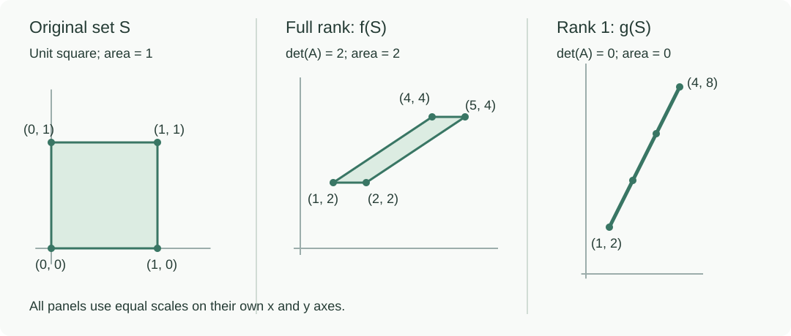

이 예제는 앞 글의 rank·range·행렬식이 집합의 변환에서도 그대로 쓰인다는 것을 보여 준다. 일반 비선형 함수에는 같은 보장이 없다. 예를 들어 $t\in [0,1]$을 $(t,t^{2})$로 보내면 포물선 조각이고, 양 끝 출력의 중간점 (0.5,0.5)은 그 조각에 없다.

## 16. Affine preimage: 출력 조건을 만족하는 입력들을 모으기

Image(상)는 “이 입력들을 변환하면 <strong>어떤 출력</strong>이 나오는가?”를 묻는다. Preimage(역상)는 반대 방향의 질문이다. “출력이 정해 둔 조건을 만족하려면 <strong>어떤 입력</strong>을 넣을 수 있는가?”를 묻는다.

예를 들어 두 입력을 더하는 함수에서 출력이 0부터 6 사이여야 한다면, 두 입력의 합이 그 구간에 들어가는 모든 입력 쌍을 찾는다. 출력 하나에 입력이 여러 개 대응해도 된다.

출력 공간의 집합 $C$를 정한 뒤, 그 안으로 들어가는 <strong>모든 입력</strong>을 모은다.

$$
f^{-1}(C)=\{x\in\mathbb R^n:f(x)\in C\}
$$

이것이 <strong>preimage(역상)</strong>다. 표기에 −1이 있어도 <strong>역함수가 존재해야 한다는 뜻이 아니다.</strong> $A$가 직사각형이거나 특이행렬이어도 정의할 수 있다.

$f$가 affine이고 $C$가 convex이면 $f^{-1}(C)$도 convex다. $p,q$가 역상에 있으면 $f(p),f(q)\in C$이고

$$
f((1-t)p+tq)=(1-t)f(p)+tf(q)\in C
$$

이므로 입력 볼록결합도 역상에 들어간다.

### 하나의 출력 구간이 입력 공간의 띠가 된다

$$
f(x_1,x_2)=x_1+x_2,\qquad C=[0,6]
$$

이면

$$
f^{-1}(C)=\{x:0\le x_1+x_2\le6\}
$$

이다. 두 평행한 직선 사이의 무한한 띠다.

![출력 구간 [0,6]의 역상은 입력 평면에서 0≤x1+x2≤6인 무한한 띠다. 입력 (1,1)은 2, (4,0)은 4로 가며, (1,-1) 방향 이동은 출력을 바꾸지 않는다.](affine-preimage-strip.svg)

오른쪽에서는 출력값 하나를 수직선에 표시하지만, 왼쪽에서는 입력 두 개를 한 점의 두 좌표로 표시한다. 입력의 첫 좌표를 늘린 만큼 둘째 좌표를 줄이면 합은 그대로이므로, 띠를 따라 끝없이 움직일 수 있다. 출력의 compact 구간을 역상으로 가져왔다고 입력 집합까지 bounded가 되는 것은 아니다. (t,−t) 방향으로는 끝없이 움직일 수 있다.

norm ball의 역상을 사용하면 다음 집합의 볼록성도 바로 알 수 있다.

$$
\{x:\|Ax-b\|_2\le r\}
$$

$x$↦Ax−b가 affine이고, 출력의 닫힌 공이 convex이기 때문이다. $A$가 rank를 잃으면 이 집합은 null space 방향으로 unbounded일 수 있다. <strong>볼록성 보존은 유계성이나 차원까지 보존한다는 말이 아니다.</strong>

## 17. Supporting hyperplane: 경계를 한쪽에서 받치는 초평면

집합 $C$의 경계점 $z$를 지나면서, $C$ 전체를 한쪽 반공간에 두는 초평면을 생각하자.

$$
H=\{x:a^Tx=b\},\qquad a\ne0,\quad b=a^Tz,
\qquad a^Tx\le b\quad\text{for all }x\in C
$$

이를 $z$에서의 <strong>supporting hyperplane(지지 초평면)</strong>이라고 한다. 평면이 $C$를 양쪽으로 가르면 지지 초평면이 아니다.

단위 닫힌 원판에서는 $z=(1,0)$에 대해 $x_{1}=1$인 직선이 한 예다. 원판 전체가 $x_{1}\le 1$ 쪽에 있고 $z$를 지난다.

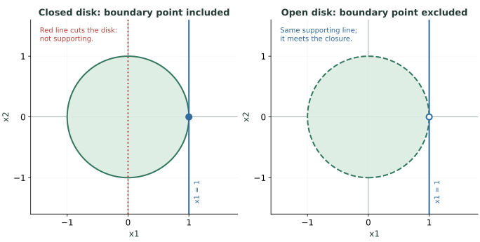

왼쪽의 빨간 선은 원판을 양쪽으로 가르므로 supporting이 아니다. 파란 선은 원판 전체를 한쪽에 두고 경계점에서 받친다. 오른쪽은 같은 그림에서 경계의 포함 여부만 바꾼 경우다. 이 차이를 다음의 열린집합 설명과 함께 읽는다.

<blockquote class="lecture-excerpt">

교안 발췌 · Module 2 — Supporting Hyperplanes

Supporting hyperplane theorem:

$$
C\subseteq\mathbb R^n\text{ convex},\quad z\in\partial C\quad\Longrightarrow\quad\text{a supporting hyperplane exists at }z
$$

</blockquote>

이 <strong>supporting hyperplane theorem</strong>은 비어 있지 않은 convex set의 모든 경계점에 지지 초평면이 존재한다고 말한다. 같은 정리는 [Boyd·Vandenberghe의 공개 강의자료 §2.23](https://web.stanford.edu/~boyd/cvxbook/bv_cvxslides.pdf)에서도 확인할 수 있다.

### 경계점이 반드시 C 안에 있는 것은 아니다

$C$가 열린 단위원판이면 $z=(1,0)$은 $C$에 없지만 경계에는 있다. 여전히 $x_{1}=1$은 $C$를 한쪽에 두고 $z$를 지나는 지지 초평면이다. 이때 초평면은 $C$ 자체와 만나지 않고 closure의 경계에 닿는다. 따라서 “항상 원래 집합과 접한다”는 그림만으로 외우면 open set에서 혼동할 수 있다.

또 지지 초평면이 유일할 필요는 없다. 삼각형의 꼭짓점에서는 서로 다른 법선 방향의 지지선들을 고를 수 있다. 매끄러운 곡선의 접선만을 뜻하는 개념도 아니다.

### 선형 목적함수의 최적점과 연결하기

처음의 삼각형 $P$에서 $x_{1}+x_{2}$를 최대화하면 최대값은 6이고, $x_{1}+x_{2}=6$인 변 전체가 최적점이다. 이 직선은 $P$를 $x_{1}+x_{2}\le 6$ 쪽에 두는 지지 초평면이기도 하다.

일반적으로 $c\ne 0$이고 $z$가 $C$에서 $c^{T}x$의 최솟값을 실제로 달성하면

$$
c^Tx\ge c^Tz\quad(x\in C)
$$

이다. $a=- c$로 쓰면 $C$ 전체가 $a^{T}x\le a^{T}z$ 쪽에 놓인다. 목적함수의 같은 값들을 잇는 초평면이 최적점에서 feasible set을 한쪽으로 받친다고 볼 수 있다.

열린 원판에서 $x_{1}$의 supremum은 1이지만 이를 달성하는 점은 없다. 지지 초평면은 존재해도 최적점이 $C$ 안에 존재한다는 보장은 별도라는 점이 compact 이야기와 연결된다.

## 18. 정의로 판정하는 세 가지 예제

### 예제 A: 원점에서 멀리 떨어진 직선도 convex일까?

$$
C=\{x:x_1+x_2=6\}
$$

convex이고 affine이며 closed다. 원점을 포함하지 않으므로 subspace는 아니다. $\mathbb{R}^{2}$에서 bounded가 아니므로 compact도 아니다. <strong>원점 포함은 convex의 조건이 아니다.</strong>

### 예제 B: 띠에 비음수 제약을 더하면?

$$
D=\{x:0\le x_1+x_2\le6,\ x_1\ge0,\ x_2\ge0\}
$$

비음수 제약 때문에 $x_{1}+x_{2}\ge 0$은 자동으로 만족한다. 따라서 $D$는 처음의 삼각형 $P$와 같다. halfspace들의 교집합이므로 convex이고, 모든 좌표가 0 이상 6 이하라 bounded이며 closed이므로 compact다.

### 예제 C: 공에서 둘레만 남기면?

$$
E=\{x\in\mathbb R^2:\|x\|_2=1\}
$$

closed이고 bounded이므로 compact다. 하지만 (1,0),(−1,0)의 중간점이 빠져 있으므로 nonconvex다. $\mathbb{R}^{2}$에서 interior는 비어 있고 boundary는 $E$ 전체다. <strong>compact와 convex는 서로를 보장하지 않는다.</strong>

## 19. 복습할 때 자주 틀리는 구분

| 혼동하기 쉬운 생각 | 확인할 조건 |
| --- | --- |
| 집합은 open 또는 closed 둘 중 하나다 | 둘 다이거나 둘 다 아닐 수 있다 |
| closed이면 bounded다 | 직선·반공간은 closed지만 unbounded |
| compact이면 convex다 | 원 둘레가 반례 |
| convex이면 경계를 포함한다 | 열린 원판도 convex |
| convex set은 원점을 포함한다 | 원점에서 이동한 선분·삼각형도 convex |
| affine combination은 계수가 양수다 | 합만 1이며 음수도 허용 |
| $b$가 hyperplane까지의 거리다 | 거리는 $\lvert b\rvert/\lVert a\rVert_{2}$ |
| polyhedron은 반드시 닫힌 유한한 덩어리다 | closed이지만 unbounded·낮은 차원·공집합일 수 있음 |
| 초평면들을 교차시키면 그 사이의 내부가 채워진다 | 비어 있지 않으면 affine set이며, 채워진 삼각형은 만들 수 없음 |
| halfspace들의 교집합에는 반드시 내부가 있다 | 반대 방향 두 부등식만으로 직선 하나가 남을 수도 있음 |
| convex 집합 둘의 합집합도 convex다 | 교집합 보존 정리와 구별 |
| affine map은 차원을 보존한다 | 특이행렬은 차원을 줄일 수 있음 |
| preimage를 구하려면 $A^{-1}$이 필요하다 | 출력 조건을 만족하는 입력의 집합으로 정의 |
| 지지 초평면의 존재는 최적점 존재를 뜻한다 | 열린 원판에서는 경계값이 달성되지 않을 수 있음 |

## 20. 혼자 풀어 보는 확인 문제

먼저 답을 생각한 뒤, 각 문제 바로 아래의 <strong>정답과 해설 펼치기</strong>를 눌러 비교한다. 해설에는 답이 나오는 이유와 혼동하기 쉬운 지점을 함께 적었다.

<strong>문제 1.</strong> $C=[0,1)$에서 interior, closure, boundary는 각각 무엇인가? C는 convex인가?

정답과 해설 펼치기

<strong>답:</strong> 내부는 `(0,1)`, 폐포는 `[0,1]`, 경계는 `{0,1}`이다. C는 convex다.

<strong>내부·폐포·경계:</strong> 0은 C에 있어도 왼쪽으로 작은 이동을 할 수 없어 내부점이 아니다. 1은 C에 없지만 C 안에서 접근할 수 있어 폐포에 들어간다. 두 끝점 주변에는 C의 점과 밖의 점이 항상 함께 나타나므로 경계는 그 두 점이다. 4절의 네 그림과 비교한다.

<strong>볼록성:</strong> C 안의 두 수 p, q는 모두 0 이상이고 1보다 작다. 음수가 아닌 가중치로 평균을 내면 그 결과도 두 수 사이에 있어 0 이상 1 미만이다.

$$
p,q\in[0,1),\quad0\leq t\leq1
\quad\Longrightarrow\quad0\leq(1-t)p+tq<1
$$

끝점 하나를 제외했다고 convex가 아닌 것은 아니다. 볼록성은 <strong>실제로 집합에 속하는 두 점 사이</strong>가 빠지는지를 확인한다.

<strong>문제 2.</strong> $x_1=(1,1)$, $x_2=(3,2)$일 때 $t=-1$로 만든 affine combination은 무엇인가? 두 점의 convex combination인가?

정답과 해설 펼치기

<strong>답:</strong> `(-1,0)`이며 affine combination이지만 두 점의 convex combination은 아니다.

$$
\begin{aligned}
(1-t)x_1+tx_2
&=2(1,1)-(3,2)\\
&=(2,2)-(3,2)=(-1,0)
\end{aligned}
$$

계수 2와 −1의 <strong>합은 1</strong>이므로 affine 조건은 만족한다. 그러나 음수 계수가 있으므로 convex의 계수 조건은 만족하지 않는다. 기하학적으로도 첫 좌표가 −1인 이 점은 첫 좌표가 1부터 3 사이인 원래 선분 밖에 있다. 음수 계수가 어떤 역할을 하는지 확인하는 문제다.

<strong>문제 3.</strong> 세 점 (0,0), (2,0), (0,2)의 affine hull과 convex hull은 무엇인가?

정답과 해설 펼치기

<strong>답:</strong> Affine hull은 2차원 평면 전체이고, convex hull은 세 점을 꼭짓점으로 하는 채워진 삼각형이다.

원점에서 나머지 두 점으로 가는 방향 `(2,0)`과 `(0,2)`는 서로 독립이다. Affine에서는 음수 계수도 허용하므로, 평면의 임의의 점 `(u,v)`를 다음처럼 만들 수 있다.

$$
(u,v)=\left(1-\frac{u+v}{2}\right)(0,0)
+\frac u2(2,0)+\frac v2(0,2)
$$

세 계수의 합은 항상 1이다. Convex에서는 세 계수가 모두 0 이상이어야 하므로 다음 조건이 추가된다.

$$
u\geq0,\qquad v\geq0,\qquad u+v\leq2
$$

이 조건의 공통 해가 채워진 삼각형이다. 세 점의 가중평균으로 내부의 점도 만들 수 있으므로, 꼭짓점 세 개나 테두리만 남는 것이 아니다.

<strong>문제 4.</strong> $2x_1+2x_2=12$의 법선, 원점에서 가장 가까운 점, 원점까지의 거리는?

정답과 해설 펼치기

<strong>답:</strong> 법선의 한 선택은 `(2,2)`, 가장 가까운 점은 `(3,3)`, 거리는 `3√2`다.

등식의 계수를 모으면 법선벡터를 얻는다. 법선은 유일한 벡터 하나가 아니라, 0이 아닌 배수들도 같은 수직 방향을 나타낸다.

$$
a=\begin{bmatrix}2\\2\end{bmatrix},\quad b=12,
\qquad a^Ta=8
$$

원점에서 가장 가까운 점은 법선 방향에 놓이므로 다음 공식에 대입한다.

$$
x^*=\frac{b}{a^Ta}a
=\frac{12}{8}\begin{bmatrix}2\\2\end{bmatrix}
=\begin{bmatrix}3\\3\end{bmatrix}
$$

실제로 `(3,3)`을 원래 등식에 넣으면 12가 된다. 거리도 그 점의 유클리드 노름으로 확인할 수 있다.

$$
\operatorname{dist}(0,H)=\frac{|b|}{\|a\|_2}
=\frac{12}{\sqrt8}=3\sqrt2
=\sqrt{3^2+3^2}
$$

오른쪽 상수 12를 그대로 거리로 읽으면 안 된다. 법선벡터의 길이로 나누어야 한다.

<strong>문제 5.</strong> $x_1+x_2\leq6$이 원점을 포함하는지 어떻게 판단하는가?

정답과 해설 펼치기

<strong>답:</strong> 원점 `(0,0)`을 부등식에 직접 넣으면 된다.

$$
0+0\leq6
$$

참이므로 이 halfspace는 원점을 포함한다. 법선이 어느 방향을 향하는지 추측하기보다, 확인할 점의 좌표를 대입하는 방법이 확실하다. 반대로 같은 경계에 `x₁+x₂≥6`을 쓰면 원점에서는 `0≥6`이 거짓이므로 원점을 포함하지 않는다. <strong>경계선이 같아도 부등호 방향이 허용 영역을 바꾼다.</strong>

<strong>문제 6.</strong> 단위 정사각형을 $g(x)=\begin{bmatrix}1&2\\2&4\end{bmatrix}x+\begin{bmatrix}1\\2\end{bmatrix}$로 변환한 image의 차원과 양 끝점은?

정답과 해설 펼치기

<strong>답:</strong> Image는 1차원 선분이며 양 끝점은 `(1,2)`와 `(4,8)`이다.

행렬의 둘째 행이 첫째 행의 두 배이므로 rank는 1이다. 좌표를 직접 전개하면 두 출력 좌표가 독립적으로 움직이지 못한다는 사실이 더 잘 보인다.

$$
g(x)=\begin{bmatrix}1+x_1+2x_2\\2+2x_1+4x_2\end{bmatrix}
=\begin{bmatrix}1+t\\2+2t\end{bmatrix},
\qquad t=x_1+2x_2
$$

입력 정사각형에서는 두 좌표가 각각 0 이상 1 이하이므로 t는 0부터 3까지다. 이 범위의 모든 t에 대해 입력을 `(t/3,t/3)`으로 잡으면 실제로 그 t를 만들 수 있다. 따라서 양끝뿐 아니라 그 사이의 출력도 전부 포함한다.

$$
t=0\Rightarrow g(x)=(1,2),\qquad
t=3\Rightarrow g(x)=(4,8)
$$

결과는 점 하나가 아니라 길이가 있는 선분이므로 차원은 1이다. 입력 좌표를 두 개 쓴다는 이유로 image도 2차원인 것은 아니다.

<strong>문제 7.</strong> $f(x)=x_1+x_2$일 때 $f^{-1}(\{3\})$는 무엇인가? 역함수가 필요할까?

정답과 해설 펼치기

<strong>답:</strong> 두 입력의 합이 3인 직선 전체다. 역함수는 필요하지 않다.

`{3}`은 출력값 3 하나만 포함하는 집합이다. Preimage는 그 출력 집합으로 가는 <strong>모든 입력</strong>을 모으므로,

$$
f^{-1}(\{3\})=\{(x_1,x_2):x_1+x_2=3\}
=\{(t,3-t):t\in\mathbb R\}
$$

이다. `(0,3)`, `(1,2)`, `(4,-1)` 모두 합이 3이므로 포함된다. 같은 출력에 서로 다른 입력이 대응해 입력을 유일하게 되찾는 역함수가 없어도, 그 입력들을 모은 집합은 문제없이 정의할 수 있다. <strong>역상과 역함수를 구별</strong>하는 문제다.

<strong>문제 8.</strong> $[0,1]^2$의 모든 점 중 $x_1+x_2$를 최대화하는 점은? 그 점을 지나는 지지선 하나는?

정답과 해설 펼치기

<strong>답:</strong> `(1,1)`에서 최대값 2를 얻는다. 지지선의 한 예는 `x₁+x₂=2`다.

`[0,1]²`는 두 좌표가 각각 0 이상 1 이하인 정사각형이다. 따라서 모든 허용점에서 다음이 성립한다.

$$
x_1+x_2\leq1+1=2
$$

등호가 성립하려면 두 좌표 모두 1이어야 하므로 최적점은 `(1,1)` 하나다. 직선 `x₁+x₂=2`는 그 점을 지나고 정사각형 전체를 `x₁+x₂≤2` 쪽에 둔다. 이것이 지지선의 조건이다. 목적함수가 같은 점들을 잇는 선을 밀어 갔을 때 마지막으로 닿는 위치라고도 볼 수 있다.

<strong>문제 9.</strong> 단위 열린 원판에서 $x_1$을 최대화하는 점이 존재하는가? $x_1=1$은 지지선인가?

정답과 해설 펼치기

<strong>답:</strong> 최대값을 달성하는 점은 없고 supremum(최소상한)은 1이다. `x₁=1`은 지지선이다.

열린 원판의 점은 중심과의 거리가 1보다 작아야 하므로 첫 좌표도 반드시 1보다 작다. 한편 다음 점들은 원판 안에 있고 첫 좌표가 1에 가까워진다.

$$
x_k=\left(1-\frac1k,0\right),\qquad k\geq2
$$

따라서 가능한 첫 좌표의 최소상한은 1이지만, 실제로 1을 갖는 점 `(1,0)`은 원판에 없다. <strong>접근 가능한 가장 위의 값과 실제로 달성하는 최댓값은 다르다.</strong>

그렇지만 `(1,0)`은 원판의 경계점이고 원판 전체는 `x₁<1` 쪽에 있으므로, `x₁=1`은 그 경계점에서의 지지선이다. 이 경우 지지선이 만나는 것은 원래 열린 원판이 아니라 그 폐포다. 지지선의 존재가 최적점의 존재를 보장하지 않는 이유다.

<strong>문제 10.</strong> 볼록결합을 몇 개 계산해 모두 집합 안에 있음을 확인하면 convexity의 증명이 될까?

정답과 해설 펼치기

<strong>답:</strong> 아니다. 그런 계산은 예시 확인이며 일반적인 증명이 아니다.

정의는 <strong>집합 안의 모든 두 점과 모든 0 이상 1 이하의 가중치</strong>에 대한 조건이다. 검사한 조합들이 성공해도 아직 검사하지 않은 조합이 실패할 수 있다.

예를 들어 두 구간 `[-2,-1]`과 `[1,2]`의 합집합에서, 같은 구간 안의 점끼리 평균을 내는 검사는 계속 성공한다. 하지만 왼쪽에서 −1, 오른쪽에서 1을 고르면 중간점은 0이고 이 집합에 없다. 따라서 nonconvex다.

증명할 때는 임의의 두 점과 임의의 허용 가중치를 놓고 조건이 항상 유지됨을 보이거나, 이미 증명된 볼록성 보존 정리를 적용한다. 반증할 때는 반대로 <strong>실패하는 조합 하나만</strong> 찾으면 충분하다.

## 다음 단원으로 이어 읽기

이번 글은 <strong>어떤 $x$를 선택할 수 있는가</strong>를 집합으로 설명했다. 다음 단원의 convex function은 그 집합 위에서 <strong>$x$의 값을 어떻게 평가하는가</strong>를 다룬다. convex set의 선분 조건과 convex function의 함수값 부등식은 서로 연결되지만 다른 정의다.

정사영에서 시작한 거리의 기하학, 행렬의 rank가 정하는 변환 후 차원, 제약조건의 교집합과 supporting hyperplane은 이후 최적화 문제의 해를 해석할 때 다시 등장한다.

## 참고한 자료와 보충 설명의 범위

- 개인 손글씨 노트 <strong>「3 Convex Set」 1–6페이지</strong>: open/closed/compact, interior·closure·boundary, affine/convex combination, convex set, hyperplane의 법선과 거리, halfspace·polyhedron·norm ball, affine image/preimage.
- ENAI601, <strong>Module 2 — Convex Sets</strong> 접근성 버전 교안: 최적화의 목적함수와 feasible set, 집합의 위상적 성질, combinations/hulls, affine·convex set, 볼록성을 보존하는 연산, supporting hyperplane.
- <strong>2026-09-16 수업</strong>: 원판과 원 둘레, open/closed의 반례, affine set, halfspace·polyhedron, 정사각형의 두 affine image 예제, supporting hyperplane.
- [Boyd·Vandenberghe, Convex Optimization 공개 강의자료 §2.23](https://web.stanford.edu/~boyd/cvxbook/bv_cvxslides.pdf): supporting hyperplane theorem의 조건 확인.

최소값 존재 조건, 상대적 내부, 거리와 정사영 공식의 유도, 볼록성 보존의 증명, 열린집합의 경계에서의 지지 초평면 예제는 복습을 위해 보강했다. 수식의 조건과 계산은 교안과 함께 확인했다. 그림은 본문 좌표로 새로 작성했다. 교안의 짧은 발췌는 본문에서 별도 블록으로 구분했으며, 필기와 강의자료 전체 파일은 첨부하지 않았다.
