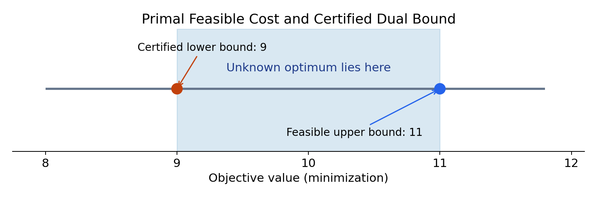
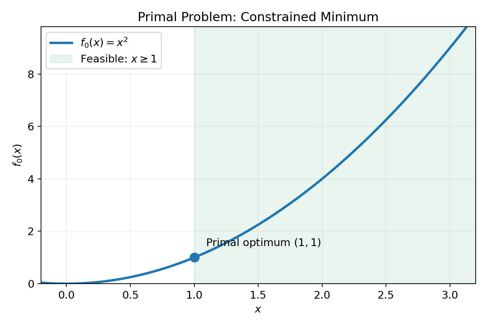
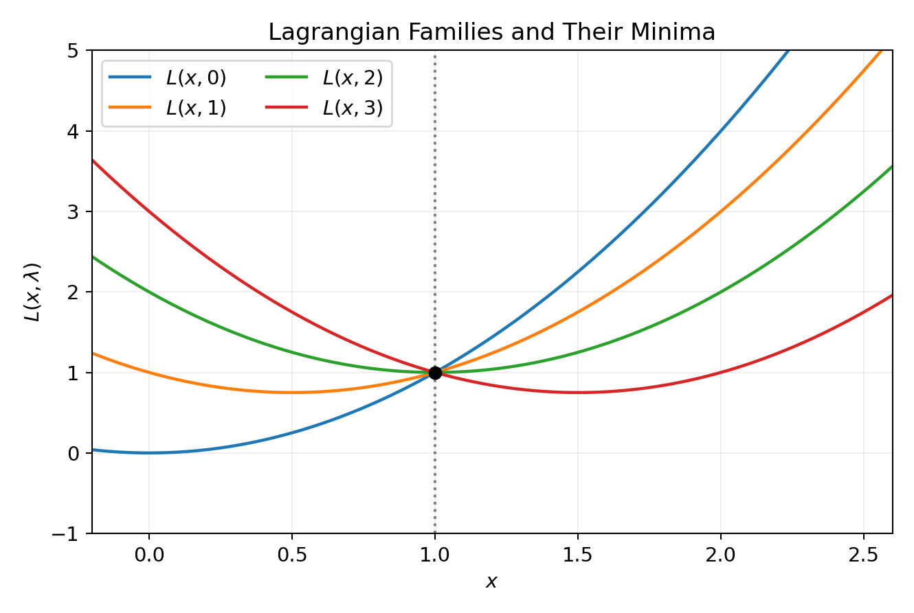
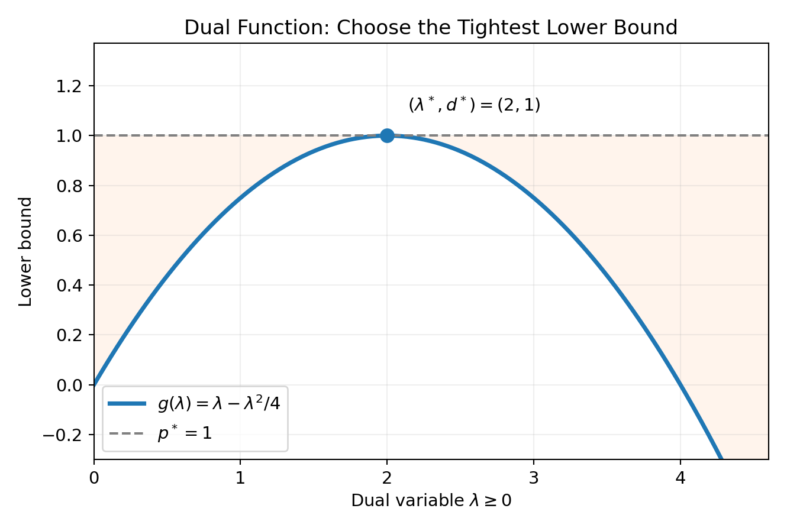
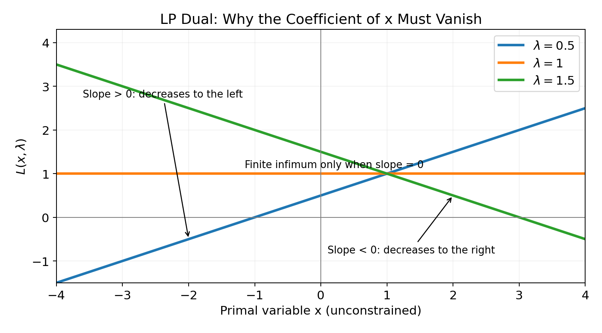
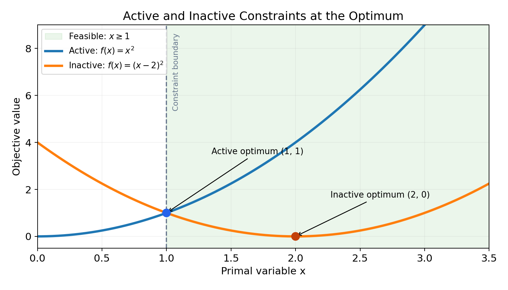

[앞 글의 Quadratic Programming](/enai601-quadratic-programming/)에서는 제약조건이 있는 이차함수의 최적점을 찾고, Gradient와 PSD를 이용해 답을 검증했다. 그러나 현실의 최적화 문제가 항상 쉽게 풀리는 것은 아니다. 특히 Nonconvex Optimization에서는 알고리즘이 찾아낸 해가 전체에서 가장 좋은 해인지 확인하기 어렵다.

여기서 <strong>Duality(쌍대성)</strong>의 질문이 등장한다.

<strong>최적해를 아직 모르더라도, 현재 찾은 해가 최적해와 얼마나 가까운지 알 수 있을까?</strong>

LP 글에서는 제약식에 가중치를 곱해 더하면 모든 가능한 비용의 하한을 얻을 수 있었다. 이제 그 방법을 일반적인 함수로 확장한다. <strong>하한이 필요한 이유→Lagrangian으로 하한 만들기→가장 좋은 하한 선택하기</strong>를 1변수 예제로 따라간 뒤 LP·QP에 적용해 보자. 목적함수가 복잡해져도 “후보의 비용과 보장된 하한이 만나면 최적성이 증명된다”는 생각은 같다.

---

## Part A. 왜 Duality가 필요한가?

### 1. 최소화 문제에서 상한과 하한은 서로 다른 역할을 한다

어떤 AI 시스템이 연산 자원을 배분하는 문제를 푼다고 가정하자. 목표는 총비용의 최소화다. 알고리즘으로 조건을 만족하는 비용 11의 해를 얻었다고 하자.

그렇다고 최적값이 11이라고 단정할 수는 없다. 다른 자원 배분 방식에서는 비용 10이나 9가 가능할 수도 있다.

그러나 <strong>비용을 9보다 작게 만드는 해는 절대로 없다는 사실을 증명</strong>했다면 이야기가 달라진다.

$$
9\le p^*\le11
$$

이 한 줄에는 성격이 다른 두 정보가 들어 있다.

- <strong>Upper Bound(상한) 11:</strong> 실제로 제약을 만족하는 해를 찾았기 때문에 최적 비용은 11보다 클 수 없다.
- <strong>Lower Bound(하한) 9:</strong> 어떤 해를 선택하더라도 비용 9 미만은 불가능하다는 증거가 있기 때문에 최적 비용은 9보다 작을 수 없다.

$p^*$는 가장 좋은 <strong>비용값</strong>, $x^*$는 그 값을 달성하는 <strong>선택</strong>이다. 두 기호는 구별해서 읽는다.

상한과 하한의 차이가 2라는 사실만으로도 알고리즘이 얼마나 더 개선될 여지가 있는지 판단할 수 있다. 이 차이는 아직 *최적 Duality Gap*이 아니라, <strong>현재 후보 해와 현재 lower bound 사이의 인증 가능한 차이</strong>다.

최소화 문제에서 Feasible Solution 하나는 상한을 주기 쉽다. 반면 아무 숫자나 하한이라고 주장해서는 안 된다. <strong>모든 feasible solution보다 작거나 같다는 이유가 있어야 한다.</strong> Duality는 이러한 하한을 만드는 체계적인 방법이다.

### 2. 끝까지 사용할 작은 Primal Problem

다음 문제를 보자.

$$
\boxed{\begin{aligned}
\operatorname{minimize}_{x\in\mathbb R}\quad&x^2\\
\text{subject to}\quad&x\ge1.
\end{aligned}}
$$

전체 실수에서 제곱함수는 0일 때 가장 작지만, 제약조건 때문에 0은 선택할 수 없다. 가능한 값 중에서는 1이 가장 작다.

$$
x^*=1,\qquad p^*=1
$$

이제 <strong>답이 1이라는 사실을 잠시 가리고</strong>, Lagrangian만 이용해 어디까지 하한을 만들 수 있는지 알아본다. 이 예제 하나를 끝까지 따라가면 Duality의 핵심 구조를 모두 볼 수 있다.

---

## Part B. Lagrangian으로 하한 만들기

### 3. 왜 제약조건을 목적함수에 더할까?

원래 문제는 제약을 만족하는 값만 검사할 수 있다. 그런데 새로운 함수의 <strong>제약 없는 최솟값</strong>을 구할 수 있다면, 그 값을 이용해 원래 문제의 하한을 만들 방법은 없을까?

먼저 제약을 교안에서 사용하는 형태로 정리한다.

$$
1-x\le0
$$

$\lambda$는 “람다”라고 읽으며, 지금은 고정해서 정할 숫자다. $x$와 $\lambda$를 동시에 아무렇게나 움직이는 것이 아니다. 먼저 $\lambda$를 정하고 $x$에 대한 보조 함수를 만든다.

그리고 이 식에 음수가 아닌 숫자 하나를 곱해 원래 목적함수에 더한다. 이 숫자를 <strong>Lagrange Multiplier(라그랑주 승수)</strong>라고 부른다.

$$
\boxed{L(x,\lambda)=x^2+\lambda(1-x),\qquad\lambda\ge0}
$$

처음에는 '왜 더하는가?'가 낯설다. 우선 <strong>제약을 만족하는 점에서 어떤 일이 일어나는지</strong>만 확인해 보자.

가능한 점은 1 이상이므로 다음 두 조건이 성립한다.

$$
1-x\le0,\qquad \lambda\ge0
$$

따라서

$$
\lambda(1-x)\le0
$$

이고, 결국

$$
\boxed{L(x,\lambda)\le x^2\qquad \text{for all feasible }x}
$$

가 된다.

<strong>Lagrangian은 feasible point에서 원래 비용보다 커지지 않는 보조 함수</strong>인 것이다. 그래서 이 보조 함수의 가장 작은 값을 구하면 원래 최적값의 하한을 얻을 가능성이 생긴다.

여기서는 하나만 조심해야 한다. <strong>위 부등식은 feasible point에서만 보장된다.</strong> 제약을 위반하는 점에서는 Lagrangian이 원래 함수보다 클 수도 있다.

### 4. Multiplier를 바꾸면 어떤 일이 생길까?

새로운 함수를 직접 살펴보자.

$$
L(x,\lambda)=x^2-\lambda x+\lambda
$$

Multiplier를 한 값으로 고정하면 이것은 x에 대한 포물선이다. 다음 네 가지를 비교해 보자.

| Multiplier | Lagrangian | 전체 실수에서의 최소 위치 | 최소값 |
|---:|---|---:|---:|
| 0 | $x^2$ | 0 | 0 |
| 1 | $x^2-x+1$ | 0.5 | 0.75 |
| 2 | $x^2-2x+2$ | 1 | 1 |
| 3 | $x^2-3x+3$ | 1.5 | 0.75 |

이 그림에서 <strong>모든 곡선이 한 점에서 만나는 이유</strong>를 먼저 이해해야 한다.

원래 최적점에서는 제약식이 정확히 0이다.

$$
1-x^*=1-1=0
$$

따라서 Multiplier의 값과 무관하게

$$
L(1,\lambda)=1+\lambda\cdot0=1
$$

이다. 즉, 모든 포물선이 점 (1, 1)을 지난다.

하지만 <strong>모든 포물선이 그 점에서 최소인 것은 아니다.</strong> Multiplier가 2일 때만 그 점이 포물선의 꼭짓점과도 일치한다.

$$
L(x,2)=x^2+2(1-x)=(x-1)^2+1
$$

따라서

$$
L(x,2)\ge1\qquad\forall x\in\mathbb R
$$

가 성립한다. 원래 문제를 직접 풀지 않고도 <strong>비용이 1보다 작아질 수 없다는 하한</strong>을 얻었다.

### 5. 왜 갑자기 원래 제약을 무시하고 최소화할까?

바로 이 부분이 Dual Function을 이해하는 핵심이다.

처음 문제에서는 x가 1 이상이어야 했다. 반면 Lagrangian의 최소값을 구할 때는 x를 <strong>전체 실수</strong>에서 움직이도록 허용한다. 제약을 어긴 값도 계산 과정에서는 사용할 수 있다.

여기서 푸는 것은 원래 문제 자체가 아니라 <strong>하한을 계산하기 위한 보조 문제</strong>다. 그 보조 문제에서 얻은 $x=\lambda/2$가 원래 제약을 만족하지 않아도 하한 계산은 유효하다. 예를 들어 $\lambda=1$이면 보조 문제의 최소점은 $x=0.5$로 원래 문제에서는 금지된 값이지만, 그때 얻는 0.75는 여전히 올바른 하한이다.

가능한 선택지를 넓히면 최솟값이 커질 수는 없다. 따라서 '전체 실수에서 구한 Lagrangian의 최솟값'은 'feasible point에서의 Lagrangian 값'보다 작거나 같다.

이 값을 <strong>Dual Function(쌍대함수)</strong>라고 정의한다.

$$
\boxed{g(\lambda)=\inf_{x\in\mathbb R}L(x,\lambda)}
$$

여기서 `inf`는 <strong>Infimum(하한의 최댓값)</strong>이다. 예를 들어 $e^x$는 항상 양수지만 $x$를 음의 방향으로 보내면 0에 한없이 가까워진다. 따라서 $\inf_{x\in\mathbb R}e^x=0$이지만 $e^x=0$인 최소점은 없다. 이런 경우까지 다루기 위해 `min`보다 일반적인 기호를 사용한다. 이번 이차함수 예제에서는 실제로 최솟값이 존재하므로 `min`으로 계산해도 된다.

이제 계산해 보자. 먼저 Multiplier를 고정하고 x에 대해 미분한다.

$$
\frac{\partial L}{\partial x}=2x-\lambda
$$

최소점은

$$
2x-\lambda=0\quad\Longrightarrow\quad x=\frac\lambda2
$$

이다. 이를 다시 Lagrangian에 대입하면

$$
\begin{aligned}
g(\lambda)
&=\left(\frac\lambda2\right)^2+\lambda\left(1-\frac\lambda2\right)\\
&=\frac{\lambda^2}{4}+\lambda-\frac{\lambda^2}{2}\\
&=\lambda-\frac{\lambda^2}{4}.
\end{aligned}
$$

따라서

$$
\boxed{g(\lambda)=\lambda-\frac{\lambda^2}{4}}
$$

를 얻는다. 주목할 점은 <strong>Dual Function에는 더 이상 원래 변수 x가 없다는 것</strong>이다. 남은 변수는 Multiplier뿐이다.

### 6. Weak Duality는 왜 항상 성립할까?

지금까지 얻은 두 부등식을 하나씩 연결해 보자. 임의의 feasible point를 y라고 하자.

첫째, `g`는 Lagrangian 전체의 infimum이므로 특정 점 y에서의 Lagrangian 값보다 클 수 없다.

$$
g(\lambda)\le L(y,\lambda)
$$

둘째, y는 제약을 만족하고 Multiplier는 0 이상이므로

$$
L(y,\lambda)\le f_0(y)
$$

다. 따라서

$$
\boxed{g(\lambda)\le L(y,\lambda)\le f_0(y)}
$$

이다. 이 사실은 <strong>어떤 feasible point를 선택하더라도</strong> 성립한다. 따라서 primal 최적값에 대해서도

$$
\boxed{g(\lambda)\le p^*\qquad\forall\lambda\ge0}
$$

가 성립한다.

이것이 <strong>Weak Duality(약한 쌍대성)</strong>의 출발점이다. 'Weak'라는 이름은 두 값이 반드시 같지는 않다는 뜻이다. <strong>Dual Function은 보장된 lower bound다.</strong> 원래 Primal Problem이 Convex인지 여부와 상관없이 이 부등식은 성립한다.

<strong>여기까지의 연결:</strong> 부등식 제약을 0 이하로 정리한다 → 0 이상인 Multiplier를 붙인다 → feasible point에서 Lagrangian이 원래 비용 이하가 된다 → x 전체에서 infimum을 취하면 더 낮은 값이 된다 → 이것이 lower bound다.

---

## Part C. 가장 좋은 하한을 찾기

### 7. Dual Problem: 왜 하한을 최대화할까?

Multiplier를 0으로 고르면 하한은 0이다. Multiplier를 1로 고르면 하한은 0.75가 된다. 2로 고르면 1이다. 어느 하한이 가장 유용할까?

최적값에 가장 가까운 <strong>가장 큰 하한</strong>이다. 그래서 Dual Problem은 Dual Function을 <strong>최대화</strong>한다.

$$
\boxed{\begin{aligned}
\operatorname{maximize}_{\lambda}\quad&\lambda-\frac{\lambda^2}{4}\\
\text{subject to}\quad&\lambda\ge0.
\end{aligned}}
$$

이를 미분하면

$$
g'(\lambda)=1-\frac\lambda2
$$

이므로

$$
g'(\lambda)=0\quad\Longrightarrow\quad\lambda^*=2
$$

다. Dual Function은 아래로 열린 포물선이므로 이 값에서 전역 최댓값을 얻는다.

$$
\boxed{d^*=g(2)=1}
$$

그리고 앞서 원래 문제에서

$$
p^*=1
$$

임을 확인했다. 따라서

$$
\boxed{d^*=p^*=1}
$$

이다. <strong>가장 좋은 하한이 실제 최적값과 일치</strong>한 것이다.

하지만 모든 문제에서 이런 일이 일어나는 것은 아니다. 'Duality는 항상 하한을 제공한다'는 주장과 '하한이 항상 최적값과 같다'는 주장은 구분해야 한다.

### 8. Duality Gap: 두 최적값의 차이

Dual의 최적값과 Primal의 최적값 사이에는 항상 다음 관계가 성립한다.

$$
\boxed{d^*\le p^*}
$$

따라서 <strong>Optimal Duality Gap(최적 쌍대 간극)</strong>은

$$
\boxed{p^*-d^*\ge0}
$$

으로 정의한다. 여기서 두 최적값의 차이를 실수로 다루는 설명은 $p^*,d^*$가 모두 유한한 경우를 전제로 한다. 무한대가 끼어 있는 경우에는 이 뺄셈을 그대로 계산하지 않는다. 두 유한한 최적값이 같으면 <strong>Strong Duality(강한 쌍대성)</strong>가 성립한다고 부른다.

이 작은 예제에서는

$$
p^*-d^*=1-1=0
$$

이다. 다만 'Convex Problem이므로 무조건 Strong Duality'라고 결론내려서는 안 된다. 어떤 조건에서 간극이 0이 되는지 판단하는 이론은 Part 2에서 <strong>Constraint Qualification / Slater's Condition</strong>을 통해 다룬다.

실제 알고리즘에서 사용할 때에는 Primal의 최적값을 몰라도 된다. Feasible Candidate가 주는 상한 U와 Dual Function이 주는 하한 L을 이용한다.

$$
L\le p^*\le U
$$

이로부터 현재 해가 실제 최적값보다 얼마나 나쁠 수 있는지도 제한할 수 있다.

$$
0\le U-p^*\le U-L
$$

즉 Duality는 답을 구하는 방법일 뿐 아니라, <strong>현재 답의 품질을 평가하는 증명 도구(Certificate)</strong>이기도 하다.

### 9. 일반적인 Lagrangian과 Dual Problem

이제 Module 7의 일반 형태로 올라갈 준비가 되었다. 우선 지금까지의 작은 예제와 기호만 달라진다는 점을 확인하자.

$$
\begin{aligned}
\operatorname{minimize}_{x\in\mathbb R^n}\quad &f_0(x)\\
\text{subject to}\quad &f_i(x)\le0,\quad i=1,\ldots,m,\\
&h_j(x)=0,\quad j=1,\ldots,p.
\end{aligned}
$$

이것이 <strong>Primal Problem(원문제)</strong>이다. $f_0$는 비용, $f_i$는 0 이하여야 하는 부등식 잔차, $h_j$는 0이어야 하는 등식 잔차다. $\lambda_i$는 “람다 아이”, $\nu_j$는 “뉴 제이”라고 읽는다.

교안의 $D$는 함수들이 정의되는 <strong>Domain(공통 정의역)</strong>이고 실제 가능집합은 그 안에서 제약까지 만족하는 점들이다. 둘은 다르다. 예를 들어 $\log x$가 들어간 함수라면 $x>0$이라는 정의역은 보조 문제에서도 유지한다. Lagrangian에 옮겨 적은 제약을 풀어 준다는 뜻이지, 함수가 정의되지 않는 점까지 계산한다는 뜻은 아니다.

제약이 여러 개라면 각 부등식에 Multiplier 하나씩, 각 등식에 Multiplier 하나씩 붙이면 된다.

$$
\boxed{
L(x,\lambda,\nu)
=f_0(x)+\sum_{i=1}^{m}\lambda_i f_i(x)+\sum_{j=1}^{p}\nu_jh_j(x)
}
$$

<blockquote class="lecture-excerpt">

교안 발췌 · Module 7 Part 1 — Lagrangian

$$
L(x,\lambda,\nu)=f_0(x)+\sum_{i=1}^{m}\lambda_i f_i(x)+\sum_{j=1}^{p}\nu_jh_j(x).
$$

$\lambda_i$ and $\nu_j$ are called “Lagrange multipliers”.

</blockquote>

부호는 다음처럼 정한다.

- 부등식 Multiplier: 0 이상이어야 한다. 이는 feasible point에서 추가 항이 0 이하가 되도록 하기 위해서다.
- 등식 Multiplier: 양수·음수 모두 가능하다. feasible point에서는 등식의 잔차가 정확히 0이므로 어느 부호를 곱해도 0이기 때문이다.

Dual Function과 Dual Problem은 다음과 같다.

$$
\boxed{g(\lambda,\nu)=\inf_{x\in D}L(x,\lambda,\nu)}
$$

$$
\boxed{\begin{aligned}
\operatorname{maximize}_{\lambda,\nu}\quad&g(\lambda,\nu)\\
\text{subject to}\quad&\lambda\ge0.
\end{aligned}}
$$

$g$를 계산할 때의 $x$와 dual을 풀 때의 $(\lambda,\nu)$는 서로 다른 단계의 변수다.

| 단계 | 고정하는 것 | 움직이는 것 | 얻는 결과 |
|---|---|---|---|
| Lagrangian 만들기 | 아직 최소화하지 않음 | $x,\lambda,\nu$가 함수의 입력 | 보조 함수 $L$ |
| Dual function 계산 | 승수 $\lambda,\nu$ | $x\in D$ | 하한값 $g(\lambda,\nu)$ |
| Dual problem 풀기 | 계산된 함수 $g$ | $\lambda\ge0$, 자유로운 $\nu$ | 가장 좋은 하한 $d^*$ |

아래로 끝없이 내려가면 $g=-\infty$로 둔다. 이 값도 형식적으로는 하한이지만 답의 품질을 평가하는 데 도움이 되지 않는다. 유한한 $g$를 주는 승수만 남겨 dual의 가능집합을 쓰기도 하며, LP에서 곧 등장할 계수 조건은 바로 이 과정에서 나온다.

<blockquote class="lecture-excerpt">

교안 발췌 · Module 7 Part 1 — Lagrange Dual Function / Weak Duality

$$
g(\lambda,\nu)=\inf_{x\in D}L(x,\lambda,\nu),
\qquad g(\lambda,\nu)\le p^*\quad\text{for all }\lambda\ge0,\ \nu\in\mathbb R^p.
$$

Weak duality: $d^*\le p^*$.

</blockquote>

최적값은 다음 기호를 사용한다.

$$
p^*=\inf_{x\text{ feasible}}f_0(x),\qquad
d^*=\sup_{\lambda\ge0,\nu}g(\lambda,\nu)
$$

두 값은 항상 다음을 만족한다.

$$
\boxed{d^*\le p^*}
$$

#### Dual Function은 왜 Concave일까?

교안에서 강조한 결과 하나를 더 확인하자. <strong>Primal이 Nonconvex여도 Dual Function은 Concave</strong>하다.

처음에는 이상해 보일 수 있다. 하지만 x를 하나 고정하고 Lagrangian을 Multiplier의 함수로 보면, 목적함수값과 제약 잔차가 상수이므로 <strong>Affine Function</strong>이 된다.

Dual Function은 이 affine 함수들을 x에 대해 가능한 만큼 아래로 내려서 만든 <strong>Pointwise Infimum</strong>이다. Affine 함수족의 Pointwise Infimum은 Concave이다.

기호로도 확인할 수 있다. 두 승수 묶음을 $z_1,z_2$, 가중치를 $0\le\theta\le1$이라 하면, 각 $x$에서 $L$이 승수에 대해 affine이므로

$$
\begin{aligned}
g(\theta z_1+(1-\theta)z_2)
&=\inf_{x\in D}\{\theta L(x,z_1)+(1-\theta)L(x,z_2)\}\\
&\ge\theta\inf_{x\in D}L(x,z_1)+(1-\theta)\inf_{x\in D}L(x,z_2)\\
&=\theta g(z_1)+(1-\theta)g(z_2).
\end{aligned}
$$

가운데 부등식은 두 항을 따로 가장 작게 만들면 같은 $x$를 골라야 하는 제한이 더 느슨해지기 때문에 성립한다. 이것이 concavity의 정의다. 따라서 Dual Problem은 Concave Maximization이라는 의미에서 Convex Optimization Problem이다. 물론 이 사실만으로 모든 Dual Problem을 항상 쉽게 계산할 수 있다는 뜻은 아니다.

---

## Part D. LP·QP와 교안 예제로 확장하기

### 10. 먼저 1변수 LP에서 Dual을 직접 구하자

지금까지는 포물선을 최소화했다. 그런데 교안에서는 이어서 <strong>Linear Program의 Dual</strong>을 유도한다. 여기서 갑자기 큰 행렬로 넘어가면 '왜 계수가 0이어야 하는가?'가 낯설 수 있다.

우선 변수 하나만 보자.

$$
\boxed{\begin{aligned}
\operatorname{minimize}_{x\in\mathbb R}\quad&x\\
\text{subject to}\quad&x\ge1.
\end{aligned}}
$$

원래 문제의 최적값은 1이다. 이제 같은 방식으로 Lagrangian을 만든다.

$$
L(x,\lambda)=x+\lambda(1-x)
$$

x에 관한 항을 모으면

$$
\boxed{L(x,\lambda)=(1-\lambda)x+\lambda}
$$

가 된다.

여기서 Dual Function을 구하기 위해 <strong>x를 모든 실수에서 최소화</strong>해야 한다.

- Multiplier가 1보다 작으면 x 앞의 계수가 양수다. x를 음의 무한대로 보내면 함수값은 끝없이 감소한다.
- Multiplier가 1보다 크면 x 앞의 계수가 음수다. x를 양의 무한대로 보내면 역시 함수값은 끝없이 감소한다.
- Multiplier가 정확히 1일 때만 x 앞의 계수가 0이 되어 Lagrangian이 상수로 남는다.

따라서

$$
\boxed{
g(\lambda)=
\begin{cases}
1,&\lambda=1,\\
-\infty,&\lambda\ne1.
\end{cases}
}
$$

이다. 여기서는 Multiplier에 음수 금지 조건도 있어야 하지만, 유한한 값을 만드는 유일한 Multiplier 1은 그 조건을 만족한다.

이제 중요한 원리가 드러났다.

<strong>제약을 제거한 뒤 선형함수를 전체 실수에서 최소화하려면, 변수 앞의 계수가 0이어야 유한한 Dual Function을 얻을 수 있다.</strong>

이 한 줄을 이해하면 다음 행렬식이 훨씬 자연스러워진다.

### 11. Module 7 Example 2 — Standard-Form LP Dual

이 절은 교안에서 Part 1에서 다룬 <strong>Standard-Form Linear Program</strong>을 따른다. LP를 처음 배울 때 사용했던 `Gx <= h, Ax=b`의 일반 affine 형태와 달리, <strong>이번에는 x의 비음수 조건을 명시한 형태</strong>이다.

$$
\boxed{\begin{aligned}
\operatorname{minimize}_{x\in\mathbb R^n}\quad&c^Tx\\
\text{subject to}\quad&Ax=b,\\
&x\ge0.
\end{aligned}}
$$

비음수 조건을 0 이하 부등식으로 쓰면

$$
-x\le0
$$

이다. 따라서 각각 Multiplier를 붙인 Lagrangian은

$$
L(x,\lambda,\nu)=c^Tx-\lambda^Tx+\nu^T(Ax-b)
$$

가 된다. 이제 x와 관련된 항을 하나로 모아보자.

$$
\boxed{
L(x,\lambda,\nu)
=(c+A^T\nu-\lambda)^Tx-b^T\nu
}
$$

바로 앞의 1변수 LP에서 x 앞의 계수가 0이어야 했던 사실을 떠올리면 된다. 이번에는 그 계수가 벡터로 바뀐 것뿐이다.

$$
c+A^T\nu-\lambda=0
$$

이 조건이 성립하지 않으면 Lagrangian을 전체 실수 벡터 x에서 아래로 끝없이 감소시킬 수 있다.

따라서

$$
g(\lambda,\nu)=
\begin{cases}
-b^T\nu,&c+A^T\nu-\lambda=0,\\
-\infty,&\text{otherwise}.
\end{cases}
$$

이제 Dual Problem을 적으면

$$
\begin{aligned}
\operatorname{maximize}_{\lambda,\nu}\quad&-b^T\nu\\
\text{subject to}\quad&c+A^T\nu-\lambda=0,\\
&\lambda\ge0.
\end{aligned}
$$

그런데 첫 번째 등식에서

$$
\lambda=c+A^T\nu
$$

이고, Multiplier의 비음수 조건에 의해

$$
c+A^T\nu\ge0
$$

가 된다. 따라서 Multiplier λ를 없애면 교안의 Equivalent Dual Problem을 얻는다.

$$
\boxed{\begin{aligned}
\operatorname{maximize}_{\nu}\quad&-b^T\nu\\
\text{subject to}\quad&c+A^T\nu\ge0.
\end{aligned}}
$$

<blockquote class="lecture-excerpt">

교안 발췌 · Module 7 Part 1 — Example 2 — Standard form linear program

$$
\begin{aligned}
\operatorname{minimize}_{x}\quad&c^Tx\\
\text{subject to}\quad&Ax=b,\quad x\ge0,
\end{aligned}
\qquad
\begin{aligned}
\operatorname{maximize}_{\nu}\quad&-\nu^Tb\\
\text{subject to}\quad&c+A^T\nu\ge0.
\end{aligned}
$$

</blockquote>

<strong>왜 위 식이 LP Dual인가?</strong> 원래 문제의 최솟값에 대한 가장 높은 하한을, 새로운 변수 ν를 이용해 구하는 LP이기 때문이다. 이 유도에서 제약의 부호와 Multiplier의 부호가 바뀌면 Dual도 달라진다. 공식 자체만 외우기보다 한 줄씩 다시 유도하는 연습이 중요하다.

#### 작은 수치 예제로 부호까지 확인하기

$\min(x_1+2x_2)$ subject to $x_1+x_2=1$, $x\ge0$이면 $x_1=1-x_2$에서 비용은 $1+x_2$다. 따라서 $x^*=(1,0)^T$, $p^*=1$이다.

교안의 부호로 dual을 쓰면 $\max(-\nu)$ subject to $1+\nu\ge0$, $2+\nu\ge0$다. 두 제약은 $\nu\ge-1$로 합쳐지고, $-\nu$를 가장 크게 만드는 값은 $\nu^*=-1$이다. 따라서 $d^*=1$이다. <strong>등식 승수가 음수여도 정상이며</strong>, 목적함수의 마이너스 부호를 빠뜨리면 다른 문제가 된다.

### 12. Module 7 Example 1 — Equality-Constrained Least-Norm Problem

교안의 첫 번째 응용 예제는 <strong>등식 제약을 만족하면서 벡터 길이의 제곱을 최소화하는 문제</strong>이다.

$$
\boxed{\begin{aligned}
\operatorname{minimize}_{x}\quad&x^Tx\\
\text{subject to}\quad&Ax=b.
\end{aligned}}
$$

이 문제에서는 부등식이 없으므로 λ가 필요 없다. 등식용 Multiplier ν만 사용한다.

$$
L(x,\nu)=x^Tx+\nu^T(Ax-b)
$$

이제 x에 대해 Gradient를 구한다.

$$
\nabla_xL(x,\nu)=2x+A^T\nu
$$

Gradient를 0으로 놓으면

$$
x=-\frac12A^T\nu
$$

이다. 이를 Lagrangian에 대입한다.

$$
\begin{aligned}
g(\nu)
&=\left(-\frac12A^T\nu\right)^T\left(-\frac12A^T\nu\right)\\
&\quad+\nu^T\left(A\left(-\frac12A^T\nu\right)-b\right)\\
&=\frac14\nu^TAA^T\nu-\frac12\nu^TAA^T\nu-\nu^Tb\\
&=-\frac14\nu^TAA^T\nu-\nu^Tb.
\end{aligned}
$$

따라서 Dual은

$$
\boxed{\operatorname{maximize}_{\nu\in\mathbb R^p}
\left(-\frac14\nu^TAA^T\nu-\nu^Tb\right)}
$$

이다. <strong>Dual에도 Quadratic Function이 등장</strong>했다. QP에서 배운 행렬 미분과 PSD가 Duality에서도 재등장하는 이유다.

<blockquote class="lecture-excerpt">

교안 발췌 · Module 7 Part 1 — Example 1 — Least squares solution of linear equations

$$
\operatorname{minimize}_{x}\ x^Tx\quad\text{subject to}\quad Ax=b,
\qquad
g(\nu)=-\frac14\nu^TAA^T\nu-\nu^Tb.
$$

</blockquote>

여기서 최소화하는 것은 <strong>해 벡터 $x$ 자체의 길이</strong>다. 앞 QP 글에서 잔차 $\|Xw-y\|_2^2$를 최소화했던 회귀 문제와 구별한다. $A$가 full row rank라고 가정하지 않았으므로, 이후 $AA^T$의 역행렬이 무조건 있다고 생각해서도 안 된다. 위 dual function의 유도에는 그 역행렬이 필요하지 않다.

#### 예제: $x_1+x_2=2$인 가장 짧은 벡터

$A=\begin{bmatrix}1&1\end{bmatrix}$, $b=2$이면 $AA^T=2$이므로

$$
g(\nu)=-\frac12\nu^2-2\nu
=-\frac12(\nu+2)^2+2.
$$

최대는 $\nu^*=-2$에서 2다. 그 승수에서 Lagrangian의 최소점은 $x=-\frac12A^T\nu^*=(1,1)^T$다. 실제로 $Ax=2$이며 $x^Tx=2$라서 하한을 달성한다. 원래 식으로도 $x_1=t$, $x_2=2-t$를 대입하면 $t^2+(2-t)^2=2(t-1)^2+2$여서 같은 답을 얻는다.

### 13. Module 7 Example 3 — Inequality-Constrained QP의 Dual

이번에는 QP의 목적함수에 부등식 제약을 결합한다. 교안에서는 이 예제에서 <strong>P를 Positive Definite</strong>로 두어 역행렬을 사용할 수 있게 한다.

$$
\boxed{\begin{aligned}
\operatorname{minimize}_{x}\quad&\frac12x^TPx+q^Tx\\
\text{subject to}\quad&Gx\le h.
\end{aligned}}
$$

Lagrangian은

$$
L(x,\lambda)
=\frac12x^TPx+q^Tx+\lambda^T(Gx-h)
$$

이다. 이번에도 <strong>Multiplier를 고정한 채 x를 최소화한다.</strong> Gradient를 구하면

$$
\nabla_xL(x,\lambda)=Px+q+G^T\lambda
$$

이고, 이 값이 0인 위치는

$$
x(\lambda)=-P^{-1}(q+G^T\lambda)
$$

이다. $a=q+G^T\lambda$라고 잠시 쓰면 $L=\frac12x^TPx+a^Tx-h^T\lambda$다. 정지점 $x=-P^{-1}a$에서 이차항은 $\frac12a^TP^{-1}a$, 선형항은 $-a^TP^{-1}a$이므로 합은 $-\frac12a^TP^{-1}a$다. $P\succ0$이어서 이 정지점은 실제 전역 최소점이다.

이 식을 Lagrangian에 대입하여 정리하면

$$
\boxed{
g(\lambda)
=-\frac12(q+G^T\lambda)^TP^{-1}(q+G^T\lambda)
-h^T\lambda
}
$$

이다. 위 표현을 전개하면 교안의 Dual Quadratic Function 형태가 된다.

$$
\begin{aligned}
g(\lambda)
&=-\frac12\lambda^TGP^{-1}G^T\lambda\\
&\quad-(GP^{-1}q+h)^T\lambda\\
&\quad-\frac12q^TP^{-1}q.
\end{aligned}
$$

따라서 Dual Problem은

$$
\boxed{\begin{aligned}
\operatorname{maximize}_{\lambda}\quad &g(\lambda)\\
\text{subject to}\quad &\lambda\ge0.
\end{aligned}}
$$

이다. 핵심은 복잡한 전개 자체보다 <strong>한 번 정한 Multiplier에 대해 x를 먼저 최소화하고, 마지막에 Multiplier를 최적화한다</strong>는 순서다.

<blockquote class="lecture-excerpt">

교안 발췌 · Module 7 Part 1 — Example 3 — Quadratic program with inequality constraints

$$
P\in S_{++}^n,\qquad
g(\lambda)=-\frac12\lambda^TGP^{-1}G^T\lambda
-(GP^{-1}q+h)^T\lambda-\frac12q^TP^{-1}q.
$$

</blockquote>

$S_{++}^n$은 실수 대칭 <strong>양의 정부호(PD)</strong> 행렬들의 집합이다. PSD만으로는 역행렬을 보장할 수 없다. 원래 목적함수에 상수 $r$가 있다면 dual function에도 $r$가 그대로 더해진다. 최적 승수는 바뀌지 않지만 비용값은 달라지므로, 수치 검증에서 상수를 빼먹지 않는다.

### 14. Module 7 Example 4 — Nonconvex 문제에도 하한을 만들 수 있다

교안의 마지막 Part 1 예제는 <strong>Two-Way Partitioning(두 그룹 분할)</strong>이다. 각 원소를 +1 또는 −1로 배정한다고 생각하면 된다.

$$
\begin{aligned}
\operatorname{minimize}_{x\in\mathbb R^n}\quad&x^TWx\\
\text{subject to}\quad&x_i^2=1,\quad i=1,\ldots,n.
\end{aligned}
$$

각 변수에는 두 선택지만 있으므로 가능한 배정은 지수적으로 증가한다.

$$
x_i\in\{-1,1\},\qquad 2^n\text{ assignments}
$$

$W$는 주어진 실수 대칭행렬이며 반드시 PSD는 아니다. 그와 별개로 <strong>$x_i^2=1$이 만드는 이산 가능집합 자체가 볼록하지 않다.</strong> 예를 들어 $-1$과 $1$의 중간값 0은 허용되지 않는다. 따라서 $W$가 PSD인 경우에도 이것을 그대로 convex optimization이라고 부를 수 없다.

교안에서는 등식 Multiplier ν를 이용해 다음 Lagrangian을 만든다.

$$
L(x,\nu)=x^T(W+\operatorname{diag}(\nu))x-\mathbf1^T\nu
$$

$\operatorname{diag}(\nu)$는 $\nu_1,\ldots,\nu_n$을 대각선에 놓은 행렬, $\mathbf1$은 모든 성분이 1인 벡터다. 따라서 $\sum_i\nu_i x_i^2=x^T\operatorname{diag}(\nu)x$, $\sum_i\nu_i=\mathbf1^T\nu$다. 이로써 $\sum_i\nu_i(x_i^2-1)$이 위 식에 합쳐진다.

이차형식이 모든 방향에서 음수가 아니려면 중심 행렬이 PSD여야 한다. 그렇지 않다면 음의 곡률 방향으로 x를 무한히 늘려 Lagrangian을 아래로 끝없이 감소시킬 수 있다.

따라서 Dual Function은

$$
g(\nu)=
\begin{cases}
-\mathbf1^T\nu,&W+\operatorname{diag}(\nu)\succeq0,\\
-\infty,&\text{otherwise}.
\end{cases}
$$

이고, Dual Problem은 다음과 같다.

$$
\boxed{\begin{aligned}
\operatorname{maximize}_{\nu}\quad&-\mathbf1^T\nu\\
\text{subject to}\quad&W+\operatorname{diag}(\nu)\succeq0.
\end{aligned}}
$$

<blockquote class="lecture-excerpt">

교안 발췌 · Module 7 Part 1 — Example 4 — Two-way partitioning problem

$$
\operatorname{maximize}_{\nu}\ -\mathbf1^T\nu
\quad\text{subject to}\quad W+\operatorname{diag}(\nu)\succeq0.
$$

Semidefinite program (SDP).

</blockquote>

이를 <strong>Semidefinite Programming(반정정부호 계획법, SDP)</strong>이라고 한다. $\succeq0$는 행렬의 원소 각각이 0 이상이라는 뜻이 아니다. 임의의 벡터 $v$에 대해 $v^T(W+\operatorname{diag}(\nu))v\ge0$이라는 PSD 조건이다.

예를 들어 $W=\begin{bmatrix}0&1\\1&0\end{bmatrix}$이면 primal 비용은 $2x_1x_2$다. 두 부호가 반대일 때 최솟값 $-2$를 얻는다. $\nu=(1,1)^T$를 고르면 $W+\operatorname{diag}(\nu)=\begin{bmatrix}1&1\\1&1\end{bmatrix}$이고, 이 행렬의 이차형식은 $(v_1+v_2)^2\ge0$이다. 따라서 유효한 dual 하한 $-\mathbf1^T\nu=-2$를 얻어 이 사례의 최적성을 인증할 수 있다. Nonconvex 문제에서도 간극이 0인 예가 있을 수 있으나, 항상 그렇지는 않다. 이 예제를 Part 1에 포함한 이유는 중요하다. <strong>원래 문제가 Nonconvex여도 Dual Function은 Concave이며, Dual로는 보장 가능한 하한을 계산할 수 있다.</strong> 다만 이 하한이 원래 최적값과 같다고 보장되지는 않는다.

---

### 15. Sample Midterm 2(c): LP 글의 하한을 Lagrangian으로 다시 얻기

<strong>출처: Fall 2025 Sample Midterm 2번, 2페이지.</strong> [LP 글](/enai601-linear-programming/)에서 푼 문제는 $3x_1+2x_2$를 최소화하면서 다음 세 부등식을 만족하는 것이다.

$$
4x_1+x_2\ge4,\quad x_1+4x_2\ge4,\quad x_1+x_2\le4.
$$

이번에는 모든 잔차를 $\le0$으로 바꿔 직접 Lagrangian을 만든다.

$$
\begin{aligned}
L(x,\lambda)
&=3x_1+2x_2+\lambda_1(4-4x_1-x_2)\\
&\quad+\lambda_2(4-x_1-4x_2)+\lambda_3(x_1+x_2-4)\\
&=(3-4\lambda_1-\lambda_2+\lambda_3)x_1\\
&\quad+(2-\lambda_1-4\lambda_2+\lambda_3)x_2
+4\lambda_1+4\lambda_2-4\lambda_3.
\end{aligned}
$$

원문에는 $x\ge0$가 독립된 제약으로 없고, 공통 정의역은 $\mathbb R^2$다. 이 예제에서 비음수성이 원래 제약들로부터 따라오더라도, 그 제약들을 Lagrangian에 옮긴 뒤 $x$를 최소화할 때에는 원래 가능 삼각형에 묶어 두지 않는다. 따라서 유한한 infimum을 얻으려면 두 선형 계수가 모두 0이어야 한다.

$$
\boxed{\begin{aligned}
\operatorname{maximize}_{\lambda}\quad&4\lambda_1+4\lambda_2-4\lambda_3\\
\text{subject to}\quad&4\lambda_1+\lambda_2-\lambda_3=3,\\
&\lambda_1+4\lambda_2-\lambda_3=2,\\
&\lambda\ge0.
\end{aligned}}
$$

$\lambda^*=(2/3,1/3,0)^T$는 두 등식과 비음수 조건을 만족하며 $g(\lambda^*)=4$다. 원문제의 후보 $x^*=(4/5,4/5)^T$는 원래 세 제약을 만족하고 비용이 4다. 따라서

$$
4=g(\lambda^*)\le d^*\le p^*\le f_0(x^*)=4.
$$

모든 값이 4라서 primal·dual 후보가 모두 최적이다. <strong>LP 글에서 제약식에 곱했던 $2/3$, $1/3$이 바로 이 dual의 최적 승수였다.</strong> 이전의 가중합 증명과 Lagrangian의 하한 계산은 같은 구조를 표현한다.

#### QP 글의 Midterm 3번도 같은 방식으로 인증된다

같은 시험 3번은 위 삼각형 제약에 $\frac12x^TPx+q^Tx+3$을 둔다. 여기서 $P=\begin{bmatrix}3.5&-1.5\\-1.5&3.5\end{bmatrix}$, $q=(-1.2,-0.8)^T$다. [QP 글 13절](/enai601-quadratic-programming/)에서는 후보 $(0.8,0.8)^T$에서 Gradient가 $(0.4,0.8)^T$임을 확인했다.

세 잔차는 $Gx-h$이며, $G=\begin{bmatrix}-4&-1\\-1&-4\\1&1\end{bmatrix}$, $h=(-4,-4,4)^T$다. $\lambda=(4/75,14/75,0)^T\ge0$를 대입하면

$$
\nabla_xL(x^*,\lambda)=Px^*+q+G^T\lambda=0.
$$

$P$가 PD이므로 $x^*$는 이 Lagrangian의 전역 최소점이다. 앞의 두 잔차는 $x^*$에서 0이고, 세 번째 승수는 0이므로 $L(x^*,\lambda)=f_0(x^*)=2.68$이다. 따라서 $g(\lambda)=2.68$이라는 하한과 가능한 비용 2.68이 만나 최적성이 증명된다. <strong>원래 목적함수의 Gradient가 0이 아니어도, 제약항을 더한 Lagrangian의 Gradient는 0이 될 수 있다.</strong>

이 두 문제를 비교하면 새 공식을 외우는 대신 이미 했던 최적성 증명을 dual 변수의 관점으로 읽을 수 있다.

---

## Part E. Part 2로 이어지는 한 가지 질문

### 16. Complementary Slackness는 어디에서 등장할까?

Part 1의 최종 결론은 Lower Bound와 Weak Duality였다. 그렇다면 <strong>Dual의 하한이 Primal의 최적값과 정확히 같아졌을 때는 무엇이 달라질까?</strong>

앞에서 본 일반적인 Weak Duality 증명을 다시 생각해 보자.

$$
g(\lambda,\nu)\le L(x,\lambda,\nu)\le f_0(x)
$$

양 끝이 같아지면 두 부등식 사이에 더는 차이가 남을 수 없다. 이를 두 개의 비음수 차이로 분리하면

$$
\begin{aligned}
f_0(x)-g(\lambda,\nu)
&=\big[f_0(x)-L(x,\lambda,\nu)\big]\\
&\quad+\big[L(x,\lambda,\nu)-g(\lambda,\nu)\big].
\end{aligned}
$$

Feasible Point에서는 첫 번째 차이가

$$
f_0(x)-L(x,\lambda,\nu)=-\sum_i\lambda_i f_i(x)\ge0
$$

이고, 두 번째 차이도 Infimum의 정의 때문에 0 이상이다.

만약 <strong>Primal과 Dual에서 최적점이 실제로 존재하고 Strong Duality가 성립</strong>하여 양 끝의 차이가 0이라면, 이 두 비음수 차이도 각각 0이어야 한다.

그 결과 각 부등식 제약에 대해

$$
\boxed{\lambda_i^* f_i(x^*)=0}
$$

가 나타난다. 이것이 바로 Part 2에서 증명하고 활용할 <strong>Complementary Slackness(상보적 느슨함)</strong>의 형태다.

앞의 1변수 예제에서는

$$
\lambda^*=2,\qquad f_1(x^*)=1-1=0
$$

이어서 곱이 0이다. 제약이 실제 최적점에서 딱 맞게 걸린 경우다.

반대로 다음 문제를 생각하면

$$
\min_x(x-2)^2\quad\text{subject to}\quad x\ge1
$$

최적점은 2이며 제약에 여유가 남는다. 최적 승수는 0으로 둘 수 있다.

$$
x^*=2,\qquad 1-x^*=-1,\qquad\lambda^*=0
$$

이 경우에도 곱은 0이다.

- <strong>Active Constraint:</strong> 제약식이 경계에서 0이다. 이때 Multiplier는 양수일 수도 0일 수도 있다.
- <strong>Slack / Inactive Constraint:</strong> 제약식이 0보다 작다. Strong Duality 등 적절한 조건 아래 최적 승수는 반드시 0이다.

이 관계를 '활성 제약이면 반드시 양의 승수'라고 외우면 안 된다. <strong>양의 승수라면 해당 제약은 반드시 Active</strong>이고, <strong>Slack인 제약의 승수는 0</strong>이라는 방향이 정확하다.

Complementary Slackness의 자세한 유도와 Slater's Condition, KKT Conditions, 경제적 해석은 모두 <strong>Module 7 Part 2</strong>의 본문 주제다.

---

## Part F. 시험 대비와 확인 문제

### 17. 직접 할 수 있어야 할 계산

1. Feasible Point가 최소화 문제의 Upper Bound를 주는 이유를 설명할 수 있다.
2. Lower Bound가 유용한 이유와 Weak Duality의 의미를 설명할 수 있다.
3. 제약을 0 이하 형태로 쓰고 부등식 Multiplier의 비음수 조건을 설정할 수 있다.
4. Lagrangian을 만든 뒤, Multiplier를 고정하고 원래 변수에 대해 Infimum을 구할 수 있다.
5. Dual Function에서 Primal Variable이 사라졌는지 점검할 수 있다.
6. Dual Problem을 작성하고, 최적 Duality Gap을 계산할 수 있다.

#### 강의 예제 응용

7. <strong>1변수 LP</strong>에서 x의 계수가 0이 아니면 Infimum이 음의 무한대임을 설명할 수 있다.
8. <strong>Standard-Form LP</strong>에서 비음수 제약을 반영한 Dual을 직접 유도할 수 있다.
9. <strong>Equality-Constrained Least-Norm</strong>에서 Gradient를 이용해 Dual Quadratic Function을 얻을 수 있다.
10. <strong>Inequality-Constrained QP</strong>에서 PD 행렬의 역행렬을 이용해 Dual Function을 구할 수 있다.
11. <strong>Two-Way Partitioning</strong>에서 PSD 행렬 부등식이 Dual 제약으로 나타나는 이유를 설명할 수 있다.

### 18. 혼자 풀어 보는 확인 문제

#### 문제 1. 상한·하한과 실제 오차

가능한 후보의 비용이 8이고 어떤 dual 가능점이 6을 준다. 최적값의 범위와 현재 후보의 최대 오차는 얼마인가? 최적 duality gap이 2라고 단정할 수 있는가?

정답과 해설 펼치기

$6\le p^*\le8$, $0\le8-p^*\le2$다. 후보에서 8을 달성하므로 8은 상한이고, dual의 값 6은 하한이다. 그러나 6이 $d^*$인지, 8이 $p^*$인지 모르므로 $p^*-d^*=2$라고 할 수 없다. 두 후보가 주는 인증 범위와 두 최적값의 차이는 다르다.

#### 문제 2. 제약의 경계가 바뀐 1변수 예제

$\min x^2$ subject to $x\ge2$의 Lagrangian과 dual function, 양쪽 최적점을 구해 보자.

정답과 해설 펼치기

잔차는 $2-x\le0$이므로 $L=x^2+\lambda(2-x)$, $\lambda\ge0$다. $x$에 대해 미분하면 $2x-\lambda=0$이므로 $x=\lambda/2$다. 대입하면 $g(\lambda)=2\lambda-\lambda^2/4=4-(\lambda-4)^2/4$다. 따라서 $\lambda^*=4$, $d^*=4$다. primal에서는 $x^*=2$, $p^*=4$로 하한을 달성한다. primal 변수 2와 dual 변수 4는 서로 다른 대상을 선택하는 값이므로 같아야 할 이유가 없다.

#### 문제 3. 등식 승수의 부호

$\min x^2$ subject to $x=2$에서 $L=x^2+\nu(x-2)$로 쓸 때 $\nu\ge0$가 필요한가? dual을 직접 풀어 보자.

정답과 해설 펼치기

필요하지 않다. 가능한 점에서는 $x-2=0$이라 어떤 실수 $\nu$를 곱해도 추가 항이 0이다. $2x+\nu=0$에서 $x=-\nu/2$이고, $g(\nu)=-\nu^2/4-2\nu=4-(\nu+4)^2/4$다. 최적 승수는 $\nu^*=-4$, 최적값은 4다. 승수를 음수가 아니라고 제한하면 이 올바른 최적 승수를 제외하게 된다.

#### 문제 4. 선형 계수와 $-\infty$

$\min 3x$ subject to $x\ge2$의 dual function이 유한해지는 조건을 구하자.

정답과 해설 펼치기

$L=3x+\lambda(2-x)=(3-\lambda)x+2\lambda$다. $x$를 전체 실수에서 움직이므로 계수가 양수면 $x\to-\infty$, 음수면 $x\to+\infty$에서 아래로 끝없이 내려간다. 유일한 유한 조건은 $\lambda=3$이고 그때 $g=6$이다. $x^*=2$에서 원래 비용도 6이므로 양쪽 최적값이 같다. $x\ge2$를 유지한 채 $L$을 최소화하면 여기서 정의한 dual function과 다른 계산이 된다.

#### 문제 5. Weak Duality가 보장하는 범위

원문제가 nonconvex이면 weak duality도 사용할 수 없을까? dual function을 최대화하면 원래 최적점을 반드시 복원할 수 있을까?

정답과 해설 펼치기

원문제의 볼록성 없이도, $\lambda\ge0$와 자유로운 등식 승수에 대해 $g(\lambda,\nu)\le p^*$는 성립한다. 근거는 가능한 $y$에서 $g\le L(y,\lambda,\nu)\le f_0(y)$라는 두 부등식이다. 그러나 하한이 최적값과 같거나 두 최적점이 실제로 존재한다는 결론까지 보장하지는 않는다. 심지어 강한 쌍대성이 성립하고 양쪽 최적점이 있어도, 최적 승수에서 $L$을 최소화하는 점이 여러 개면 그중 아무 점이나 primal 가능점인 것은 아니다. 복원한 후보의 원래 제약도 확인해야 한다.

---

## 출처와 보충 범위

- <strong>ENAI601 Module 7 — Duality (part 1) 교안:</strong> Lagrangian, dual function, dual problem, weak duality, optimal duality gap 및 Example 1–4. 발췌 블록은 원문의 수식·표현을 옮겼다. 예제의 순서는 1변수 LP에서 표준형 LP로 넘어가기 위해 조정했다.
- <strong>2026년 10월 14일 수업:</strong> 하한을 이용한 해의 품질 평가, Lagrangian의 변수와 정의역, dual function과 LP·QP 예제의 연결을 참고했다. 10월 21일 수업의 Part 1 복습도 표기 확인에 참고했다.
- <strong>Fall 2025 Sample Midterm 2(c)와 3번:</strong> 실제 제약·계수에 따라 Lagrangian과 dual 하한을 계산했다. 일반 HW5의 LP·QP 문제는 앞의 두 글에서 풀이했으며, 이 글에서는 새 개념과 직접 연결되는 시험 문제를 사용했다.
- <strong>설명용 예제·그림:</strong> 제공된 초안과 수치 그래프 6개를 바탕으로 1변수 예제·승수 비교표를 정리했다. 표준형 LP의 작은 수치 예, 최소 노름의 수치 풀이, 두 원소 분할 및 확인 문제는 이해를 위한 보충이다. 교안의 원래 수치 데이터와 구별한다.
- <strong>다음 범위:</strong> Complementary Slackness는 연결을 위한 예고다. Slater 조건, KKT와 강한 쌍대성의 일반적인 성립 조건은 Part 2에서 이어서 다룬다.
