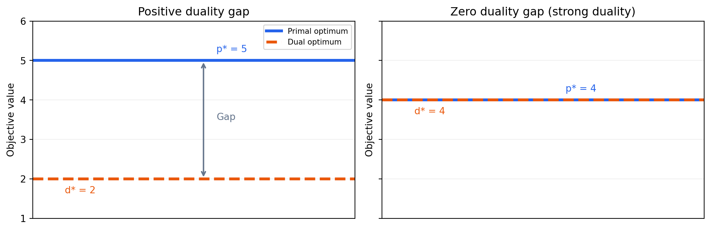
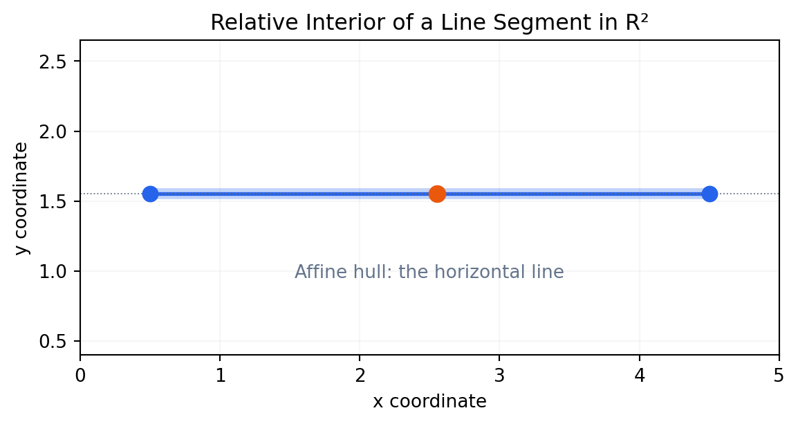
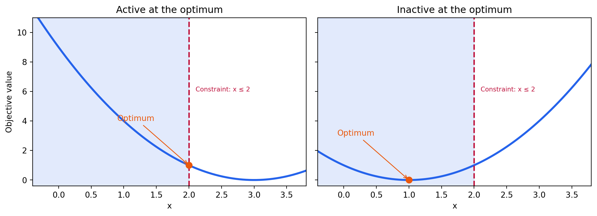
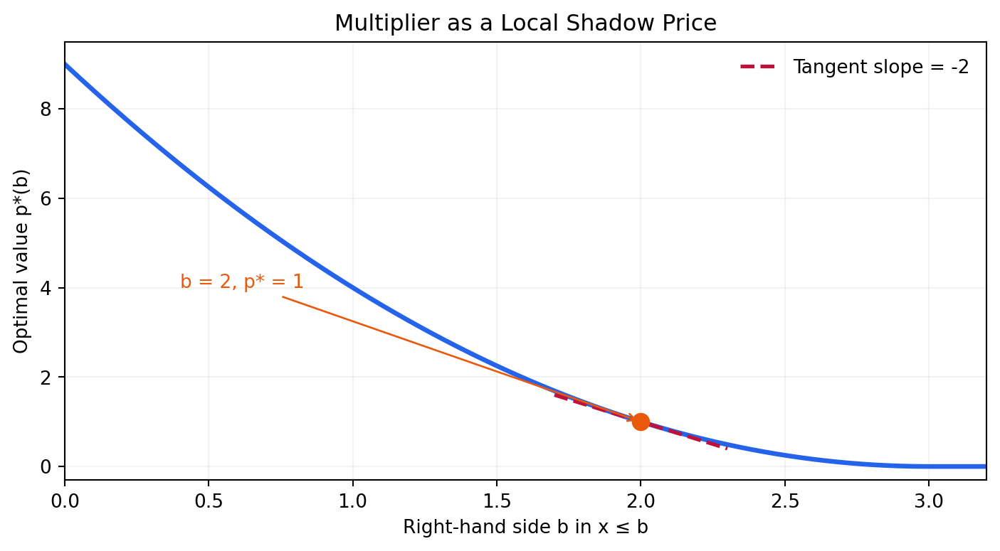
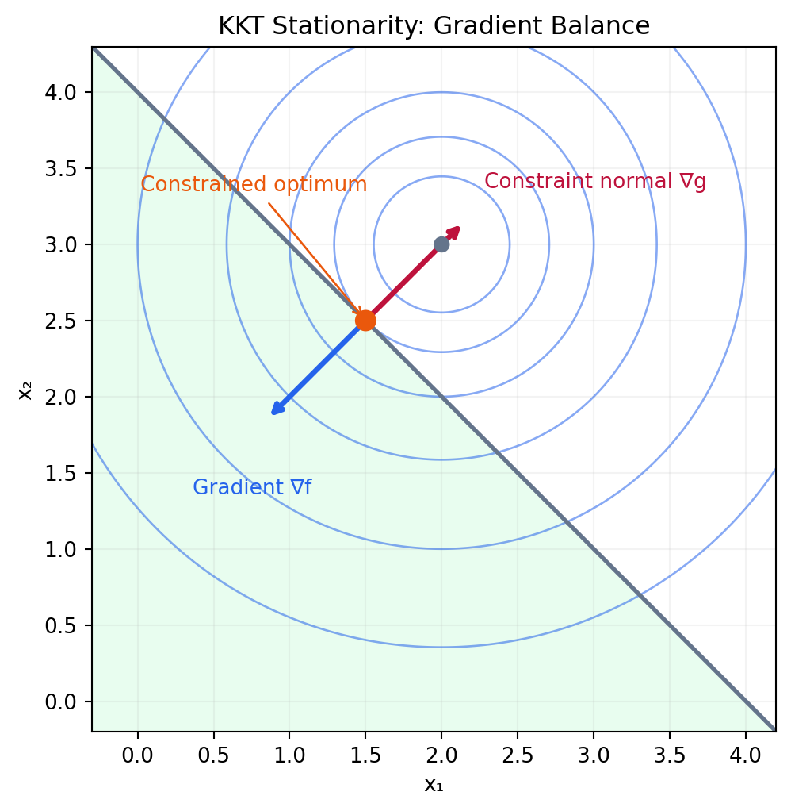
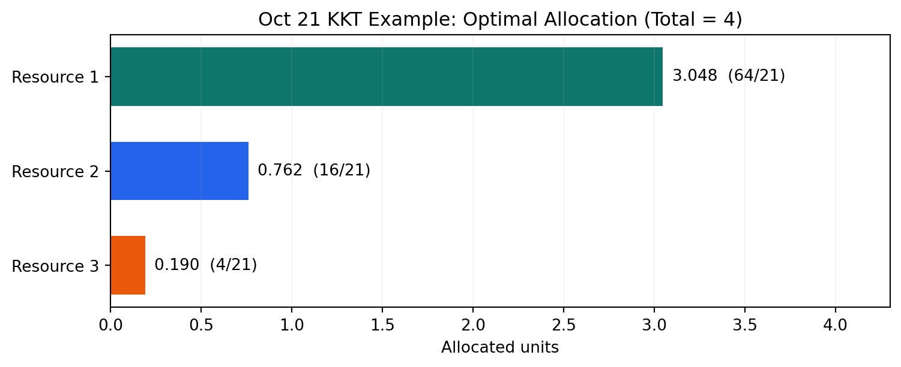
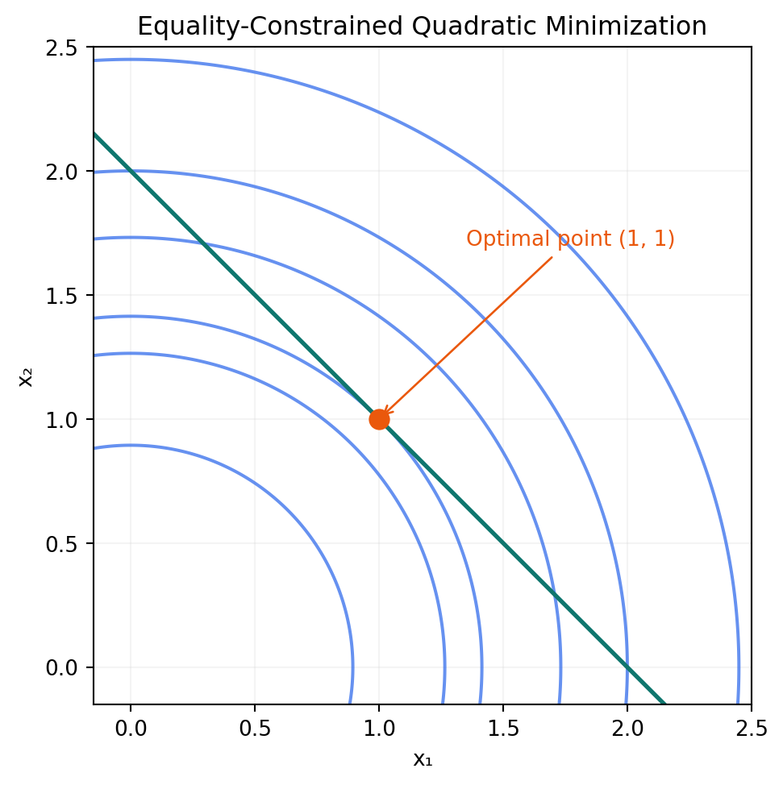
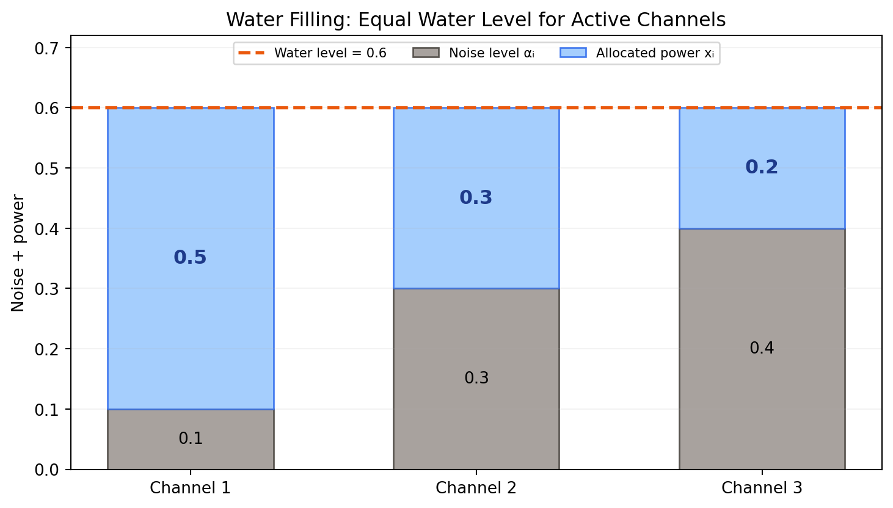
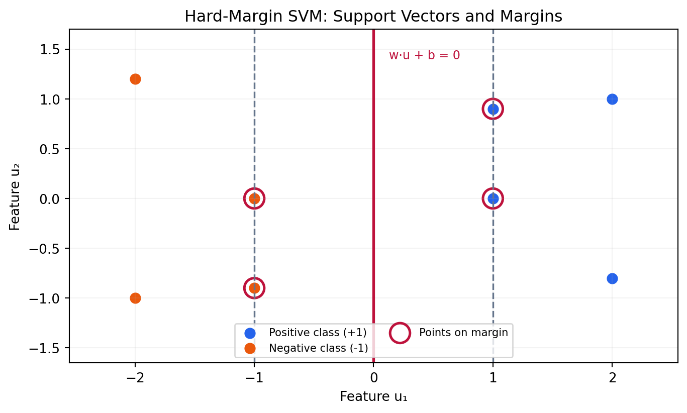

[앞 글의 Duality Part 1](/enai601-duality-part1/)에서는 제약을 Lagrangian에 포함해 <strong>원래 최소화 문제의 하한(lower bound)</strong>을 구했다. Dual Function을 최대화하면 가장 좋은 하한을 얻지만, 그 하한이 실제 최소 비용에 도달하는지는 별개의 질문이다.

이제 <strong>Duality Part 2</strong>에서는 그 질문을 한 단계 더 발전시킨다. 최적 하한과 실제 최적값이 같아질 때 어떤 조건이 반드시 성립하는가? 그리고 그 조건을 이용해 답을 직접 계산할 수는 없을까?

제약이 없을 때는 기울기가 0인 점을 찾았지만, 제약이 있으면 최적점에서도 목적함수의 기울기가 0이 아닐 수 있었다. <strong>KKT는 목적함수의 기울기에 제약들의 기울기를 함께 넣어, 어떤 점에서 더 이상 개선할 수 없는지를 표현한다.</strong> 네 조건을 따로 외우기보다 하한이 정확해지는 과정을 따라가면 각 조건이 필요한 이유가 드러난다.

먼저 $x\le2$인 포물선 문제 하나에서 활성·비활성 제약과 승수를 계산한다. 그 뒤 세 작업의 자원 배분을 끝까지 풀고, 등식 QP·Water Filling·SVM으로 확장한다. $p^*$는 원문제의 최적 <strong>비용값</strong>, $d^*$는 가장 좋은 dual <strong>하한값</strong>, $x^*$는 원래 선택, $\lambda^*,\nu^*$는 부등식·등식에 붙이는 최적 승수다. 서로 다른 역할의 값들이므로 혼동하지 말자.

## Part A. Strong Duality는 언제 성립할까?

### 1. Weak Duality와 Strong Duality의 정확한 차이

최소화 문제의 Primal Optimal Value를 다음과 같이 쓴다.

$$
p^*=	ext{Primal Optimal Value}
$$

Dual Optimal Value는 다음과 같다.

$$
d^*=	ext{Dual Optimal Value}
$$

Part 1의 Weak Duality는 모든 최소화 문제에서 성립하는 다음 관계였다.

$$
\boxed{d^*\le p^*}
$$

즉, Dual 문제는 원래 최적 비용보다 높은 값을 하한이라고 주장하지 않는다. 하지만 두 값 사이에 차이가 남을 수 있다.

$$
\text{Duality Gap}=p^*-d^*\ge0
$$

$p^*,d^*$가 모두 유한할 때 이 차이를 실수로 계산한다. 무한대가 포함되면 차이를 그대로 빼지 않는다. 만약 이 차이가 0이라면 <strong>Strong Duality(강한 쌍대성)</strong>가 성립한다.

$$
\boxed{p^*=d^*}
$$

그림은 Strong Duality가 성립하는 경우와 그렇지 않은 경우를 개념적으로 비교한 것이다. 수치는 설명용이며 실제 특정 최적화 문제를 나타내지는 않는다. Strong Duality가 성립하면 Dual 문제에서 얻은 최적 하한이 원래 문제의 정확한 최적값을 인증한다.

여기서 <strong>Convexity와 Strong Duality를 같은 뜻으로 생각해서는 안 된다.</strong> Convex 문제에서는 적절한 조건 아래 Strong Duality가 보장되며, 그러한 조건을 *Constraint Qualification(제약 자격조건)*이라 부른다.

### 2. 왜 Slater's Condition이 필요한가?

가장 자주 사용하는 충분조건 중 하나가 <strong>Slater's Condition(슬레이터 조건)</strong>이다. 직관적으로는 제약조건의 경계에만 겨우 매달린 점이 아니라, 부등식을 충분히 여유 있게 만족시키는 점을 찾는 것이다.

다음 문제를 보자.

$$
\begin{aligned}
\operatorname{minimize}_{x\in\mathbb R}\quad &(x-3)^2\\
\text{subject to}\quad &x-2\le0
\end{aligned}
$$

이 목적함수는 Convex이고, 부등식 제약은 Affine이다. 예를 들어 다음 점을 선택하면 원래 제약을 엄격하게 만족한다.

$$
x=1,\qquad 1-2=-1<0
$$

이런 점을 <strong>Strictly Feasible Point(엄격 가능점)</strong>라고 한다. 따라서 이 예제는 Slater's Condition을 만족한다. Strong Duality가 성립한다는 보장을 얻는다.

<blockquote class="lecture-excerpt">

교안 발췌 · Module 7 Part 2 — Slater’s Condition

There exists a feasible point $x\in\operatorname{relint}D$ such that

$$
f_i(x)<0\ (i=1,\ldots,m),\qquad Ax=b.
$$

When some of the inequality constraint functions are affine, weak inequality suffices for those constraints.

</blockquote>

### 3. Relative Interior는 왜 등장할까?

이때 강의에는 익숙하지 않은 용어인 <strong>Relative Interior(상대내부)</strong>가 등장한다.

2차원 평면 안에 놓인 선분을 생각해 보자. 선분의 어떤 점을 중심으로 작은 원판을 그리더라도 원판의 일부는 선분 밖에 놓이므로, 일반적인 2차원 의미에서 선분의 내부는 비어 있다.

그러나 선분 자체가 놓인 직선 위에서 생각하면 양 끝점을 제외한 부분은 분명히 내부처럼 행동한다. 이것이 상대내부의 직관이다.

집합의 Affine Hull(아핀껍질)을 먼저 고려하고, 그 안에서 내부인 점을 찾는 것이다.

$$
\operatorname{relint} C
=\left\{x\in C:\exists r>0,\ B(x,r)\cap\operatorname{aff}C\subseteq C\right\}
$$

일반적인 Slater 조건은 다음과 같다. $D$는 함수들이 정의되는 <strong>공통 정의역</strong>이며 실제 가능집합과 구별한다. 예를 들어 목적함수가 모든 실수에서 정의되고 등식이 $x_1+x_2=2$라면 $D=\mathbb R^2$다. 실제 가능집합은 직선이지만, 그래서 $D$도 그 직선이라고 바꾸는 것은 아니다. 상대내부는 함수 자체의 정의역이 낮은 차원에 놓일 수도 있어 일반적인 정리에 사용한다.

$$
\begin{aligned}
&\exists x\in\operatorname{relint}D:\\
&f_i(x)<0\qquad (i=1,\ldots,m)\\
&Ax=b
\end{aligned}
$$

단, <strong>Affine Inequality Constraints에는 완화된 Slater 조건</strong>을 사용할 수 있다. 모든 부등식 제약이 Affine인 경우에는 적절한 정의역의 상대내부에 있는 Feasible Point가 있으면 된다. 특히 공통 정의역이 전체 실수 공간이고 모든 제약이 affine인 볼록 LP·QP에서는 완화된 Slater 조건이 가능점의 존재로 줄어든다. 다만 최적 비용이 유한한지와 최적점이 실제로 존재하는지는 별도로 확인한다. 가능점이 있다는 사실만으로 비용이 아래로 무한히 내려가는 경우까지 배제되지는 않는다.

<strong>조건을 읽을 때:</strong> Strong Duality는 모든 Convex 문제에서 자동으로 성립하는 것이 아니며, Slater's Condition은 대표적인 <em>충분조건</em>이다. Strong Duality가 성립하는 비볼록 문제도 존재한다. 또한 최적 승수가 실제로 존재한다는 Dual Attainment와, 최적값만 같다는 사실은 구분해야 한다. 이 볼록 문제의 Slater 조건은 $d^*>-\infty$일 때 dual 최적 승수의 존재도 보장한다. 값이 같다는 사실만으로 그 값을 달성하는 유한한 승수나 primal 최적점까지 자동으로 존재한다고 결론 내리지는 않는다.

---

## Part B. Complementary Slackness는 어디서 나올까?

### 4. 먼저 Active Constraint와 Inactive Constraint를 구별한다

Part A의 한 변수 문제를 다시 보자.

$$
\begin{aligned}
\min_x\quad &(x-3)^2\\
\text{subject to}\quad &x\le2
\end{aligned}
$$

제약이 없을 때 최솟값은 3에서 얻지만, 3은 허용되지 않는다. 제약을 만족하는 점 가운데 가장 좋은 점은 2다.

$$
\boxed{x^*=2,\qquad p^*=1}
$$

이때 제약식의 왼쪽은 정확히 0이다.

$$
x^*-2=0
$$

이를 <strong>Active Constraint(활성 제약)</strong>라고 부른다. 제약의 경계까지 정확히 도달했다는 뜻이다.

반대로 목적함수를 바꾼 다음 문제를 생각하자.

$$
\begin{aligned}
\min_x\quad &(x-1)^2\\
\text{subject to}\quad &x\le2
\end{aligned}
$$

이번에는 최적점 1에서 제약을 여유 있게 만족한다.

$$
x^*=1,\qquad x^*-2=-1<0
$$

이 경우는 <strong>Inactive Constraint(비활성 제약)</strong>다.

경계에 도달했는지의 여부는 최적화에서 단순한 그림 문제가 아니다. 해당 점에서 어느 경계에 닿아 있는지를 알려준다. 다만 경계에 닿았다고 그 제약이 반드시 양의 승수를 가져야 하는 것은 아니며, 이 차이는 7절에서 구별한다.

### 5. Lagrangian을 다시 작성한다

다음 최적화 문제를 기준으로 계산하자.

$$
\begin{aligned}
\min_x\quad &(x-3)^2\\
\text{subject to}\quad &x-2\le0
\end{aligned}
$$

Lagrangian은 목적함수에 제약항을 Multiplier로 가중해 더한 것이다.

$$
\boxed{L(x,\lambda)=(x-3)^2+\lambda(x-2),\qquad\lambda\ge0}
$$

Feasible Point에서는 제약식이 0 이하이고 Multiplier는 0 이상이므로, 제약항은 양수가 될 수 없다.

$$
L(x,\lambda)\le f_0(x)\qquad\text{for feasible }x
$$

Dual Function은 Multiplier를 고정한 뒤 Lagrangian을 원래 변수에 대해 최소화한 값이다.

$$
g(\lambda)=\inf_x L(x,\lambda)
$$

따라서 임의의 Feasible Point와 Nonnegative Multiplier에 대해 다음 부등식이 성립한다.

$$
g(\lambda)\le L(x,\lambda)\le f_0(x)
$$

이것이 Complementary Slackness를 유도할 준비다.

### 6. Strong Duality이면 왜 곱이 0이 될까?

Primal 최적점과 Dual 최적 승수가 실제로 존재하며 Strong Duality가 성립한다고 하자.

$$
\begin{aligned}
g(\lambda^*)&\le L(x^*,\lambda^*)\le f_0(x^*)\\
d^*&=p^*
\end{aligned}
$$

양 끝이 같은 값이므로 가운데 값 역시 그 값과 같아야 한다.

$$
L(x^*,\lambda^*)=f_0(x^*)
$$

Lagrangian 정의를 대입해 보자.

$$
f_0(x^*)+\lambda^* f_1(x^*)=f_0(x^*)
$$

따라서 다음 식을 얻는다.

$$
\boxed{\lambda^* f_1(x^*)=0}
$$

이것이 <strong>Complementary Slackness(상보적 여유 조건)</strong>다.

여러 개의 부등식 제약이 있는 경우에도 같은 논리가 성립한다. 모든 항이 0 이하이고 이들의 합이 0이므로 각각 0이어야 한다.

$$
\boxed{\lambda_i^*f_i(x^*)=0\qquad(i=1,\ldots,m)}
$$

<blockquote class="lecture-excerpt">

교안 발췌 · Module 7 Part 2 — Complementary Slackness

Suppose that strong duality holds. Let $x^*$ and $(\lambda^*,\nu^*)$ denote primal and dual optimal points.

$$
x^*\in\operatorname{argmin}_{x\in D}L(x,\lambda^*,\nu^*),\qquad
\lambda_i^*f_i(x^*)=0\quad(i=1,\ldots,m).
$$

</blockquote>

일반형에 등식이 있더라도 가능한 점에서는 $h_j(x^*)=0$이어서 그 항들은 사라진다. 또한 $\sum_i\lambda_i^*f_i(x^*)=0$에서 각 항을 0이라고 할 수 있는 이유는 <strong>모든 항이 0 이하</strong>이기 때문이다. 양수와 음수가 상쇄되는 합이라면 같은 결론을 내릴 수 없다.

### 7. 식이 뜻하는 것을 두 경우로 나누어 읽는다

| 제약 상태 | 제약함수값 | 최적 Multiplier에 대한 결론 |
|---|---|---|
| Inactive / Slack | 음수 | 반드시 0 |
| Active | 0 | 0 이상이면 가능. 반드시 양수일 필요는 없음 |

정확한 논리 방향은 다음과 같다.

- 제약에 여유가 남으면, 최적 승수는 0이다.
- 최적 승수가 양수이면, 그 제약은 반드시 활성이다.
- 제약이 활성이라고 해서 승수가 반드시 양수인 것은 아니다.

이 마지막 구분이 중요하다. 예를 들어 다음 문제는 경계에 있는 최적점에서 승수가 0인 사례다.

$$
\begin{aligned}
\min_x\quad &(x-2)^2\\
\text{subject to}\quad &x\le2
\end{aligned}
$$

최적점은 경계인 2이고 원래 Gradient도 0이므로, Lagrangian Stationarity를 만족하는 승수는 0이다. 즉 <strong>Active와 Positive Multiplier는 동의어가 아니다.</strong>

### 8. 경제적 의미: Multiplier는 Shadow Price다

Lagrangian Multiplier는 단순한 계산 도구를 넘어선다. 제약의 우변을 조금 완화했을 때 최적 비용이 어떻게 달라지는지를 설명할 수 있다.

제약의 우변을 변수 b로 바꾸자.

$$
\begin{aligned}
p^*(b)=\min_x\quad &(x-3)^2\\
\text{subject to}\quad &x\le b
\end{aligned}
$$

b가 3보다 작은 구간에서는 최적점이 경계에 놓이므로 다음과 같다.

$$
p^*(b)=(b-3)^2\qquad(b<3)
$$

$b\ge3$이면 원래 최적점 3을 선택할 수 있어 최적 비용은 0이고 제약은 더 이상 비용을 높이지 않는다. 그림에서 오른쪽 곡선이 0에 머무는 이유다.

$b<3$인 구간에서 양변을 미분하면

$$
\frac{dp^*(b)}{db}=2(b-3)
$$

b가 2일 때는

$$
\left.\frac{dp^*(b)}{db}\right|_{b=2}=-2
$$

한편 $L=(x-3)^2+\lambda(x-b)$를 $x$로 미분하면 $2(x-3)+\lambda$다. $b=2$의 최적점 $x=2$에서 이를 0으로 만드는 승수는 $\lambda^*=2$다. 뒤에서 이 관계를 Stationarity라고 부른다. 따라서

$$
\boxed{\frac{dp^*}{db}=-\lambda^*=-2\qquad\text{at }b=2}
$$

제약의 허용 한계를 조금 늘리면 최적 비용이 내려간다는 뜻이다. 이 예제에서는 허용 한계를 0.01만큼 늘릴 때 최적 비용이 대략 0.02 감소한다. 이 해석은 해당 구간에서 최적값이 매끄럽게 변하고 정규성 조건이 만족되는 상황의 <strong>국소적인 민감도(Sensitivity)</strong> 설명이다. 모든 문제에서 아무 조건 없이 같은 미분 공식을 사용할 수 있는 것은 아니다.

---

## Part C. KKT: 네 가지 조건이 어떻게 하나로 연결될까?

### 9. KKT Conditions의 일반형

목적함수와 제약함수가 열린 정의역에서 미분 가능한 다음 문제를 생각한다. 경계에서 미분이 되지 않는 경우는 이 미분형 조건을 그대로 적용하지 않고 따로 확인한다.

$$
\begin{aligned}
\operatorname{minimize}_x\quad &f_0(x)\\
\text{subject to}\quad &f_i(x)\le0\quad(i=1,\ldots,m)\\
&h_j(x)=0\quad(j=1,\ldots,p)
\end{aligned}
$$

Lagrangian은 다음과 같다.

$$
L(x,\lambda,\nu)=f_0(x)+\sum_{i=1}^m\lambda_i f_i(x)+\sum_{j=1}^p\nu_j h_j(x)
$$

KKT는 <strong>Karush–Kuhn–Tucker Conditions(카루시–쿤–터커 조건)</strong>의 약자다. $\nabla_x$는 “승수는 고정하고 원래 변수 $x$로만 미분한다”는 뜻이다. $\lambda$는 람다, $\nu$는 뉴라고 읽는다.

Part 1의 부등식 $g\le L\le f_0$에서 최적값이 같아지면, 두 가지 일이 동시에 일어난다. <strong>$x^*$가 Lagrangian을 최소화하고</strong>, <strong>제약항의 합이 0</strong>이어야 한다. 두 번째가 상보적 느슨함이었다. 첫 번째는 최적점이 정의역 내부에 있고 미분 가능할 때 $\nabla_xL=0$을 준다. 원래 문제의 목적함수만 최소화하는 것이 아니라, 고정된 최적 승수에서 보조 함수 $L$을 최소화한다는 점이 중요하다.

이 관계에 원래 제약과 승수의 부호를 합치면 네 조건이 된다. 필요·충분조건으로 사용할 수 있는 범위는 11절에서 분명히 한다.

<strong>1. Primal Feasibility:</strong> 원래 제약을 지키는가?

$$
\boxed{f_i(x^*)\le0,\qquad h_j(x^*)=0}
$$

<strong>2. Dual Feasibility:</strong> 부등식 Multiplier가 음수가 아닌가?

$$
\boxed{\lambda_i^*\ge0}
$$

<strong>3. Complementary Slackness:</strong> 제약에 여유가 남는다면 그 제약의 승수가 0인가?

$$
\boxed{\lambda_i^* f_i(x^*)=0}
$$

<strong>4. Stationarity:</strong> 원래 목적함수 Gradient와 제약들의 Gradient가 균형을 이루는가?

$$
\boxed{\nabla_x L(x^*,\lambda^*,\nu^*)=0}
$$

마지막 조건을 펼치면 다음과 같다.

$$
\nabla f_0(x^*)+\sum_{i=1}^m\lambda_i^*\nabla f_i(x^*)+\sum_{j=1}^p\nu_j^*\nabla h_j(x^*)=0
$$

여기서 Equality Multiplier에는 부호 제약이 없다. 등식 제약의 잔차는 Feasible Point에서 항상 0이기 때문이다.

<blockquote class="lecture-excerpt">

교안 발췌 · Module 7 Part 2 — Karush–Kuhn–Tucker Conditions

$$
\begin{aligned}
f_i(x^*)&\le0,\quad h_j(x^*)=0,\\
\lambda^*&\ge0,\\
\lambda_i^*f_i(x^*)&=0,\\
\nabla f_0(x^*)+\sum_i\lambda_i^*\nabla f_i(x^*)
+\sum_j\nu_j^*\nabla h_j(x^*)&=0.
\end{aligned}
$$

</blockquote>

<strong>Primal feasibility는 후보 $x$를 검사하고, dual feasibility는 승수의 부호를 검사한다.</strong> 상보적 느슨함은 후보와 승수를 묶고, stationarity는 미분값들을 묶는다. 네 조건은 서로 다른 검사를 하므로, 미분식 하나를 풀었다고 나머지가 자동으로 성립하지 않는다.

### 10. Stationarity를 기하학적으로 읽기

앞에서 계속 사용한 문제를 다시 보자.

$$
\begin{aligned}
\min_x\quad &(x-3)^2\\
\text{subject to}\quad &x-2\le0
\end{aligned}
$$

Lagrangian의 미분은 다음과 같다.

$$
\frac{\partial L}{\partial x}=2(x-3)+\lambda
$$

최적점 2를 대입해 0으로 놓으면

$$
-2+\lambda^*=0
$$

따라서

$$
\boxed{\lambda^*=2}
$$

이다. 목적함수의 Gradient는 -2로, 최적점에서 0이 아니다. 대신 제약함수의 Gradient에 Multiplier를 곱한 값이 +2가 되어 합이 0이 된다. 이는 앞에서 QP의 Optimality Criterion을 공부했을 때와 같은 기하학적 균형이다.

2변수 예제에서는 이 관계가 더 선명하다.

$$
\begin{aligned}
\min_{x_1,x_2}\quad &(x_1-2)^2+(x_2-3)^2\\
\text{subject to}\quad &x_1+x_2-4\le0
\end{aligned}
$$

최적점 후보는 다음과 같다.

$$
x^*=\begin{bmatrix}1.5\\2.5\end{bmatrix}
$$

목적함수와 제약의 Gradient는 각각 다음과 같다.

$$
\nabla f_0(x^*)=\begin{bmatrix}-1\\-1\end{bmatrix},\qquad
\nabla f_1(x^*)=\begin{bmatrix}1\\1\end{bmatrix}
$$

따라서 KKT Stationarity는

$$
\nabla f_0(x^*)+\lambda^*\nabla f_1(x^*)=0
$$

이며 이를 만족하는 승수는 1이다.

$$
\boxed{\lambda^*=1}
$$

그림에서 제약 법선을 표시한 $\nabla g$는 이 절의 $\nabla f_1$을 뜻한다. 이 그림의 $g$는 제약식 표기이며, dual function $g$와 구별한다. 그림의 두 화살표는 방향을 보여 주기 위해 같은 비율로 축소했으며, 최적점에서 서로 반대 방향을 가리킨다. Gradient가 0이 아닌데도 최적점이 될 수 있는 이유가 여기에 있다. 제약을 위반하지 않는 방향으로는 더 이상 비용을 줄일 수 없는 상태다.

#### 활성인지 모르면 두 경우를 나누어 직접 풀기

처음부터 최적점이 경계에 있다고 안다고 가정하지 말자. $\min(x-3)^2$ subject to $x\le2$에서 KKT를 쓰면

$$
x\le2,\quad\lambda\ge0,\quad\lambda(x-2)=0,\quad2(x-3)+\lambda=0.
$$

곱이 0이므로 적어도 한 인자가 0이다. 두 경우는 $\lambda=0$과 $x=2$이며 서로 배타적일 필요는 없다.

| 가정 | Stationarity로 계산 | 남은 조건 검사 |
|---|---|---|
| $\lambda=0$ | $x=3$ | $x\le2$를 위반하므로 탈락 |
| $x=2$ | $\lambda=2$ | 원래 제약·승수 부호·곱 조건을 모두 만족 |

따라서 $(x^*,\lambda^*)=(2,2)$다. 비용은 1이다. 실제로 승수 2를 고정하면

$$
L(x,2)=(x-3)^2+2(x-2)=(x-2)^2+1.
$$

따라서 $g(2)=1$이고 원래 후보의 비용 $f_0(2)=1$과 같다. KKT 계산은 Part 1에서 배운 **원래 비용에 정확히 도달하는 하한**을 찾은 것이다. 목적함수와 제약이 볼록하고 제약이 affine이므로, 이 KKT 후보가 전역 최적임은 다음 절의 충분성으로 보장된다.

이번에는 목적함수만 $(x-1)^2$로 바꾸자. $\lambda=0$이면 $x=1$이 되어 모든 조건을 만족한다. 경계 $x=2$를 가정하면 $2(2-1)+\lambda=0$에서 $\lambda=-2$가 나와 dual feasibility를 위반한다. 따라서 경계 후보를 버린다. <strong>양의 승수 조건은 장식이 아니라, 경계에서 잘못된 후보를 걸러 내는 검사다.</strong>

### 11. KKT는 필요조건일까, 충분조건일까?

수업에서는 여기서 두 문장을 구분한다.

- <strong>Necessity(필요성):</strong> 적절한 미분 가능성 아래 Primal·Dual 최적해가 존재하고 Strong Duality가 성립하면 최적해는 KKT를 만족한다. 이러한 결론은 비볼록 문제에서도 성립할 수 있다.
- <strong>Sufficiency(충분성):</strong> Convex Optimization Problem에서 KKT를 만족하는 Primal·Dual Feasible Point를 찾으면 그 점은 전역 최적해이며 Duality Gap은 0이다.

따라서 다음 결론이 중요하다.

<blockquote class="lecture-excerpt">

교안 발췌 · Module 7 Part 2 — Necessity and Sufficiency

For a convex optimization problem that satisfies Slater’s condition, $x^*$ is optimal if and only if there exists a pair $(\lambda^*,\nu^*)$ such that the KKT conditions hold.

</blockquote>

#### KKT 후보가 있으면 왜 최적성이 증명되는가?

볼록 목적함수·볼록 부등식 제약·affine 등식 제약에서, $\lambda\ge0$를 고정한 $L$은 $x$에 대해 볼록하다. 미분 가능한 볼록함수의 기울기가 0인 점은 전역 최소점이다. 따라서 stationarity가 성립하는 후보는 $g(\lambda,\nu)=L(x,\lambda,\nu)$를 만족한다. Primal feasibility와 complementary slackness는 다시 $L(x,\lambda,\nu)=f_0(x)$를 준다.

$$
g(\lambda,\nu)=L(x,\lambda,\nu)=f_0(x).
$$

유효한 하한과 가능한 비용이 일치하므로 primal·dual 후보가 모두 최적이다. <strong>이 충분성 증명에는 Slater 조건이 따로 필요하지 않다.</strong> Slater는 주로 “최적점에 대응하는 승수를 찾을 수 있는가”라는 필요성·존재 보장을 준다.

최적점이 있어도 유한한 KKT 승수가 없는 경우는 글 끝의 심화 예제에서 구별한다.

기억해야 할 점은 Slater 조건이 KKT를 사용할 수 있는 모든 상황의 필요조건은 아니라는 사실이다. 또한 미분 불가능한 경계점이 포함된 문제에서는 Stationarity를 도함수 하나로 적어도 되는지 별도로 확인해야 한다.

---

## Part D. 10월 21일 수업의 KKT 종합 연습문제

### 12. 이 문제는 무엇을 시험하려는가?

2026년 10월 21일 수업에서 수업에서는 중간고사에 출제할 수도 있었던 예제를 실제로 풀었다. 이 문제는 이전 연도 시험지의 문제가 아니라, 수업 중 제시한 <strong>KKT 종합 연습문제</strong>다. 주어진 Hint를 활용하면 경우를 나누지 않고 풀이할 수 있다.

$$
\boxed{\begin{aligned}
\operatorname{minimize}_{x\in\mathbb R^3}\quad
&-\left(4\sqrt{x_1}+2\sqrt{x_2}+\sqrt{x_3}\right)\\
\text{subject to}\quad
&-x_i\le0\quad(i=1,2,3)\\
&x_1+x_2+x_3=4
\end{aligned}}
$$

문제가 요구하는 세 가지를 순서대로 풀이한다.

1. Convex Optimization Problem인지 확인한다.
2. Strong Duality가 성립하는지 확인한다.
3. KKT Conditions를 사용해 최적점을 구한다.

<strong>Hint:</strong> 최적점의 모든 성분이 양수이다.

### 13. (a) Convexity 확인

제곱근 함수는 $[0,\infty)$에서 concave다. 음수를 곱한 각 항은 끝점 0을 포함한 정의역에서 convex다. 양수인 곳에서는 두 번째 미분으로 확인하고, 0까지의 볼록성은 연속적인 극한으로도 이어진다. 미분 가능성과 볼록성은 별개이므로, 0에서 도함수가 유한하지 않다는 사실이 볼록성을 깨뜨리지는 않는다.

$$
-4\sqrt{x_1},\qquad -2\sqrt{x_2},\qquad -\sqrt{x_3}
$$

이들의 합도 Convex다. 세 개의 비음수 제약과 총량 등식은 모두 Affine이다. 따라서 문제는 Convex Optimization Problem이다.

목적함수에 제곱근이 있으므로 이 문제는 Quadratic Programming 자체는 아니다. 그러나 KKT는 QP뿐 아니라 이러한 Convex Optimization에도 적용된다.

### 14. (b) Slater's Condition 확인

다음 점을 선택하자.

$$
\bar x=\begin{bmatrix}1\\1\\2\end{bmatrix}
$$

모든 성분이 양수이므로 비음수 제약을 엄격하게 만족한다. 합은 정확히 4이다.

$$
1+1+2=4
$$

따라서 엄격 가능점이 존재한다. 공통 정의역 $D=\mathbb R_+^3$의 상대내부는 $\mathbb R_{++}^3$이므로 그 조건도 만족한다. 가능집합은 합이 4인 닫힌 비음수 단체이고 compact하며, 목적함수는 연속이다. 따라서 유한한 최적값과 primal 최적점이 실제로 존재한다. 이 문제는 Convex이고 Slater's Condition을 만족하므로 Strong Duality가 성립한다.

### 15. (c-1) Lagrangian 작성

세 개의 부등식에 대해 세 개의 Multiplier가 필요하다.

$$
\lambda_1,\lambda_2,\lambda_3\ge0
$$

총량 등식에는 하나의 Multiplier가 필요하며 부호 제한이 없다.

$$
\nu\in\mathbb R
$$

따라서 Lagrangian은 다음과 같다.

$$
\begin{aligned}
L(x,\lambda,\nu)
={}&-4\sqrt{x_1}-2\sqrt{x_2}-\sqrt{x_3}\\
&-\lambda_1x_1-\lambda_2x_2-\lambda_3x_3\\
&+\nu(x_1+x_2+x_3-4)
\end{aligned}
$$

부등식 Multiplier 앞에 마이너스 부호가 붙은 이유는 제약함수를 다음과 같이 설정했기 때문이다.

$$
f_i(x)=-x_i\le0
$$

### 16. (c-2) Complementary Slackness로 항 제거

Complementary Slackness는 다음과 같다.

$$
\lambda_i^*(-x_i^*)=0
$$

따라서

$$
\lambda_i^*x_i^*=0
$$

이다. 그런데 Hint는 모든 최적 성분이 양수라고 말한다.

$$
x_1^*>0,\qquad x_2^*>0,\qquad x_3^*>0
$$

이제 곱이 0이 되려면 Multiplier가 모두 0이어야 한다.

$$
\boxed{\lambda_1^*=\lambda_2^*=\lambda_3^*=0}
$$

이 단계는 단순한 계산 생략이 아니다. <strong>제약에 여유가 있는 최적점에서는 그 제약에 대응하는 승수가 사라진다</strong>는 KKT 조건을 직접 사용한 결과다.

### 17. (c-3) Stationarity에서 자원 배분 비율 도출

제곱근의 도함수는 다음과 같다.

$$
\frac{d}{dx}\sqrt{x}=\frac{1}{2\sqrt{x}}\qquad(x>0)
$$

따라서 Lagrangian을 세 변수로 각각 미분하면

$$
\begin{aligned}
\frac{\partial L}{\partial x_1}&=-\frac{2}{\sqrt{x_1}}-\lambda_1+\nu\\
\frac{\partial L}{\partial x_2}&=-\frac{1}{\sqrt{x_2}}-\lambda_2+\nu\\
\frac{\partial L}{\partial x_3}&=-\frac{1}{2\sqrt{x_3}}-\lambda_3+\nu
\end{aligned}
$$

가 된다. 앞에서 모든 최적 Lambda가 0이라는 사실을 얻었으므로 Stationarity는 다음과 같이 단순화된다.

$$
\begin{aligned}
-\frac{2}{\sqrt{x_1^*}}+\nu^*&=0\\
-\frac{1}{\sqrt{x_2^*}}+\nu^*&=0\\
-\frac{1}{2\sqrt{x_3^*}}+\nu^*&=0
\end{aligned}
$$

세 식의 우변은 모두 같은 Multiplier이므로, 좌변에서 대응하는 한계비용도 일치해야 한다.

$$
\boxed{\frac{2}{\sqrt{x_1^*}}=
\frac{1}{\sqrt{x_2^*}}=
\frac{1}{2\sqrt{x_3^*}}=\nu^*}
$$

먼저 첫 번째와 두 번째를 비교한다.

$$
\frac{2}{\sqrt{x_1^*}}=\frac{1}{\sqrt{x_2^*}}
$$

이를 정리하고 제곱하면

$$
\sqrt{x_1^*}=2\sqrt{x_2^*}
$$

$$
\boxed{x_1^*=4x_2^*}
$$

이제 첫 번째와 세 번째를 비교하면

$$
\frac{2}{\sqrt{x_1^*}}=\frac{1}{2\sqrt{x_3^*}}
$$

$$
\sqrt{x_1^*}=4\sqrt{x_3^*}
$$

$$
\boxed{x_1^*=16x_3^*}
$$

따라서 최적 자원 배분 비율은 다음과 같다.

$$
\boxed{x_1^*:x_2^*:x_3^*=16:4:1}
$$

### 18. (c-4) 총량 제약을 이용해 실제 값 계산

이제 총량 제약을 사용한다.

$$
x_1^*+x_2^*+x_3^*=4
$$

앞에서 구한 비율을 대입하면

$$
16x_3^*+4x_3^*+x_3^*=4
$$

$$
21x_3^*=4
$$

따라서

$$
\boxed{x_3^*=\frac4{21}}
$$

이고 나머지 두 변수도 구할 수 있다.

$$
\boxed{x_1^*=\frac{64}{21},\qquad x_2^*=\frac{16}{21}}
$$

최적점 전체를 벡터로 정리하면

$$
\boxed{x^*=\begin{bmatrix}64/21\\16/21\\4/21\end{bmatrix}}
$$

이 값들은 모두 양수이고 합이 4이므로 Feasible하다. Stationarity에서 Equality Multiplier까지 계산하면

$$
\boxed{\nu^*=\frac{\sqrt{21}}{4}}
$$

가 된다. 최적 목적함수값은 다음과 같다.

$$
\begin{aligned}
p^*&=-\left(4\sqrt{\frac{64}{21}}+2\sqrt{\frac{16}{21}}+\sqrt{\frac4{21}}\right)\\
&=-\frac{32+8+2}{\sqrt{21}}\\
&=\boxed{-2\sqrt{21}}
\end{aligned}
$$

이 점은 KKT 조건을 만족하고 원래 문제가 Convex이므로 전역 최적점이다. Slater's Condition까지 확인했으므로 Primal과 Dual의 최적값도 같다.

### 19. 왜 이런 비율이 나올까? AI 자원 배분의 관점

목적함수에 음수가 붙었으므로 원래 문제는 다음 효용을 최대화하는 문제와 같다.

$$
U(x)=4\sqrt{x_1}+2\sqrt{x_2}+\sqrt{x_3}
$$

총 4단위의 컴퓨팅 자원을 세 작업에 나누어 준다고 생각해 보자. 첫 번째 작업의 중요도가 가장 높지만, 제곱근 함수는 자원을 많이 받을수록 추가 자원 한 단위의 효용이 작아지는 <strong>Diminishing Returns(한계효용 체감)</strong>를 표현한다.

따라서 첫 번째 작업에만 모든 자원을 주는 것이 아니라, 세 작업에 대한 <strong>Marginal Utility(한계효용)</strong>가 같아지도록 나누는 것이 유리하다. 앞의 Stationarity가 바로 이 균형을 수식으로 나타낸 것이다.

추가 검산으로 Cauchy–Schwarz Inequality를 사용할 수도 있다.

$$
\begin{aligned}
4\sqrt{x_1}+2\sqrt{x_2}+\sqrt{x_3}
&\le\sqrt{4^2+2^2+1^2}\sqrt{x_1+x_2+x_3}\\
&=\sqrt{21}\sqrt4\\
&=2\sqrt{21}
\end{aligned}
$$

등호가 성립하는 조건에서도 바로 다음 비율을 얻는다.

$$
x_1:x_2:x_3=16:4:1
$$

이는 KKT 풀이와 독립적으로 최적값을 확인해 주는 방법이다. 수업에서 요구한 풀이는 <strong>KKT 네 조건의 적용</strong>이므로, 이 부등식은 그 풀이를 대체하기보다 독립적인 검산으로 활용한다.

<strong>미분 가능성 주의:</strong> 제곱근은 0에서 도함수가 유한하지 않다. 수업에서 제공한 “최적점의 모든 성분이 양수”라는 Hint는 이 문제에서 직접적인 미분과 Lambda 제거를 정당화해 준다. Hint가 없다면 0인 성분이 있는 경우까지 검토해야 한다. 그 경계에서는 제곱근의 보통 도함수를 대입할 수 없으므로 극한·직접 비교 등의 별도 논리가 필요하다. 위 Cauchy–Schwarz 검산은 모든 비음수 점에서 유효하고 등호 조건이 양의 후보만 남기므로, 이 사례에서는 그 경계까지 포함해 최적성을 확인해 준다.

---

## Part E. KKT를 QP·Water Filling·SVM에 적용하기

### 20. Equality-Constrained QP: 최적화가 연립방정식으로 바뀐다

Module 7 Part 2의 첫 번째 KKT 응용은 <strong>Equality-Constrained Convex Quadratic Minimization</strong>이다.

$$
\begin{aligned}
\min_x\quad &\frac12x^TPx+q^Tx+r\\
\text{subject to}\quad &Ax=b
\end{aligned}
$$

여기서 P는 PSD인 대칭행렬이다. 부등식 제약이 없으므로 비음수 Dual Multiplier나 Complementary Slackness는 필요하지 않다.

Lagrangian은 다음과 같다.

$$
L(x,\nu)=\frac12x^TPx+q^Tx+r+\nu^T(Ax-b)
$$

Stationarity와 Primal Feasibility를 각각 쓰면

$$
Px+q+A^T\nu=0
$$

$$
Ax=b
$$

이다. 이 두 식을 한 번에 묶으면

$$
\boxed{
\begin{bmatrix}P&A^T\\A&0\end{bmatrix}
\begin{bmatrix}x^*\\\nu^*\end{bmatrix}
=
\begin{bmatrix}-q\\b\end{bmatrix}}
$$

를 얻는다. 이것이 교안에서 소개한 <strong>KKT Linear System</strong>이다. 단, 이 행렬이 항상 가역인 것은 아니다. 조건에 따라 해가 여러 개이거나 선형시스템의 유일성을 추가로 확인해야 할 수 있다.

<blockquote class="lecture-excerpt">

교안 발췌 · Module 7 Part 2 — Equality constrained convex quadratic minimization

$$
\begin{bmatrix}P&A^T\\A&0\end{bmatrix}
\begin{bmatrix}x^*\\\nu^*\end{bmatrix}
=\begin{bmatrix}-q\\b\end{bmatrix},\qquad P\in S_+^n.
$$

</blockquote>

위쪽 블록은 stationarity, 아래쪽 블록은 원래 등식이다. $x$가 $n$개, 등식 승수가 $p$개이면 미지수와 식이 각각 $n+p$개다. 개수가 같다는 사실만으로 유일성을 보장하지는 않는다. 예를 들어 $P$가 PD이고 $A$의 행들이 선형독립이면 이 KKT 행렬은 가역이다. PSD만으로는 이 결론을 내릴 수 없다.

#### 숫자 예제

$$
\begin{aligned}
\min_{x_1,x_2}\quad &\frac12(x_1^2+x_2^2)\\
\text{subject to}\quad &x_1+x_2=2
\end{aligned}
$$

Lagrangian을 작성하면

$$
L(x,\nu)=\frac12(x_1^2+x_2^2)+\nu(x_1+x_2-2)
$$

Stationarity는 다음과 같다.

$$
x_1+\nu=0,\qquad x_2+\nu=0
$$

따라서 두 변수는 같고, 합이 2이므로

$$
\boxed{x_1^*=x_2^*=1,\qquad\nu^*=-1}
$$

이다.

원점에 중심을 둔 원형 등고선을 따라가며 등식 제약 직선에 가장 먼저 닿는 지점이 바로 이 최적점이다. 이 예제는 <strong>제약이 등식만 있어도 Gradient가 0이 아닐 수 있으며, KKT의 Equality Multiplier가 그 역할을 담당한다</strong>는 사실을 보여준다.

#### 교안의 QCQP: 제약도 이차식일 때

Part 1의 QP 예제는 이차 목적함수와 affine 제약을 사용했다. Part 2의 <strong>QCQP(Quadratically Constrained Quadratic Program, 이차 제약 이차계획)</strong>는 부등식 제약도 이차함수인 경우다.

$$
\begin{aligned}
f_0(x)&=\frac12x^TP_0x+q_0^Tx+r_0,\\
f_i(x)&=\frac12x^TP_ix+q_i^Tx+r_i\le0.
\end{aligned}
$$

교안에서는 $P_0\succ0$, $P_i\succeq0$로 둔다. $L=f_0+\sum_i\lambda_i f_i$에서 같은 차수의 항들을 모으면

$$
\begin{aligned}
P(\lambda)&=P_0+\sum_i\lambda_iP_i,\\
q(\lambda)&=q_0+\sum_i\lambda_iq_i,\\
r(\lambda)&=r_0+\sum_i\lambda_i r_i.
\end{aligned}
$$

즉 $L$도 $x$에 대한 이차함수다. $\lambda\ge0$이면 $P(\lambda)$가 PD여서 역행렬을 쓸 수 있다. Part 1에서 했던 이차함수 최소화를 적용하면 다음 dual function을 얻는다.

<blockquote class="lecture-excerpt">

교안 발췌 · Module 7 Part 2 — Lagrange dual of QCQP

$$
g(\lambda)=-\frac12q(\lambda)^TP(\lambda)^{-1}q(\lambda)+r(\lambda),
\qquad\lambda\ge0.
$$

</blockquote>

이를 $\lambda\ge0$에서 최대화하면 dual problem이다. 모든 이차 제약을 엄격하게 만족하는 점이 있으면 이 볼록 문제에 Slater 조건을 적용할 수 있다.

작은 예로 $\min x^2$ subject to $(x-2)^2\le1$을 보자. 가능 구간은 $[1,3]$이고 primal 최적점은 1이다. $L=(1+\lambda)x^2-4\lambda x+3\lambda$에서

$$
g(\lambda)=3\lambda-\frac{4\lambda^2}{1+\lambda}.
$$

$\lambda=1$이면 Lagrangian의 최소점이 $x=1$, 하한이 $g(1)=1$이다. 원래 비용도 1이므로 최적성이 인증된다. 이 예제는 제약이 이차식이어도 같은 Lagrangian의 논리를 쓴다는 것을 보여 준다.

### 21. Water Filling: Complementary Slackness에서 알고리즘으로

두 번째 응용은 통신·정보이론의 <strong>Water Filling(물 채우기)</strong>이다. 여러 통신 채널에 총 전력 1을 배분하되, 채널마다 잡음 수준이 다르다.

교안의 문제는 다음과 같다.

$$
\begin{aligned}
\operatorname{minimize}_x\quad &-\sum_{i=1}^n\log(\alpha_i+x_i)\\
\text{subject to}\quad &x_i\ge0\qquad(i=1,\ldots,n)\\
&\sum_{i=1}^n x_i=1
\end{aligned}
$$

잡음 수준을 나타내는 상수는 다음처럼 쓴다.

$$
\alpha_i>0
$$

로그함수는 Concave이므로 음수를 곱한 목적함수는 Convex하다. 비음수 제약과 전력 총량 제약은 Affine이다.

여기서 $x_i$는 채널 $i$에 넣는 전력, $\alpha_i$는 이미 주어진 잡음 수준이다. $\log$는 자연로그이며 $\alpha_i>0$라서 $x_i\ge0$인 가능점에서는 로그가 정의된다. $\log(1+x_i/\alpha_i)=\log(\alpha_i+x_i)-\log\alpha_i$에서 마지막 항은 상수이므로, 이 모델은 통신 효용의 합을 최대화하는 방식과 같은 전력 배분을 준다.

#### KKT에서 왜 '물 높이'가 나올까?

Lagrangian은 다음과 같다.

$$
L(x,\lambda,\nu)=-\sum_{i=1}^n\log(\alpha_i+x_i)-\sum_{i=1}^n\lambda_ix_i+\nu\left(\sum_{i=1}^nx_i-1\right)
$$

Complementary Slackness는

$$
\lambda_i^*x_i^*=0
$$

이고 Stationarity는

$$
-\frac1{\alpha_i+x_i^*}-\lambda_i^*+\nu^*=0
$$

이다. 이제 두 경우로 나눈다.

<strong>전력이 양수인 채널:</strong> 그 채널은 비음수 제약을 여유 있게 만족하므로 승수가 0이다.

$$
x_i^*>0\ \Longrightarrow\ \lambda_i^*=0
$$

따라서

$$
\alpha_i+x_i^*=\frac1{\nu^*}
$$

즉 사용 중인 모든 채널에서 <strong>잡음 높이 + 배분 전력</strong>이 같은 높이에 도달한다.

<strong>전력이 0인 채널:</strong> 승수가 0 이상일 수 있으므로

$$
x_i^*=0\ \Longrightarrow\ \nu^*\ge\frac1{\alpha_i}
$$

또는

$$
\alpha_i\ge\frac1{\nu^*}
$$

이다. 잡음 수준 자체가 수면보다 높으면 그 채널에는 전력을 주지 않는다는 뜻이다.

<blockquote class="lecture-excerpt">

교안 발췌 · Module 7 Part 2 — Water filling — KKT conditions

$$
-\frac1{\alpha_i+x_i^*}-\lambda_i^*+\nu^*=0,
\qquad \lambda_i^*x_i^*=0,\qquad\lambda_i^*\ge0.
$$

</blockquote>

총 전력이 양수이므로 적어도 한 채널은 $x_i^*>0$이다. 그 채널에서 $\nu^*=1/(\alpha_i+x_i^*)>0$를 얻으므로 역수로 수면 높이를 정의할 수 있다.

두 경우를 하나의 공식으로 합치면

$$
\boxed{x_i^*=\max\left\{0,\ \mu-\alpha_i\right\},\qquad \mu=\frac1{\nu^*}}
$$

여기서 수면 높이 μ는 총 전력 조건으로 결정한다.

$$
\sum_{i=1}^n\max\{0,\mu-\alpha_i\}=1
$$

#### 3채널 수치 예제: 수업의 전력 배분 결과를 재현하기

강의에서는 세 채널에 대한 전력 배분 결과가 (0.5, 0.3, 0.2)로 나오는 사례를 시연했다. 그 결과를 일관된 수치로 확인하기 위해 다음 잡음 수준을 갖는 설명용 모델을 사용한다. 이 잡음 값은 강의 중 제시된 배분 결과에 맞춘 재구성 예제이며 교안의 원래 표에서 그대로 옮긴 수치라고 주장하지 않는다.

$$
\alpha=(0.1,\ 0.3,\ 0.4)
$$

이 재구성 예제에서 수면 높이는 다음과 같다.

$$
\mu=0.6
$$

따라서 전력 배분은

$$
\boxed{x^*=(0.5,\ 0.3,\ 0.2)}
$$

이다. 합은 정확히 1이다.

이 그림에서 회색 부분은 채널의 잡음 수준, 파란 부분은 실제 배분한 전력이다. 사용 중인 모든 채널에서 전체 높이가 0.6으로 같아진다. 새로운 채널의 잡음 수준이 수면보다 높으면 전력을 주지 않는다.

예를 들어 첫 채널 하나를 잡음 높이 0.1에서 다음 높이 0.3까지 채우는 데 0.2가 든다. 두 채널을 0.3에서 0.4까지 함께 채우는 데는 $2\times0.1=0.2$가 든다. 남은 0.6을 세 채널에 0.2씩 나누면 최종 수면이 0.6이 된다.

그림의 “Active Channels”는 <strong>사용 중인 채널</strong>이라는 뜻이다. KKT의 “활성 제약”과 혼동하지 말자. $x_i>0$인 사용 중인 채널에서는 비음수 제약 $-x_i\le0$이 오히려 비활성이다. 전력이 0인 채널에서 그 제약이 활성이다.

수업에서는 잡음 수준을 작은 순서대로 정렬하고, 첫 번째 채널을 다음 채널의 잡음 높이까지 채운 뒤, 남는 전력을 열린 채널들에 고르게 나누는 알고리즘을 소개했다. <strong>KKT 조건이 단지 답을 검증하는 도구가 아니라 실제 알고리즘의 설계 원리가 된다</strong>는 점이 이 예제의 핵심이다.

### 22. Support Vector Machine: 왜 Support Vectors만 남을까?

세 번째 응용은 AI와 직접 연결되는 <strong>Hard-Margin SVM</strong>이다. 레이블이 양수 또는 음수인 선형 분리 가능한 데이터를 생각한다.

학습 데이터는 다음과 같이 표현한다.

$$
(u^{(i)},v^{(i)}),\qquad v^{(i)}\in\{-1,+1\}
$$

결정경계와 분리 조건은 다음과 같다.

$$
w^Tu+b=0
$$

$$
v^{(i)}(w^Tu^{(i)}+b)\ge1
$$

따라서 SVM 최적화 문제는

$$
\begin{aligned}
\min_{w,b}\quad &\frac12\|w\|_2^2\\
\text{subject to}\quad &1-v^{(i)}(w^Tu^{(i)}+b)\le0
\quad(i=1,\ldots,N)
\end{aligned}
$$

이다. SVM의 Hard Margin을 크게 만드는 문제가 이 QP 형태로 표현된다.

$u^{(i)}$는 입력 특성 벡터, $v^{(i)}$는 정답 레이블이다. $w$는 결정경계의 법선벡터, $b$는 위치를 옮기는 상수다. 경계 $w^Tu+b=0$과 양쪽 margin 평면 $w^Tu+b=\pm1$ 사이의 거리는 각각 $1/\|w\|_2$여서 전체 폭은 $2/\|w\|_2$다. 두 클래스가 모두 있고 선형 분리가 가능할 때, 위 제약을 지키며 $\frac12\|w\|_2^2$를 줄이면 이 폭을 늘릴 수 있다.

#### Complementary Slackness가 알려주는 사실

각 데이터에 대해 하나의 Multiplier를 둔다.

$$
\lambda_i\ge0
$$

Complementary Slackness는 다음과 같다.

$$
\boxed{\lambda_i^*\left[1-v^{(i)}(w^{*T}u^{(i)}+b^*)\right]=0}
$$

만약 데이터가 Margin Boundary보다 충분히 멀리 떨어져 있다면 제약조건은 엄격한 부등식이다.

$$
v^{(i)}(w^{*T}u^{(i)}+b^*)>1
$$

따라서 그 데이터의 최적 Multiplier는 0이다.

$$
\lambda_i^*=0
$$

반대로 Multiplier가 양수인 데이터는 반드시 Margin Boundary 위에 놓여야 한다.

$$
\lambda_i^*>0\ \Longrightarrow\ v^{(i)}(w^{*T}u^{(i)}+b^*)=1
$$

이 데이터를 Support Vector라고 부른다. 다만 Margin Boundary에 놓인 점이라도 Multiplier가 0일 수 있으므로 역방향 명제는 항상 성립하지 않는다.

#### Stationarity가 알려주는 구조

먼저 데이터마다 잔차에 승수를 붙인다.

$$
L(w,b,\lambda)=\frac12\|w\|_2^2+\sum_i\lambda_i\{1-v^{(i)}(w^Tu^{(i)}+b)\}.
$$

Lagrangian을 w에 대해 미분해 0으로 놓으면

$$
\boxed{w^*=\sum_{i=1}^N\lambda_i^*v^{(i)}u^{(i)}}
$$

이다. b에 대한 Stationarity는

$$
\boxed{\sum_{i=1}^N\lambda_i^*v^{(i)}=0}
$$

을 준다.

중요한 것은 대부분의 데이터에 대한 Multiplier가 0이면 첫 번째 합에서 그 데이터가 사라진다는 사실이다. 결국 <strong>결정경계의 법선벡터가 Support Vectors의 가중합</strong>으로 표현된다.

QP에서 배운 Gradient와 결정경계의 Normal Vector, Duality에서 배운 Multiplier, Complementary Slackness가 이 식 하나로 연결된다.

---

#### SVM dual과 작은 인증 예제

$a=\sum_i\lambda_i v^{(i)}u^{(i)}$라고 쓰면 $L=\frac12\|w\|^2-a^Tw+\sum_i\lambda_i-b\sum_i\lambda_i v^{(i)}$다. $b$를 모든 실수에서 최소화하므로 그 계수는 0이어야 하고, $w$에 대해서는 최소점 $w=a$를 대입한다. 따라서 교안의 SVM dual은 다음과 같다.

<blockquote class="lecture-excerpt">

교안 발췌 · Module 7 Part 2 — KKT Conditions: SVM

$$
\begin{aligned}
\operatorname{maximize}_{\lambda}\quad&\sum_i\lambda_i-\frac12\sum_{i,j}\lambda_i\lambda_jv^{(i)}v^{(j)}u^{(i)T}u^{(j)}\\
\text{subject to}\quad&\lambda_i\ge0,\quad\sum_i\lambda_i v^{(i)}=0.
\end{aligned}
$$

</blockquote>

앞 그림에서는 $w=(1,0)^T$, $b=0$을 택하면 모든 점이 제약을 만족한다. $(1,0)$의 양성 표본과 $(-1,0)$의 음성 표본에 각각 승수 $1/2$를 주고 나머지 표본의 승수를 0으로 두면 $\sum_i\lambda_i v^{(i)}=0$, $\sum_i\lambda_i v^{(i)}u^{(i)}=(1,0)^T$다. 양의 승수를 가진 두 점은 margin 위에 있으므로 상보적 느슨함도 만족한다.

Primal 비용은 $\frac12\|w\|^2=1/2$이고 dual 값도 $1-\frac12=1/2$로 같다. 따라서 이 경계가 최적이다. 그림의 $(1,0.9)$, $(-1,-0.9)$도 margin 위지만 방금 고른 최적 승수에서는 0을 받는다. <strong>Margin 위의 모든 점이 반드시 양의 승수를 받는 것은 아니다.</strong>

## Part F. 실제 Midterm과 연결하기

### 23. 2025 Sample Midterm Q2(c): LP의 Dual과 KKT

이 예제는 2025년 공개 Sample Midterm의 실제 LP 문제다. Duality Part 1에서 Dual을 유도했던 문제를 Part 2의 Complementary Slackness로 다시 해석한다.

$$
\begin{aligned}
\min_{x_1,x_2}\quad &3x_1+2x_2\\
\text{subject to}\quad &4x_1+x_2\ge4\\
&x_1+4x_2\ge4\\
&x_1+x_2\le4
\end{aligned}
$$

LP 단원에서는 다음 최적점을 얻었다.

$$
x^*=\begin{bmatrix}4/5\\4/5\end{bmatrix},\qquad p^*=4
$$

이를 Lagrangian의 0 이하 부등식으로 옮기면

$$
\begin{aligned}
f_1(x)&=4-4x_1-x_2\le0\\
f_2(x)&=4-x_1-4x_2\le0\\
f_3(x)&=x_1+x_2-4\le0
\end{aligned}
$$

이다. Multiplier를 세 개 두면 Lagrangian은

$$
\begin{aligned}
L(x,\lambda)
={}&3x_1+2x_2+\lambda_1(4-4x_1-x_2)\\
&+\lambda_2(4-x_1-4x_2)+\lambda_3(x_1+x_2-4)
\end{aligned}
$$

이다. 최적점에서 첫 번째와 두 번째 부등식은 Active이지만, 세 번째는 Strictly Slack이다.

$$
f_3(x^*)=\frac85-4=-\frac{12}{5}<0
$$

따라서 Complementary Slackness로부터

$$
\boxed{\lambda_3^*=0}
$$

이다. Stationarity에서 남는 두 식은

$$
\begin{aligned}
3-4\lambda_1^*-\lambda_2^*&=0\\
2-\lambda_1^*-4\lambda_2^*&=0
\end{aligned}
$$

이다. 연립하면

$$
\boxed{\lambda_1^*=\frac23,\qquad\lambda_2^*=\frac13}
$$

을 얻는다. 모두 0 이상이므로 Dual Feasibility를 만족한다. Dual 값은

$$
\begin{aligned}
d^*&=4\lambda_1^*+4\lambda_2^*-4\lambda_3^*\\
&=4
\end{aligned}
$$

이며 실제 Primal 최적값과 일치한다.

$$
\boxed{p^*=d^*=4}
$$

이 예제는 <strong>LP의 꼭짓점 계산 → Dual Multiplier → Complementary Slackness → Strong Duality</strong>가 별개 단원이 아니라 하나의 논리라는 점을 보여준다. 실제 2025 Sample Midterm Q2(c)는 Dual Problem의 유도를 요구했으므로, 위 계산은 그 문제에 대한 KKT 관점의 추가 해설이다.

### 24. 시험장에서 KKT 문제를 푸는 순서

교안의 10월 21일 연습문제와 공개 Sample Midterm을 기준으로 다음 순서가 유용하다.

1. Objective와 Constraints를 식으로 정확히 옮기고 부등식을 0 이하 형태로 통일한다.
2. Convexity를 확인한다. 제약의 정의역과 미분 가능성도 점검한다.
3. Strong Duality를 주장해야 한다면 Slater's Condition 또는 적절한 Constraint Qualification을 확인한다.
4. Lagrangian을 작성하고 Multiplier의 부호를 명시한다.
5. 네 가지 KKT Conditions를 빠짐없이 작성한다.
6. Active/Inactive 여부나 문제의 Hint로 Complementary Slackness를 적용해 Multiplier를 정리한다.
7. Stationarity와 원래 Equality Constraints를 연립한다.
8. 구한 답을 다시 제약식에 대입하고 필요하면 목적함수값과 Duality Gap까지 확인한다.

마지막 검증은 생략하지 않는 것이 좋다. Stationarity만 풀어 얻은 값은 제약을 위반할 수도 있기 때문이다.

### 25. 직접 풀어 보는 확인 문제

<strong>문제 1.</strong> 다음 문제의 최적점을 구하고 Active/Inactive 여부와 최적 Multiplier를 설명하라.

$$
\begin{aligned}
\min_x\quad &(x-1)^2\\
\text{subject to}\quad &x\le2
\end{aligned}
$$

정답과 해설 펼치기

최적점은 1이고 제약식은 -1로 음수다. 따라서 Inactive이며 Complementary Slackness에 따라 최적 Multiplier는 0이다.

$$
x^*=1,\qquad\lambda^*=0
$$

목적함수의 Gradient도 최적점에서 0이므로 Stationarity가 성립한다.

<strong>문제 2.</strong> 다음 문제에서 Complementary Slackness만으로 결정할 수 있는 Multiplier는 무엇인가?

$$
\begin{aligned}
\min_{x_1,x_2}\quad &x_1^2+x_2^2\\
\text{subject to}\quad &x_1+x_2\le4\\
&x_1\ge0,\ x_2\ge0
\end{aligned}
$$

정답과 해설 펼치기

원점이 최적점이므로 첫 번째 제약은 엄격하게 만족되어 해당 Multiplier는 0이다. 그러나 비음수 제약 두 개는 원점에서 Active다. Active라는 사실만으로 두 Multiplier의 값은 결정되지 않는다. 이번에는 Stationarity까지 적용하면 두 승수도 0임을 알 수 있다.

<strong>문제 3.</strong> 이번에는 본문과 다른 잡음 $\alpha=(0.1,0.3,2.0)$, 총 전력 1을 사용한다. 사용하지 않는 채널까지 판정해 최적 전력과 승수를 구하라.

정답과 해설 펼치기

세 채널을 모두 쓴다고 가정하면 $\mu=(1+0.1+0.3+2)/3=3.4/3$인데, 세 번째 전력이 $\mu-2<0$가 되어 불가능하다. 첫 두 채널만 쓴다고 놓으면 $\mu=(1+0.1+0.3)/2=0.7$이고

$$
\boxed{x^*=(0.6,0.4,0),\quad\nu^*=\frac{10}{7},\quad
\lambda^*=\left(0,0,\frac{13}{14}\right)}.
$$

앞의 두 전력은 양수이고 합이 1이다. 세 번째 잡음 2는 수면 0.7 이상이므로 전력을 안 주는 가정도 맞는다. 마지막 승수는 stationarity에서 $\lambda_3=\nu-1/\alpha_3=10/7-1/2=13/14$로 구한다. 세 번째 비음수 제약은 활성이고 승수도 양수다. 첫 두 채널은 사용 중이지만 비음수 제약은 비활성이어서 승수가 0이다.

<strong>문제 4.</strong> SVM에서 어떤 학습 데이터가 다음 조건을 만족하면 그 데이터의 최적 Multiplier에 대해 무엇을 말할 수 있는가?

$$
v^{(i)}(w^{*T}u^{(i)}+b^*)>1
$$

정답과 해설 펼치기

제약에 여유가 있으므로 Complementary Slackness에 따라 해당 Multiplier는 반드시 0이다. 따라서 이 데이터는 최적 법선벡터의 가중합에 기여하지 않는다.

$$
\boxed{\lambda_i^*=0}
$$

<strong>문제 5.</strong> 교안의 10월 21일 연습문제에서 왜 모든 Inequality Multiplier를 0으로 둘 수 있었는가?

정답과 해설 펼치기

제약은 각 변수의 비음수성이었다. 주어진 Hint에 따라 최적점의 세 성분은 모두 엄격하게 양수이므로 비음수 제약 세 개가 모두 Slack이다. 각각의 Complementary Slackness 식에서 양수 변수와 Multiplier의 곱이 0이어야 하므로 모든 해당 Multiplier가 0이다.

$$
\lambda_i^*x_i^*=0,\quad x_i^*>0\quad\Longrightarrow\quad\lambda_i^*=0
$$

---

## 심화 메모: KKT의 가정을 구분하는 두 예제

#### Slater가 실패하면 무엇을 조심해야 할까?

보충 예로 $\min x$ subject to $x^2\le0$을 보자. 가능한 점은 $x=0$뿐이므로 최적점은 분명히 있다. 하지만 stationarity는 $1+2\lambda x=0$이고 $x=0$을 대입하면 어떤 유한한 승수로도 성립하지 않는다. 제약을 엄격하게 만족하는 점도 없다.

$\lambda>0$에서 $g(\lambda)=\inf_x(x+\lambda x^2)=-1/(4\lambda)$이고 $\lambda=0$에서는 $g=-\infty$다. 따라서 $d^*=0=p^*$지만 어떤 유한한 승수도 그 하한 0을 달성하지 못한다. <strong>값이 같은 것, 최적 승수가 존재하는 것, 미분형 KKT를 쓸 수 있는 것은 구별해야 한다.</strong> 이 예제는 KKT가 아무 가정 없이 모든 최적점에서 성립하는 공식이 아님을 보여 준다.

### Strong Duality가 있는 비볼록 문제도 존재한다

수업에서는 Strong Duality의 충분조건을 Convexity와 Slater's Condition으로 소개한 다음, 예외적으로 <strong>비볼록이어도 Duality Gap이 0인 경우</strong>를 보여준다. 대표적인 것이 Trust-Region Problem이다.

$$
\begin{aligned}
\min_{x\in\mathbb R^n}\quad &x^TAx+2b^Tx\\
\text{subject to}\quad &x^Tx\le1
\end{aligned}
$$

행렬 A가 PSD가 아닐 경우 목적함수는 비볼록일 수 있지만, 이 특정 유형은 Strong Duality가 성립한다. 이는 “Convexity가 Strong Duality의 필요조건”이라는 잘못된 결론을 방지해 준다. 이 단원에서는 풀이를 확장하지 않고 개념상 예외로 구분한다.

또한 교안 Part 2의 'Examples with No Duality Gap'에는 Equality-Constrained Least-Norm, Standard-Form LP, QCQP의 Dual을 재검토하는 부분이 있다. 최소 노름과 LP는 Part 1의 dual을 강한 쌍대성의 관점으로 다시 본다. QCQP는 이차 제약으로의 확장이므로 20절에서 별도로 유도했다.

---

## 출처 및 보충 범위

- <strong>주교안:</strong> ENAI601, Module 7 — Duality (part 2), Strong Duality / Relative Interior / Slater's Condition / Complementary Slackness / KKT Conditions / Examples.
- <strong>수업:</strong> 2026년 10월 21일 ENAI601 강의. Equality-Constrained QP, Water Filling, SVM의 설명과 수업의 중간고사 연습문제를 참고했다.
- <strong>시험 자료:</strong> ENAI601 Sample Midterm Fall 2025, Problem 2(c). 본문 23절은 기존 시험 문제에 대한 KKT 관점의 보충 풀이이며, 실제 Q2(c)의 요구사항은 Dual Problem의 유도다.
- <strong>학습용 예제:</strong> 1변수 Active/Inactive 예제, Shadow Price 민감도 예제, 2변수 Gradient Balance, Equality-Constrained QP의 작은 수치 예제는 개념 설명을 위한 추가 예제다. 강의 원문에 실린 수치로 오해하지 않도록 구분했다. Water Filling의 잡음 수치는 강의에서 시연한 전력 배분 결과를 재현하도록 선택했다.
- <strong>그래프와 보충:</strong> 제공된 수치 그래프 9개를 해당 함수·좌표·해와 대조했다. 활성 여부에 따른 1변수 경우 나누기, Slater 실패 시 승수 비달성 반례, QCQP 수치 예제, SVM dual의 수치 인증과 확인 문제의 다른 잡음 예제는 이해를 위한 보충이다. 수업의 판서 전체 파일은 첨부하지 않았다.
