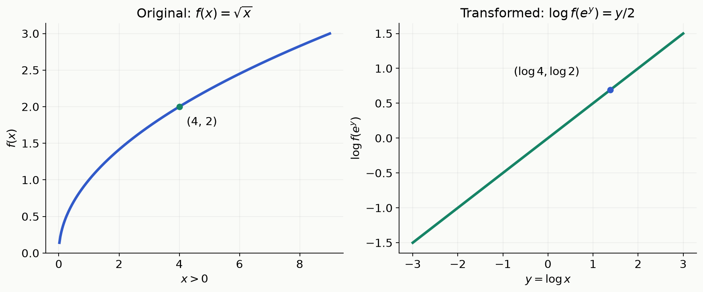
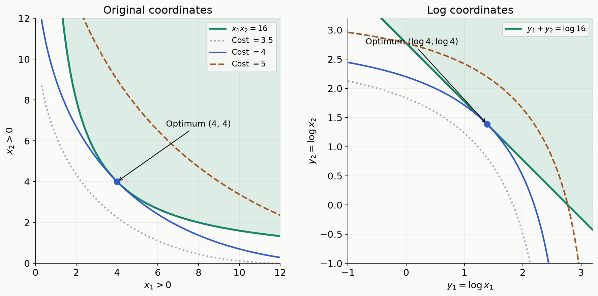
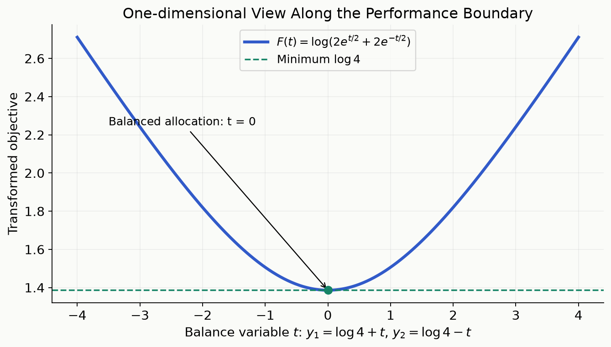

[LP](/enai601-linear-programming/)와 [QP](/enai601-quadratic-programming/)에서는 목적함수와 제약의 모양을 보고 볼록 문제인지 판단했다. 그런데 식에 곱, 나눗셈, 제곱근이 섞여 있으면 그대로는 볼록 문제처럼 보이지 않을 수 있다. 그때 식 자체를 포기하기 전에 <strong>변수를 다른 좌표로 표현하면 계산하기 쉬워지는가?</strong>를 물을 수 있다.

<strong>Geometric Programming(기하계획법, GP)</strong>는 양수 변수의 곱과 거듭제곱으로 된 특정 문제를 로그 변수로 바꾸어 볼록 문제로 푸는 방법이다. 이 글에서는 두 설계변수의 곱을 유지하면서 비용을 줄이는 작은 예제에서 시작한다. 함수의 종류를 구별하고, 로그 변환을 한 줄씩 적용한 뒤, 답을 원래 변수로 되돌리는 것까지 마친다.

## Part A. 곱과 거듭제곱이 있는 문제 알아보기

### 1. 작은 문제: 곱은 16 이상, 비용은 작게

두 부품의 성능을 나타내는 양수 $x_1,x_2$를 정한다고 하자. 결합 성능은 두 값의 곱이고, 비용은 각 성능의 제곱근을 더한 값이라는 모형을 생각한다.

$$
\begin{aligned}
\operatorname{minimize}_{x_1,x_2>0}\quad&\sqrt{x_1}+\sqrt{x_2}\\
\text{subject to}\quad&x_1x_2\ge16.
\end{aligned}
$$

먼저 가능한 선택 몇 개의 비용을 계산해 보자.

| 선택 $(x_1,x_2)$ | 곱 $x_1x_2$ | 비용 $\sqrt{x_1}+\sqrt{x_2}$ |
|---|---:|---:|
| $(1,16)$ | $16$ | $5$ |
| $(4,4)$ | $16$ | $4$ |
| $(16,1)$ | $16$ | $5$ |

균형 있게 나눈 $(4,4)$가 좋아 보인다. 하지만 세 후보만 비교해서는 모든 양수 중 최적이라고 결론 내릴 수 없다. <strong>이 문제를 어떤 구조로 읽고 풀 것인지</strong>가 GP의 출발점이다.

목적함수에는 제곱근이 있고 제약에는 두 변수의 곱이 있다. LP나 QP의 표준형에 바로 들어맞지 않는다. 특히 제곱근은 오목함수이므로, 이 목적함수를 최소화하는 원래 형태는 볼록 최적화의 표준 조건을 만족하지 않는다. GP에서는 이런 곱과 거듭제곱을 로그로 바꿀 수 있는지 살펴본다.

### 2. Monomial: 양의 계수 하나와 거듭제곱들의 곱

GP의 <strong>monomial(단항함수)</strong>는 다음 모양이다.

$$
m(x)=c x_1^{a_1}x_2^{a_2}\cdots x_n^{a_n},
\qquad c>0,\quad a_i\in\mathbb R,\quad x_i>0.
$$

$c$는 양의 계수, $a_i$는 지수다. 지수는 양의 정수뿐 아니라 0, 음수, 소수 같은 모든 실수가 가능하다. 예를 들어 다음은 모두 monomial이다.

$$
3x_1^2x_2^{-1},\qquad
\sqrt{x_1}=x_1^{1/2},\qquad
\frac{16}{x_1x_2}=16x_1^{-1}x_2^{-1}.
$$

첫 식에서 $x_1=2$, $x_2=4$를 대입하면 $3\cdot4/4=3$이다. 나눗셈은 음의 지수로 쓸 수 있어도 함수의 종류가 달라지지 않는다. 양의 상수도 모든 지수가 0인 monomial이다.

학교에서 다항식을 배울 때의 “단항식”보다 지수의 범위가 넓다. 대신 <strong>계수와 변수는 반드시 양수</strong>다. $-3x_1$은 계수가 음수이므로 여기서의 monomial이 아니다.

$\mathbb R_{++}^n$은 모든 성분이 엄격하게 양수인 벡터들의 집합이다. $x_i\ge0$와 다르게 0도 포함하지 않는다. 이 정의역 덕분에 음의 지수와 실수 지수를 일관되게 쓰고, 뒤에서 로그도 취할 수 있다.

### 3. Posynomial: monomial들을 양의 계수로 더하기

<strong>Posynomial(포지노미얼)</strong>은 monomial을 유한 개 더한 함수다.

$$
f(x)=\sum_{k=1}^{K}c_k x_1^{a_{1k}}\cdots x_n^{a_{nk}},
\qquad c_k>0.
$$

$K$는 더하는 항의 개수이고, $k$는 그 항을 구별하는 번호다. 각 항마다 지수도 달라도 된다. 예를 들어

$$
f(x)=2\sqrt{x_1}+\frac3{x_2}+x_1x_2
$$

는 세 항의 posynomial이다. $x_1=x_2=1$이면 값은 $2+3+1=6$이다. 항이 하나인 monomial도 posynomial에 포함된다.

<blockquote class="lecture-excerpt">

교안 발췌 · Module 6 — Geometric Program: Monomial / Posynomial

$$
m(x)=c x_1^{a_1}\cdots x_n^{a_n},\qquad c>0,\quad a_i\in\mathbb R,
$$

$$
f(x)=\sum_{k=1}^{K}c_kx_1^{a_{1k}}\cdots x_n^{a_{nk}},\qquad c_k>0,
\qquad \operatorname{dom}f=\mathbb R_{++}^n.
$$

</blockquote>

핵심은 지수가 정수인지가 아니라 <strong>양의 계수인 곱의 항들을 더했는가</strong>다. 일반적인 polynomial(다항식)과 같은 말이 아니다. 양의 함수값을 가진다는 사실만으로 posynomial인 것도 아니다. 각 항의 계수 조건을 확인해야 한다.

식의 모양을 정리할 때 다음 규칙을 쓸 수 있다.

| 연산 | 결과 |
|---|---|
| monomial × monomial, monomial ÷ monomial | monomial |
| posynomial + posynomial, posynomial × posynomial | posynomial |
| posynomial ÷ monomial | posynomial |
| 양수 상수 × posynomial | posynomial |
| posynomial의 뺄셈 또는 posynomial로 나누기 | 일반적으로 보장되지 않음 |

예를 들어 $(x_1+x_2)/x_1=1+x_2/x_1$은 posynomial이다. 반대로 $1/(x_1+x_2)$는 분모가 합이므로 이 규칙으로 posynomial이라고 할 수 없다. 서로 다른 monomial의 합도 보통은 monomial이 아니지만, $2x_1+3x_1=5x_1$처럼 같은 지수의 항은 합쳐질 수 있다. 엄격한 양의 계수 정의에서는 0을 곱해 얻은 영함수는 별도로 구별한다.

### 4. GP의 표준형: 왜 오른쪽이 0이 아니라 1일까?

GP의 <strong>posynomial form</strong>은 다음과 같다.

<blockquote class="lecture-excerpt">

교안 발췌 · Module 6 — Geometric Program

$$
\begin{aligned}
\operatorname{minimize}_x\quad&f_0(x)\\
\text{subject to}\quad&f_i(x)\le1,\quad i=1,\ldots,m,\\
&h_j(x)=1,\quad j=1,\ldots,p.
\end{aligned}
$$

$f_0,\ldots,f_m$ are posynomials and $h_1,\ldots,h_p$ are monomials.

$$
D=\mathbb R_{++}^n.
$$

</blockquote>

목적함수와 부등식 왼쪽은 posynomial, 등식 왼쪽은 monomial이어야 한다. 등식에 posynomial을 마음대로 넣지 않는 이유는 로그를 취한 뒤 등식을 affine으로 만들어야 하기 때문이다.

첫 예제의 성능 제약은 양수인 곱으로 나누면 된다.

$$
x_1x_2\ge16
\quad\Longleftrightarrow\quad
\frac{16}{x_1x_2}\le1.
$$

목적함수 $\sqrt{x_1}+\sqrt{x_2}$는 posynomial이고, 제약 왼쪽은 monomial이면서 posynomial이기도 하다. 모든 변수도 양수이므로 GP 표준형을 만족한다. 오른쪽 1은 로그를 취하면 0이 된다. 이것이 나중에 볼록 최적화의 표준 제약 형태로 돌아가는 연결점이다.

<strong>GP 표준형에 들어맞는다는 말과 원래 변수에서 이미 볼록하다는 말은 다르다.</strong> GP는 로그로 바꾼 뒤의 볼록성을 이용한다.

## Part B. 로그 변환이 식을 바꾸는 과정

### 5. 먼저 변수만 바꾼다: 양수 x와 실수 y

로그가 곱을 덧셈으로 바꾸는 성질을 이용한다. 여기서 $\log$는 자연로그이며, $e$를 밑으로 한다.

$$
\log(ab)=\log a+\log b,\qquad
\log(x^r)=r\log x\quad(a,b,x>0).
$$

새 변수를 다음처럼 정의한다.

$$
\boxed{y_i=\log x_i\quad\Longleftrightarrow\quad x_i=e^{y_i}}.
$$

$y_i$는 “$e$를 몇 제곱해야 $x_i$가 되는가”를 나타낸다. $x_i=1$이면 $y_i=0$이고, $x_i=4$이면 $y_i=\log4$다. $0<x_i<1$이면 $y_i$는 음수가 될 수 있다. <strong>양수라는 제한은 x에 대한 것이며, y는 모든 실수를 움직일 수 있다.</strong>

이 변환은 양수 $x_i$ 하나마다 실수 $y_i$ 하나를 정확히 대응시킨다. 따라서 변환한 문제를 푼 뒤 $x_i=e^{y_i}$로 돌아갈 수 있다. 0이나 음수 $x_i$는 이 대응에 포함되지 않는다.

### 6. Monomial에 변수를 대입하고 로그까지 취하면 affine이 된다

작은 함수 하나로 두 단계를 구별해 보자.

$$
m(x)=3x_1^2x_2^{-1}.
$$

먼저 $x_i=e^{y_i}$를 대입한다.

$$
m(e^y)=3e^{2y_1-y_2}.
$$

여기서 $e^y$는 각 성분에 지수를 취한 벡터다. 아직 함수는 지수함수다. <strong>그 함수값에 로그를 취하는 단계</strong>까지 하면

$$
\boxed{\log m(e^y)=\log3+2y_1-y_2}
$$

가 되어 affine 함수가 된다. $x=(2,4)$의 원래 함수값은 3이고, 변환된 식에 $y=(\log2,\log4)$를 넣으면 $\log3$이다. 변수뿐 아니라 함수값의 눈금도 달라졌다는 점에 주의한다.

그림은 더 간단한 $m(x)=\sqrt{x}$를 보여 준다. 오른쪽은 단순히 가로축 이름만 바꾼 그림이 아니다. $x=e^y$를 대입하고 함수값에도 로그를 취해 $\log\sqrt{e^y}=y/2$로 만든 것이다.

일반적인 monomial에도 같은 계산을 적용한다. $a=(a_1,\ldots,a_n)^T$, $b=\log c$라고 쓰면

<blockquote class="lecture-excerpt">

교안 발췌 · Module 6 — Geometric Program: Convex Form

$$
y_i=\log x_i,\qquad x_i=e^{y_i},
$$

$$
cx_1^{a_1}\cdots x_n^{a_n}
\quad\longrightarrow\quad e^{a^Ty+b},\qquad b=\log c.
$$

</blockquote>

따라서 로그까지 취한 결과는 $a^Ty+b$다. 특히 monomial 등식 $h_j(x)=1$은 로그 좌표에서 affine 등식이 된다.

### 7. Posynomial의 로그는 Log-Sum-Exp가 된다

합에는 곱에서 쓴 로그 규칙을 적용할 수 없다.

$$
\log(a+b)\ne\log a+\log b\quad\text{in general}.
$$

예를 들어 $a=b=1$이면 왼쪽은 $\log2$이고 오른쪽은 0이다. 그래서 posynomial은 항들을 따로 로그로 바꾸어 더하는 것이 아니라, <strong>지수함수들의 합 전체에 로그</strong>를 취한다.

$$
f(x)=2\sqrt{x_1}+3x_2^{-1}
\quad\Longrightarrow\quad
\log f(e^y)=\log\left(2e^{y_1/2}+3e^{-y_2}\right).
$$

계수도 지수 안으로 넣으면 $2=e^{\log2}$, $3=e^{\log3}$이므로 다음과 같다.

$$
\log f(e^y)
=\log\left(e^{y_1/2+\log2}+e^{-y_2+\log3}\right).
$$

이 모양이 <strong>log-sum-exp</strong>다. 일반적으로 지수 안의 affine 식들을 $a_k^Ty+b_k$라고 쓰면

$$
\boxed{F(y)=\log\left(\sum_{k=1}^{K}e^{a_k^Ty+b_k}\right)}.
$$

이 함수는 볼록하다. [Convex Function 글](/enai601-convex-functions/)에서 배운 볼록함수의 한 예가 실제 문제 변환에 쓰이는 지점이다. <strong>로그는 오목함수이지만, 여기서는 지수함수의 합과 결합한 이 특정 모양 전체가 볼록하다.</strong> 아무 양수 함수에 로그를 취하면 볼록해진다는 규칙은 없다.

심화: Log-Sum-Exp의 볼록성을 확인하는 이유

$t_k=a_k^Ty+b_k$라고 쓰고, 각 지수항이 전체 합에서 차지하는 양의 비율을 $p_k=e^{t_k}/\sum_l e^{t_l}$로 둔다. 이 비율의 합은 1이다. 벡터 $\bar a=\sum_kp_ka_k$는 이 가중치로 평균한 방향이다.

미분하면 Hessian은 다음과 같다.

$$
\nabla^2F(y)=\sum_kp_ka_ka_k^T-\bar a\bar a^T.
$$

임의의 방향 $v$에 대해 이 이차형식을 계산하면

$$
v^T\nabla^2F(y)v
=\sum_kp_k\left(v^Ta_k-v^T\bar a\right)^2\ge0.
$$

양의 가중치를 곱한 편차의 제곱 합이므로 음수가 될 수 없다. 따라서 Hessian이 PSD이고 $F$는 볼록하다. 이 유도를 외우지 않아도, GP를 변환한 목적함수와 부등식이 이 모양이라는 사실을 알아보면 된다.

## Part C. 볼록 문제로 바꾸고 원래 답까지 구하기

### 8. 첫 예제에 변환을 한 줄씩 적용하기

처음 문제의 목적함수와 표준형 부등식은 다음 두 함수였다.

$$
f_0(x)=\sqrt{x_1}+\sqrt{x_2},\qquad
f_1(x)=\frac{16}{x_1x_2}\le1.
$$

<strong>첫째, 변수만 바꾼다.</strong> $x_1=e^{y_1}$, $x_2=e^{y_2}$를 대입하면

$$
f_0(e^y)=e^{y_1/2}+e^{y_2/2},\qquad
f_1(e^y)=16e^{-y_1-y_2}\le1.
$$

<strong>둘째, 양수인 함수값에 로그를 취한다.</strong> 로그는 엄격하게 증가하므로 작은 비용을 더 큰 비용보다 먼저 선택하는 순서를 바꾸지 않는다. 부등식의 방향도 유지한다.

$$
\begin{aligned}
\operatorname{minimize}_{y_1,y_2\in\mathbb R}\quad
&\log\left(e^{y_1/2}+e^{y_2/2}\right)\\
\text{subject to}\quad
&\log16-y_1-y_2\le0.
\end{aligned}
$$

목적함수는 log-sum-exp라서 볼록하고 제약은 affine이다. 이제 볼록 최적화 문제다.

초록 영역은 조건을 만족하는 부분이고, 파랑·갈색 등고선은 원래 비용이 각각 4·5인 점들을 나타낸다. 회색 비용 3.5의 등고선은 가능집합에 닿지 못한다. 오른쪽에서는 같은 점들을 로그 좌표로 옮겼다. 변환된 목적함수의 등고선 값은 각각 $\log4$, $\log5$이지만 원래 비용의 순서는 그대로다.

왼쪽의 가능집합도 이 예제에서는 볼록하다. 원래 형태가 볼록 최적화가 아니었던 이유는 목적함수가 볼록하지 않았기 때문이다. 오른쪽에서는 <strong>목적함수와 제약을 함께</strong> 볼록 최적화의 조건에 맞췄다. 왼쪽 좌표축 위의 점들은 $x_i>0$ 정의역에 포함되지 않는다.

### 9. 손으로 끝까지 풀고 x로 돌아오기

목적함수는 두 변수가 커질수록 증가한다. $y_1+y_2>\log16$인 여유가 있다면 두 값을 조금씩 함께 줄여도 제약을 지키며 비용을 낮출 수 있다. 따라서 최적점은 경계에 있다.

$$
y_1+y_2=\log16.
$$

합을 고정한 채 두 값의 균형만 바꾸도록 새 실수 $t$를 하나 쓰자.

$$
y_1=\log4+t,\qquad y_2=\log4-t.
$$

어떤 $t$에도 두 값의 합은 $2\log4=\log16$이다. $t=0$이면 균형 잡힌 배분이고, 양수면 첫 번째 쪽으로, 음수면 두 번째 쪽으로 치우친다. 목적함수를 이 변수 하나로 쓰면

$$
F(t)=\log\left(2e^{t/2}+2e^{-t/2}\right).
$$

양수 $w=e^{t/2}$라고 두면 다음 계산으로 최소값을 알 수 있다.

$$
w+\frac1w-2=\frac{(w-1)^2}{w}\ge0.
$$

따라서 $e^{t/2}+e^{-t/2}\ge2$이고, 등호는 $w=1$, 즉 $t=0$에서만 성립한다. 로그는 증가하므로

$$
F(t)\ge\log4,\qquad
\boxed{y_1^*=y_2^*=\log4}.
$$

이것은 로그 좌표에서의 답이다. 원래 성능값으로 돌아가려면 성분마다 지수를 취한다.

$$
\boxed{x_1^*=e^{y_1^*}=4,\qquad x_2^*=e^{y_2^*}=4}.
$$

곱은 $4\cdot4=16$으로 제약을 지킨다. 원래 비용은 $\sqrt4+\sqrt4=4$다. 두 목적함수의 최적값을 구분하면 다음과 같다.

| 무엇을 계산했는가? | 값 |
|---|---|
| 로그 좌표의 최적점 $y^*$ | $(\log4,\log4)$ |
| 원래 변수의 최적점 $x^*$ | $(4,4)$ |
| 변환된 목적함수의 최적값 | $\log4$ |
| 원래 목적함수의 최적값 | $4$ |

<strong>변환된 비용을 원래 비용으로 보고 끝내면 안 된다.</strong> 로그를 목적함수에 적용했으므로 원래 비용은 그 값의 지수다. 최적점도 $x_i=e^{y_i}$로 복원한다. 이 예제에서는 변환과 역변환 모두 정확하므로 근사 문제를 푼 것이 아니다.

### 10. 일반 GP에도 같은 변환을 적용한다

각 posynomial $f_i$의 항을 번호 $k$로 구분하고, 그 지수 벡터를 $a_{ik}$, 양의 계수의 로그를 $b_{ik}$라 쓰자. $K_i$는 그 함수의 항 개수다. 그러면

$$
\widetilde f_i(y)=\log f_i(e^y)
=\log\left(\sum_{k=1}^{K_i}e^{a_{ik}^Ty+b_{ik}}\right).
$$

등식용 monomial $h_j$의 지수 벡터를 $d_j$, 양의 계수를 $c_j$라 쓰면 $\log h_j(e^y)=d_j^Ty+\log c_j$다. 따라서 변환된 문제는

$$
\begin{aligned}
\operatorname{minimize}_{y\in\mathbb R^n}\quad&\widetilde f_0(y)\\
\text{subject to}\quad&\widetilde f_i(y)\le0,\quad i=1,\ldots,m,\\
&d_j^Ty+\log c_j=0,\quad j=1,\ldots,p.
\end{aligned}
$$

목적함수와 부등식은 log-sum-exp, 등식은 affine이다. 이것이 <strong>GP in convex form(볼록 형태의 GP)</strong>이다. <strong>로그의 단조성</strong>은 같은 답을 고른다는 것을, <strong>log-sum-exp의 볼록성</strong>은 변환된 문제의 구조가 볼록하다는 것을 보장한다. 두 이유는 역할이 다르다.

모든 함수가 monomial이면 항이 하나뿐이라 로그를 취한 함수가 전부 affine이 된다. 이 경우 변환된 문제는 LP로 줄어든다. 예를 들어

$$
\begin{aligned}
\operatorname{minimize}_{x_1,x_2>0}\quad&x_1^2x_2\\
\text{subject to}\quad&\frac4{x_1x_2}\le1,\qquad \frac{x_2}{2}=1
\end{aligned}
$$

의 로그 변환은 다음 LP다.

$$
\begin{aligned}
\operatorname{minimize}_{y_1,y_2}\quad&2y_1+y_2\\
\text{subject to}\quad&\log4-y_1-y_2\le0,\\
&y_2-\log2=0.
\end{aligned}
$$

등식에서 $y_2=\log2$, 부등식에서 $y_1\ge\log2$다. 목적함수는 $y_1$이 작을수록 작아지므로 $y_1^*=\log2$다. 복원하면 $x^*=(2,2)$, 원래 최적 비용은 $2^2\cdot2=8$이다. 로그 문제의 비용 $3\log2=\log8$과도 대응한다.

## Part D. 직접 정식화하고 풀어 보기

### 11. GP인지 판별할 때 확인할 것

식에 곱이 있다고 모두 GP인 것은 아니다. 먼저 양수 정의역을 확인하고, 각 함수가 어떤 종류인지 구별한 뒤 제약을 표준형으로 정리한다.

| 주어진 식 | GP 표준형으로 정리하기 |
|---|---|
| posynomial $f(x)\le b$, $b>0$ | $f(x)/b\le1$ |
| posynomial $f(x)\le$ monomial $m(x)$ | $f(x)/m(x)\le1$ |
| monomial $m_1(x)=m_2(x)$ | $m_1(x)/m_2(x)=1$ |
| monomial $m(x)$ 최대화 | 양수인 역수 $1/m(x)$ 최소화 |
| posynomial $f(x)\ge1$ 또는 $f(x)=1$ | 일반적으로 표준 GP 조건을 만족하지 않음 |

예를 들어 $x_1+x_2\le x_3$는 $(x_1+x_2)/x_3\le1$로 쓸 수 있다. 분모가 monomial이므로 왼쪽은 posynomial이다. 반면 $x_1+x_2=6$은 로그로 바꾸면 $e^{y_1}+e^{y_2}=6$이어서 affine 등식이 되지 않는다. 이 식이 다른 방법으로 풀 수 없는 제약이라는 뜻은 아니며, <strong>주어진 형태가 표준 GP 등식 규칙에는 들어맞지 않는다는 뜻</strong>이다.

LP·QP는 주로 원래 식의 affine·이차 구조를 보고 분류하고, GP는 양수 변수와 monomial·posynomial 구조를 본다. 따라서 이름의 순서만으로 GP가 QP의 차수를 더 높인 문제라고 생각하지 않는다. GP에서는 로그 변환 뒤의 구조가 중요하다.

### 12. 혼자 풀어 보는 확인 문제

#### 문제 1. 주어진 형태가 표준 GP에 들어갈까?

모든 변수가 양수라고 하자. 다음을 각각 판별하고 이유를 설명하라.

1. 목적함수 $x_1+x_2$를 최소화하고 $x_1x_2\ge4$를 만족한다.
2. 목적함수 $x_1-x_2$를 최소화한다.
3. 등식 제약 $x_1+x_2=4$를 둔다.

정답과 해설 펼치기

1번은 GP다. 목적함수는 posynomial이고 제약은 $4/(x_1x_2)\le1$로 쓸 수 있다.

2번의 목적함수는 음의 계수 항이 있어 posynomial이 아니다. 함수값이 일부 영역에서 양수라는 것만으로 계수 조건을 대신할 수 없다.

3번의 왼쪽은 posynomial이지만 monomial은 아니다. 로그 변환 후의 등식도 affine이 아니므로 이 형태는 표준 GP 등식에 해당하지 않는다. $x_1+x_2\le4$라면 $(x_1+x_2)/4\le1$로 쓸 수 있어 GP 부등식으로는 허용된다.

#### 문제 2. 합의 로그와 monomial 등식 변환하기

$f(x)=2\sqrt{x_1}+3/x_2$와 등식 $x_1x_2^2=8$을 $y_i=\log x_i$로 변환하라.

정답과 해설 펼치기

함수값에 로그까지 취하면

$$
\log f(e^y)=\log\left(2e^{y_1/2}+3e^{-y_2}\right).
$$

두 항을 따로 로그로 바꿔 더하면 다른 함수가 된다. 등식은 곱의 로그 규칙을 적용할 수 있으므로

$$
\log(x_1x_2^2)=\log8
\quad\Longleftrightarrow\quad
y_1+2y_2-\log8=0.
$$

합은 log-sum-exp로, 곱 하나는 affine으로 바뀌는 차이를 확인할 수 있다.

#### 문제 3. 첫 번째 비용에 가중치가 생기면?

목적함수를 $2\sqrt{x_1}+\sqrt{x_2}$로 바꾸고, 같은 성능 제약 $x_1x_2\ge16$을 둔다. GP인지 확인하고 최적점을 구하라. 여전히 $(4,4)$가 답인가?

정답과 해설 펼치기

목적함수는 두 항의 posynomial이고 제약도 같으므로 GP다. 변환된 목적함수는 $\log(2e^{y_1/2}+e^{y_2/2})$, 제약은 $y_1+y_2\ge\log16$이다.

손계산에서는 양수 $a=\sqrt{x_1}$, $b=\sqrt{x_2}$로 쓰면 $ab\ge4$이고 비용은 $2a+b$다. 제곱이 0 이상인 사실에서

$$
(\sqrt{2a}-\sqrt b)^2\ge0
\quad\Longrightarrow\quad
2a+b\ge2\sqrt{2ab}\ge4\sqrt2.
$$

등호가 성립하려면 $2a=b$이고 $ab=4$여야 한다. 따라서 $a=\sqrt2$, $b=2\sqrt2$이며

$$
\boxed{x_1^*=2,\qquad x_2^*=8,\qquad f_0(x^*)=4\sqrt2}.
$$

첫 번째 성능의 비용이 더 비싸져 그 값을 줄이고 두 번째를 늘린다. 양쪽 계수가 같을 때의 대칭성만 보고 항상 같은 양을 배분하면 안 된다. 로그 좌표의 답은 $(\log2,\log8)$이다.

#### 문제 4. 변환된 해를 원래 해로 읽기

문제 3의 로그 좌표 해가 $y^*=(\log2,\log8)$이고 변환된 최적 비용이 $\log(4\sqrt2)$다. 원래 변수와 비용을 각각 어떻게 복원하는가?

정답과 해설 펼치기

변수는 성분마다 지수를 취한다.

$$
x^*=(e^{\log2},e^{\log8})=(2,8).
$$

원래 목적함수값도 로그를 취했으므로 지수로 되돌린다.

$$
f_0(x^*)=e^{\log(4\sqrt2)}=4\sqrt2.
$$

원래 식에 직접 대입하면 $2\sqrt2+\sqrt8=4\sqrt2$이고 곱은 16이다. 점과 비용의 역변환을 각각 수행한 뒤 원래 제약에 대입하는 순서다.

#### 문제 5. 양수 정의역이면 최적점이 항상 존재할까?

$\min x$ subject to $0<x\le1$은 GP다. 최적점이 $x=0$이라고 해도 될까? 로그 문제는 어떻게 되는가?

정답과 해설 펼치기

0은 정의역 밖이므로 최적점이라고 할 수 없다. 비용을 0에 한없이 가깝게 할 수 있지만 실제로 0을 달성하는 양수는 없다. 원래 문제의 infimum은 0이며 최소점은 없다.

로그 변환은 $\min y$ subject to $y\le0$이다. $y\to-\infty$로 비용이 끝없이 내려가고, 복원한 $x=e^y$가 0에 가까워진다. <strong>GP가 볼록 문제로 변환된다는 사실만으로 최적점의 존재나 유일성까지 보장되지는 않는다.</strong>

GP를 풀 때 남겨 둘 순서는 <strong>양수 정의역 확인 → monomial·posynomial 구별 → 오른쪽 1로 정리 → 로그 변수 대입 → 함수값에 로그 → 볼록 문제 풀이 → 원래 변수와 비용 복원</strong>이다.

GP에서는 표현을 바꿔 풀기 쉬운 등가 문제를 만들었다. [다음 Duality Part 1](/enai601-duality-part1/)에서는 최적값을 아직 몰라도 그보다 낮다고 보장할 수 있는 값을 만들어, 답의 품질과 최적성을 판단하는 방법을 배운다.

## 참고 자료

- <strong>ENAI601 Module 6 — LP, QP, GP</strong>: Geometric Program, Geometric Program — Convex Form.
- <strong>2026년 10월 7일·10월 14일 수업</strong>.
- Boyd, Kim, Vandenberghe, Hassibi, [A tutorial on geometric programming](https://web.stanford.edu/~boyd/papers/pdf/gp_tutorial.pdf), §2.
