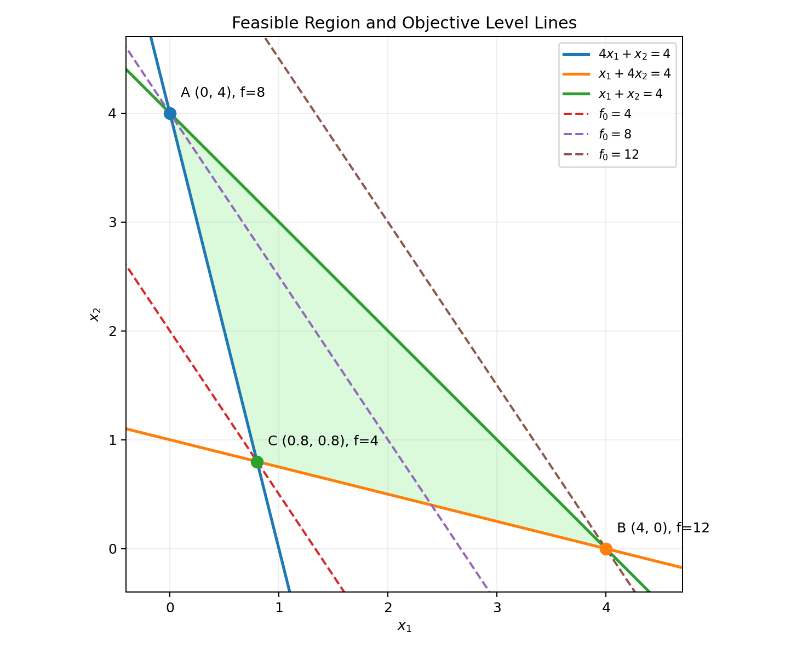
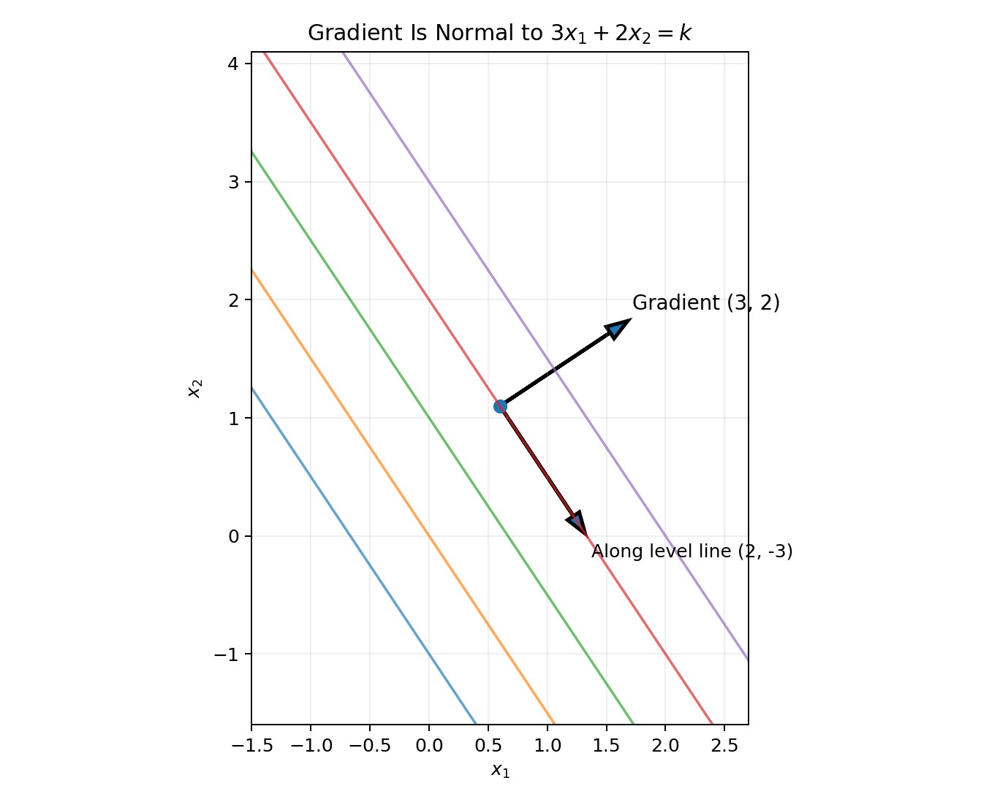
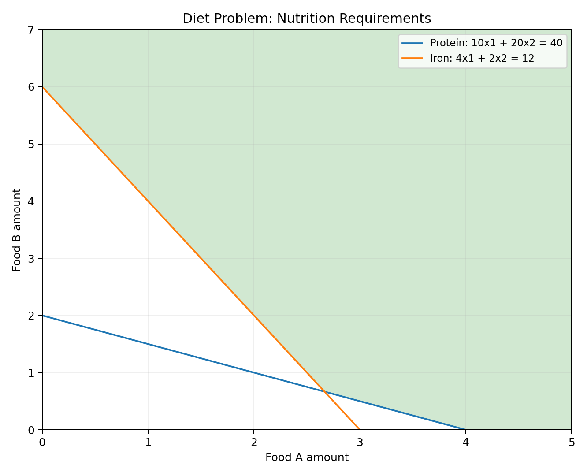
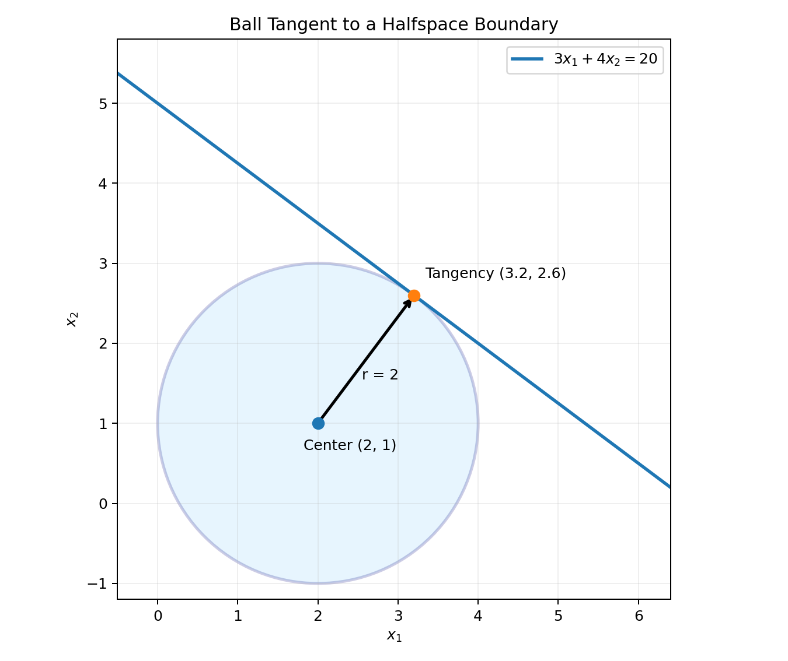

[앞 글의 Convex Optimization](/enai601-convex-optimization/)에서는 볼록 문제의 국소 최적점이 왜 전역 최적점인지, Gradient로 후보점의 최적성을 어떻게 확인하는지 살펴봤다. 이제 가장 단순하면서도 중요한 사례인 <strong>Linear Programming(선형계획법, LP)</strong>으로 그 원리를 구체화한다.

LP의 목적함수와 제약식은 모두 affine이다. 이 덕분에 가능집합은 다면체가 되고, 같은 비용을 나타내는 등고선을 평행하게 움직여 최적점을 읽을 수 있다. 하지만 “그래프에서 가장 아래인 점”과 “비용이 가장 작은 점”은 다르며, “꼭짓점에 최적해가 있다”는 말에도 조건이 있다.

두 변수 예제에서 이 차이를 확인한 뒤, 영양소를 충족하는 식단과 다면체 안의 가장 큰 공을 찾는 문제를 LP로 바꿔 보자. 목표는 도형의 모양을 외우는 것이 아니라 <strong>변수·목적함수·제약을 구별하고, 답이 최적인 이유까지 설명하는 것</strong>이다.

## Part A. LP의 식과 그림 읽기

### 1. LP는 Convex Optimization의 특별한 경우

#### 작은 구매 문제에서 변수·비용·제약 구별하기

단위 가격이 2인 재료를 최소 3만큼 구매해야 한다고 하자. 구매량 $x$를 선택할 때 문제는

$$
\operatorname{minimize}_{x}\ 2x
\quad\text{subject to}\quad x\ge3
$$

이다. $\operatorname{minimize}$는 “허용된 선택 중 뒤에 적힌 비용을 가장 작게 만드는 값을 고르라”는 뜻이다. <strong>변수(Variable)</strong>는 구매량 $x$, <strong>목적함수(Objective Function)</strong>는 비용 $2x$, <strong>제약조건(Constraint)</strong>은 구매량 제한 $x\ge3$이다. 따라서 최적점은 $x^*=3$, 최적값은 $p^*=6$이다. “얼마를 고르는가”와 “그때 비용은 얼마인가”를 구별하자.

변수가 여러 개이면 비용은 $c^Tx=c_1x_1+\cdots+c_nx_n$으로 모아 쓴다. 위첨자 $T$는 전치(Transpose)다. 열벡터 $c$를 행벡터로 바꾸어 $x$와 곱하므로 결과는 숫자 하나인 내적(Inner Product)이 된다. 예를 들어 $c=(3,2)^T$, $x=(1,2)^T$이면 $c^Tx=3\cdot1+2\cdot2=7$이다.

#### Affine 목적함수와 선형 제약

$$
\begin{aligned}
\operatorname{minimize}\quad & c^Tx+d\\
\text{subject to}\quad &Gx\leq h\\
&Ax=b
\end{aligned}
$$

- <strong>Optimization variable:</strong> 결정할 벡터, 보통 $x$.
- <strong>Objective function:</strong> 최소화하려는 비용 $c^Tx+d$.
- <strong>Inequality constraints:</strong> $Gx\le h$.
- <strong>Equality constraints:</strong> $Ax=b$.
- 목적함수와 제약함수는 모두 <strong>Affine(아핀)</strong>이다. Affine은 $a^Tx+b$처럼 선형식에 상수항을 더한 형태다. 따라서 함수의 Convexity와 제약집합의 Convexity가 보장되고 LP는 Convex Optimization이다.
- 상수항 $d$는 <strong>Optimal Point</strong>에는 영향을 주지 않지만, <strong>Optimal Value</strong>에는 영향을 준다.
- LP의 Feasible Set은 Halfspace와 Hyperplane의 교집합인 <strong>Polyhedron</strong>이다. 이 정의의 Polyhedron은 닫힌집합이지만, 항상 유계인 다각형이라는 뜻은 아니다. 비어 있거나 무한히 뻗을 수도 있다.

<strong>Linear와 Affine의 차이.</strong> 선형함수(Linear Function) $a^Tx$에는 상수항이 없고, affine 함수 $a^Tx+b$에는 상수항이 있을 수 있다. 두 함수 모두 직선 또는 평면 모양이지만, affine 함수는 원점을 지나지 않아도 된다. Affine 함수는 convex이면서 concave다. 실제로 두 점의 가중평균에서 함수값도 정확히 같은 가중평균이 되기 때문에 convexity의 부등식이 등호로 성립한다.

일반적 Convex Optimization을 나타내는 형태에서는 부등식이 $f_i(x)\le0$이고, LP에서는 계수 행렬과 우변을 모아 쓸 수 있다. 예를 들어 $4x_1+x_2\ge4$는 $-4x_1-x_2\le-4$로 바꿀 수 있다.

교안은 다음 표현으로 LP의 핵심을 요약한다.

<blockquote class="lecture-excerpt">

교안 발췌 · Module 6 — Linear Program

Both objective function and constraint functions are affine

$$
\begin{aligned}
\operatorname{minimize}_{x}\quad &c^Tx+d\\
\text{subject to}\quad&Gx\le h,\quad Ax=b.
\end{aligned}
$$

</blockquote>

여기서 $x\in\mathbb R^n$, $c\in\mathbb R^n$, $G\in\mathbb R^{m\times n}$, $h\in\mathbb R^m$, $A\in\mathbb R^{p\times n}$, $b\in\mathbb R^p$다. $Gx\le h$는 벡터 전체의 크기를 비교하는 것이 아니라 <strong>각 행의 부등식을 모두 만족한다</strong>는 뜻이다. $G$의 $i$번째 행을 $g_i^T$라 쓰면 $g_i^Tx\le h_i$를 $i=1,\ldots,m$에 대해 요구한다.

상수항을 허용하지만 관례상 <strong>Linear Programming(선형계획법, LP)</strong>이라고 부른다. 이때 programming은 코딩 언어가 아니라 자원과 행동을 수학적으로 <strong>계획한다</strong>는 뜻이다. 이 글은 수업의 위 행렬 표현을 사용한다. 다른 책에서는 $Ax=b,\ x\ge0$ 형태를 standard form이라 부르기도 하므로 이름보다 실제 제약식을 확인하는 것이 정확하다.

#### Halfspace와 Hyperplane

$$
\text{Halfspace}:\quad a^Tx\le b
$$

$$
\text{Boundary hyperplane}:\quad a^Tx=b
$$

$a\ne0$일 때 inequality(부등식)가 허용하는 영역은 <strong>Halfspace(반공간)</strong>이며, <strong>경계 자체는 Hyperplane(초평면)</strong>이다. 2차원에서는 경계가 직선이고, 부등식은 그 직선의 한쪽 영역을 허용한다. Equality constraint(등식 제약)는 경계 위의 점만 허용한다.

반공간은 허용되는 한쪽 영역을 정하고, 등식은 해가 놓일 공간을 좁힌다. 등식도 $a^Tx\le b$, $-a^Tx\le-b$라는 두 부등식으로 바꿀 수 있으므로 polyhedron은 <strong>유한 개의 닫힌 반공간의 교집합</strong>으로 정의할 수 있다. 차원이 낮은 선분·평면도 polyhedron일 수 있으며, 반드시 3차원 부피를 가진 입체라는 뜻은 아니다.

$D^*$는 이 수업에서 쓰는 <strong>Feasible Set(가능집합)</strong> 기호다. 별표가 있다고 해서 최적점들만 모은 집합은 아니다. $x^*$는 <strong>Optimal Point(최적점)</strong>, $p^*$는 <strong>Optimal Value(최적값)</strong>로 구별한다.

---

### 2. Sample Midterm Q2: 실제 LP를 그래프로 풀어 보기

Fall 2025 Sample Midterm 2번(2페이지)의 문제는 다음과 같다. 원문은 (a) 가능집합을 그리고, (b) 최적점을 구하고, (c) dual 문제를 구하라고 요구한다. 이 절에서 (a)와 (b)를 풀고, 5절에서 최적성 증명과 (c)를 연결한다.

$$
\begin{aligned}
\operatorname{minimize}\quad &3x_1+2x_2\\
\text{subject to}\quad &4x_1+x_2\ge4\\
&x_1+4x_2\ge4\\
&-x_1-x_2\ge-4
\end{aligned}
$$

마지막 부등식은 다음과 동등하다.

$$
x_1+x_2\le4
$$

이 예제에는 $x_1,x_2\ge0$가 따로 적혀 있지 않다. 임의로 추가할 필요도 없다. $x_2\le4-x_1$와 $4x_1+x_2\ge4$를 합치면 $x_1\ge0$이고, 같은 방식으로 $x_2\ge0$가 이미 따라오기 때문이다.

#### (a) 경계선을 그린 뒤 허용되는 쪽을 고르기

먼저 부등호를 등호로 바꾸어 경계선 세 개를 그린다. 선만 그리는 것으로는 가능집합이 정해지지 않는다. 각 부등식이 허용하는 쪽을 골라 세 영역을 겹쳐야 한다.

| 제약 | 경계선의 두 점 | 허용되는 쪽 확인 |
|---|---|---|
| $4x_1+x_2\ge4$ | $(0,4),(1,0)$ | 원점은 $0\ge4$를 만족하지 않아 제외 |
| $x_1+4x_2\ge4$ | $(0,1),(4,0)$ | 원점은 제외 |
| $x_1+x_2\le4$ | $(0,4),(4,0)$ | 원점은 $0\le4$를 만족해 포함 |

확인용 점은 해당 경계선 위에 있지 않은 점을 골라야 한다. 원점이 경계선 위에 있으면 다른 점을 사용한다. <strong>경계의 어느 쪽을 택하는지</strong>와 <strong>모든 제약을 동시에 만족하는지</strong>를 순서대로 확인하는 방법이다.

첫 번째 경계는 $(0,4)$, $(1,0)$을 지나고, 두 번째 경계는 $(0,1)$, $(4,0)$을 지나며, 마지막 경계는 $(0,4)$, $(4,0)$을 지난다. 각 부등식이 지정한 쪽을 겹치면 삼각형 Feasible Region이 생긴다.

<strong>그림 읽기:</strong> 실선은 제약조건의 경계, 반투명한 삼각형은 Feasible Region, 점선은 동일한 목적함수값을 갖는 Level Line이다. 모든 축은 *optimization variables*이지 목적함수값이 아니다.

세 경계선의 쌍을 연립하면 교점은 $(0,4)$, $(4,0)$, $(4/5,4/5)$다. 각 교점을 나머지 제약에도 대입하면 모두 허용된다. 따라서 이 세 점이 삼각형의 꼭짓점이다. 경계선이 더 많은 문제에서는 교점이 다른 제약을 위반할 수 있으므로 모든 교점을 자동으로 꼭짓점으로 취급하지 않는다.

#### (b) 세로좌표가 작다고 비용도 작은 것은 아니다

목적함수는

$$
f_0(x_1,x_2)=3x_1+2x_2
$$

이다. 점 B는 그림에서 세로좌표가 0이므로 ‘가장 아래’에 있지만, 목적함수값은 <strong>좌표 두 개를 가중합한 값</strong>이다.

| Vertex | Coordinates | Objective value |
|:--|:--|--:|
| A | $(0,4)$ | $8$ |
| B | $(4,0)$ | $12$ |
| C | $(0.8,0.8)$ | <strong>$4$</strong> |

그래서 B는 가장 아래에 있어도 목적함수값이 가장 크다. 최소화할 대상은 $x_2$만이 아니라 $3x_1+2x_2$이다.

#### C를 연립방정식으로 찾기

$$
\begin{cases}
4x_1+x_2=4\\
x_1+4x_2=4
\end{cases}
$$

두 식을 빼면

$$
3x_1-3x_2=0\quad\Longrightarrow\quad x_1=x_2
$$

따라서

$$
5x_1=4\quad\Longrightarrow\quad x_1=x_2=\frac45
$$

최적점과 최적값은

$$
\boxed{x^*=\begin{bmatrix}4/5\\4/5\end{bmatrix},\qquad p^*=4}
$$

이다. 아래에서 이 답이 왜 전역 최적인지 기하학·대수 양쪽에서 확인한다.

---

### 3. Level Line과 Gradient: 같은 비용을 잇는 선과 그 수직 방향

#### 같은 함수값인 점들을 이으면 직선이 된다

목적함수값을 $k$로 고정하면

$$
3x_1+2x_2=k
$$

즉

$$
x_2=-\frac32x_1+\frac{k}{2}
$$

이므로 $k$가 변할 때 기울기가 같은 평행선들이 이동한다. <strong>Level Line(등고선)</strong>은 “선 위의 모든 점이 같은 비용을 가진다”는 뜻이다. $k$는 좌표가 아니라 비용값이다. 예를 들어 $k=4$인 선은 $3x_1+2x_2=4$이고, $k=8$인 선은 비용이 8인 점들을 모은 것이다. 등고선 하나는 선택 가능한 모든 점의 집합이 아니라 그중 같은 비용인 점들의 집합이다.

LP에서는 이 Level Line을 목적함수값이 작아지는 방향으로 움직이고, 여전히 Feasible Region에 닿는 마지막 위치가 최적값을 결정한다.

#### Gradient가 등고선과 수직인 이유

일단 식보다 상황을 보자. 같은 Level Line을 따라 오른쪽으로 2만큼 움직였다면 $3x_1$ 항은 6 증가한다. 목적함수값을 일정하게 유지하려면 $2x_2$ 항은 정확히 6 감소해야 하므로 $x_2$를 3만큼 줄여야 한다.

따라서 Level Line을 따라가는 방향 벡터의 한 예는

$$
d=\begin{bmatrix}2\\-3\end{bmatrix}
$$

이다. 한편 목적함수의 Gradient는

$$
\nabla f_0=\begin{bmatrix}3\\2\end{bmatrix}
$$

이다. 두 벡터의 내적은

$$
(\nabla f_0)^Td=3(2)+2(-3)=0
$$

이다. 결국 <strong>Level Line을 따라 움직일 때 함수값 변화가 0이므로 Gradient와 접선 방향 벡터의 내적이 0</strong>이고, 따라서 서로 수직이다.

일반적으로 같은 Level Hyperplane 위의 두 점 $x,y$에 대해

$$
c^Tx=k,\qquad c^Ty=k
$$

이므로

$$
c^T(y-x)=0
$$

이다. 즉 <strong>Cost Vector $c$는 Level Hyperplane의 Normal Vector</strong>이다.

#### LP에서 Gradient가 특히 간단한 이유

$$
f_0(x)=c^Tx+d
$$

이면

$$
\nabla f_0(x)=c
$$

이다. <strong>Gradient(기울기 벡터)</strong>의 각 성분은 각 변수의 편미분이고, 이 경우 그 벡터가 바로 <strong>Cost Vector(비용 벡터)</strong> $c$다.

<blockquote class="lecture-excerpt">

교안 발췌 · Module 6 — Linear Program, Geometric picture

$$
\nabla f_0(x)=c\quad\text{for all }x\in\mathbb R^n.
$$

</blockquote>

실제로 $f_0=3x_1+2x_2$에서 $x_1$만 바꿔 미분하면 3, $x_2$만 바꿔 미분하면 2다. 다른 변수를 고정하고 하나만 미분하는 것을 <strong>Partial Derivative(편미분)</strong>라고 하며, 그 결과들을 열벡터로 모으면 Gradient다. $x_1$을 $0.1$ 늘리면 비용은 $0.3$, $x_2$를 $0.1$ 늘리면 비용은 $0.2$ 증가한다.

위치가 바뀌어도 Gradient가 바뀌지 않는다. 이에 비해 이차함수의 Gradient는 일반적으로 위치에 따라 변한다. 따라서 LP에서는 목적함수의 증가·감소 방향이 공간 전체에서 일정하다.

그림의 화살표는 방향을 보여주기 위해 길이를 축소했다. $(3,2)$와 $(2,-3)$라는 표기는 그 방향을 나타내는 벡터다.

일반식에서 $c\ne0$이면 $c^Tx+d=k$는 초평면이다. $c=0$이면 목적함수가 상수 $d$이므로 모든 feasible point가 최적점이고, 증가·감소 방향도 없다. 이 예외에는 등고선이 평행하게 이동한다는 그림을 적용하지 않는다.

#### 감소 방향과 이동 가능한 방향은 다르다

변위 $v$만큼 움직일 때 비용 변화는 정확히

$$
f_0(x+v)-f_0(x)=c^Tv
$$

다. 따라서 $c^Tv<0$인 방향으로 <strong>제약을 지키며</strong> 움직일 수 있으면 비용이 줄어든다. $-c$는 제약이 없을 때 가장 가파른 감소 방향이지만, 경계에서 그쪽이 막혔다고 곧 최적점은 아니다. 경계를 따라 다른 감소 방향이 남아 있을 수 있다. 최적성을 판단하려면 가능한 <strong>모든</strong> 다른 점을 비교해야 한다.

예를 들어 $x_1\ge0$에서 $f=x_1+x_2$를 최소화한다고 하자. 점 $(0,1)$에서 $-\nabla f=(-1,-1)$로 움직이면 $x_1<0$이 되어 제약을 위반한다. 하지만 $(0,-1)$ 방향으로는 이동할 수 있고 비용도 줄어든다. 따라서 <strong>가장 가파른 감소 방향 하나가 막혔다고 최적점은 아니다.</strong>

#### SVM과 연결

SVM의 결정경계는

$$
w^Tx+b=0
$$

이다. 경계 위에서 움직여도 왼쪽 값은 계속 0이어야 하므로, 경계와 평행한 변위 $d$에 대해

$$
w^Td=0
$$

이다. 따라서 $w$는 결정경계의 Normal Vector다. LP에서 $c$가 Objective Level Hyperplane에 수직인 이유와 동일한 선형대수 원리다.

---

## Part B. 최적점을 찾고 증명하기

### 4. 왜 LP에서는 꼭짓점을 검사할까?

꼭짓점 A, B, C의 비용은 서로 다르다. 그렇다면 “꼭짓점에 최적해가 있다”는 말은 무엇을 보장할까? 정확한 명제는 <strong>모든 꼭짓점이 좋다</strong>가 아니라 <strong>적어도 하나의 꼭짓점이 최적값을 달성한다</strong>이다(최적해가 존재하고 Polyhedron에 꼭짓점이 있을 때).

#### 삼각형 내부의 점은 꼭짓점의 가중평균

$$
x=\alpha A+\beta B+\gamma C
$$

$$
\alpha,\beta,\gamma\ge0,\qquad\alpha+\beta+\gamma=1
$$

Affine Objective는 Convex Combination을 그대로 보존한다.

$$
f_0(x)=\alpha f_0(A)+\beta f_0(B)+\gamma f_0(C)
$$

$\alpha,\beta,\gamma$는 각 꼭짓점의 비중이다. 모두 0 이상이고 합이 1이므로 이 표현을 <strong>Convex Combination(볼록결합)</strong>이라고 한다. 예를 들어 세 비중이 각각 $1/3$이면 세 꼭짓점 좌표를 평균한 점이다. Affine 목적함수에서는 상수항도 $d=(\alpha+\beta+\gamma)d$로 나뉘므로 위 등식이 성립한다.

그러므로 내부 점의 목적함수값은 꼭짓점 목적함수값들의 <strong>가중평균</strong>이다. 가중평균은 그중 가장 작은 값보다 작아질 수 없다.

$$
\min\{f_0(A),f_0(B),f_0(C)\}\le f_0(x)
$$

예를 들어

$$
x=0.2A+0.2B+0.6C
$$

이면

$$
f_0(x)=0.2(8)+0.2(12)+0.6(4)=6.4
$$

이다. 6.4는 높은 꼭짓점 B의 12보다 작지만 가장 좋은 꼭짓점 C의 4보다 크다.

#### 이 성질은 일반적인 Convex Optimization과 다르다

$$
\operatorname{minimize}_{0\le x\le4}\;(x-2)^2
$$

에서는 양 끝점 함수값이 모두 4지만 내부 점 $x=2$에서 최솟값 0을 얻는다. 따라서 <strong>Convex Objective라는 이유만으로 꼭짓점 최적성이 보장되지 않는다</strong>. LP에서는 Objective가 <strong>Affine</strong>이기 때문에 위 가중평균 논리가 성립한다.

#### 최적점은 꼭짓점 하나일 수도, 변 전체일 수도 있다

같은 삼각형에서 목적함수를 $-x_1-x_2$로 바꾸면, 변 AB의 모든 점은 $x_1+x_2=4$이므로 비용이 $-4$로 같다. $x_1+x_2\le4$인 영역 전체에서 이것이 최솟값이다. 따라서 <strong>A와 B도 최적점이고, 그 사이의 모든 점도 최적점</strong>이다. 정리는 최적점의 유일성을 보장하지 않는다.

꼭짓점은 더 정확히 <strong>Extreme Point(극점)</strong>라고도 한다. 집합 안의 서로 다른 두 점을 잇는 선분의 중간점으로 표현할 수 없는 점이다. 삼각형 꼭짓점은 이 성질을 가지지만 변 가운데의 점은 양 끝점의 볼록결합으로 표현된다.

#### 꼭짓점 정리의 범위

위의 가중평균 증명은 <strong>유계인 polyhedron, 즉 polytope</strong>에서 모든 점을 꼭짓점들의 convex combination(볼록결합)으로 나타낼 수 있다는 사실을 사용한다. 무한히 뻗는 polyhedron의 점을 모두 같은 방식으로 표현할 수 있는 것은 아니다.

일반적인 정리는 다음 조건으로 읽어야 한다. <strong>Feasible polyhedron에 꼭짓점이 있고 최적해가 존재하면, 적어도 하나의 꼭짓점에서 최적값을 얻는다.</strong>

- $\min\{x:x\ge0\}$: 영역은 무한히 뻗지만 최적점 $x=0$이 있다.
- $\min\{-x:x\ge0\}$: $x$를 키울수록 비용이 내려가므로 <strong>Unbounded below(아래로 무한)</strong>다. 유한한 최적값이 없다.
- $x\ge1,\ x\le0$: <strong>Infeasible(불가능)</strong>이다. 선택할 수 있는 점 자체가 없다.
- $\min x_1$ subject to $x_1\ge0$, $x_2\in\mathbb R$: $x_1=0$인 모든 점이 최적점이지만, 가능집합은 꼭짓점이 없는 반평면이다.

따라서 <strong>영역이 unbounded</strong>인 것과 <strong>목적함수가 아래로 unbounded</strong>인 것은 다르다. 또 꼭짓점이 없다는 사실만으로 최적해가 없다고 결론내릴 수 없다.

---

### 5. Supporting Hyperplane과 Optimality Criterion

최적점 후보를 찾은 뒤에는 “왜 다른 점이 더 좋을 수 없는가?”를 보여야 한다. 먼저 $x^*$가 제약을 만족하는 후보라고 하자. 다른 가능점 $y$로 옮겨 갈 때 LP의 비용 차이는 정확히

$$
f_0(y)-f_0(x^*)=(c^Ty+d)-(c^Tx^*+d)=c^T(y-x^*).
$$

$y-x^*$는 후보에서 다른 점을 향한 이동 벡터다. 내적이 음수면 더 저렴한 점을 찾은 것이고, 0이면 비용이 같으며, 양수면 비용이 증가한다. 따라서 <strong>모든 가능점으로의 비용 차이가 0 이상</strong>이면, 그리고 그럴 때만 후보가 최적점이다. $\forall$는 “모든 …에 대해”라는 뜻이다.

[앞 글의 Convex Optimization](/enai601-convex-optimization/)에서 다룬 일반 조건도 같은 생각이다. 볼록 가능집합 $D^*$의 후보 $x^*\in D^*$와, 그 집합을 포함하는 열린 영역에서 미분 가능한 볼록 목적함수에 대해

$$
\boxed{\nabla f_0(x^*)^T(y-x^*)\ge0\qquad\forall y\in D^*}
$$

이다. LP의 Objective Gradient는 $c$로 일정하므로

$$
\boxed{c^T(y-x^*)\ge0\qquad\forall y\in D^*}
$$

로 단순화된다. 정리하면

$$
c^Ty\ge c^Tx^*
$$

즉 다른 모든 Feasible Point의 목적함수값이 $x^*$보다 낮지 않다는 뜻이다.

<strong>$c\ne0$일 때 Supporting Hyperplane(지지 초평면)</strong> 관점에서는 $x^*$를 지나는 Objective Level Hyperplane이 Feasible Set에 접하고, Feasible Set 전체가 목적함수값이 더 크거나 같은 한쪽 반공간에 놓여 있는 상황이다.

LP에서는 위 식이 실제 비용 차이와 정확히 같았다. 일반적인 볼록함수에서는 다음 <strong>접선의 전역 하한</strong>을 사용한다.

$$
f_0(y)\ge f_0(x^*)+\nabla f_0(x^*)^T(y-x^*).
$$

오른쪽의 내적이 모든 가능점에서 0 이상이면 $f_0(y)\ge f_0(x^*)$라서 최적성이 보장된다. 반대로 최적점에서 어떤 가능점 방향의 내적이 음수라면, 그 점 쪽으로 충분히 조금 이동했을 때 비용이 줄어 모순이다. 가능집합의 볼록성 때문에 그 짧은 이동도 허용된다. <strong>이 조건은 다음 QP 글에서도 그대로 사용한다.</strong>

#### Sample Midterm 문제의 최적성을 부등식으로 검증

후보 $x^*=(4/5,4/5)$가 최적이라는 것을 보이자. Feasible Point $y$는

$$
4y_1+y_2\ge4,\qquad y_1+4y_2\ge4
$$

를 만족한다. 왜 $2/3$, $1/3$이라는 가중치를 고르는지부터 보자. 제약식들의 왼쪽을 더해 목적함수 $3y_1+2y_2$를 만들려면

$$
\alpha(4y_1+y_2)+\beta(y_1+4y_2)=3y_1+2y_2
$$

여야 한다. 계수를 비교하면 $4\alpha+\beta=3$, $\alpha+4\beta=2$이고, 이를 풀면 $\alpha=2/3$, $\beta=1/3$이다. 두 계수가 모두 0 이상이므로 부등식 방향을 유지하며 더할 수 있다.

첫 번째 부등식에 $2/3$, 두 번째에 $1/3$을 곱해 더하면

$$
\frac23(4y_1+y_2)+\frac13(y_1+4y_2)\ge4
$$

즉

$$
3y_1+2y_2\ge4
$$

이다. 그리고 $x^*$에서 목적함수값이 4이므로

$$
c^T(y-x^*)=3y_1+2y_2-4\ge0
$$

가 모든 Feasible $y$에 대해 성립한다. 따라서 Optimality Criterion으로 전역 최적성을 증명했다. <strong>이 증명은 그래프에 의존하지 않아서 시험 답안에 특히 유용하다.</strong>

---

#### (c) Sample Midterm의 Dual Problem: 가장 강한 비용 하한 찾기

<strong>Dual Problem(쌍대 문제)</strong>은 이 예제에서 “제약식들을 0 이상의 가중치로 더해 보장할 수 있는 비용 하한을 최대화하는 문제”로 이해할 수 있다. 원래 선택 $x$를 구하는 문제를 <strong>Primal Problem(원문제)</strong>이라고 한다. 먼저 방금 쓴 가중치의 생각만으로 dual을 만들어 보자.

원문 부등식의 방향을 모두 $\ge$로 유지한다.

$$
4x_1+x_2\ge4,\quad x_1+4x_2\ge4,\quad -x_1-x_2\ge-4.
$$

각 식에 $\lambda_1,\lambda_2,\lambda_3\ge0$을 곱해 더하면

$$
(4\lambda_1+\lambda_2-\lambda_3)x_1
+(\lambda_1+4\lambda_2-\lambda_3)x_2
\ge4\lambda_1+4\lambda_2-4\lambda_3.
$$

왼쪽이 원래 비용 $3x_1+2x_2$와 같도록 계수를 맞추면, 오른쪽은 모든 가능점에서 보장되는 하한이다. 가장 큰 하한을 고르는 문제는

$$
\boxed{
\begin{aligned}
\operatorname{maximize}_{\lambda}\quad&4\lambda_1+4\lambda_2-4\lambda_3\\
\text{subject to}\quad&4\lambda_1+\lambda_2-\lambda_3=3,\\
&\lambda_1+4\lambda_2-\lambda_3=2,\\
&\lambda_1,\lambda_2,\lambda_3\ge0.
\end{aligned}}
$$

이다. 원문은 $x\in\mathbb R^2$이고 $x\ge0$를 별도 제약으로 적지 않았으므로, 이 정식화에서는 자유변수 $x_1,x_2$의 계수를 정확히 맞추는 등식이 생긴다. 가능집합에서 비음수성이 결과적으로 따라온다는 것과, 원문에 비음수 제약을 명시해 다른 모양의 dual을 구성하는 것은 구별한다.

$\lambda=(2/3,1/3,0)^T$는 dual 제약을 만족하고 하한 4를 준다. 한편 primal의 $x^*=(4/5,4/5)^T$에서도 비용이 4다.

$$
4\le p^*\le f_0(x^*)=4
$$

첫 부등식은 모든 가능점의 비용이 4 이상이라는 증명에서, 둘째 부등식은 비용 4를 실제로 달성하는 후보에서 나온다. 따라서 양쪽 해가 모두 최적이다. <strong>계산으로 찾은 후보와 모든 점에 대한 하한이 만나면 최적성이 증명된다.</strong> 이 사례의 하한 증명은 일반적인 strong duality 정리를 먼저 외우지 않아도 이해할 수 있다.

---

## Part C. 현실 문제 정식화와 과제 풀이

### 6. Diet Problem: 현실 문제를 LP로 정식화하기

<strong>Diet Problem(식단 문제)</strong>은 필요한 영양소를 확보하면서 구매 비용을 최소화하는 문제다.

<blockquote class="lecture-excerpt">

교안 발췌 · Module 6 — Examples – Linear Program, Diet problem

Want to find the "cheapest" diet that satisfies the nutritional requirements

$$
\operatorname{minimize}_{x}\ c^Tx
\quad\text{subject to}\quad Ax\ge b,\quad x\ge0.
$$

</blockquote>

이 뜻을 구체화하기 위해 두 식품과 두 영양소만 있는 작은 예를 보자. <strong>아래 숫자는 설명용 예제이며 교안의 원래 수치가 아니다.</strong>

| | Food A | Food B | Minimum requirement |
|--|--:|--:|--:|
| Protein | 10 g | 20 g | 40 g |
| Iron | 4 mg | 2 mg | 12 mg |
| Cost per unit | 2달러 | 3달러 | Minimize |

<strong>Decision variables:</strong> 식품 A, B의 구매량 $x_1,x_2$.

$$
\boxed{
\begin{aligned}
\operatorname{minimize}\quad &2x_1+3x_2\\
\text{subject to}\quad &10x_1+20x_2\ge40\\
&4x_1+2x_2\ge12\\
&x_1\ge0,\quad x_2\ge0
\end{aligned}
}
$$

<strong>Nonnegativity Constraints(비음수 제약)</strong> $x_1,x_2\ge0$는 음수 구매량을 막는다. 앞의 시험 예제에서 비음수성이 다른 제약으로부터 따라왔던 것과 달리, 이 문제는 물리적 의미에 맞게 명시해야 한다.

#### 실제 구매량까지 계산하기

첫 제약을 10으로, 둘째 제약을 2로 나누면 $x_1+2x_2\ge4$, $2x_1+x_2\ge6$이다. 두 경계의 교점은

$$
x_1+2x_2=4,\qquad2x_1+x_2=6
$$

을 풀어 찾는다. 첫 식의 두 배에서 둘째 식을 빼면 $3x_2=2$이고, 따라서 $x_2=2/3$, $x_1=8/3$이다. 이 점은 비음수 조건도 만족하며 비용은 $2(8/3)+3(2/3)=22/3$달러다.

축 위의 점도 확인하자. $x_2=0$이면 $x_1\ge4$와 $x_1\ge3$을 함께 만족해야 하므로 최소 구매량은 $x_1=4$다. $x_1=0$이면 $x_2\ge2$와 $x_2\ge6$을 함께 만족해야 해서 최소 구매량은 $x_2=6$이다. 따라서 나머지 꼭짓점 $(4,0)$, $(0,6)$의 비용은 각각 8달러, 18달러다. 그래프의 초록 영역은 위쪽으로 계속 이어지지만, 이 경우 최적 비용은 유한하다.

꼭짓점 비교 밖에서도 검증할 수 있다. 정리한 제약 $x_1+2x_2\ge4$, $2x_1+x_2\ge6$의 가중합이 비용 $2x_1+3x_2$가 되려면 $\alpha+2\beta=2$, $2\alpha+\beta=3$이어야 한다. 풀면 $\alpha=4/3$, $\beta=1/3$이다. 두 제약에 각각 이 계수를 곱해 더하면

$$
2x_1+3x_2\ge\frac{4}{3}\cdot4+\frac13\cdot6=\frac{22}{3}.
$$

후보점에서 이 하한을 정확히 달성하므로 전역 최적이다. 그림은 화면에 보이는 부분만 잘라 보여주므로, 초록 영역의 위·오른쪽 가장자리가 실제 제약 경계인 것은 아니다.

#### 행렬로 일반화

식품이 많아져도 형태는 변하지 않는다.

$$
\boxed{
\begin{aligned}
\operatorname{minimize}\quad &c^Tx\\
\text{subject to}\quad &Ax\ge b\\
&x\ge0
\end{aligned}
}
$$

이때 $A$의 행은 영양소를, 열은 식품을 나타낸다. $A_{ij}$는 식품 $j$ 한 단위에 들어 있는 영양소 $i$의 양이다.

#### 정식화 연습: 컴퓨팅 자원 배분

두 종류의 자원을 연속적인 양 $x_1,x_2$만큼 확보한다고 하자. 단위 비용은 각각 2, 4이고, 단위량당 두 요구 항목의 기여도가 각각 $(3,4)$, $(5,2)$라고 하자. 요구량은 각각 30, 20이다. 그러면

$$
\begin{aligned}
\operatorname{minimize}\quad&2x_1+4x_2\\
\text{subject to}\quad&3x_1+5x_2\ge30,\\
&4x_1+2x_2\ge20,\\
&x_1,x_2\ge0.
\end{aligned}
$$

<strong>Variables → Objective → Constraints → 물리적 제한과 단위</strong> 순서로 확인하면 비음수 조건을 빠뜨리기 어렵다. 두 종류의 기여량은 각 행마다 같은 단위로 비교해야 한다. 실제 서버 대수를 결정한다면 정수 조건도 필요하며, 그때는 연속 변수 LP와 구별되는 정수계획 문제가 된다. 위 식은 연속적인 자원량을 가정한 설명용 모델이다.

---

### 7. Chebyshev Center: 원래 비선형처럼 보이는 문제를 LP로 바꾸기

#### 중심과 반지름을 함께 선택한다

Polyhedron 안에 완전히 들어가는 가장 큰 <strong>Euclidean Ball</strong>을 찾는다. 선택할 변수는 공의 중심 $x_c$와 반지름 $r$이고, 목표는 반지름 최대화다.

$$
B(x_c,r)=\{x:\|x-x_c\|_2\le r\}
$$

Polyhedron은 주어진 Halfspace들의 교집합이다.

$$
D^*=\{x:a_i^Tx\le b_i,\ i=1,\ldots,m\}
$$

여기서 ball(공)은 경계까지 포함하는 <strong>닫힌 공</strong>이다. 2차원에서는 원 둘레만이 아니라 <strong>채워진 원판 전체</strong>를 뜻한다. Chebyshev center는 그 최대 내접 공의 중심이다.

<blockquote class="lecture-excerpt">

교안 발췌 · Module 6 — Chebyshev center of a polyhedron

We get to choose the center $x_c$ and the radius $r$

We wish to maximize the radius $r$ such that $B\subseteq P$

</blockquote>

<strong>핵심 질문:</strong> 공 내부의 무한히 많은 점을 하나하나 확인하지 않고, 공 전체가 각 Halfspace에 포함된다는 조건을 어떻게 표현할까?

#### Step 1. 중심 + 변위

공 안의 임의의 점은 중심에서 벡터 $u$만큼 이동한 점이다.

$$
x=x_c+u,\qquad\|u\|_2\le r
$$

하나의 Halfspace 조건에 넣으면

$$
a_i^Tx_c+a_i^Tu\le b_i
$$

이다.

#### Step 2. ‘가장 위험한 점’을 찾는다

원하는 건 이 조건이 <strong>모든 $u$</strong>에 대해 성립하는 것이다. 왼쪽 값이 가장 클 때조차 조건을 만족하면 나머지 점은 자동으로 만족한다. 여기서 $a_i^Tx_c$는 $u$에 대해 상수이므로 내적 $a_i^Tu$의 최대값을 찾아야 한다.

$$
\max_{\|u\|_2\le r}a_i^Tu
$$

<strong>Cauchy–Schwarz Inequality</strong>는 내적의 크기를 벡터 길이의 곱으로 제한한다.

$$
a_i^Tu\le\|a_i\|_2\|u\|_2\le r\|a_i\|_2
$$

직관은 *두 화살표가 같은 방향일 때 내적이 최대*라는 것이다. 그리고 $a_i\ne0$일 때 실제로 그 상한에 도달하는 변위는

$$
u^*=r\frac{a_i}{\|a_i\|_2}
$$

이다. 따라서 상한은 단지 넉넉한 경계가 아니라 <strong>정확한 최댓값</strong>이다.

$$
\boxed{\max_{\|u\|_2\le r}a_i^Tu=r\|a_i\|_2}
$$

$a_i=0$일 때도 최댓값은 0으로 동일하다.

#### Step 3. 무한개의 조건을 하나의 정확한 조건으로 치환

$$
\boxed{a_i^Tx_c+r\|a_i\|_2\le b_i}
$$

이 식은 “공에서 해당 Halfspace를 가장 심하게 위반하려는 점조차 경계를 넘지 않는다”는 뜻이다. 상한이 실제로 달성될 수 있으므로 단순한 충분조건이 아니라 <strong>필요충분조건</strong>이다.

#### Step 4. 수치로 확인하기

$$
3x_1+4x_2\le20,\qquad x_c=\begin{bmatrix}2\\1\end{bmatrix}
$$

일 때

$$
a=\begin{bmatrix}3\\4\end{bmatrix},\qquad\|a\|_2=5
$$

이므로

$$
3(2)+4(1)+5r\le20
$$

즉

$$
10+5r\le20\quad\Longrightarrow\quad \boxed{r\le2}
$$

이다. 중심에서 경계까지의 수직거리가 2이므로 반지름 2인 공은 경계에 정확히 접한다.

#### Step 5. 왜 이것이 LP인가?

최종 정식화는

$$
\boxed{
\begin{aligned}
\operatorname{maximize}_{x_c,r}\quad &r\\
\text{subject to}\quad &a_i^Tx_c+r\|a_i\|_2\le b_i,\quad i=1,\ldots,m\\
&r\ge0
\end{aligned}
}
$$

이다. 수업의 Minimization 표기로 바꾸려면 Objective를 $-r$로 두면 된다.

Norm이 등장한다고 무조건 비선형인 것은 아니다. 여기서는 $a_i$가 <strong>이미 주어진 상수 벡터</strong>이므로 $\|a_i\|_2$ 또한 상수다. 실제 Optimization Variables인 $x_c$와 $r$에 대해서는 모든 Constraints가 Affine이다.

#### “Norm이 있으니 비선형”이라고 판단하면 안 되는 이유

식을 분류할 때는 눈에 띄는 기호가 아니라 <strong>무엇이 변수인지</strong> 먼저 봐야 한다. 여기서는 $a_i$와 $b_i$가 고정된 데이터다. 따라서 $\|a_i\|_2$는 계산해 둘 수 있는 하나의 계수이고, $r\|a_i\|_2$는 그 계수에 변수 $r$을 곱한 선형 항이다.

반대로 $\|x_c\|_2$처럼 변수의 norm이 나타나면 같은 이유로 LP라고 부를 수는 없다.

<blockquote class="lecture-excerpt">

교안 발췌 · Module 6 — Chebyshev center, equivalent constraints

$$
a_i^Tx_c+r\|a_i\|_2\le b_i.
$$

Linear inequality in $x_c$ and $r$

</blockquote>

교안의 표기에서는 목적함수를 $-r$로 최소화한다. 위 정식화의 $r\ge0$는 반지름이라는 의미를 명시한 조건이다. $a_i=0$인 행은 $0\le b_i$만 요구하므로, $b_i\ge0$이면 항상 참이고 $b_i<0$이면 원래 가능집합이 비어 있다.

<strong>중심을 고정한 앞의 수치 예는 전체 Chebyshev center 문제의 해가 아니다.</strong> 반공간 하나만 있고 중심도 자유롭게 움직일 수 있다면, 중심을 안쪽으로 옮기면서 반지름을 얼마든지 키울 수 있다. 여러 제약이 동시에 작용해야 유한한 최대 반지름이 생기는 경우가 많다. 폭이 유한한 띠처럼 무한히 뻗는 영역도 최대 반지름이 유한할 수 있고, 그 중심이 여러 개일 수도 있다. 주변 공간에서 내부가 없는 비어 있지 않은 polyhedron은 양의 반지름 공을 담을 수 없으므로 이 정식화의 최적 반지름은 0이다.

이 유도에서 핵심은 다음 네 단계다.

1. 무한히 많은 변위 $u$에 대해 성립해야 하는 제약을 쓴다.
2. 제약을 가장 크게 만드는 $a_i^Tu$의 최댓값을 구한다.
3. Cauchy–Schwarz로 상한을 얻는다.
4. 같은 방향의 벡터가 그 상한을 달성함을 보여 <strong>필요충분조건</strong>으로 바꾼다.

이 구조는 불확실한 값이 어느 범위 안에서 움직이더라도 제약이 지켜져야 하는 <strong>Robust Optimization(강건 최적화)</strong>의 사고방식과도 연결된다. 이 연결은 개념을 확장하기 위한 보충 설명이다.

---

#### 완결 예제: 직사각형 안의 가장 큰 공과 모든 중심 구하기

앞의 그림은 <em>중심을 고정한 상태</em>에서 반공간 하나의 포함 조건을 확인했다. 이번에는 중심도 직접 선택해 보자. 설명용 영역은 $0\le x_1\le4$, $0\le x_2\le2$인 직사각형이다. 중심을 $(s,t)$, 반지름을 $r$라 하면 포함 조건은

$$
\begin{aligned}
-s+r&\le0,&s+r&\le4,\\
-t+r&\le0,&t+r&\le2,\\
r&\ge0.
\end{aligned}
$$

예를 들어 왼쪽 경계는 $-x_1\le0$, 법선은 $(-1,0)^T$이고 그 길이가 1이므로 $-s+r\le0$을 얻는다. 다른 세 경계도 같은 방식이다. 이제 목표는 $r$의 최대화다.

세로 방향의 두 제약 $-t+r\le0$, $t+r\le2$를 더하면 $2r\le2$이므로 어떤 중심을 골라도 $r\le1$이다. 실제로 $(s,t,r)=(2,1,1)$이 모든 제약을 만족하므로

$$
\boxed{r^*=1}.
$$

그런데 중심은 하나일까? $r=1$을 다시 대입하면 $1\le s\le3$, $t=1$이다. 따라서 모든 최적 중심은

$$
\boxed{x_c^*=(s,1),\qquad1\le s\le3}
$$

이다. 최적 반지름은 하나의 값이어도 그 값을 달성하는 중심은 여러 개일 수 있다. <strong>포함 조건 만들기→반지름의 상한 증명→상한을 달성하는 공 찾기</strong>까지 해야 최대 내접 공 문제를 끝까지 푼 것이다.

---

### 8. HW5 1번: 등식으로 차원을 줄여 LP 풀기

<strong>출처: 수업 폴더 HW5, 1번, 1페이지.</strong> 원문 머리말은 “ENAI602”로 표기되어 있다. 원문은 (a) 가능집합을 그리고, (b) 최적점을 구한 뒤 Optimality Criterion으로 증명하라고 요구한다.

$$
\begin{aligned}
\operatorname{minimize}_{x\in\mathbb R^2}\quad&-x_1-2x_2\\
\text{subject to}\quad&-2x_1+x_2\le2,\\
&x_1-2x_2\le2,\\
&x_1+x_2=2.
\end{aligned}
$$

#### (a) 등식 위에서 두 부등식을 읽기

등식 때문에 모든 가능점은 직선 $x_2=2-x_1$ 위에 있어야 한다. 그러므로 이번 가능집합은 2차원 넓이를 가진 영역이 아니다. $x_1=t$, $x_2=2-t$로 놓으면 원래 부등식은

$$
-2t+(2-t)\le2\quad\Longleftrightarrow\quad t\ge0,
$$

$$
t-2(2-t)\le2\quad\Longleftrightarrow\quad t\le2
$$

가 된다. 따라서

$$
D^*=\{(t,2-t):0\le t\le2\}
$$

는 $(0,2)$와 $(2,0)$을 잇는 선분이다. $\{\cdots:\cdots\}$는 “콜론 뒤의 조건을 만족하는 앞의 점들을 모두 모은 집합”이라는 뜻이다. 선분의 양 끝도 $\le$ 부등식을 만족하므로 포함한다. 비음수 제약은 원문에 없지만 이 경우에는 두 좌표가 자동으로 0 이상이다.

#### (b) 비용을 한 변수 식으로 바꾸기

$$
f_0(t,2-t)=-t-2(2-t)=t-4.
$$

$0\le t\le2$에서 $t-4$는 $t$가 커질수록 증가한다. 따라서 가장 작은 $t=0$을 택한다.

$$
\boxed{x^*=(0,2)^T,\qquad p^*=-4}.
$$

원래 식으로도 확인하면 $-2(0)+2=2\le2$, $0-2(2)=-4\le2$, $0+2=2$다. 비용이 음수라고 문제가 잘못된 것은 아니다. 목적함수는 구매비용뿐 아니라 이익의 음수나 상대적인 점수일 수도 있다.

#### Optimality Criterion으로 모든 점과 비교하기

비용 벡터는 $c=(-1,-2)^T$다. 임의의 가능점 $y=(t,2-t)$에 대해 $0\le t\le2$이고

$$
\begin{aligned}
c^T(y-x^*)
&=\begin{bmatrix}-1&-2\end{bmatrix}
\begin{bmatrix}t\\-t\end{bmatrix}\\
&=-t+2t=t\ge0.
\end{aligned}
$$

따라서 $x^*$는 전역 최적점이다. $t>0$이면 내적이 엄격히 양수이므로 같은 비용을 얻는 다른 점도 없다. 즉 이번 최적점은 유일하다. <strong>가능집합이 선분처럼 차원이 낮아져도 동일한 최적성 조건을 사용한다.</strong>

---

## Part D. 복습과 QP로의 연결

### 9. 시험용 실전 체크리스트

#### LP를 보자마자 할 일

1. Objective Function이 Affine인지 확인한다.
2. Constraints가 Affine Inequality/Equality인지 확인한다.
3. 부등호를 정리할 때 음수를 곱하면 방향이 바뀌는지 확인한다.
4. Feasible Region을 구한다. 필요한 경우 교점의 Feasibility를 다시 검증한다.
5. Bounded/Unbounded와 Feasible/Infeasible을 구분한다.
6. 2변수 도형 문제는 경계선과 Level Line으로 최적점을 찾는다.
7. 주어진 최적점 후보가 있으면 <strong>Optimality Criterion</strong>으로 증명한다.
8. 현실 문제를 정식화할 때 Nonnegativity, Unit, Physical Restrictions를 빠뜨리지 않는다.

#### 공식 요약

$$
\begin{aligned}
\text{LP objective:}\quad&f_0(x)=c^Tx+d\\
\text{Gradient:}\quad&\nabla f_0(x)=c\\
\text{Level hyperplane:}\quad&c^Tx+d=k\\
\text{Optimality criterion:}\quad&c^T(y-x^*)\ge0\quad\forall y\in D^*\\
\text{Cauchy--Schwarz:}\quad&|a^Tu|\le\|a\|_2\|u\|_2\\
\text{Ball in halfspace:}\quad&a_i^Tx_c+r\|a_i\|_2\le b_i
\end{aligned}
$$

### 10. 혼자 풀어 보는 확인 문제

#### 1. 목적함수에 7을 더하면 무엇이 달라질까?

2절의 삼각형에서 목적함수를 $3x_1+2x_2+7$로 바꾸면 최적점과 최적값은 각각 무엇일까?

정답과 해설 펼치기

<strong>정답:</strong> 최적점은 여전히 $(4/5,4/5)$이고 최적값은 $11$이다.

어느 점에서나 같은 7을 더하므로 점들 사이의 비용 대소관계가 변하지 않는다. 원래 최소 비용이 4였으므로 $4+7=11$이다. Gradient도 여전히 $(3,2)^T$다. 상수항은 <strong>어디에서 달성하는지</strong>에는 영향을 주지 않지만 <strong>달성한 값</strong>에는 영향을 준다.

#### 2. 영역이 무한히 뻗으면 최적해가 없을까?

6절의 식단 가능영역은 위·오른쪽으로 무한히 이어진다. 그런데 비용의 최솟값이 존재하는 이유는 무엇일까?

정답과 해설 펼치기

<strong>정답:</strong> 영역의 유계성과 목적함수의 아래쪽 유계성은 서로 다른 성질이다.

이 문제는 모든 feasible point에서 비용이 $22/3$ 이상이고, $(8/3,2/3)$에서 그 값을 실제로 얻는다. 따라서 영역은 unbounded여도 최적해가 존재한다. 반대로 $\min -x$ subject to $x\ge0$는 목적값 자체가 아래로 무한히 내려가므로 유한한 최적값이 없다.

#### 3. HW5의 목적함수를 바꾸면 최적점은 여전히 하나일까?

8절과 같은 가능집합에서 목적함수를 $-x_1-x_2$로 바꾸자. 최적점과 최적값을 구해 보자. <strong>HW5 원문 문제의 목적함수를 바꾼 복습용 변형</strong>이다.

정답과 해설 펼치기

<strong>정답:</strong> 선분의 모든 점이 최적점이며 최적값은 $-2$다.

모든 가능점이 $x_1+x_2=2$를 만족하므로 $-x_1-x_2=-2$로 일정하다. Gradient는 $(-1,-1)^T$로 0이 아니지만, 선분 방향의 이동 $(t,-t)^T$과의 내적은 항상 0이다. 따라서 허용된 방향으로 움직여도 비용이 바뀌지 않는다. 최적점에서 Gradient가 0이어야 한다는 주장은 제약이 있을 때 일반적으로 성립하지 않는다.

#### 4. 반지름 3인 공도 같은 반공간 안에 들어갈까?

$3x_1+4x_2\le20$에서 중심은 $(2,1)$로 고정한다. 반지름을 2에서 3으로 키울 수 있을까? 불가능하다면 실제로 제약을 위반하는 점 하나를 찾아보자.

정답과 해설 펼치기

<strong>정답:</strong> 불가능하다. 최악의 변위는 $u=3(3,4)^T/5=(9/5,12/5)^T$다.

그 점은 $x_c+u=(19/5,17/5)$이고, 중심과의 거리는 정확히 3이다. 하지만

$$
3\cdot\frac{19}{5}+4\cdot\frac{17}{5}=25>20.
$$

따라서 공 안에 실제 위반점이 있다. 같은 내용을 포함 조건으로 계산하면 $10+5\cdot3=25>20$다. 상한을 달성하는 점을 찾았기 때문에 단순히 “안전성을 보장할 수 없다”가 아니라 <strong>실제로 포함되지 않는다</strong>고 결론낼 수 있다.

#### 5. 제약식에 norm이 있으면 모두 LP가 아닐까?

주어진 $a=(3,4)^T$에 대해 $a^Tx_c+r\|a\|_2\le20$와 $\|x_c\|_2+r\le20$를 비교해 보자. 둘 중 어느 쪽이 $(x_c,r)$에 대한 affine inequality인가?

정답과 해설 펼치기

<strong>정답:</strong> 첫 번째만 affine inequality다.

첫 번째는 $3x_{c,1}+4x_{c,2}+5r\le20$로, 변수들의 상수 계수 가중합이다. 두 번째는 $\sqrt{x_{c,1}^2+x_{c,2}^2}+r\le20$이며 변수에 norm을 취한다. 이는 convex 제약이지만 일반적으로 affine 제약은 아니다. “Convex이다”와 “LP 형태이다”는 구분해야 한다.

---

### 11. 다음 글: Quadratic Programming(QP)

LP에서 익힌 <strong>변수·가능집합·Gradient·최적성 조건</strong>은 QP에서도 그대로 쓴다. 달라지는 것은 목적함수에 이차항이 들어간다는 점이다.

| 질문 | LP | Convex QP |
|---|---|---|
| 무엇을 최소화하는가? | $c^Tx+d$ | $\frac12x^TPx+q^Tx+r$ |
| Gradient는? | 어디서나 같은 $c$ | 위치에 따라 달라지는 $Px+q$ |
| Hessian은? | 0 행렬 | 일정한 대칭행렬 $P\succeq0$ |
| 제약은? | Affine 부등식·등식 | Affine 부등식·등식 |
| 최적점 증명은? | $c^T(y-x^*)\ge0$ | $(Px^*+q)^T(y-x^*)\ge0$ |
| 꼭짓점 비교만으로 충분한가? | 앞서 설명한 정리의 조건 아래 가능 | 일반적으로 불가능 |

<strong>Hessian(헤시안)</strong>은 기울기를 한 번 더 미분한 값들을 모은 행렬이다. LP의 Gradient는 상수이므로 다시 미분하면 0이다. QP에서는 Gradient가 $Px+q$이므로 다시 미분하면 $P$가 남는다. 이 행렬이 어느 방향에서 얼마나 휘는지 정하며, 다음 글에서 실제 편미분 계산으로 다시 복습한다.

LP에서 비용 변화는 $c^Tv$와 정확히 같았다. QP에서 변위 $v$만큼 움직이면

$$
f(x+v)-f(x)=(Px+q)^Tv+\frac12v^TPv.
$$

즉 Gradient가 주는 1차 변화에 이차항이 더해진다. $P\succeq0$이면 마지막 항은 음수가 아니므로, <strong>후보의 Gradient와 모든 가능한 이동의 내적이 0 이상이면 다른 가능점이 더 좋은 값을 가질 수 없다.</strong> LP에서 익힌 내적 부등식이 QP로 이어지는 이유다.

가장 작은 예는 $0\le x\le4$에서 $2x+1$을 최소화하는 LP와 $(x-2)^2$를 최소화하는 QP다. LP는 끝점 $x=0$에서, QP는 내부 점 $x=2$에서 최소다. <strong>같은 가능집합이어도 목적함수의 휘어짐 때문에 답의 위치가 바뀐다.</strong>

샘플 Midterm도 이 연결을 사용한다. 2번은 이 글의 LP이고, 3번은 같은 삼각형 제약에 이차 목적함수를 둔 QP다. 2번의 Gradient는 $(3,2)^T$이고, 3번은 후보 $(0.8,0.8)^T$에서 $(0.4,0.8)^T$다. 두 문제에서 후보가 우연히 같아도 목적함수와 증명에 사용할 Gradient는 다르다. [다음 QP 글](/enai601-quadratic-programming/)에서는 포물선에서 출발해 Hessian·PSD를 이해하고, 13절에서 Midterm 3번을 풀어 이 차이를 확인한다.

---

## 출처와 보충 범위

- <strong>ENAI601 Module 6 — Examples 교안</strong>, Linear Program, Diet problem, Chebyshev center 절. 본문의 ‘교안 발췌’ 블록은 해당 정의·표현·수식을 옮겼다.
- <strong>2026년 10월 7일 수업</strong>: LP의 기하학, 일정한 Gradient, Diet Problem과 Chebyshev Center의 정식화 설명을 참고했다.
- <strong>ENAI601 Midterm Fall 2025, Problem 2</strong>: 2절의 LP와 제약식. 가능집합·최적점·최적성 증명과 dual 정식화를 다룬다. 다음 QP 글과의 연결에서는 같은 시험의 Problem 3을 비교한다.
- 제공된 <strong>`hw5.pdf`, Problem 1</strong>: 8절의 선분 위 LP. 확인 문제 3은 목적함수를 바꾼 복습용 변형이다. 문서 머리글은 ‘ENAI 602’로 표기돼 있으므로, 여기서는 제공된 연습문제의 수식만 사용했다.
- 제공된 <strong>LP 스터디 노트와 그림 4개</strong>를 바탕으로 설명을 정리했다. 꼭짓점 정리의 조건·반례, SVM과의 연결, 직접적인 최적성 증명과 연습 해설은 이해를 위한 보충이다. 직사각형 Chebyshev center와 식단·컴퓨팅 자원의 숫자는 설명용 예제이며 교안의 원래 수치가 아니다. 원자료 전체 파일은 첨부하지 않았다.
