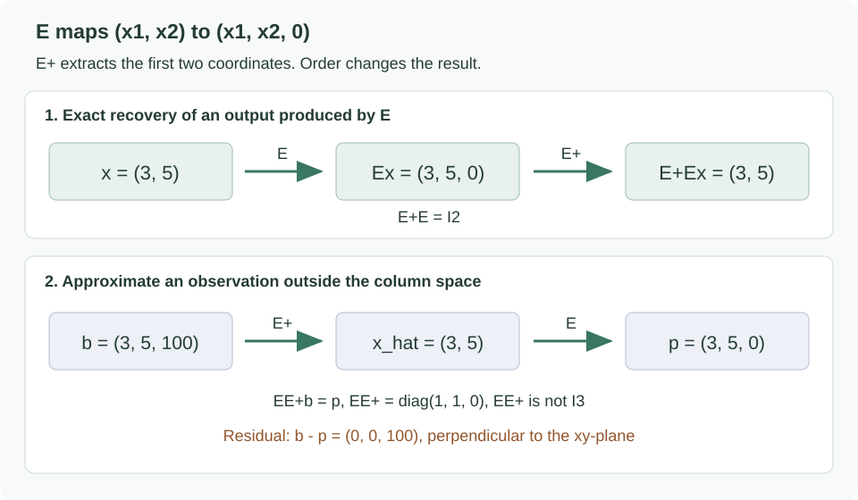

행렬에 벡터를 곱하면 새로운 벡터가 나온다. 계산은 행과 열을 곱해서 더하면 되지만, 그 결과를 이해하려면 다른 질문이 필요하다. <strong>입력의 어떤 방향이 출력에 남고, 어떤 방향이 사라질까? 출력만 보고 입력을 되찾을 수 있을까?</strong>

[앞 글의 벡터·정사영](/enai601-vectors-and-projection/)에서 다룬 표현과 거리는 행렬을 통해 여러 입력과 출력의 관계로 확장된다. 선형방정식의 해가 존재하는지, 유일한지, 정확한 해가 없을 때 무엇을 근사할지 알아야 이후 학습 문제를 수식으로 세우고 풀 수 있다. 이 글에서는 실수 벡터와 실수 행렬을 사용한다.

| 학습의 출발점 | 이 글에서 확인할 것 |
| --- | --- |
| 행과 열의 관점 | 출력 하나를 계산하는 방법과 가능한 출력 전체의 관계 |
| rank·null space·inverse | pivot, 자유변수, 복원 가능성의 연결 |
| left inverse·least squares | 정확한 복원과 가장 가까운 근사의 차이 |
| eigenvector·spectral theorem | 고유방향을 검사하는 것으로 모든 방향을 설명하는 이유 |
| PSD·PD·outer product·각도 | 대칭성, 영벡터 예외, 행렬식 판정의 한계 |

이번 복습의 흐름은 세 단계다. 먼저 <strong>어떤 출력을 만들 수 있는지</strong>를 range와 rank로 보고, 다음으로 <strong>출력에서 입력을 얼마나 되찾을 수 있는지</strong>를 null space와 inverse로 본다. 마지막에는 <strong>입력 방향마다 변환이 어떻게 작용하는지</strong>를 eigenvalue와 quadratic form으로 읽는다. 기호를 계산하는 법과 그 기호가 설명하는 공간을 함께 확인한다.

| 기본 표기 | 읽는 방법 |
| --- | --- |
| $A\in\mathbb R^{m\times n}$ | 행이 $m$개, 열이 $n$개인 실수 행렬 |
| $a_{ij}$ | $A$의 $i$번째 행, $j$번째 열의 원소(entry) |
| $x\in\mathbb R^n$ | 기본적으로 $n\times1$ 열벡터(column vector) |
| $A^T$ | 행과 열을 바꾼 전치행렬(transpose) |
| $I_n$ | $n\times n$ 항등행렬(identity matrix) |
| $\operatorname{span}\{v_1,\ldots,v_k\}$ | 주어진 벡터들의 모든 선형결합(linear combination)의 집합 |
| $\dim W$ | 부분공간 $W$의 기저(basis)에 필요한 벡터 개수 |

아래에서 행렬의 이름 $A,B,C$ 등은 예제마다 새로 정의한다. 같은 문자라는 이유만으로 이전 예제와 같은 행렬이라고 읽지 않는다.

## 1. 행 관점과 열 관점은 서로 다른 질문에 답한다

<strong>행렬(matrix)</strong>은 수를 행(row)과 열(column)에 맞춰 배열한 것이다. 행은 가로, 열은 세로이며, $m\times n$에서 앞의 $m$이 행 개수다. $A\in\mathbb R^{m\times n}$의 행벡터는 성분이 $n$개이고, 열벡터는 성분이 $m$개다. 따라서 행과 열은 서로 다른 차원의 공간에 놓일 수 있다.

필기의 첫 행렬은 출력 두 개와 입력 세 개를 연결한다.

$$
A=\begin{bmatrix}2&-1&5\\0&3&4\end{bmatrix},\qquad
x=\begin{bmatrix}x_1\\x_2\\x_3\end{bmatrix},\qquad
Ax=\begin{bmatrix}2x_1-x_2+5x_3\\3x_2+4x_3\end{bmatrix}
$$

### 행 관점: 출력 하나를 어떻게 계산하는가?

첫 번째 출력은 첫 번째 행과 입력 전체의 내적이다. 두 번째 출력은 두 번째 행과 입력 전체의 내적이다.

$$
A=\begin{bmatrix}r_1^T\\r_2^T\end{bmatrix}
\quad\Longrightarrow\quad
Ax=\begin{bmatrix}r_1^Tx\\r_2^Tx\end{bmatrix}
$$

각 행은 하나의 출력을 만들기 위한 가중치 묶음이다. 예를 들어 입력 $x=(1,2,- 1)$이면 첫 번째 출력은 −5, 두 번째 출력은 2다.

여기서 <strong>내적(inner product, dot product)</strong>은 같은 위치의 성분끼리 곱한 뒤 더하는 연산이다. 첫 번째 출력의 계산은 $2\cdot1+(-1)\cdot2+5\cdot(-1)=-5$다. 하나의 행이 입력 전체를 읽고, 하나의 스칼라 출력 성분을 만든다.

### 열 관점: 입력 하나가 출력 전체에 어떻게 기여하는가?

이번에는 입력 성분별로 항을 모아 보자.

$$
Ax=x_1\begin{bmatrix}2\\0\end{bmatrix}
+x_2\begin{bmatrix}-1\\3\end{bmatrix}
+x_3\begin{bmatrix}5\\4\end{bmatrix}
$$

각 열벡터는 해당 입력 성분이 출력 공간에 더하는 방향이다. $x_{1}$, $x_{2}$, $x_{3}$는 그 방향들의 계수다. 일반적으로는

$$
A=[a_1\ a_2\ \cdots\ a_n]
\quad\Longrightarrow\quad Ax=\sum_{j=1}^{n}x_ja_j
$$

이다. 수업에서 강조한 “행렬 곱은 열의 선형결합”이라는 설명이 여기서 나온다. 행 관점은 <strong>출력 성분 하나의 계산</strong>, 열 관점은 <strong>가능한 출력들의 공간</strong>을 이해할 때 유용하다.

표준기저벡터(standard basis vector) $e_j$는 $j$번째 성분만 1이고 나머지는 0인 입력이다. 그러면

$$
Ae_j=a_j
$$

이므로 <strong>$A$의 $j$번째 열은 $j$번째 입력만 한 단위 켰을 때의 출력 전체</strong>다. 일반 입력은 $x=\sum_jx_je_j$이므로 각 열의 기여를 $x_j$배씩 합치면 된다. 행 관점에서의 “출력 하나”와 열 관점에서의 “입력 성분 하나의 기여”를 구분하면 행렬 곱을 외우기 쉬워진다.

### Shape를 먼저 확인한다

$$
A\in\mathbb R^{m\times n},\quad x\in\mathbb R^n,
\quad Ax\in\mathbb R^m,\qquad A:\mathbb R^n\to\mathbb R^m
$$

입력 차원은 열의 개수 $n$이고 출력 차원은 행의 개수 $m$이다. 벡터의 shape를 열로 쓰면 $n\times 1$에서 $m\times 1$로 바뀐다.

행렬 $C$에 대해서도 각 열을 하나씩 입력하면 된다.

$$
A\in\mathbb R^{m\times n},\quad C\in\mathbb R^{n\times p}
\quad\Longrightarrow\quad AC\in\mathbb R^{m\times p},
\qquad (AC)_{ij}=\sum_{k=1}^n a_{ik}c_{kj}
$$

$AC$는 먼저 $C$, 다음 $A$를 적용하는 합성(composition)이다. 일반적으로 $AC$와 $CA$는 다르며, 한쪽만 정의될 수도 있다. 행렬 덧셈은 두 행렬의 shape가 같을 때 같은 위치의 원소끼리 더한다.

예를 들어

$$
F=\begin{bmatrix}1&2\\3&4\end{bmatrix},\qquad
G=\begin{bmatrix}5&1\\6&0\end{bmatrix}
$$

이면 첫 번째 출력 열은 $F(5,6)^T=(17,39)^T$, 두 번째 출력 열은 $F(1,0)^T=(1,3)^T$다. 따라서

$$
FG=[Fg_1\ Fg_2]=\begin{bmatrix}17&1\\39&3\end{bmatrix}
$$

이다. 행렬끼리의 곱도 <strong>오른쪽 행렬의 각 열을 입력으로 넣은 결과를 나란히 놓는 것</strong>이다. 같은 위치의 원소끼리 곱하는 elementwise product와는 다른 연산이다.

반대로 왼쪽에서 행벡터 $w^T$를 곱하면 행들의 선형결합이 된다.

$$
w^TA=\sum_{i=1}^m w_i r_i^T\in\mathbb R^{1\times n}
$$

가령 $(2,-1)F=2(1,2)-(3,4)=(-1,0)$이다. 교안의 열벡터 곱과 행벡터 곱은 같은 곱셈을 서로 다른 방향에서 묶어 읽는 예제다.

### 전치와 기본 행렬: 뒤의 식을 읽기 위한 준비

전치(transpose)는 $(A^T)_{ij}=a_{ji}$로 정의한다. 대각선 기준으로 행과 열을 교환하므로 $A^T\in\mathbb R^{n\times m}$이며, 대칭행렬이 아닌 일반 행렬에서는 $A^T\ne A$다.

$$
\begin{bmatrix}2&-1&5\\0&3&4\end{bmatrix}^T
=\begin{bmatrix}2&0\\-1&3\\5&4\end{bmatrix}
$$

특히 다음 세 식을 기억한다. 곱의 전치에서는 <strong>순서까지 반대로 바뀐다.</strong>

$$
(A^T)^T=A,\qquad (A+B)^T=A^T+B^T,\qquad
(AC)^T=C^TA^T
$$

따라서 $(Ax)^T=x^TA^T$다. 뒤에서 $(Ax)^T(Ax)=x^TA^TAx$로 묶는 계산은 이 성질을 사용한다.

| 이름 | 정의와 역할 |
| --- | --- |
| 영행렬(zero matrix) $0$ | 모든 원소가 0. 영벡터와 마찬가지로 크기(shape)는 문맥으로 구분한다. |
| 정방행렬(square matrix) | 행과 열의 개수가 같다. 일반적인 양쪽 역행렬·행렬식·고유값은 이 경우에 논의한다. |
| 항등행렬(identity matrix) $I_n$ | 대각 원소가 1, 나머지가 0. $I_mA=AI_n=A$로, 변환을 바꾸지 않는다. |
| 대각행렬(diagonal matrix) $\operatorname{diag}(d_1,\ldots,d_n)$ | 대각선 밖이 0. 각 좌표를 해당 $d_i$배 한다. |
| 삼각행렬(triangular matrix) | 대각선 아래 또는 위의 원소가 모두 0. 행 소거와 행렬식 계산에서 등장한다. |

## 2. 선형변환: 덧셈과 스칼라배를 보존한다

선형변환(linear transformation, linear map)은 벡터의 덧셈과 스칼라배를 보존하는 함수다. 두 성질을 하나로 쓰면 다음과 같다.

행렬 $A$로 정의한 변환은 선형이다.

$$
A(\alpha x+\beta y)=\alpha Ax+\beta Ay
$$

입력을 먼저 조합하고 변환하든, 각각 변환한 뒤 같은 계수로 조합하든 결과가 같다. 따라서 원점은 반드시 원점으로 간다.

$$
A0=0
$$

고정된 벡터 $b$를 더하면 아핀변환(affine transformation)이 된다. 특히 $b\ne0$이면 선형변환은 아니다.

$$
T(x)=Ax+b
$$

이 변환은 일반적으로 원점을 보존하지 않는다. 나중에 제약식을 볼 때 선형 부분공간과 원점에서 이동한 집합을 구별하는 데 도움이 된다.

## 3. Range는 가능한 출력 전체다

먼저 앞 글의 용어 세 개를 연결해 두자. <strong>선형생성(span)</strong>은 벡터들을 계수로 조합해 만들 수 있는 전체 집합이다. <strong>선형독립(linear independence)</strong>은 어느 벡터도 나머지 벡터들의 조합으로 대신할 수 없다는 뜻이며,

$$
c_1v_1+\cdots+c_kv_k=0
\quad\Longrightarrow\quad c_1=\cdots=c_k=0
$$

일 때 성립한다. 전체 공간을 생성하면서 선형독립인 벡터 집합이 <strong>기저(basis)</strong>다. <strong>차원(dimension)</strong>은 그 기저에 필요한 벡터의 개수다. 좌표 성분의 개수와 어떤 부분공간의 차원은 구분해야 한다.

입력을 자유롭게 바꿀 때 만들 수 있는 출력의 집합이 <strong>range</strong>, 또는 column space다.

$$
\mathcal R(A)=\{Ax:x\in\mathbb R^n\}
=\operatorname{span}\{a_1,\ldots,a_n\}\subseteq\mathbb R^m
$$

필기의 예제처럼 두 열이 종속인 행렬을 생각하자.

$$
B=\begin{bmatrix}1&2\\2&4\end{bmatrix},\qquad
Bx=(x_1+2x_2)\begin{bmatrix}1\\2\end{bmatrix}
$$

두 번째 열은 첫 번째 열의 2배다. 어떤 입력을 넣어도 출력은 (1,2) 방향의 직선에 놓인다.

$$
\mathcal R(B)=\operatorname{span}\left\{\begin{bmatrix}1\\2\end{bmatrix}\right\}
$$

출력 성분은 두 개지만 독립적인 출력 방향은 하나다. 예를 들어 $b=(1,0)$은 이 직선 밖에 있으므로 $Bx=b$를 만족하는 입력이 없다.

식으로 확인하면 $x_1+2x_2=1$과 $2x_1+4x_2=0$을 동시에 만족해야 한다. 첫 식의 두 배는 두 번째 식의 왼쪽과 같지만 오른쪽은 2와 0으로 모순이다. 반면 $b=(3,6)$은 첫 번째 열의 3배이므로 range 안에 있다. <strong>$b\in\mathcal R(B)$인지 묻는 것과 $Bx=b$의 해가 존재하는지 묻는 것은 같은 질문</strong>이다.

range가 부분공간인 이유도 선형성으로 확인할 수 있다. 가능한 두 출력 $Ax$, $Ay$를 선형결합하면 다시 $A(\alpha x+\beta y)$라는 가능한 출력이 된다. 영벡터 $A0=0$도 포함한다. 이런 덧셈·스칼라배에 대한 닫힘(closure)이 부분공간(subspace)의 핵심 조건이다.

## 4. Null space는 사라지는 입력 전체다

<strong>Null space</strong>, 또는 kernel은 출력이 영벡터가 되는 입력들의 집합이다.

$$
\mathcal N(A)=\{x\in\mathbb R^n:Ax=0\}\subseteq\mathbb R^n
$$

range는 <strong>출력 공간</strong>, null space는 <strong>입력 공간</strong>에 놓인다. $Ax=Ay$일 때 $A(x- y)=0$이므로, null space는 같은 출력을 만드는 입력들의 차이도 설명한다.

위의 $B$에서는 다음이 성립한다.

$$
z=\begin{bmatrix}-2\\1\end{bmatrix},\qquad Bz=0,
\qquad B(x+tz)=Bx\quad(t\in\mathbb R)
$$

원래 입력에 $z$ 방향을 얼마나 더해도 출력이 바뀌지 않는다. 출력만으로 그 방향의 입력 정보를 복원할 수 없다.

$A0=0$이므로 null space에는 항상 영벡터가 있다. 중요한 구분은 <strong>영벡터만 있는가</strong>, 아니면 <strong>0이 아닌 해(nontrivial solution)</strong>도 있는가다. $Ax=0$은 우변이 영벡터인 동차 연립방정식(homogeneous linear system)이다.

또 $Ax=b$의 특정 해(particular solution) $x_p$를 하나 찾았다면 모든 해는

$$
\{x:Ax=b\}=x_p+\mathcal N(A)
$$

로 쓸 수 있다. 실제로 $A(x_p+z)=b$이고, 다른 해 $y$가 있다면 $A(y-x_p)=0$이다. 예를 들어 $Bx=(3,6)^T$의 모든 해는

$$
x=\begin{bmatrix}3\\0\end{bmatrix}
+t\begin{bmatrix}-2\\1\end{bmatrix},\qquad t\in\mathbb R
$$

다. <strong>null space는 정확한 복원을 막는 모호함(ambiguity)의 방향</strong>이다. 실수 벡터 공간에서는 해가 존재하고 null space에 0이 아닌 방향이 있으면 그 방향으로 움직여 무한히 많은 해를 만든다.

### 필기의 2×3 예제: 자유변수로 모든 해를 표현하기

$$
C=\begin{bmatrix}1&0&1\\0&1&1\end{bmatrix},\qquad Cx=0
$$

연립방정식으로 쓰면 $x_{1}+x_{3}=0$, $x_{2}+x_{3}=0$이다. 세 번째 성분을 $t$로 놓으면

$$
x=\begin{bmatrix}-t\\-t\\t\end{bmatrix}
=t\begin{bmatrix}-1\\-1\\1\end{bmatrix},\qquad
\mathcal N(C)=\operatorname{span}\left\{\begin{bmatrix}-1\\-1\\1\end{bmatrix}\right\}
$$

이다. 자유변수가 하나이므로 null space의 차원은 1이다.

이 차원을 <strong>nullity(영공간의 차원)</strong>라고 한다. $t=0$ 하나가 null space의 전부인 것이 아니라, $t$가 모든 실수를 움직일 때 얻는 직선 전체가 null space다. 여기서 null space는 “입력 벡터 하나”가 아닌 <strong>그런 입력들의 집합</strong>이다. 또한 선형결합해도 여전히 0으로 가므로 부분공간이다.

## 5. Rank는 pivot의 개수이자 독립적인 출력 방향의 수다

rank는 range의 차원이다.

$$
\operatorname{rank}(A)=\dim\mathcal R(A)\le\min(m,n)
$$

열벡터가 $n$개이므로 독립적인 방향은 $n$개를 넘을 수 없고, 그 열들이 사는 출력 공간이 $m$차원이므로 $m$개도 넘을 수 없다. 영행렬의 rank는 0이며, 가능한 최대값 $\min(m,n)$을 가지면 <strong>full rank</strong>다.

필기에서는 행 소거 후 pivot을 세는 계산으로 연결했다.

<strong>행 소거(row reduction, Gaussian elimination)</strong>는 행의 교환, 0이 아닌 상수배, 다른 행의 배수를 더하는 기본 행 연산(elementary row operations)으로 행렬을 단순화하는 과정이다. 사다리꼴(row echelon form)로 만들었을 때 각 0이 아닌 행에서 처음 나타나는 0이 아닌 원소가 <strong>pivot(피벗)</strong>이며, 그 열이 pivot column이다. 여기서 pivot은 처음부터 1일 필요는 없다.

피벗 열에 대응하는 변수를 <strong>피벗 변수(pivot variable)</strong>, 나머지를 <strong>자유변수(free variable)</strong>라고 한다. 자유변수 값을 고른 뒤 피벗 변수를 결정할 수 있으므로 자유변수가 null space를 매개화한다.

$$
D=\begin{bmatrix}1&2&1\\1&2&2\end{bmatrix}
\xrightarrow{R_2\leftarrow R_2-R_1}
R=\begin{bmatrix}1&2&1\\0&0&1\end{bmatrix}
$$

첫 번째 열과 세 번째 열에 pivot이 있으므로 rank는 2다. 두 번째 열은 첫 번째 열의 2배다.

한 번 더 $R_1\leftarrow R_1-R_2$를 수행하면 기약행 사다리꼴(reduced row echelon form, RREF)을 얻는다.

$$
\begin{bmatrix}1&2&0\\0&0&1\end{bmatrix}
$$

$Dx=0$은 $x_1+2x_2=0$, $x_3=0$이므로 자유변수는 $x_2=t$다.

$$
\mathcal N(D)=\operatorname{span}\left\{\begin{bmatrix}-2\\1\\0\end{bmatrix}\right\},
\qquad \operatorname{rank}(D)=2,\quad\operatorname{nullity}(D)=1
$$

세 열 모두 영벡터가 아니지만 rank는 3이 아니다. <strong>0이 아닌 열의 개수와 선형독립인 열의 개수는 다르다.</strong> 이제 range의 기저를 원래 행렬의 피벗 열에서 고르면

$$
\left\{\begin{bmatrix}1\\1\end{bmatrix},
\begin{bmatrix}1\\2\end{bmatrix}\right\}
$$

가 된다. <strong>행 소거는 pivot 열의 위치를 알려 주지만, 원래 column space의 기저는 원래 행렬의 그 열에서 가져온다.</strong>

행 연산을 가역행렬 $E$의 곱으로 쓰면 $R=ED$다. 따라서 rank와 열들 사이의 선형관계는 보존되지만, column space 자체는 $E$에 의해 바뀔 수 있다. 예를 들어 $B$의 두 번째 행에서 첫 번째 행의 2배를 빼면 range가 (1,2) 방향에서 (1,0) 방향으로 바뀐다. 두 경우 모두 차원은 1이다. 한편 $EDx=0$과 $Dx=0$은 동치이므로 null space는 그대로다.

### Rank–nullity는 입력 변수의 개수를 센다

$$
n=\operatorname{rank}(A)+\dim\mathcal N(A)
$$

피벗 변수의 수와 자유변수의 수를 더하면 전체 입력 변수의 수 $n$이다.

이를 <strong>rank–nullity theorem(계수–퇴화차수 정리)</strong>이라고 한다. 한국어 번역보다 $n=\operatorname{rank}(A)+\operatorname{nullity}(A)$가 어느 공간의 차원을 세는지 기억하는 편이 유용하다. $C$는 rank 2와 nullity 1로 3=2+1을 만족한다. 행의 수 $m$을 왼쪽에 넣으면 안 된다.

row rank와 column rank도 같다. 다만 <strong>행들이 사는 공간과 열들이 사는 공간이 같다</strong>는 뜻은 아니다. 행공간은 $\mathbb{R}^{n}$, 열공간은 $\mathbb{R}^{m}$의 부분공간이다.

| 조건 | $Ax=b$에서의 의미 |
| --- | --- |
| full column rank(열 전체가 선형독립): rank = $n$ | null space가 $\{0\}$. 해가 존재하면 유일. 일대일(injective) |
| full row rank(행 전체가 선형독립): rank = $m$ | range가 $\mathbb{R}^{m}$ 전체. 모든 $b$에 대해 해가 존재. 전사(surjective) |
| 정방행렬이고 rank = $n$ | 모든 $b$에 대해 유일한 해. 역행렬 존재 |

### 행공간과 null space는 서로 수직이다

<strong>행공간(row space)</strong>은 $A$의 행벡터들을 생성원으로 하는 $\mathbb R^n$의 부분공간이며, 열벡터 표기로는 $\mathcal R(A^T)$다. $Ax=0$은 모든 행 $r_i^T$에 대해 $r_i^Tx=0$이라는 뜻이다. 따라서

$$
\mathcal N(A)=\mathcal R(A^T)^\perp,\qquad
\mathbb R^n=\mathcal R(A^T)\oplus\mathcal N(A)
$$

이다. $\perp$는 직교여공간(orthogonal complement), $\oplus$는 두 공간의 합이 전체 공간을 이루고 성분 분해가 유일하다는 뜻이다. 입력 $x$는 행공간 성분과 null space 성분으로 나눌 수 있으며, $A$는 뒤의 성분을 지운다. 두 차원이 rank와 nullity이므로 합이 $n$이라는 정리와도 맞아떨어진다.

출력 공간에서도 $\mathcal R(A)^\perp=\mathcal N(A^T)$가 성립한다. 이것이 뒤에서 잔차 $r$가 열공간에 수직일 때 $A^Tr=0$으로 쓰는 근거다.

## 6. 역행렬과 행렬식: 되돌릴 수 있는 변환인가?

$n\times n$ 정방행렬 $A$에 대해 다음을 만족하는 행렬이 있으면 <strong>가역(invertible)</strong> 또는 <strong>비특이(nonsingular)</strong>라고 한다. 역행렬이 없는 정방행렬은 <strong>특이행렬(singular matrix)</strong>이다.

$$
AA^{-1}=A^{-1}A=I_n
$$

가역이면 출력 $b$로부터 입력을 되찾을 수 있다.

입력에 먼저 $A$, 다음 $A^{-1}$을 적용하면 $A^{-1}(Ax)=x$다. 반대 순서도 항등변환이다. 정방행렬의 역행렬은 양쪽에서 작용하며 존재하면 유일하다.

$$
Ax=b\quad\Longrightarrow\quad x=A^{-1}b
$$

교안의 예제는 다음과 같다.

$$
A=\begin{bmatrix}3&2\\1&4\end{bmatrix},\qquad
A^{-1}=\frac1{10}\begin{bmatrix}4&-2\\-1&3\end{bmatrix}
$$

$2\times 2$ 행렬의 determinant는 다음 식이다.

$$
\det\begin{bmatrix}a&b\\c&d\end{bmatrix}=ad-bc
$$

위의 $A$에서는 12−2=10이다.

일반적인 $2\times2$ 역행렬 공식은

$$
\begin{bmatrix}a&b\\c&d\end{bmatrix}^{-1}
=\frac1{ad-bc}\begin{bmatrix}d&-b\\-c&a\end{bmatrix},\qquad ad-bc\ne0
$$

이다. 분모가 0이면 사용할 수 없다. 위 예제에서는 곱을 직접 계산하면

$$
\begin{bmatrix}3&2\\1&4\end{bmatrix}
\frac1{10}\begin{bmatrix}4&-2\\-1&3\end{bmatrix}
=\frac1{10}\begin{bmatrix}10&0\\0&10\end{bmatrix}=I_2
$$

가 된다. 더 큰 행렬에서는 첨가행렬(augmented matrix) $[A\mid I_n]$에 Gauss–Jordan elimination을 적용해 $[I_n\mid A^{-1}]$로 만드는 방법도 있다. 왼쪽을 $I_n$으로 만들 수 없다면 가역이 아니다.

역행렬과 전치는 다른 연산이다. 예를 들어 $\operatorname{diag}(2,3)$의 전치는 자기 자신이지만, 역행렬은 $\operatorname{diag}(1/2,1/3)$이다. <strong>$A^{-1}=A^T$는 정규직교 열을 가진 정방행렬에서 성립하는 특별한 성질</strong>이다. 정방행렬에서 다음 조건들은 동치다.

$$
\det(A)\ne0
\iff \operatorname{rank}(A)=n
\iff \mathcal N(A)=\{0\}
\iff A^{-1}\text{ exists}
$$

9월 9일 수업에서는 행렬식의 기하학적 의미도 설명했다. 2차원 단위 정사각형에 $A$를 적용하면 두 열벡터가 만드는 평행사변형이 된다. <strong>행렬식의 절댓값은 넓이의 배율</strong>이다. 더 높은 차원에서는 부피의 배율로 확장된다. 부호는 방향의 보존 또는 반전을 나타낸다.

행렬식이 0이면 차원이 눌려 넓이·부피가 0이 된다. 그러면 서로 다른 입력들이 겹쳐져 원래 입력을 유일하게 복원할 수 없다.

### 3×3 이상: 소행렬식과 여인수 전개

교안의 <strong>cofactor expansion(여인수 전개, Laplace expansion)</strong>은 큰 행렬의 determinant를 작은 행렬의 determinant로 줄이는 계산이다. $A$에서 $i$번째 행과 $j$번째 열을 지운 부분행렬(submatrix)을 $A_{\widehat i,\widehat j}$라고 쓰자.

$$
M_{ij}=\det(A_{\widehat i,\widehat j}),\qquad
C_{ij}=(-1)^{i+j}M_{ij}
$$

$M_{ij}$가 <strong>minor(소행렬식)</strong>, 부호까지 곱한 $C_{ij}$가 <strong>cofactor(여인수)</strong>다. 임의의 고정된 행 $i$를 따라 전개하면

$$
\det(A)=\sum_{j=1}^n a_{ij}C_{ij}
$$

이다. $3\times3$에서 여인수의 부호는 첫 행 $+,-,+$, 둘째 행 $-,+,-$, 셋째 행 $+,-,+$처럼 번갈아 붙는다. 예를 들어

$$
T=\begin{bmatrix}1&2&0\\0&3&1\\2&0&1\end{bmatrix}
$$

의 첫 행을 따라 전개하면

$$
\det(T)
=1\det\begin{bmatrix}3&1\\0&1\end{bmatrix}
-2\det\begin{bmatrix}0&1\\2&1\end{bmatrix}
+0
=3-2(-2)=7
$$

이다. 원소가 0인 행이나 열을 따라 전개하면 계산량을 줄일 수 있다. 열을 따라 전개하는 공식도 마찬가지로 성립한다.

### 행렬식에서 함께 기억할 성질

아래의 곱과 역행렬 공식에서는 같은 크기의 정방행렬을 가정한다.

| 성질 | 의미 |
| --- | --- |
| $\det(I_n)=1$ | 항등변환은 부피를 바꾸지 않는다. |
| $\det(A^T)=\det(A)$ | 전치해도 행렬식은 같다. |
| $\det(AB)=\det(A)\det(B)$ | 변환을 합성하면 부피 배율도 곱해진다. |
| $\det(A^{-1})=1/\det(A)$ | 역변환의 배율은 역수다. 가역일 때만 쓴다. |
| 삼각행렬의 행렬식은 대각 원소들의 곱 | 행 소거로 삼각형을 만들면 계산하기 쉬워진다. |

행 연산이 determinant에 미치는 효과는 따로 추적해야 한다. <strong>두 행을 바꾸면 부호 반전</strong>, <strong>한 행을 $c$배 하면 행렬식도 $c$배</strong>, <strong>다른 행의 배수를 더하는 연산은 행렬식을 보존</strong>한다. rank를 구할 때처럼 행 소거 결과만 보고 원래 determinant가 그대로라고 생각하면 안 된다.

덧셈에는 곱셈과 같은 규칙이 없다. 예를 들어 $\det(I_2+I_2)=\det(2I_2)=4$지만 $\det(I_2)+\det(I_2)=2$다.

### 직사각형 행렬은 왜 따로 생각해야 할까?

필기에서 이어지는 질문은 “정방행렬이 아니어도 입력을 복구할 수 있을까?”다. 여기부터 왼쪽 역행렬·최소제곱 부분은 보충 학습이다.

행이 더 많은 <strong>tall matrix</strong>라도 full column rank이면 서로 다른 입력이 같은 출력으로 겹치지 않는다. 입력을 더 큰 출력 공간 안에 일대일로 넣는 것이다. 다만 출력 공간의 모든 벡터를 만들지는 못한다.

반대로 열이 더 많은 <strong>wide matrix</strong>는 $\operatorname{rank}\le m<n$이므로 nullity가 양수다. 입력 전체를 일대일로 복구할 수 없다. full row rank이면 모든 출력을 만들 수 있고 오른쪽 역행렬은 가질 수 있다.

## 7. 왼쪽 역행렬은 원래 만들어 낸 출력을 정확히 복원한다

full column rank인 $A$에 대해, $A$의 왼쪽에 곱해서 항등행렬을 만드는 $L$을 생각하자.

$$
A\in\mathbb R^{m\times n},\quad L\in\mathbb R^{n\times m},
\qquad LA=I_n
$$

그러면 실제로 $A$가 만든 출력 $y=Ax$에서는 $Ly=L(Ax)=(LA)x=x$다. 이것이 <strong>left inverse(왼쪽 역행렬)</strong>의 복원 의미다.

하지만 임의의 $b$에 대해 $ALb=b$라고 결론 내릴 수는 없다. tall matrix에서 $AL$은 $m\times m$이고 rank가 최대 $n$이므로, $m>n$이면 $I_m$이 될 수 없다.

필기의 간단한 예제를 쓰면

$$
E=\begin{bmatrix}1&0\\0&1\\0&0\end{bmatrix},\qquad
Ex=\begin{bmatrix}x_1\\x_2\\0\end{bmatrix}
$$

이다. 입력은 두 성분인데 출력은 세 성분이다. 출력은 xy평면 안에만 놓이고, 그 평면 안에서는 입력을 잃지 않는다.

### 왼쪽 역행렬은 하나가 아닐 수 있다

임의의 실수 $c,d$에 대해 다음 행렬은 모두 $E$의 왼쪽 역행렬이다.

$$
L_{c,d}=\begin{bmatrix}1&0&c\\0&1&d\end{bmatrix},
\qquad L_{c,d}E=I_2
$$

원래 $E$가 만드는 출력은 세 번째 성분이 0이므로 $c,d$가 무엇이든 복원값이 같다. 그러나 $b=(3,5,100)$처럼 range 밖의 벡터에 적용하면 결과가 달라진다.

$$
L_{c,d}b=\begin{bmatrix}3+100c\\5+100d\end{bmatrix}
$$

따라서 <strong>왼쪽 역행렬이라는 조건만으로 임의의 관측값에 대한 최소제곱해가 정해지지는 않는다.</strong> 그 역할을 하는 특별한 선택이 의사역행렬이다.

## 8. 최소제곱과 의사역행렬: 만들 수 없는 출력에 가장 가깝게 가기

현실의 관측값 $b$는 $A$의 range 밖에 있을 수 있다. 그때는 $Ax=b$의 정확한 해를 찾는 대신

$$
\min_x\|Ax-b\|_2^2
$$

를 푼다. 가능한 출력 중 $b$에 가장 가까운 점을 고르는 문제다. [벡터 글의 정사영](/enai601-vectors-and-projection/)이 여기서 다시 등장한다.

$$
\hat b=A\hat x=\operatorname{proj}_{\mathcal R(A)}b,\qquad
r=b-A\hat x,\qquad r\perp\mathcal R(A)
$$

잔차가 $A$의 각 열과 직교해야 하므로

$$
A^T(b-A\hat x)=0\quad\Longleftrightarrow\quad
A^TA\hat x=A^Tb
$$

를 얻는다. 이것이 <strong>normal equations(정규방정식)</strong>다. 잔차를 $b-A\hat x$로 정의했으므로 부호도 이 식과 일치한다.

여기서 <strong>least squares(최소제곱)</strong>는 오차 성분들의 제곱합을 최소화한다는 뜻이고, $r=b-A\hat x$는 <strong>residual(잔차)</strong>다. 제곱 노름과 노름 자체는 같은 점에서 최소가 되지만, 제곱형은 미분·전개하기 편하다.

왜 잔차가 수직이면 정말 최솟값일까? 임의의 다른 입력 $x$에 대해

$$
b-Ax=r+A(\hat x-x)
$$

다. 첫 항은 열공간에 수직이고 둘째 항은 열공간 안에 있으므로, 앞 글의 피타고라스 정리(Pythagorean theorem)를 적용할 수 있다.

$$
\|b-Ax\|_2^2
=\|r\|_2^2+\|A(\hat x-x)\|_2^2
\ge\|r\|_2^2
$$

즉 잔차 직교 조건은 단순한 암기 공식이 아니라 <strong>다른 어떤 입력도 오차를 더 작게 만들지 못한다는 증명</strong>이다. 정규방정식은 $A$가 rank deficient여도 성립한다. 다만 그때는 해를 구하기 위해 $(A^TA)^{-1}$을 쓸 수 없고, 최소제곱 계수가 여러 개일 수 있다.

### Full column rank일 때의 공식

$$
x^TA^TAx=\|Ax\|_2^2
$$

$A$가 full column rank이면 0이 아닌 $x$에서 이 값이 양수다. 따라서 $A^{T}A$는 PD이자 가역이다. 이때

$$
A^+=(A^TA)^{-1}A^T,\qquad \hat x=A^+b,\qquad A^+A=I_n
$$

이다. $A^+$는 Moore–Penrose pseudoinverse이며, 이 경우에는 왼쪽 역행렬이기도 하다. 하지만 앞의 모든 $L$이 $A^+$인 것은 아니다.

만약 $A$의 열들이 정규직교라면 $A^TA=I_n$이어서 $A^+=A^T$로 단순해진다. 일반적인 기저에서는 열들 사이에 내적이 0이 아닌 항이 있으므로, 계수를 얻기 위해 $(A^TA)^{-1}$ 보정이 필요하다. <strong>열벡터와 내적하기만 하면 계수가 바로 나온다는 설명은 정규직교기저에서의 특별한 경우</strong>다.

### 필기의 관측값 예제: b=(3,5,100)



$E$의 두 열은 이미 정규직교하므로 $E^{T}E=I_{2}$다.

$$
E^+=E^T=\begin{bmatrix}1&0&0\\0&1&0\end{bmatrix}
$$

$$
\hat x=E^+b=\begin{bmatrix}3\\5\end{bmatrix},\qquad
\hat b=E\hat x=\begin{bmatrix}3\\5\\0\end{bmatrix},\qquad
r=\begin{bmatrix}0\\0\\100\end{bmatrix}
$$

$b$ 자체를 복원한 것이 아니라, <strong>xy평면에서 $b$에 가장 가까운 출력의 두 좌표</strong>를 얻었다. 세 번째 성분 100은 $E$의 어떤 입력으로도 만들 수 없는 잔차다.

$$
EE^+=\begin{bmatrix}1&0&0\\0&1&0\\0&0&0\end{bmatrix}\ne I_3
$$

$E^+E$는 입력을 복원하는 $I_{2}$지만, $EE^+$는 출력 공간에서 xy평면으로 정사영하는 행렬이다.

같은 xy평면을 생성해도 기저가 바뀌면 계수는 달라진다. 보충 예제로

$$
\widetilde E=\begin{bmatrix}1&1\\0&1\\0&0\end{bmatrix},\qquad
\widetilde E^T\widetilde E=\begin{bmatrix}1&1\\1&2\end{bmatrix}
$$

를 쓰면, 똑같은 관측값 $b=(3,5,100)^T$에 대해

$$
\hat x=
\begin{bmatrix}2&-1\\-1&1\end{bmatrix}
\begin{bmatrix}3\\8\end{bmatrix}
=\begin{bmatrix}-2\\5\end{bmatrix},\qquad
\widetilde E\hat x=\begin{bmatrix}3\\5\\0\end{bmatrix}
$$

다. <strong>정사영된 점은 같지만 그 점을 표현하는 기저의 계수는 다르다.</strong> $A^Tb$만 계산한 $(3,8)^T$를 그대로 해라고 하면 틀리는 이유가 보인다.

### Rank가 부족해도 의사역행렬은 존재한다

일반 실수 행렬의 Moore–Penrose 의사역행렬은 유일하다. 다음 네 조건을 만족한다.

첫 두 조건은 원래 변환과 의사역변환의 호환성을 정하고, 뒤의 두 대칭 조건은 $AA^+$와 $A^+A$가 비스듬한 사영이 아닌 <strong>직교사영(orthogonal projection)</strong>이 되도록 한다.

$$
AA^+A=A,\qquad A^+AA^+=A^+,
\qquad (AA^+)^T=AA^+,\qquad(A^+A)^T=A^+A
$$

rank가 부족하면 $(A^{T}A)^{-1}A^{T}$ 공식은 사용할 수 없다. 대신 SVD로 정의할 수 있다. $A=U\Sigma V^{T}$이면

$$
A^+=V\Sigma^+U^T
$$

이며, $\Sigma^+$는 0이 아닌 특이값만 역수로 바꾸고 전치한 크기에 배치한다. 0인 특이값은 0으로 남긴다.

<strong>SVD(singular value decomposition, 특이값 분해)</strong>에서 $U$와 $V$는 각각 출력·입력 공간의 정규직교기저를 담고, $\Sigma$는 0 이상의 특이값(singular value)을 대각선에 담는 $m\times n$ 행렬이다. 전체 크기의 SVD에서는 $U\in\mathbb R^{m\times m}$, $V\in\mathbb R^{n\times n}$이며 $\Sigma^+\in\mathbb R^{n\times m}$다. 0이 아닌 특이값의 개수가 rank다.

고유값 분해와 달리 SVD는 직사각형 행렬에도 적용된다. 의사역행렬은 살아남은 방향의 배율만 역수로 되돌리고, 사라진 방향에는 0을 둔다. 이 설명은 일반 rank의 공식을 이해하기 위한 보충이며, 실제 계산에서는 라이브러리의 SVD 기반 루틴을 사용하면 된다.

<strong>$A^+ b$는 최소제곱해들 중 유클리드 노름이 가장 작은 해</strong>다. rank가 부족하면 계수는 여러 개일 수 있어도 정사영된 출력 $AA^+b$는 유일하다. 일반적으로 $A^+ A$는 입력 공간의 row space로의 정사영이며, 원래 입력 전체를 되돌리는 항등행렬은 아니다.

최소 노름(minimum norm)이라는 말은 계수 벡터의 유클리드 노름(Euclidean norm)이 가장 작은 해를 고른다는 뜻이다. 해들의 차이가 null space에 놓이므로, 행공간 성분은 유지하고 불필요한 null space 성분을 0으로 고르는 해가 가장 짧다. 이는 앞에서 본 $\mathbb R^n=\mathcal R(A^T)\oplus\mathcal N(A)$라는 직교 분해와 연결된다.

### Full row rank이면 오른쪽 역행렬이 된다

$A\in\mathbb R^{m\times n}$이 full row rank이면 $AA^T$가 가역이고

$$
A^+=A^T(AA^T)^{-1},\qquad AA^+=I_m
$$

이다. 이것이 <strong>right inverse(오른쪽 역행렬)</strong> 역할이다. 모든 $b$를 정확히 만들 수 있지만, $n>m$이면 그 입력은 여러 개다. 의사역행렬은 그중 최소 노름 입력을 선택한다.

예를 들어 앞의 $C=\begin{bmatrix}1&0&1\\0&1&1\end{bmatrix}$에서 $Cx=(1,1)^T$의 해는

$$
x=(1-t,1-t,t)^T
$$

이며 $\|x\|_2^2=2(1-t)^2+t^2=3(t-2/3)^2+2/3$이다. 따라서 가장 짧은 해는 $t=2/3$인 $(1/3,1/3,2/3)^T$다. 정확히 맞추는 해가 여러 개라는 사실과 의사역행렬의 출력이 하나라는 사실은 모순이 아니다.

| $A$의 조건 | $A^+$의 공식 | 항등행렬이 되는 쪽 |
| --- | --- | --- |
| full column rank | $(A^TA)^{-1}A^T$ | $A^+A=I_n$ |
| full row rank | $A^T(AA^T)^{-1}$ | $AA^+=I_m$ |
| 정방행렬이고 가역 | $A^{-1}$ | 양쪽 모두 |
| 일반적인 rank | $V\Sigma^+U^T$ | 일반적으로 양쪽 모두 정사영 행렬 |

| 연산 | 의미 |
| --- | --- |
| $A^+ b$ | $b$에 대한 최소 노름 최소제곱 계수 |
| $AA^+b$ | $b$를 column space에 정사영한 출력 |
| $A^+ Ax$ | $x$를 row space에 정사영한 입력 성분 |

NumPy의 [`lstsq`](https://numpy.org/doc/stable/reference/generated/numpy.linalg.lstsq.html)는 최소제곱해를, [`pinv`](https://numpy.org/doc/stable/reference/generated/numpy.linalg.pinv.html)는 SVD를 이용한 의사역행렬을 계산한다. 실제 수치 계산에서는 정규방정식의 역행렬을 직접 만들기보다 이러한 수치 선형대수 루틴을 사용한다. $A^TA$를 만드는 과정에서 조건수(condition number)가 악화될 수 있으므로, 공식이 있다는 사실과 그 공식을 그대로 구현하는 것이 수치적으로 좋은지는 구분한다. 아주 작은 특이값을 0으로 취급할지에 따라 수치적 rank와 결과가 달라질 수 있으므로 임계값도 의미가 있다.

## 9. 고유벡터와 고유값: 특정 방향의 배율

<strong>고유벡터(eigenvector)</strong>와 <strong>고유값(eigenvalue)</strong>은 행렬의 모든 작용을 무작정 추적하는 대신, 변환 후에도 같은 방향의 직선에 남는 벡터부터 찾는 개념이다.

정방행렬 $A$의 <strong>고유벡터</strong>는 다음을 만족하는 0이 아닌 벡터다.

$$
Av=\lambda v,\qquad v\ne0
$$

실수 고유벡터와 실수 고유값을 생각하면, 변환 결과가 원래 벡터와 같은 직선 위에 있다. 양의 고유값은 같은 방향의 배율, 음의 고유값은 방향 반전까지 포함한 배율이고, 0이면 그 방향이 사라진다.

영벡터는 어떤 행렬에서도 위 식을 만족하므로 고유벡터에서 제외한다. 또 일반 실수 행렬의 고유값·고유벡터는 복소수가 될 수도 있다. 이때는 실수 평면의 화살표 그림만으로 해석하기 어렵다.

필기의 가장 간단한 예제는 $A=\operatorname{diag}(2,3)$이다. $(1,0)^T$는 2배, $(0,1)^T$는 3배가 되므로 각각 고유값 2와 3의 고유벡터다. 반면 $(1,1)^T$는 $(2,3)^T$로 가서 한 개의 스칼라배로 표현할 수 없으므로 고유벡터가 아니다.

실수 고유방향이 없는 경우도 있다. 90도 회전행렬 $\begin{bmatrix}0&-1\\1&0\end{bmatrix}$의 특성다항식은 $\lambda^2+1$이어서 고유값은 $\pm i$다. 실수 평면에서는 0이 아닌 벡터가 90도 회전한 뒤 원래 직선에 남지 않는다는 기하학과 맞는다.

### Right eigenvector와 left eigenvector

지금까지의 $Av=\lambda v$는 열벡터를 오른쪽에서 곱하므로 <strong>right eigenvector(오른쪽 고유벡터)</strong>의 정의다. 보통 별도 수식어 없이 eigenvector라고 하면 이를 뜻한다.

교안에는 왼쪽에서 행벡터를 곱하는 <strong>left eigenvector(왼쪽 고유벡터)</strong>도 나온다. 0이 아닌 열벡터 $\ell$을 사용해 쓰면

$$
\ell^TA=\lambda\ell^T
\quad\Longleftrightarrow\quad A^T\ell=\lambda\ell
$$

이다. 즉 $A$의 왼쪽 고유벡터는 $A^T$의 오른쪽 고유벡터 문제로 찾을 수 있다. $A$와 $A^T$의 특성다항식은 같지만, 대응하는 좌·우 고유벡터의 성분은 일반적으로 다르다.

예를 들어 $J=\begin{bmatrix}2&1\\0&3\end{bmatrix}$에서 $v=(1,0)^T$는 $Jv=2v$를 만족하지만, $v^TJ=(2,1)$이므로 $v^T$는 고유값 2의 왼쪽 고유벡터가 아니다. 대신 $\ell^T=(1,-1)$이면 $\ell^TJ=(2,-2)=2\ell^T$다. 실수 대칭행렬에서는 $A^T=A$여서 좌·우 고유벡터 문제를 같은 열벡터들로 풀 수 있다.

### 왜 특성방정식이 null space 문제일까?

$$
Av=\lambda v\quad\Longleftrightarrow\quad(A-\lambda I)v=0
$$

고유벡터는 0이 아니므로 $A- \lambda I$의 null space에 영벡터 이외의 벡터가 있어야 한다.

이 집합 $\mathcal N(A-\lambda I)$을 해당 고유값의 <strong>eigenspace(고유공간)</strong>라고 한다. 고유공간은 영벡터도 포함하는 부분공간이고, 그중 영벡터를 제외한 벡터들이 고유벡터다. 즉 $A- \lambda I$가 특이행렬이어야 한다. 따라서 고유값을 찾는 식은 특성방정식이다.

$$
\det(\lambda I-A)=0
$$

교안의 대칭행렬을 예로 들면

$$
S=\begin{bmatrix}1&-2\\-2&6\end{bmatrix}
$$

이고 특성다항식은

$$
\det(\lambda I-S)=(\lambda-1)(\lambda-6)-4
=\lambda^2-7\lambda+2
$$

이다. 따라서

$$
\lambda_1=\frac{7-\sqrt{41}}2\approx0.2984,\qquad
\lambda_2=\frac{7+\sqrt{41}}2\approx6.7016
$$

두 배율 모두 양수지만 방향별로 크기가 꽤 다르다. 고유값의 합과 곱으로 계산을 검산할 수도 있다. 고유값은 대수적 중복도를 포함해서 센다.

<strong>Trace(대각합)</strong>는 $\operatorname{tr}(A)=\sum_i a_{ii}$다. 고유값이 중복되면 특성다항식에서 근으로 등장하는 횟수인 <strong>algebraic multiplicity(대수적 중복도)</strong>만큼 센다. $2\times2$ 행렬에서는

$$
p_A(\lambda)=\det(\lambda I-A)
=\lambda^2-\operatorname{tr}(A)\lambda+\det(A)
$$

이므로 근의 합·곱과 대각합·행렬식이 바로 연결된다.

$$
\lambda_1+\lambda_2=7=\operatorname{tr}(S),\qquad
\lambda_1\lambda_2=2=\det(S)
$$

$\lambda$를 찾은 뒤에는 $(A- \lambda I)v=0$을 풀어 고유벡터를 구한다. 고유벡터의 0이 아닌 스칼라배도 같은 고유값의 고유벡터다. 특정 길이 하나로 유일하게 정해지는 것이 아니라, 그 방향을 나타낸다.

### 고유벡터를 실제로 구하고 길이를 1로 만들기

위의 $S$에서 $(S-\lambda I)v=0$의 첫 행을 쓰면

$$
(1-\lambda)v_1-2v_2=0
\quad\Longrightarrow\quad v_2=\frac{1-\lambda}{2}v_1
$$

이다. $\lambda_1\approx0.2984$에서 $v_1=1$로 고르면 $v\approx(1,0.3508)^T$다. 이것도 완전한 고유벡터 답이다. 수업에서 길이를 1로 맞추는 <strong>normalization(정규화)</strong>를 추가한 것은 고유벡터의 배율을 통일하기 위해서다.

$$
q_1=\frac{v}{\|v\|_2}
\approx\begin{bmatrix}0.9436\\0.3310\end{bmatrix},\qquad
q_2\approx\begin{bmatrix}0.3310\\-0.9436\end{bmatrix}
$$

$q_2$는 $\lambda_2$에 대응하며, 두 벡터는 각각 단위 길이를 갖고 서로 직교한다. $q_i$ 대신 $-q_i$를 사용해도 같은 고유값의 고유벡터이므로 프로그램마다 부호가 다르게 나오는 것은 오류가 아니다.

특성다항식은 $\det (\lambda I- A)$ 또는 $\det (A- \lambda I)$로 쓸 수 있다. 둘은 $(- 1)^{n}$ 배 차이이므로 근은 같다. 다만 최고차항과 상수항의 부호를 계산할 때는 어느 쪽을 썼는지 일관되게 유지한다.

필기 7쪽의 “왜 determinant가 고유값의 곱인가?”도 이 부호로 확인할 수 있다. 최고차항 계수가 1인 특성다항식을

$$
p_A(\lambda)=\prod_{i=1}^n(\lambda-\lambda_i)
$$

로 쓰고 $\lambda=0$을 넣으면, 한편으로 $p_A(0)=\det(-A)=(-1)^n\det(A)$이고 다른 한편으로 $p_A(0)=(-1)^n\prod_i\lambda_i$다. 양쪽의 $(-1)^n$을 지우면 $\det(A)=\prod_i\lambda_i$가 된다.

## 10. 대칭행렬: 직교하는 고유방향으로 좌표를 바꾸기

실수 대칭행렬은 전치해도 같다.

$$
S=S^T
$$

교안에서 강조하는 성질은 다음과 같다.

- 고유값이 모두 실수다.
- 서로 다른 고유값에 대응하는 고유벡터들은 직교한다.
- 고유값이 중복되어도, 각 고유공간에서 적절히 기저를 고르면 전체 공간의 정규직교 고유기저를 만들 수 있다.

마지막 성질까지 포함한 spectral theorem을 행렬로 쓰면 다음과 같다.

<strong>Orthogonal(직교)</strong>은 서로 다른 벡터의 내적이 0이라는 뜻이고, <strong>orthonormal(정규직교)</strong>은 거기에 각 벡터의 길이가 1이라는 조건까지 포함한다. <strong>Spectral theorem(스펙트럼 정리)</strong>은 실수 대칭행렬에 대해 전체 공간을 생성하는 정규직교 고유기저(orthonormal eigenbasis)를 고를 수 있다는 정리다.

$$
S=Q\Lambda Q^T,\qquad Q^TQ=QQ^T=I
$$

$Q$의 열은 정규직교 고유벡터이고, $\Lambda$의 대각선에 대응 고유값들이 놓인다. $Q$의 열들이 전체 공간의 기저이므로 임의의 $x$를 이 좌표로 표현할 수 있다.

$$
c=Q^Tx,\qquad x=Qc
$$

앞 글에서 본 “정규직교기저와 내적하면 계수를 얻는다”는 계산이 그대로 다시 나온다.

이때 $Q$를 <strong>orthogonal matrix(직교행렬)</strong>라고 부른다. 이름에 orthogonal이 들어가지만, 열벡터들이 서로 직교하기만 해서는 안 되고 길이도 1이어야 $Q^TQ=I$다.

$$
Q^TQ=I_n\quad\Longrightarrow\quad Q^{-1}=Q^T
$$

따라서 $S=Q\Lambda Q^T$는 다음 순서로 읽는다. 먼저 $Q^T$로 원래 벡터를 고유기저 좌표 $c$로 바꾸고, $\Lambda$로 각 좌표를 해당 고유값만큼 늘이거나 줄인 뒤, $Q$로 원래 좌표계로 돌아온다. <strong>대각화(diagonalization)</strong>는 변환 자체를 바꾸는 것이 아니라 그 변환이 단순하게 보이는 좌표계를 고르는 것이다.

중복 고유값에 속하는 벡터들이 <strong>처음부터 모두 직교한다</strong>는 뜻은 아니다. 그 고유공간 안에서 직교기저를 선택할 수 있다는 뜻이다.

### “고유벡터끼리는 직교한다”의 정확한 조건

실수 대칭행렬 $S$에 대해 $Sv=\lambda v$, $Sw=\mu w$라 하자. 그러면

$$
\lambda v^Tw=(Sv)^Tw=v^TSw=\mu v^Tw
$$

이므로 $(\lambda - \mu )v^{T}w=0$이다. $\lambda \ne \mu$이면 $v^{T}w=0$을 얻는다. 대칭성으로 $S^{T}=S$를 쓸 수 있었던 것이 핵심이다.

같은 고유값의 고유벡터들은 임의로 골랐을 때 직교할 필요가 없다. 예를 들어 $I_{2}$에서는 모든 0이 아닌 벡터가 고유값 1의 고유벡터다. 그중 (1,0), (1,1)은 직교하지 않는다. spectral theorem은 이런 고유공간 안에서도 <strong>정규직교기저를 선택할 수 있다</strong>는 정리다.

### 직교하는 고유벡터가 왜 기저가 될까?

정규직교벡터 $q_1,\ldots,q_n\in\mathbb R^n$에 대해 $\sum_i c_iq_i=0$이라 하자. 양쪽에 $q_k^T$를 곱하면

$$
0=q_k^T\sum_i c_iq_i=\sum_i c_i q_k^Tq_i=c_k
$$

다. 모든 $k$에서 $c_k=0$이므로 선형독립이다. $n$차원 공간에 선형독립인 벡터가 $n$개 있으면 기저가 된다. 따라서 <strong>어떤 $x$도 이 고유벡터들의 선형결합으로 나타낼 수 있다.</strong>

반대로 선형독립이라는 이유만으로 직교하는 것은 아니다. $(1,0)^T$, $(1,1)^T$는 $\mathbb R^2$의 기저지만 내적은 1이다. 필기에 적힌 “직교이면 독립이지만, 독립이면 직교는 아니다”가 이 구분이다.

고유값이 반복되는 경우에는 “서로 다른 고유값이면 직교”라는 성질만으로 $n$개를 확보할 수 없다. <strong>반복 고유값까지 포함해도 전체 정규직교 고유기저를 고를 수 있다는 부분이 스펙트럼 정리의 추가 내용</strong>이다. 그 정리의 일반 증명은 수업 범위를 넘어가지만, 단순히 고유값이 모두 다르다고 가정할 필요가 없다는 점은 사용한다.

일반 행렬의 대각화는 고유벡터를 충분히 확보했을 때 $A=P\Lambda P^{-1}$로 쓴다. 실수 대칭행렬에서는 $P$를 정규직교행렬 $Q$로 고를 수 있어 $Q^{-1}=Q^{T}$라는 추가 이점이 생긴다.

일반 행렬이 언제나 대각화되는 것은 아니다. $\begin{bmatrix}1&1\\0&1\end{bmatrix}$는 고유값 1이 두 번 나오지만 고유공간은 $\operatorname{span}\{(1,0)^T\}$ 하나뿐이어서 2차원 기저를 만들 수 없다. 대수적 중복도와 고유공간의 차원인 <strong>geometric multiplicity(기하적 중복도)</strong>를 구분해야 하는 이유다.

### 수업에서 PCA를 예로 든 이유

<strong>PCA(principal component analysis, 주성분 분석)</strong>는 데이터를 설명하는 방향 중 분산이 큰 방향을 찾는 방법이다. 각 열의 평균을 뺀 데이터 행렬 $X\in\mathbb R^{N\times d}$에서 행은 관측값, 열은 feature라고 하자. $N\ge2$일 때 표본 공분산행렬(sample covariance matrix)은

$$
C=\frac1{N-1}X^TX
$$

다. 이 행렬은 대칭이고, 임의의 방향 $v$에서 $v^TCv=\|Xv\|_2^2/(N-1)\ge0$이다. 아래에서 정의할 PSD 행렬의 형태다. 단위 고유벡터 $q_i$ 방향으로 데이터를 정사영한 좌표 $Xq_i$의 표본 분산은

$$
\operatorname{Var}_{\mathrm{sample}}(Xq_i)=q_i^TCq_i=\lambda_i
$$

가 된다. 큰 고유값의 고유방향부터 고르면 큰 분산을 담는 좌표부터 남긴다. 대칭행렬의 고유벡터와 기저변환이 단지 계산 편의가 아니라 실제 데이터의 방향을 고르는 데 쓰인다는 연결이다. 이 식 전개는 수업의 PCA 언급을 이해하기 위한 보충이다.

## 11. 이차형식: 고유방향별 제곱 크기에 가중치를 주기

필기 5–6페이지에서 PSD를 이해하기 위해 전개한 식이다.

$$
f(x)=x^TSx
$$

$x$는 $n\times 1$, $S$는 $n\times n$이므로 결과는 $1\times 1$ 스칼라다. 행렬 곱 $Sx$가 벡터를 만들고, 여기에 $x$를 내적한다.

대칭행렬을 고유기저로 분해하면 이 식의 의미가 선명해진다.

$$
\begin{aligned}
x^TSx
&=(Qc)^T(Q\Lambda Q^T)(Qc)\\
&=c^T\Lambda c\\
&=\sum_{i=1}^n\lambda_i c_i^2
\end{aligned}
$$

<strong>정규직교 고유방향별 성분의 제곱에 고유값을 가중치로 곱한 합</strong>이다. 직교하는 좌표를 선택해서 교차항을 없앤 것이다.

### 필기의 핵심 전개: 교차항은 정확히 어디서 사라질까?

$n=2$일 때 $x=c_1q_1+c_2q_2$로 놓고 $Sq_i=\lambda_iq_i$를 쓰면

$$
Sx=c_1\lambda_1q_1+c_2\lambda_2q_2
$$

다. 두 식을 내적하면 처음에는 네 항이 생긴다.

$$
\begin{aligned}
x^TSx={}&\lambda_1c_1^2q_1^Tq_1
+\lambda_2c_1c_2q_1^Tq_2\\
&+\lambda_1c_1c_2q_2^Tq_1
+\lambda_2c_2^2q_2^Tq_2.
\end{aligned}
$$

<strong>직교성</strong>으로 $q_1^Tq_2=q_2^Tq_1=0$이어서 가운데 두 <strong>cross terms(교차항)</strong>이 사라진다. <strong>정규화</strong>로 $q_1^Tq_1=q_2^Tq_2=1$이어서 남은 두 항이 $\lambda_1c_1^2+\lambda_2c_2^2$가 된다.

직교하지만 단위 길이가 아닌 기저를 쓰면 교차항은 없어져도 $\lambda_i c_i^2\|q_i\|_2^2$가 남는다. 단순히 선형독립인 기저라면 교차항 자체가 남을 수 있다. <strong>basis, orthogonal basis, orthonormal basis가 계산에서 각각 어떤 역할을 하는지</strong>를 이 전개로 확인할 수 있다.

원래 좌표에서 $S$의 예제를 전개하면 다음과 같다.

$$
x^TSx=x_1^2-4x_1x_2+6x_2^2
=(x_1-2x_2)^2+2x_2^2
$$

교차항은 있지만 완전제곱으로 정리하면 0이 아닌 $x$에서 항상 양수임을 알 수 있다. 원래 좌표에서 교차항이 있다는 사실만으로 이차형식의 부호를 판단하면 안 된다.

고유벡터 하나에만 $x$를 대입하면 그 방향의 부호를 검사한다. 그러나 PSD 정의는 <strong>모든 $x$</strong>에 관한 것이다. spectral theorem 덕분에 모든 $x$를 이 고유기저의 선형결합으로 표현할 수 있고, 교차항이 사라진 가중 제곱합으로 계산할 수 있다. 그래서 모든 고유값이 0 이상이라는 조건이 모든 $x$에서의 부호 조건으로 확장된다.

## 12. PSD와 PD: 모든 방향에서의 부호 조건

이 수업에서는 실수 대칭행렬에 대해 PSD와 PD를 정의한다.

$$
S\succeq0\quad\Longleftrightarrow\quad
x^TSx\ge0\quad\text{for every }x\in\mathbb R^n
$$

$$
S\succ0\quad\Longleftrightarrow\quad
x^TSx>0\quad\text{for every }x\ne0
$$

첫 번째가 <strong>positive semidefinite(양의 준정부호)</strong>, 두 번째가 <strong>positive definite(양의 정부호)</strong>다.

약자는 각각 <strong>PSD</strong>, <strong>PD</strong>이며, 교안의 <strong>non-negative definite(비음의 정부호)</strong>도 PSD와 같은 뜻으로 쓰인다. 여기서 *positive*는 원소별 부호가 아니라 이차형식의 부호를 가리킨다. 또한 PD는 PSD의 조건도 만족하므로 <strong>PD는 PSD에 포함된다.</strong> “PSD”라고 했다고 해서 반드시 0인 고유값이 있어야 하는 것은 아니다.

$S\succeq0$, $S\succ0$은 각각 PSD와 PD를 나타내는 행렬 부등식 표기다. 원소마다 $s_{ij}\ge0$을 요구하는 elementwise inequality와는 다르다. PD에서도 $x=0$을 넣으면 결과는 0이므로 정의에서 제외한다.

고유방향의 제곱합 표현으로부터 판정 조건을 얻는다.

이 연결은 두 방향으로 확인해야 한다.

1. <strong>PSD라면 고유값이 0 이상이다.</strong> 0이 아닌 고유벡터 $v_i$를 대입하면 $v_i^TSv_i=\lambda_i\|v_i\|_2^2\ge0$이다. $\|v_i\|_2^2>0$이므로 $\lambda_i\ge0$이어야 한다.
2. <strong>모든 고유값이 0 이상이면 PSD다.</strong> 임의의 $x$를 고유기저로 전개하면 $x^TSx=\sum_i\lambda_i c_i^2\ge0$이다. 한 고유벡터가 아니라 모든 $x$를 다룰 수 있는 이유가 고유기저의 존재다.

PD도 마찬가지다. 모든 $\lambda_i>0$이고 $x\ne0$이면 적어도 하나의 $c_i$가 0이 아니어서 합이 양수다. 반대로 PD에서 고유벡터를 대입하면 각 $\lambda_i>0$을 얻는다.

$$
S\succeq0\iff\lambda_i\ge0\ (\text{all }i),\qquad
S\succ0\iff\lambda_i>0\ (\text{all }i)
$$

| 행렬 | 이차형식 | 판정 |
| --- | --- | --- |
| $\operatorname{diag}(3,1)$ | $3x_{1}^{2}+x_{2}^{2}$ | PD |
| $\operatorname{diag}(3,0)$ | $3x_{1}^{2}$ | PSD, PD는 아님 |
| $\operatorname{diag}(1,-1)$ | $x_{1}^{2}- x_{2}^{2}$ | indefinite: 방향에 따라 양수·음수 |

PSD는 <strong>원소들이 모두 0 이상</strong>이라는 조건이 아니다. 위에서 계산한 $S$는 음수 원소 −2를 포함하지만 PD다. 반대로 모든 원소가 양수여도 다음 행렬은 PSD가 아니다.

$$
H=\begin{bmatrix}1&2\\2&1\end{bmatrix},\qquad
\begin{bmatrix}1&-1\end{bmatrix}H\begin{bmatrix}1\\-1\end{bmatrix}=-2
$$

또한 행렬식이 양수라는 조건만으로도 부족하다. 예를 들어 $- I_{2}$는 행렬식이 1이지만 모든 0이 아닌 방향에서 이차형식이 음수다.

PD이면 고유값이 모두 양수이므로 행렬식도 양수이고 역행렬이 존재한다. 반대로 <strong>PSD이면서 가역이면 PD</strong>다. PSD의 고유값들은 0 이상이고, 가역성은 그중 0이 없다는 뜻이기 때문이다. 가역이라는 조건만으로 PD가 되는 것은 아니다.

영어로 <strong>indefinite(부정부호)</strong>는 이차형식이 방향에 따라 양수도 음수도 된다는 뜻이다. $-S$가 PSD이면 $S$는 negative semidefinite(음의 준정부호), $-S$가 PD이면 negative definite(음의 정부호)라고 부른다. 이 역시 실수 대칭행렬을 대상으로 한 분류다.

### 2×2 대칭행렬의 빠른 판정

보충으로, $S=\begin{bmatrix}a&b\\b&c\end{bmatrix}$라면

$$
S\succ0\iff a>0\ \text{and}\ ac-b^2>0,
$$

$$
S\succeq0\iff a\ge0,\ c\ge0,\ ac-b^2\ge0
$$

이다. $a>0$일 때는

$$
x^TSx=a\left(x_1+\frac ba x_2\right)^2
+\left(c-\frac{b^2}{a}\right)x_2^2
$$

로 완전제곱을 만들면 이유가 보인다. PSD에서 $a=0$이면 $b=0$이어야 하고 $c\ge0$이면 된다. 예제 $\begin{bmatrix}1&-2\\-2&6\end{bmatrix}$는 $a=1>0$, $\det(S)=2>0$이므로 PD다. 이 판정은 <strong>2×2 대칭행렬</strong>에 대한 것이며, 큰 행렬에 “대각 원소와 determinant만 보면 된다”고 일반화하지 않는다.

## 13. 왜 BᵀB와 outer product는 PSD일까?

교안의 마지막 연결은 행렬을 특정 형태로 만들면 PSD임을 바로 보일 수 있다는 것이다.

$B\in\mathbb R^{m\times n}$이면 $B^TB\in\mathbb R^{n\times n}$, $BB^T\in\mathbb R^{m\times m}$다. 먼저 부호를 따지기 전에 대칭성부터 확인한다.

$$
(B^TB)^T=B^T(B^T)^T=B^TB
$$

$BB^T$도 같은 전치 규칙으로 대칭이다. 임의의 실수 행렬 $B$에 대해

$$
x^TB^TBx=(Bx)^T(Bx)=\|Bx\|_2^2\ge0
$$

이므로 $B^{T}B$는 대칭 PSD다. $B$가 <strong>full column rank</strong>이면 0이 아닌 $x$를 영벡터로 보내지 않으므로 PD다. $BB^{T}$도 같은 방식으로 PSD이며, PD가 되려면 $B$가 full row rank여야 한다.

$B$의 열벡터를 $b_1,\ldots,b_n$이라고 쓰면 $(B^TB)_{ij}=b_i^Tb_j$다. 이렇게 벡터들의 쌍별 내적을 모은 행렬이 <strong>Gram matrix(그람 행렬)</strong>다. 대각선은 각 열의 제곱 길이, 대각선 밖은 서로 다른 열의 내적이다. 최소제곱의 $A^TA$가 바로 열벡터들의 Gram matrix다.

또 $\|Bx\|_2^2=0$과 $Bx=0$이 동치이므로 $\mathcal N(B^TB)=\mathcal N(B)$다. $B^TB$가 PD인지 묻는 것은 <strong>$B$가 0이 아닌 입력 방향을 잃는지</strong> 묻는 것과 같다.

열벡터 $a$로 만든 outer product는 그 특수한 경우다.

$$
aa^T\in\mathbb R^{n\times n},\qquad
x^Taa^Tx=(a^Tx)^2\ge0
$$

내적 $a^{T}a$는 스칼라지만 외적 $aa^T$는 행렬이다. 여기서 outer product는 3차원 cross product와 다른 연산이다.

$a$가 0이 아니면 $aa^T$의 rank는 1이다. $n$이 2 이상이면 $a$에 수직인 0이 아닌 방향이 존재하므로 그 방향에서 이차형식은 0이다. 따라서 보통 PSD이며, $n\ge 2$에서는 PD가 될 수 없다.

필기의 $u=(1,2)$를 실제로 곱하면

$$
uu^T=\begin{bmatrix}1&2\\2&4\end{bmatrix}=B,
\qquad x^TBx=(x_1+2x_2)^2
$$

이다. 처음 range와 null space를 설명할 때 사용한 $B$가 다시 나온다. 가능한 출력은 $u$ 방향 하나뿐이고, $u$에 수직인 (−2,1) 방향은 사라진다. 그 방향에서 이차형식도 0이므로 PSD지만 PD는 아니다. 이 행렬의 고유값은 5와 0이다.

직접 고유방향을 확인해 보면 $Bu=u(u^Tu)=5u$이고, $z\perp u$이면 $Bz=u(u^Tz)=0$이다. 따라서 살아남는 $u$ 방향의 고유값은 $\|u\|_2^2=5$, 지워지는 직교 방향의 고유값은 0이다.

### Outer product는 언제 projection matrix가 될까?

일반적인 $uu^T$는 PSD지만 정사영 행렬은 아니다. 벡터 글의 공식에 따르면 $u\ne0$ 방향으로의 정사영 행렬(projection matrix)은

$$
P_u=\frac{uu^T}{u^Tu},\qquad
P_ux=\frac{u^Tx}{u^Tu}u
$$

다. $u=(1,2)^T$라면 $P_u=B/5$다. $B$는 $u$ 방향으로 정사영한 결과를 다시 5배 하고, $P_u$는 길이를 추가로 바꾸지 않는다.

정사영 행렬은 $P_u^2=P_u$라는 <strong>idempotence(멱등성)</strong>를 갖는다. 이미 정사영한 벡터를 다시 정사영해도 그대로라는 뜻이다. 반면 $B^2=5B$여서 $B$ 자체는 정사영이 아니다. 단위벡터 $q=u/\|u\|_2$를 쓰면 $P_u=qq^T$가 된다.

## 14. 왜 PSD를 대칭행렬에 대해 정의할까?

필기 마지막 페이지에 남겨 둔 질문이다. 여기서는 수업의 정의에서 출발해 보충해서 생각해 본다.

임의의 실수 정방행렬 $M$은 대칭 부분(symmetric part) $S$와 반대칭 부분(skew-symmetric part) $K$로 나눌 수 있다.

$$
M=S+K,\qquad S=\frac{M+M^T}{2},\qquad K=\frac{M-M^T}{2},
\qquad S^T=S,\quad K^T=-K
$$

$x^TKx$는 스칼라이므로 전치해도 같아야 한다. 그런데 $K^{T}=- K$를 쓰면 부호가 반대가 된다.

$$
x^TKx=(x^TKx)^T=x^TK^Tx=-x^TKx
\quad\Longrightarrow\quad x^TKx=0
$$

따라서

$$
\boxed{x^TMx=x^T\left(\frac{M+M^T}{2}\right)x=x^TSx}
$$

이다. <strong>이차형식은 반대칭 부분을 보지 못한다.</strong> 이차형식의 부호를 설명하는 대표 행렬을 대칭 부분으로 잡으면 실수 고유값·정규직교 고유기저·곡률을 일관되게 연결할 수 있다. 이것이 이번 수업의 PSD 정의에서 대칭성을 명시하는 이유다.

### 비대칭행렬의 고유값만 검사하면 안 되는 이유

$$
M=\begin{bmatrix}1&4\\0&1\end{bmatrix}
$$

은 두 고유값이 모두 1이다. 하지만 $x=(1,- 1)$을 넣으면

$$
x^TMx=1-4+1=-2
$$

가 된다. “고유값이 모두 양수이므로 PD”라는 판정은 여기서 적용할 수 없다. 앞에서 사용한 판정의 조건은 <strong>실수 대칭행렬</strong>이었다.

반대로 대칭이 아니어도 이차형식이 항상 양수인 경우는 있다.

$$
N=\begin{bmatrix}1&-1\\1&1\end{bmatrix},\qquad
x^TNx=x_1^2+x_2^2
$$

이 경우 대칭 부분이 $I_{2}$다. 이번 글에서는 교안의 관례에 따라 $N$ 자체를 PSD/PD 행렬로 분류하지 않고, <strong>$N$의 이차형식은 $I_{2}$의 이차형식과 같다</strong>고 표현한다. 부호 부등식 자체와 대칭행렬을 대상으로 한 용어의 정의를 구분한다.

## 15. x와 Ax의 각도로 PSD를 읽을 때의 주의점

9월 9일 수업은 이차형식을 $x$와 $Ax$ 사이의 내적으로 해석했다. 필기 7–8페이지도 이 설명을 따라간다.

$$
x^TAx=\langle x,Ax\rangle
=\|x\|_2\|Ax\|_2\cos\theta
$$

$x$와 $Ax$가 모두 0이 아닌 경우, 내적이 음수가 아니면 둘 사이의 각도는 90도를 넘지 않는다. 즉 출력이 입력의 정반대쪽으로 크게 꺾이는 방향이 없다는 직관이다. 행렬이 모든 벡터를 같은 각도로 회전시킨다는 뜻은 아니다.

예를 들어 $A=\operatorname{diag}(2,3)$, $x=(1,1)^T$이면 $Ax=(2,3)^T$이고

$$
\cos\theta=\frac{x^TAx}{\|x\|_2\|Ax\|_2}
=\frac5{\sqrt2\sqrt{13}}\approx0.9806
$$

로 두 벡터 사이의 각도는 약 $11.31^\circ$다. 같은 행렬에서도 고유벡터 $(1,0)^T$는 방향이 그대로여서 각도가 0이다. 양의 고유값이라고 해서 임의의 입력 방향이 그대로 보존되는 것은 아니다.

단, <strong>$Ax=0$이면 각도는 정의되지 않는다.</strong> PSD 행렬은 null space를 가질 수 있으므로 이 예외를 반드시 포함해야 한다. 예를 들어 $\operatorname{diag}(2,0)$에 $x=(0,1)$을 넣으면 $Ax=0$이다. 내적은 0이지만 이를 “각도가 90도”라고 읽으면 안 된다.

실수 대칭 PSD에서는 더 강한 사실도 성립한다.

$$
x^TAx=\sum_i\lambda_i c_i^2=0
\quad\Longleftrightarrow\quad Ax=0
$$

모든 항이 0 이상이므로 합이 0이려면 양의 고유값에 해당하는 계수가 모두 0이어야 한다. 따라서 <strong>$Ax$가 0이 아닌 PSD의 경우에는 실제로 각도가 90도보다 작다.</strong> 수업의 “90도를 넘지 않는다”는 설명은 맞는 필요조건이며, 영벡터 예외를 보완하면 더 정확해진다.

또 이 각도 조건만으로 대칭성을 유도할 수는 없다. 앞 절의 $N$은 비대칭이지만 0이 아닌 모든 $x$에서 $x^TNx>0$이다. 각도는 이차형식의 부호를 설명하는 직관이고, PSD의 전체 정의를 대체하지 않는다.

필기에서 말한 <strong>no negative direction</strong>은 모든 원소가 양수라는 뜻도, 모든 벡터가 같은 방향으로 간다는 뜻도 아니다. 대칭행렬의 어느 방향에서도 $x^TAx<0$인 음의 이차형식 방향이 없다는 뜻으로 읽는다. 음의 고유값이 하나라도 있으면 그 고유벡터 $v$에서 $Av=\lambda v$가 반대 방향을 가리키고 $v^TAv<0$이어서 이 조건이 깨진다.

## 16. 최적화로 이어지는 이차함수

대칭행렬 $S$를 사용한 이차함수에서는

$$
f(x)=x^TSx,\qquad \nabla f(x)=2Sx,\qquad \nabla^2f(x)=2S
$$

이다. $S$가 PSD이면 convex, PD이면 strictly convex다. 이 이차함수에서 PSD는 아래로 휘는 고유방향이 없다는 뜻이고, PD는 모든 0이 아닌 방향에서 양의 곡률을 갖는다는 뜻이다.

최소제곱 목적함수도 같은 구조다.

$$
g(x)=\|Ax-b\|_2^2
=x^TA^TAx-2b^TAx+b^Tb,\qquad
\nabla^2g(x)=2A^TA\succeq0
$$

$A$가 full column rank이면 $A^{T}A$가 PD여서 최소제곱 계수는 유일하다. rank가 부족하면 null space 방향으로 움직여도 $Ax$가 같아서 목적함수 값이 변하지 않는다. <strong>rank, 복원 가능성, 최소제곱해의 유일성, PSD/PD가 같은 구조를 다른 관점에서 설명하고 있다.</strong>

이때 $\nabla f$는 gradient(기울기 벡터), $\nabla^2f$는 Hessian(헤시안, 이계편미분 행렬)이다. 행렬 자체의 PSD/PD와 함수의 convex/strictly convex를 구분하되, 이차함수에서는 Hessian을 통해 연결된다. 이 연결은 [Convex Function 글](/enai601-convex-functions/)에서 더 이어진다.

## 17. 계산으로 확인하기

아래 코드는 필기의 null space·왼쪽 역행렬·의사역행렬 예제와 비대칭 반례를 확인한다. NumPy가 설치된 Python에서 독립적으로 실행할 수 있다. 부동소수점 계산이므로 0인지 검사할 때는 근사 비교를 쓴다.

```python
import numpy as np

np.set_printoptions(precision=4, suppress=True)

# 1. Full row rank지만 입력 방향 하나를 잃는 2x3 행렬
C = np.array([[1., 0., 1.], [0., 1., 1.]])
z = np.array([-1., -1., 1.])
print("C rank / nullity:", np.linalg.matrix_rank(C),
      C.shape[1] - np.linalg.matrix_rank(C))
print("C @ z:", C @ z)
assert np.allclose(C @ z, 0)

# 2. 정확한 복원과 range 밖의 최소제곱 근사
E = np.array([[1., 0.], [0., 1.], [0., 0.]])
b = np.array([3., 5., 100.])
E_plus = np.linalg.pinv(E)
x_hat, _, _, _ = np.linalg.lstsq(E, b, rcond=None)
p = E @ x_hat
r = b - p
print("x_hat:", x_hat)
print("projection:", p)
print("residual:", r)
print("E+ E is identity:", np.allclose(E_plus @ E, np.eye(2)))
print("E E+ is identity:", np.allclose(E @ E_plus, np.eye(3)))
assert np.allclose(E.T @ r, 0)
assert np.allclose(E_plus @ b, x_hat)

# 3. 다른 왼쪽 역행렬은 range 밖의 b에서 결과가 다르다
L = np.array([[1., 0., 1.], [0., 1., 0.]])
assert np.allclose(L @ E, np.eye(2))
print("another left inverse applied to b:", L @ b)

# 4. Outer product는 PSD이며, 직교하는 입력 방향을 지운다
u = np.array([1., 2.])
B = np.outer(u, u)
print("outer-product eigenvalues:", np.linalg.eigvalsh(B))
assert np.allclose(B @ np.array([-2., 1.]), 0)

# 5. 비대칭행렬에서는 양의 고유값만으로 충분하지 않다
M = np.array([[1., 4.], [0., 1.]])
x = np.array([1., -1.])
print("nonsymmetric eigenvalues:", np.linalg.eigvals(M))
print("x^T M x:", x @ M @ x)
assert np.isclose(x @ M @ x, -2)
```

출력은 다음과 같다. 매우 작은 반올림 오차의 부호 표시는 환경에 따라 달라질 수 있다. NumPy 버전에 따라 마지막 고유값이 실수 배열 대신 허수부가 0인 `1.+0.j` 형태로 표시될 수도 있으며, 수학적으로는 같은 값이다.

```text
C rank / nullity: 2 1
C @ z: [0. 0.]
x_hat: [3. 5.]
projection: [3. 5. 0.]
residual: [  0.   0. 100.]
E+ E is identity: True
E E+ is identity: False
another left inverse applied to b: [103.   5.]
outer-product eigenvalues: [0. 5.]
nonsymmetric eigenvalues: [1. 1.]
x^T M x: -2.0
```

## 18. 다시 풀어 볼 질문

1. 행 소거 후의 열벡터를 그대로 원래 column space의 기저로 써도 될까?
2. $3\times 2$ full column rank 행렬은 모든 3차원 출력을 만들 수 있을까?
3. $LA=I$를 만족하는 $L$은 항상 Moore–Penrose 의사역행렬일까?
4. 최소제곱 계수 $\hat x$가 여러 개이면 정사영된 출력도 여러 개일까?
5. 대칭 PSD 행렬에서 $x^{T}Ax=0$이면 $x$가 반드시 영벡터일까?
6. 고유값이 모두 1인 비대칭행렬은 반드시 이차형식이 양수일까?

<strong>해설:</strong> 1. 일반적으로 안 된다. pivot 위치를 찾고 원래 행렬의 해당 열을 선택한다. 2. 안 된다. range는 3차원 공간 안의 2차원 부분공간이다. 3. 아니다. 왼쪽 역행렬은 여러 개일 수 있다. 4. 아니다. 출력은 유일하며 계수 차이가 null space에 있다. 5. 아니다. $x$가 null space에 있을 수 있다. 다만 $Ax=0$은 성립한다. 6. 아니다. 본문의 $M$과 $x=(1,- 1)$이 반례다.

## 영어 용어로 다시 찾기

수업이나 교안에서 영어 표현을 봤을 때 본문의 어느 개념인지 연결하기 위한 표다. 수식의 조건은 각 절의 설명을 함께 본다.

| 영어 표현 | 한국어·핵심 의미 |
| --- | --- |
| entry / row / column / shape | 원소 / 행 / 열 / 행렬 크기 |
| transpose / identity matrix | 전치 / 항등행렬 |
| linear combination / span | 계수를 곱해 더한 벡터 / 그렇게 만들 수 있는 전체 집합 |
| linearly independent / dependent | 선형독립 / 선형종속 |
| basis / dimension | 공간을 생성하는 독립 벡터 집합 / 기저 벡터 개수 |
| range / column space | 가능한 출력 전체, $\mathcal R(A)\subseteq\mathbb R^m$ |
| row space | 행들이 생성하는 공간, $\mathcal R(A^T)\subseteq\mathbb R^n$ |
| null space / kernel / nullity | $Ax=0$인 입력 공간 / 같은 의미 / 그 공간의 차원 |
| row reduction / pivot / free variable | 행 소거 / 피벗 / 자유변수 |
| full column rank / full row rank | 입력을 구별함 / 모든 출력을 만들 수 있음 |
| invertible, nonsingular / singular | 가역·비특이 / 특이 |
| determinant / minor / cofactor | 행렬식 / 소행렬식 / 부호를 붙인 여인수 |
| left inverse / right inverse | $LA=I_n$ / $AR=I_m$를 만족하는 한쪽 역행렬 |
| least squares / residual | 최소제곱 / 관측값에서 근사 출력을 뺀 잔차 |
| pseudoinverse / minimum-norm solution | 의사역행렬 / 해들 중 유클리드 노름이 최소인 해 |
| singular value decomposition (SVD) | 직사각형에도 가능한 특이값 분해 |
| eigenvalue / eigenvector / eigenspace | 고유값 / 고유벡터 / 해당 고유값의 고유공간 |
| characteristic polynomial / trace | 특성다항식 / 대각 원소의 합 |
| orthogonal / orthonormal | 직교 / 직교하면서 단위 길이 |
| diagonalization / spectral theorem | 대각화 / 대칭행렬의 정규직교 고유기저를 보장하는 정리 |
| quadratic form / cross term | 이차형식 / 서로 다른 좌표가 곱해진 교차항 |
| positive semidefinite (PSD) / positive definite (PD) | 모든 방향에서 이차형식이 비음 / 0이 아닌 모든 방향에서 양수 |
| indefinite | 방향에 따라 이차형식의 부호가 달라짐 |
| Gram matrix / outer product | 벡터들의 내적을 모은 행렬 / 열벡터와 행벡터의 곱으로 만든 행렬 |
| orthogonal projection / idempotent | 직교사영 / 두 번 적용해도 한 번과 같은 멱등성 |

## 참고한 자료와 보충 설명의 범위

- 개인 손글씨 노트 <strong>「2 Matrix」 1–8페이지</strong>: 행·열 해석, pivot과 rank, null space 예제, 왼쪽 역행렬·최소제곱·의사역행렬, PSD·PD, 마지막의 대칭성과 각도 질문.

- 개인 손글씨 노트 <strong>「1 Vector」 1–6페이지</strong>: 선형독립·기저·차원, 정규직교기저의 계수 계산, 정사영과 잔차. 행렬 글 안에서 필요한 배경을 다시 연결했다.
- ENAI601, <strong>Module 1 — Linear Algebra</strong> 접근성 버전 교안: Matrices부터 Range and Nullspace, Inverse, Determinant의 여인수 전개와 성질, 좌·우 고유벡터, Symmetric Matrices, PSD/PD, outer product까지.
- <strong>2026-09-09 수업</strong>: 열의 선형결합, rank–nullity, 행렬식·고유값, 대칭행렬과 PSD/PD, $x$와 $Ax$의 내적을 통한 기하학적 해석.
- <strong>2026-09-16 수업 도입부</strong>: 행렬 연산·range·null space·역행렬·PD의 복습.
- [NumPy `lstsq` 공식 문서](https://numpy.org/doc/stable/reference/generated/numpy.linalg.lstsq.html), [NumPy `pinv` 공식 문서](https://numpy.org/doc/stable/reference/generated/numpy.linalg.pinv.html): 보충 계산 예제의 API와 최소 노름 해·SVD 계산 방식 확인.

왼쪽 역행렬의 비유일성 반례, 최소제곱의 직교성 증명, Moore–Penrose 조건·SVD·최소 노름 해, PCA의 공분산 식, 2×2 PSD/PD 판정, 이차형식의 대칭 부분, 각도의 영벡터 예외와 엄밀한 조건, 최적화 연결은 필기의 질문과 수업의 설명을 이해하기 위해 보강한 부분이다. 예제의 차원·기호는 교안과 직접 계산으로 확인했다. 그림은 예제의 좌표와 행렬에서 새로 작성했으며, 필기·강의자료 원문을 첨부하지 않았다.
