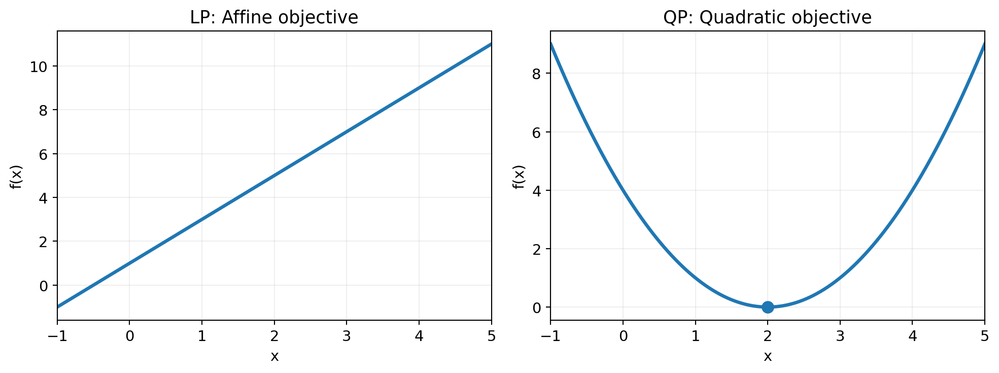
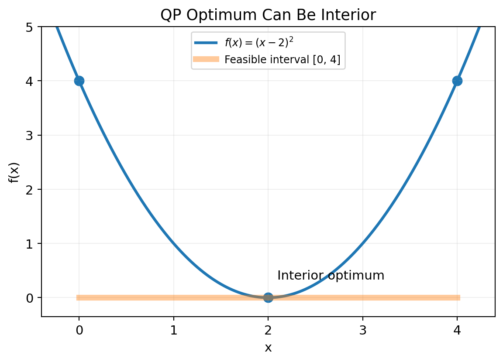
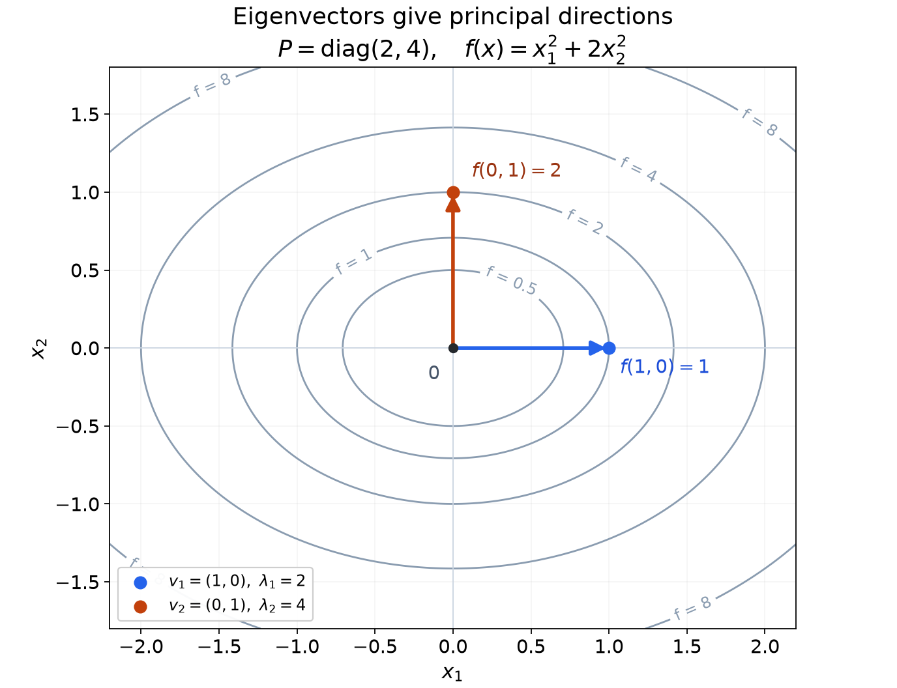
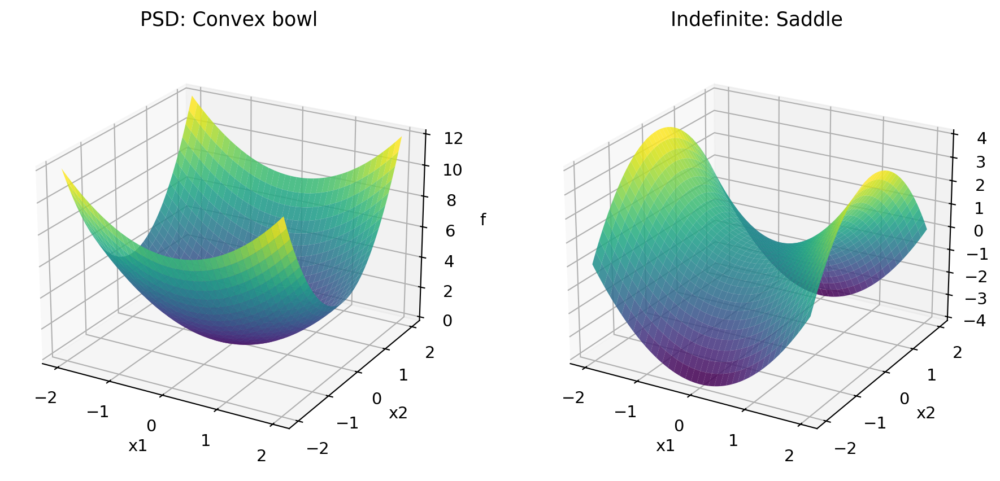
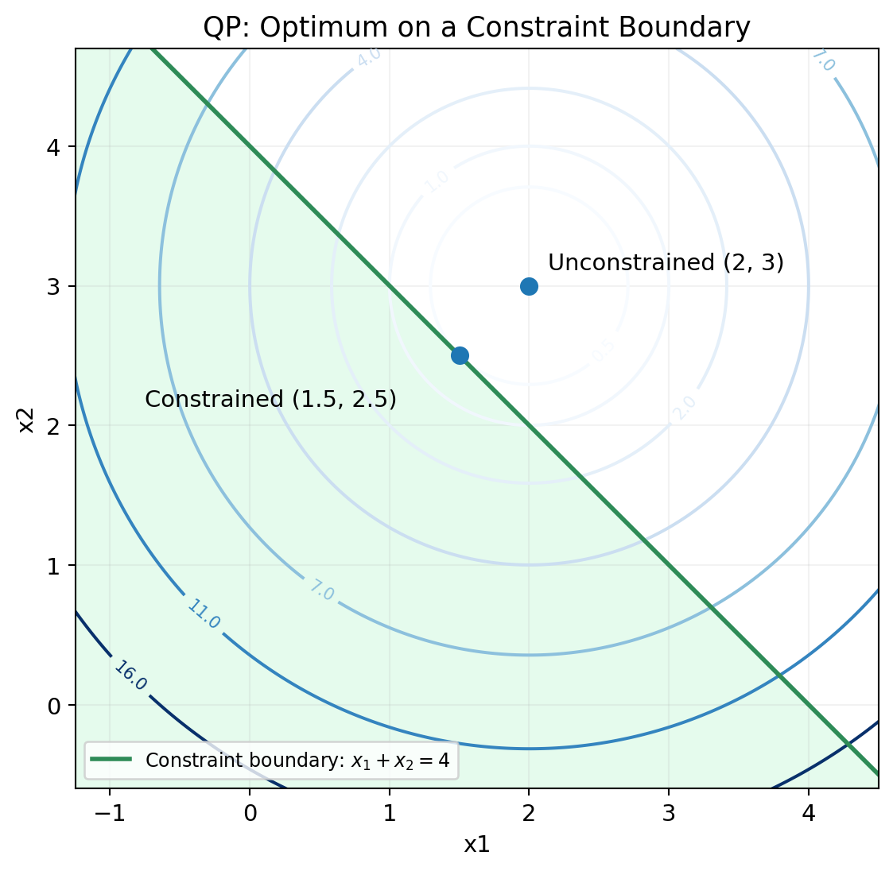
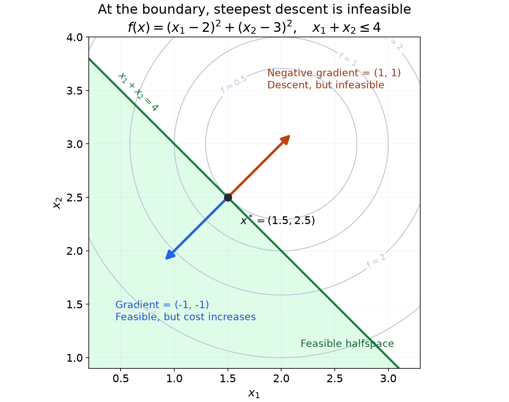
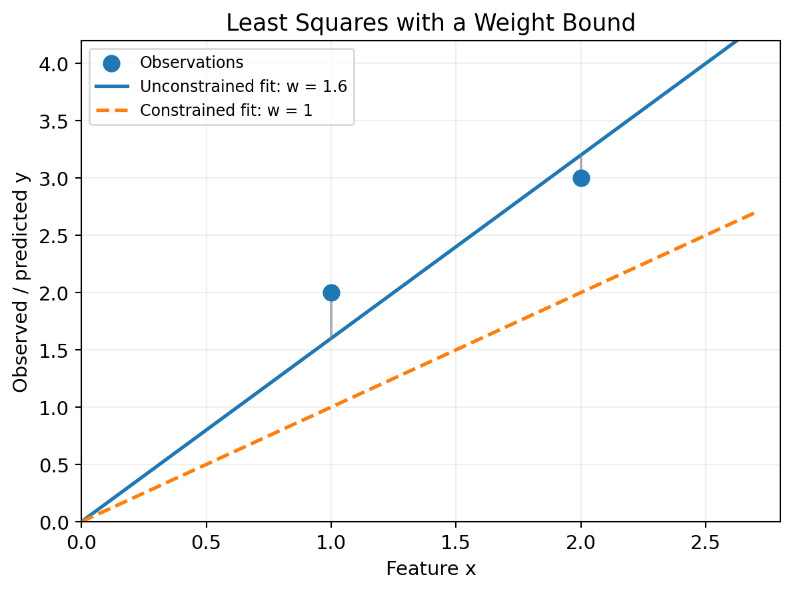
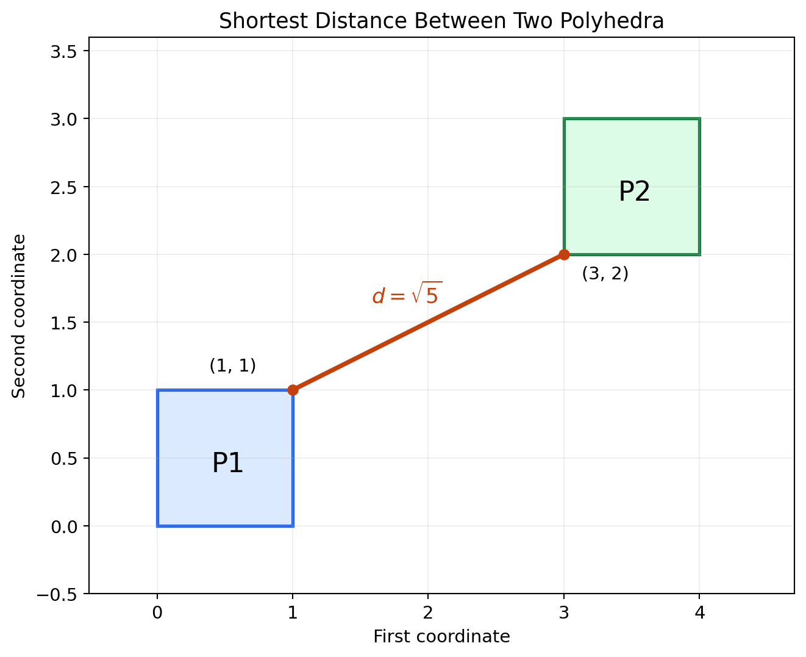

[앞 글의 Linear Programming](/enai601-linear-programming/)에서는 목적함수가 직선처럼 일정한 기울기를 가지고, 조건이 성립할 때 다면체의 꼭짓점에서 최적해를 찾을 수 있음을 살펴보았다. 그러나 AI 모델의 예측 오차처럼 <strong>차이를 제곱한 비용</strong>은 직선이 아니라 포물선으로 표현된다. 이때도 꼭짓점만 확인하면 최적해를 구할 수 있을까?

<strong>Quadratic Programming(이차계획법, QP)</strong>은 이런 질문에서 출발한다. 제약조건은 LP처럼 Affine으로 유지하되, 목적함수에 이차항을 허용하는 최적화 문제다. 이차항의 곡률을 이해하면 최적점이 내부에 있을 수도 있다는 사실, Hessian의 Positive Semidefinite(PSD) 조건이 필요한 이유, 제약조건 아래에서 Gradient가 0이 아닐 수도 있다는 사실이 서로 연결된다.

포물선의 모양에서 출발해 최적점의 위치를 이해한 뒤, 예측 오차와 거리 문제를 QP로 표현해 보자.

1. <strong>Part A — 함수의 모양:</strong> 작은 포물선에서 시작해 Quadratic Form, Eigenvalue, PSD를 이해한다.
2. <strong>Part B — 최적점의 위치:</strong> 무제약 문제와 제약 문제를 비교하고 Optimality Criterion을 적용한다.
3. <strong>Part C — 실제 문제의 정식화:</strong> Constrained Least Squares와 두 Polyhedra 사이의 거리를 QP로 바꾼다.

처음 읽을 때에는 본문의 작은 예제와 굵게 표시한 결론을 따라가고, 특이행렬(Singular Matrix)이나 존재성·유일성의 예외는 글 끝의 <strong>Advanced Notes</strong>에서 확인해도 된다.

---

<strong>Part A. QP의 목적함수는 왜 다른 모양일까?</strong>

## 1. LP에서 QP로: 직선과 포물선

가장 작은 문제부터 보자. 선택할 변수가 하나이고, 그 값은 0에서 4 사이여야 한다.

먼저 LP를 생각한다.

$$
\begin{aligned}
\operatorname{minimize}\quad &2x+1\\
\text{subject to}\quad &0\le x\le4.
\end{aligned}
$$

목적함수는 오른쪽으로 갈수록 증가하므로 가장 왼쪽에서 최솟값을 얻는다.

$$
x_{\mathrm{LP}}^*=0
$$

이번에는 같은 구간에서 <strong>어떤 목표값 2와의 차이를 제곱한 비용</strong>을 최소화한다.

$$
\begin{aligned}
\operatorname{minimize}\quad &(x-2)^2\\
\text{subject to}\quad &0\le x\le4.
\end{aligned}
$$

이 경우에는 구간의 끝이 아니라 가운데에서 오차가 0이 된다.

$$
x_{\mathrm{QP}}^*=2
$$

첫 번째 그림은 직선과 포물선을 비교하고, 두 번째 그림은 동일한 구간에서 이차 목적함수가 내부 최적점을 갖는 상황을 보여준다.

왼쪽 직선에서는 한 방향으로 움직일수록 값이 계속 감소하거나 증가한다. 오른쪽 포물선에서는 <strong>최저점의 왼편에서는 감소하고, 오른편에서는 증가</strong>한다. 이미 이 작은 예제만으로 LP의 꼭짓점 논리를 QP에 그대로 적용할 수 없다는 사실을 확인할 수 있다.

<strong>핵심 직관:</strong> LP와 QP가 동일한 가능집합(Feasible Set)을 사용하더라도 목적함수의 모양이 달라지면 최적점의 위치가 달라진다. QP는 내부의 최저점을 가질 수 있다.

### 일반적인 QP 표준형

변수가 여러 개일 때 이차함수를 행렬로 표현한 것이 다음 형식이다.

$$
\boxed{
\begin{aligned}
\operatorname{minimize}_{x}\quad
&\frac12x^TPx+q^Tx+r\\
\text{subject to}\quad
&Gx\le h,\\
&Ax=b.
\end{aligned}}
$$

여기서 각 항의 역할은 구분할 필요가 있다.

| 표현 | 의미 |
|---|---|
| Optimization variable | 선택해야 할 벡터 x |
| Quadratic term | 방향별 곡률을 정하는 항 |
| Linear term | 목적함수를 한쪽으로 기울이는 항 |
| Constant term | 모든 목적함수값에 똑같이 더해지는 항 |
| Affine constraints | 선택할 수 있는 영역을 정하는 부등식·등식 |

여기서 $x\in\mathbb R^n$은 선택할 변수 벡터, $P\in\mathbb R^{n\times n}$은 실수 대칭행렬(Symmetric Matrix), $q\in\mathbb R^n$은 계수 벡터, $r\in\mathbb R$은 상수다. $Gx\le h$는 각 행에 해당하는 부등식을 모두 만족한다는 뜻이다. 일반적인 QP가 모두 볼록한 것은 아니며, 이 수업에서는 주로 $P\succeq0$인 Convex QP(볼록 이차계획)를 다룬다. 이때 이차함수의 Gradient와 Hessian은 다음처럼 간단해진다.

$$
\nabla f_0(x)=Px+q
$$

$$
\nabla^2f_0(x)=P
$$

<blockquote class="lecture-excerpt">

교안 발췌 · Module 6 — Quadratic Program

$$
\begin{aligned}
\operatorname{minimize}_{x}\quad&\frac12x^TPx+q^Tx+r\\
\text{subject to}\quad&Gx\le h,\quad Ax=b,\qquad P\in S_+^n.
\end{aligned}
$$

Quadratic objective function

Affine constraint functions

When $P=0$, reduces to a linear program

</blockquote>

교안의 $S_+^n$은 $n\times n$ 실수 대칭 PSD 행렬들의 집합이다. 원소가 모두 양수라는 뜻은 아니며, 그 조건은 4절에서 설명한다. $P=0$이면 이차항이 사라져 LP가 된다.

P가 무엇을 의미하는지 이해하려면 먼저 Quadratic Form을 실제로 계산해 볼 필요가 있다.

## 2. Quadratic Form: 행렬 안에 들어 있는 제곱항

<strong>Quadratic Form(이차형식)</strong>은 다음 식이다.

$$
x^TPx
$$

처음부터 추상적인 기호로 받아들이기보다 작은 행렬을 곱해 보자.

$$
P=\begin{bmatrix}2&0\\0&4\end{bmatrix},
\qquad
x=\begin{bmatrix}x_1\\x_2\end{bmatrix}
$$

첫 번째 행렬곱은 다음과 같다.

$$
Px=
\begin{bmatrix}2x_1\\4x_2\end{bmatrix}
$$

여기에 왼쪽에서 전치벡터를 곱한다.

$$
\begin{aligned}
x^TPx
&=\begin{bmatrix}x_1&x_2\end{bmatrix}
\begin{bmatrix}2x_1\\4x_2\end{bmatrix}\\
&=2x_1^2+4x_2^2.
\end{aligned}
$$

QP 표준형에 들어가는 이차항은 여기에 절반을 곱한 것이다.

$$
\boxed{\frac12x^TPx=x_1^2+2x_2^2}
$$

즉 행렬이 특별한 종류의 함수를 새로 만들어 내는 것이 아니다. <strong>여러 변수의 제곱항과 교차항을 간결하게 기록하는 방법</strong>이다.

이번 예제의 두 변수 방향을 비교해 보자.

- 첫 번째 방향으로만 움직이면 비용은 이동거리의 제곱만큼 증가한다.
- 두 번째 방향으로만 움직이면 같은 거리에서도 비용은 두 배 증가한다.

그림에서는 두 번째 방향이 더 가파른 그릇을 만든다. 그렇다면 P에 대각선 밖의 값까지 있다면, 어느 방향으로 얼마나 가파른지 어떻게 찾을 수 있을까?

이 질문이 <strong>Eigenvector(고유벡터)</strong>와 <strong>Eigenvalue(고유값)</strong>가 필요한 이유다.

## 3. Eigenvector와 Eigenvalue가 '휘어지는 방향'을 알려주는 이유

선형대수에서 고유벡터는 행렬을 곱해도 같은 직선 위에 남는 특별한 벡터다.

$$
\boxed{Pv=\lambda v}
$$

고유벡터는 그 방향을, 고유값은 그 방향에서의 부호 있는 배율을 나타낸다.

이제 그 정의를 QP에 연결해 보자. 이해를 위해 선형항과 상수항이 없는 이차함수를 사용한다.

$$
f_0(x)=\frac12x^TPx
$$

길이가 1인 고유벡터를 하나 선택하고 그 방향의 좌표를 $t$로 나타내자. 원점에서의 실제 거리는 $|t|$이며, $t$의 부호는 이동 방향을 구별한다.

$$
x=tv_i,\qquad v_i^Tv_i=1
$$

함수에 대입하면

$$
\begin{aligned}
f_0(tv_i)
&=\frac12(tv_i)^TP(tv_i)\\
&=\frac12t^2v_i^TPv_i\\
&=\frac12t^2v_i^T(\lambda_i v_i)\\
&=\frac12\lambda_i t^2.
\end{aligned}
$$

여기서 중요한 것은 결과가 <strong>한 변수 포물선</strong>으로 바뀌었다는 사실이다.

$$
\boxed{f_0(tv_i)=\frac12\lambda_i t^2}
$$

이 포물선의 두 번째 미분은 고유값과 같다. 여기서 말하는 방향별 곡률은 이 두 번째 미분을 뜻한다. 곡선의 기하학적 곡률과는 구별하며, 이차함수에서는 위치가 바뀌어도 같은 방향의 두 번째 미분은 일정하다.

$$
\frac{d^2}{dt^2}f_0(tv_i)=\lambda_i
$$

따라서 고유값의 부호로 해당 방향에서 함수가 어떻게 휘어지는지 판단할 수 있다.

- <strong>양수:</strong> 위로 열리는 방향이다.
- <strong>0:</strong> 그 방향으로 이차적인 휘어짐이 없다.
- <strong>음수:</strong> 아래로 열리는 방향이다.

이 설명에서 고유벡터 방향을 택한 이유는 행렬의 작용이 단순한 스칼라 곱으로 바뀌기 때문이다. 일반적인 방향을 다루려면 여러 고유벡터의 조합을 생각해야 한다.

그림은 앞 절에서 계산한 이차함수의 등고선(Contour Lines)을 위에서 본 것이다. 원점에서 같은 거리만큼 이동하더라도 두 고유벡터 방향의 비용이 다르다.

$$
f_0(1,0)=1
$$

$$
f_0(0,1)=2
$$

같은 비용을 유지하려면 두 번째 방향으로는 덜 이동해야 한다. 등고선이 타원처럼 나타나는 이유다.

<strong>핵심 직관:</strong> 고유벡터는 곡면을 이해하기 쉬운 주축 방향이고, 고유값은 그 방향의 곡률이다. QP에서 고유값은 단순히 행렬 계산 문제를 풀기 위한 숫자가 아니다.

### 직접 계산하는 2×2 고유값 문제

시험에서는 다음과 같은 작은 행렬의 고유값을 직접 구할 수 있어야 한다.

$$
P=\begin{bmatrix}3&1\\1&3\end{bmatrix}
$$

고유값은 특성방정식(Characteristic Equation)으로 계산한다.

$$
\det(P-\lambda I)=0
$$

$$
\begin{aligned}
\det\begin{bmatrix}3-\lambda&1\\1&3-\lambda\end{bmatrix}
&=(3-\lambda)^2-1\\
&=(2-\lambda)(4-\lambda).
\end{aligned}
$$

따라서

$$
\boxed{\lambda_1=2,\qquad\lambda_2=4}
$$

이다. 이 행렬은 모든 고유값이 양수이므로 Positive Definite(PD)이다. 고유값으로 행렬의 성질을 판단하는 이유는 다음 절에서 분명해진다.

## 4. PSD는 왜 Convexity의 조건인가?

다음 두 이차함수를 비교해 보자.

$$
f_1(x_1,x_2)=x_1^2+2x_2^2
$$

$$
f_2(x_1,x_2)=x_1^2-x_2^2
$$

첫 번째 함수는 어느 좌표 방향으로 움직여도 위로 열린다. 반면 두 번째 함수는 첫 번째 방향으로는 위로, 두 번째 방향으로는 아래로 열린다.

오른쪽 안장(Saddle) 모양은 아래로 휘어지는 방향이 있기 때문에 Convex Function이 아니다.

실수 대칭행렬 P가 <strong>Positive Semidefinite(양의 준정부호, PSD)</strong>라는 것은 모든 벡터 v에 대해 다음이 성립한다는 뜻이다.

$$
\boxed{v^TPv\ge0\qquad\forall v}
$$

대칭행렬에 대해서는 다음 두 조건이 동등하다.

$$
P\succeq0
\quad\Longleftrightarrow\quad
\lambda_i\ge0\quad\text{for all }i
$$

그렇다면 이것이 목적함수의 Convexity와 어떻게 연결될까?

QP의 목적함수를 임의의 점에서 임의의 방향 v로 잘라 한 변수 함수로 생각한다.

$$
g(t)=f_0(x+tv)
$$

이 함수의 두 번째 미분은 다음과 같다.

$$
g''(t)=v^TPv
$$

P가 PSD라면 모든 방향에서 두 번째 미분이 0 이상이다. 따라서 어떤 직선 방향으로 잘라 보더라도 아래로 휘어지는 단면이 없고, 전체 이차함수는 Convex하다.

결론적으로 대칭 P를 사용하는 QP에서는

$$
\boxed{
P\succeq0
\quad\Longleftrightarrow\quad
f_0\text{ is convex on }\mathbb R^n
}
$$

이다.

<blockquote class="lecture-excerpt">

교안 발췌 · Module 6 — Quadratic Program, convexity

$$
\nabla^2 f_0(x)=P\in S_+^n\quad\text{(positive semidefinite)}.
$$

</blockquote>

이 조건은 목적함수 자체를 전체 공간에서 판별하는 기준이다. 제약이 특정 방향을 제거해 제한된 영역에서만 볼록해지는 경우와 구별한다. 제약조건은 Affine이므로 Feasible Set도 Convex하다. 따라서 P가 PSD이면 전체 문제는 <strong>Convex QP</strong>가 된다.

| 고유값의 상태 | P의 성질 | 이차 목적함수의 성질 |
|---|---|---|
| 모두 양수 | Positive Definite (PD) | Strictly Convex |
| 모두 0 이상 | Positive Semidefinite (PSD) | Convex |
| 양수와 음수가 섞임 | Indefinite | Non-convex |

0인 고유값이 하나 있더라도 PSD가 될 수 있다. 이때는 특정 방향으로 평평할 수 있으므로 반드시 Strictly Convex인 것은 아니다.

$$
P=\begin{bmatrix}4&0\\0&0\end{bmatrix}
$$

$$
\frac12x^TPx=2x_1^2
$$

위 함수에서는 두 번째 변수 방향으로 움직여도 함수값이 변하지 않는다.

<strong>여기까지의 연결:</strong> Quadratic Form은 이차함수를 행렬로 기록한 식이다. 고유값은 방향별 곡률을 나타낸다. 모든 방향의 이차 곡률이 음수가 아니라는 조건이 PSD이며, 바로 그 조건이 Convex QP를 만든다.

---

<strong>Part B. QP의 최적점은 어떻게 찾을까?</strong>

## 5. 제약이 없을 때: Gradient가 0인 지점

AI 모델이 가중치 하나를 선택해 예측 오차를 최소화한다고 가정하자. 예측 목표가 3이고, 오차에 일정한 비용 2가 더해진 상황을 단순화하면 다음과 같은 함수가 된다.

$$
f(w)=(w-3)^2+2
$$

이를 전개하고 미분한다.

$$
f(w)=w^2-6w+11
$$

$$
f'(w)=2w-6
$$

Gradient가 0인 지점을 찾으면

$$
2w-6=0
$$

$$
\boxed{w^*=3}
$$

이다. 두 번째 미분이 양수이므로 유일한 전역 최솟값을 얻는다.

$$
f''(w)=2>0
$$

변수가 여러 개인 QP에서도 원리는 같다. 제약이 없고 P가 PD라면 Gradient를 0으로 놓아 유일한 최적점을 구한다.

$$
\nabla f_0(x)=Px+q=0
$$

$$
\boxed{Px^*=-q}
$$

P가 PD이면 역행렬이 존재하므로 형식적으로 다음처럼 쓸 수 있다.

$$
x^*=-P^{-1}q
$$

다만 수치 계산에서는 역행렬을 명시적으로 만들기보다 선형방정식 시스템을 푼다.

여기까지는 <strong>어디로든 이동할 수 있는 Unconstrained Problem</strong>의 이야기다. 이동할 수 있는 영역에 제한이 생기면 상황이 달라진다.

## 6. 제약이 있을 때: 원래 최저점으로 갈 수 없다면?

목적함수가 어떤 목표점에서의 거리 제곱이라고 하자.

$$
f_0(x_1,x_2)=(x_1-2)^2+(x_2-3)^2
$$

제약조건이 없다면 두 제곱항을 동시에 0으로 만드는 점이 최적점이다.

$$
x_{\mathrm{free}}^*=\begin{bmatrix}2\\3\end{bmatrix}
$$

하지만 다음과 같은 자원 제한이 추가되었다고 해 보자.

$$
x_1+x_2\le4
$$

원래 최적점은 이 조건을 위반한다.

$$
2+3=5>4
$$

<strong>이제 질문은 바뀐다.</strong> 목표점 자체에 도달할 수 없다면, 허용된 영역 안에서 그 목표점에 가장 가까운 곳은 어디인가?

### 왜 최적점은 경계에서 찾아야 할까?

Feasible Set이 반공간인 이 예제에서 내부의 임의의 점을 선택했다고 하자. 그 점에서 목표점 쪽으로 아주 조금 이동하면 목표점과의 거리가 줄어든다. 내부에서는 충분히 작은 이동으로도 제약을 계속 만족시킬 수 있다.

따라서 내부의 그 점은 최적점일 수 없다. <strong>가장 가까운 점은 Feasible Set의 경계 위에 있어야 한다.</strong>

이 논리는 이번처럼 목적함수가 <strong>고정된 점까지의 거리 제곱</strong>일 때 특히 직관적이다. 무제약 최적점이 유일하게 존재하고 그 점이 영역 밖에 있는 Convex QP라면, 제약 최적점이 존재할 경우 제약 경계가 최적해를 결정한다. 가장 가까운 Euclidean 점을 찾는 방식이 일반적인 QP에서 항상 통하는 것은 아니다.

경계 방정식은

$$
x_1+x_2=4
$$

이므로

$$
x_2=4-x_1
$$

이다. 이제 변수 하나로 바꿔 계산할 수 있다.

$$
\begin{aligned}
f_0(x_1)
&=(x_1-2)^2+(4-x_1-3)^2\\
&=(x_1-2)^2+(1-x_1)^2\\
&=2x_1^2-6x_1+5.
\end{aligned}
$$

이를 미분하면

$$
\frac{df_0}{dx_1}=4x_1-6
$$

이므로

$$
4x_1-6=0
$$

$$
\boxed{x_1^*=1.5,\qquad x_2^*=2.5}
$$

이다.

원형 등고선은 목표점에서 같은 거리 제곱을 갖는 점들이다. 작은 원일수록 목적함수값이 작다. 허용된 반공간에 최초로 닿는 가장 작은 등고선의 접점이 최적점이다.

이때 최솟값은 다음과 같다.

$$
f_0(x^*)=(-0.5)^2+(-0.5)^2=0.5
$$

### 그런데 최적점에서 Gradient가 0이 아니다

미분한 Gradient를 최적점에 대입해 보자.

$$
\nabla f_0(x)=
\begin{bmatrix}
2(x_1-2)\\2(x_2-3)
\end{bmatrix}
$$

$$
\nabla f_0(x^*)=
\begin{bmatrix}-1\\-1\end{bmatrix}
\ne0
$$

그렇다고 최적점이 잘못된 것은 아니다. Gradient는 목적함수가 가장 가파르게 증가하는 방향이다. 반대로 Negative Gradient는 가장 가파르게 감소하는 방향이다.

$$
-\nabla f_0(x^*)=
\begin{bmatrix}1\\1\end{bmatrix}
$$

그런데 최적점에서 이 방향으로 조금 이동하면 두 좌표의 합이 4보다 커져 제약을 위반한다.

즉 <strong>비용을 줄일 방향이 존재하더라도 그 방향으로 이동할 수 없다면</strong> 최적점이 될 수 있다.

여기서 주의할 점은 “제약이 있으면 Gradient가 0이 아니다”가 아니라 <strong>“제약 최적점에서는 Gradient가 0이 아닐 수도 있다”</strong>는 것이다. 원래 최적점이 Feasible하다면 제약 문제에서도 Gradient가 0인 최적점을 가질 수 있다.

## 7. Optimality Criterion으로 실제 최적성을 증명하기

앞 절에서는 그림과 미분으로 최적점 후보를 찾았다. 이제 <strong>왜 다른 Feasible Point가 더 좋은 값을 만들 수 없는지</strong> 증명할 차례다.

볼록한 가능집합 $D$와 그 집합을 포함하는 열린 영역에서 미분 가능한 볼록 목적함수 $f_0$를 생각하자. 후보점 $x^*\in D$가 전역 최소점일 필요충분조건은 다음과 같다.

$$
\boxed{
\nabla f_0(x^*)^T(y-x^*)\ge0
\qquad\forall y\in D
}
$$

직관적으로는 <strong>현재 최적점에서 허용된 다른 점을 향해 이동하는 방향이 목적함수를 감소시키지 않는다</strong>는 뜻이다. 식의 내적은 Gradient와 이동 방향의 관계를 나타낸다.

방금 구한 후보점에 이 조건을 적용한다.

$$
x^*=\begin{bmatrix}1.5\\2.5\end{bmatrix}
$$

$$
\nabla f_0(x^*)=\begin{bmatrix}-1\\-1\end{bmatrix}
$$

임의의 Feasible Point를 다음처럼 놓는다.

$$
y=\begin{bmatrix}y_1\\y_2\end{bmatrix},
\qquad y_1+y_2\le4
$$

그러면

$$
\begin{aligned}
\nabla f_0(x^*)^T(y-x^*)
&=\begin{bmatrix}-1&-1\end{bmatrix}
\begin{bmatrix}y_1-1.5\\y_2-2.5\end{bmatrix}\\
&=-(y_1-1.5)-(y_2-2.5)\\
&=4-y_1-y_2\\
&\ge0.
\end{aligned}
$$

마지막 부등식은 모든 Feasible Point가 원래 제약을 만족하기 때문에 성립한다. 따라서 이 후보점은 전역 최적점이다. 이번 목적함수는 Strictly Convex이므로 최적점도 유일하다.

LP에서 Supporting Hyperplane과 Gradient로 증명했던 원리가 그대로 작동한다. 달라진 것은 Gradient가 상수가 아니라 현재 위치에 따라 변한다는 점뿐이다.

<strong>핵심 직관:</strong> 무제약 문제에서는 모든 방향으로 움직일 수 있으므로 Gradient가 0인 점을 찾는다. 제약 문제에서는 *허용된 방향*으로 개선할 수 있는지를 확인해야 한다. 이 구분이 이후 KKT Conditions와 Complementary Slackness를 배우는 출발점이 된다.

---

<strong>Part C. 현실 문제를 QP로 정식화하기</strong>

## 8. Constrained Least Squares: 예측 오차에서 QP까지

<strong>Constrained Least Squares(제약 최소제곱법)</strong>은 예측 오차를 줄이면서 모델 계수의 제한도 만족시키는 문제다. 교안에서는 주택가격 추정을 예로 든다.

<blockquote class="lecture-excerpt">

교안 발췌 · Module 6 — Examples – Quadratic Program

Least squares problem with constraints (example: estimation of house values)

$$
\operatorname{minimize}_{x}\ \|Ax-b\|_2^2
\quad\text{subject to}\quad l\le x\le u.
$$

</blockquote>

교안의 $x$는 추정할 계수 벡터다. 아래에서는 입력 특성과 구별하기 위해 계수를 $w$, 데이터 행렬을 $X$, 목표값을 $y$로 쓴다. 예를 들어 집의 크기와 가격 사이의 관계를 나타내는 간단한 모델을 학습할 수 있다.

아래 데이터는 원리를 설명하기 위해 만든 예제다. 실제 주택시장 데이터나 교안에 제시된 관측값은 아니다.

| House size (feature) | Actual price (target) |
|---:|---:|
| 1 | 2 |
| 2 | 3 |

입력 크기에 가중치를 곱해 가격을 예측하는 모델을 생각한다. 계산을 단순하게 하기 위해 절편(Bias)은 생략한다.

$$
\hat y=wx
$$

첫 번째 집과 두 번째 집의 예측값은 각각 다음과 같다.

$$
\hat y_1=w,\qquad\hat y_2=2w
$$

실제값과 예측값의 차이, 즉 Residual(잔차)은

$$
e_1=w-2,\qquad e_2=2w-3
$$

이다.

### 왜 잔차를 제곱해서 더할까?

잔차를 그냥 더하면 양수 오차와 음수 오차가 상쇄될 수 있다. 따라서 각 잔차를 제곱해 더한 <strong>Sum of Squared Errors(SSE)</strong>를 사용한다.

$$
\boxed{f(w)=(w-2)^2+(2w-3)^2}
$$

이를 전개한다.

$$
\begin{aligned}
f(w)
&=(w^2-4w+4)+(4w^2-12w+9)\\
&=5w^2-16w+13.
\end{aligned}
$$

미분하면

$$
f'(w)=10w-16
$$

이므로 무제약 최적 가중치는

$$
\boxed{w_{\mathrm{free}}^*=1.6}
$$

이다.

그런데 가중치가 특정 범위를 벗어나면 안 된다는 추가 요구가 있다고 하자.

$$
0\le w\le1
$$

무제약 최적해는 1.6이므로 범위를 벗어난다. 허용된 구간 전체에서 미분값은 음수다.

$$
f'(w)=10w-16\le-6<0
$$

따라서 구간 안에서는 오른쪽으로 갈수록 비용이 작아지고, 허용된 가장 큰 가중치가 최적해가 된다.

$$
\boxed{w^*=1}
$$

두 최적해의 SSE를 비교하면 제약이 왜 오차를 증가시킬 수 있는지도 확인할 수 있다.

$$
f(1.6)=0.2
$$

$$
f(1)=2
$$

제약은 선택할 수 있는 가중치를 줄이므로, 제약이 없을 때보다 예측 오차의 최소값이 커질 수 있다.

이 그림의 가로축은 <strong>입력 데이터의 Feature</strong>이며, 최적화 변수인 w가 아니다. w는 직선의 기울기를 결정한다. 따라서 그래프의 두 예측 직선을 비교할 때에는 최적화 변수와 관측 데이터의 좌표를 혼동하지 않아야 한다.

### 예측 데이터가 많아지면 행렬로 바꾼다

지금까지는 가중치 하나와 관측값 두 개만 사용했다. 실제 회귀 모델에는 여러 관측값과 여러 Feature가 있으므로 <strong>Design Matrix(설계행렬)</strong>로 계산을 묶는다.

$$
\hat y=Xw
$$

여기서 X는 관측 데이터를 행별로 모은 행렬, w는 모델의 가중치 벡터, y는 실제 목표값 벡터다. 잔차 벡터는

$$
e=Xw-y
$$

이고, SSE는 잔차 벡터 길이의 제곱과 같다.

$$
\|Xw-y\|_2^2
$$

QP 표준형과 비교하기 쉽게 앞에 1/2을 붙인 함수를 먼저 다룬다. 이 양수 배율은 최적 가중치를 바꾸지 않는다.

$$
\boxed{f_0(w)=\frac12\|Xw-y\|_2^2}
$$

### Norm의 제곱을 Quadratic Form으로 전개하기

이 부분은 QP 정식화의 핵심이다. 먼저 Euclidean Norm의 제곱은 벡터와 자기 자신의 내적이라는 사실을 사용한다.

$$
\|u\|_2^2=u^Tu
$$

따라서

$$
\begin{aligned}
f_0(w)
&=\frac12\|Xw-y\|_2^2\\
&=\frac12(Xw-y)^T(Xw-y).
\end{aligned}
$$

여기서 전치를 적용하면

$$
(Xw-y)^T=w^TX^T-y^T
$$

이다. 이제 괄호를 전개한다.

$$
\begin{aligned}
&(w^TX^T-y^T)(Xw-y)\\
&=w^TX^TXw-w^TX^Ty-y^TXw+y^Ty.
\end{aligned}
$$

가운데 두 항은 둘 다 Scalar이고 서로의 전치이므로 같은 값이다.

$$
w^TX^Ty=y^TXw
$$

따라서

$$
\boxed{
f_0(w)=\frac12w^TX^TXw-w^TX^Ty+\frac12y^Ty
}
$$

를 얻는다.

QP의 일반적인 목적함수와 비교한다.

$$
f_0(w)=\frac12w^TPw+q^Tw+r
$$

각 계수는 다음과 같다.

$$
\boxed{
P=X^TX,\qquad q=-X^Ty,\qquad r=\frac12y^Ty
}
$$

즉 Least Squares의 목적함수는 QP의 목적함수로 정확히 표현된다. 상수항 r은 최적점에는 영향을 주지 않으므로 해를 구할 때 생략할 수 있지만, <strong>원래 최적 목적함수값을 보고하려면 보존해야 한다.</strong>

### 왜 이 문제가 Convex QP인가?

이제 처음에 공부한 PSD가 다시 등장한다. Least Squares에서 Hessian은 다음 행렬이다.

$$
\nabla^2f_0(w)=X^TX
$$

임의의 벡터 v를 생각한다.

$$
\begin{aligned}
v^TX^TXv
&=(Xv)^T(Xv)\\
&=\|Xv\|_2^2\\
&\ge0.
\end{aligned}
$$

Norm의 제곱은 언제나 0 이상이므로

$$
\boxed{X^TX\succeq0}
$$

이다. 따라서 <strong>Least Squares 목적함수는 Convex</strong>다. 가중치의 상·하한처럼 Affine Constraints를 추가하면 Convex QP가 된다.

교안의 제약 최소제곱은 다음과 같은 형태로 나타난다.

$$
\begin{aligned}
\operatorname{minimize}_{w}\quad&\|Xw-y\|_2^2\\
\text{subject to}\quad&l\le w\le u.
\end{aligned}
$$

이때 Box Constraints는 두 묶음의 Affine Inequalities로 표현할 수 있다.

$$
w\le u,\qquad-w\le-l
$$

<strong>계수의 1/2을 주의해야 한다.</strong> 앞서 계산한 P와 q는 절반의 SSE를 최소화하는 함수에 대한 것이다. 교안처럼 SSE 자체를 QP 표준형에 정확히 맞추면 전체 계수가 두 배가 된다.

| Objective | Quadratic matrix P | Linear vector q | Constant r |
|---|---|---|---|
| Half SSE | XᵀX | −Xᵀy | ½ yᵀy |
| SSE | 2XᵀX | −2Xᵀy | yᵀy |

이 표에서 두 경우의 최적점은 동일하지만 최적 목적함수값은 두 배 차이가 난다.

<strong>핵심 직관:</strong> Least Squares를 QP로 바꾸기 위해 새로운 목적함수를 만드는 것이 아니다. 이미 사용하던 오차 제곱합을 행렬곱으로 <strong>다시 표현</strong>하는 것이다. 그러면 Hessian이 XᵀX라는 사실과 PSD 성질이 자연스럽게 드러난다.

## 9. Distance Between Two Polyhedra: 가장 가까운 두 점 찾기

<strong>두 Polyhedra(다면체) 사이의 최단거리</strong>는 각 영역에서 가장 가까운 점을 고르는 문제다. 우선 두 집합이 모두 비어 있지 않다고 가정한다.

여기서 선택할 변수는 물체의 모양이 아니다. <strong>첫 번째 영역에서 선택하는 점 하나와 두 번째 영역에서 선택하는 점 하나</strong>다.

### 먼저 1차원 구간으로 생각하기

수직선 위에 다음 두 구간이 있다고 하자.

$$
P_1=[0,1],\qquad P_2=[3,4]
$$

$[0,1]$은 $0\le x\le1$인 모든 수를 모은 구간으로 양 끝점도 포함한다. $[3,4]$도 같은 방식으로 읽는다.

첫 번째 구간에서 하나의 수를 고르고, 두 번째 구간에서도 하나의 수를 고른다. 가장 가까운 조합은 첫 구간의 오른쪽 끝 1과 둘째 구간의 왼쪽 끝 3이다.

$$
|1-3|=2
$$

이것이 집합 사이 거리의 기본 생각이다. 다만 2차원이나 100차원에서는 단순히 구간의 양 끝을 비교하는 방법으로는 해결할 수 없다.

### 2차원 정사각형 두 개로 확장하기

설명용 예제로 다음 영역을 사용한다.

$$
P_1=[0,1]\times[0,1]
$$

$$
P_2=[3,4]\times[2,3]
$$

$\times$는 두 구간에서 좌표를 하나씩 고른다는 뜻이다. 예를 들어 $[0,1]\times[0,1]$은 $0\le x_1\le1$, $0\le x_2\le1$을 동시에 만족하는 정사각형이다.

첫 번째 영역에서 선택한 점을 x, 두 번째에서 선택한 점을 y라 하자. 두 점 사이의 제곱거리는

$$
\|x-y\|_2^2
=(x_1-y_1)^2+(x_2-y_2)^2
$$

이다.

첫 번째 좌표에서는 두 점 사이 차이가 적어도 2이고, 두 번째 좌표에서는 적어도 1이다. 따라서 두 차이를 동시에 최소화하는 점들이 최단거리 쌍이 된다.

$$
x^*=\begin{bmatrix}1\\1\end{bmatrix},
\qquad
y^*=\begin{bmatrix}3\\2\end{bmatrix}
$$

$$
\|x^*-y^*\|_2^2=2^2+1^2=5
$$

따라서 실제 최단거리는

$$
\boxed{\operatorname{dist}(P_1,P_2)=\sqrt5}
$$

이다.

이 예제의 최단거리 쌍은 모두 꼭짓점이지만, <strong>일반적인 두 다면체의 최단거리 문제에서 양 끝점이 꼭짓점일 필요는 없다.</strong> 마주 보는 평행한 변의 중간에서도 최단거리가 달성될 수 있다.

### 각 점이 제약을 만족해야 한다

고차원에서는 두 Polyhedra를 각각 여러 Halfspaces의 교집합으로 나타낸다.

$$
P_1=\{x\in\mathbb R^n:A_1x\le b_1\}
$$

$$
P_2=\{y\in\mathbb R^n:A_2y\le b_2\}
$$

선택한 점은 자신이 속한 집합의 제약을 만족해야 한다. 그래서 원래 문제는 다음과 같다.

$$
\begin{aligned}
\operatorname{minimize}_{x,y}\quad&\|x-y\|_2\\
\text{subject to}\quad&A_1x\le b_1,\\
&A_2y\le b_2.
\end{aligned}
$$

여기까지는 거리를 최소화하는 Convex Optimization이지만, <strong>QP의 이차형식</strong>은 직접 드러나지 않는다.

### 왜 거리를 제곱할까?

거리는 항상 0 이상이다. 음수가 아닌 수에서는 제곱이 크기 순서를 유지한다.

$$
0\le a<b\quad\Longrightarrow\quad a^2<b^2
$$

따라서 거리 자체를 최소화하거나 <strong>거리의 제곱</strong>을 최소화해도 같은 점의 조합이 선택된다.

$$
\boxed{\operatorname{minimize}_{x,y}\ \|x-y\|_2^2}
$$

<blockquote class="lecture-excerpt">

교안 발췌 · Module 6 — Examples – Quadratic Program, Distance between two polyhedra

$$
\operatorname{minimize}_{x_1,x_2}\ \|x_1-x_2\|_2^2
\quad\text{subject to}\quad A_1x_1\le b_1,\quad A_2x_2\le b_2.
$$

</blockquote>

교안의 두 점 $x_1,x_2$를 여기서는 $x,y$로 쓴다. 아래첨자를 좌표 번호와 혼동하지 않기 위한 표기다.

다만 이차형식을 사용해 계산한 최적 목적함수값은 <strong>제곱거리</strong>다. 실제 거리가 필요하면 마지막에 제곱근을 취해야 한다.

### 거리의 제곱을 행렬곱으로 바꾸기

우선 Norm의 제곱을 전개한다.

$$
\begin{aligned}
\|x-y\|_2^2
&=(x-y)^T(x-y)\\
&=x^Tx-x^Ty-y^Tx+y^Ty\\
&=x^Tx-2x^Ty+y^Ty.
\end{aligned}
$$

이제 첫 번째 점과 두 번째 점을 <strong>하나의 큰 Optimization Variable Vector</strong>로 묶는다.

$$
\boxed{z=\begin{bmatrix}x\\y\end{bmatrix}\in\mathbb R^{2n}}
$$

여기서 z는 두 점의 좌표를 위아래로 쌓아 만든 벡터다. 새로운 물리적 의미를 가진 점이 아니라 계산을 편리하게 하기 위한 표기다.

다음 블록 행렬을 사용해 보자. $I$는 $n\times n$ 단위행렬이며 $Ix=x$다. $-I$는 부호를 반대로 바꾸므로 $(-I)y=-y$다.

$$
M=\begin{bmatrix}I&-I\\-I&I\end{bmatrix}
$$

먼저 곱하면

$$
Mz=
\begin{bmatrix}I&-I\\-I&I\end{bmatrix}
\begin{bmatrix}x\\y\end{bmatrix}
=
\begin{bmatrix}x-y\\-x+y\end{bmatrix}
$$

이다. 왼쪽에서 z의 전치를 곱하면

$$
\begin{aligned}
z^TMz
&=\begin{bmatrix}x^T&y^T\end{bmatrix}
\begin{bmatrix}x-y\\-x+y\end{bmatrix}\\
&=x^Tx-2x^Ty+y^Ty\\
&=\|x-y\|_2^2.
\end{aligned}
$$

즉 원래 거리의 제곱과 정확히 같다.

QP 표준형에는 1/2이 붙어 있으므로, 원래 제곱거리 값을 그대로 얻으려면 P를 두 배로 정한다.

$$
\boxed{
P=2\begin{bmatrix}I&-I\\-I&I\end{bmatrix},
\qquad q=0
}
$$

제약조건도 블록 행렬로 하나로 묶을 수 있다.

$$
\boxed{
\begin{bmatrix}A_1&0\\0&A_2\end{bmatrix}z
\le
\begin{bmatrix}b_1\\b_2\end{bmatrix}
}
$$

따라서 두 다면체 사이의 최단거리 문제가 QP 표준형으로 정리되었다.

### 이 QP도 Convex인지 증명하기

앞에서 배운 PSD의 정의를 사용한다. 이 검사는 제약을 만족하는 점만이 아니라 모든 $z\in\mathbb R^{2n}$에 대해 해야 한다. 임의의 z에 대해

$$
\begin{aligned}
z^TPz
&=2z^TMz\\
&=2\|x-y\|_2^2\\
&\ge0.
\end{aligned}
$$

따라서

$$
\boxed{P\succeq0}
$$

이다. 제약조건도 Affine이므로 전체 문제는 Convex QP다.

여기서 P는 PD가 아니다. 두 점을 같은 방향으로 함께 이동하면 두 점 사이의 차이가 그대로 유지되므로 목적함수가 변하지 않는 방향이 있기 때문이다. 실제 가능집합의 제약이 그런 이동을 막을 수 있으므로, <strong>P가 PSD이지만 PD가 아니라고 해서 최단거리 쌍이 반드시 여러 개 존재하는 것은 아니다.</strong>

<strong>핵심 직관:</strong> 두 점 사이의 거리 최소화는 두 점의 좌표를 함께 선택하는 최적화다. 거리의 제곱으로 바꾸면 목표점의 조합은 그대로 유지되면서 목적함수를 Quadratic Form으로 쓸 수 있다.

---

<strong>Part D. 전체 연결과 시험 대비</strong>

## 10. LP와 QP의 공통점, 차이점

| 비교 항목 | Linear Programming | Convex Quadratic Programming |
|---|---|---|
| 목적함수 | Affine | Quadratic |
| Gradient | 위치와 무관하게 일정 | 위치에 따라 달라짐 |
| Hessian | Zero Matrix | PSD인 행렬 P |
| 가능집합 | Affine 제약으로 만든 Polyhedron | Affine 제약으로 만든 Polyhedron |
| 최적점 위치 | 조건이 맞으면 꼭짓점 해 존재 | 내부·변·꼭짓점 모두 가능 |
| 핵심 증명 도구 | Optimality Criterion | PSD와 Optimality Criterion |

여기까지의 학습 흐름은 다음 네 문장으로 요약할 수 있다.

1. <strong>목적함수가 Quadratic이면</strong> 위치와 방향에 따라 Gradient가 달라진다.
2. <strong>Hessian이 PSD이면</strong> 전체 이차 목적함수는 Convex하다.
3. <strong>제약조건이 있으면</strong> Gradient가 0인지만 볼 것이 아니라 가능한 이동 방향을 확인해야 한다.
4. <strong>실제 문제를 QP로 정식화하려면</strong> 오차 제곱합이나 거리 제곱을 Quadratic Form으로 전개해야 한다.

### 시험장에서 사용할 기본 공식

$$
\begin{aligned}
f_0(x)&=\frac12x^TPx+q^Tx+r\\
\nabla f_0(x)&=Px+q\\
\nabla^2f_0(x)&=P
\end{aligned}
$$

$$
P\succeq0
\quad\Longleftrightarrow\quad
f_0\text{ is convex on }\mathbb R^n
$$

$$
\nabla f_0(x^*)^T(y-x^*)\ge0
\qquad\forall y\in D
$$

$$
\frac12\|Xw-y\|_2^2
=\frac12w^TX^TXw-w^TX^Ty+\frac12y^Ty
$$

$$
\|x-y\|_2^2=
\begin{bmatrix}x^T&y^T\end{bmatrix}
\begin{bmatrix}I&-I\\-I&I\end{bmatrix}
\begin{bmatrix}x\\y\end{bmatrix}
$$

## 11. 직접 풀어 보는 확인 문제

### 문제 1. 교차항을 전개하고 Convexity 판단하기

다음 행렬로 정의된 이차함수를 성분으로 전개하고 Convexity를 판별한다.

$$
P=\begin{bmatrix}3&1\\1&3\end{bmatrix},
\qquad
f_0(x)=\frac12x^TPx
$$

정답과 해설 펼치기

행렬의 비대각원소 두 개가 모두 교차항에 기여한다.

$$
x^TPx=3x_1^2+2x_1x_2+3x_2^2
$$

따라서

$$
f_0(x)=\frac32x_1^2+x_1x_2+\frac32x_2^2
$$

앞에서 계산한 고유값은 2와 4이며 모두 양수다. 따라서 P는 PD이고 이차함수는 Strictly Convex다.

### 문제 2. PSD이면 최적해가 반드시 존재할까?

다음 함수를 전체 2차원 공간에서 최소화한다.

$$
f_0(x_1,x_2)=x_1^2-x_2
$$

이 함수는 Convex인가? 최적점이 존재하는가?

정답과 해설 펼치기

Hessian은 PSD이므로 Convex하다.

$$
\nabla^2f_0=\begin{bmatrix}2&0\\0&0\end{bmatrix}\succeq0
$$

그러나 첫 번째 변수를 0으로 고정하고 두 번째 변수를 계속 증가시키면 목적함수값이 아래로 무한히 감소한다.

$$
f_0(0,t)=-t\longrightarrow-\infty
$$

따라서 최적점은 존재하지 않는다. Convexity와 최적해의 존재성은 다른 문제다.

### 문제 3. 경계 최적점을 Optimality Criterion으로 검증하기

다음 후보가 실제 최적점인지 증명한다.

$$
\begin{aligned}
\operatorname{minimize}\quad&(x_1-2)^2+(x_2-3)^2\\
\text{subject to}\quad&x_1+x_2\le4
\end{aligned}
$$

$$
x^*=\begin{bmatrix}1.5\\2.5\end{bmatrix}
$$

정답과 해설 펼치기

후보는 제약을 만족한다. 이 점에서 Gradient는 다음과 같다.

$$
\nabla f_0(x^*)=\begin{bmatrix}-1\\-1\end{bmatrix}
$$

모든 Feasible Point에서

$$
\nabla f_0(x^*)^T(y-x^*)=4-y_1-y_2\ge0
$$

이다. 따라서 전역 최적점이다. Gradient가 0이 아니어도 제약조건 때문에 더 나은 Feasible Point로 이동할 수 없다.

### 문제 4. Least Squares 앞의 1/2을 없애면?

목적함수가 절반의 SSE일 때와 SSE 전체일 때, QP 표준형의 P와 q는 각각 어떻게 달라지는가?

정답과 해설 펼치기

표준형의 이차항 앞에는 항상 1/2이 있으므로 다음과 같다.

$$
\begin{aligned}
\frac12\|Xw-y\|_2^2
&:\quad P=X^TX,\quad q=-X^Ty\\
\|Xw-y\|_2^2
&:\quad P=2X^TX,\quad q=-2X^Ty.
\end{aligned}
$$

상수항도 두 배다. 목적함수 전체를 양수 2배로 바꾼 것이므로 최적점은 동일하지만 최적값은 두 배다.

### 문제 5. 거리 문제에서 P를 두 배로 만드는 이유

다음 행렬 M이 주어져 있다고 하자.

$$
M=\begin{bmatrix}I&-I\\-I&I\end{bmatrix}
$$

왜 제곱거리의 QP 표준형에서는 P를 M이 아니라 2M으로 선택하는가?

정답과 해설 펼치기

행렬곱 자체는 이미 제곱거리다.

$$
z^TMz=\|x-y\|_2^2
$$

반면 QP 표준형은 다음과 같다.

$$
\frac12z^TPz
$$

따라서 원래의 목적함수값을 보존하려면

$$
P=2M
$$

이어야 한다. P를 M으로 두어도 최적점은 같지만, 계산된 최적값이 제곱거리의 절반이 된다.

---

## Advanced Notes — 첫 독해에서는 건너뛰어도 되는 보충

여기까지의 본문만으로 Module 6의 기본 QP 정식화와 Convexity, 최적점 검증을 따라갈 수 있다. 아래 내용은 본문에서 사용한 조건이 언제 성립하지 않는지, 혹은 어떻게 확장되는지를 정리한 것이다.

### A1. PSD, PD, 최적점의 존재성과 유일성

P가 PSD라는 것은 목적함수의 곡률에 관한 조건이다. <strong>최적점이 반드시 존재한다거나 유일하다는 뜻은 아니다.</strong>

예를 들어 다음 함수는 두 번째 변수 방향으로 평평하다.

$$
f_0(x_1,x_2)=x_1^2
$$

첫 번째 변수가 0이면 두 번째 변수의 값과 상관없이 최솟값 0을 달성한다. 반면 다음 함수에서는 같은 PSD Hessian을 사용하지만 최솟값이 존재하지 않는다.

$$
f_0(x_1,x_2)=x_1^2-x_2
$$

특이행렬(Singular Matrix)은 역행렬이 없으므로 무제약 QP에서 다음 표현을 기계적으로 사용할 수 없다.

$$
x^*=-P^{-1}q
$$

PSD인 무제약 QP에서는 선형방정식이 풀리면 그 해가 전역 최소점이며, 풀리지 않으면 목적함수가 아래로 무한히 감소한다.

$$
Px=-q
$$

P가 PD이면 이차함수는 Strictly Convex이고 무제약 최적점은 유일하다. 여기서 사용하는 비엄격 Affine 부등식·등식이 만드는 가능집합은 닫힌 다면체다. 이 집합이 비어 있지 않다면 제약 QP에서도 유일한 최소점이 존재한다. PD인 목적함수는 멀리 갈수록 비용이 무한히 커지므로 최소화하는 점이 끝없이 멀어질 수 없고, 닫힌 집합에서는 그 극한점도 허용되기 때문이다. 제약끼리 모순이면 가능집합이 비어 있어 최적점도 없다. PSD이면서 PD가 아닌 경우에도 제약이 평평한 방향을 제한하면 유일한 최적점이 가능하다.

### A2. 왜 P를 대칭행렬로 놓고 앞에 1/2을 붙이는가?

일반적인 행렬 B에 대해서는 다음 미분 공식이 성립한다.

$$
\nabla(x^TBx)=(B+B^T)x
$$

그런데 이차형식은 대칭 부분만으로도 같은 값을 표현할 수 있다.

$$
x^TBx=x^T\left(\frac{B+B^T}{2}\right)x
$$

따라서 QP에서는 P를 대칭행렬로 두어도 일반성을 잃지 않는다. 대칭 P에 대해서는

$$
\nabla\left(\frac12x^TPx\right)=Px
$$

가 되므로 앞의 1/2은 미분 결과를 간결하게 만드는 표준적인 선택이다.

### A3. 제약조건이 활성(Active)인 경우에도 Gradient가 0일 수 있다

다음 목적함수는 제약이 없다면 점 (2,3)에서 최솟값을 갖는다.

$$
f_0(x_1,x_2)=(x_1-2)^2+(x_2-3)^2
$$

제약을 다음처럼 바꾸면 무제약 최적점이 경계 위에 있지만 Gradient는 여전히 0이다.

$$
x_1+x_2\le5
$$

반면 제약을 더 느슨하게 하면 최적점에서 제약은 비활성(Inactive)이 된다.

$$
x_1+x_2\le6
$$

따라서 <strong>Active Constraint의 존재만으로 Gradient가 0이 아니라고 단정할 수 없다.</strong> 중요한 것은 허용된 이동 방향에 대한 Optimality Criterion이다.

### A4. 왜 Full Column Rank가 PD와 연결되는가?

Least Squares에서 Hessian은 다음 행렬이다.

$$
P=X^TX
$$

이 행렬은 언제나 PSD이지만 항상 PD는 아니다. PD이려면 영벡터가 아닌 모든 방향에서 다음 값이 양수여야 한다.

$$
v^TX^TXv=\|Xv\|_2^2>0
\qquad\forall v\ne0
$$

이는 영벡터가 아닌 v가 데이터 행렬의 Null Space에 존재하지 않는다는 뜻이며, 곧 X의 열들이 선형독립이라는 조건(Full Column Rank)과 동등하다.

### A5. QP와 2차 Taylor Approximation

일반적인 비선형함수도 어떤 점 근처에서는 2차 Taylor Approximation으로 근사할 수 있다.

$$
f(x+\Delta)\approx
f(x)+\nabla f(x)^T\Delta+
\frac12\Delta^T\nabla^2f(x)\Delta
$$

현재 위치를 고정하고 이동량을 Optimization Variable로 보면 오른쪽은 이차함수다. 다만 일반적인 비선형함수의 Hessian이 PSD라는 보장은 없으므로 <strong>2차 근사라는 사실만으로 Convex QP가 되는 것은 아니다.</strong>

---

## 출처와 예제 구분

- <strong>강의 기반:</strong> ENAI601 Module 6 — Linear Program, Quadratic Program 및 Examples – Quadratic Program. 특히 QP 표준형, Constrained Least Squares, Distance Between Two Polyhedra의 정식화를 따른다.
- <strong>수업 맥락:</strong> 2026년 10월 7일 강의에서 QP의 Convexity와 PSD, 두 응용 문제의 정식화를 다룬 흐름을 참고했다.
- <strong>학습용 수치 예제:</strong> 단일 가중치 회귀 데이터, 정사각형 두 개의 거리, 반공간으로 제한된 최적점, 2×2 Eigenvalue 계산은 이해를 위해 사용한 숫자 예제이며 교안의 원래 관측 데이터가 아니다.
- <strong>보충 설명:</strong> 고유벡터와 곡률의 연결, Singular PSD 반례, 정지점·경계 최적점의 차이, Full Column Rank 및 Taylor Approximation은 학습 흐름을 연결하기 위한 설명이다.

이 글은 QP의 모델링과 기초 최적성 판단을 다룬다. 보다 일반적인 제약 문제의 최적성 조건인 <strong>KKT Conditions와 Complementary Slackness</strong>는 Duality를 다룰 때 본격적으로 연결한다.
