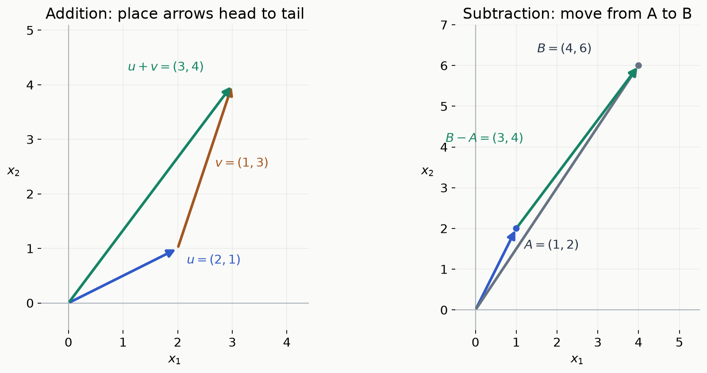
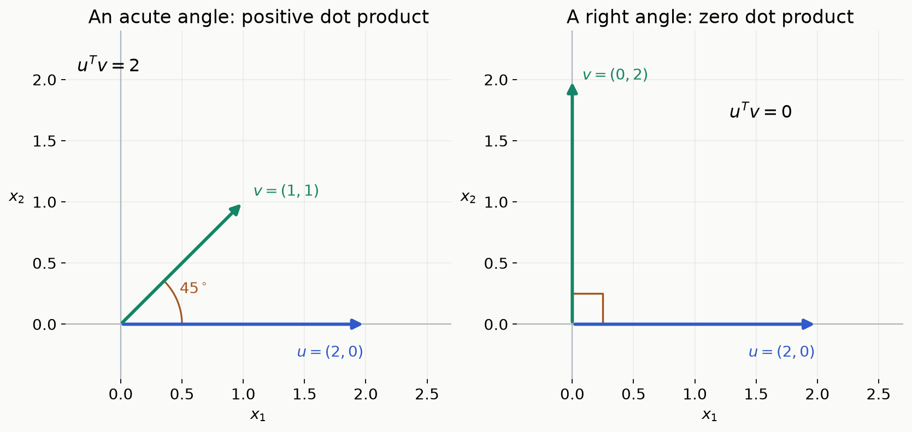
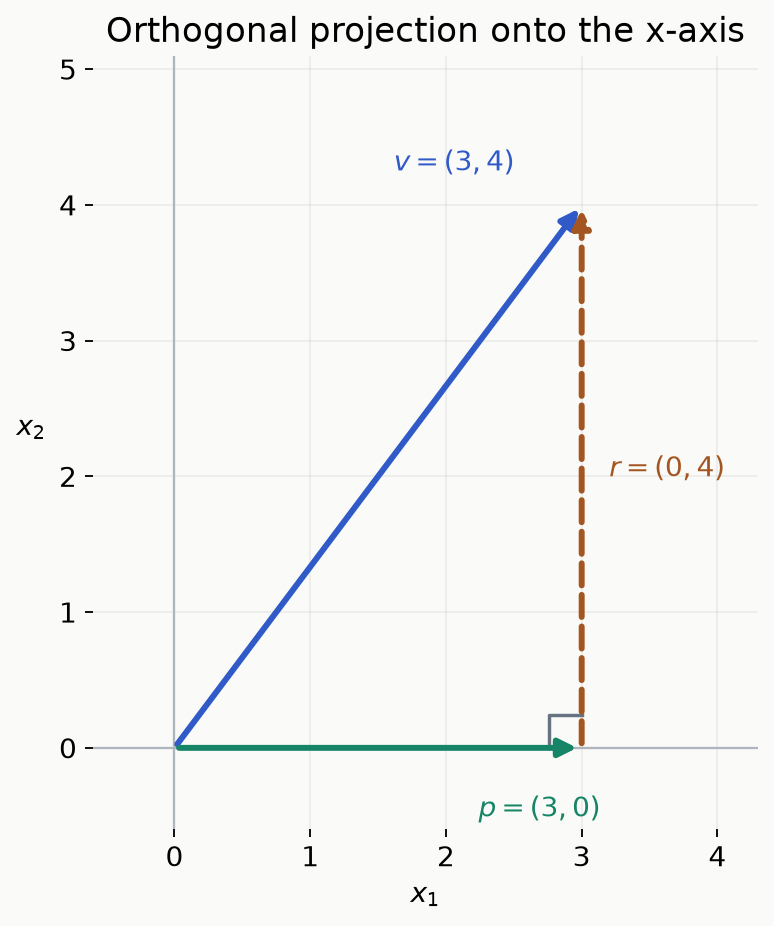
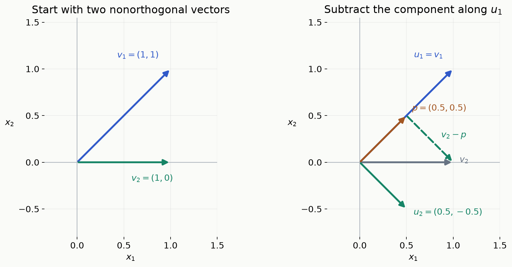

벡터는 위치나 이동을 나타내는 화살표이면서, 여러 숫자를 한꺼번에 다루는 방법이기도 하다. 지도에서의 이동은 두 숫자로, 하나의 데이터가 가진 여러 특징은 더 많은 숫자로 표현할 수 있다. ENAI601의 선형대수 복습은 이런 벡터를 더하고, 길이와 방향을 비교하고, 필요한 방향의 성분만 남기는 계산에서 출발한다.

이 글의 목표는 <strong>벡터 → 내적과 노름 → span과 기저 → 직교성 → 정사영 → Gram–Schmidt</strong>를 차례로 이해하는 것이다. 실수 성분을 갖는 벡터와 표준 내적을 사용하며, 각 계산을 작은 좌표 예제와 연결한다.

## 1. 왜 벡터로 표현할까?

“오른쪽으로 3만큼 이동했다”만으로는 평면 위의 이동을 다 설명할 수 없다. 위아래로 얼마나 움직였는지도 필요하다. 오른쪽으로 3, 위쪽으로 2만큼 이동했다면 두 숫자를 순서대로 묶는다.

$$
v=\begin{bmatrix}3\\2\end{bmatrix}.
$$

첫째 성분은 가로 이동, 둘째 성분은 세로 이동이다. 순서가 바뀐 $(2,3)$은 다른 이동이다. 두 숫자를 하나의 대상으로 묶으면 이동 전체를 더하거나, 방향을 뒤집거나, 길이를 계산할 수 있다.

숫자가 반드시 위치를 뜻할 필요는 없다. 예를 들어 데이터 한 개의 키·몸무게·나이를 정해진 순서로 모은 세 숫자도 <strong>feature vector(특징 벡터)</strong>로 표현할 수 있다. 이때 축은 물리적 방향 대신 각 특징을 뜻한다. 서로 다른 단위의 특징을 비교할 때는 스케일을 맞출 필요가 있지만, 성분별 덧셈 같은 벡터 연산의 규칙은 그대로다.

## 2. 벡터와 연산: 이동을 합치고 차이를 구하기

### 성분, 열벡터, 스칼라

벡터의 각 숫자를 <strong>component(성분)</strong>라 한다. 두 성분을 가진 실수 벡터는 다음처럼 쓴다.

$$
v=\begin{bmatrix}v_1\\v_2\end{bmatrix}\in\mathbb R^2.
$$

$\mathbb R$은 실수, $\mathbb R^2$는 두 실수 성분을 가진 모든 벡터의 공간이다. $\in$은 “속한다”는 뜻이다. 성분이 $n$개라면 $\mathbb R^n$에 속한다. 한 숫자만을 말할 때는 <strong>scalar(스칼라)</strong>라 부른다.

위처럼 세로로 쓴 것이 <strong>column vector(열벡터)</strong>이며 이 글의 기본 표기다. 가로로 쓰고 $T$를 붙인 $(3,2)^T$도 같은 열벡터를 뜻한다. $T$는 행과 열을 바꾸는 <strong>transpose(전치)</strong> 표시다. 벡터의 이동 방향을 말할 때는 0이 아닌 벡터를 생각한다. 모든 성분이 0인 <strong>zero vector(영벡터)</strong>는 길이가 0이라 방향이 없다.

### 덧셈과 뺄셈

두 이동을 차례로 하면 각 성분을 더한다. 성분 수가 같은 벡터끼리 더해야 한다.

$$
u=\begin{bmatrix}2\\1\end{bmatrix},\qquad
v=\begin{bmatrix}1\\3\end{bmatrix},\qquad
u+v=\begin{bmatrix}3\\4\end{bmatrix}.
$$

왼쪽 그림에서는 파란 이동을 마친 곳에서 갈색 이동을 이어 간다. 원점에서 최종 도착점으로 향하는 초록 화살표가 합벡터다. 벡터는 같은 방향과 크기를 유지한 채 평행이동해 그릴 수 있다. 이처럼 화살표의 머리와 다음 화살표의 꼬리를 잇는 방법을 <strong>head-to-tail rule</strong>이라 한다.

뺄셈은 두 위치 사이의 이동을 구한다. 위치 $A=(1,2)^T$에서 $B=(4,6)^T$까지 가려면 다음만큼 움직인다.

$$
B-A=\begin{bmatrix}4-1\\6-2\end{bmatrix}
=\begin{bmatrix}3\\4\end{bmatrix}.
$$

오른쪽 그림의 초록 화살표다. 역순으로 뺀 $A-B=(-3,-4)^T$는 반대 방향의 이동이다. <strong>어느 위치에서 어느 위치로 가는지</strong>에 따라 빼는 순서를 정한다.

### 스칼라배

벡터에 숫자를 곱하면 모든 성분에 그 숫자를 곱한다.

$$
v=\begin{bmatrix}1\\3\end{bmatrix},\qquad
2v=\begin{bmatrix}2\\6\end{bmatrix},\qquad
-v=\begin{bmatrix}-1\\-3\end{bmatrix}.
$$

양수 2를 곱하면 방향은 같고 길이는 두 배다. 음수 $-1$을 곱하면 길이는 같고 방향이 반대다. 0을 곱하면 영벡터가 된다. 일반적인 스칼라 $c$를 곱한 결과는 $cv$로 쓴다.

## 3. 내적: 두 방향의 관계를 숫자 하나로 계산하기

두 벡터가 같은 쪽으로 향하는지, 서로 수직인지 알고 싶을 때 <strong>inner product(내적)</strong>를 쓴다. 여기서 사용하는 표준 내적은 <strong>dot product(점곱)</strong>라고도 하며, 대응하는 성분끼리 곱한 뒤 모두 더한다.

$$
x=\begin{bmatrix}3\\4\end{bmatrix},\qquad
y=\begin{bmatrix}1\\2\end{bmatrix},\qquad
x^Ty=3\cdot1+4\cdot2=11.
$$

$x^Ty$는 벡터가 아니라 <strong>스칼라 11</strong>이다. $\langle x,y\rangle$도 이 글에서는 같은 내적을 뜻한다. 성분이 $n$개일 때의 공식은 다음과 같다. $\sum$는 표시한 항들을 모두 더한다는 기호다.

$$
\langle x,y\rangle=x^Ty=\sum_{i=1}^{n}x_i y_i.
$$

### 왜 수직이면 내적이 0일까?

내적은 두 벡터의 길이와 사이각에도 연결된다. 두 벡터가 모두 0이 아닐 때 다음 관계가 성립한다.

$$
x^Ty=\|x\|_2\|y\|_2\cos\theta.
$$

$\theta$는 두 벡터 사이각이며 세타라고 읽는다. $\|x\|_2$는 벡터의 길이로, 다음 절에서 계산한다. 코사인은 90도에서 0이므로 <strong>두 벡터가 수직이면 내적이 0</strong>이다. 반대로 0이 아닌 두 벡터의 내적이 0이면 사이각은 90도다.

왼쪽은 $(2,0)^T$와 $(1,1)^T$의 내적이 2인 경우다. 오른쪽은 $(2,0)^T$와 $(0,2)^T$의 내적이 0인 경우다. 숫자만 계산해도 방향 관계를 판별할 수 있다.

| 두 벡터의 사이각 | 내적의 부호 |
|---|---|
| 90도보다 작다 | 양수 |
| 90도다 | 0 |
| 90도보다 크다 | 음수 |

각도가 0도 또는 180도이면 각각 같은 방향 또는 정반대 방향이다. 다만 내적의 크기는 각도뿐 아니라 벡터 길이에도 영향을 받는다. 방향만 비교하려면 길이를 1로 맞춘 벡터의 내적을 사용할 수 있다. AI의 임베딩 유사성 비교가 한 사용처다. 영벡터와의 내적은 항상 0이지만 영벡터의 방향과 사이각은 정의하지 않는다.

## 4. 노름과 거리: 화살표의 길이 재기

내적이 두 벡터 사이의 관계를 재는 계산이라면, <strong>norm(노름)</strong>은 벡터 하나의 길이를 재는 함수다. 여기서 다루는 <strong>Euclidean norm(유클리드 노름), 또는 L2 norm</strong>은 피타고라스 정리와 같다.

$$
x=\begin{bmatrix}3\\4\end{bmatrix},\qquad
\|x\|_2=\sqrt{3^2+4^2}=5.
$$

기호 $\|x\|_2$는 “$x$의 L2 노름”이라고 읽는다. 아래첨자 2는 노름의 종류이고, 제곱을 뜻하지 않는다. 자기 자신과의 내적을 이용하면 다음처럼 쓴다.

$$
\|x\|_2=\sqrt{x^Tx},\qquad
\|x\|_2^2=x^Tx=\sum_{i=1}^{n}x_i^2.
$$

왼쪽 노름은 길이이고, 오른쪽 <strong>제곱 노름</strong>은 그 길이를 제곱한 스칼라다. 예제에서는 각각 5와 25다.

### 두 점 사이 거리에는 먼저 뺄셈이 필요하다

앞의 두 위치 $A=(1,2)^T$, $B=(4,6)^T$의 거리는 이동 벡터 $B-A=(3,4)^T$의 길이다.

$$
d(A,B)=\|B-A\|_2=5.
$$

<strong>벡터를 빼면 이동이 나오고, 그 노름을 구하면 거리가 나온다.</strong> $A$ 자체의 노름은 원점에서 $A$까지의 거리이므로 두 위치 사이 거리와 구별한다.

### 길이가 가져야 할 성질과 두 부등식

노름은 항상 0 이상이며 영벡터에서만 0이다. 스칼라배를 하면 부호를 제외한 배율만큼 길이가 바뀐다.

$$
\|v\|_2\ge0,\qquad
\|v\|_2=0\iff v=0,\qquad
\|cv\|_2=|c|\,\|v\|_2.
$$

$\iff$는 양쪽이 서로 동치라는 뜻이다. 예를 들어 $\|-2(3,4)^T\|_2=2\cdot5=10$이다. 음수를 곱해도 길이가 음수가 되지는 않는다.

<strong>Cauchy–Schwarz inequality(코시–슈바르츠 부등식)</strong>는 내적의 절댓값이 두 길이의 곱을 넘지 못한다는 뜻이다.

$$
|u^Tv|\le\|u\|_2\|v\|_2.
$$

내적의 각도 공식에서 $|\cos\theta|\le1$인 것과 연결된다. 예를 들어 $u=(3,4)^T$, $v=(1,0)^T$이면 $|u^Tv|=3\le5\cdot1$이다. 두 벡터가 같은 직선 방향이면 코사인의 절댓값이 1이 되어 등호가 성립한다. 한쪽이 영벡터여도 등호가 성립한다.

<strong>Triangle inequality(삼각부등식)</strong>는 직접 가는 거리가 두 번의 이동을 거쳐 가는 총길이보다 길지 않다는 뜻이다.

$$
\|u+v\|_2\le\|u\|_2+\|v\|_2.
$$

$u=(3,0)^T$, $v=(0,4)^T$라면 직접 가는 길이는 5, 두 이동의 길이 합은 $3+4=7$이다. 벡터를 이어 만든 삼각형에서 한 변의 길이가 나머지 두 변의 합을 넘지 못하는 모습이다.

## 5. 선형결합, span, 선형독립: 어떤 방향까지 만들 수 있을까?

이미 가진 화살표를 늘이거나 뒤집어서 더하면 어떤 벡터를 만들 수 있을까? 벡터의 스칼라배를 더한 것을 <strong>linear combination(선형결합)</strong>이라 한다.

$$
v_1=\begin{bmatrix}1\\0\end{bmatrix},\qquad
v_2=\begin{bmatrix}0\\1\end{bmatrix},\qquad
3v_1+2v_2=\begin{bmatrix}3\\2\end{bmatrix}.
$$

가로 방향을 3만큼, 세로 방향을 2만큼 써서 목표 벡터를 만들었다. 계수를 모든 실수로 바꿔 가며 만들 수 있는 <strong>모든 벡터의 집합</strong>이 <strong>span(생성공간)</strong>이다.

$$
\operatorname{span}\{v_1,v_2\}
=\{c_1v_1+c_2v_2:c_1,c_2\in\mathbb R\}.
$$

중괄호는 집합을 나타내고, 콜론 오른쪽은 계수에 대한 조건이다. 즉 “$c_1,c_2$를 아무 실수로 골라 만든 결과를 전부 모은다”는 뜻이다. 위의 두 좌표축 방향으로는 평면 전체를 만들 수 있다.

### 화살표가 두 개라고 두 방향이 생기지는 않는다

다음 두 벡터는 서로 배수다.

$$
w_1=\begin{bmatrix}1\\1\end{bmatrix},\qquad
w_2=\begin{bmatrix}2\\2\end{bmatrix}=2w_1.
$$

어떤 선형결합도 $(c_1+2c_2)(1,1)^T$이므로 직선 $x_2=x_1$을 벗어나지 못한다. 계수가 음수일 수도 있어 직선의 양쪽 방향을 모두 만든다. 두 번째 벡터를 추가해도 새로운 방향은 생기지 않았다.

이처럼 일부 벡터가 나머지 벡터의 조합으로 대체되는 것을 <strong>linear dependence(선형종속)</strong>라 한다. 반대로 어느 벡터도 나머지 조합으로 대체할 수 없으면 <strong>linear independence(선형독립)</strong>다. 공식으로는 다음과 같다.

$$
c_1v_1+\cdots+c_kv_k=0
\quad\Longrightarrow\quad c_1=\cdots=c_k=0.
$$

영벡터를 만드는 방법이 모든 계수를 0으로 두는 방법뿐이라는 뜻이다. 앞의 $w_1,w_2$는 $2w_1-w_2=0$이라는 다른 방법이 있으므로 종속이다. 서로 다른 좌표축 방향 $(1,0)^T$, $(0,1)^T$는 $c_1(1,0)^T+c_2(0,1)^T=(c_1,c_2)^T$가 0이려면 두 계수 모두 0이어야 하므로 독립이다.

## 6. 벡터공간, 부분공간, 기저, 차원

### Subspace: 연산해도 벗어나지 않는 공간

<strong>Vector space(벡터공간)</strong>는 벡터 덧셈과 스칼라배가 정의되고, 결합법칙·분배법칙·영벡터와 덧셈 역원의 존재 같은 벡터공간 규칙을 만족하는 공간이다. 이 글의 $\mathbb R^n$이 기본 예다.

그 안의 일부 벡터들만 모은 집합 $W$도 같은 연산으로 벡터공간이 된다면 <strong>subspace(부분공간)</strong>라 한다. $\mathbb R^n$의 부분집합에는 다음 세 조건으로 확인할 수 있다.

$$
\begin{aligned}
&0\in W,\\
&u,v\in W\ \Longrightarrow\ u+v\in W,\\
&u\in W,\ c\in\mathbb R\ \Longrightarrow\ cu\in W.
\end{aligned}
$$

영벡터가 들어 있고, 안에 있는 벡터끼리 더하거나 어떤 실수배를 해도 밖으로 나가지 않는다는 뜻이다. 나머지 연산 규칙은 원래 공간에서 물려받는다.

예를 들어 3차원 안의 $xy$평면은 부분공간이다.

$$
W=\left\{\begin{bmatrix}a\\b\\0\end{bmatrix}:a,b\in\mathbb R\right\}.
$$

더하고 배율을 바꿔도 세 번째 성분이 0으로 남는다. 반면 세 번째 성분이 항상 1인 평면은 영벡터가 없고, 두 벡터를 더하면 세 번째 성분이 2가 되므로 부분공간이 아니다. 원점을 지나는 직선과 영벡터만 있는 집합도 부분공간이다. 선형결합으로 만든 span 역시 부분공간이 된다.

### Basis: 빠진 방향도 중복도 없는 재료

<strong>Basis(기저)</strong>는 공간 전체를 span하면서 동시에 선형독립인 벡터들의 집합이다. 두 조건이 모두 필요하다. span은 “공간의 모든 벡터를 표현할 수 있는가?”, 독립성은 “중복된 재료가 없는가?”를 검사한다.

기저가 꼭 좌표축처럼 수직일 필요는 없다. 다음 두 벡터도 평면의 기저다.

$$
b_1=\begin{bmatrix}1\\1\end{bmatrix},\qquad
b_2=\begin{bmatrix}1\\0\end{bmatrix}.
$$

임의의 $(x,y)^T$를 $yb_1+(x-y)b_2$로 만들 수 있고, 두 벡터는 독립이다. 예를 들어 $(3,2)^T=2b_1+b_2$다. 둘째 성분을 2로 맞추려면 $b_1$의 계수는 2여야 하고, 그러면 첫째 성분을 맞추는 $b_2$의 계수는 1로 정해진다. 이처럼 <strong>기저에 대한 표현의 계수는 유일하다.</strong>

<blockquote class="lecture-excerpt">

교안 발췌 · Module 1 — Basis of a Vector Space

Definition: A subset $B=\{b_1,b_2,\ldots,b_n\}$ is a basis for a vector space if every vector in the vector space can be expressed as a linear combination of the elements in the subset in a unique way.

</blockquote>

발췌의 “in a unique way”가 계수의 유일성을 말한다. 공간을 전부 생성하더라도 벡터를 불필요하게 더 넣어 표현이 중복되면 기저가 아니다.

### Dimension: 성분 개수와 부분공간의 차원 구별하기

<strong>Dimension(차원)</strong>은 기저에 들어가는 벡터의 개수다. 같은 유한차원 공간의 기저들은 개수가 같으므로, 다른 기저를 골라도 차원은 바뀌지 않는다.

$$
\dim\mathbb R^2=2,\qquad \dim\mathbb R^3=3.
$$

3차원 안의 $xy$평면은 $(1,0,0)^T$, $(0,1,0)^T$ 두 개로 생성되므로 자체 차원은 2다. 벡터를 세 성분으로 썼다는 사실과, 그 벡터들이 움직이는 부분공간의 차원은 다르다. 독립인 벡터의 개수는 그 공간의 차원을 넘을 수 없다.

## 7. 직교와 정규직교: 독립보다 더 편리한 방향들

기저를 골라도 벡터들이 비스듬하면 방향별 성분을 구분하기 번거로울 수 있다. 좌표축처럼 서로 수직인 방향을 고르면 계산이 간단해진다.

<strong>Orthogonal(직교)</strong>는 내적이 0이라는 뜻이다. 예를 들어 $u=(1,1)^T$와 $v=(1,-1)^T$는 $u^Tv=1-1=0$이므로 직교한다. 두 벡터의 길이는 모두 $\sqrt2$다. 길이가 1일 필요는 없다.

벡터를 자기 길이로 나누어 길이를 1로 만드는 것을 <strong>normalization(정규화)</strong>라 한다. 0이 아닌 벡터에 대해 다음처럼 계산한다.

$$
q=\frac{u}{\|u\|_2},\qquad \|q\|_2=1.
$$

따라서 두 벡터를 각각 정규화하면

$$
q_1=\frac1{\sqrt2}\begin{bmatrix}1\\1\end{bmatrix},\qquad
q_2=\frac1{\sqrt2}\begin{bmatrix}1\\-1\end{bmatrix}
$$

이고, $q_1^Tq_2=0$, $q_1^Tq_1=q_2^Tq_2=1$이다. 서로 직교하면서 각 길이가 1인 것을 <strong>orthonormal(정규직교)</strong>라 한다.

| 개념 | 추가로 요구하는 조건 |
|---|---|
| 기저(basis) | 전체를 생성하고 선형독립이다 |
| 직교기저(orthogonal basis) | 서로 다른 기저 벡터의 내적이 0이다 |
| 정규직교기저(orthonormal basis) | 직교기저의 각 벡터 길이가 1이다 |

<strong>0이 아닌 직교 벡터들은 독립이지만, 독립인 벡터들이 모두 직교하지는 않는다.</strong> 또한 각 길이가 1이라는 사실만으로 서로 직교하는 것도 아니다.

보충: 독립만으로 길이의 제곱을 더할 수 없는 이유

$w_1=(1,0)^T$, $w_2=(1,1)^T$는 독립이지만 내적이 1이다. 합벡터 $(2,1)^T$의 제곱 길이는 5인 반면, 두 벡터의 제곱 길이 합은 $1+2=3$이다. 빠진 2는 다음 전개의 마지막 <strong>cross term(교차항)</strong>이다.

$$
\|w_1+w_2\|_2^2
=\|w_1\|_2^2+\|w_2\|_2^2+2w_1^Tw_2
=1+2+2=5.
$$

직교하면 내적이 0이어서 이 항이 사라진다. 피타고라스처럼 각 방향의 제곱 길이를 더할 수 있는 이유는 독립성만이 아니라 직교성이다.

## 8. 정사영: 지정한 방향의 그림자만 남기기

### 먼저 x축으로 수직으로 내리기

벡터를 한 직선 위로 수직으로 내려 그림자를 만든다고 생각하자. 원래 벡터가 가진 여러 방향의 성분 중 <strong>지정한 직선 방향의 성분만 남기는 것</strong>이 <strong>orthogonal projection(정사영)</strong>이다. 이 글에서 projection은 수직으로 내리는 정사영을 뜻한다.

$$
v=\begin{bmatrix}3\\4\end{bmatrix}
\quad\Longrightarrow\quad
p=\begin{bmatrix}3\\0\end{bmatrix}.
$$

$x$축 방향의 이동 3은 남기고 $y$방향의 이동 4는 제거했다. 원래 벡터와 그림자 사이의 차이 $r=v-p=(0,4)^T$를 <strong>residual(잔차)</strong>이라 한다. 그림의 갈색 화살표는 $p$의 끝에서 $v$의 끝으로 향하며, $x$축과 수직이다.

직선 위에서 $p$보다 왼쪽이나 오른쪽의 다른 점을 고르면, $v$까지의 선분이 직각삼각형의 빗변이 되어 수직선보다 길어진다. 그래서 수선의 발 $p$가 직선 위에서 가장 가까운 점이다.

### 기울어진 직선에서도 “남긴 방향과 잔차가 수직”이다

이번에는 직선 $x_2=x_1$ 위로 정사영한다. 방향벡터를 $u=(1,1)^T$, 원래 벡터를 $v=(3,1)^T$로 둔다.

그림의 초록 벡터 $p=(2,2)^T$는 직선 위에 있고, 잔차 $r=(1,-1)^T$는 그 방향과 수직이다. 실제로 $u^Tr=1-1=0$이다. 이제 이 그림자를 계산하는 공식을 만든다.

직선 위의 벡터는 모두 $cu$로 쓸 수 있다. 여기서 $c$는 얼마나 늘이거나 뒤집을지를 정하는 스칼라다. 정사영을 $p=cu$라고 두고, 잔차가 직선과 수직이라는 조건을 쓰면

$$
u^T(v-cu)=0
\quad\Longrightarrow\quad
u^Tv-c(u^Tu)=0.
$$

따라서 0이 아닌 $u$에 대해

$$
c=\frac{u^Tv}{u^Tu},\qquad
\boxed{\operatorname{proj}_{u}(v)=\frac{u^Tv}{u^Tu}u}.
$$

$\operatorname{proj}_{u}(v)$는 “$v$를 $u$ 방향으로 정사영한 벡터”라고 읽는다. $u\ne0$이면 $u^Tu=\|u\|_2^2>0$이므로 나눌 수 있다. 분모는 직선 방향을 표현한 $u$의 길이를 보정한다. $u$의 길이를 1로 정규화했다면 분모는 1이다.

숫자를 대입하면 다음과 같다.

$$
u^Tv=1\cdot3+1\cdot1=4,\qquad u^Tu=1^2+1^2=2,
$$

$$
c=\frac42=2,\qquad
p=2\begin{bmatrix}1\\1\end{bmatrix}
=\begin{bmatrix}2\\2\end{bmatrix}.
$$

<strong>계수 2와 정사영 벡터 $(2,2)^T$, 그 벡터의 길이 $2\sqrt2$는 서로 다르다.</strong> 계수는 어떤 기준벡터를 골랐는지에 따라 달라진다. 같은 직선의 방향을 $(2,2)^T$로 잡으면 계수는 1이지만 결과 벡터는 같다. 단위 방향 $u/\|u\|_2$에 대한 부호 있는 성분은 $u^Tv/\|u\|_2$이고, 정사영 벡터의 실제 길이는 그 절댓값이다.

## 9. 부분공간 정사영: 직교하는 방향들의 그림자 더하기

한 직선이 아니라 평면 위의 성분을 남기고 싶다면 어떻게 할까? 그 평면을 만드는 <strong>서로 직교하는 기저</strong>가 있다면 각 방향의 정사영을 더할 수 있다.

3차원 속 $xy$평면과 그 기저를 생각한다.

$$
W=\operatorname{span}\{e_1,e_2\},\qquad
e_1=\begin{bmatrix}1\\0\\0\end{bmatrix},\qquad
e_2=\begin{bmatrix}0\\1\\0\end{bmatrix}.
$$

$v=(3,4,5)^T$에서 각 방향의 그림자를 구하면

$$
\operatorname{proj}_{e_1}(v)=\begin{bmatrix}3\\0\\0\end{bmatrix},\qquad
\operatorname{proj}_{e_2}(v)=\begin{bmatrix}0\\4\\0\end{bmatrix}.
$$

둘을 더하면 평면 위의 정사영이다.

$$
\boxed{p=\operatorname{proj}_W(v)
=\begin{bmatrix}3\\4\\0\end{bmatrix}},\qquad
r=v-p=\begin{bmatrix}0\\0\\5\end{bmatrix}.
$$

잔차는 $z$축 방향이라 평면 안의 모든 방향과 수직이다. 한 방향의 성분을 구해도 다른 방향의 성분을 중복해서 세지 않는 것이 직교기저의 장점이다.

일반적인 직교기저 $w_1,\ldots,w_m$에 대해서는 다음처럼 쓴다.

$$
\operatorname{proj}_W(v)
=\sum_{i=1}^{m}\frac{w_i^Tv}{w_i^Tw_i}w_i.
$$

<strong>독립이지만 서로 직교하지 않는 기저에서는 각 정사영을 그대로 더하면 안 된다.</strong> 정사영 자체는 존재하지만 위의 간단한 합 공식은 사용할 수 없다. 다음 절에서 기저를 직교하게 바꾸는 방법을 배운다.

### 정규직교기저라면 좌표도 내적으로 바로 구한다

각 길이가 1인 기저 $q_i$라면 분모가 1이 된다. $c_i=q_i^Tv$라고 두면

$$
p=\operatorname{proj}_W(v)=\sum_{i=1}^{m}c_iq_i,
\qquad \|p\|_2^2=\sum_{i=1}^{m}c_i^2.
$$

여기서 $c_i$는 단위 기저 방향의 부호 있는 좌표다. 위 $xy$평면 예제에서는 좌표가 3과 4이고, 정사영의 제곱 길이는 $3^2+4^2=25$다. 반면 원래 벡터의 제곱 길이는 $3^2+4^2+5^2=50$이다. <strong>기저가 벡터 전체를 표현하는 공간을 생성할 때만 $p=v$가 되어 계수 제곱의 합이 원래 벡터의 제곱 노름과 같다.</strong> 부분공간 밖 성분이 남으면 그 성분의 길이를 빠뜨리면 안 된다.

심화: 가장 가까운 점이라는 증명

유한차원 실수 벡터공간의 부분공간 $W$에 정사영한 점을 $p$라 하면, $r=v-p$는 $W$의 모든 벡터와 수직이다. $W$ 안의 다른 점을 $y$라 하자. 그러면 $p-y$도 $W$ 안에 있다.

$$
v-y=(v-p)+(p-y).
$$

오른쪽 두 벡터가 직교하므로 피타고라스 정리에서

$$
\|v-y\|_2^2=\|v-p\|_2^2+\|p-y\|_2^2
\ge\|v-p\|_2^2.
$$

다른 점으로 옮기면 마지막 제곱 길이가 더해질 뿐이다. 등호는 $y=p$일 때만 성립하므로 정사영은 $W$ 안에서 $v$와 가장 가까운 유일한 점이다. 한 직선의 수선의 발에서 보았던 직각삼각형이 부분공간에서도 같은 역할을 한다.

## 10. Gram–Schmidt: 겹치는 성분을 빼고 길이를 1로 만들기

두 기저 벡터가 비스듬하면, 두 번째 벡터에는 첫 번째 방향으로 향하는 성분도 들어 있다. 그 부분을 정사영으로 구해 빼면 첫 번째에 수직인 나머지만 남는다. 이를 반복한 뒤 각 길이를 1로 맞추는 과정이 <strong>Gram–Schmidt process(그람–슈미트 직교화)</strong>다.

다음 두 벡터에서 시작한다.

$$
v_1=\begin{bmatrix}1\\1\end{bmatrix},\qquad
v_2=\begin{bmatrix}1\\0\end{bmatrix}.
$$

그림 왼쪽은 원래의 비직교 벡터다. 오른쪽의 갈색 벡터는 두 번째 벡터가 가진 첫 방향 성분이고, 초록 점선은 그 성분을 뺀 나머지다. 같은 초록 화살표를 원점으로 옮겨 그린 것이 $u_2$다.

### 1단계: 첫 방향을 유지하고, 두 번째에서 겹친 성분 빼기

첫 방향은 그대로 $u_1=v_1$로 둔다. 두 번째 벡터를 이 방향에 정사영한다.

$$
\operatorname{proj}_{u_1}(v_2)
=\frac{u_1^Tv_2}{u_1^Tu_1}u_1
=\frac12\begin{bmatrix}1\\1\end{bmatrix}
=\begin{bmatrix}1/2\\1/2\end{bmatrix}.
$$

이것을 원래 두 번째 벡터에서 뺀다.

$$
u_2=v_2-\operatorname{proj}_{u_1}(v_2)
=\begin{bmatrix}1\\0\end{bmatrix}
-\begin{bmatrix}1/2\\1/2\end{bmatrix}
=\begin{bmatrix}1/2\\-1/2\end{bmatrix}.
$$

내적으로 수직 여부를 확인하면

$$
u_1^Tu_2=1\cdot\frac12+1\cdot\left(-\frac12\right)=0.
$$

### 2단계: 각 길이를 1로 만들기

$\|u_1\|_2=\sqrt2$, $\|u_2\|_2=1/\sqrt2$이므로 각각 자기 길이로 나눈다.

$$
q_1=\frac{u_1}{\|u_1\|_2}
=\frac1{\sqrt2}\begin{bmatrix}1\\1\end{bmatrix},\qquad
q_2=\frac{u_2}{\|u_2\|_2}
=\frac1{\sqrt2}\begin{bmatrix}1\\-1\end{bmatrix}.
$$

이제 $q_1^Tq_2=0$, $\|q_1\|_2=\|q_2\|_2=1$이므로 정규직교기저다. <strong>정사영을 빼는 단계는 직교화이고, 노름으로 나누는 단계까지 해야 정규직교화가 완성된다.</strong>

원래 공간도 유지된다. $u_1=v_1$, $u_2=v_2-\tfrac12v_1$이므로 새 벡터는 원래 벡터의 조합이고, 반대로 $v_2=u_2+\tfrac12u_1$로 복원할 수 있다. 정규화도 0이 아닌 배율을 바꾸는 것뿐이다. 따라서 원래 기저와 새 기저의 span은 같다.

### 여러 벡터의 경우에도 같은 작업을 반복한다

선형독립인 입력 $v_1,\ldots,v_m$에 대해, 새 벡터에서 이미 만든 직교 방향들의 성분을 모두 뺀다.

$$
u_1=v_1,\qquad
u_k=v_k-\sum_{j=1}^{k-1}\frac{u_j^Tv_k}{u_j^Tu_j}u_j,
\qquad q_k=\frac{u_k}{\|u_k\|_2}.
$$

$k$번째 단계에서는 앞서 만든 $u_1,\ldots,u_{k-1}$이 서로 직교하므로 정사영을 각각 구해 뺄 수 있다. $u_j$는 직교화한 벡터, $q_j$는 정규화까지 마친 벡터를 뜻한다.

<blockquote class="lecture-excerpt">

교안 발췌 · Module 1 — Projection / Gram–Schmidt

Gram-Schmidt process: Starting with a basis $w_1,\ldots,w_m$, it constructs an orthonormal basis $b_1,\ldots,b_m$.

$$
b_1\leftarrow w_1,\qquad b_k\leftarrow w_k-\sum_{l=1}^{k-1}\frac{\langle w_k,b_l\rangle}{\langle b_l,b_l\rangle}b_l\quad(k=2,\ldots,m)
$$

</blockquote>

발췌의 $\leftarrow$는 계산한 값을 대입한다는 표시다. 위 갱신식 자체는 직교화 단계이며, 정규직교기저를 얻으려면 각 결과를 그 노름으로 나누는 단계가 필요하다. 본문의 $u_k$와 $q_k$ 표기는 이 두 단계를 구별한 것이다.

입력이 종속이면 어느 단계에서 $u_k=0$이 나올 수 있다. 이미 확보한 방향들만으로 그 입력을 만들 수 있다는 뜻이며, 영벡터는 길이로 나눌 수 없다. 기저를 만들려면 이런 중복 입력을 제외해야 한다.

## 11. 벡터 계산은 어디에 쓰일까?

내적은 두 특징 벡터가 얼마나 같은 방향인지 비교하는 데, 노름은 차이 벡터의 크기를 재는 데 쓸 수 있다. 정사영은 관심 있는 방향의 성분을 추출하고, Gram–Schmidt는 같은 공간을 표현하면서 계산하기 쉬운 방향들을 만드는 방법이다.

벡터들을 나란히 열로 모으면 행렬이 된다. [다음 행렬 글](/enai601-matrices-and-psd/)에서는 여러 방향을 한꺼번에 다루는 방법을 배운다. 가장 가까운 표현을 구한다는 정사영의 의미는 [최소제곱과 QP](/enai601-quadratic-programming/)에서 다시 사용하며, 내적의 수직 관계는 [LP](/enai601-linear-programming/)의 경계를 이해하는 데도 쓰인다.

응용: 두 관측값의 평균을 정사영으로 얻기

관측값 3과 1을 $v=(3,1)^T$로 모으고, 두 값을 같은 숫자로 요약한 결과를 $(a,a)^T$로 나타내자. 이런 벡터는 모두 방향 $(1,1)^T$의 직선 위에 있다. 앞서 계산한 그 직선으로의 정사영은 $(2,2)^T$다.

그림자의 두 성분 2는 평균 $(3+1)/2$와 같다. 실제로 정사영 계수의 분자는 $3+1$, 분모는 $1^2+1^2=2$였다. 평균이라는 익숙한 계산을 이 경우에는 정사영으로도 볼 수 있다.

## 12. 혼자 풀어 보는 확인 문제

### 문제 1. 이동과 거리 계산하기

$u=(2,1)^T$, $v=(1,3)^T$에 대해 $u+v$, $v-u$, $\|v-u\|_2$를 구하라. 마지막 값은 어느 두 점 사이의 거리인가?

정답과 해설 펼치기

성분별로 더하고 빼면 다음과 같다.

$$
u+v=\begin{bmatrix}3\\4\end{bmatrix},\qquad
v-u=\begin{bmatrix}-1\\2\end{bmatrix},\qquad
\|v-u\|_2=\sqrt{(-1)^2+2^2}=\sqrt5.
$$

마지막 값은 위치 $u$와 위치 $v$ 사이의 거리다. $v-u$라는 벡터와 그 길이 $\sqrt5$라는 스칼라를 구별한다.

### 문제 2. 기울어진 직선에 정사영하기

$v=(5,1)^T$를 $u=(1,1)^T$ 방향에 정사영하고 잔차를 구하라. 잔차가 그 직선과 수직인지도 확인하라.

정답과 해설 펼치기

정사영 계수는 $u^Tv/(u^Tu)=(5+1)/(1+1)=3$이다.

$$
p=3\begin{bmatrix}1\\1\end{bmatrix}
=\begin{bmatrix}3\\3\end{bmatrix},\qquad
r=v-p=\begin{bmatrix}2\\-2\end{bmatrix}.
$$

$u^Tr=2-2=0$이므로 잔차는 직선 방향과 수직이다. 정사영은 직선 위에 있고 차이는 직선에 수직이라는 두 조건을 모두 만족한다.

### 문제 3. 방향벡터를 두 배로 바꾸면?

$v=(3,1)^T$를 $u=(2,2)^T$ 방향에 정사영하라. 기준벡터를 $(1,1)^T$에서 두 배로 바꾸면 정사영 계수와 벡터도 두 배가 되는가?

정답과 해설 펼치기

계수는 $u^Tv/(u^Tu)=8/8=1$이고 정사영은 $1(2,2)^T=(2,2)^T$다. 이전 기준벡터 $(1,1)^T$를 쓸 때 계수는 2였다. 기준벡터가 두 배가 되면 계수는 절반이 되어 같은 점을 나타낸다. 정사영하는 직선이 같으므로 결과 벡터도 같다.

계수 1은 길이가 아니다. 결과 벡터의 길이는 여전히 $\sqrt{2^2+2^2}=2\sqrt2$다.

### 문제 4. 독립인 두 방향의 정사영을 더하면?

$v=(3,1)^T$, $w_1=(1,0)^T$, $w_2=(1,1)^T$에 대해 두 방향의 정사영을 각각 구해 더하라. 두 벡터의 span으로 정사영한 결과와 같은가?

정답과 해설 펼치기

각 정사영은 $(3,0)^T$, $(2,2)^T$이므로 합은 $(5,2)^T$다. 하지만 두 독립 벡터는 평면 전체를 span하므로 그 공간으로 정사영하면 $v$ 자체인 $(3,1)^T$여야 한다.

두 방향의 내적이 1이라 직교하지 않는다. 따라서 개별 정사영을 더하면서 성분을 중복해서 셌다. 직교기저를 만든 뒤 합하는 방법은 사용할 수 있다.

### 문제 5. 정사영의 길이와 원래 길이 구별하기

$v=(3,1)^T$를 단위 방향 $q_1=(1,1)^T/\sqrt2$에 정사영했다. $(q_1^Tv)^2$는 원래 벡터의 제곱 길이와 같은가?

정답과 해설 펼치기

내적 좌표는 $q_1^Tv=4/\sqrt2=2\sqrt2$이고 제곱은 8이다. 이는 정사영 $(2,2)^T$의 제곱 길이다. 원래 벡터의 제곱 길이는 $3^2+1^2=10$이라 다르다.

빠진 2는 잔차 $(1,-1)^T$의 제곱 길이다. 한 방향만 남긴 정사영의 좌표로는 벡터 전체의 길이를 나타낼 수 없다. 기저가 전체 벡터를 표현하는 공간을 생성하는지 확인해야 한다.

### 문제 6. Gram–Schmidt를 다른 두 벡터에 적용하기

$v_1=(1,0)^T$, $v_2=(1,1)^T$에서 시작해 정규직교기저를 만들어라. 정사영을 빼는 단계와 정규화 단계를 구별하라.

정답과 해설 펼치기

첫 벡터를 $u_1=v_1=(1,0)^T$로 둔다. 두 번째에서 첫 방향의 성분을 뺀다.

$$
\operatorname{proj}_{u_1}(v_2)=\begin{bmatrix}1\\0\end{bmatrix},\qquad
u_2=\begin{bmatrix}1\\1\end{bmatrix}-\begin{bmatrix}1\\0\end{bmatrix}
=\begin{bmatrix}0\\1\end{bmatrix}.
$$

두 벡터의 내적은 0이다. 이번에는 두 길이가 우연히 이미 1이므로 정규화해도 변하지 않는다.

$$
q_1=(1,0)^T,\qquad q_2=(0,1)^T.
$$

$v_2=u_1+u_2$로 원래 벡터를 복원할 수 있어 span도 같다. 일반적인 입력에서는 직교화 후의 길이가 1인지 별도로 확인하고, 1이 아니면 그 노름으로 나누어야 한다.

## 참고 자료

- ENAI601, <strong>Module 1 — Linear Algebra</strong>: Vector Space, Subspaces, Basis, Dimension, Inner Product, Projection, Gram–Schmidt.
- <strong>2026년 9월 2일·9월 9일 수업</strong>.
- 개인 필기 <strong>「1 Vector」 1–6페이지</strong>.
