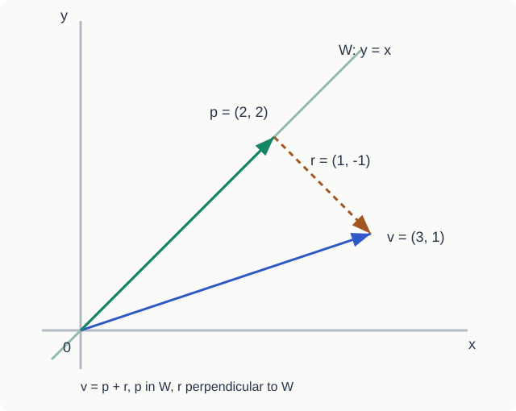

ENAI601 <strong>Numerical Methods for Engineering AI</strong>는 최적화를 공부하기 전에 선형대수를 복습한다. 내적, 노름, 기저, 정사영을 따로 외우면 공식이 많아 보이지만, 모두 같은 질문으로 이어진다. <strong>주어진 벡터를 어떤 방향으로 표현하고, 그 표현의 오차를 어떻게 잴까?</strong>

정사영은 원하는 공간에 가장 가까운 벡터를 찾는 방법이다. 이후 최소제곱에서 예측 오차를 줄이고, 최적화에서 이동 방향과 잔차를 해석할 때 이 기하학이 다시 쓰인다. 여기서는 실수 벡터와 표준 내적을 사용한다.

| 흐름 | 핵심 질문 |
| --- | --- |
| 벡터 → 내적·노름 | 이동의 방향과 크기는 어떻게 재는가? |
| span → 부분공간·기저 | 어떤 벡터를 표현할 수 있는가? |
| 직교 → 정사영 | 원하는 공간에 가장 가까운 표현은 무엇인가? |
| Gram–Schmidt → 잔차 | 계산하기 쉬운 기저와 최소 오차는 어떻게 연결되는가? |

## 1. 벡터는 숫자 목록이면서 공간 속 이동이다

벡터(vector)는 여러 성분(component)을 순서대로 모아 놓은 대상이다. 예를 들어 2차원 벡터를 생각하자.

$$
v=\begin{bmatrix}3\\2\end{bmatrix}\in\mathbb{R}^2
$$

성분은 두 개이며, 기하학적으로는 원점에서 오른쪽으로 3, 위쪽으로 2만큼 향하는 화살표로 그릴 수 있다. 이런 관점에서 벡터에는 <strong>방향(direction)</strong>과 <strong>크기(magnitude)</strong>가 있다.

AI에서는 벡터를 하나의 데이터에 대한 <strong>feature vector</strong>로 생각할 수도 있다. 숫자 하나하나가 어떤 특징을 의미하는지에 따라 공간의 각 축이 정해진다. 그림의 좌표축이든 데이터의 특징축이든, 벡터 계산 자체는 같다.

### 덧셈: 이동을 이어 붙이기

$$
u=\begin{bmatrix}2\\1\end{bmatrix},\qquad
v=\begin{bmatrix}1\\3\end{bmatrix}
$$

$$
u+v
=\begin{bmatrix}2+1\\1+3\end{bmatrix}
=\begin{bmatrix}3\\4\end{bmatrix}
$$

먼저 $u$만큼 움직이고, 그 끝점에서 $v$만큼 더 움직인다. 원점에서 최종 도착점으로 향하는 하나의 화살표가 합벡터다. 이를 <strong>head-to-tail rule</strong>이라고 한다. 두 벡터를 원점에서 그렸을 때 평행사변형의 대각선이 합벡터가 되는 <strong>parallelogram rule</strong>도 같은 이야기다.

### 뺄셈: 한 위치에서 다른 위치까지의 이동

$$
x=\begin{bmatrix}1\\2\end{bmatrix},\qquad
y=\begin{bmatrix}4\\6\end{bmatrix}
$$

$$
y-x=\begin{bmatrix}3\\4\end{bmatrix}
$$

이 결과는 <strong>위치 $x$에서 위치 $y$로 향하는 displacement vector</strong>다. 화살표의 시작점은 $x$, 끝점은 $y$다. 역순으로 빼면 방향도 반대가 된다.

$$
x-y=-(y-x)
$$

덧셈이 연속된 이동을 합치는 작업이라면, 뺄셈은 두 위치 사이의 이동을 찾아내는 작업이다.

### 스칼라배: 크기를 조절하거나 방향을 뒤집기

$$
cv=\begin{bmatrix}cv_1\\cv_2\end{bmatrix}
$$

양수인 스칼라를 곱하면 같은 방향으로 길이가 늘거나 줄어든다. 음수를 곱하면 반대 방향으로 뒤집힌다. 특히 스칼라가 0이면 영벡터가 된다.

---

## 2. 내적은 두 방향의 관계를 숫자로 만든다

내적(inner product), 또는 점곱(dot product)은 두 벡터에서 하나의 스칼라를 만든다.

$$
x=\begin{bmatrix}3\\4\end{bmatrix},\qquad
y=\begin{bmatrix}1\\2\end{bmatrix}
$$

$$
x^Ty=3\cdot1+4\cdot2=11
$$

하지만 <strong>왜 하필 곱해서 더할까?</strong> 기하학적인 의미를 보면 이해가 쉬워진다.

$$
x^Ty=\|x\|_2\|y\|_2\cos\theta
$$

여기서 각도는 두 벡터 사이의 각도다. 내적은 벡터의 길이뿐 아니라 <strong>얼마나 같은 방향을 향하는지</strong>도 반영한다.

- 예각이면 내적은 양수이고, <strong>두 벡터의 길이를 고정했을 때</strong> 각도가 0도이면 최대가 된다.
- 서로 수직이면 내적이 0이다.
- 서로 반대쪽으로 기울어 있으면 내적은 음수가 되고, 각도가 180도일 때 가장 작은 값이 된다.

단, 길이가 0인 벡터의 방향이나 두 벡터 사이의 각도는 정의하지 않는다.

이 사실은 AI에서도 익숙하다. 텍스트나 이미지의 feature embedding을 비교할 때, 벡터의 방향 관계를 이용해 유사성을 해석할 수 있다. 다만 단순 dot product는 벡터 길이에도 영향을 받으므로, 방향만 비교하고 싶을 때는 정규화한 벡터를 사용한다.

---

## 3. 노름은 길이, 두 벡터의 차이는 거리다

벡터의 길이를 재는 함수가 <strong>norm</strong>이다. 여기서 주로 쓰는 것은 Euclidean norm 또는 L2 norm이다.

$$
\|x\|_2=\sqrt{x^Tx}
$$

예를 들어 다음 벡터의 길이는 피타고라스 정리로 계산된다.

$$
x=\begin{bmatrix}3\\4\end{bmatrix}
$$

$$
\|x\|_2=\sqrt{3^2+4^2}=5
$$

두 위치 사이의 <strong>distance</strong>는 먼저 두 벡터를 빼서 displacement를 만든 다음, 그 길이를 재는 것이다.

$$
d(x,y)=\|y-x\|_2
$$

앞에서 사용한 위치 벡터라면 결과는 다음과 같다.

$$
y-x=\begin{bmatrix}3\\4\end{bmatrix},\qquad
\|y-x\|_2=5
$$

즉 <strong>subtraction은 이동 벡터를 만들고, norm은 그 이동의 길이를 계산한다.</strong>

### 제곱 노름과 자기 자신과의 내적

노름을 제곱하면 제곱근이 사라진다.

$$
\|x\|_2^2=x^Tx=\sum_{i=1}^{n}x_i^2
$$

이것은 다음 장에서 계속 등장하는 <strong>quadratic form</strong>의 가장 기본적인 예다. 최적화에서는 제곱 노름을 목적함수로 사용하는 경우가 많다.

### 교수님 자료에서 강조한 노름의 성질

스칼라배에 대해서는 길이의 배율만큼 변한다.

$$
\|cv\|_2=|c|\,\|v\|_2
$$

영벡터만 길이가 0이다.

$$
\|v\|_2=0\iff v=0
$$

<strong>Cauchy–Schwarz inequality</strong>는 내적의 절댓값이 두 벡터 길이의 곱보다 클 수 없다고 말한다.

$$
|u^Tv|\le\|u\|_2\|v\|_2
$$

이것은 내적의 각도 공식에서 코사인의 절댓값이 1 이하라는 사실로 이해할 수 있다.

<strong>Triangle inequality</strong>는 직접 가는 거리가 경유해서 가는 거리보다 길 수 없다는 뜻이다.

$$
\|u+v\|_2\le\|u\|_2+\|v\|_2
$$

나중에 어떤 norm 함수가 convex함을 보일 때 이 성질이 중요한 도구가 된다.

---

## 4. 정사영은 한 방향의 성분만 남긴다

그림은 뒤에서 계산할 예제다. 파란 화살표가 원래 벡터, 초록 화살표가 정사영이고 점선이 잔차다.

어떤 벡터가 여러 방향으로 향하고 있을 때, 관심 있는 한 방향으로 얼마나 향하는지만 추출할 수 있을까? 이것이 <strong>projection</strong>의 출발점이다.

원래 벡터를 $v$, 기준 방향을 나타내는 0이 아닌 벡터를 $u$라고 하자. $v$를 $u$ 방향의 직선 위에 정사영하면 다음 결과를 얻는다.

$$
\operatorname{proj}_{u}(v)
=\frac{u^Tv}{u^Tu}u
=\frac{u^Tv}{\|u\|_2^2}u
$$

식의 역할을 나누면 다음과 같다.

- <strong>내적:</strong> 원래 벡터가 기준 방향과 얼마나 정렬되는지 확인한다.
- <strong>분모:</strong> 기준 벡터 자체의 길이 때문에 생기는 배율을 보정한다.
- <strong>마지막 벡터:</strong> 구한 양을 다시 실제 공간 속 화살표로 만든다.

예를 들어 $x$축에 정사영하고 싶다면 기준 방향을 이렇게 고를 수 있다.

$$
u=\begin{bmatrix}1\\0\end{bmatrix},\qquad
v=\begin{bmatrix}3\\4\end{bmatrix}
$$

$$
\operatorname{proj}_{u}(v)
=\frac{3}{1}\begin{bmatrix}1\\0\end{bmatrix}
=\begin{bmatrix}3\\0\end{bmatrix}
$$

원래 벡터의 $y$방향 부분은 제거되고 $x$방향 부분만 남았다.

여기서 중요한 질문이 남는다. <strong>한 방향이 아니라 평면 전체에 정사영하고 싶다면 어떻게 해야 할까?</strong> 그러려면 먼저 공간과 기저를 이해해야 한다.

---

## 5. Linear combination과 span: 벡터들이 만들어 낼 수 있는 공간

벡터 덧셈과 스칼라배를 합친 연산이 <strong>linear combination(선형결합)</strong>이다.

$$
c_1v_1+c_2v_2+\cdots+c_kv_k
$$

각 계수를 바꾸면서 만들 수 있는 모든 결과를 모으면 <strong>span(생성공간)</strong>이 된다.

$$
\operatorname{span}\{v_1,\ldots,v_k\}
=\left\{\sum_{i=1}^{k}c_iv_i:c_i\in\mathbb R\right\}
$$

예를 들어 $x$축 방향과 $y$축 방향의 단위벡터가 있으면, 각각에 원하는 계수를 곱하고 더해서 평면의 모든 점에 도달할 수 있다.

$$
e_1=\begin{bmatrix}1\\0\end{bmatrix},\qquad
e_2=\begin{bmatrix}0\\1\end{bmatrix}
$$

$$
\operatorname{span}\{e_1,e_2\}=\mathbb R^2
$$

반면 두 벡터가 같은 직선을 가리킨다면 아무리 조합해도 그 직선 밖으로 나갈 수 없다.

$$
v_1=\begin{bmatrix}1\\1\end{bmatrix},\qquad
v_2=\begin{bmatrix}2\\2\end{bmatrix}=2v_1
$$

이것이 <strong>linear dependence(선형종속)</strong>이다. 두 번째 벡터가 새로운 방향 정보를 주지 않는다.

벡터들이 <strong>linearly independent(선형독립)</strong>라는 말은 영벡터를 만드는 선형결합이 자명한 경우밖에 없다는 뜻이다.

$$
c_1v_1+\cdots+c_kv_k=0
\quad\Longrightarrow\quad
c_1=\cdots=c_k=0
$$

> 선형독립은 각 벡터가 <strong>다른 벡터들의 조합으로 대체할 수 없는 새로운 방향 정보</strong>를 준다는 뜻이다.

---

## 6. Vector space, subspace, basis, dimension

여기서 <strong>vector space(벡터공간)</strong>를 생각해보자. 이 글에서 주로 다루는 표준적인 공간은 실수 성분을 갖는 다음 공간이다.

$$
\mathbb R^n
$$

벡터공간은 벡터 덧셈과 스칼라배가 정의되고 그 결과가 여전히 공간 안에 있으며, 그 밖의 벡터공간 공리도 만족하는 대상이다.

<strong>Subspace(부분공간)</strong>는 큰 벡터공간 안에 포함된 작은 벡터공간이다. 실수 벡터공간의 부분집합이 부분공간인지 확인할 때는 다음 조건이 핵심이다.

$$
0\in W
$$

$$
u,v\in W\implies u+v\in W
$$

$$
c\in\mathbb R,\ u\in W\implies cu\in W
$$

예를 들어 3차원 안의 xy평면은 부분공간이다.

$$
W=\left\{\begin{bmatrix}a\\b\\0\end{bmatrix}:a,b\in\mathbb R\right\}
$$

여기서는 더하고 배율을 바꿔도 세 번째 성분이 언제나 0이다. 반면 세 번째 성분이 항상 1인 평면은 영벡터가 포함되지 않으므로 부분공간이 아니다.

<strong>Basis(기저)</strong>는 공간 전체를 span하면서 동시에 linearly independent인 벡터들의 집합이다. 다시 말해 <strong>빠진 방향도 없고 불필요한 중복도 없는 좌표의 재료</strong>다.

<strong>Dimension(차원)</strong>은 기저에 포함된 벡터의 개수다.

$$
\dim(\mathbb R^2)=2,\qquad \dim(\mathbb R^3)=3
$$

특히 3개의 성분으로 적힌 벡터라도 그 벡터들이 움직이는 부분공간의 차원은 2일 수 있다. 예를 들어 위의 xy평면은 3차원 공간 안에 있지만 자체 차원은 2다.

---

## 7. 직교성: 서로 다른 방향이 얼마나 겹치지 않는가

두 벡터가 <strong>orthogonal(직교)</strong>이라는 것은 내적이 0이라는 뜻이다.

$$
u^Tv=0
$$

0이 아닌 벡터끼리는 공간에서 90도를 이룬다. 이때 각 방향은 서로 간섭하지 않는 좌표축처럼 사용할 수 있다.

<strong>Orthogonal basis(직교기저)</strong>는 기저 벡터들이 서로 직교하는 경우다. <strong>Orthonormal basis(정규직교기저)</strong>는 여기에 각 기저 벡터의 길이가 1이라는 조건까지 더한 경우다.

$$
w_i^Tw_j=0\quad (i\ne j)
$$

$$
w_i^Tw_i=1
$$

여기서 주의할 점은 <strong>선형독립과 직교는 같지 않다</strong>는 것이다. 0이 아닌 직교 벡터들은 선형독립이지만, 선형독립인 벡터들이 모두 직교하는 것은 아니다.

그럼 왜 굳이 직교기저를 만들까? 답은 정사영을 평면이나 더 높은 차원으로 확장하면 분명해진다.

---

## 8. 한 방향의 정사영을 모으면 부분공간의 정사영이 된다

어떤 부분공간을 직교기저들이 생성한다고 하자.

$$
W=\operatorname{span}\{w_1,\ldots,w_m\}
$$

기저가 서로 직교한다면 <strong>부분공간 전체로의 정사영</strong>은 <strong>각 기저 방향으로의 정사영의 합</strong>으로 계산된다.

$$
\boxed{
\operatorname{proj}_W(v)
=\sum_{i=1}^{m}\operatorname{proj}_{w_i}(v)
}
$$

일반적인 직교기저에서는 다음처럼 계산한다.

$$
\operatorname{proj}_W(v)
=\sum_{i=1}^{m}\frac{w_i^Tv}{w_i^Tw_i}w_i
$$

### 실제로 평면에 정사영해 보기

3차원 속 xy평면을 생각하자.

$$
w_1=\begin{bmatrix}1\\0\\0\end{bmatrix},\qquad
w_2=\begin{bmatrix}0\\1\\0\end{bmatrix}
$$

$$
v=\begin{bmatrix}3\\4\\5\end{bmatrix}
$$

$x$축 방향의 정사영은 다음과 같다.

$$
\operatorname{proj}_{w_1}(v)
=\begin{bmatrix}3\\0\\0\end{bmatrix}
$$

$y$축 방향도 별도로 계산한다.

$$
\operatorname{proj}_{w_2}(v)
=\begin{bmatrix}0\\4\\0\end{bmatrix}
$$

둘을 더하면 xy평면 위의 정사영이 된다.

$$
\operatorname{proj}_W(v)
=\begin{bmatrix}3\\0\\0\end{bmatrix}
+\begin{bmatrix}0\\4\\0\end{bmatrix}
=\begin{bmatrix}3\\4\\0\end{bmatrix}
$$

각 기저 방향이 90도로 분리되어 있으므로 <strong>하나의 방향 성분을 구해도 다른 방향 성분을 중복해서 세지 않는다.</strong> 바로 이 이유로 각 정사영을 독립적으로 계산해서 합칠 수 있다.

> 직교하지 않는 기저에 대해서도 부분공간으로의 정사영 자체는 존재한다. 다만 개별 기저벡터로 단순히 정사영한 결과들을 그냥 더하는 공식은 일반적으로 성립하지 않는다.

---

## 9. Orthonormal basis의 세 가지 이점

정규직교기저에서는 각 기저 벡터 길이의 제곱이 1이다. 따라서 정사영 공식의 분모가 사라진다.

$$
\operatorname{proj}_{w_i}(v)=(w_i^Tv)w_i
$$

이것은 단순히 계산이 짧아진다는 뜻이 아니다. <strong>좌표의 추출, 정사영의 재구성, 크기의 계산</strong>이 모두 간단해진다는 뜻이다.

### 9.1 계수 추출: 내적 한 번으로 그 방향의 좌표를 안다

정규직교기저로 표현된 벡터를 생각하자.

$$
v=c_1w_1+\cdots+c_mw_m
$$

양변에 특정 기저 벡터를 내적하면 서로 다른 방향의 항들은 0이 된다.

$$
w_k^Tv
=\sum_{i=1}^{m}c_iw_k^Tw_i
=c_k
$$

따라서

$$
\boxed{c_k=w_k^Tv}
$$

이다. 이 값은 <strong>해당 기저 방향으로 얼마만큼 향하는지 나타내는 부호 있는 계수(signed coordinate)</strong>다. 계수가 음수라면 그 기저 벡터가 향하는 방향의 반대쪽 성분이라는 뜻이다.

예를 들어

$$
v=\begin{bmatrix}3\\-2\\4\end{bmatrix}
$$

라면 표준 정규직교기저에서 각 계수는 3, -2, 4다. 두 번째 계수 -2는 <strong>정의한 두 번째 축과 반대 방향</strong>의 성분을 뜻한다.

### 9.2 부분공간 재구성: 필요한 좌표 성분만 추출한다

정규직교기저를 사용하면 부분공간 정사영 공식이 이렇게 단순해진다.

$$
\boxed{
\operatorname{proj}_W(v)
=\sum_{i=1}^{m}(w_i^Tv)w_i
}
$$

예를 들어 첫 번째와 세 번째 좌표만 남기고 싶다면 첫 번째와 세 번째 표준기저가 생성하는 부분공간에 정사영한다.

$$
W=\operatorname{span}\{e_1,e_3\}
$$

$$
\operatorname{proj}_W(v)
=3e_1+4e_3
=\begin{bmatrix}3\\0\\4\end{bmatrix}
$$

원래 벡터에서 선택한 부분공간에 속하는 성분만 남았다.

### 9.3 제곱 노름: 피타고라스 정리가 고차원으로 확장된다

정규직교기저가 <strong>벡터 전체를 표현하는 공간</strong>의 기저라면,

$$
\boxed{\|v\|_2^2=\sum_{i=1}^{m}c_i^2}
$$

가 성립한다. 예시에서는 다음과 같다.

$$
\|v\|_2^2
=3^2+(-2)^2+4^2
=29
$$

서로 직교하는 성분에서는 교차항이 사라지므로, 각 좌표 성분의 제곱을 더해서 전체 길이의 제곱을 얻는다.

<strong>중요한 적용 조건:<strong> 기저가 작은 부분공간만 생성한다면, 위의 합은 전체 벡터가 아니라 </strong>그 부분공간으로 정사영한 벡터의 제곱 노름</strong>과 같다.

$$
\boxed{
\|\operatorname{proj}_W(v)\|_2^2
=\sum_{i=1}^{m}c_i^2
}
$$

예를 들어 첫 번째와 세 번째 좌표만 남긴 결과라면

$$
\|\operatorname{proj}_W(v)\|_2^2
=3^2+4^2=25
$$

이고, 원래 전체 벡터의 제곱 노름 29와는 다르다.

---

## 10. 왜 직교하지 않으면 cross term이 나타날까?

여기서 선형독립과 직교를 혼동하기 쉽다.

<strong>“전체 크기의 제곱은 각 독립 성분의 크기 제곱을 더하면 되는 것 아닌가?”</strong>

정확히는 <strong>선형독립만으로는 부족하고, 서로 직교해야</strong> 단순히 더할 수 있다.

두 성분을 합친 벡터를 보자.

$$
v=c_1w_1+c_2w_2
$$

제곱 노름을 직접 전개하면

$$
\begin{aligned}
\|v\|_2^2
&=(c_1w_1+c_2w_2)^T(c_1w_1+c_2w_2)\\
&=c_1^2\|w_1\|_2^2+c_2^2\|w_2\|_2^2
+2c_1c_2w_1^Tw_2
\end{aligned}
$$

마지막 항이 <strong>cross term(교차항)</strong>이다.

$$
\boxed{2c_1c_2w_1^Tw_2}
$$

직교하면 내적이 0이므로 교차항이 사라진다.

$$
w_1^Tw_2=0
$$

그러나 선형독립이지만 직교하지 않는 경우에는 일반적으로 교차항이 남는다.

$$
w_1=\begin{bmatrix}1\\0\end{bmatrix},\qquad
w_2=\begin{bmatrix}1\\1\end{bmatrix}
$$

이 두 벡터는 선형독립이다. 그런데 두 벡터의 내적은 1이므로 직교하지 않는다. 계수를 모두 1로 선택하면

$$
v=w_1+w_2=\begin{bmatrix}2\\1\end{bmatrix}
$$

이고 실제 제곱 노름은 5다.

$$
\|v\|_2^2=2^2+1^2=5
$$

반면 각 성분의 제곱 노름만 더하면 3밖에 안 된다.

$$
\|w_1\|_2^2+\|w_2\|_2^2=1+2=3
$$

빠진 값 2가 바로 cross term이다.

$$
2w_1^Tw_2=2
$$

따라서

$$
5=1+2+2
$$

가 된다.

비직교 벡터여도 계수 중 하나가 0이면 해당 교차항은 0이다. 따라서 교차항의 존재는 기저의 관계와 실제 계수를 함께 보아야 한다.

> <strong>Linear independence</strong>는 정보가 중복되지 않는다는 조건이고, <strong>orthogonality</strong>는 제곱 노름을 계산할 때 서로 다른 방향의 교차항이 사라지는 조건이다. <strong>Orthonormality</strong>는 거기에 각 기저의 길이까지 1로 맞춘다.

---

## 11. Gram–Schmidt: 겹치는 방향을 빼서 정규직교기저 만들기

교안의 재귀식은 정사영을 빼서 <strong>직교벡터</strong>를 만드는 단계다. 정규직교기저를 얻으려면 마지막에 각 벡터를 자신의 노름으로 나누는 <strong>정규화</strong>까지 해야 한다.

그렇다면 처음부터 직교하지 않는 기저를 갖고 있다면 어떻게 해야 할까?

여기서 등장하는 것이 <strong>Gram–Schmidt process(그람–슈미트 직교화)</strong>다. 아이디어는 의외로 단순하다.

<strong>새 벡터에서 이미 확보한 방향으로의 정사영을 빼면, 그 방향에 수직인 나머지만 남는다.</strong>

다음 두 벡터는 선형독립이지만 직교하지 않는다.

$$
v_1=\begin{bmatrix}1\\1\end{bmatrix},\qquad
v_2=\begin{bmatrix}1\\0\end{bmatrix}
$$

### Step 1. 첫 번째 방향을 유지한다

$$
u_1=v_1=\begin{bmatrix}1\\1\end{bmatrix}
$$

### Step 2. 두 번째 벡터에서 첫 번째 방향의 성분을 뺀다

$$
\operatorname{proj}_{u_1}(v_2)
=\frac{u_1^Tv_2}{u_1^Tu_1}u_1
=\frac12\begin{bmatrix}1\\1\end{bmatrix}
$$

$$
\begin{aligned}
u_2
&=v_2-\operatorname{proj}_{u_1}(v_2)\\
&=\begin{bmatrix}1\\0\end{bmatrix}
-\begin{bmatrix}1/2\\1/2\end{bmatrix}\\
&=\begin{bmatrix}1/2\\-1/2\end{bmatrix}
\end{aligned}
$$

검산하면

$$
u_1^Tu_2
=1\cdot\frac12+1\cdot\left(-\frac12\right)
=0
$$

이다. 즉 두 벡터가 직교하게 됐다.

### Step 3. 각 벡터 길이를 1로 만든다

$$
q_1=\frac{u_1}{\|u_1\|_2}
=\frac1{\sqrt2}\begin{bmatrix}1\\1\end{bmatrix}
$$

$$
q_2=\frac{u_2}{\|u_2\|_2}
=\frac1{\sqrt2}\begin{bmatrix}1\\-1\end{bmatrix}
$$

이제 서로 직교하고 각 길이도 1이다.

$$
q_1^Tq_2=0,\qquad
\|q_1\|_2=\|q_2\|_2=1
$$

따라서 원래 두 벡터가 만들던 <strong>같은 공간</strong>에 대해 orthonormal basis를 얻었다.

세 개 이상의 선형독립 벡터에 대해서도 원리는 같다. 새로운 벡터에서 앞서 구한 직교 방향들의 정사영을 모두 제거한다.

$$
u_k
=v_k-\sum_{j=1}^{k-1}
\frac{u_j^Tv_k}{u_j^Tu_j}u_j
$$

그리고 정규화한다.

$$
q_k=\frac{u_k}{\|u_k\|_2}
$$

입력 벡터들이 선형독립이라는 조건이 필요하다. 종속된 벡터를 넣으면 어느 단계에서 나머지가 영벡터가 되어 정규화할 수 없다.

Gram–Schmidt가 의미 있는 이유는 <strong>일반 기저를 더 계산하기 쉬운 정규직교기저로 바꾸면서도, 그 기저가 만드는 공간 자체는 유지하기 때문</strong>이다.

---

## 12. Residual: 왜 정사영은 가장 가까운 점인가?

정사영의 또 다른 중요한 해석은 <strong>closest vector in $a$ subspace</strong>다. 이 부분은 최적화와 직접 연결된다.

어떤 부분공간이 있고 그 밖에 원래 벡터가 있다고 하자. 정사영을 $p$라고 쓰면,

$$
p=\operatorname{proj}_W(v)
$$

원래 벡터와 정사영 사이의 차이를 <strong>residual(잔차)</strong>이라고 한다.

$$
r=v-p
$$

정사영의 핵심 성질은 residual이 부분공간의 모든 방향과 수직이라는 것이다.

$$
r\perp W
$$

왜 이 점이 최단거리인지 확인해 보자. 부분공간 안에서 정사영이 아닌 임의의 다른 벡터를 $y$라고 하자.

$$
y\in W
$$

차이를 두 부분으로 나눌 수 있다.

$$
v-y=(v-p)+(p-y)
$$

첫 번째는 부분공간에 수직이고, 두 번째는 부분공간 안에 있다. 그러므로 두 부분은 직교하고 피타고라스 정리를 사용할 수 있다.

$$
\|v-y\|_2^2
=\|v-p\|_2^2+\|p-y\|_2^2
$$

마지막 항은 항상 0 이상이므로

$$
\boxed{
\|v-y\|_2^2\ge\|v-p\|_2^2
}
$$

가 된다. equality가 되려면 다른 점 $y$가 바로 정사영 $p$여야 한다.

따라서 정사영은 <strong>부분공간 안에서 원래 벡터와의 거리를 최소화하는 유일한 벡터</strong>다.

### 작은 숫자 예시

다음 직선에 정사영한다고 하자.

$$
W=\operatorname{span}\left\{\begin{bmatrix}1\\1\end{bmatrix}\right\},\qquad
v=\begin{bmatrix}3\\1\end{bmatrix}
$$

정사영을 구하면

$$
p=\frac{4}{2}\begin{bmatrix}1\\1\end{bmatrix}
=\begin{bmatrix}2\\2\end{bmatrix}
$$

이고 잔차는

$$
r=v-p=\begin{bmatrix}1\\-1\end{bmatrix}
$$

이다. 이 잔차는 직선의 방향과 내적이 0이다.

$$
\begin{bmatrix}1&1\end{bmatrix}
\begin{bmatrix}1\\-1\end{bmatrix}=0
$$

이제 정사영과 최적화 사이의 연결이 보인다. 많은 문제에서는 <strong>정답과 완전히 일치하는 표현을 찾는 대신, 가능한 공간 안에서 오차를 가장 작게 만드는 표현</strong>을 찾는다. Least squares도 이 아이디어와 이어진다.

---

## 13. 행렬과 최적화로 이어지는 질문

벡터의 길이 제곱은 자기 자신과의 내적이다. 행렬을 사이에 넣은 이차형식은 방향에 따라 다른 값을 부여한다. 또 행렬과 벡터의 곱은 열벡터들의 선형결합이다. 필기 2페이지에서 먼저 등장했던 두 개념이 다음 글의 출발점이다.

$$
x^Tx=\|x\|_2^2,\qquad x^TAx,\qquad Ax=\sum_j x_jA_{\cdot j}
$$

[다음 글: 행렬·고유값·이차형식과 PSD](/enai601-matrices-and-psd/)

## 참고한 수업 자료와 정리 범위

- ENAI601, <strong>Module 1 — Linear Algebra</strong>: Vector Space부터 Projection, Gram–Schmidt까지. 접근성 버전 교안과 수식을 대조했다.
- <strong>2026-09-02 수업</strong>: 기저의 유일 표현, 내적·노름, 정사영을 가장 가까운 벡터로 해석하는 설명.
- <strong>2026-09-09 수업 도입부</strong>: 부분공간·차원·직교기저·정사영 복습.
- 개인 필기 <strong>「1 Vector」 1–6페이지</strong>: 예제와 학습 흐름의 출발점.

수학적 조건과 예제 계산을 확인했다. 그림은 본문의 좌표로 새로 작성했다.
