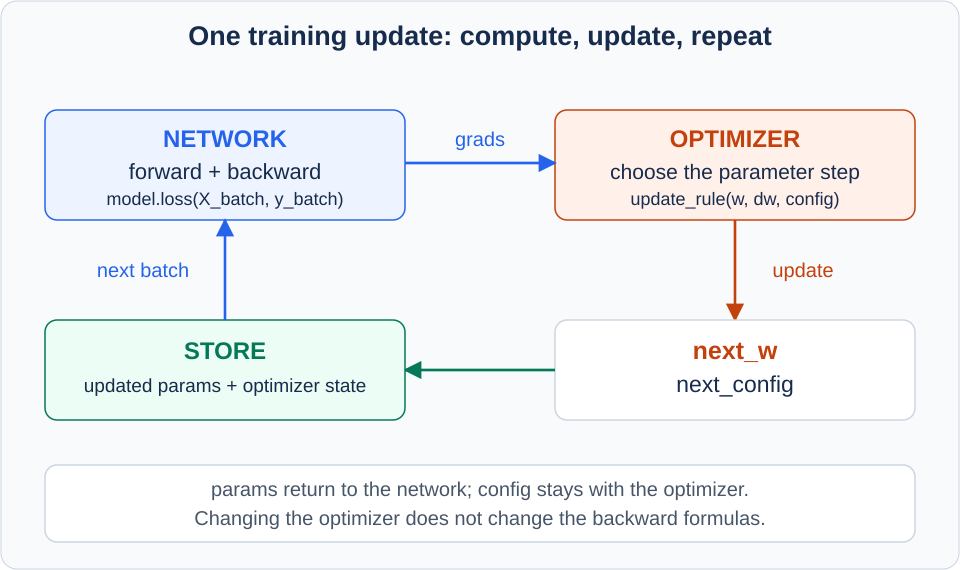
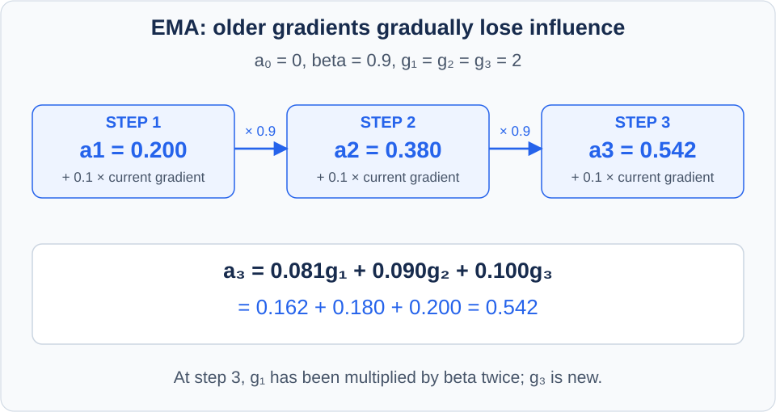
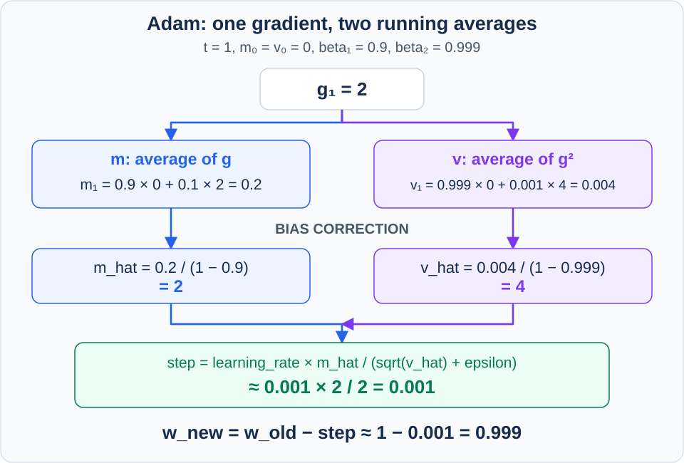

[앞 글](/enpm703-neural-networks-backprop/)에서는 입력으로 score와 loss를 계산하고, 역전파로 `dW`와 `db`를 구했다. 하지만 gradient가 생겼다는 것만으로 weight가 바뀌지는 않는다. <strong>현재 gradient를 받아 실제 parameter를 얼마나, 어느 방향으로 움직일지 정하는 규칙</strong>이 필요하다. 이것이 optimizer다.

두 층 신경망을 여러 층의 `FullyConnectedNet`으로 확장해도 역전파의 기본 원리는 같다. 달라지는 문제는 계산한 gradient를 그대로 따라가는 것만으로 깊은 신경망을 잘 학습시킬 수 있느냐는 것이다. Mini-batch마다 gradient가 흔들리고, parameter마다 변화의 크기도 다르다. Momentum, RMSProp, Adam은 이 업데이트를 개선하는 방법이다.

이 글은 <strong>SGD → Momentum → AdaGrad → RMSProp → Adam</strong> 순서로 이어진다. 읽고 나면 `optim.py`의 계산을 설명하고, `Solver(update_rule="adam")`이 신경망의 어느 부분을 바꾸는지 이해하며, 과제의 optimizer 검사와 학습 실험을 구분할 수 있어야 한다.

## 1. TwoLayerNet에서 FullyConnectedNet으로: 무엇이 늘어났나?

앞 글의 구조는 다음과 같다.

```text
입력 → Affine → ReLU → Affine → Score → Softmax loss
```

Hidden layer가 하나이고, weight를 가진 affine layer는 두 개다. Hidden layer를 두 개로 늘리면:

```text
입력 → Affine → ReLU → Affine → ReLU → Affine → Score → Loss
```

`hidden_dims=[100, 100]`이면 hidden layer가 둘, 마지막 class score용 affine까지 합쳐 <strong>세 층 신경망</strong>이다. 각 층에 `W1, b1`, `W2, b2`, `W3, b3`가 생긴다. Forward는 앞에서부터, backward는 뒤에서부터 반복한다.

중요한 것은 층이 많아져도 아래 두 작업을 구분한다는 점이다.

| 작업 | 질문 | 담당 |
|---|---|---|
| Loss와 gradient 계산 | 지금 parameter에서 예측이 얼마나 틀렸고, 무엇을 바꾸면 loss가 어떻게 변할까? | Network의 forward·backward |
| Parameter update | 계산된 gradient와 이전 기록을 이용해 실제로 얼마나 움직일까? | Optimizer |

<strong>Adam을 사용한다고 affine backward의 `dW = X.T @ dout`이 바뀌지는 않는다.</strong> 그 식으로 구한 `dW`를 weight 변경에 사용하는 방식이 바뀐다.

## 2. 학습 한 번을 세 부분으로 나누기

훈련 중 한 번의 update는 다음 순서다.

```python
loss, grads = model.loss(X_batch, y_batch)  # forward + backward
next_w, config = update_rule(w, dw, config)  # optimizer
# next_w를 모델의 parameter로 저장하고 다음 batch로 반복
```

`model.loss`는 평균 data loss와 필요한 regularization loss를 계산하고, `grads`에 parameter별 gradient를 넣는다. 예를 들어 `grads["W1"]`은 최종 loss의 `W1`에 대한 미분이다. `dw`는 이 중 optimizer가 지금 처리할 parameter의 gradient다.



Network 상자는 <strong>어떻게 미분할지</strong>를, optimizer 상자는 <strong>그 미분값으로 어떻게 움직일지</strong>를 맡는다. 저장한 parameter는 다음 forward에 사용하고, `config`는 다음 optimizer update에 다시 사용한다. `config`를 network의 forward cache와 혼동하지 않도록 두 역할을 나눠 보자.

이 글의 표기를 먼저 정하자.

| 기호·코드 | 뜻 |
|---|---|
| $w_{t-1}$, `w` | t번째 update 직전의 parameter |
| $g_t$, `dw` | 현재 mini-batch loss를 현재 parameter로 미분한 값 |
| $\eta$, `learning_rate` | 업데이트의 전체 크기를 조절하는 learning rate |
| $t$ | 지금까지 수행한 update 횟수. 첫 update는 1 |
| `config` | optimizer의 설정과, 다음 update까지 보존할 상태 |

처음에는 $w$와 $g$를 숫자 하나로 생각하면 된다. 실제 `W1`이 `(3072, 100)`이면 `dw`도 `(3072, 100)`이다. Optimizer의 덧셈·곱셈·제곱·나눗셈은 각 위치에 독립적으로 적용한다. <strong>이 글의 optimizer 식에는 신경망 forward의 행렬곱 `@`가 등장하지 않는다.</strong>

또한 mini-batch 평균 loss의 `1/N`과 L2 항은 network가 gradient를 만들 때 반영한다. Optimizer가 gradient를 다시 batch size로 나누거나 같은 L2 항을 또 더하지 않는다.

## 3. SGD: 지금 gradient의 반대쪽으로 움직이기

Gradient는 parameter를 증가시킬 때 loss가 얼마나 변하는지를 나타낸다. 예를 들어 현재 위치에서:

$$
\frac{\partial L}{\partial w}=2
$$

라면 $w$를 조금 증가시킬 때 loss가 증가하는 방향이다. 반대로 조금 감소시키면 loss를 줄일 수 있다고 예상한다. SGD의 업데이트는:

$$
\boxed{w_t=w_{t-1}-\eta g_t}
$$

$w_0=1$, $g_1=2$, $\eta=0.1$이면:

$$
w_1=1-0.1(2)=0.8.
$$

Gradient가 $-2$였다면 $w_1=1.2$다. <strong>Gradient descent는 weight를 무조건 작게 만드는 것이 아니다.</strong> Loss를 줄일 것으로 예상되는 방향으로 움직이는 것이다.

```python
next_w = w - learning_rate * dw
```

다만 이 예상은 현재 위치 근처에서의 미분에 근거한다. Learning rate가 너무 크면 반대편까지 넘어가 loss를 오히려 키울 수 있다. Mini-batch가 달라지면 loss를 측정하는 데이터도 달라지므로 매 update마다 loss가 반드시 내려가지는 않는다.

여기서 SGD의 stochastic은 전체 데이터 대신 무작위 sample이나 mini-batch로 gradient를 계산한다는 뜻이다. 과제처럼 mini-batch를 쓰는 방식도 보통 SGD라고 부른다.

## 4. 올바른 gradient가 있어도 왜 학습이 답답할까?

수업에서는 SGD의 어려움을 몇 가지로 나눈다.

첫째, <strong>방향마다 loss의 변화가 다르다.</strong> 한 parameter 방향으로는 loss가 급격히 변하고 다른 방향으로는 완만하게 변할 수 있다. 급한 방향에서 튀지 않도록 learning rate를 줄이면, 완만한 방향으로는 진전이 느려질 수 있다.

둘째, <strong>mini-batch마다 gradient가 흔들린다.</strong> 한 batch에서는 오른쪽이 유리하고 다음 batch에서는 왼쪽이 유리하다는 신호가 나올 수 있다. 매번 현재 신호만 따라가면 지그재그로 움직인다.

셋째, <strong>gradient가 매우 작아지는 구간이 있다.</strong> 평평한 구간이나 saddle point(안장점) 근처에서는 한 번의 gradient가 이동 방향을 충분히 알려주지 못할 수 있다. Saddle point는 어떤 방향으로는 올라가고 다른 방향으로는 내려가는 지점이다. Local minimum과 같은 뜻이 아니다.

이 문제들을 풀기 위해 두 가지 아이디어를 도입한다.

1. <strong>최근에 어느 방향으로 움직였는지 기억한다.</strong>
2. <strong>각 parameter가 최근 얼마나 큰 gradient를 받았는지에 따라 이동 크기를 조절한다.</strong>

Momentum은 첫 번째를, RMSProp은 두 번째를 강조한다. Adam은 두 정보를 함께 사용한다.

## 5. Momentum: 현재 gradient만 보지 않고 이동을 이어가기

Momentum은 관성이라는 뜻이다. 이미 움직이던 방향을 어느 정도 유지하면서 현재 gradient를 더한다. 과제 코드의 `velocity`는 <strong>weight에 더할 이동량</strong>을 기억한다.

헷갈리지 않도록 이 이동량을 수식에서는 $u_t$로 쓰자.

$$
u_t=\rho u_{t-1}-\eta g_t
$$

$$
\boxed{w_t=w_{t-1}+u_t}
$$

$\rho$는 이전 이동량을 남기는 비율이다. $\rho=0.9$이면 이전 이동량의 90%를 유지한다. $u_0=0$에서 시작하므로 첫 update는 SGD와 같다.

### 같은 gradient가 이어지는 숫자 예

$w_0=1$, $\eta=0.1$, $\rho=0.9$로 두고, 처음 두 번의 gradient가 모두 $0.2$라고 하자.

$$
u_1=0.9(0)-0.1(0.2)=-0.02,\qquad w_1=0.98
$$

$$
u_2=0.9(-0.02)-0.1(0.2)=-0.038,\qquad w_2=0.942.
$$

SGD였다면 두 번 모두 $0.02$씩 움직여 $w_2=0.96$이다. Momentum에서는 <strong>같은 방향의 신호가 쌓여 두 번째 이동량이 커졌다.</strong>

### Gradient 방향이 갑자기 바뀌면?

세 번째 gradient가 $-0.2$라고 하자.

$$
u_3=0.9(-0.038)-0.1(-0.2)=-0.0142.
$$

현재 gradient만 보면 weight를 늘리는 것이 맞지만, 이전의 음수 이동량이 남아 있어 이번에는 여전히 조금 감소한다. 따라서 Momentum은 <strong>무조건 현재 gradient의 반대 방향으로만 움직이는 규칙은 아니다.</strong> 일관된 방향은 강화하고 짧게 반전되는 신호는 완화한다. 이 기억이 도움이 될 때도 있고, 최적점 근처에서 지나쳐 가게 할 때도 있다.

현재 gradient가 정확히 0이어도 이전 이동량이 남아 있으면 움직일 수 있다. 그러나 이전 이동량도 0이면 움직이지 않는다. Momentum이 모든 안장점이나 local minimum을 반드시 탈출시킨다는 보장은 없다.

### 과제 인터페이스로 구현하기

아래 함수들은 `import numpy as np`를 전제로 하며 `next_w, config`를 반환한다. `config`에는 hyperparameter와 다음 update에 쓸 기록이 함께 들어간다.

```python
def sgd_momentum(w, dw, config=None):
    if config is None:
        config = {}
    lr = config.setdefault("learning_rate", 1e-2)
    rho = config.setdefault("momentum", 0.9)
    velocity = config.get("velocity", np.zeros_like(w))

    velocity = rho * velocity - lr * dw
    next_w = w + velocity

    config["velocity"] = velocity
    return next_w, config
```

`np.zeros_like(w)`는 weight와 같은 shape의 0 배열을 만든다. 모든 weight 성분이 자기 이동량을 하나씩 가진다. `config`를 매번 새로 만들면 `velocity`가 0으로 돌아가므로 Momentum의 기억이 사라진다.

<details class="review-answer"><summary>슬라이드에는 gradient를 더하고, 코드에는 빼는 이유</summary>
<div class="review-answer-body">

슬라이드에서는 gradient의 누적값을 $q$라고 생각하면 다음과 같다.

$$
q_t=\rho q_{t-1}+g_t,\qquad w_t=w_{t-1}-\eta q_t.
$$

과제에서는 learning rate와 음수 부호가 들어간 이동량을 `velocity`에 저장한다. Learning rate가 고정되어 있다면 $u_t=-\eta q_t$로 놓아 두 식을 연결할 수 있다. 변수에 <strong>gradient의 누적값</strong>을 저장하는지, <strong>실제 이동량</strong>을 저장하는지를 먼저 확인해야 부호를 잘못 뒤집지 않는다. Learning rate를 중간에 바꿀 때는 두 상태를 같은 값처럼 섞어 쓰지 않는다.

</div></details>

## 6. 이동평균: 과거를 조금씩 잊는 계산

Adam을 읽으려면 exponential moving average, 즉 <strong>지수이동평균</strong>을 이해해야 한다. 현재 gradient를 $g_t$, 기억할 값을 $a_t$라고 하면:

$$
a_t=\beta a_{t-1}+(1-\beta)g_t.
$$

기억 비율은 $0\leq\beta<1$로 둔다. $\beta=0.9$이면 이전 기록의 90%와 현재 값의 10%를 섞는다. $a_0=0$, $g_1=g_2=2$이면:

$$
a_1=0.9(0)+0.1(2)=0.2
$$

$$
a_2=0.9(0.2)+0.1(2)=0.38.
$$

두 번째 식을 펼쳐 보면:

$$
a_2=0.09g_1+0.1g_2.
$$

첫 값의 계수는 $0.1$에서 $0.09$로 줄었다. 다음 update에서는 $0.081$이 된다. <strong>오래된 값은 곱해지는 $\beta$가 많아질수록 영향이 작아진다.</strong> 이것이 이전 값 전부를 같은 비중으로 더하는 단순 누적과 다른 점이다.



화살표의 `×0.9`는 <strong>이전 기록을 남기는 비율</strong>이고, 각 상자의 `+0.1 × current gradient`는 새 정보를 더하는 항이다. 세 번째 값의 계산에서 같은 숫자 2라도 오래된 $g_1$은 $0.081$, 새 $g_3$는 $0.1$의 계수를 받는다. 초기값이 0이므로 초반 이동평균이 관측값 2보다 작은 현상은 10절의 bias correction으로 이어진다.

$\beta$가 클수록 과거를 오래 기억하고 새 변화에 느리게 반응한다. 작을수록 현재 gradient에 빠르게 반응한다. 앞 절의 Momentum 코드에는 현재 gradient 앞에 `1-rho`가 없었다. 둘 다 과거를 감쇠해 누적하지만 저장값의 스케일은 다르므로 식의 계수를 그대로 혼용하지 않는다.

그리고 이 평균은 <strong>sample 축을 평균내는 것이 아니다.</strong> 현재 mini-batch에서 구한 gradient를, 이전 update들의 gradient와 시간 방향으로 섞는 것이다.

## 7. AdaGrad: 각 parameter의 gradient 크기를 따로 기억하기

이제 방향의 기억과 별개로, parameter마다 다른 크기로 움직이는 방법을 보자. AdaGrad는 각 parameter가 지금까지 받은 gradient의 제곱을 누적한다.

$$
r_t=r_{t-1}+g_t^2
$$

$$
w_t=w_{t-1}-\eta\frac{g_t}{\sqrt{r_t}+\epsilon}.
$$

제곱·제곱근·나눗셈은 모두 성분별 연산이다. $\epsilon$은 분모가 0이 되지 않도록 넣는 작은 양수다. 제곱을 쓰는 이유는 양수·음수 gradient가 크기의 기록에서 상쇄되지 않게 하기 위해서다.

어떤 parameter가 계속 큰 gradient를 받았다면 $r$이 커져 그 parameter의 업데이트를 더 강하게 나눈다. 작은 gradient를 받아 왔다면 상대적으로 덜 나눈다. <strong>모든 parameter에 같은 learning rate를 지정하더라도, 실제 적용되는 배율이 parameter마다 달라진다.</strong>

```python
cache += dw * dw
next_w = w - learning_rate * dw / (np.sqrt(cache) + epsilon)
```

하지만 `cache`에는 음수가 아닌 값만 계속 더해진다. 예를 들어 매번 $g_t=2$라면 $r_t=4t$이므로, $\epsilon$을 무시했을 때 업데이트 크기는:

$$
\eta\frac{2}{\sqrt{4t}}=\frac{\eta}{\sqrt t}.
$$

같은 gradient가 계속 와도 이동량이 줄어든다. 이런 누적이 유용한 경우도 있지만, 신경망 학습에서는 일찍부터 움직임이 너무 작아지는 문제가 생길 수 있다. 이 문제를 보려면 <strong>분자뿐 아니라 분모에 무엇이 쌓이는지</strong> 읽어야 한다.

## 8. RMSProp: 제곱 gradient를 끝없이 더하지 않기

RMSProp은 AdaGrad의 누적 제곱합을 지수이동평균으로 바꾼다.

$$
r_t=\rho r_{t-1}+(1-\rho)g_t^2
$$

$$
\boxed{w_t=w_{t-1}-\eta\frac{g_t}{\sqrt{r_t}+\epsilon}}.
$$

이전 기록에는 $\rho$를 곱하므로 오래된 gradient의 영향은 줄어든다. 일정한 gradient가 계속된다면 $r_t$는 그 제곱값에 가까워진다. AdaGrad처럼 그 값이 시간에 비례해 끝없이 커지는 구조가 아니다.

RMS는 root mean square의 약자다. Gradient를 제곱해 평균낸 뒤 제곱근을 취하므로, 대략 <strong>최근 gradient의 크기를 나타내는 척도</strong>로 나눈다고 이해할 수 있다. 여기서 $r$은 variance(분산)가 아니다. 평균을 빼고 제곱한 값이 아니라 <strong>gradient 자체를 제곱한 값의 평균</strong>이다.

### Parameter 두 개의 크기 조절 비교

어떤 시점에 두 parameter의 제곱평균이 이미 다음과 같이 계산되었다고 하자.

$$
r=[100,1],\qquad g=[2,2],\qquad\eta=0.1.
$$

$\epsilon$을 무시한 이동량은:

$$
-0.1\frac{[2,2]}{[10,1]}=[-0.02,-0.2].
$$

현재 gradient는 같지만, 최근 큰 gradient를 받아 온 첫 parameter는 적게 움직인다. 이것이 <strong>좌표별 adaptive scaling</strong>이다. 이 예의 $r$은 0에서 시작한 첫 update의 값이 아니라, 과거 기록이 반영된 현재 상태다.

### 코드와 cache

```python
def rmsprop(w, dw, config=None):
    if config is None:
        config = {}
    lr = config.setdefault("learning_rate", 1e-2)
    rho = config.setdefault("decay_rate", 0.99)
    eps = config.setdefault("epsilon", 1e-8)
    cache = config.get("cache", np.zeros_like(w))

    cache = rho * cache + (1 - rho) * (dw * dw)
    next_w = w - lr * dw / (np.sqrt(cache) + eps)

    config["cache"] = cache
    return next_w, config
```

이 `cache`는 optimizer가 다음 update에 쓸 <strong>과거 제곱 gradient의 기록</strong>이다. 앞 글의 affine cache처럼 backward에 필요한 forward 입력을 저장하는 것과는 역할이 다르다.

또한 RMSProp이 항상 SGD보다 작은 이동량을 만든다는 뜻은 아니다. 분모가 1보다 작으면 같은 gradient와 learning rate에서 이동량이 더 커질 수도 있다. Adaptive라는 말은 적응해서 조절한다는 뜻이며, 무조건 줄인다는 뜻은 아니다.

## 9. Adam: 방향의 기억과 크기의 기억을 함께 사용하기

Adam은 <strong>adaptive moment estimation</strong>에서 온 이름이다. 이름을 외우기 전에 어떤 두 값을 기억하는지 보자.

### 첫 번째 기록: gradient의 이동평균 m

$$
m_t=\beta_1m_{t-1}+(1-\beta_1)g_t.
$$

$m_t$는 부호를 가진 gradient를 평균낸다. 같은 방향이 반복되면 그 방향이 남고, 반대 방향의 신호는 상쇄될 수 있다. <strong>어느 방향의 신호가 이어지고 있는가?</strong>를 담는다.

### 두 번째 기록: 제곱 gradient의 이동평균 v

$$
v_t=\beta_2v_{t-1}+(1-\beta_2)g_t^2.
$$

$v_t$는 제곱을 평균내므로 성분마다 음수가 아니다. <strong>최근 gradient가 얼마나 큰 규모로 들어왔는가?</strong>를 담는다. 평균을 뺀 제곱을 누적하지 않으므로 이것도 분산 자체가 아니라 second raw moment(2차 원시 모멘트)의 추정값이다.

모멘트라는 용어는 여기서 평균에 해당하는 첫 번째 기록과, 제곱의 평균에 해당하는 두 번째 기록을 가리킨다. 별도의 역전파를 두 번 수행한다는 뜻이 아니다. <strong>현재 gradient 한 번으로 m과 v를 각각 갱신한다.</strong>

표기에도 주의하자. Momentum 코드의 `velocity`는 이동량이었고, <strong>Adam 코드의 `v`는 제곱 gradient의 이동평균</strong>이다. 같은 글자처럼 보여도 역할이 다르다.

## 10. 왜 bias correction이 필요한가?

Adam의 상태는 $m_0=0$, $v_0=0$에서 시작한다. 아직 관측한 gradient가 없기 때문이다. 그러나 이 초기 0이 이동평균을 초반에 0 쪽으로 끌어당긴다.

첫 gradient가 2이고 $\beta_1=0.9$, $\beta_2=0.999$라고 하자.

$$
m_1=0.9(0)+0.1(2)=0.2
$$

$$
v_1=0.999(0)+0.001(2^2)=0.004.
$$

지금까지 관측한 값은 2 하나뿐인데, gradient의 평균 기록은 0.2다. 제곱값은 4 하나뿐인데 제곱평균 기록은 0.004다. <strong>계수가 작은 새 값과, 실제 관측이 아닌 초기 0을 섞었기 때문</strong>이다.

Adam은 다음 값으로 이 초기화 편향을 보정한다. Hat은 여기서 보정한 값이라는 표기다.

$$
\widehat m_t=\frac{m_t}{1-\beta_1^t},\qquad
\widehat v_t=\frac{v_t}{1-\beta_2^t}.
$$

첫 update에서는:

$$
\widehat m_1=\frac{0.2}{0.1}=2,\qquad
\widehat v_1=\frac{0.004}{0.001}=4.
$$

여기서 <strong>bias는 affine layer의 bias b와 관계없다.</strong> 통계적 추정이 초기 0 쪽으로 치우친다는 의미다. 따라서 bias parameter `b1`을 수정하거나 제거하는 연산이 아니다.

<details class="review-answer"><summary>왜 보정 분모가 1 − βᵗ일까?</summary>
<div class="review-answer-body">

초기값이 0인 이동평균을 펼치면:

$$
m_t=(1-\beta_1)\sum_{k=1}^{t}\beta_1^{t-k}g_k.
$$

지금까지 들어온 gradient들에 붙은 계수의 합은 등비수열의 합으로:

$$
(1-\beta_1)(1+\beta_1+\cdots+\beta_1^{t-1})=1-\beta_1^t.
$$

초반에는 계수 합이 1보다 작다. 이를 나누면 관측한 값들에 붙은 계수 합이 1이 된다. 일정한 gradient가 들어오는 예에서는 그 값 자체가 복원된다. Gradient의 평균이 일정하다고 가정하면 초기화로 인한 평균 추정의 편향도 이렇게 보정된다. 실제 gradient가 시간에 따라 달라질 때 과거의 가중평균이 현재 gradient와 항상 같아지는 것은 아니다.

제곱 gradient의 $v_t$에도 같은 논리를 적용하되 $\beta_2$를 쓴다.

</div></details>

### 보정은 첫 번째 update에서만 할까?

아니다. <strong>매 update마다 현재 t로 계산한다.</strong> $\beta^t$가 작아질수록 분모가 1에 가까워져 보정의 영향이 줄어든다. 얼마나 빨리 줄어드는지는 beta에 달려 있다.

예를 들어 $0.999^{50}\approx0.9512$이므로 50번째 update에서도 $1-0.999^{50}\approx0.0488$이다. 분모가 벌써 1에 가깝다고 가정하면 안 된다. `t`를 계속 늘려야 하는 이유다.

## 11. Adam 업데이트 한 번을 끝까지 계산하기

이제 두 보정값을 사용해 weight를 바꾼다.

$$
\boxed{w_t=w_{t-1}-\eta\frac{\widehat m_t}{\sqrt{\widehat v_t}+\epsilon}}.
$$

분자는 방향을 기억하고, 분모는 좌표별 규모를 조절한다. $w_0=1$, $\eta=0.001$, 첫 gradient가 2라면 앞 절의 값으로:

$$
w_1=1-0.001\frac{2}{\sqrt4+\epsilon}\approx0.999.
$$

$\epsilon=10^{-8}$은 이 예의 분모 2에 비해 매우 작으므로 근사에서 생략했다. Gradient가 2라고 해서 SGD처럼 곧바로 $0.002$를 빼는 것이 아니다. 제곱평균의 제곱근으로 나눈 값이 실제 update에 들어간다.



파란 경로는 <strong>gradient의 방향</strong>, 보라 경로는 <strong>제곱 gradient의 규모</strong>를 기억한다. 두 경로가 합쳐질 때 더하는 것이 아니라, 보정한 방향을 보정한 규모의 제곱근으로 나눈다. 그림의 `step`에는 learning rate가 이미 곱해져 있으므로 마지막에는 `w_old - step`만 계산한다.

같은 gradient 2가 한 번 더 들어오면:

| 값 | 첫 update t=1 | 두 번째 update t=2 |
|---|---:|---:|
| $m_t$ | 0.2 | 0.38 |
| $v_t$ | 0.004 | 0.007996 |
| $\widehat m_t$ | 2 | 2 |
| $\widehat v_t$ | 4 | 4 |
| Weight에서 빼는 크기, $\epsilon$ 무시 | 0.001 | 0.001 |

두 번째 보정은 $0.38/(1-0.9^2)=2$, $0.007996/(1-0.999^2)=4$다. 따라서 $w_2\approx0.998$이다. 이 예는 계산 원리를 보기 위해 같은 gradient가 계속 들어온다고 놓은 것이다. 실제 network에서는 weight와 batch가 달라져 gradient도 달라진다.

보정을 생략하면 첫 update의 크기는:

$$
0.001\frac{0.2}{\sqrt{0.004}}\approx0.003162.
$$

위 설정에서는 보정한 경우보다 약 3.16배 크다. 초기의 두 추정값이 서로 다른 비율로 작아지므로, 비율을 취한다고 그 편향이 자동으로 없어지지 않는다. 과제에서 <strong>complete Adam, including bias correction</strong>을 요구하는 이유다.

그렇다고 Adam이 항상 gradient의 크기를 완전히 없애거나 update를 항상 learning rate와 같게 만드는 것은 아니다. 위 결과는 같은 부호·크기의 gradient가 이어진 특별히 단순한 예다.

## 12. optim.py의 Adam 구현 읽기

아래는 보정된 $\widehat m$, $\widehat v$를 명시적으로 계산하는 형태다. 과제의 `w, dw, config` 인터페이스에 맞춰 사용할 수 있다.

```python
def adam(w, dw, config=None):
    if config is None:
        config = {}
    lr = config.setdefault("learning_rate", 1e-3)
    beta1 = config.setdefault("beta1", 0.9)
    beta2 = config.setdefault("beta2", 0.999)
    eps = config.setdefault("epsilon", 1e-8)
    m = config.get("m", np.zeros_like(w))
    v = config.get("v", np.zeros_like(w))
    t = config.get("t", 0) + 1

    m = beta1 * m + (1 - beta1) * dw
    v = beta2 * v + (1 - beta2) * (dw * dw)
    m_hat = m / (1 - beta1 ** t)
    v_hat = v / (1 - beta2 ** t)
    next_w = w - lr * m_hat / (np.sqrt(v_hat) + eps)

    config["m"] = m
    config["v"] = v
    config["t"] = t
    return next_w, config
```

`config.setdefault(key, default)`는 그 설정이 이미 있으면 기존 값을 사용하고, 없으면 기본값을 넣는다. `get`은 이전 상태가 있으면 그것을 읽고, 없으면 초기값을 사용한다.

코드는 다음 다섯 일을 순서대로 한다.

1. <strong>t를 1 늘린다.</strong> 첫 update에서는 `t=1`이어야 한다. `t=0`으로 보정하면 분모가 0이다.
2. <strong>보정 전 m과 v를 갱신한다.</strong> 현재 `dw`를 각 이동평균에 반영한다.
3. <strong>현재 t로 m_hat과 v_hat을 계산한다.</strong>
4. <strong>보정된 방향과 규모로 weight를 갱신한다.</strong>
5. <strong>보정 전 m, v와 t를 저장한다.</strong> 보정값을 원래 기록에 덮어쓰지 않는다.

`m`, `v`, `dw`, `w`는 모두 같은 shape다. `t`는 배열 성분마다 따로 세는 값이 아니라, 해당 parameter 배열이 받은 update 횟수를 나타내는 정수다. 제곱은 `dw * dw` 또는 `dw ** 2`이며 `dw @ dw`가 아니다.

기본값 $\beta_1=0.9$, $\beta_2=0.999$, learning rate $10^{-3}$은 시작점으로 사용할 수 있다. 하지만 모델·입력 스케일·batch 구성에 따라 적절한 learning rate는 달라진다. <strong>Adaptive optimizer에도 learning rate 선택은 필요하다.</strong>

<details class="review-answer"><summary>과제 코드에서 보정 계수를 alpha에 모으는 이유</summary>
<div class="review-answer-body">

보정 계수를 learning rate 쪽으로 모으면 아래 계산이 나온다.

```python
alpha = lr * np.sqrt(1 - beta2 ** t) / (1 - beta1 ** t)
next_w = w - alpha * m / (np.sqrt(v) + eps)
```

별도의 `m_hat`, `v_hat`을 만들지 않았어도 <strong>alpha 안의 거듭제곱 항이 bias correction을 반영한다.</strong> 다만 epsilon까지 엄밀하게 같은 식이 되려면 위 코드의 `eps`는 명시적 보정식의 epsilon에 `sqrt(1-beta2**t)`를 곱한 값이어야 한다. 같은 epsilon 상수를 그대로 쓰면 아주 작은 분모에서 수치 차이가 생길 수 있다.

식과 코드를 비교할 때는 보정 여부뿐 아니라 epsilon의 위치도 확인한다. 앞의 명시적 구현은 보정된 분모에 epsilon을 더하는 형태로 일관되게 작성했다.

</div></details>

## 13. Solver는 parameter마다 다른 기억을 보존한다

Adam 상태를 `W1`과 `W2`가 함께 써도 될까? 안 된다. Shape가 다를 수 있고, 각 parameter가 받은 gradient의 이력도 다르다. `b1`, `b2`에도 각각 상태가 필요하다.

`Solver`의 핵심 흐름은 다음과 같다.

```python
loss, grads = self.model.loss(X_batch, y_batch)

for name, w in self.model.params.items():
    dw = grads[name]
    config = self.optim_configs[name]
    next_w, next_config = self.update_rule(w, dw, config)
    self.model.params[name] = next_w
    self.optim_configs[name] = next_config
```

`self.optim_configs["W1"]`은 `W1` 전용 상태다. 그 안의 `m`, `v`는 `W1`과 같은 shape다. 다음 batch에서는 <strong>새 gradient와 지난 batch까지 누적된 이 상태</strong>를 함께 사용한다.

한 batch에서 `W1`, `b1`, `W2`, `b2`를 각각 한 번씩 갱신하면 각자의 `t`가 1씩 증가한다. Parameter가 네 개라고 `W1`의 `t`를 한 batch에 4 증가시키는 것이 아니다.

이 구조 덕분에:

```python
update_rule="sgd"
```

를:

```python
update_rule="adam"
```

으로 바꿔도 network의 forward·backward 코드를 다시 작성하지 않는다. Solver가 같은 `grads`를 다른 update 함수로 보낸다.

### 무엇이 바뀌는지 한 번에 비교하기

| 방법 | 다음 update까지 기억할 것 | 방향에 사용하는 값 | 크기 조절 |
|---|---|---|---|
| SGD | 별도 gradient 이력 없음 | 현재 gradient | 전체 learning rate |
| Momentum | `velocity` | 과거 이동량 + 현재 gradient | 전체 learning rate와 누적 이동량 |
| AdaGrad | gradient 제곱의 누적합 | 현재 gradient | 누적 제곱합의 제곱근으로 나눔 |
| RMSProp | gradient 제곱의 이동평균 | 현재 gradient | 최근 제곱평균의 제곱근으로 나눔 |
| Adam | `m`, `v`, `t` | 보정한 gradient 이동평균 | 보정한 제곱평균의 제곱근으로 나눔 |

Adam의 상태가 두 배열인 이유는 두 번의 신경망이 필요해서가 아니라, <strong>방향과 크기의 이력을 따로 저장하기 때문</strong>이다.

## 14. FullyConnectedNets 과제를 어떤 순서로 읽을까?

Notebook은 여러 종류의 작업을 한 파일에 담고 있다. 목적을 구분하면 필요한 코드를 찾기 쉬워진다.

### 첫째: network 자체가 맞는지 확인한다

임의 개수 hidden layer의 초기화·forward·backward를 먼저 연결한다. 마지막 layer에는 ReLU를 붙이지 않고 class score를 낸다. Loss와 regularization을 포함한 gradient가 맞는지 작은 입력으로 확인한다.

이 단계는 <strong>미분이 맞는가?</strong>를 묻는다. Optimizer를 바꿔도 잘못된 gradient가 올바른 미분으로 바뀌지는 않는다.

### 둘째: 작은 데이터에 충분히 맞출 수 있는지 본다

Notebook은 50개 이미지로 세 층·다섯 층 신경망을 훈련해 보게 한다. 목적은 validation accuracy를 높이는 것이 아니라, <strong>모델과 학습 코드가 작은 훈련 집합에 맞출 능력이 있는지</strong> 확인하는 것이다.

여기서 `weight_scale`은 최초 weight 분포의 크기, `learning_rate`는 매 update의 크기다. 둘은 다른 hyperparameter다. 깊이가 늘면 forward·backward에서 곱해지는 weight와 activation이 많아지므로 초기 scale의 영향도 달라질 수 있다. Adam으로 바꿨다고 부적절한 초기화 문제가 자동으로 해결되지는 않는다.

훈련 정확도 100%는 이 작은 집합을 잘 맞췄다는 의미다. 새로운 데이터도 잘 맞힌다는 의미는 아니다.

### 셋째: optimizer 함수의 상태 전이를 검사한다

`sgd_momentum`, `rmsprop`, `adam` 검사 셀은 정해진 `w`, `dw`, 이전 상태를 넣고 <strong>한 번 업데이트한 next_w와 새 상태</strong>를 예상값과 비교한다. 여기서는 CIFAR-10 학습 전체를 돌릴 필요가 없다.

Adam 검사는 이미 `t=5`인 config를 넘긴다. 그렇다면 이번 계산은 6번째 update다. 기존 `m`, `v`도 무시하고 0으로 초기화하면 안 된다.

### 넷째: 학습에서 update rule을 비교한다

SGD와 Momentum을 비교하고, RMSProp과 Adam을 비교한다. 이때는 같은 구조라도 learning rate가 다르면 곡선이 달라진다. 특정 실험 한 번으로 어느 optimizer가 항상 우수하다고 결론 내리지는 않는다.

공정하게 효과를 비교하려면 같은 데이터 분할·초기 parameter·batch 조건을 사용하고, learning rate 선택도 함께 고려해야 한다. 과제의 기본 실험은 동작과 차이를 관찰하는 출발점으로 읽는다.

### 다섯째: 검증 성능으로 설정을 고른다

훈련 성능이 올라가는지와 별개로 validation 성능을 확인한다. 최종 모델을 고르기 위한 판단에는 validation set을 쓰고, test set을 반복해서 보며 설정을 선택하지 않는다.

Adam을 사용해 학습하는 연결 예는 다음과 같다. 앞에서 정의한 함수들은 `cs231n/optim.py`에 두고, `FullyConnectedNet`, `Solver`, 전처리된 `data`가 준비된 문맥이다.

```python
model = FullyConnectedNet(
    [100, 100],
    weight_scale=5e-2,
    reg=1e-3,
    dtype=np.float32,
)

solver = Solver(
    model,
    data,
    update_rule="adam",
    optim_config={"learning_rate": 1e-3},
    lr_decay=0.95,
    num_epochs=15,
    batch_size=100,
    print_every=100,
)
solver.train()
```

이 코드는 두 hidden layer의 network에 Adam을 연결하는 예다. Hidden 크기와 epoch 수는 실험 설정이며 특정 정확도를 보장하지 않는다. `optim_config`에 생략한 beta와 epsilon은 `adam` 함수의 기본값을 사용한다.

## 15. Adam을 써도 learning rate를 줄일까?

Adam의 adaptive scaling과 learning rate schedule은 서로 다른 계산이다.

- <strong>Adaptive scaling:</strong> 지금까지 받은 gradient를 이용해 parameter 성분별로 배율을 조절한다.
- <strong>Learning rate schedule:</strong> 학습 시간에 따라 전체 learning rate를 바꾼다.

따라서 두 방법을 함께 사용할 수 있다. 위 Solver에서 `lr_decay=0.95`이면 epoch 경계에서 각 parameter의 learning rate에 0.95를 곱한다. 예를 들어:

$$
0.001\ \longrightarrow\ 0.00095\ \longrightarrow\ 0.0009025.
$$

이 과제의 `lr_decay`는 매 mini-batch마다 적용하는 것이 아니다. 또한 Adam의 `beta1`, `beta2`와 같은 의미도 아니다. Beta는 <strong>기억을 얼마나 남기는가</strong>, learning rate는 <strong>전체 update를 얼마나 크게 하는가</strong>를 조절한다.

훈련 곡선은 다음처럼 읽는다.

| 관찰 | 먼저 생각할 것 |
|---|---|
| Loss가 폭증하거나 NaN이 나온다 | Learning rate, 입력 scale, 수치 안정성과 구현 오류 |
| Loss가 조금씩만 변한다 | Learning rate가 너무 작은지, gradient와 상태가 제대로 전달되는지 |
| Train accuracy는 높고 validation accuracy는 낮다 | 과적합과 일반화 문제. Optimizer만으로 해결되는지 단정하지 않기 |
| Batch마다 loss가 위아래로 흔들린다 | Mini-batch의 차이도 있으므로 전체 추세와 함께 해석 |

Learning rate를 무조건 줄이는 것이 모든 상황의 해결책은 아니다. 먼저 무엇이 잘못되었는지 구분해야 한다.

## 16. Batch normalization과 convolution은 어디에 들어갈까?

Optimizer까지 이해하면 서로 다른 세 질문을 나눌 수 있다.

| 개념 | 바꾸는 것 | 중심 질문 |
|---|---|---|
| Fully connected / convolution | 입력으로 특징을 계산하는 연결 구조 | 무엇을 어떻게 연결해 표현할까? |
| SGD / Momentum / Adam | gradient로 parameter를 갱신하는 규칙 | 계산된 gradient를 어떻게 사용할까? |
| Batch normalization | network 내부 activation을 변환하는 연산 | 중간 값의 규모를 어떻게 조절하며 학습할까? |

Convolution을 구현해야만 Adam을 이해할 수 있는 것은 아니다. 이미 이해한 fully connected network에 Adam을 붙여 공부할 수 있다. Batch normalization도 fully connected layer 사이에 넣어 볼 수 있으므로, 다음에는 <strong>중간 activation의 평균·분산·shape와 training/inference의 차이</strong>를 중심으로 이어갈 수 있다.

Adam의 제곱 gradient 기록을 batch normalization의 activation 분산과 혼동하지 않는 것이 중요하다. Adam은 optimizer의 과거 gradient 상태를 다루고, batch normalization은 network 안에서 중간 값을 변환하며 backward에도 참여한다.

## 17. 스스로 확인할 문제

### 문제 1. Adam을 쓰면 dW 공식도 바뀔까?

Affine layer의 `dw = x_flat.T @ dout`을 Adam 전용 식으로 바꿔야 할까? `Solver`에서는 무엇이 달라지는가?

<details class="review-answer"><summary>정답과 해설 펼치기</summary>
<div class="review-answer-body">

Affine의 미분식은 그대로다. `model.loss`가 같은 방식으로 `grads`를 만들고, Solver가 선택한 update 함수로 넘긴다. Adam은 그 gradient와 저장된 `m`, `v`, `t`로 `next_w`를 계산한다. Network 구조와 optimizer의 역할을 구분해야 한다.

</div></details>

### 문제 2. Momentum의 두 번째 이동량

$u_0=0$, $\eta=0.1$, $\rho=0.9$, $g_1=g_2=0.2$다. $u_1$, $u_2$를 구하라. SGD의 두 번째 이동량과 어떻게 다른가?

<details class="review-answer"><summary>정답과 해설 펼치기</summary>
<div class="review-answer-body">

$$
u_1=-0.02,\qquad u_2=0.9(-0.02)-0.02=-0.038.
$$

SGD라면 두 번째 이동량도 $-0.02$다. Momentum에서는 이전 이동량의 90%가 남아 같은 방향의 현재 이동량과 더해진다. `w += velocity`를 쓸 때 `velocity`에 이미 음수 부호와 learning rate가 들어 있다는 점에 주의한다.

</div></details>

### 문제 3. 이동평균은 batch 평균일까?

Adam의 `m = beta1 * m + (1 - beta1) * dw`에서 섞이는 두 값은 각각 무엇인가? `dw`를 다시 batch size로 나눠야 할까?

<details class="review-answer"><summary>정답과 해설 펼치기</summary>
<div class="review-answer-body">

이전 update까지의 gradient 이동평균과 현재 update의 gradient를 섞는다. 시간 방향의 기록이다. Network가 이미 평균 mini-batch loss를 미분했다면 `dw`에는 그 평균이 반영되어 있으므로 optimizer에서 다시 나누지 않는다.

</div></details>

### 문제 4. AdaGrad의 이동량이 작아지는 이유

매 update마다 $g_t=2$이고 누적 제곱합의 초기값은 0이다. $\epsilon$을 무시하면 t번째 이동량의 크기는 얼마인가? RMSProp도 똑같이 줄어들까?

<details class="review-answer"><summary>정답과 해설 펼치기</summary>
<div class="review-answer-body">

AdaGrad는 $r_t=4t$이므로 이동량 크기가 $\eta/\sqrt t$다. RMSProp은 오래된 기록을 감쇠하며 $r_t$가 일정한 gradient의 제곱 4에 가까워진다. 같은 gradient가 이어지는 이 예에서는 이동량이 대략 $\eta$에 가까워진다. 다만 실제 학습의 gradient와 learning rate가 바뀔 때까지 항상 같은 이동량이라는 뜻은 아니다.

</div></details>

### 문제 5. Adam의 첫 update

$w_0=1$, $g_1=2$, $\eta=0.001$, $\beta_1=0.9$, $\beta_2=0.999$다. $m_1$, $v_1$, 보정값, $w_1$을 계산하라. $\epsilon$은 무시한다.

<details class="review-answer"><summary>정답과 해설 펼치기</summary>
<div class="review-answer-body">

$$
m_1=0.2,\quad v_1=0.004,\quad\widehat m_1=2,\quad\widehat v_1=4.
$$

따라서 $w_1=1-0.001(2/2)=0.999$다. `v`는 음수가 아닌 제곱평균이며 이동량이 아니다. Bias correction은 affine bias가 아니라 초기 0의 영향을 보정한다.

</div></details>

### 문제 6. 어떤 상태를 저장해야 할까?

아래 코드에는 두 문제가 있다. 무엇을 고쳐야 할까?

```python
t = config.get("t", 0)
m_hat = m / (1 - beta1 ** t)
config["m"] = m_hat
```

<details class="review-answer"><summary>정답과 해설 펼치기</summary>
<div class="review-answer-body">

첫 update에서 `t=0`이면 보정 분모가 0이므로 현재 update 횟수로 1 증가시킨 뒤 계산해야 한다. 또 `config["m"]`에는 보정 전 이동평균 `m`을 저장해야 한다. 다음 update에서 다시 이동평균을 계산할 원래 상태에 보정값을 덮어쓰면 다른 알고리즘이 된다. `v`도 같은 원칙이다.

</div></details>

### 문제 7. State의 shape와 공유

`W1.shape == (3072, 100)`, `W2.shape == (100, 10)`이다. Adam의 `m`, `v`는 각자 어떤 shape인가? 두 parameter가 하나의 config를 공유해도 될까?

<details class="review-answer"><summary>정답과 해설 펼치기</summary>
<div class="review-answer-body">

`W1`의 `m`, `v`는 `(3072, 100)`, `W2`의 것은 `(100, 10)`이다. 각 성분의 gradient 이력을 기억하므로 parameter별 config가 필요하다. Shape가 우연히 같아도 다른 parameter의 이력을 섞으면 안 된다. 각 parameter가 batch마다 한 번씩 update된다면 각각의 `t`는 batch마다 1 증가한다.

</div></details>

### 문제 8. 작은 데이터에 train accuracy 100%라면?

50개 훈련 이미지에 100% accuracy를 얻었지만 validation accuracy는 낮다. Adam 구현이 완벽하거나 모델의 일반화가 좋다는 뜻일까?

<details class="review-answer"><summary>정답과 해설 펼치기</summary>
<div class="review-answer-body">

그 작은 훈련 집합에 맞출 수 있다는 증거다. Optimizer의 정확한 상태 전이는 별도의 고정 입력 검사로, network gradient는 gradient check로 확인한다. 일반화 성능은 validation 데이터로 따로 평가해야 한다. 작은 데이터에 일부러 과적합하는 실험의 목적과 최종 모델 선택의 목적을 구분한다.

</div></details>

다음 글: [Batch Normalization — 평균·분산에서 역전파와 LayerNorm까지](/enpm703-batch-normalization/)

## 참고 자료

- ENPM703, Module 07a — Training Neural Networks, Part 1: Optimizers, Learning Rate Decay; Module 07b — Training Neural Networks, Part 2: Choosing Hyperparameters.
- ENPM703, 2026년 10월 15일 수업; `FullyConnectedNets.ipynb`, `optim.py`, `solver.py`.
- Kingma & Ba, [Adam: A Method for Stochastic Optimization](https://arxiv.org/abs/1412.6980), Algorithm 1.
