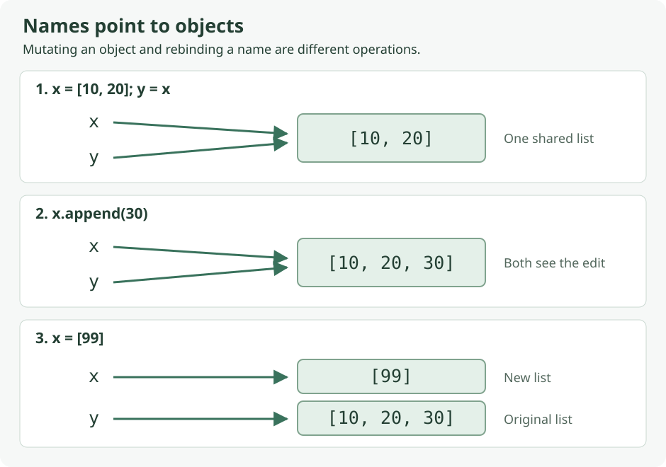

Python에서 `x = 5`는 무엇을 저장하는 코드일까? `5 and 2`가 왜 `True`가 아니라 `2`이고, `-11 // 2`는 왜 `-5`가 아니라 `-6`일까? 이런 기초를 알고 나면 이후의 리스트 복사, 파일 입력, 클래스 검증 코드도 훨씬 쉽게 읽힌다.

이 글은 **Python 수업의 첫 순서**에 해당한다. 프로그램이 실행되는 과정, 들여쓰기, 변수와 객체, 기본 자료형, 숫자 계산, 비교·논리 연산, 키보드 입력과 출력을 처음부터 설명한다. 뒤의 강의 글을 먼저 읽었어도 여기서 기초를 이어 붙일 수 있다.

각 `python` 코드 블록은 초기값과 필요한 import를 포함하므로 **하나씩 따로 복사해서 실행**할 수 있다. 키보드 입력 예제는 안내한 입력을 넣으면 된다. 문법 틀이나 의도적으로 잘못된 코드는 `text` 블록으로 구분했다. 출력 주석의 `#` 뒤는 실행되지 않는다.

## 빠른 목차 — 개념·함수·오류 이름으로 찾기

| 찾는 내용 | 바로가기 |
| --- | --- |
| 가장 자주 쓰는 문법 한눈에 보기 | [0. 요약표](#quick-reference) |
| Python·CPython·동적 타입·duck typing | [1. Python의 특징](#python-model) |
| `.py`·대화형 셸·바이트코드·SyntaxError | [2. 실행 흐름](#workflow) |
| `:`·들여쓰기·주석·while·팩토리얼 추적 | [3. 첫 프로그램 읽기](#first-program) |
| `x = 값`·재대입·공유 참조·del | [4. 변수와 객체](#references) |
| `type`·`isinstance`·자료형 구분 | [5. 기본 자료형](#types) |
| `/`·`//`·`%`·`**`·음수 나눗셈 | [6. 산술 연산](#arithmetic) |
| `int`·`float`·`round`·반올림과 버림 | [7. 숫자 변환](#conversion) |
| `0.1 + 0.2`·실수 오차·math.isclose | [8. float 정밀도](#float-precision) |
| `import math`·pi·sin·sqrt·log·exp | [9. math 모듈](#math) |
| `None`·`False`·0·빈 문자열·truthy | [10. 참·거짓 판정](#truthiness) |
| `=`·`==`·`is`·순서 비교·연쇄 비교 | [11. 비교 연산](#comparison) |
| `in`·`not in`·딕셔너리 키·문자열 포함 | [12. 멤버십 검사](#membership) |
| `and`·`or`·`not`·단락 평가·기본값 함정 | [13. 논리 연산](#logic) |
| `input`은 str·숫자 변환·입력 검증 | [14. 입력](#input) |
| `print`·end·sep·f-string·`:d`·`:.2f` | [15. 출력](#output) |
| 이름 규칙·키워드·내장 함수 가리기·pass | [16. 이름과 스타일](#naming) |
| NameError·TypeError·ValueError·들여쓰기 | [17. 오류 검색표](#pitfalls) |
| 출력 예측·조건식·참조 변화 연습 | [18. 연습과 해설](#practice) |
| 입력 → 검증 → 계산 → 출력 종합 코드 | [19. 실행 파일](#integrated-example) |
| 다음 강의·공식 문법 확인 | [20. 이어 읽기](#next) |

<a id="quick-reference"></a>

## 0. 바로 찾는 핵심 요약표

아래는 **문법을 찾기 위한 요약**이다. 실제 실행에 필요한 초기값은 각 절의 예제에 들어 있다.

| 목적 | 문법 | 기억할 점 |
| --- | --- | --- |
| 이름에 값 연결 | `x = 5` | 오른쪽을 평가한 뒤 왼쪽 이름에 연결 |
| 값의 타입 확인 | `type(x)` / `isinstance(x, int)` | 타입은 객체에 있다 |
| 값 비교 | `a == b`, `a != b` | 같음 / 다름 |
| 같은 객체인지 검사 | `a is b`, `a is not b` | 숫자·문자열 값 비교에 쓰지 않음 |
| 값 없음 검사 | `x is None` | 0·빈 리스트와 구분 |
| 참·거짓 판정 | `if x:` / `bool(x)` | None·0·빈 컨테이너는 거짓 |
| 일반 나눗셈 | `a / b` | int끼리 나눠도 float |
| 내림 나눗셈 | `a // b` | 음의 무한대 방향으로 내림 |
| 나머지 | `a % b` | `a == (a // b) * b + a % b` |
| 거듭제곱 | `a ** b` | `^`가 아님 |
| 실수 → 정수 | `int(x)` | 0 방향으로 소수 부분 제거 |
| 반올림 | `round(x)` / `round(x, n)` | 정확한 중간값은 가까운 짝수 쪽 |
| 두 조건 모두 | `a and b` | 첫 거짓 피연산자, 없으면 마지막 값 |
| 둘 중 하나 | `a or b` | 첫 참 피연산자, 없으면 마지막 값 |
| 논리 반전 | `not x` | bool 결과를 반환 |
| 포함 여부 | `item in collection` | dict에서는 기본적으로 키 검사 |
| 모듈 사용 | `import math`, `math.sqrt(x)` | `모듈.이름`으로 접근 |
| 문자열 입력 | `input("안내: ")` | 숫자를 입력해도 str |
| 숫자로 변환 | `int(text)`, `float(text)` | 형식이 잘못되면 ValueError |
| 개행 없이 출력 | `print(value, end="")` | 기본 end는 `"\n"` |
| 출력 구분자 | `print(a, b, sep=",")` | 기본 sep는 공백 |
| 정수·실수 형식 | `f"{n:d}"`, `f"{x:.2f}"` | 표시 형식이며 원래 값은 유지 |

<a id="python-model"></a>

## 1. Python — 객체를 다루는 고수준 언어

Python은 숫자 계산, 데이터 처리, 자동화 등 여러 작업에 쓰는 범용 언어다. 메모리 주소를 직접 관리하는 대신 숫자·문자열·리스트 같은 객체를 다루며 프로그램을 작성한다. 문법이 비교적 간결하고 메모리는 런타임이 관리한다.

### 동적 타입: 변수 이름에 타입이 고정되는 것이 아니다

```python
x = 5
print(x, type(x).__name__)  # 5 int
x = "Hello"
print(x, type(x).__name__)  # Hello str
```

이름 x는 처음에는 정수 객체, 다음에는 문자열 객체를 가리킨다. **타입이 없는 것은 객체가 아니라, 이름에 고정된 타입 선언이 필요하지 않다는 뜻**이다. 문자열 객체에는 str이라는 타입이 있고, 허용되는 연산도 정해져 있다.

그래서 “선언 없이 무엇이든 대입 가능”과 “모든 타입끼리 어떤 연산이든 가능”은 다르다. `"5" + 2`는 숫자 덧셈이 되지 않는다. 문자열을 `int()`로 변환하거나 숫자를 `str()`로 변환하는 등 의도를 정해야 한다. 이런 타입 불일치는 보통 실행 중에 드러나므로 예제 외의 입력도 테스트해야 한다.

### Duck typing: 실제로 그 연산을 지원하는가?

```python
print(len("ABC"))       # 3
print(len([10, 20, 30])) # 3
```

문자열과 리스트는 다른 타입이지만 둘 다 길이를 구할 수 있다. duck typing은 이름표만 보고 판단하기보다 **해당 객체가 필요한 동작을 지원하는지**에 주목하는 접근이다. 모든 객체에 `len()`을 쓸 수 있다는 뜻은 아니다. `len(5)`는 지원되지 않는다.

### CPython과 메모리 관리

Python은 언어 이름이고, CPython은 널리 사용하는 그 언어의 구현이다. CPython은 C로 구현되어 Python 코드를 바이트코드로 컴파일한 뒤 실행한다. JVM과 연결되는 Jython, .NET과 연결되는 IronPython처럼 실행 기반이 다른 구현도 있지만, 이 글의 예제는 일반적인 Python 3 환경을 기준으로 한다.

메모리는 자동으로 관리된다. 일반적인 CPython의 설명에서는 참조 카운팅과 순환 참조를 처리하는 가비지 컬렉션을 함께 생각하면 된다. 다만 **참조가 없어졌을 때 정확히 언제 메모리가 회수되는지에 의존해 코드를 작성하지 않는다.** 변수 이름 하나를 지웠다고 객체가 반드시 바로 사라지는 것도 아니다. 다른 변수나 컨테이너가 참조할 수 있다.

개발 속도와 프로그램 실행 속도도 다른 개념이다. Python으로 짧은 코드로 기능을 만들 수 있어도, 실행 시간이 모든 작업에서 다른 언어보다 빠르다는 의미는 아니다. 작업·구현·라이브러리에 따라 달라지는 속도 배수를 고정된 언어 규칙으로 외울 필요는 없다.

<a id="workflow"></a>

## 2. 코드가 실행되는 과정 — 셸, .py, 바이트코드

### 대화형 모드와 스크립트 모드

| 모드 | 사용 방법 | 결과 확인 |
| --- | --- | --- |
| 대화형 셸 | `>>>` 프롬프트에 한 줄씩 입력 | 식의 값이 자동 표시될 수 있음 |
| 스크립트 | `.py` 파일에 작성한 뒤 실행 | 보통 `print()`로 결과를 표시 |

```text
# 터미널에서 실행할 명령: Python 코드 안에 넣지 않는다.
python basics.py
```

대화형 셸의 `>>>`는 프롬프트 표시다. 예제를 `.py` 파일에 옮길 때 함께 복사하지 않는다. 스크립트에 `2 + 3`만 적으면 계산은 하더라도 보통 화면에는 표시되지 않는다. `print(2 + 3)`으로 써야 출력된다.

### 실행 흐름

| 단계 | 일어나는 일 | 문제가 있으면 |
| --- | --- | --- |
| 1. 소스 읽기 | 입력한 명령이나 `.py` 파일 읽기 | 파일 경로·인코딩 문제 등 |
| 2. 구문 분석·컴파일 | 문법을 확인하고 바이트코드 생성 | SyntaxError·IndentationError 등 |
| 3. 실행 | 인터프리터가 연산·함수 호출 수행 | TypeError·ValueError·NameError 등 |

“인터프리터 언어”라고 해서 컴파일 과정이 전혀 없는 것은 아니다. import한 모듈의 바이트코드는 `__pycache__`의 `.pyc` 파일로 캐시될 수 있다. **`.py`를 직접 실행할 때마다 반드시 `.pyc`가 생성되는 것은 아니다.** 캐시는 모듈을 읽어 준비하는 비용과 관련되고, 같은 계산을 무조건 더 빠르게 만들어 주는 파일은 아니다. [Python 공식 문서의 바이트코드 캐시 설명](https://docs.python.org/3.14/tutorial/modules.html#compiled-python-files)

다음은 **의도적으로 잘못된 문법**이므로 실행 예제에 섞지 않는다.

```text
# SyntaxError: if 문 끝에 콜론이 없다.
if True
    print("hello")

# 실행 중 TypeError: 문자열과 정수를 그대로 더할 수 없다.
print("5" + 2)
```

예외 메시지를 볼 때 마지막 줄의 **오류 종류와 설명**, 그리고 traceback의 **파일 이름과 줄 번호**를 먼저 읽으면 된다.

<a id="first-program"></a>

## 3. 첫 프로그램 읽기 — 4!를 계산하는 while

팩토리얼 `4!`는 `4 × 3 × 2 × 1 = 24`다. 다음 코드를 한 줄씩 읽어 보자.

```python
# 4! 계산: 4 × 3 × 2 × 1
x = 4
fact = 1
while x > 1:
    fact = fact * x
    x -= 1
print(f"The result is: {fact:d}")
# The result is: 24
```

| 코드 | 역할 |
| --- | --- |
| `# ...` | 설명용 주석; 문자열 밖의 #부터 줄 끝까지 무시 |
| `x = 4` | 정수 4를 이름 x에 연결 |
| `fact = 1` | 곱을 누적할 초기값; 0으로 시작하면 계속 0 |
| `while x > 1:` | 조건이 참인 동안 들여쓴 두 줄 반복 |
| `fact = fact * x` | 기존 fact와 x의 곱을 계산해 fact에 다시 저장 |
| `x -= 1` | 이 정수 예제에서 `x = x - 1`과 같은 역할 |
| 마지막 print | 들여쓰기가 끝났으므로 반복이 끝난 후 한 번 실행 |
| `f"...{fact:d}"` | fact를 문자열에 넣고 정수 십진수 형식으로 표시 |

### 반복마다 변수는 어떻게 바뀔까?

| 시점 | 조건 검사에 사용하는 x | 곱셈 후 fact | 감소 후 x |
| --- | --- | --- | --- |
| 시작 | 4 | 초기값 1 | 아직 감소 안 함 |
| 첫 반복 | 4 > 1 → 참 | 1 × 4 = 4 | 3 |
| 두 번째 | 3 > 1 → 참 | 4 × 3 = 12 | 2 |
| 세 번째 | 2 > 1 → 참 | 12 × 2 = 24 | 1 |
| 다음 검사 | 1 > 1 → 거짓 | 24 유지 | 반복 종료 |

**조건은 반복 본문을 실행하기 전에 매번 확인**한다. x를 줄이지 않으면 조건이 계속 참이라 반복이 끝나지 않는다. print를 while 안으로 들여쓰면 4·12·24를 매번 출력하므로 현재 코드와 동작이 달라진다.

콜론은 while·if·def·class 같은 블록 시작 구문에 필요하고, 블록 범위는 중괄호가 아니라 들여쓰기로 표시한다. 보통 **한 단계에 공백 4개**를 사용한다. 단순히 보기 좋게 맞추는 장식이 아니다.

이 코드에서 x의 시작값을 0 또는 1로 바꾸면 반복 없이 fact가 1로 남는다. 이는 `0! = 1`, `1! = 1`과 맞는다. 반면 음수에 대해서도 그냥 1을 출력하면 잘못된 결과다. 일반 입력으로 확장할 때는 **음이 아닌 정수인지 별도 검증**해야 한다. 19절에서 이어서 구현한다.

주석과 문자열 속 `#`는 구분된다.

```python
print("#은 이 문자열의 일부다")  # 여기부터만 주석이다.
# #은 이 문자열의 일부다
```

<a id="references"></a>

## 4. 변수와 객체 — 이름이 무엇을 가리키는가?

### 대입은 오른쪽 평가 후 왼쪽 이름 연결이다

```python
x = 5
x = x + 1
print(x)  # 6
```

`x = x + 1`은 수학의 등식이 아니다. 오른쪽의 기존 x에 1을 더해 6을 구한 다음, 이름 x를 결과에 연결한다. 처음부터 x를 정하지 않고 이 문장을 실행하면 오른쪽 값을 읽을 수 없어 NameError가 난다.

```python
x = 5
y = x
x = 8
print(x, y)  # 8 5
```

`y = x`는 “앞으로 x가 바뀔 때마다 y도 따라 바뀌어라”라는 연결식이 아니다. **그 시점에 x가 가리키는 객체를 y도 가리키게 한다.** 이후 x를 8에 다시 연결해도 y는 5를 유지한다. 정수 객체 5 자체를 8로 고친 것이 아니다.

### 가변 객체의 수정은 공유한 다른 이름에서도 보인다

```python
x = [10, 20]
y = x
x.append(30)
print(x, y)  # [10, 20, 30] [10, 20, 30]
x = [99]
print(x, y)  # [99] [10, 20, 30]
```



| 동작 | 바뀌는 대상 | 다른 이름 y에도 영향? |
| --- | --- | --- |
| `y = x` | y가 같은 리스트를 가리키게 함 | 공유 시작 |
| `x.append(30)` | 두 이름이 공유하는 리스트 | y로 읽어도 30이 보임 |
| `x = [99]` | x가 가리키는 대상 | y는 기존 리스트 유지 |

**객체를 수정하는 것과 이름에 다른 객체를 재대입하는 것은 다르다.** 지금은 리스트의 `append()`가 끝에 원소를 추가한다는 점만 알면 된다. 리스트 복사와 중첩 구조의 독립성은 [Lecture 02의 참조와 복사](/enai607-lecture02/#copy), [Set C 문제 7](/enai607-practice-set-c/#p7-explain)에서 더 다룬다.

### del은 이름을 제거한다

```python
x = [10, 20]
y = x
del x
print(y)  # [10, 20]
```

이후 x를 읽으면 NameError지만 y는 정상이다. x라는 이름을 없앤 것이지, y가 가리키는 리스트까지 강제로 삭제한 것이 아니다. 객체의 수명은 남아 있는 참조와 관련된다.

### 함수도 객체다

```python
operation = abs
print(operation(-7))  # 7
```

`operation = abs`는 함수를 실행하지 않고 함수 자체를 이름에 연결한다. `operation(-7)`에서 호출한다. 숫자뿐 아니라 함수·클래스·모듈·예외도 Python의 객체다. 함수 자체를 인자로 주거나 자료구조에 저장하고 반환할 수 있다는 것을 **일급 객체**라고 부른다. [함수 인자와 호출의 차이](/enai607-practice-set-c/#p8-explain)는 이후의 함수 수업과 연결된다.

<a id="types"></a>

## 5. 기본 자료형과 타입 확인 — None·bool·int·float·str

| 타입 / 값 | 예 | 읽는 방법 |
| --- | --- | --- |
| `None` | `result = None` | 값이 없음을 나타내는 특별한 객체 |
| `bool` | `True`, `False` | 참·거짓; 첫 글자 대문자 |
| `int` | `3`, `-11`, `10_000` | 정수; 밑줄은 숫자 구분용 |
| `float` | `3.0`, `-0.5`, `1e3` | 부동소수점 수 |
| `str` | `"3"`, `'Hello'` | 문자열; 따옴표 안의 문자 데이터 |

```python
print(type(3).__name__)       # int
print(type(3.0).__name__)     # float
print(type("3").__name__)     # str
print(type(True).__name__)    # bool
print(type(None).__name__)    # NoneType
print(10_000 == 10000)        # True
print(1e3, type(1e3).__name__) # 1000.0 float
```

`type(x)`는 객체의 타입을 반환하고, `.__name__`은 그 타입 이름 문자열이다. `isinstance(x, int)`는 x가 int 또는 그 하위 타입의 인스턴스인지 검사한다.

```python
print(isinstance(3, int))       # True
print(isinstance(3.0, int))     # False
print(isinstance(True, int))    # True
print(type(True) is int)        # False
```

bool은 int의 하위 타입이다. 따라서 **정수만 허용하면서 True·False는 거부해야 하는 문제**라면 `isinstance(x, int)`만으로는 부족할 수 있다. [Set C의 Date 입력 검증](/enai607-practice-set-c/#p9-explain)이 그런 예다. 일반적인 타입 검사에서 무조건 정확한 type 비교만 쓰라는 뜻은 아니며 문제 조건에 맞춘다.

<a id="arithmetic"></a>

## 6. 숫자 연산 — 나눗셈·나머지·거듭제곱

### 기본 연산과 결과 타입

```python
print(7 + 2, 7 - 2, 7 * 2)  # 9 5 14
print(7 / 2, 8 / 2)         # 3.5 4.0
print(7 // 2, 7 % 2)        # 3 1
print(2 ** 12, 2.0 ** 12)   # 4096 4096.0
print(3 + 0.5)              # 3.5
```

int는 고정된 32비트 범위를 넘어서도 필요한 크기로 표현할 수 있다. 다만 메모리와 계산 시간은 유한하므로 현실적으로 자원 제한이 있다. int끼리 `+`, `-`, `*`, `%`를 계산하면 정수 결과이고, **`/`는 나누어떨어져도 float**다.

**`//`는 소수 부분을 무조건 잘라내는 연산이 아니라 음의 무한대 방향의 내림**이다. 양수에서는 버림처럼 보여 헷갈리기 쉽다.

```python
print(11 / 2, 11 // 2)     # 5.5 5
print(-11 / 2, -11 // 2)   # -5.5 -6
print(int(-11 / 2))        # -5
print(11 // 2.0)           # 5.0
```

마지막처럼 피연산자에 float가 있으면 `//`도 float 결과가 될 수 있다. “내림 나눗셈이므로 항상 int”로 외우지 않는다.

### 나머지는 내림 나눗셈과 짝이다

```python
print(11 % 2, -11 % 2)    # 1 1
print(11 % -2, -11 % -2)  # -1 -1
print((-11 // 2) * 2 + (-11 % 2))  # -11
```

정수에서 나누는 수 b가 0이 아니면 `a == (a // b) * b + (a % b)`다. 나머지가 0이 아니면 b와 같은 부호를 갖는다. `-11 // 2 = -6`이므로 나머지 1을 더해야 원래 -11이 된다.

짝수 검사는 `n % 2 == 0`, 배수 검사는 `n % divisor == 0`이다. 윤년 검사의 4·100·400 조건도 같은 원리를 사용한다. `/`, `//`, `%`에서 0으로 나누면 ZeroDivisionError다.

### 거듭제곱과 우선순위

```python
print(2 + 3 * 4)       # 14
print((2 + 3) * 4)     # 20
print(-2 ** 2)         # -4
print((-2) ** 2)       # 4
print(2 ** 3 ** 2)     # 512
```

`-2 ** 2`는 `-(2 ** 2)`로 계산된다. `2 ** 3 ** 2`는 `2 ** (3 ** 2)`로 결합한다. 지수는 `**`이고, `^`는 다른 연산인 비트 XOR이므로 제곱으로 쓰면 안 된다. 부호나 조건이 섞여 읽기 어렵다면 괄호로 의도를 명확히 한다.

`+=`, `-=`, `*=` 같은 증강 대입도 있다. 단, “모든 타입에서 증강 대입과 일반 대입의 내부 동작이 같다”고 확대해서 생각하지 않는다. 리스트 같은 가변 객체의 `+=`는 공유 참조에 영향을 줄 수 있다.

<a id="conversion"></a>

## 7. int·float·round — 변환과 반올림은 다르다

```python
print(int(2.6), int(-2.6))   # 2 -2
print(float(3))             # 3.0
print(round(2.6))           # 3
print(round(2.5), round(3.5)) # 2 4
print(round(-2.5), round(-3.5)) # -2 -4
print(round(3.14159, 2))    # 3.14
```

| 함수 | 동작 | 음수에서 주의할 점 |
| --- | --- | --- |
| `int(x)` | 소수 부분을 0 방향으로 제거 | `int(-2.6)`은 -2 |
| `math.floor(x)` | 음의 무한대 방향으로 내림 | floor(-2.6)은 -3 |
| `math.ceil(x)` | 양의 무한대 방향으로 올림 | ceil(-2.6)은 -2 |
| `round(x)` | 가까운 정수로 반올림 | 정확히 중간이면 짝수 쪽 |

```python
import math
print(int(-2.6), math.floor(-2.6), math.ceil(-2.6))
# -2 -3 -2
print(type(round(2.6)).__name__)     # int
print(type(round(2.6, 0)).__name__)  # float
```

**`round(2.5) == 2`, `round(3.5) == 4`다.** 정확히 두 후보의 중간일 때는 짝수 쪽으로 간다. “소수 첫째 자리가 5면 언제나 올림”으로 외우면 틀린다. float에 대해 자릿수 인자를 생략한 round는 int, 자릿수 인자를 주면 보통 float가 나온다. [round 공식 설명](https://docs.python.org/3.14/library/functions.html#round)

문자열 숫자도 변환할 수 있지만, 문자열의 형식은 맞아야 한다.

```python
print(int("25"), float("25"), float("2.5"))  # 25 25.0 2.5
print(int(float("2.5")))  # 2
```

`int("2.5")`는 정수 형태의 문자열이 아니므로 ValueError다. `int(float("2.5"))`로 쓰면 2가 되지만, **정수 입력만 허용해야 하는 문제에서 소수를 임의로 잘라 허용하면 안 된다.** 변환이 된다는 것과 문제 조건을 만족한다는 것은 다르다.

<a id="float-precision"></a>

## 8. float — 소수점 아래 15자리까지 항상 정확한가?

일반적인 Python 환경의 float는 64비트 이진 부동소수점이며 유효 정밀도는 대략 십진수 15~17자리 수준이다. 이는 **소수점 아래 고정된 15자리를 모두 정확히 저장한다는 뜻이 아니다.** 대부분의 십진 소수는 이진수로 유한하게 표현할 수 없어 가까운 값으로 저장된다.

```python
import math
value = 0.1 + 0.2
print(value)                      # 0.30000000000000004
print(value == 0.3)               # False
print(math.isclose(value, 0.3))   # True
print(f"{value:.2f}")             # 0.30
print(value)                      # 0.30000000000000004
print(round(2.675, 2))            # 2.67
```

`math.isclose()`는 허용 오차를 고려해 두 실수가 가까운지 검사한다. 무엇을 같은 값으로 취급할지는 문제의 오차 요구에 맞춘다. 0 근처에서는 기본 상대 오차만으로 부족할 수 있어 `abs_tol`도 고려한다.

`f"{value:.2f}"`는 **표시를 문자열로 만드는 것**이라 저장된 value를 바꾸지 않는다. `round(2.675, 2)`도 이진수로 저장된 근삿값을 반올림하므로 사람이 기대한 2.68과 다를 수 있다. 이를 Python이 소수 계산을 전혀 못 한다는 뜻으로 해석할 필요는 없다. [부동소수점의 표현과 비교](https://docs.python.org/3.14/tutorial/floatingpoint.html)

<a id="math"></a>

## 9. math 모듈 — 모듈.이름으로 상수와 함수 사용

```python
import math
angle = math.pi / 4
print(f"pi = {math.pi:.6f}")           # pi = 3.141593
print(f"sin = {math.sin(angle):.6f}")  # sin = 0.707107
print(f"sqrt = {math.sqrt(10):.6f}")   # sqrt = 3.162278
print(f"log = {math.log(10):.6f}")     # log = 2.302585
print(f"exp = {math.exp(10):.6f}")     # exp = 22026.465795
```

| 사용법 | 의미 | 자주 하는 실수 |
| --- | --- | --- |
| `math.pi` | 원주율 상수 | `math.pi()`로 호출하지 않음 |
| `math.sin(x)` | x 라디안의 사인 | 도 단위를 그대로 넣지 않음 |
| `math.cos(x)` | x 라디안의 코사인 | 같은 각도 단위 사용 |
| `math.sqrt(x)` | 제곱근 | 실수 math에서 음수는 ValueError |
| `math.log(x)` | 자연로그 ln(x) | 상용로그는 `math.log10(x)` |
| `math.exp(x)` | e의 x제곱 | `10 ** x`와 다름 |
| `math.radians(deg)` | 도 → 라디안 | 90도를 sin에 넣기 전 변환 가능 |

```python
import math
print(math.sin(math.pi / 2))             # 1.0
print(math.sin(math.radians(90)))        # 1.0
print(math.log10(100))                   # 2.0
```

`import math`를 했으면 `math.sqrt(9)`로 쓴다. 이 방식에서 `sqrt(9)`만 쓰면 sqrt라는 이름을 찾을 수 없어 NameError다. `from math import sqrt` 방식이라면 이름을 직접 가져온 것이므로 `sqrt(9)`로 쓸 수 있지만, 처음에는 **어느 모듈의 함수인지 드러나는 `math.이름`을 일관되게 쓰면 읽기 쉽다.**

<a id="truthiness"></a>

## 10. None과 bool — 값이 없음, 숫자 0, 거짓은 다르다

### None은 값이 없음을 나타내는 특별한 객체

```python
result = None
print(result is None)  # True
print(result == 0)     # False
print(result == False) # False
print(bool(result))    # False
```

**None은 0도, False도, 빈 문자열도 아니다.** 다만 조건식에서 거짓으로 취급된다. `result is None`은 “아직 결과가 없다”를 구체적으로 검사하고, `if not result:`는 None뿐 아니라 0·빈 문자열 등도 함께 잡는다.

```python
reading = 0.0
if reading is None:
    print("측정값 없음")
else:
    print("유효한 측정값:", reading)
# 유효한 측정값: 0.0
```

측정값 0.0도 유효한 숫자인데 `if not reading:`으로 검사하면 값이 없다고 오판할 수 있다. **거짓으로 평가되는 값 전체를 거부할지, None만 거부할지**를 요구사항에 맞춰 구분한다.

### truthy와 falsy: bool이 아니어도 조건으로 쓸 수 있다

| 값 | bool 판정 | 이유 |
| --- | --- | --- |
| `None` | False | 값 없음 |
| `False` | False | bool 거짓 |
| `0`, `0.0`, `0j` | False | 숫자 0 |
| `""`, `[]`, `()`, `{}`, `set()` | False | 빈 문자열·빈 컨테이너 |
| `-3`, `0.5` | True | 0이 아닌 숫자 |
| `"0"`, `"False"`, `" "` | True | 내용이 있는 문자열 |
| `[0]`, `[False]` | True | 원소가 하나라도 있는 리스트 |

```python
print(bool(0), bool(-3), bool(None))     # False True False
print(bool(""), bool("0"), bool("False")) # False True True
print(bool([]), bool([0]), bool([False])) # False True True
print(bool(" "), bool(" ".strip()))     # True False
```

문자열 `"False"`는 영어 단어를 해석해 bool False로 바뀌지 않는다. **문자열이 비어 있지 않으므로 True**다. 마찬가지로 `"0"`도 True다. `bool(input(...))`로 사용자에게 참·거짓을 입력받는 코드는 이런 함정이 있다.

리스트는 내부 모든 원소가 참인지 검사하는 것이 아니라 비어 있는지를 본다. `[False]`도 비어 있지 않다. `if values:`는 “values가 빈 리스트가 아니다”라는 뜻으로 자주 사용한다.

```python
values = []
if values:
    print(sum(values) / len(values))
else:
    print("평균을 구할 값이 없다")
# 평균을 구할 값이 없다
```

이는 빈 리스트에서 `len(values) == 0`으로 나누는 것을 피한다. 평균이 반드시 비어 있지 않은 입력만 받는 문제라면 별도 기본값을 임의로 정하지 않고 문제 전제를 따라도 된다. [참·거짓 판정의 공식 정의](https://docs.python.org/3.14/library/stdtypes.html#truth-value-testing)

<a id="comparison"></a>

## 11. 비교 — =·==·is는 서로 다른 질문이다

| 문법 | 질문 / 동작 | 예 |
| --- | --- | --- |
| `x = value` | 값을 이름에 연결 | 대입 |
| `a == b` | 값이 같은가? | 숫자·문자열 내용 비교 |
| `a != b` | 값이 다른가? | 같음의 반대 |
| `a is b` | 정확히 같은 객체인가? | 공유 객체 여부 |
| `a is not b` | 서로 다른 객체인가? | 동일성의 반대 |
| `<`, `<=`, `>`, `>=` | 값의 순서 관계는? | 범위 검사 |

### ==는 값, is는 객체 동일성

```python
a = [1, 2, 3]
b = [1, 2, 3]
c = a
print(a == b)     # True
print(a is b)     # False
print(a is c)     # True
print(a is not b) # True
```

a와 b는 내용이 같은 별도 리스트다. c는 a의 복사본이 아니라 같은 리스트를 가리키는 다른 이름이다.

**문자열이나 작은 정수의 `is` 결과를 값 비교 규칙으로 외우지 않는다.** 구현의 객체 재사용이나 문자열 intern 때문에 같은 내용의 문자열이 같은 객체일 수도, 아닐 수도 있다. `a = "Hello"; b = "Hello"` 뒤 `a is b`가 언제나 False라고 가정하면 안 된다. 이 설명에는 결과가 확실한 별도 리스트 예제를 사용했다. 문자열 내용·숫자 값 비교는 `==`, None 검사는 `is None`을 사용한다. [객체 동일성과 값 비교의 차이](https://docs.python.org/3.14/reference/expressions.html#is-not)

### 타입이 다르면 어떤 비교가 가능할까?

```python
print(3 == 3.0)       # True
print(3 == "3")       # False
print("Bye!" < "Hello") # True
print(1 <= 5 < 10)    # True
```

숫자 int·float는 값으로 비교할 수 있다. 반면 int 3과 str `"3"`은 자동으로 같은 숫자로 변환되지 않는다. **`3 == "3"`은 False지만, `3 < "3"`은 TypeError**다. 타입이 다르면 모든 비교가 무조건 예외라는 식으로 이해하지 않는다.

문자열은 문자 순서에 따른 사전식 비교다. `"Bye!" < "Hello"`는 첫 문자 B가 H보다 앞서기 때문에 참이다. `"10" < "2"`도 첫 문자 `"1"`이 `"2"`보다 앞서 참이므로, 숫자 크기를 비교하려면 숫자로 변환해야 한다.

`1 <= score < 10`처럼 비교를 연결할 수 있다. 이는 해당 범위를 검사하는 표현이다. 점수의 타입과 값이 유효하다는 전제는 따로 확인해야 한다.

### if x와 x == True는 항상 같지 않다

```python
count = 2
print(bool(count))     # True
print(count == True)   # False
print(count is True)   # False
```

2는 조건에서 참이지만 값이 bool True와 같지는 않다. 일반적인 조건 판정은 `if count:`로 쓴다. `if count is True:`는 객체가 정확히 True인지 확인하므로 다른 truthy 값은 통과하지 않는다. API 계약상 **정확한 bool True만 요구**하는 특수한 상황과 일반 참·거짓 판정은 구분한다.

<a id="membership"></a>

## 12. in·not in — 리스트·문자열·딕셔너리에서 무엇을 찾는가?

```python
letters = ["x", "y", "z"]
print("x" in letters)      # True
print("W" not in letters)  # True
print("Py" in "Python")    # True
print("py" in "Python")    # False
accounts = {"joe": 123456, "jill": 444567}
print("joe" in accounts)          # True
print(123456 in accounts)         # False
print(123456 in accounts.values()) # True
```

| 대상 | in이 확인하는 것 |
| --- | --- |
| 리스트·튜플 | 같은 값의 원소가 있는지 |
| 문자열 | 해당 부분 문자열이 포함되는지 |
| 딕셔너리 | 기본적으로 해당 **키**가 있는지 |

리스트에서는 원소의 값 동등성으로 찾으므로 같은 객체일 필요는 없다. 문자열에서는 문자 한 개뿐 아니라 `"Py"` 같은 부분 문자열도 찾는다. 대소문자를 구분한다. dict의 값을 검사하려면 `.values()`처럼 대상 범위를 바꾼다.

`item not in items`는 포함되지 않았는지 검사한다. 일반적으로 `not item in items`보다 의도가 잘 드러난다. 없는 딕셔너리 키를 읽어 KeyError를 내기 전에 `if key in data:`로 안전하게 확인하는 방식도 자주 쓴다.

<a id="logic"></a>

## 13. and·or·not — 참·거짓 판정과 반환값은 구분한다

### and와 or는 피연산자 자체를 반환한다

```python
print(5 and 2)   # 2
print(0 and 2)   # 0
print(5 or 0)    # 5
print(0 or 2)    # 2
print(not 5)     # False
print(not 0)     # True
```

| 식 | 평가 순서 | 반환값 |
| --- | --- | --- |
| `a and b` | a가 거짓이면 거기서 멈춤; 참이면 b 평가 | 거짓인 a 또는 b |
| `a or b` | a가 참이면 거기서 멈춤; 거짓이면 b 평가 | 참인 a 또는 b |
| `not a` | a의 참·거짓을 반전 | 항상 bool |

`5 and 2`는 “5도 참, 2도 참이므로 True라는 새 값을 만든다”가 아니다. 5를 통과한 뒤 **마지막으로 평가한 피연산자 2를 반환**한다. 피연산자 자체가 bool이면 bool이 결과일 수 있지만, 숫자·문자열·리스트도 그대로 결과가 될 수 있다.

여러 항목이면 and는 **첫 거짓 값**, 없으면 마지막 값을 반환하고, or는 **첫 참 값**, 없으면 마지막 값을 반환한다. not은 논리값을 반전하므로 bool이다.

```python
print("" or "guest")       # guest
print([] or [10])          # [10]
print(1 and 2 and 3)       # 3
print(1 and 0 and 3)       # 0
print(0 or "" or "ready")  # ready
print(False or [])        # []
```

### 단락 평가: 결과가 결정되면 뒤쪽은 실행하지 않는다

```python
total = 10
count = 0
safe = count != 0 and total / count > 2
print(safe)  # False
```

첫 조건 `count != 0`이 거짓이므로 and의 결과가 결정된다. 뒤의 `total / count`는 평가하지 않아 0으로 나누는 오류가 발생하지 않는다. **순서가 중요하다.** `total / count > 2 and count != 0`는 나눗셈부터 해 버려 안전하지 않다.

or도 첫 조건이 참이면 뒤를 생략한다. 뒤쪽에 함수 호출이 있다면 호출 자체가 일어나지 않을 수 있다. 그래서 조건식 안의 함수에 중요한 저장·출력 동작을 몰래 기대하면 실행 경로를 오해하기 쉽다.

### or로 기본값을 정할 때 0까지 사라지는 함정

```python
reading = 0
fallback = reading or 20
print(fallback)  # 20
if reading is None:
    chosen = 20
else:
    chosen = reading
print(chosen)   # 0
```

`reading or 20`은 None만 처리하는 표현이 아니다. 0도 거짓이므로 20을 선택한다. **0이 유효한 데이터이면 None을 명시적으로 검사**해야 한다.

### 논리 우선순위와 범위 검사

대체로 지금 다룬 표현은 **산술 연산 → 비교·in·is → not → and → or** 순서로 묶인다. 헷갈리는 복합 조건에는 괄호를 쓴다.

```python
year = 2000
leap = (year % 4 == 0 and year % 100 != 0) or year % 400 == 0
print(leap)  # True
score = 70
print(score >= 60 and score <= 100)  # True
print(60 <= score <= 100)            # True
```

“score가 0 또는 1인지”를 검사하려고 `score == 0 or 1`로 쓰면 잘못이다. 뒤의 1 자체가 참이므로 조건이 항상 참으로 평가된다. `score == 0 or score == 1` 또는 `score in (0, 1)`로 각 조건을 완성한다.

<a id="input"></a>

## 14. input — 숫자를 입력해도 문자열이다

### 원문자열과 숫자 변환을 구분한다

```python
# 입력: 25
text = input("Age: ")
print(text, type(text).__name__)  # 25 str
age = int(text)
print(age + 1)                   # 26
```

`input()`의 인자는 화면에 보여 줄 안내 문자열이다. 반환값은 입력 줄 끝의 개행을 제거한 **str**이다. 사용자가 25를 입력했더라도 반환값은 `"25"`이며 숫자가 아니다.

```python
# 입력: 25
age = int(input("Age: "))
print(f"Next year: {age + 1}")  # Next year: 26
```

`int(input(...))`는 안쪽부터 실행한다. 안내 표시 → 사용자 입력 → 문자열 반환 → int 변환 → age에 대입 순서다. 실수 입력이면 `float(input(...))`를 사용한다.

### 숫자 형식과 값의 범위는 따로 검사한다

```python
# 입력 예: 25, -1, hello 중 하나를 넣어 본다.
text = input("Nonnegative age: ")
try:
    age = int(text)
except ValueError:
    print("정수 형식이 아니다")
else:
    if age < 0:
        print("나이는 음수가 될 수 없다")
    else:
        print("유효한 나이:", age)
```

`"hello"`는 정수 변환이 안 되므로 ValueError, `"-1"`은 변환은 성공하지만 범위를 위반한다. **타입 변환 성공이 입력 검증 완료를 뜻하지 않는다.** try/except/else는 뒤의 [예외 처리 수업](/enai607-lecture04/)에서 자세히 다루며, 여기서는 변환 실패도 프로그램의 정상적인 입력 경로 중 하나라는 점을 보면 된다.

input은 입력 앞뒤 공백을 모두 지우지는 않는다. `"   "`은 비어 있지 않으므로 `if text:`를 통과한다. 공백만 있는 줄도 빈 입력으로 볼 때는 `text.strip()`을 확인한다. 반면 int·float는 숫자 문자열 주변의 일반 공백을 허용하므로 `int(" 25 ")`는 25다.

<a id="output"></a>

## 15. print와 f-string — 값과 표시를 분리한다

### 기본 개행, end와 sep

```python
age = 25
print("Your age is:")
print(age)
print("Your age is: ", end="")
print(age)
print("A", "B", "C", sep=",")
# Your age is:
# 25
# Your age is: 25
# A,B,C
```

print는 기본적으로 인자 **사이를 공백으로 구분**하고, 맨 뒤에 **개행 `\n`을 추가**한다. `sep`는 여러 인자 사이, `end`는 출력 끝을 제어한다. 서로 다른 역할이다.

```python
print("A", "B", sep="-", end="!")
print("C")
# A-B!C
```

첫 print의 끝에 개행이 없으므로 다음 print가 같은 줄에 이어진다. `print()`만 호출하면 빈 줄을 출력한다.

### f-string에서 값과 출력 형식을 지정한다

```python
name = "Alex"
age = 25
value = 1 / 3
print(f"{name}: age = {age:d}, value = {value:.2f}")
# Alex: age = 25, value = 0.33
print("{name}")   # {name}
print(f"{name}")  # Alex
```

앞의 f가 있어야 `{...}` 내부를 평가해 넣는다. `:d`는 정수의 십진수 표현, `:.2f`는 소수점 두 자리 표현이다. float 3.0에 `:d`를 쓰면 오류다. 정말 정수 변환이 필요한지 확인한 뒤 변환하거나 float 형식을 쓴다.

`print("age = " + age)`도 str와 int를 더하려 해서 TypeError다. `print("age =", age)` 또는 `print(f"age = {age}")`로 출력할 수 있다. 더 많은 정렬·자릿수·퍼센트 형식은 [Lecture 02의 f-string](/enai607-lecture02/#formatting)에서 찾으면 된다.

<a id="naming"></a>

## 16. 이름과 코딩 스타일 — 실행 규칙과 권장 규칙

### 식별자의 기본 규칙

| 이름 | 사용 가능? | 이유 |
| --- | --- | --- |
| `student_count`, `_count`, `count2` | 가능 | 글자·밑줄로 시작, 이후 숫자 가능 |
| `2count` | 불가능 | 숫자로 시작 |
| `student-count` | 하나의 이름으로 불가능 | `-`가 뺄셈 연산자 |
| `class`, `if`, `and` | 불가능 | Python 키워드 |
| `apple`, `Apple`, `APPLE` | 모두 가능 | 서로 다른 이름 |
| `list`, `sum`, `int` | 문법상 가능하지만 피함 | 내장 타입·함수를 가림 |

보통 영문자·숫자·밑줄을 사용한다. Python은 허용되는 Unicode 문자로 된 식별자도 지원하므로 “영문자만 가능”이라는 뜻은 아니다. 읽기 쉽고 도구와 일관되게 쓰기 위해 예제는 영문 이름을 사용한다.

### 내장 이름을 가리면 다음 호출이 깨진다

```text
# 잘못된 이름 선택: 이후 list(...)로 리스트를 만들려 할 때 문제가 된다.
list = 3
numbers = list("123")  # TypeError: 'int' object is not callable
```

`list`는 키워드가 아니라 내장 이름이므로 대입 자체는 가능하다. 문제는 그 이름이 이제 타입이 아니라 정수 3을 가리킨다는 점이다. `sum`, `str`, `float`, `input`, `print`, `ValueError`도 변수·함수 이름으로 덮어쓰지 않는 것이 좋다. 사용자 코드에서 딕셔너리를 만들 때 `dict = {...}`보다 `data`, `readings`, `accounts`처럼 역할을 나타내는 이름을 쓰자.

### 관례와 실제 문법을 구분한다

| 대상 | 권장 예 | 의미 |
| --- | --- | --- |
| 변수·함수·메서드 | `student_count`, `calculate_average` | 소문자 + 밑줄 |
| 상수로 취급하는 이름 | `MAX_TRIALS`, `DAYS_PER_MONTH` | 대문자 + 밑줄; 재대입을 강제 금지하지는 않음 |
| 클래스 | `Sensor`, `Date`, `StudentRecord` | 단어 첫 글자를 대문자로 |
| 코드 블록 | 공백 4개 들여쓰기 | 탭·공백 혼용을 피함 |
| 일반 조건 검사 | `if values:` | 불필요한 `== True`를 붙이지 않음 |
| 값 없음 검사 | `if result is None:` | None 객체 여부를 명시 |

선행 밑줄 `_internal`은 내부용 관례, `__private`는 클래스의 이름 변환, `__str__`는 정해진 특수 메서드 이름처럼 각각 쓰임이 있다. 밑줄이 있다는 이유만으로 문법 오류가 되는 것은 아니다. 일반 변수에 의미 없이 밑줄을 둘러쓰거나 임의의 특수 메서드 이름을 만들지 않는 것으로 이해하면 된다.

### 빈 블록에는 pass

```python
ready = False
if ready:
    pass  # 아직 할 작업은 없지만 블록을 문법적으로 채운다.
print("계속 실행")
# 계속 실행
```

주석만 있는 블록은 문장으로 채워진 것이 아니다. 일단 빈 블록이 필요하면 `pass`를 쓴다. 이는 아무 동작도 하지 않는 문장이다. `pass`가 반복을 종료하거나 다음 반복으로 넘어가는 뜻은 아니다.

Python 문장은 보통 줄바꿈으로 끝낸다. 한 줄에 여러 단순 문장을 쓰려면 **세미콜론 `;`을 사용**할 수 있지만, 쉼표 `,`는 문장 구분자가 아니다. 처음에는 한 줄에 한 문장을 쓰는 편이 읽고 오류를 찾기 쉽다.

<a id="pitfalls"></a>

## 17. 오류·오해 검색표 — 원인부터 좁히기

| 증상 / 잘못된 예상 | 원인 | 고치는 방향 |
| --- | --- | --- |
| SyntaxError·invalid syntax | 콜론·괄호·따옴표 등 문법 오류 | 오류 줄과 바로 앞줄 확인 |
| IndentationError·TabError | 블록 들여쓰기 누락·불일치·탭 혼용 | 같은 블록은 같은 깊이, 공백 4개 |
| NameError·name is not defined | 대입 전 사용·이름 오타·누락된 import | 생성·import 후 사용, 대소문자 확인 |
| `"5" + 2`에서 TypeError | 문자열과 정수의 덧셈 | 계산이면 int·float 변환, 출력이면 f-string |
| `int("2.5")`에서 ValueError | 정수 형식이 아닌 문자열 | 요구사항상 실수 허용 여부부터 확인 |
| int object is not callable | `list = 3`처럼 내장 이름을 덮어씀 | 이름을 바꾸고 실행 환경을 정리 |
| `-11 // 2`가 -6 | 내림 나눗셈의 정상 동작 | 0 방향 절삭인 int와 구분 |
| `round(2.5)`가 2 | 정확한 중간값에서 짝수 쪽 반올림 | 일반적인 무조건 5 올림과 구분 |
| `0.1 + 0.2 == 0.3`이 거짓 | 이진 부동소수점 근사 | 필요한 오차 기준으로 isclose |
| `5 and 2`가 2 | and는 피연산자 반환 | 판정과 반환 타입 구분 |
| `bool("False")`가 참 | 비어 있지 않은 문자열 | 사용자 입력의 의미는 별도 해석 |
| 0이 유효한데 기본값으로 바뀜 | `reading or default`가 0도 거부 | None만 실패라면 is None |
| 문자열 is 결과가 예상과 다름 | 객체 재사용 여부에 의존 | 내용 비교에는 == |
| dict에서 값이 있는데 in이 거짓 | in은 키를 검사 | 값 검사라면 `.values()` |
| 입력 숫자에 1을 더할 수 없음 | input 결과는 str | int·float로 변환 |
| while이 끝나지 않음 | 조건에 영향을 주는 값이 변하지 않음 | 반복 중 갱신과 종료 조건 확인 |
| f-string에 `{name}`이 그대로 보임 | 앞의 f 누락 | `f"{name}"`으로 작성 |
| `:d` 출력에서 오류 | float·str에 정수 형식 적용 | 타입과 형식 맞추기 |
| `math.sin(90)`이 1이 아님 | 90을 도가 아니라 라디안으로 해석 | radians 변환 또는 pi 기준 각도 |
| 같은 리스트가 같이 바뀜 | 복사 없이 참조를 공유 | 재대입·내부 수정·복사를 구분 |

<a id="practice"></a>

## 18. 연습 — 출력과 조건의 의미를 먼저 예측하기

문제는 바로 읽고, 생각한 뒤 해설을 펼쳐 보자. 각 코드도 독립 실행할 수 있다.

### 연습 1. 나눗셈 세 가지의 결과는?

```python
print(-7 / 2)
print(-7 // 2)
print(int(-7 / 2))
print(-7 % 2)
```

<details>
<summary>정답과 계산 과정</summary>

순서대로 **-3.5, -4, -3, 1**이다. `/`는 실수 나눗셈, `//`는 아래쪽 정수로 내림, int는 0 방향 절삭이다. `-4 × 2 + 1 = -7`이므로 나머지는 1이다.

</details>

### 연습 2. and·or가 돌려주는 값과 타입은?

```python
print(0 or "guest")
print("ready" and 7)
print([] or [0])
print(not [0])
```

<details>
<summary>정답과 단락 평가</summary>

순서대로 **guest, 7, [0], False**다. 처음 세 결과의 타입은 str·int·list다. or는 첫 참 값을 고르고, and는 첫 값이 참이면 다음 값을 반환한다. `[0]`은 비어 있지 않으므로 참이며 not을 적용하면 False다.

</details>

### 연습 3. 대입 후 원래 이름과 같은 값을 유지할까?

```python
a = [1, 2]
b = a
c = [1, 2]
print(a is b, a is c, a == c)
a.append(3)
print(b, c)
a = [9]
print(a, b)
```

<details>
<summary>정답과 객체 연결</summary>

첫 줄은 `True False True`, 다음은 `[1, 2, 3] [1, 2]`, 마지막은 `[9] [1, 2, 3]`이다. b는 원래 a의 리스트를 공유하고, c는 값만 같은 다른 리스트다. a 재대입은 b가 가리키는 객체를 바꾸지 않는다.

</details>

### 연습 4. None과 0을 어떻게 구별할까?

```python
reading = 0
print(bool(reading))
print(reading is None)
print(reading or 99)
```

<details>
<summary>정답과 유효한 0 처리</summary>

`False`, `False`, `99`다. 0은 조건에서 거짓이지만 None은 아니다. 센서 값 0을 유지하고 싶으면 `or`로 기본값을 주지 말고 None만 따로 검사한다.

</details>

### 연습 5. score가 0 또는 1인지 검사하는 올바른 조건은?

```python
score = 7
print(bool(score == 0 or 1))
print(score == 0 or score == 1)
print(score in (0, 1))
```

<details>
<summary>정답과 각 조건을 완성해야 하는 이유</summary>

`True`, `False`, `False`다. 첫 식은 `(score == 0) or 1`이므로 score가 0이 아니어도 값 1을 반환하고, bool(1)은 True다. 나머지 둘은 실제로 0 또는 1인지를 검사한다.

</details>

### 연습 6. 1900년·2000년·2024년·2023년의 윤년 여부는?

```python
for year in (1900, 2000, 2024, 2023):
    leap = (year % 4 == 0 and year % 100 != 0) or year % 400 == 0
    print(year, leap)
```

<details>
<summary>정답과 배수 조건</summary>

각각 **False, True, True, False**다. for는 괄호 안의 연도를 차례대로 year에 넣는 반복문이다. 1900은 100의 배수지만 400의 배수는 아니고, 2000은 400의 배수다. 전체 날짜의 월·일 검증은 [Set C Date 풀이](/enai607-practice-set-c/#p9-explain)에서 연결한다.

</details>

### 연습 7. 반올림과 표시 형식은 원래 값을 바꿀까?

```python
x = 2.5
print(round(x), f"{x:.2f}", x)
print(round(3.5))
```

<details>
<summary>정답과 값·표현의 차이</summary>

첫 줄은 `2 2.50 2.5`, 다음은 `4`다. round의 결과와 f-string 문자열을 출력했을 뿐 x에 다시 대입하지 않았으므로 x는 2.5다. 정확한 중간값의 짝수 쪽 반올림도 함께 확인한다.

</details>

<a id="integrated-example"></a>

## 19. 종합 예제 — 입력·검증·반복·숫자 출력 연결

[기초 종합 연습 파일](python_basics_practice.py)을 저장해 VS Code나 PyCharm에서 실행할 수 있다. 추가 패키지는 필요 없다. 터미널에서는 파일이 있는 폴더에서 `python python_basics_practice.py`로 실행한다.

다음 코드는 입력받은 음이 아닌 정수의 팩토리얼을 계산한다. 앞에서 배운 input·int·try/except·비교·while·f-string을 연결했다. 대용량 팩토리얼 출력보다 기본 동작을 확인하려는 예제이므로 먼저 **0·1·4 같은 작은 입력**으로 실행해 보자.

```python
# 입력 예: 4
text = input("Nonnegative integer: ")
try:
    number = int(text)
except ValueError:
    print("Invalid integer")
else:
    if number < 0:
        print("The integer must be nonnegative")
    else:
        remaining = number
        factorial = 1
        while remaining > 1:
            factorial *= remaining
            remaining -= 1
        print(f"{number:d}! = {factorial:d}")
```

| 입력 | 흐름 | 출력 |
| --- | --- | --- |
| `4` | 변환 성공 → 범위 통과 → 3번 반복 | `4! = 24` |
| `0` | 변환 성공 → 범위 통과 → 반복 0번 | `0! = 1` |
| `1` | 변환 성공 → 범위 통과 → 반복 0번 | `1! = 1` |
| `-1` | 변환 성공 → 음수 거부 | `The integer must be nonnegative` |
| `hello`, `2.5` | int 변환 실패 | `Invalid integer` |

**원래 number는 출력용으로 보존하고 remaining만 줄인다.** 앞의 간단한 프로그램처럼 x 자체를 줄이면 계산 끝에 원래 입력을 잃으므로 `4!`라는 표시에 별도 값이 필요하다. 두 이름이 어떤 역할을 하는지 분리한 것이다.

다운로드 파일에는 실행 번호를 골라 숫자 연산·참조 변화·참거짓·논리 연산·팩토리얼을 실험하는 메뉴도 넣었다. 본문 예제는 모두 따로 실행 검증했고, 메뉴 파일도 정상 입력·잘못된 형식·음수 입력·0! 경계에서 확인했다.

<a id="next"></a>

## 20. 다음 글과 연결 — 첫 수업에서 가져갈 기준

코드를 볼 때 **현재 객체의 타입**, **이름 재대입인지 객체 수정인지**, **식이 반환하는 실제 값**, **문제에서 허용하는 입력 범위**를 차례로 확인해 보자. 이 네 가지를 구분하면 이후 코드의 동작도 추적하기 쉬워진다.

| 다음에 필요한 내용 | 이어 읽기 |
| --- | --- |
| 리스트·튜플·슬라이싱·복사·문자열 | [Lecture 02](/enai607-lecture02/) |
| 딕셔너리·조건문·함수·lambda | [Lecture 03](/enai607-lecture03/) |
| 예외 처리·모듈·파일 입출력 | [Lecture 04](/enai607-lecture04/) |
| 클래스·private·상속·객체 상태 | [Lecture 05](/enai607-lecture05/) |
| NumPy 배열·axis·Matplotlib | [Lecture 06](/enai607-lecture06/) |
| 중첩 참조·함수 객체·윤년 검증 응용 | [Set C 풀이](/enai607-practice-set-c/) |

공식 문법을 확인할 때는 [내장 함수](https://docs.python.org/3.14/library/functions.html), [기본 타입과 참·거짓 판정](https://docs.python.org/3.14/library/stdtypes.html), [비교와 논리 표현식](https://docs.python.org/3.14/reference/expressions.html)을 참고할 수 있다. 이 글의 실행 예제에는 필요한 초기값과 import를 포함했으므로 별도 자료를 열지 않고도 실행하며 복습할 수 있다.
