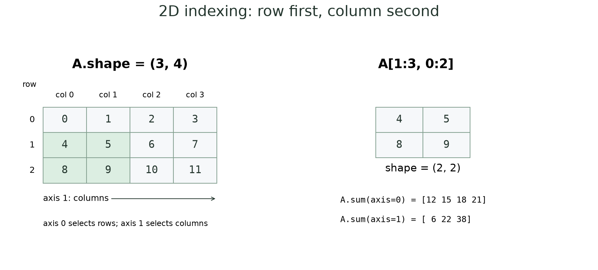
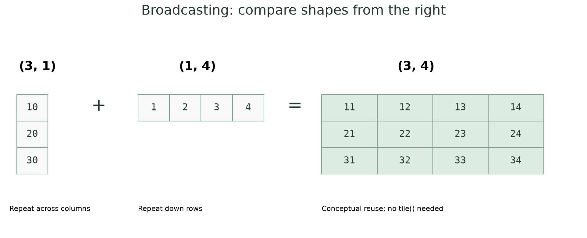
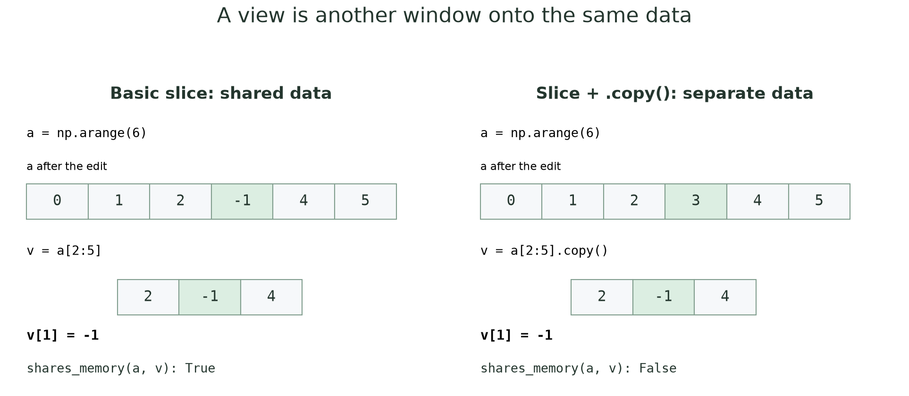
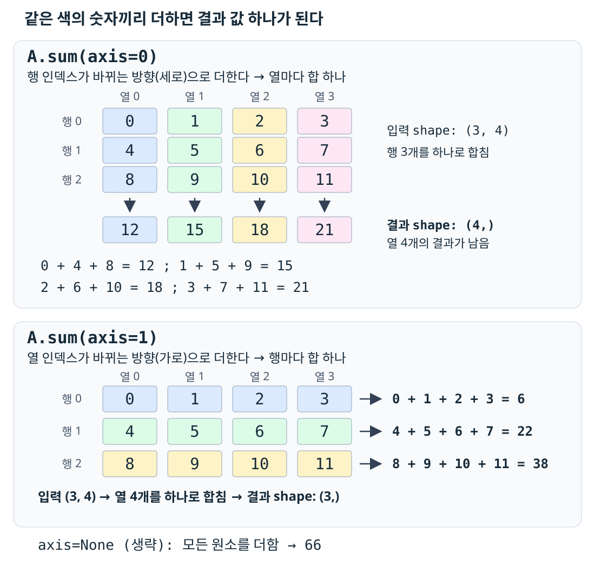
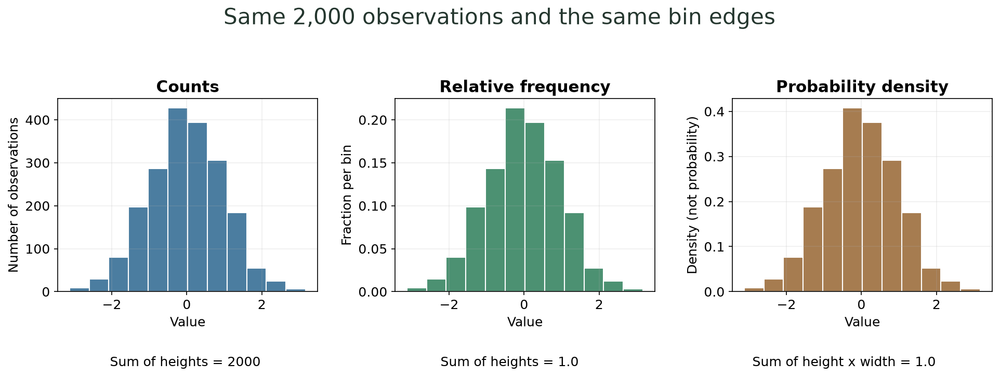

500개의 x 좌표에서 함수를 한 번에 계산하고, 그중 최댓값의 위치를 찾고, 일부 값을 행렬로 바꾸고, 복소 난수 10,000개의 크기를 히스토그램으로 그리고 싶다. NumPy는 이런 계산을 **배열 전체에 적용하는 식**으로 표현하게 해 준다. Matplotlib은 그 결과를 그림으로 보여 준다.

이 글은 배열의 기본 문법부터 선형대수·난수·그래프까지 설명하고, 예상문제 3번을 하나의 실행 프로그램으로 완성한다. 단순히 함수 이름을 외우기보다 **모양(shape), 원본 데이터 공유 여부, 계산의 종류, 그래프의 축 의미**를 구분하면서 읽는 것이 목표다. 이 네 가지를 확인하면 숫자와 조건이 달라진 응용 문제에서도 필요한 코드를 고르기 쉬워진다.

**읽는 순서:** 처음이면 1–17절로 개념과 짧은 예제를 익힌 뒤 18–21절에서 전체 문제를 풀어 본다. 막혔을 때는 아래 목차나 블로그 검색에서 `reshape`, `axis`, `argmax`, `normal`, `density`, `solve`처럼 함수 이름을 찾는다. 22절에는 조건이 바뀌었을 때의 대응법, 23절에는 오류별 해결표를 모았다.

짧은 `python` 블록은 필요한 import를 포함한 독립 예제다. `text`는 명령·문법 틀·출력이다. 전체 풀이와 테스트 파일은 글 끝에서 다운로드할 수 있다. 코드는 Python 3.14, NumPy 2.5, Matplotlib 3.11 환경에서 실행해 확인했다. 난수는 seed를 지정하지 않으면 값이 바뀌며, 출력의 공백·기본 정수 dtype·마지막 소수 자리는 환경에 따라 다를 수 있다.

## 빠른 목차 — 작업과 함수 이름으로 찾기

| 찾는 작업 / 함수 | 바로가기 |
| --- | --- |
| 핵심 식을 빠르게 복사하기 | [0. 치트시트](#quick-reference) |
| 리스트와 배열의 `+`, `*` 차이 | [1. NumPy와 벡터화](#arrays) |
| `ndim`, `shape`, `size`, `len`, `dtype` | [2. 배열 속성](#shape) |
| `array`, `zeros`, `ones`, `arange`, `linspace`, `diag`, `eye` | [3. 배열 생성](#creation) |
| dtype 지정, `astype`, 정수 배열에 실수 대입 | [4. 자료형](#dtype) |
| `sin`, `cos`, `exp`, `sqrt`, 라디안, 부동소수점 | [5. 원소별 함수](#ufuncs) |
| 서로 다른 shape를 더할 수 있는가 | [6. broadcasting](#broadcasting) |
| `a[r, c]`, `a[-2:, :2]`, 인덱스와 범위 | [7. 인덱싱·슬라이싱](#slicing) |
| 원본까지 바뀌는 이유, `.copy()`, `shares_memory` | [8. view와 copy](#copy) |
| `reshape`, `-1`, `.T`, 1차원 행·열 벡터 | [9. 모양 변경](#reshape) |
| `sum`, `mean`, `var`, `std`, `axis`, `ddof` | [10. 통계](#statistics) |
| `max`와 `argmax`, 최댓값의 x 좌표 | [11. 값과 위치](#argmax) |
| 조건으로 고르기, `&`, `where`, `any`, `all` | [12. 마스크](#mask) |
| `*`와 `@`, `dot`, `solve`, `inv`, `det`, `allclose` | [13. 선형대수](#linear-algebra) |
| `rand`, `randn`, `normal`, `randint`, seed | [14. 난수](#random) |
| `1j`, `np.abs`, Gaussian → Rayleigh | [15. 복소수와 크기](#complex) |
| `plot`, `scatter`, `bar`, 범례·색·선 종류 | [16. 그래프 기본](#plotting) |
| `hist`, bins, counts·상대도수·밀도, subplot·savefig | [17. 히스토그램과 저장](#histogram) |
| 예상문제 3번의 요구사항 | [18. 문제 설계](#requirements) |
| 전체 실행 파일 | [19. 전체 풀이](#solution) |
| 전체 코드의 계산 순서와 함정 | [20. 풀이 해설](#walkthrough) |
| 자동 테스트 | [21. 검증](#tests) |
| 입력 크기·함수·행렬·분포가 달라지면 | [22. 응용 대응표](#variations) |
| 오류 메시지·자주 틀리는 코드 | [23. 문제 해결표](#pitfalls) |
| 스스로 예상해 볼 질문 | [24. 확인 문제](#review) |

<a id="quick-reference"></a>

## 0. 바로 찾아 쓰는 치트시트

아래는 필요한 문장을 모은 **문법 틀**이다. 전체를 그대로 실행하기보다 변수에 맞는 식을 골라 쓴다.

```text
import numpy as np
import matplotlib.pyplot as plt

a = np.array([[1, 2], [3, 4]], dtype=float)
a.ndim, a.shape, a.size, a.dtype
x = np.linspace(0, 10, 500)           # 끝점 포함, 개수 500
y = np.sin(3*x) * np.exp(-x/2)        # 반복문 없이 원소별 계산

block = a[1:, :2]                    # 기본 슬라이스: view
independent = a[1:, :2].copy()        # 독립 복사
matrix = y[:12].reshape(3, 4).copy()  # 실험이 y를 바꾸지 않게 분리
matrix.T                            # 행·열 전환

y.mean(), y.std()                    # 기본 ddof=0
i = np.argmax(y)                     # 값이 아니라 인덱스
x_at_max = x[i]
selected = y[(y > 0) & (y < 1)]

solution = np.linalg.solve(A, b)
np.allclose(A @ solution, b)

sigma = 1 / np.sqrt(2)
real = np.random.normal(0, sigma, 10_000)
imag = np.random.normal(0, sigma, 10_000)
magnitude = np.abs(real + 1j*imag)

fig, axes = plt.subplots(2, 1)
axes[0].plot(x, y, label="curve")
axes[0].legend()
axes[1].hist(magnitude, bins=100, density=False)
fig.tight_layout()
fig.savefig("simulation.png")        # show보다 먼저 저장
plt.show()
```

> **특히 기억:** `(500,)`는 1차원, `(500, 1)`은 2차원이다. 기본 슬라이싱은 보통 원본을 공유한다. `*`는 원소별 곱이고 `@`는 행렬 곱이다. `argmax()`는 좌표가 아니라 위치를 준다. `normal`의 두 번째 인자는 분산이 아니라 표준편차다. 횟수 히스토그램에는 `weights=1/N`이나 `density=True`를 붙이지 않는다.

## 실행 준비

프로젝트에서 선택한 Python 인터프리터에 라이브러리가 없으면 터미널에서 설치한다.

```text
python -m pip install numpy matplotlib
```

VS Code·PyCharm의 실행 인터프리터와 설치에 사용한 Python이 같아야 한다. 파일 이름을 `numpy.py`, `matplotlib.py`로 만들면 실제 라이브러리를 가릴 수 있으므로 다른 이름을 쓴다.

<a id="arrays"></a>

## 1. NumPy 배열과 벡터화 — 리스트 계산과 다르다

`ndarray`는 다차원 배열이다. 수치 계산에서는 보통 같은 dtype의 숫자를 저장하며, 연산을 배열 전체에 적용한다.

```python
import numpy as np

values = [1, 2, 3]
a = np.array(values)

print(values * 2)  # [1, 2, 3, 1, 2, 3]: 리스트 반복
print(a * 2)       # [2 4 6]: 원소마다 곱함
print(values + values)  # [1, 2, 3, 1, 2, 3]: 리스트 연결
print(a + a)            # [2 4 6]: 원소별 덧셈
print(a ** 2)           # [1 4 9]
```

**벡터화는 반복 계산을 배열 식으로 표현하는 방식**이다. Python에서 원소마다 `for`를 도는 대신 `np.sin(x)`처럼 배열을 전달한다. NumPy 내부에서는 최적화된 연산을 수행한다. “벡터화하면 언제나 몇 배 빠르다”는 고정 보장은 없지만, 이 수업의 대량 수치 연산에는 잘 맞는다.

예상문제의 “벡터화하라”는 조건에서는 리스트 comprehension으로 값들을 하나씩 계산한 뒤 배열로 바꾸는 것도 피한다. `np.vectorize()` 역시 일반 Python 함수를 편하게 반복 적용하는 도구이지, 그 이름만으로 빠른 배열 연산이 되는 것은 아니다.

<a id="shape"></a>

## 2. `ndim`, `shape`, `size`, `len`, `dtype`

```python
import numpy as np

a = np.array([[0., 1., 2.], [3., 4., 5.]])
print(a.ndim)   # 2: 축이 두 개
print(a.shape)  # (2, 3): 2행 3열
print(a.size)   # 6: 전체 원소 수
print(len(a))   # 2: 첫 번째 축의 길이
print(a.dtype)  # float64

v = np.array([2, 4, 6, 0])
print(v.shape)  # (4,)
```

| 속성 / 함수 | 질문 | `(3, 4)` 배열의 답 |
| --- | --- | --- |
| `ndim` | 축이 몇 개인가 | `2` |
| `shape` | 각 축의 길이는 얼마인가 | `(3, 4)` |
| `size` | 전체 원소가 몇 개인가 | `12` |
| `len(a)` | 첫 축 길이는 얼마인가 | `3` |
| `dtype` | 각 원소를 어떤 타입으로 저장하는가 | `int64`, `float64` 등 |

`shape`는 튜플이다. `(4,)`의 쉼표는 원소가 하나인 튜플이라는 뜻이다. **1차원 배열은 행 벡터나 열 벡터라는 2차원 모양을 아직 가지지 않는다.** `(4,)`, `(1, 4)`, `(4, 1)`을 구분한다.



그림의 초록 부분이 `A[1:3, 0:2]`다. 첫 인자는 행, 둘째 인자는 열을 선택한다.

**그림 오른쪽 아래의 두 합계는 잘라낸 `(2, 2)` 배열이 아니라 왼쪽 원본 `A` 전체를 더한 값이다.** `axis=0`이면 같은 열의 숫자를 세로로 더하고, `axis=1`이면 같은 행의 숫자를 가로로 더한다. 어떤 숫자끼리 더하는지는 [10.2절의 색상별 계산 그림](#axis-sums)에서 확인할 수 있다.

<a id="creation"></a>

## 3. 배열 생성 — 개수와 간격을 구분하기

### 3.1 `array`, `zeros`, `ones`

```python
import numpy as np

print(np.array([1, 2, 3]))       # [1 2 3]
print(np.array((1.0, 2.0)))      # [1. 2.]
print(np.zeros(3))              # [0. 0. 0.]
print(np.ones((2, 3), dtype=int))
# [[1 1 1]
#  [1 1 1]]
```

`np.zeros((2, 3))`의 shape는 튜플 하나로 전달한다. `np.zeros(2, 3)`처럼 쓰면 “2행 3열”로 해석되지 않는다. 중첩 리스트의 각 행 길이가 달라지는 것도 일반적인 숫자 2차원 배열로 바로 만들 수 없으므로 행 길이를 맞춘다.

### 3.2 `arange`는 간격, `linspace`는 개수

```python
import numpy as np

print(np.arange(5))          # [0 1 2 3 4]
print(np.arange(2, 8, 2))    # [2 4 6]
print(np.linspace(0, 1, 5))  # [0.   0.25 0.5  0.75 1.  ]

x = np.linspace(0, 10, 500)
print(x.shape)                # (500,)
print(x[0], x[-1])            # 0.0 10.0
print(np.isclose(x[1] - x[0], 10 / 499))  # True
```

| 함수 | 세 번째 인자 | 끝점 |
| --- | --- | --- |
| `np.arange(start, stop, step)` | 한 번에 증가하는 간격 | 보통 stop 제외 |
| `np.linspace(start, stop, num)` | 전체 점 개수 | 기본 stop 포함 |

0부터 10까지 양 끝을 포함한 점 500개에는 **구간이 499개** 있다. 간격은 `10/499`다. `np.linspace(0, 10, 0.1)`에서 `0.1`은 간격이 아니라 개수 자리에 들어가므로 맞지 않는다.

실수 간격의 `arange`는 부동소수점 반올림 때문에 원소 개수나 끝부분이 예상과 다를 수 있다. **정확한 점 개수와 양 끝점이 주어졌으면 `linspace`를 선택한다.** 끝점을 빼고 같은 개수의 점이 필요하면 `endpoint=False`를 쓴다.

### 3.3 `diag`와 `eye`

```python
import numpy as np

print(np.diag([1., 2., 3.]))
# [[1. 0. 0.]
#  [0. 2. 0.]
#  [0. 0. 3.]]
print(np.eye(2))
# [[1. 0.]
#  [0. 1.]]
print(np.diag(np.array([[1, 2], [3, 4]])))  # [1 4]
```

`np.diag`에 1차원 값을 주면 대각 행렬을 만들고, 2차원 배열을 주면 대각 원소를 추출한다. `np.eye(n)`은 n행 n열 단위행렬을 만든다.

<a id="dtype"></a>

## 4. dtype과 `astype` — 값이 소수인데 정수로 저장되면

```python
import numpy as np

a = np.array([1, 2, 3], dtype=np.int64)
a[0] = 1.9
print(a)                 # [1 2 3]: 정수 저장소에서 소수부 손실

b = a.astype(np.float64)
b[0] = 1.9
print(b)                 # [1.9 2.  3. ]
print(b.dtype)           # float64
print(a)                 # [1 2 3]: astype 결과는 b에 받음
```

기본 정수 dtype이 항상 `int32`라고 외우지 않는다. NumPy 버전과 플랫폼에 따라 달라질 수 있다. 비트 수가 중요하면 `np.int32`, `np.int64`, `np.float64`처럼 명시한다. 작은 정수 타입에는 표현 범위가 있으므로 큰 값의 계산에서 overflow도 고려해야 한다.

`astype`는 반올림 함수가 아니다. 정수로 변환하면 일반적으로 소수부가 0 쪽으로 잘린다. `np.round`로 반올림할지, 정수 dtype으로 바꿀지는 목적이 다르다. `a.astype(float)`라고 호출만 하고 반환값을 버리면 원래 `a`가 자동으로 바뀌지 않는다.

<a id="ufuncs"></a>

## 5. 원소별 계산과 수학 함수

```python
import numpy as np

x = np.array([0., 1., 4.])
print(np.sqrt(x))          # [0. 1. 2.]
print(np.exp(np.array([0., 1.])).round(4))  # [1.     2.7183]
print(np.sin(np.array([0., np.pi/2, np.pi])).round(6))
# [0. 1. 0.]

t = np.linspace(0, 10, 500)
f = np.sin(3*t) * np.exp(-t/2)
print(f.shape)            # (500,)
```

`np.sin`, `np.cos`, `np.sqrt`, `np.exp`, `np.abs` 같은 함수는 원소별 계산을 지원한다. `math.sin`은 이런 배열 전체를 그대로 처리하는 용도로 쓰지 않는다. `np.exp(x)`는 $e^x$다. `np.e ** x`로도 표현할 수 있지만 `np.exp`가 의도를 분명히 보여 준다.

**삼각함수 입력은 라디안이다.** 각도가 도 단위이면 `np.deg2rad(degrees)`로 바꾼다. `sin(90)`을 계산한다고 1이 나오는 것은 아니다.

```python
import numpy as np

print(np.sin(np.deg2rad(90)))  # 1.0
value = np.sin(np.pi)
print(np.isclose(value, 0))   # True
print(np.allclose([0.1 + 0.2], [0.3]))  # True
```

컴퓨터의 실수 연산에서는 수학적으로 0인 값이 `1.22e-16`처럼 아주 작은 수로 나타날 수 있다. `e-16`은 $10^{-16}$ 배라는 뜻이다. 계산 결과를 검증할 때 `==`만 사용하면 반올림 오차 때문에 실패할 수 있어 `isclose`나 `allclose`를 사용한다. 비교 허용 오차가 중요한 문제라면 `rtol`, `atol`을 문제의 단위와 규모에 맞게 지정한다.

<a id="broadcasting"></a>

## 6. Broadcasting — 크기가 달라도 연산 가능한 경우

스칼라 `10 + a`는 모든 원소에 10을 더한다. 배열끼리도 다음 규칙을 만족하면 크기를 맞추어 원소별 연산을 할 수 있다.

1. shape를 **오른쪽 축부터** 비교한다.
2. 각 축의 길이가 같거나, 둘 중 하나가 1이면 호환된다.
3. 없는 왼쪽 축은 길이 1인 것처럼 생각한다.

```python
import numpy as np

column = np.array([[10], [20], [30]])  # (3, 1)
row = np.array([[1, 2, 3, 4]])         # (1, 4)
result = column + row
print(result.shape)  # (3, 4)
print(result)
# [[11 12 13 14]
#  [21 22 23 24]
#  [31 32 33 34]]
```



그림은 값을 어떻게 재사용하는지 보여 주는 개념도다. 같은 값을 실제로 큰 배열에 복제하는 `np.tile()`을 호출할 필요는 없다.

| shape 조합 | 결과 |
| --- | --- |
| `(3, 4)` + `(4,)` | `(3, 4)` |
| `(3, 4)` + `(3, 1)` | `(3, 4)` |
| `(3, 4)` + `(3,)` | 오류: 오른쪽 4와 3이 다름 |
| `(3, 1)` + `(1, 4)` | `(3, 4)` |

행별 값 3개를 3행 4열 배열에 더하고 싶으면 `(3,)`를 `(3, 1)`로 바꾸어야 한다. `rows[:, None]` 또는 `rows.reshape(-1, 1)`을 쓸 수 있다. `None`은 이 인덱싱 위치에서 새 축을 추가한다.

```python
import numpy as np

A = np.zeros((3, 4))
rows = np.array([10, 20, 30])
print((A + rows[:, None]).shape)  # (3, 4)
try:
    A + rows
except ValueError:
    print("incompatible shapes")
```

<a id="slicing"></a>

## 7. 인덱싱과 슬라이싱 — 행 먼저, 열 나중

### 7.1 1차원 배열

```python
import numpy as np

a = np.arange(6)
print(a[0], a[-1]) # 0 5
print(a[2:5])      # [2 3 4]
print(a[::2])      # [0 2 4]
print(a[::-1])     # [5 4 3 2 1 0]
print(a[99:])      # []: 슬라이스는 범위를 넘겨도 잘릴 수 있음
try:
    print(a[99])
except IndexError:
    print("index out of bounds")
```

`[start:stop:step]`에서 start는 포함, stop은 제외한다. `a[2:5]`는 인덱스 2·3·4다. `a[-1]`은 마지막 원소다. 단일 인덱스 초과와 슬라이스 초과의 동작은 다르다.

### 7.2 2차원 배열과 차원 유지

```python
import numpy as np

A = np.arange(12).reshape(3, 4)
print(A[1, 2])           # 6
print(A[1:3, 0:2])
# [[4 5]
#  [8 9]]
print(A[-2:, :2].shape)  # (2, 2)
print(A[1].shape)        # (4,): 한 행을 1차원으로
print(A[1:2].shape)      # (1, 4): 행 축을 유지
print(A[:, 1].shape)    # (3,)
print(A[:, 1:2].shape)  # (3, 1)
```

정수 인덱스는 해당 축을 제거하고, 슬라이스는 축을 유지한다. 계산식이 맞는데 broadcasting이나 행렬 곱이 실패하면 이 차원을 확인한다.

### 7.3 `A[rows, columns]`와 연속 대괄호는 다르다

```python
import numpy as np

A = np.arange(12).reshape(3, 4)
print(A[1:3, 0:2].shape)  # (2, 2)
print(A[1:3][0:2].shape)  # (2, 4)
```

`A[1:3][0:2]`는 먼저 행 두 개를 고른 다음, 그 결과에서 다시 행을 고른다. 두 번째 대괄호가 자동으로 열을 고르는 것이 아니다. 단일 원소 `A[1][2]`는 이 경우 `A[1, 2]`와 같은 값을 주지만, 2차원 영역을 자를 때는 쉼표 표기가 정확하고 읽기 쉽다.

<a id="copy"></a>

## 8. View와 copy — 원본까지 바뀌는 이유

### 8.1 기본 슬라이스는 데이터를 공유한다

```python
import numpy as np

a = np.arange(6)
view = a[2:5]
view[1] = -1
print(view)                    # [ 2 -1  4]
print(a)                       # [ 0  1  2 -1  4  5]
print(np.shares_memory(a, view)) # True
view[:] = 0
print(a)                       # [0 1 0 0 0 5]
```

`view[1]`은 원본의 인덱스 3과 연결된다. 서로 다른 배열 객체라도 실제 데이터 저장 영역을 공유할 수 있다. `view[:] = 0`은 view가 가리키는 영역 전체를 바꾸므로 원본의 그 영역도 바뀐다.

### 8.2 독립 결과가 필요하면 `.copy()`

```python
import numpy as np

a = np.arange(6)
copied = a[2:5].copy()
copied[1] = -1
print(copied)                   # [ 2 -1  4]
print(a)                        # [0 1 2 3 4 5]
print(np.shares_memory(a, copied)) # False
```



| 코드 | 관계 |
| --- | --- |
| `b = a` | 같은 배열 객체를 가리키는 다른 이름 |
| `b = a[2:5]` | 보통 다른 배열 객체지만 데이터를 공유하는 view |
| `b = a[2:5].copy()` | 별도 데이터의 독립 배열 |
| `b = a[[2, 3, 4]]` | 정수 배열을 이용한 advanced indexing 결과는 copy |
| `b = a[a > 2]` | Boolean indexing으로 읽어 온 결과는 copy |

**주의:** “NumPy의 모든 인덱싱은 view”는 틀리다. 기본 슬라이스와 정수 배열·Boolean 마스크 인덱싱을 구분한다.

### 8.3 view의 내용 변경과 이름 재대입

```python
import numpy as np

a = np.arange(6)
view = a[2:5]
view = np.zeros(3, dtype=int)
print(a)  # [0 1 2 3 4 5]: view라는 이름의 대상만 바꿈

view = a[2:5]
view[:] = 0
print(a)  # [0 1 0 0 0 5]: 연결된 데이터 내용을 바꿈
```

이전 글의 `values = ...`와 `values[0] = ...` 차이가 여기에도 적용된다. 원본 변경 여부를 확실히 검사할 때는 `b is a`만 보지 말고 `np.shares_memory(a, b)`도 확인한다.

<a id="reshape"></a>

## 9. `reshape`, `.T`, 행·열 벡터

### 9.1 원소 개수는 보존된다

```python
import numpy as np

a = np.arange(12)
M = a.reshape(3, 4)
print(M.shape)           # (3, 4)
print(a.reshape(3, -1).shape) # (3, 4)
print(M.T.shape)         # (4, 3)
print(M.T)
# [[ 0  4  8]
#  [ 1  5  9]
#  [ 2  6 10]
#  [ 3  7 11]]
try:
    a.reshape(5, 3)
except ValueError:
    print("element count does not match")
```

12개를 3×4로 바꿀 수 있지만 5×3으로 바꿀 수는 없다. `-1`은 나머지 축 크기에서 해당 길이를 추론하라는 뜻이며 한 축에만 사용할 수 있다. 기본 reshape는 C 순서, 즉 마지막 축이 먼저 변하는 순서로 값을 배치한다.

`reshape`는 가능하면 view를 만들지만 데이터 배치에 따라 복사가 필요할 수 있다. 항상 독립 복사이거나 항상 view라고 가정하지 않는다. `.T`도 일반적으로 원본 데이터를 공유하는 전치 view다. 독립 결과가 필요하면 마지막에 `.copy()`를 붙인다.

### 9.2 1차원 `.T`는 열 벡터를 만들지 않는다

```python
import numpy as np

v = np.array([1, 2, 3])
print(v.T.shape)          # (3,): 그대로 1차원
print(v.reshape(1, -1).shape) # (1, 3)
print(v.reshape(-1, 1).shape) # (3, 1)
print(v[:, None].shape)  # (3, 1)
print(v[None, :].shape)  # (1, 3)
```

모양을 한 줄로 펴고 싶으면 `ravel()`이나 `flatten()`도 볼 수 있다. `ravel()`은 가능하면 공유된 view를, `flatten()`은 복사본을 반환한다. 필요하다면 `reshape(-1)`로도 한 축으로 바꿀 수 있지만 공유 여부를 따로 확인한다.

<a id="statistics"></a>

## 10. 합·평균·분산·표준편차와 `axis`

### 10.1 전체 통계와 `ddof`

```python
import numpy as np

a = np.array([1., 2., 3., 4.])
print(a.sum())            # 10.0
print(a.mean())           # 2.5
print(a.var())            # 1.25
print(round(float(a.std()), 6))        # 1.118034
print(round(float(a.std(ddof=1)), 6))  # 1.290994
```

`a.mean()`과 `np.mean(a)`처럼 메서드와 모듈 함수 형태를 모두 사용할 수 있는 경우가 많다. 평균은 합/N, 분산은 평균에서 떨어진 거리의 제곱을 합해 나눈 값, 표준편차는 분산의 제곱근이다.

NumPy의 분산·표준편차는 기본 `ddof=0`이므로 분모가 N이다. `ddof=1`이면 N−1을 사용한다. `ddof`는 단순히 “degrees of freedom 자체”가 아니라 **분모에서 빼는 보정값**으로 읽으면 계산을 기억하기 쉽다. N개 원소에 `ddof >= N`을 주면 유효한 분산 계산이 되지 않으므로 원소 수를 확인한다.

예상문제에서 default NumPy definition을 요구하면 `.std()`를 그대로 쓴다. 무조건 표본 표준편차라며 `ddof=1`을 추가하지 않는다.

<a id="axis-sums"></a>

### 10.2 `axis`는 어느 방향으로 더할지 고른다

`A.shape == (3, 4)`는 **0번 축의 길이가 3(행 3개), 1번 축의 길이가 4(열 4개)라는 뜻**이다. `sum(axis=...)`는 그 축의 인덱스를 바꿔 가며 숫자들을 더한다. 기본값인 `keepdims=False`에서는 더한 축이 결과의 `shape`에서 사라진다.



**`axis=0`: 열을 하나 고정하고 행 번호를 0 → 1 → 2로 바꿔 가며 더한다.** 예를 들어 첫 번째 열은 `A[0, 0] + A[1, 0] + A[2, 0]`, 즉 `0 + 4 + 8 = 12`다. 모든 열에 같은 계산을 하면 다음과 같다.

| 고정한 열 | 세로로 더하는 값 | 결과 |
| --- | --- | --- |
| 열 0 | `0 + 4 + 8` | `12` |
| 열 1 | `1 + 5 + 9` | `15` |
| 열 2 | `2 + 6 + 10` | `18` |
| 열 3 | `3 + 7 + 11` | `21` |

따라서 `A.sum(axis=0)`은 **`[12, 15, 18, 21]`이다.** 열마다 값이 하나 남아 총 4개이므로 결과의 `shape`는 `(4,)`다.

**`axis=1`: 행을 하나 고정하고 열 번호를 0 → 1 → 2 → 3으로 바꿔 가며 더한다.** 예를 들어 첫 번째 행은 `A[0, 0] + A[0, 1] + A[0, 2] + A[0, 3]`, 즉 `0 + 1 + 2 + 3 = 6`이다.

| 고정한 행 | 가로로 더하는 값 | 결과 |
| --- | --- | --- |
| 행 0 | `0 + 1 + 2 + 3` | `6` |
| 행 1 | `4 + 5 + 6 + 7` | `22` |
| 행 2 | `8 + 9 + 10 + 11` | `38` |

따라서 `A.sum(axis=1)`은 **`[6, 22, 38]`이다.** 행마다 값이 하나 남아 총 3개이므로 결과의 `shape`는 `(3,)`다.

> **2차원 배열에서 기억할 것:** `axis=0` → 세로로 더함 → 열별 합. `axis=1` → 가로로 더함 → 행별 합. `axis`를 생략하면 모든 원소를 더해 `66` 하나가 나온다. “0은 행 축”이라는 말은 **행 번호를 바꿔 가며 계산한다는 뜻**이지, 각 행의 합을 구한다는 뜻이 아니다.

```python
import numpy as np

A = np.arange(12).reshape(3, 4)
print(A.sum())          # 66
print(A.sum(axis=0))    # [12 15 18 21]: 행 축을 줄임, 열별 합
print(A.sum(axis=1))    # [ 6 22 38]: 열 축을 줄임, 행별 합
print(A.mean(axis=1))   # [1.5 5.5 9.5]
print(A.mean(axis=1, keepdims=True).shape) # (3, 1)
```

`axis=0`을 무조건 “행별 결과”라고 외우면 헷갈린다. `(3, 4)`에서 0번 축인 길이 3의 행 축을 줄이면 길이 4의 열별 결과가 남는다. `axis=1`은 열 축을 줄여 길이 3의 행별 결과를 만든다.

`keepdims=True`는 줄인 축을 길이 1로 유지한다. 행별 평균을 원래 배열에서 뺄 때 `(3, 1)`로 남겨 두면 broadcasting과 잘 맞는다.

```python
import numpy as np

A = np.array([[1., 2., 3.], [10., 20., 30.]])
centered = A - A.mean(axis=1, keepdims=True)
print(centered)
# [[ -1.   0.   1.]
#  [-10.   0.  10.]]
print(np.allclose(centered.mean(axis=1), 0))  # True
```

<a id="argmax"></a>

## 11. `max`와 `argmax` — 값, 인덱스, x 좌표는 다르다

```python
import numpy as np

x = np.array([0., 0.5, 1., 1.5])
y = np.array([2., 8., 3., 1.])
index = np.argmax(y)
print(y.max())      # 8.0: 최댓값
print(int(index))   # 1: 인덱스
print(x[index])     # 0.5: 그때의 x 좌표
```

`np.argmax(y)`가 23이라고 해서 최대가 x=23에서 발생했다는 뜻은 아니다. 500개 점의 인덱스 23에 해당하는 x를 다시 `x[23]`으로 읽어야 한다. 같은 최대가 여러 번 있으면 1차원 `argmax`는 첫 위치를 반환한다. 최솟값·최소 위치는 `min`, `argmin`이다.

2차원 배열에서 `axis`를 생략한 `argmax`는 펼친 배열 기준 인덱스를 반환한다.

```python
import numpy as np

A = np.array([[1, 9, 3], [4, 5, 6]])
flat_index = np.argmax(A)
row, col = np.unravel_index(flat_index, A.shape)
print(int(flat_index))           # 1
print(int(row), int(col))        # 0 1
print(A[row, col])               # 9
print(A.argmax(axis=1))          # [1 2]: 각 행의 최대가 있는 열
```

빈 배열에는 일반적인 `max`, `argmax`를 사용할 수 없다. 필터링 뒤 원소가 남았는지 `selected.size > 0`을 확인하고 호출한다.

<a id="mask"></a>

## 12. Boolean 마스크와 조건 계산

```python
import numpy as np

a = np.array([-2., -1., 0., 1., 2.])
mask = (a > 0) & (a < 2)
print(mask)           # [False False False  True False]
print(a[mask])        # [1.]
print(np.where(a >= 0, a, 0))  # [0. 0. 0. 1. 2.]
print(np.any(a < 0))  # True
print(np.all(a >= 0)) # False
```

배열의 조건을 결합할 때는 `and`, `or` 대신 `&`, `|`를 쓰고 **각 비교식을 괄호로 묶는다.** Boolean 배열을 뒤집을 때는 `~mask`를 사용한다. Markdown 표 안에서 연산자가 헷갈리면 이 문장의 코드를 참고한다.

`if a:`처럼 여러 원소의 배열을 하나의 참/거짓으로 읽으려 하면 ambiguous truth value 오류가 난다. “하나라도 참인가”는 `np.any`, “모두 참인가”는 `np.all`, “비어 있는가”는 `a.size == 0`으로 의도를 분명히 한다.

```python
import numpy as np

a = np.array([1, 2, 3])
b = a[a > 1]
b[0] = 99
print(a)      # [1 2 3]: 선택해 읽은 결과는 copy
a[a > 1] = 0
print(a)      # [1 0 0]: 원본에 대한 인덱싱 대입은 원본 수정
```

`np.where(condition, a, b)`는 조건에 따라 원소별 값을 고른다. Python의 한 줄 조건식처럼 선택되지 않은 쪽의 계산이 언제나 생략되는 것은 아니다. `np.where(x != 0, 1/x, 0)`도 먼저 `1/x`를 계산할 수 있으므로 0 나눗셈 경고를 완전히 막는 도구로 생각하지 않는다.

<a id="linear-algebra"></a>

## 13. 원소별 곱, 행렬 곱과 선형대수

### 13.1 `*`와 `@`는 계산 자체가 다르다

```python
import numpy as np

A = np.array([[1, 2], [3, 4]])
B = np.array([[5, 6], [7, 8]])
print(A * B)
# [[ 5 12]
#  [21 32]]
print(A @ B)
# [[19 22]
#  [43 50]]
print(np.array_equal(A @ B, np.dot(A, B)))  # True: 이 2차원 경우
```

행렬 곱 `(m, n) @ (n, p)`는 `(m, p)`다. 안쪽 길이 n이 같아야 한다. 반면 원소별 곱은 같은 shape 또는 broadcasting 규칙을 만족해야 한다. 행렬 곱이 필요한 곳에 `*`를 넣으면 오류 없이 다른 계산을 할 수도 있어 더 주의해야 한다.

1차원끼리 `@`를 쓰면 내적이다. `np.dot`과 `@`는 일반적인 2차원 행렬 곱에서는 같지만, 더 높은 차원에서는 동작 규칙이 달라질 수 있다. 이 글의 문제에서는 `@`를 사용하면 행렬 곱 의도가 분명하다.

### 13.2 `np.linalg.solve(A, b)`로 $Ax=b$ 풀기

```python
import numpy as np

A = np.array([[3., 1.], [1., 2.]])
b = np.array([9., 8.])
solution = np.linalg.solve(A, b)
print(solution)          # [2. 3.]
print(A @ solution)      # [9. 8.]
print(np.allclose(A @ solution, b))  # True
```

여기서 `solution`은 계수 행렬 A와 우변 b로부터 계산한 해다. 정답 `[2, 3]`을 코드에 그대로 대입하는 것은 방정식을 푼 것이 아니다. 함수 그래프의 x와 혼동하지 않게 변수 이름을 `solution`으로 구분했다.

`solve`는 이 문제처럼 정방이고 full-rank인 계수 행렬을 전제로 한다. 특이행렬이면 `np.linalg.LinAlgError`가 발생할 수 있다. 직사각형 행렬이나 최소제곱 문제는 `np.linalg.lstsq`처럼 별도의 문제 설정이므로 `solve`를 무조건 적용하지 않는다.

### 13.3 역행렬과 행렬식

```python
import numpy as np

A = np.array([[1., 2.], [2., 1.]])
inverse = np.linalg.inv(A)
print(np.round(inverse, 4))
# [[-0.3333  0.6667]
#  [ 0.6667 -0.3333]]
print(round(float(np.linalg.det(A)), 6))  # -3.0
print(np.allclose(A @ inverse, np.eye(2))) # True
```

`A ** -1`은 원소별 역수이지 행렬의 역행렬이 아니다. `inv`의 결과를 확인할 때는 `A @ inverse`가 단위행렬과 가까운지 검사한다. 단순히 $Ax=b$를 풀 목적이라면 역행렬을 따로 계산하기보다 `solve`를 쓴다. 행렬식이 매우 작은지의 해석에는 스케일과 수치 오차도 영향을 주므로 작은 실수 하나만 보고 일반적인 수치 안정성을 단정하지 않는다.

<a id="random"></a>

## 14. 난수 — 평균·표준편차·개수·seed

### 14.1 자주 쓰는 함수 비교

| 함수 | 의미 | 모양 지정 |
| --- | --- | --- |
| `np.random.rand(2, 3)` | 0 이상 1 미만 균등 난수 | 축 길이를 위치 인자로 |
| `np.random.randn(2, 3)` | 평균 0, 표준편차 1 정규 난수 | 축 길이를 위치 인자로 |
| `np.random.normal(mu, sigma, size=(2, 3))` | 평균 mu, 표준편차 sigma 정규 난수 | `size` |
| `np.random.randint(low, high, size=5)` | low 이상 high 미만 정수 난수 | `size` |

```python
import numpy as np

np.random.seed(607)
print(np.random.rand(2, 3).shape)                 # (2, 3)
print(np.random.randn(5).shape)                   # (5,)
print(np.random.normal(10, 2, size=100).shape)    # (100,)
print(np.random.randint(0, 4, size=5).shape)      # (5,)
```

`randn`의 n은 normal을 떠올리면 된다. `randn`의 인자는 평균·표준편차가 아니라 shape다. 평균 mu, 표준편차 sigma를 만들 때 `mu + sigma * np.random.randn(N)` 또는 `np.random.normal(mu, sigma, N)`을 사용한다.

### 14.2 분산이 1/2라면 sigma는 `1/np.sqrt(2)`

분산은 표준편차의 제곱이다. 정규 난수의 분산이 1/2이면 표준편차는 $sqrt{1/2}=1/sqrt{2}$다. `normal(0, 0.5, N)`을 쓰면 표준편차가 0.5, 분산이 0.25인 다른 난수를 만든다.

표본 평균·표준편차가 지정한 분포의 모수와 정확히 같아야 하는 것은 아니다. 유한 개의 난수이므로 차이가 난다. 분포 모양과 적절한 허용 오차로 확인한다.

### 14.3 seed는 한 번 설정하고 연속으로 뽑는다

```python
import numpy as np

np.random.seed(607)
real = np.random.normal(0, 1/np.sqrt(2), 10_000)
imag = np.random.normal(0, 1/np.sqrt(2), 10_000)
print(real.shape, imag.shape)        # (10000,) (10000,)
print(np.array_equal(real, imag))    # False
```

두 배열 사이에 같은 seed를 다시 설정하면 같은 난수열이 나와 독립 성분이라는 의도가 깨질 수 있다. seed 고정은 예제를 재현하기 위한 것이며 실수부와 허수부를 같게 만들라는 뜻이 아니다. `10_000`의 밑줄은 숫자를 읽기 쉽게 구분하는 Python 문법이다. 값은 `10000`과 같다.

새 코드를 자유롭게 작성할 때는 `np.random.default_rng(seed)`로 Generator를 만들어 쓰는 방식도 있다. 다만 예상문제는 `np.random.randn()` 또는 `np.random.normal()`을 명시하므로 전체 풀이에서는 요구한 함수로 구현한다.

```python
import numpy as np

rng = np.random.default_rng(607)
sample = rng.normal(0, 1, size=5)
integers = rng.integers(0, 4, size=5)
print(sample.shape, integers.shape)  # (5,) (5,)
```

<a id="complex"></a>

## 15. 복소수와 Rayleigh 분포 — `real + 1j*imag`

```python
import numpy as np

real = np.array([3., 0.])
imag = np.array([4., -2.])
z = real + 1j * imag
print(z)              # [3.+4.j 0.-2.j]
print(np.abs(z))      # [5. 2.]
print(np.allclose(np.abs(z), np.sqrt(real**2 + imag**2))) # True
```

Python은 허수 단위로 `1j`를 사용한다. `j`라는 이름을 별도로 선언할 필요가 없다. 복소수의 크기는 $sqrt{\mathrm{real}^2+\mathrm{imag}^2}$이므로 음수가 아니다. `np.abs(real + imag)`는 두 실수의 합에 절댓값을 취한 것이어서 다른 계산이다.

서로 독립인 평균 0, 같은 표준편차 sigma의 Gaussian 성분 X와 Y에 대해 $R=|X+jY|$는 Rayleigh 분포를 따른다. 예상문제에서는 sigma가 $1/sqrt{2}$다. 크기는 주로 작은 양수 쪽에서 많고 오른쪽으로 꼬리가 생긴다. 위의 `[3, 4]`는 크기 계산을 설명한 결정적 예제일 뿐 Gaussian 표본은 아니다.

이 경우 $E[R^2]=2\sigma^2=1$이므로 실제 난수의 `np.mean(magnitude**2)`가 1 근처인지 확인해 볼 수 있다. 난수 생성의 건전성 확인이지, 유한 표본이 분포를 따른다는 수학적 증명을 대신하는 것은 아니다.

<a id="plotting"></a>

## 16. Matplotlib — Figure와 Axes부터 구분하기

### 16.1 그래프 전체와 한 칸의 축

`Figure`는 전체 그림이고, `Axes`는 실제 데이터를 그리는 한 영역이다. 아래 예제는 Figure 하나에 Axes 하나를 만든다.

```python
import numpy as np
import matplotlib.pyplot as plt

x = np.linspace(0, 2*np.pi, 100)
fig, ax = plt.subplots()
ax.plot(x, np.sin(x), color="royalblue", label="sin(x)")
ax.plot(x, np.cos(x), color="darkorange", linestyle="--", label="cos(x)")
ax.set_title("Sinusoidal curves")
ax.set_xlabel("x (radians)")
ax.set_ylabel("Function value")
ax.grid(True, alpha=0.3)
ax.legend()
fig.tight_layout()
plt.show()
plt.close(fig)
```

`label=`을 지정하고 `legend()`를 호출해야 범례가 나타난다. 색뿐 아니라 선 종류도 다르게 하면 구별하기 쉽다. 형식 문자열 `'r--'`는 빨간 점선, `'go-'`는 초록 원형 마커와 실선이다. `color`, `linestyle`, `marker` 키워드로 나누어 써도 된다.

| pyplot 방식 | Axes 방식 |
| --- | --- |
| `plt.plot(x, y)` | `ax.plot(x, y)` |
| `plt.title("...")` | `ax.set_title("...")` |
| `plt.xlabel("...")` | `ax.set_xlabel("...")` |
| `plt.ylabel("...")` | `ax.set_ylabel("...")` |
| `plt.grid(True)` | `ax.grid(True)` |
| `plt.legend()` | `ax.legend()` |

두 방식 모두 쓸 수 있지만 subplot이 여러 개면 `axes[0]`, `axes[1]`처럼 **어느 축을 수정하는지 직접 지정하는 방식**이 실수를 줄인다.

### 16.2 Scatter와 bar

```python
import numpy as np
import matplotlib.pyplot as plt

rng = np.random.default_rng(607)
x = rng.normal(size=100)
y = 0.5*x + rng.normal(scale=0.3, size=100)
fig, ax = plt.subplots()
ax.scatter(x, y, s=18, alpha=0.6)
ax.set_xlabel("x")
ax.set_ylabel("y")
ax.set_title("Scatter plot")
ax.grid(True, alpha=0.3)
plt.show()
plt.close(fig)
```

scatter는 두 측정량의 관계를 점으로 보여 준다. `plot`처럼 점을 순서대로 선으로 잇는 것과 목적이 다르다.

```python
import matplotlib.pyplot as plt

fig, ax = plt.subplots()
ax.bar([0, 1, 2], [12, 8, 5], width=0.6, edgecolor="black")
ax.set_xticks([0, 1, 2], ["A", "B", "C"])
ax.set_ylabel("Count")
ax.set_title("Category counts")
fig.tight_layout()
plt.show()
plt.close(fig)
```

bar는 이미 정리된 범주별 값을 비교한다. histogram은 원자료를 구간에 나누어 도수를 계산한다. `bar`에 난수 10,000개를 그대로 주는 것은 문제에서 요구한 분포 히스토그램과 다르다.

<a id="histogram"></a>

## 17. 히스토그램·subplot·파일 저장

### 17.1 `bins`는 막대 높이가 아니라 구간 설정

```python
import numpy as np
import matplotlib.pyplot as plt

data = np.array([0.1, 0.2, 0.7, 1.2, 1.8])
fig, ax = plt.subplots()
counts, edges, patches = ax.hist(data, bins=[0, 1, 2], density=False)
print(counts)                    # [3. 2.]
print(edges)                     # [0. 1. 2.]
print(int(counts.sum()))         # 5
print(len(patches))              # 2
plt.close(fig)
```

`bins=100`이면 보통 데이터 범위를 100개 구간으로 나누고 각 구간의 개수를 센다. 높이 100의 막대를 만들라는 뜻이 아니다. 구간이 100개면 경계 값은 101개다. 일반적으로 구간은 왼쪽 포함·오른쪽 제외이며, 마지막 구간은 오른쪽 끝도 포함한다.

### 17.2 횟수·상대도수·확률밀도는 y축이 다르다

| 목적 | 설정 | y축 의미 / 확인 |
| --- | --- | --- |
| 횟수 counts | 기본 또는 `density=False` | 막대 높이의 합이 포함된 표본 수 |
| 상대도수 relative frequency | `weights=np.ones(N)/N` | 각 구간의 표본 비율, 전체 범위를 포함하면 높이 합 1 |
| 확률밀도 density | `density=True` | 높이×구간 폭의 합이 1 |



위 그림의 표본 수는 2,000개다. 세 그래프는 같은 데이터를 쓰지만 y축의 정의가 다르다. **밀도 높이 자체는 그 구간의 확률이 아니며 1보다 클 수도 있다.** 확률은 해당 구간의 밀도×폭으로 해석한다. 일반적인 데이터에서 weights 방식과 density 방식은 같지 않다.

예상문제 3번은 **발생 횟수**를 요구한다. 따라서 `density=False`로 두고 weights를 추가하지 않는다. 10,000개를 전부 포함하면 `counts.sum()`이 10,000이어야 한다. `range=`로 일부 표본을 제외하면 횟수 합이 전체 N보다 작아질 수 있다.

### 17.3 위아래 두 개의 subplot

```python
import numpy as np
import matplotlib.pyplot as plt

x = np.linspace(0, 1, 5)
fig, axes = plt.subplots(2, 1, figsize=(7, 6))
axes[0].plot(x, x**2)
axes[0].set_title("Square")
axes[0].set_xlabel("x")
axes[0].set_ylabel("x squared")
axes[1].hist([0.1, 0.2, 0.8, 1.2], bins=4)
axes[1].set_title("Histogram")
axes[1].set_xlabel("Value")
axes[1].set_ylabel("Count")
axes[0].grid(True)
axes[1].grid(True)
fig.tight_layout()
fig.savefig("two_panels.png", dpi=120)
plt.show()
plt.close(fig)
```

`subplots(2, 1)`은 2행 1열이다. 기본 squeeze 동작에서는 이 경우 `axes`가 길이 2인 1차원 배열이므로 `axes[0]`, `axes[1]`을 사용한다. `subplots(1, 1)`의 기본 반환 `ax`는 단일 Axes다. 언제나 2차원 인덱싱을 쓰고 싶으면 `squeeze=False`를 명시하는 방법도 있다.

### 17.4 저장 위치와 y축 자동 범위

`fig.savefig(...)`는 `plt.show()`보다 먼저 실행한다. 창을 닫은 뒤 현재 figure가 달라지거나 사라져 빈 그림을 저장하는 실수를 줄일 수 있다. `fig.tight_layout()`은 제목·축 이름 간 간격을 조정한다. 최신 코드에서는 `layout="constrained"`를 사용하는 선택지도 있지만 전체 풀이에서는 한 방식을 일관되게 사용한다.

`"simulation.png"`만 지정하면 현재 작업 폴더에 저장된다. 전체 풀이에서는 `Path(__file__).resolve().parent`를 사용하여 `.py` 파일 옆에 저장한다. 노트북에는 `__file__`이 없을 수 있으므로 그때는 `Path.cwd()`처럼 저장 폴더를 직접 정한다.

그래프의 y축 끝이 0.8 대신 0.81처럼 보이는 것은 데이터·여백·자동 축 범위에 따른 결과일 수 있다. 함수 자체가 틀렸다는 증거는 아니다. 정확한 범위를 요구하면 `ax.set_ylim(bottom, top)`을 사용하되 실제 데이터가 잘리지 않는지 확인한다. 난수 히스토그램은 seed·표본·bins가 바뀌면 막대 높이도 바뀐다.

<a id="requirements"></a>

## 18. 예상문제 3번 — 요구사항을 계산 단계로 나누기

| 단계 | 해야 할 일 | 사용할 도구 |
| --- | --- | --- |
| P3.1 | 0–10 양 끝 포함 500점, 두 감쇠 함수, 통계·최대 위치 | `linspace`, `sin`, `cos`, `exp`, `mean`, `std`, `max`, `argmax` |
| P3.2 | f의 앞 12개를 3×4, 전치, 마지막 두 행·처음 두 열, view/copy 수정 | `[:12]`, `reshape`, `.T`, `[-2:, :2]`, `.copy()` |
| P3.3 | 주어진 2×2 연립방정식 풀고 검증 | `linalg.solve`, `@`, `allclose` |
| P3.4 | 실수·허수 Gaussian 배열 각 10,000개, 표준편차 $1/\sqrt{2}$, 크기 | `random.normal`, `1j`, `np.abs` |
| P3.5 | 위 함수 두 곡선, 아래 100구간 횟수 히스토그램, 축·범례·격자·저장 | `subplots(2,1)`, `plot`, `hist`, `savefig` |

두 함수는 다음과 같다.

$$f(x)=\sin(3x)e^{-x/2},\qquad g(x)=\cos(2x)e^{-x/2}$$

부호와 괄호를 확인한다. `np.exp(-x/2)`와 `np.exp(-x)/2`는 다르다. `sin(3*x)`의 3과 `cos(2*x)`의 2도 구분한다.

**구현 순서:** 좌표·함수 배열 생성 → 원본 통계 계산 → 복사한 행렬에서 슬라이싱 실험 → 연립방정식 → 복소 난수 → 그래프와 저장 → 모양·계산 검증.

<a id="solution"></a>

## 19. 전체 풀이 — `numpy_simulation.py`

아래 전체 블록을 하나의 파일로 저장해 실행한다. `create_curves`, `make_slice_examples`처럼 단계별 함수로 나누었지만 원소별 함수 계산과 난수 생성은 배열 식으로 처리한다. Python `for`로 x의 각 원소를 계산하거나 복소 난수를 하나씩 만들지 않는다.

```python
"""Lecture 06 / Practice Problem 3: vectorized NumPy and Matplotlib."""
from pathlib import Path
import numpy as np
import matplotlib.pyplot as plt


def create_curves():
    x = np.linspace(0, 10, 500)
    f = np.sin(3 * x) * np.exp(-x / 2)
    g = np.cos(2 * x) * np.exp(-x / 2)
    return x, f, g


def make_slice_examples(f):
    # Keep the original f intact for statistics and plotting.
    matrix = f[:12].reshape(3, 4).copy()
    initial = matrix.copy()
    transpose = matrix.T.copy()

    view = matrix[-2:, :2]
    view[0, 0] = -1.0
    # A basic slice shares storage: matrix[1, 0] also becomes -1.0.

    independent_matrix = f[:12].reshape(3, 4).copy()
    copied_slice = independent_matrix[-2:, :2].copy()
    copied_slice[0, 0] = -999.0
    # The copied slice owns separate data; independent_matrix is unchanged.
    return initial, transpose, matrix, view, independent_matrix, copied_slice


def solve_system():
    A = np.array([[3.0, 1.0], [1.0, 2.0]])
    b = np.array([9.0, 8.0])
    solution = np.linalg.solve(A, b)
    return A, b, solution


def generate_rayleigh(sample_count=10_000, seed=607):
    if sample_count <= 0:
        raise ValueError("sample_count must be positive")
    # The practice problem explicitly requests np.random.normal or randn.
    np.random.seed(seed)
    sigma = 1 / np.sqrt(2)
    real = np.random.normal(0.0, sigma, sample_count)
    imag = np.random.normal(0.0, sigma, sample_count)
    z = real + 1j * imag
    magnitude = np.abs(z)
    return real, imag, z, magnitude


def make_figure(x, f, g, magnitude):
    fig, axes = plt.subplots(2, 1, figsize=(10, 8))
    axes[0].plot(x, f, color="royalblue", label=r"$f(x)=\sin(3x)e^{-x/2}$")
    axes[0].plot(x, g, color="darkorange", linestyle="--",
                 label=r"$g(x)=\cos(2x)e^{-x/2}$")
    axes[0].set_title("Damped sinusoidal functions")
    axes[0].set_xlabel("x")
    axes[0].set_ylabel("Function value")
    axes[0].grid(True, alpha=0.3)
    axes[0].legend()

    counts, edges, _ = axes[1].hist(magnitude, bins=100, density=False,
                                   color="steelblue", edgecolor="white",
                                   linewidth=0.3)
    axes[1].set_title("Rayleigh-distributed magnitudes")
    axes[1].set_xlabel("Magnitude")
    axes[1].set_ylabel("Number of occurrences")
    axes[1].grid(True, alpha=0.3)
    fig.tight_layout()
    return fig, axes, counts, edges


def main():
    np.set_printoptions(precision=4, suppress=True)
    x, f, g = create_curves()
    peak_index = np.argmax(f)
    print("shape:", f.shape)
    print(f"mean: {f.mean():.6f}")
    print(f"std (ddof=0): {f.std():.6f}")
    print(f"maximum: {f.max():.6f}")
    print("maximum index:", int(peak_index))
    print(f"x at maximum: {x[peak_index]:.6f}")

    initial, transpose, changed, view, independent, copied = make_slice_examples(f)
    print("matrix shape:", initial.shape)
    print(initial)
    print("transpose shape:", transpose.shape)
    print(transpose)
    print("view shape:", view.shape)
    print("matrix[1, 0] after view edit:", changed[1, 0])
    print("view shares memory:", np.shares_memory(changed, view))
    print("copy shares memory:", np.shares_memory(independent, copied))
    print("independent matrix unchanged:", np.array_equal(independent, initial))

    A, b, solution = solve_system()
    print("solution:", solution)
    print("A @ solution:", A @ solution)
    print("system verified:", np.allclose(A @ solution, b))

    real, imag, z, magnitude = generate_rayleigh()
    assert x.shape == f.shape == g.shape == (500,)
    assert real.shape == imag.shape == z.shape == magnitude.shape == (10_000,)
    assert np.all(magnitude >= 0)
    assert np.allclose(magnitude, np.sqrt(real**2 + imag**2))

    fig, axes, counts, edges = make_figure(x, f, g, magnitude)
    assert len(counts) == 100
    assert len(edges) == 101
    assert np.isclose(counts.sum(), magnitude.size)
    print("random array shape:", magnitude.shape)
    print("histogram bins:", len(counts))
    print("histogram total count:", int(counts.sum()))

    output = Path(__file__).resolve().parent / "simulation.png"
    fig.savefig(output, dpi=160, bbox_inches="tight")
    print("Saved:", output.name)
    plt.show()
    plt.close(fig)


if __name__ == "__main__":
    main()
```

실행 명령이다.

```text
python numpy_simulation.py
```

출력 예시는 다음과 같다. seed는 607이며 행렬 출력 정밀도는 네 자리로 설정했다.

```text
shape: (500,)
mean: 0.032353
std (ddof=0): 0.217951
maximum: 0.780170
maximum index: 23
x at maximum: 0.460922
matrix shape: (3, 4)
[[0.     0.0595 0.1176 0.1741]
 [0.2288 0.2816 0.3324 0.3809]
 [0.427  0.4706 0.5117 0.5501]]
transpose shape: (4, 3)
[[0.     0.2288 0.427 ]
 [0.0595 0.2816 0.4706]
 [0.1176 0.3324 0.5117]
 [0.1741 0.3809 0.5501]]
view shape: (2, 2)
matrix[1, 0] after view edit: -1.0
view shares memory: True
copy shares memory: False
independent matrix unchanged: True
solution: [2. 3.]
A @ solution: [9. 8.]
system verified: True
random array shape: (10000,)
histogram bins: 100
histogram total count: 10000
Saved: simulation.png
```


이 그림은 예제 코드로 계산한 실제 결과다. 원본 문제의 그림을 외워 재현하거나 그래프 수치를 하드코딩한 것이 아니다. y축 아래 그래프가 확률밀도가 아닌 **Number of occurrences**인지 확인한다.

<a id="walkthrough"></a>

## 20. 전체 풀이에서 중요한 다섯 가지 결정

### 20.1 통계는 500개 전체 f에서 계산한다

`f.mean()`, `f.std()`, `f.max()`는 f 배열 전체를 대상으로 한다. 앞 12개를 뽑은 행렬에서 통계를 구하면 다른 문제를 푼다. `peak_index=np.argmax(f)` 다음에는 `x[peak_index]`를 사용하여 원래 x 좌표를 찾는다. 이 예제에서는 최대 인덱스가 23이고 x는 약 0.460922다.

이는 **500개 격자점 중의 최대**다. 연속 함수 전체의 정확한 최대 위치를 미분하여 구하는 문제와는 다르다. 표본 수가 바뀌면 최대 인덱스·좌표가 조금 달라질 수 있다.

### 20.2 `.reshape(3,4).copy()`로 f와 실험 행렬을 분리한다

단순히 `matrix=f[:12].reshape(3,4)`라고 하면 이 연속 데이터에서는 원래 f와 메모리를 공유한다. view 실험으로 값을 -1로 바꾸면 f도 바뀌어 나중의 함수 그래프에 이상한 꺾임이 생길 수 있다.

그래서 실험용 행렬을 만들 때 마지막에 `.copy()`를 붙였다. 그 행렬의 부분 슬라이스는 다시 view여서 행렬을 수정하지만, **원래 f 곡선까지 수정하지는 않는다.** 문제에서 보여야 하는 view/copy 차이와 그래프 데이터 보존을 둘 다 만족한다.

### 20.3 수정 전 행렬과 전치는 출력용 snapshot을 둔다

`initial=matrix.copy()`, `transpose=matrix.T.copy()`는 수정 전 상태를 남긴다. 단순히 `transpose=matrix.T`로만 두면 나중에 matrix를 수정할 때 transpose가 보여 주는 값도 바뀔 수 있다. “전치 값을 처음 상태로 출력하려고 보관했다”는 목적에 맞추어 복사했다.

`view=matrix[-2:, :2]`의 `[0,0]`은 matrix의 `[1,0]`에 해당한다. view에 -1을 대입한 뒤 `changed[1,0]`이 -1인지 확인한다. copy 실험은 원래 f에서 별도로 만든 `independent_matrix`에서 시작하여 앞 실험의 수정이 섞이지 않게 했다.

### 20.4 복소수의 크기는 배열 한 줄로 계산한다

real과 imag는 각각 shape `(10000,)`이고, `z=real+1j*imag`도 같은 shape다. `np.abs(z)`는 각 복소수의 크기를 한 번에 계산한다. `np.sqrt(real**2+imag**2)`와 가까운지 검사하면 실수부·허수부 결합 실수를 잡을 수 있다.

### 20.5 히스토그램은 두 가지 길이를 확인한다

막대 개수는 `len(counts)=100`, 경계 수는 `len(edges)=101`이다. weights와 density 정규화를 사용하지 않았으며 전체 데이터를 포함하므로 `counts.sum()`은 10,000이다. 이 검사는 표본 수 누락·잘못된 히스토그램 모드를 발견하는 데 도움이 된다.

<a id="tests"></a>

## 21. 검증 — 그림이 비슷한지만 보지 않기

아래 파일은 전체 풀이와 같은 폴더에 `test_numpy_simulation.py`로 저장한다. 그림 테스트는 창을 띄우지 않는 Agg backend를 사용하고 저장된 파일도 확인한다.

```python
from pathlib import Path
import tempfile
import unittest
import matplotlib
matplotlib.use("Agg")
import matplotlib.pyplot as plt
import numpy as np
from numpy_simulation import (create_curves, make_slice_examples, solve_system,
                              generate_rayleigh, make_figure)


class SimulationTests(unittest.TestCase):
    def test_grid_endpoints_and_spacing(self):
        x, f, g = create_curves()
        self.assertEqual(x.shape, (500,))
        self.assertEqual(f.shape, x.shape)
        self.assertEqual(g.shape, x.shape)
        self.assertEqual(x[0], 0)
        self.assertEqual(x[-1], 10)
        np.testing.assert_allclose(np.diff(x), 10 / 499)

    def test_functions_and_maximum_coordinate(self):
        x, f, g = create_curves()
        np.testing.assert_allclose(f, np.sin(3 * x) * np.exp(-x / 2))
        np.testing.assert_allclose(g, np.cos(2 * x) * np.exp(-x / 2))
        self.assertEqual(f[np.argmax(f)], f.max())
        self.assertGreater(x[np.argmax(f)], 0)
        self.assertTrue(np.isfinite(f.std()))

    def test_view_copy_and_original_curve(self):
        _, f, _ = create_curves()
        before = f.copy()
        initial, transpose, matrix, view, independent, copied = make_slice_examples(f)
        self.assertEqual(initial.shape, (3, 4))
        self.assertEqual(transpose.shape, (4, 3))
        self.assertEqual(view.shape, (2, 2))
        self.assertTrue(np.shares_memory(matrix, view))
        self.assertEqual(matrix[1, 0], -1)
        self.assertFalse(np.shares_memory(independent, copied))
        np.testing.assert_array_equal(independent, initial)
        np.testing.assert_array_equal(f, before)
        np.testing.assert_array_equal(transpose, initial.T)

    def test_linear_system(self):
        A, b, solution = solve_system()
        np.testing.assert_allclose(solution, [2, 3])
        np.testing.assert_allclose(A @ solution, b)

    def test_complex_magnitudes_and_shapes(self):
        real, imag, z, magnitude = generate_rayleigh()
        self.assertEqual(real.shape, (10_000,))
        self.assertEqual(imag.shape, real.shape)
        self.assertTrue(np.iscomplexobj(z))
        np.testing.assert_array_equal(z.real, real)
        np.testing.assert_array_equal(z.imag, imag)
        np.testing.assert_allclose(magnitude, np.sqrt(real**2 + imag**2))
        self.assertTrue(np.all(magnitude >= 0))

    def test_random_parameters_sanity(self):
        real, imag, _, magnitude = generate_rayleigh(seed=607)
        self.assertLess(abs(real.mean()), 0.03)
        self.assertLess(abs(imag.mean()), 0.03)
        self.assertAlmostEqual(real.std(), 1 / np.sqrt(2), delta=0.03)
        self.assertAlmostEqual(imag.std(), 1 / np.sqrt(2), delta=0.03)
        self.assertLess(abs(np.corrcoef(real, imag)[0, 1]), 0.05)
        self.assertAlmostEqual(np.mean(magnitude**2), 1, delta=0.05)

    def test_histogram_and_saved_figure(self):
        x, f, g = create_curves()
        *_, magnitude = generate_rayleigh()
        fig, axes, counts, edges = make_figure(x, f, g, magnitude)
        try:
            self.assertEqual(len(fig.axes), 2)
            self.assertEqual(len(axes[0].lines), 2)
            self.assertEqual(counts.shape, (100,))
            self.assertEqual(edges.shape, (101,))
            self.assertEqual(counts.sum(), 10_000)
            with tempfile.TemporaryDirectory(dir=Path(__file__).parent) as folder:
                output = Path(folder) / "test.png"
                fig.savefig(output)
                self.assertGreater(output.stat().st_size, 0)
        finally:
            plt.close(fig)

    def test_invalid_sample_count(self):
        with self.assertRaises(ValueError):
            generate_rayleigh(0)
        with self.assertRaises(ValueError):
            generate_rayleigh(-1)


if __name__ == "__main__":
    unittest.main(verbosity=2)
```

```text
python -m unittest -v test_numpy_simulation
```

자동 테스트 **8개를 통과**했다. 테스트 범위는 다음과 같다.

- 점 500개의 양 끝점·간격·shape와 두 함수식
- 최댓값과 인덱스 연결
- view의 메모리 공유, copy의 독립성, 원래 f 보존, 전치
- 연립방정식 해와 행렬 곱 재검증
- 복소수 실수부·허수부·크기·shape
- 고정 seed 표본의 평균·표준편차·상관·크기 제곱 평균 sanity check
- subplot 두 개·곡선 두 개·100개 bins·10,000개 횟수·PNG 저장
- 잘못된 표본 개수 거부

난수 통계 테스트의 허용 오차는 이 고정 seed 예제를 검사하기 위한 것이다. 다른 seed에서도 표본 모멘트가 항상 정확히 같은 숫자가 된다고 해석하지 않는다. 통계·선형대수의 실수 결과에는 적절한 근사 비교를 사용하고, shape·길이 같은 정수 조건은 정확히 검사한다.

<a id="variations"></a>

## 22. 조건이 달라졌을 때 — 어떤 줄을 바꿀까

| 바뀐 요구 | 판단과 수정 |
| --- | --- |
| 구간이 −5부터 5, 점 1000개 | `np.linspace(-5, 5, 1000)`, 관련 shape 검사 수정 |
| 점 개수 대신 간격 0.1이 명시됨 | 끝점 조건을 확인하고 `arange` 또는 계산한 num 사용 |
| 감쇠율이 달라짐 | 지수의 괄호까지 포함해 `np.exp(-alpha*x)` 수정 |
| 앞 20개를 4×5로 바꿈 | `f[:20].reshape(4,5)`, 곱이 20인지 확인 |
| 마지막 두 행·첫 두 열이 아니라 가운데 열 | 선택할 인덱스 범위를 직접 써서 shape 확인 |
| 원본이 바뀌면 안 됨 | 수정하기 전에 `.copy()`, `shares_memory`로 검사 |
| 행마다 평균을 빼기 | `A - A.mean(axis=1, keepdims=True)` |
| 각 열 평균을 구하기 | `A.mean(axis=0)` |
| 최대가 아니라 최소 위치 | `argmin`과 같은 인덱스의 x 사용 |
| 조건을 만족하는 원소만 사용 | Boolean 마스크, 빈 결과의 `size` 확인 |
| 원소별 곱이 아닌 행렬 곱 | `@`, 안쪽 shape 일치 검사 |
| A와 b가 달라짐 | 입력만 바꾸고 `solve`로 계산, `allclose(A@solution,b)` 검증 |
| Gaussian 분산이 v로 주어짐 | 표준편차 인자에 `np.sqrt(v)` |
| 난수 표본 개수만 바뀜 | `sample_count`, shape·히스토그램 합 검사 함께 수정 |
| 상대도수를 요구함 | `weights=np.ones(N)/N`, y축 설명 수정 |
| 확률밀도를 요구함 | `density=True`, 면적 합 확인 |
| 그래프가 좌우 배치 | `subplots(1,2)`와 figsize 조정 |
| 한 그림에 세 개의 곡선 | 같은 Axes에 plot 추가하고 label·legend 확인 |

문제의 구체적 조건이 바뀌었는데 기존 assert의 `(500,)`, `(10000,)`, bins 100을 그대로 두면 검증 코드가 새 요구와 충돌한다. **계산식·모양·검증·축 이름을 함께 수정한다.**

<a id="pitfalls"></a>

## 23. 오류 메시지와 실수 해결표

| 증상 / 잘못된 코드 | 원인과 해결 |
| --- | --- |
| `ModuleNotFoundError: numpy` | 실행 Python과 설치 Python 확인, `python -m pip install numpy` |
| 리스트 `* 2`가 길이만 늘어남 | NumPy 배열인지 확인 |
| `np.zeros(2,3)` | shape를 `(2,3)` 튜플로 전달 |
| `linspace(0,10,0.1)` | 세 번째 인자는 간격이 아니라 정수 개수 |
| 기대와 다른 기본 `int32` / `int64` | dtype를 직접 지정하고 `.dtype` 확인 |
| 정수 배열에 1.9를 넣었더니 1 | 실수 dtype으로 만들거나 `astype(float)` 결과 사용 |
| `a.shape()` | shape는 메서드가 아니라 속성, 괄호 제거 |
| `cannot reshape array` | 원소 수와 새 shape의 곱 확인 |
| `.T`를 했는데 `(n,)` 그대로 | 1차원 배열임. `reshape(-1,1)`로 열 축 추가 |
| `operands could not be broadcast together` | shape를 오른쪽부터 비교, 필요한 축을 길이 1로 추가 |
| `A[1:3][0:2]`가 열을 안 자름 | `A[1:3,0:2]` 사용 |
| 슬라이스만 바꿨는데 그래프가 이상해짐 | view가 원본 f를 수정했는지 확인, 실험 배열 복사 |
| 복사했다고 생각했는데 원본이 바뀜 | `b=a`는 복사가 아님, `.copy()` 확인 |
| truth value of an array is ambiguous | `and`/`or`, `if array` 확인. 마스크에는 `&`/`|`, 축약에는 any/all |
| `argmax` 결과를 최댓값으로 출력 | 인덱스임. `y[index]`, x 좌표는 `x[index]` |
| 표준편차 값이 예제와 다름 | `ddof`, 계산 대상, dtype·입력 데이터를 확인 |
| `math.sin(array)` 오류 | 배열 연산에는 `np.sin` 사용 |
| `A*B`가 기대한 행렬 곱이 아님 | `A@B`와 shape 확인 |
| `LinAlgError: Singular matrix` | 역행렬·유일 해의 조건을 만족하는지 확인 |
| `normal(0,0.5,N)` | 표준편차를 줬는지, 분산을 잘못 넣었는지 확인 |
| real과 imag가 완전히 같음 | 두 번 같은 seed로 초기화했는지 확인 |
| `abs(real+imag)` | 복소수 결합이 빠짐. `np.abs(real+1j*imag)` |
| 히스토그램 y축이 0.2 정도 | 상대도수·density 정규화 여부 확인 |
| 막대 높이가 원본 그림과 다름 | seed·bins·범위·표본이 같은지 확인, 난수 변동 고려 |
| 범례가 안 보임 | 각 plot의 label과 해당 Axes의 legend 호출 확인 |
| 저장 이미지가 비거나 다른 그림 | `fig.savefig`를 `show`보다 먼저, 올바른 Figure 사용 |
| 저장 파일을 못 찾음 | 현재 작업 폴더와 `.py` 파일 폴더 차이 확인 |
| 제목·축 이름이 겹침 | figsize·tight_layout 또는 constrained layout 확인 |

<a id="review"></a>

## 24. 확인 문제 — 직접 출력과 shape를 예상하기

1. `np.arange(12).reshape(3,4).size`, `len(...)`, `.ndim`은 각각 얼마인가?
2. 그 배열에서 `A[1]`과 `A[1:2]`의 shape는 무엇인가?
3. `v=A[-2:,:2]`에서 `v[0,0]`은 A의 어느 원소인가?
4. `v=A[-2:,:2].copy()`였다면 대입 후 A가 바뀌는가?
5. `(3,4)`와 `(3,)`를 바로 더할 수 있는가? 행별 3개 값을 더하려면?
6. `A.mean(axis=0)`과 `A.mean(axis=1)`은 각각 무엇을 남기는가?
7. x 좌표 500개에서 `argmax(f)`가 23이면 x=23에서 최대인가?
8. 분산 1/2 정규 난수의 `normal` scale 인자는 얼마인가?
9. 복소수 크기와 `real+imag`의 절댓값은 같은가?
10. density 히스토그램의 막대 높이 합은 반드시 1인가?
11. 100개 bins의 경계 값은 몇 개인가?
12. `f[:12].reshape(3,4)`를 바꾸면 f가 바뀔 수 있는가?

**정답:** 1. 12, 3, 2. 2. `(4,)`, `(1,4)`. 3. `A[1,0]`. 4. 바뀌지 않는다. 5. 불가능하며 `(3,1)`로 바꾼다. 6. 열별 평균 4개, 행별 평균 3개. 7. 아니다. `x[23]`을 읽는다. 8. `1/np.sqrt(2)`. 9. 다르다. 크기는 `sqrt(real**2+imag**2)`. 10. 아니다. 높이×폭의 합이 1이다. 11. 101개. 12. 이 연속 데이터에서는 공유될 수 있으므로 별도의 `.copy()`로 분리한다.

## 참고 자료

본문은 외부 자료를 옆에 두지 않아도 읽을 수 있게 작성했다. API의 세부 옵션을 추가로 확인할 때는 다음 공식 문서를 사용한다.

- [NumPy: 배열 기초와 shape](https://numpy.org/doc/stable/user/absolute_beginners.html)
- [NumPy: copy와 view](https://numpy.org/doc/stable/user/basics.copies.html)
- [NumPy: broadcasting](https://numpy.org/doc/stable/user/basics.broadcasting.html)
- [NumPy: std와 ddof](https://numpy.org/doc/stable/reference/generated/numpy.std.html)
- [NumPy: normal 난수](https://numpy.org/doc/stable/reference/random/generated/numpy.random.normal.html)
- [NumPy: 연립방정식 solve](https://numpy.org/doc/stable/reference/generated/numpy.linalg.solve.html)
- [Matplotlib: hist와 density](https://matplotlib.org/stable/api/_as_gen/matplotlib.pyplot.hist.html)
- [Matplotlib: subplots](https://matplotlib.org/stable/api/_as_gen/matplotlib.pyplot.subplots.html)
