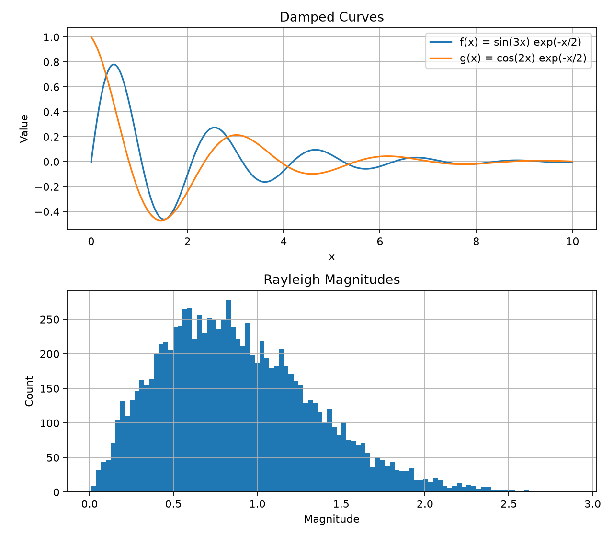
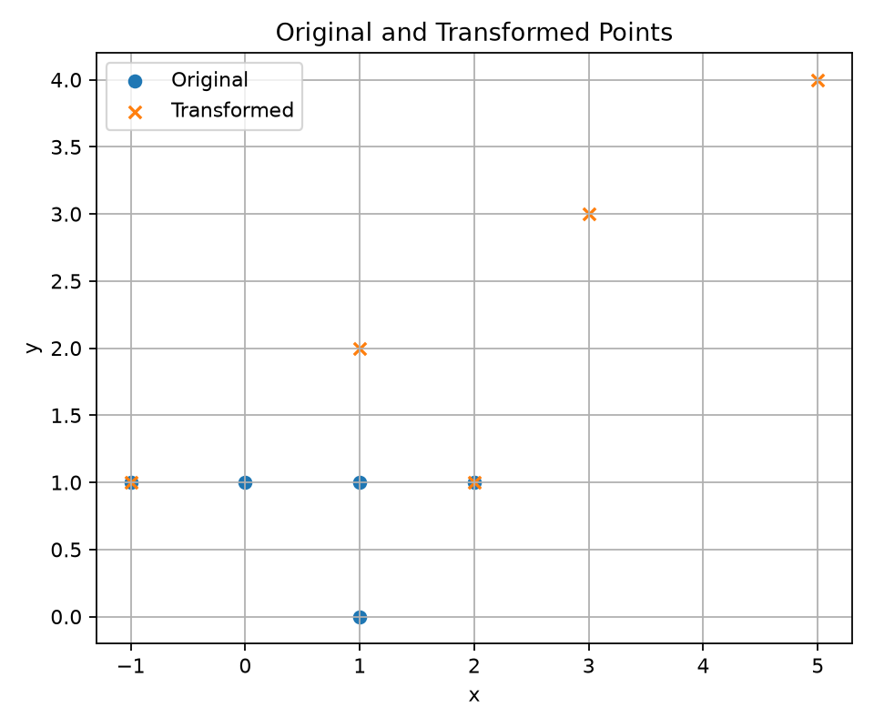
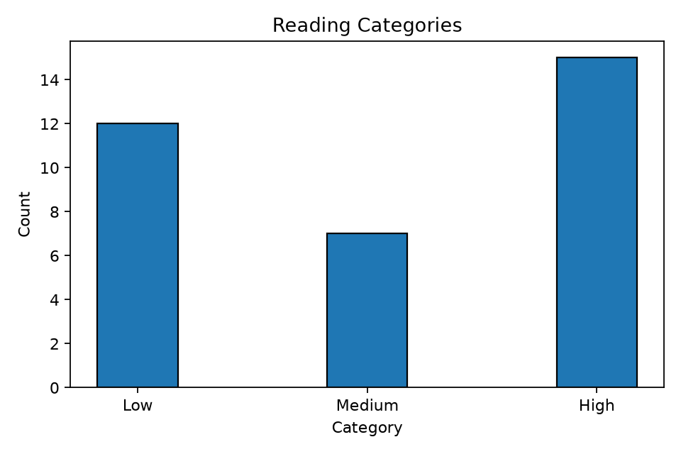

이 글은 Mega Review 문서의 **미니 드릴 M1–M6 여섯 개와 통합 문제 A–H 여덟 영역을 모두** 풀이한다. 문제는 영어 원문과 한국어 번역으로 읽고, 바로 아래의 **요구사항에 대응하는 한국어 주석 코드 → 동작 해설 → 출력·주의점**으로 확인할 수 있다. 문제 본문을 코드 블록에 넣지 않았으며 코드와 데이터 예시만 코드 블록으로 구분했다.

먼저 짧은 M1–M6로 핵심 동작을 확인하고, 이어서 A–H가 한 프로그램에서 어떻게 연결되는지 읽는 순서다. PDF의 `[01]`–`[18]` 문법 표식도 주석과 빠른 색인에 유지했다. 전체 실행 파일은 [ZIP](mega_review.zip)에 있고, 본문 A–H 코드는 그 파일의 실제 부분이다. PDF의 줄 번호를 옮겨 적거나 다른 자료를 대조할 필요는 없다.

## 빠른 목차 — 문제 이름에서 코드로 바로 이동

| 번호 | 확인할 개념 | 문제·번역 | 구현 코드 | 해설 |
| --- | --- | --- | --- | --- |
| M1 | 문자열 삽입과 회문 | [문제](#m1-question) | [코드](#m1-code) | [해설](#m1-explain) |
| M2 | 중첩 복사와 is·== | [문제](#m2-question) | [코드](#m2-code) | [해설](#m2-explain) |
| M3 | 함수 인자·lambda·기본값 | [문제](#m3-question) | [코드](#m3-code) | [해설](#m3-explain) |
| M4 | global 카운터와 반환값 | [문제](#m4-question) | [코드](#m4-code) | [해설](#m4-explain) |
| M5 | 입력 반복과 종료 범위 | [문제](#m5-question) | [코드](#m5-code) | [해설](#m5-explain) |
| M6 | zip·튜플 키·broadcasting | [문제](#m6-question) | [코드](#m6-code) | [해설](#m6-explain) |
| A | 파일 입력과 평균 보고서 | [문제](#a-question) | [코드](#a-code) | [해설](#a-explain) |
| B | 독립 문자열 모듈 | [문제](#b-question) | [코드](#b-code) | [해설](#b-explain) |
| C | Sensor와 보정 센서 상속 | [문제](#c-question) | [코드](#c-code) | [해설](#c-explain) |
| D | 중첩 명단·튜플 키·기본 정렬 | [문제](#d-question) | [코드](#d-code) | [해설](#d-explain) |
| E | 복소수와 일급 함수 | [문제](#e-question) | [코드](#e-code) | [해설](#e-explain) |
| F | 윤년과 안전한 날짜 갱신 | [문제](#f-question) | [코드](#f-code) | [해설](#f-explain) |
| G | NumPy·행렬·세 종류의 그림 | [문제](#g-question) | [코드](#g-code) | [해설](#g-explain) |
| H | 선택 가위바위보 콘솔 | [문제](#h-question) | [코드](#h-code) | [해설](#h-explain) |
| 실행 | 전체 파일·모드·결과 | [준비](#setup) | [main](#main-entry) | [전체 실행 결과](#run-result) |
| 확인 | 오류·함정·검증 결과 | [오류 검색표](#traps) | [자동 테스트](test_mega_review.py) | [검증](#verification) |

<a id="syntax-index"></a>

## 0. 20분 문법 색인 — 기억이 안 나는 이름으로 찾기

**20분 경로:** 색인과 실행 구조 2분 → M2·M3·M5의 복사·함수·루프 5분 → A·C·F의 검증·저장 순서 6분 → G의 shape·행렬·그림 5분 → 나머지 미니 문제와 오류 검색표 2분. PDF의 통합 문제는 실제 두 시간 분량을 예측한 문제가 아니라 여러 개념을 묶은 비공식 연습 자료다.

| 표식 | 문법 | 구현 위치와 해석 |
| --- | --- | --- |
| [01] | import·모듈·main guard·sys·random | [준비](#setup), [B 모듈](#b-code), [H 종료](#h-code), [main](#main-entry) |
| [02] | 지역·전역 범위 | [M4](#m4-explain), [E rec_to_pol](#e-code) |
| [03] | 사용자 예외 class·raise | [A InvalidReadingError](#a-code) |
| [04] | with open·rt·wt·encoding | [A 읽기·쓰기](#a-code) |
| [05] | for·while True·continue·break·if/elif/else | [M5](#m5-code), [H](#h-code) |
| [06] | 리스트 컴프리헨션·필터 | [A values·selected](#a-code), [D 독립 목록](#d-code) |
| [07] | try/except·raise | [A 줄 폐기](#a-explain), [F 생성 실패](#f-explain) |
| [08] | list·dict·items·append·insert·del·sort | [D](#d-code) |
| [09] | 함수 반환·튜플 unpacking·기본/키워드 인자 | [M3](#m3-explain), [E gain](#e-code), [main](#main-entry) |
| [10] | 딕셔너리 컴프리헨션 | [A 평균](#a-code), [M6 튜플 키](#m6-code) |
| [11] | lambda·sorted·key·reverse | [A 평균 정렬](#a-explain), [M3 함수](#m3-code) |
| [12] | zip·enumerate·start=1 | [M6](#m6-explain), [E](#e-code), [A 보고서](#a-code) |
| [13] | 참일 값 if 조건 else 거짓일 값 | [A HIGH/LOW](#a-code) |
| [14] | init·self·private·str·classmethod·super·override | [C](#c-explain), [F](#f-explain) |
| [15] | 얕은 복사·방어적 복사·NumPy view/copy | [M2](#m2-explain), [C](#c-explain), [G](#g-explain) |
| [16] | 역순 슬라이싱·2D 슬라이싱·and/or·나머지·내림 | [M1](#m1-code), [F 윤년](#f-code), [G view](#g-explain) |
| [17] | complex·real/imag·atan2·함수 객체 | [E](#e-explain) |
| [18] | linspace·reshape·@·linalg·plot/hist/scatter/bar | [G](#g-explain), [M6 broadcasting](#m6-explain) |

<a id="setup"></a>

## 1. 실행 준비와 전체 문제의 연결 구조

[전체 풀이·테스트 ZIP](mega_review.zip)을 **같은 폴더에** 풀고 실행한다. VS Code·PyCharm에서는 NumPy·Matplotlib이 설치된 같은 Python 인터프리터를 선택한다. 필요하면 해당 환경에서 `python -m pip install numpy matplotlib`을 실행한다.

```text
mega_review/
    ENAI607_Mega_Review.py  # A-H 통합 프로그램
    lab_strings.py         # B 독립 문자열 모듈
    lab_readings.txt       # A 입력 데이터
    mini_drills.py         # M1-M6 독립 연습 코드
    test_mega_review.py    # 36개 자동 테스트
    README.md
```

```text
python ENAI607_Mega_Review.py          # 입력·창 없이 보고서와 PNG 3개 생성
python ENAI607_Mega_Review.py --show   # 저장한 뒤 그래프 창도 표시
python ENAI607_Mega_Review.py --game   # 선택적 가위바위보 입력 모드
python mini_drills.py                 # 입력 없는 M1-M4·M6 시연
python mini_drills.py --input         # M5 반복 입력 연습
python mini_drills.py --exit          # Bye 출력 후 스크립트 종료
python test_mega_review.py            # 자동 검증
```

| 시작 | 처리 | 결과 |
| --- | --- | --- |
| lab_readings.txt | A 읽기·검증·평균 | lab_summary.txt |
| A의 data | C Sensor·CalibratedSensor | raw 평균과 보정 평균 확인 |
| 별도 학생·계정 자료 | D 중첩 변경·복사·튜플 키·정렬 | 객체 공유와 독립성 확인 |
| 복소수·날짜 자료 | E 함수 전달, F 날짜 검증 | 변환 횟수·상태 보존 확인 |
| 수치 표본과 행렬 | G 벡터 연산·행렬·그림 | PNG 3개 |
| `--game`만 지정 | H 입력·난수·판정·통계 | 종료 전 승·패·무 통계 |

기본 실행에는 입력 프롬프트가 없다. M5와 `--game`은 사람이 입력하는 별도 연습이다. 출력 파일은 **스크립트 파일 옆**에 저장하므로 터미널의 현재 위치가 달라도 경로가 맞는다.

### 통합 파일의 공통 import와 경로

아래 **A–H 코드는 한 통합 파일의 부분**이므로 한 블록만 따로 실행하는 예제가 아니다. ZIP을 쓰거나, 공통 import → A–H → 마지막 main을 같은 파일에 둔다. B만 별도 lab_strings.py 파일이다. 반면 M1–M6 구현 블록은 각각의 초기값·import·호출문을 포함하여 따로 실험할 수 있다. M5는 안내한 입력이 필요하다.

```python
from pathlib import Path
import math
import random
import sys
import numpy as np
import matplotlib

# 기본 실행은 PNG 저장만 한다. --show일 때만 환경의 그래픽 backend를 사용한다.
if "--show" not in sys.argv:
    matplotlib.use("Agg")
import matplotlib.pyplot as plt
import lab_strings  # [01] 같은 폴더의 모듈. 호출할 때 lab_strings.를 붙인다.

BASE_DIR = Path(__file__).resolve().parent  # 현재 터미널 위치가 아닌 코드 파일 위치.
DATA_FILE = BASE_DIR / "lab_readings.txt"
OUTPUT_FILE = BASE_DIR / "lab_summary.txt"
conversion_count = 0  # [02] rec_to_pol이 공유하는 모듈 수준의 누적 횟수.
```

### 제공된 입력 데이터

```text
Ava,10,20,30
Ben,5,15,25
Ava,20,40
Cara,8,12,16
Bad,3,hello,4
```

<details>
<summary>전체 상황·공통 요구사항 · English / 한국어</summary>

<section class="problem-statement" lang="en">

#### English · 전체 상황과 공통 검증

ENAI 607 / MEGA REVIEW One Integrated Programming Problem Engineering Lab Review System | Practice Sets A, B, and C UNOFFICIAL PRACTICE. Not an actual examination, university homework, or a prediction of exam questions. This one problem consolidates the main constructs exercised in the nine earlier practice problems. The solution follows after the problem statement. Scenario. A small engineering laboratory maintains sensor logs, calibrated instruments, a trainee roster, access records, complex-valued measurements, schedules, and numerical plots. Write a working Python program that processes the records and provides a training console. Use only the Python standard library, NumPy, and Matplotlib. The functions below are parts of one integrated program. Required files: ENAI607_Mega_Review.py, lab_strings.py, lab_readings.txt. The main script must import the string module. Test normal operation without interactive prompts, and provide an optional `--game` mode.

Required verification Provide repeatable assertions or printed checks covering invalid sensor data, defensive copies, subclass behavior, a leap-year boundary case, a failed date update, NumPy matrix recovery, the expected output files, and each RPS decision. Use readable function names and comments. Suggested outputs: lab_summary.txt, lab_simulation.png, lab_scatter.png, lab_bars.png. This integrated question is deliberately longer than a real two-hour exam problem and is intended for last-minute review, not as a timed prediction.

</section>

<section class="problem-statement" lang="ko">

#### 한국어 · 전체 상황과 공통 검증

**ENAI 607 Mega Review — Sets A·B·C를 연결하는 하나의 통합 프로그래밍 문제.** 비공식 연습 자료이며 실제 시험·대학 과제·출제 예측이 아니다. 앞선 아홉 연습문제의 주요 문법을 통합하며 원문에도 문제 뒤에 풀이가 들어 있다.

공학 실험실이 센서 로그·보정 계측기·교육생 명단·출입 기록·복소수 측정·일정·수치 그래프를 관리한다. 기록을 처리하고 훈련 콘솔을 제공하는 실행 가능한 프로그램을 작성하시오. **표준 라이브러리·NumPy·Matplotlib만 사용**하시오. 각 함수는 한 통합 프로그램의 일부다.

필수 파일은 ENAI607_Mega_Review.py·lab_strings.py·lab_readings.txt다. 메인 스크립트는 문자열 모듈을 import해야 한다. 일반 동작은 사용자 입력 없이 테스트하고, 선택적인 `--game` 모드를 제공하시오. 입력 파일의 내용은 바로 위에 제시했다.

**필수 검증:** 잘못된 센서 데이터, 방어적 복사, 자식 클래스 동작, 윤년 경계, 실패한 날짜 갱신, NumPy 행렬 복원, 예상 출력 파일, 모든 가위바위보 판정을 반복 가능한 assert 또는 출력 검사로 확인하시오. 읽기 쉬운 함수 이름과 주석을 쓰시오.

권장 출력은 lab_summary.txt·lab_simulation.png·lab_scatter.png·lab_bars.png다. 이 통합 문제는 실제 두 시간짜리 시험 문제보다 의도적으로 길며 최종 복습용이다.

</section>

</details>


## 2. M1 — 문자열 삽입과 회문

<a id="m1-question"></a>

### M1.1 문제 원문과 한국어 번역

<section class="problem-statement" lang="en">

#### English · 문제 원문

##### M1. String functions and slicing | 5-8 minutes

Write insert_text(text, addition, pos) that inserts a substring using slicing. Reject a position outside 0..len(text) by raising ValueError. Do not use replace(), find(), or join(). Then write is_palindrome(text) using a negative slice step. Predict these two outputs.

```python
print(insert_text("ABCD", "xy", 2))
print(is_palindrome("level"))
```

</section>

<section class="problem-statement" lang="ko">

#### 한국어 · 전체 번역

**문자열 함수와 슬라이싱 / 권장 5–8분.** 슬라이싱으로 문자열을 삽입하는 `insert_text(text, addition, pos)`를 작성하시오. 0부터 len(text)까지 양끝을 포함한 범위 밖의 위치는 **ValueError를 발생시켜 거부**하시오. replace(), find(), join()은 사용하지 마시오.

그다음 음수 슬라이스 간격으로 `is_palindrome(text)`를 작성하고 아래 두 출력을 예측하시오.

```python
print(insert_text("ABCD", "xy", 2))
print(is_palindrome("level"))
```

</section>

<a id="m1-code"></a>

### M1.2 구현 코드 — 한국어 주석으로 읽기

```python
def insert_text(text, addition, pos):
    # 통합 B의 str_insert와 달리, 이 문제는 잘못된 위치에 예외를 요구한다.
    if pos < 0 or pos > len(text):
        raise ValueError("invalid position")
    # pos는 새 문자가 들어갈 위치다. 앞은 pos 미포함, 뒤는 pos부터 시작한다.
    return text[:pos] + addition + text[pos:]


def is_palindrome(text):
    # 이 미니 문제는 문자열 입력을 전제로 한다. 역순과 원래 값을 비교한다.
    return text == text[::-1]


def m1_demo():
    print(insert_text("ABCD", "xy", 2))  # ABxyCD
    print(is_palindrome("level"))  # True

m1_demo()  # 이 블록을 따로 실행할 때의 호출문.
```

**실행 출력**:

```text
ABxyCD
True
```

<a id="m1-explain"></a>

### M1.3 해설 — 요구사항이 구현된 위치

#### 요구사항을 코드로 읽기

`text[:pos]`는 pos 바로 앞까지, `text[pos:]`는 pos부터 끝까지다. pos=2라면 **AB + xy + CD → ABxyCD**다. 원래 text를 고치는 것이 아니라 새 문자열을 반환한다. pos=0은 맨 앞, pos=len(text)는 맨 뒤 삽입이다.

`text[::-1]`은 간격 -1로 역순을 만들고, `==`로 내용을 비교한다. `level`은 같으므로 True다. 이 미니 드릴의 입력은 문자열, pos는 정수라는 전제다. 대소문자와 문장부호는 임의로 지우지 않는다.

**여기서는 잘못된 위치에 ValueError가 필수다.** 통합 문제 B의 str_insert는 메시지 출력 + None이므로 그대로 가져오면 오류 처리 요구사항이 달라진다. 같은 삽입 문제라도 실패 규칙부터 읽자.


## 3. M2 — 중첩 복사와 is·==

<a id="m2-question"></a>

### M2.1 문제 원문과 한국어 번역

<section class="problem-statement" lang="en">

#### English · 문제 원문

##### M2. Nested lists, dictionary lookup, identity, and copying | 5 minutes

Predict the printed values after the following code, then fix the copy so that changing the copied grade list does not change the original. Explain the difference between is and ==.

```python
roster = {"Ava": {"grades": [80, 90]}}
other = roster.copy()
other["Ava"]["grades"].append(100)
print(roster["Ava"]["grades"])
print(roster is other, roster == other)
```

</section>

<section class="problem-statement" lang="ko">

#### 한국어 · 전체 번역

**중첩 리스트·딕셔너리 조회·동일성·복사 / 권장 5분.** 다음 코드의 출력을 예측하시오. 그런 다음 **복사한 성적 리스트를 바꿔도 원본이 바뀌지 않도록 복사를 수정**하시오. `is`와 `==`의 차이를 설명하시오.

```python
roster = {"Ava": {"grades": [80, 90]}}
other = roster.copy()
other["Ava"]["grades"].append(100)
print(roster["Ava"]["grades"])
print(roster is other, roster == other)
```

</section>

<a id="m2-code"></a>

### M2.2 구현 코드 — 한국어 주석으로 읽기

```python
def m2_demo():
    roster = {"Ava": {"grades": [80, 90]}}
    other = roster.copy()  # 새 바깥 dict만 생성. 내부 dict와 list는 공유한다.
    other["Ava"]["grades"].append(100)
    print(roster["Ava"]["grades"])  # [80, 90, 100]
    print(roster is other, roster == other)  # False True
    # 비교를 위해 초기 데이터를 다시 만든다. 이미 100이 추가된 원본을 복사하지 않는다.
    roster = {"Ava": {"grades": [80, 90]}}
    independent = {name: {"grades": record["grades"].copy()}
                   for name, record in roster.items()}
    independent["Ava"]["grades"].append(100)
    print(roster["Ava"]["grades"])  # [80, 90]
    print(roster is independent, roster == independent)  # False False
    return roster, independent

m2_demo()  # 이 블록을 따로 실행할 때의 호출문.
```

**실행 출력**:

```text
[80, 90, 100]
False True
[80, 90]
False False
```

<a id="m2-explain"></a>

### M2.3 해설 — 요구사항이 구현된 위치

#### 왜 False True가 함께 나올까?

바깥 dict는 새 객체여서 `roster is other`는 False다. 내부 Ava 딕셔너리와 grades 리스트는 공유하므로 append한 100이 원본에도 보인다. 두 바깥 dict가 가리키는 내용은 여전히 같아 **`roster == other`는 True**다.

수정 코드에서는 이름별 새 내부 딕셔너리와 새 성적 리스트를 만든다. 숫자 성적은 불변이므로 리스트 안 숫자까지 복제할 필요는 없다. 독립본을 수정한 뒤 원본은 [80,90], 복사본은 [80,90,100]이라 내용 비교도 False다.

**이미 100이 붙은 roster를 복사한 뒤 원본이 [80,90]이라고 예상하면 안 된다.** 예제는 초기 데이터를 다시 만든 다음 독립 복사를 시연한다. 구조가 더 깊고 복잡해지면 표준 `copy.deepcopy()`도 선택할 수 있다. 이 재구성 방식은 현재의 알려진 구조에 맞춘 복사다.


## 4. M3 — 함수 인자·lambda·기본값

<a id="m3-question"></a>

### M3.1 문제 원문과 한국어 번역

<section class="problem-statement" lang="en">

#### English · 문제 원문

##### M3. Functions as arguments, lambda, and default / keyword arguments | 5 minutes

Write apply_each(values, operation) that returns a new list after calling operation on each input. Define multiply(x, factor=2). Call apply_each once with abs and once with a lambda that doubles each number. Explain why passing abs works but passing abs() without an argument does not.

```python
values = [-2, -1, 3]
# Expected: [2, 1, 3] and [-4, -2, 6]
```

</section>

<section class="problem-statement" lang="ko">

#### 한국어 · 전체 번역

**함수 인자·lambda·기본 인자·키워드 인자 / 권장 5분.** 각 입력에 operation을 호출하여 새 리스트를 반환하는 `apply_each(values, operation)`을 작성하시오. `multiply(x, factor=2)`를 정의하시오.

apply_each에 abs를 전달하여 한 번, 각 수를 두 배로 만드는 lambda를 전달하여 한 번 호출하시오. **abs를 전달하면 되지만 인자 없이 abs()를 전달하려 하면 안 되는 이유**를 설명하시오.

```python
values = [-2, -1, 3]
# 예상 결과: [2, 1, 3], [-4, -2, 6]
```

</section>

<a id="m3-code"></a>

### M3.2 구현 코드 — 한국어 주석으로 읽기

```python
def apply_each(values, operation):
    # operation에는 함수가 들어온다. 반환값들로 새 리스트를 만들어 원본을 유지한다.
    return [operation(value) for value in values]


def multiply(x, factor=2):
    return x * factor  # factor를 생략하면 2, 이름으로 전달하면 해당 값 사용.


def m3_demo():
    values = [-2, -1, 3]
    print(apply_each(values, abs))  # [2, 1, 3]
    print(apply_each(values, lambda x: multiply(x)))  # [-4, -2, 6]
    print(multiply(5))  # 10: 기본 인자.
    print(multiply(5, factor=3))  # 15: 키워드 인자.

m3_demo()  # 이 블록을 따로 실행할 때의 호출문.
```

**실행 출력**:

```text
[2, 1, 3]
[-4, -2, 6]
10
15
```

<a id="m3-explain"></a>

### M3.3 해설 — 요구사항이 구현된 위치

#### operation과 lambda를 실제 호출로 바꾸어 읽기

`apply_each(values, abs)`에서 operation은 abs라는 함수 객체다. 첫 반복은 `abs(-2)` → 2, 다음은 `abs(-1)` → 1이다. `lambda x: multiply(x)`는 x를 받으면 기본 factor=2인 multiply를 호출하는 작은 함수다. 따라서 -2 → -4, -1 → -2, 3 → 6이다.

| 표현 | 의미 |
| --- | --- |
| `abs` | 함수 객체 전달 |
| `abs(-2)` | 지금 실행한 결과 2 전달 |
| `abs()` | 인자가 없어 전달 전에 TypeError |
| `multiply(5)` | 기본 factor=2 → 10 |
| `multiply(5, factor=3)` | 키워드로 factor 지정 → 15 |

컴프리헨션은 원본 values를 바꾸지 않고 operation의 반환값들을 새 리스트로 모은다. lambda의 매개변수 이름 x는 임시 지역 이름이며 값 자체를 고정한 것이 아니다.


## 5. M4 — global 카운터와 반환값

<a id="m4-question"></a>

### M4.1 문제 원문과 한국어 번역

<section class="problem-statement" lang="en">

#### English · 문제 원문

##### M4. Global scope, mutable state, and return values | 4 minutes

Given calls = 0, write a function counted_square(x) that increments the module-level counter and returns x*x. Show what happens after two calls. Explain the role of global and why omitting it can raise UnboundLocalError.

</section>

<section class="problem-statement" lang="ko">

#### 한국어 · 전체 번역

**전역 범위·상태 변경·반환값 / 권장 4분.** `calls = 0`이 주어졌을 때 모듈 수준 카운터를 증가시키고 `x*x`를 반환하는 `counted_square(x)`를 작성하시오. 두 번 호출한 뒤의 결과를 보이시오. global의 역할과 이를 생략했을 때 UnboundLocalError가 발생할 수 있는 이유를 설명하시오.

</section>

<a id="m4-code"></a>

### M4.2 구현 코드 — 한국어 주석으로 읽기

```python
calls = 0  # 함수 호출마다 새로 만들지 않는 모듈 수준 변수.


def counted_square(x):
    global calls  # calls += 1이 지역 이름 재대입으로 해석되지 않게 한다.
    answer = x * x  # answer는 이번 호출만의 지역 변수다.
    calls += 1
    return answer


def m4_demo():
    before = calls
    print(counted_square(3))  # 9
    print(counted_square(4))  # 16
    print("Batch calls:", calls - before)  # 2
    print("Total calls:", calls)  # 처음 실행하면 2. 반복 호출 시 누적된다.

m4_demo()  # 이 블록을 따로 실행할 때의 호출문.
```

**실행 출력**:

```text
9
16
Batch calls: 2
Total calls: 2
```

<a id="m4-explain"></a>

### M4.3 해설 — 요구사항이 구현된 위치

#### 카운터의 값과 함수 반환값은 따로 추적한다

첫 호출은 9를 반환하고 calls를 1로, 두 번째는 16을 반환하고 calls를 2로 만든다. **정답 숫자 9·16과 부수 효과인 호출 횟수 2는 서로 다른 결과**다. calls를 함수 내부에서 매번 0으로 초기화하면 누적되지 않는다.

`calls += 1`은 읽기와 재대입을 모두 한다. global이 없으면 함수의 지역 이름 calls로 해석한 뒤, 아직 값이 없는 그 지역 이름을 읽으려 해 UnboundLocalError가 난다. 전역 변수를 읽기만 하는 경우에는 global 선언이 필요하지 않다.

정수 카운터는 전역 이름에 새 정수를 연결하는 것이다. 반면 이미 존재하는 전역 리스트에 `.append()`만 하는 것은 그 리스트 객체를 수정하는 동작이다. 이름 재대입과 내부 변경을 구분한다. 이 예제는 제곱 계산 성공 후 카운터를 올린다.


## 6. M5 — 입력 반복과 종료 범위

<a id="m5-question"></a>

### M5.1 문제 원문과 한국어 번역

<section class="problem-statement" lang="en">

#### English · 문제 원문

##### M5. while True / break / continue / try-except / sys.exit | 6 minutes

Write read_nonnegative_integer() that keeps asking until a valid nonnegative integer is entered. A noninteger or negative input should print an error and continue. Input "q" stops the loop and returns None. Separately, show how to exit an entire script after printing "Bye". Identify which statement stops only a loop and which stops the program.

</section>

<section class="problem-statement" lang="ko">

#### 한국어 · 전체 번역

**while True·break·continue·try/except·sys.exit / 권장 6분.** 올바른 음이 아닌 정수가 들어올 때까지 계속 입력받는 `read_nonnegative_integer()`를 작성하시오. 정수가 아니거나 음수이면 오류를 출력하고 다시 입력받아야 한다. **`"q"`를 입력하면 반복을 멈추고 None을 반환**한다.

이와 별도로 `"Bye"`를 출력한 뒤 스크립트 전체를 종료하는 방법을 보이시오. 반복문만 멈추는 문장과 프로그램을 멈추는 문장을 구분하시오.

</section>

<a id="m5-code"></a>

### M5.2 구현 코드 — 한국어 주석으로 읽기

**입력 시나리오:** hello → -1 → 0을 차례로 입력하면 두 오류 뒤 Returned: 0이다. q면 Returned: None이다. exit_program은 따로 호출할 때 Bye를 출력하고 종료한다.

```python
import sys

def read_nonnegative_integer():
    while True:
        raw = input("Nonnegative integer (q to quit): ")
        if raw == "q":
            break  # 가장 가까운 while만 끝낸 뒤 함수 마지막 return None으로 이동.
        try:
            number = int(raw)
        except ValueError:
            print("Invalid integer")
            continue  # 범위 검사를 실행하지 않고 입력부터 다시 받는다.
        if number < 0:
            print("Negative value")
            continue
        return number  # 정상 입력: 반복문뿐 아니라 이 함수 자체를 끝낸다.
    return None


def exit_program():
    print("Bye")
    sys.exit(0)  # SystemExit를 발생시켜 보통 스크립트를 종료한다.

print("Returned:", read_nonnegative_integer())
```

**실행 출력** (M5는 hello → -1 → 0을 모의 입력하고 프롬프트는 생략):

```text
Invalid integer
Negative value
Returned: 0
```

<a id="m5-explain"></a>

### M5.3 해설 — 요구사항이 구현된 위치

#### 입력 하나가 지나가는 네 갈래

| 입력 | 다음 동작 | 반환 |
| --- | --- | --- |
| `hello` | int 변환 실패 → 오류 출력 → continue | 아직 없음, 다시 입력 |
| `-1` | 변환은 성공, 범위 위반 → continue | 아직 없음, 다시 입력 |
| `0` 또는 양의 정수 | return number | 해당 정수 |
| 소문자 `q` | break → 루프 뒤 return None | None |

q를 int로 바꾸기 전에 검사한다. None과 유효한 0은 다르므로 호출자는 **`result is None`으로 취소를 구분**해야 한다. `if not result`는 0도 취소처럼 취급한다.

| 문장 | 멈추거나 건너뛰는 범위 |
| --- | --- |
| `continue` | 현재 반복의 남은 부분을 건너뛰고 다음 반복 |
| `break` | 가장 가까운 반복문 종료 |
| `return` | 현재 함수 종료 |
| `sys.exit(0)` | SystemExit를 발생시켜 보통 스크립트 종료 |

`exit_program()`은 호출할 때만 Bye를 출력하고 종료한다. 입력 함수 안에서 q가 나올 때 곧바로 sys.exit하면 None을 반환하라는 이 문제와 다르다. 단위 테스트는 SystemExit를 잡아서 종료 경로도 검증한다.


## 7. M6 — zip·튜플 키·broadcasting

<a id="m6-question"></a>

### M6.1 문제 원문과 한국어 번역

<section class="problem-statement" lang="en">

#### English · 문제 원문

##### M6. zip / enumerate / tuple keys and NumPy broadcasting | 6 minutes

Given names=["Ava","Ben"] and points=[8,10], make a dictionary with keys (name, index) where index starts at 1, and values from points. Use zip and enumerate. Then add the 1D array [10,20,30] to every row of the 2D array below without a for loop. Report the output shape. This array-shape example is extra practice, not a claim that general broadcasting is explicitly emphasized on the slides.

```python
import numpy as np
a = np.array([[1, 2, 3], [4, 5, 6]])
b = np.array([10, 20, 30])
```

</section>

<section class="problem-statement" lang="ko">

#### 한국어 · 전체 번역

**zip·enumerate·튜플 키·NumPy broadcasting / 권장 6분.** `names=["Ava","Ben"]`, `points=[8,10]`이 주어졌을 때, **1부터 시작하는 index와 name으로 만든 `(name, index)`를 키로**, points의 점수를 값으로 갖는 딕셔너리를 만드시오. zip과 enumerate를 사용하시오.

그다음 아래 2차원 배열의 **각 행에 1차원 배열 [10,20,30]을 for 없이 더하고 결과 shape를 제시**하시오. 이 배열 shape 예제는 추가 연습이며, 일반적인 broadcasting 전체가 강의에서 명시적으로 강조되었다는 주장은 아니다.

```python
import numpy as np
a = np.array([[1, 2, 3], [4, 5, 6]])
b = np.array([10, 20, 30])
```

</section>

<a id="m6-code"></a>

### M6.2 구현 코드 — 한국어 주석으로 읽기

```python
def m6_demo():
    import numpy as np
    names = ["Ava", "Ben"]
    points = [8, 10]
    records = {(name, index): score
               for index, (name, score) in enumerate(zip(names, points), start=1)}
    print(records)  # {('Ava', 1): 8, ('Ben', 2): 10}
    a = np.array([[1, 2, 3], [4, 5, 6]])  # shape (2,3).
    b = np.array([10, 20, 30])  # shape (3,): 각 행의 세 열과 맞춰진다.
    result = a + b  # Python 리스트의 +가 아니라 NumPy 원소별 덧셈과 broadcasting.
    print(result)  # [[11 22 33], [14 25 36]]
    print(result.shape)  # (2,3).
    return records, result

m6_demo()  # 이 블록을 따로 실행할 때의 호출문.
```

**실행 출력**:

```text
{('Ava', 1): 8, ('Ben', 2): 10}
[[11 22 33]
 [14 25 36]]
(2, 3)
```

<a id="m6-explain"></a>

### M6.3 해설 — 요구사항이 구현된 위치

#### 중첩된 for처럼 보이는 한 줄을 순서대로 풀기

`zip(names, points)`는 (Ava,8), (Ben,10)을 만든다. enumerate(..., start=1)이 이 쌍에 1·2를 붙이고, `index, (name, score)`가 바깥 번호와 안쪽 두 값을 각각 받는다. 마지막으로 **튜플 `(name,index)` 하나를 키로, score를 값으로 저장**한다.

zip은 입력이 짧은 쪽에서 멈춘다. 이 문제는 두 입력의 길이가 같지만 통합 E는 요청 개수가 정해져 있으므로 별도의 길이 검사가 필요하다. 문자열·정수로 이뤄진 현재 튜플 키는 해시 가능하다. 리스트를 포함한 튜플까지 언제나 키가 되는 것은 아니다.

| 식 | shape | 해석 |
| --- | --- | --- |
| a | (2,3) | 2행 3열 |
| b | (3,) | 마지막 축인 열 3개와 정렬 |
| a + b | (2,3) | 첫 행에 [10,20,30], 두 번째 행에도 같은 값 더함 |

결과의 첫 행은 [1+10,2+20,3+30], 두 번째 행은 [4+10,5+20,6+30]이다. **Python 리스트의 +는 연결이고, 여기의 +는 NumPy 원소별 덧셈**이다. broadcasting은 뒤쪽 축부터 크기가 같거나 한쪽이 1이면 맞출 수 있다는 규칙이다. b를 shape (2,)로 바꾸면 끝 크기 3과 2가 안 맞는다.


## 8. A — 파일 입력과 평균 보고서

<a id="a-question"></a>

### A.1 문제 원문과 한국어 번역

<section class="problem-statement" lang="en">

#### English · 문제 원문

##### A. Data input and summary reporting

Read the input file with with open. Ignore blank lines; split comma-separated fields, strip whitespace, and convert all readings to floating-point values. Count and skip invalid nonempty lines in their entirety by using try/except. Collect repeated names in a dictionary of lists. Return (data, invalid_count) as a tuple. Calculate averages with a dictionary comprehension; select names with mean at least 15 via a list comprehension. Sort by decreasing average using sorted(key=lambda ...). Assign HIGH or LOW with a conditional expression. Write a numbered report with enumerate(), f-strings, and two-digit decimal formatting.

</section>

<section class="problem-statement" lang="ko">

#### 한국어 · 전체 번역

입력 파일을 **with open으로 읽으시오.** 빈 줄은 무시하고, 쉼표로 필드를 분리하여 각 필드의 양끝 공백을 지운 뒤 모든 측정값을 float로 변환하시오. **try/except로 잘못된 비어 있지 않은 줄을 세고, 그 줄 전체를 버리시오.** 반복되는 이름은 딕셔너리 안의 리스트에 모으시오. `(data, invalid_count)`라는 튜플을 반환하시오.

- **딕셔너리 컴프리헨션으로 평균**을 계산한다.
- **리스트 컴프리헨션으로 평균이 15 이상인 이름**을 고른다.
- `sorted(key=lambda ...)`를 사용해 평균의 내림차순으로 정렬한다.
- 한 줄 조건 표현식으로 HIGH 또는 LOW를 정한다.
- `enumerate()`, f-string, 소수점 아래 두 자리 표시로 번호가 있는 보고서를 쓴다.

</section>

<a id="a-code"></a>

### A.2 구현 코드 — 한국어 주석으로 읽기

```python
class InvalidReadingError(Exception):  # [03] 이름·필드 구조 오류를 표현하는 사용자 예외.
    pass


def load_readings(filename):
    data = {}
    invalid = 0  # 반복문 밖: 각 줄마다 0으로 초기화하면 안 된다.
    with open(filename, "rt", encoding="utf-8") as file:  # [04] 끝나면 자동 close.
        for line in file:  # [05] readline을 중복 호출하지 않고 매 줄을 한 번씩 읽는다.
            if not line.strip():
                continue  # 빈 줄은 오류로 세지 않고 다음 줄로 넘어간다.
            fields = [field.strip() for field in line.split(",")]  # [06] 문자열 리스트.
            try:  # [07] 이 줄의 검증과 변환이 모두 끝나기 전에는 data를 바꾸지 않는다.
                if not fields[0] or len(fields) < 2:
                    raise InvalidReadingError("missing field")
                values = [float(field) for field in fields[1:]]
            except (InvalidReadingError, ValueError):
                invalid += 1  # 오류 값의 개수가 아니라 잘못된 줄 하나를 센다.
                continue  # Bad,3,hello,4에서 3과 4도 저장하지 않는다.
            if fields[0] in data:  # [08] 기존 이름이면 읽기 목록 뒤에 이어 붙인다.
                data[fields[0]].extend(values)
            else:
                data[fields[0]] = values
    return data, invalid  # [09] 쉼표가 있는 반환값은 두 항목 튜플이다.


def calculate_average(values):
    if not values:
        raise ValueError("empty readings")
    return sum(values) / len(values)


def make_report(data, invalid, filename=OUTPUT_FILE):
    # [10] name: 평균 구조이므로 딕셔너리 컴프리헨션이다.
    means = {name: calculate_average(vals) for name, vals in data.items()}
    # [06] 필터 뒤에 남는 것은 이름만 담은 리스트다.
    selected = [name for name, avg in means.items() if avg >= 15.0]
    # [11] items의 원소는 (이름, 평균). item[1]인 평균을 기준으로 내림차순 정렬.
    ordered = sorted(means.items(), key=lambda item: item[1], reverse=True)
    lines = []
    for number, (name, avg) in enumerate(ordered, start=1):  # [12] 1부터 번호 매김.
        status = "HIGH" if avg >= 20.0 else "LOW"  # [13] 한 줄 조건 표현식.
        lines.append(f"{number}. {name}: count = {len(data[name])}, "
                     f"average = {avg:.2f}, status = {status}")
    lines.append(f"Invalid lines: {invalid}")
    lines.append(f"Sensors with average >= 15.0: {selected}")
    with open(filename, "wt", encoding="utf-8") as file:
        # [01][04] write에는 문자열 하나. 모듈 함수로 줄들을 개행으로 연결한다.
        file.write(lab_strings.str_join(lines, "\n") + "\n")
    return means, selected, ordered
```

<a id="a-explain"></a>

### A.3 해설 — 요구사항이 구현된 위치

#### 한 줄을 통째로 성공시키고 나서 저장한다

1. `line.strip()`이 비면 continue하므로 빈 줄은 오류 수에 들어가지 않는다.
2. `line.split(",")`로 문자열 리스트를 만든 뒤 각 field의 `strip()`을 적용한다.
3. 이름이 비었거나 숫자 필드가 없으면 사용자 예외를 raise한다.
4. `values = [float(field) for field in fields[1:]]`로 숫자만 변환한다.
5. **모든 변환이 성공한 뒤에만 data에 저장·extend**한다.

Bad,3,hello,4에서 3을 먼저 data에 추가했다가 hello에서 실패하면 잘못된 줄 일부가 남는다. 풀이에서는 변환용 새 리스트를 만들다 실패하므로 그 줄의 3·4가 어느 이름에도 저장되지 않는다. 오류는 숫자 개수가 아니라 **줄당 한 번** 센다. 빈 숫자 필드 역시 float 변환에 실패한다.

#### 리스트·딕셔너리 컴프리헨션·lambda의 결과 모양

| 코드 | 결과 모양 | 이 예제 |
| --- | --- | --- |
| `data.items()` | (이름, 측정 목록) 쌍 | Ava → 5개 측정 |
| `{name: average ...}` | 이름:평균 dict | Ava:24.0, Ben:15.0, Cara:12.0 |
| `[name ... if avg >= 15]` | 이름 list | ['Ava','Ben'] |
| `sorted(means.items(), key=lambda item:item[1], reverse=True)` | 정렬된 튜플 list | [('Ava',24),('Ben',15),('Cara',12)] |

lambda는 각 (name,avg)의 **avg를 정렬 키로 반환**한다. 평균을 재계산하는 함수가 아니다. `enumerate`의 number는 출력 순번이며 readings 개수와 다르다. `len(data[name])`가 실제 측정 수다.

선택 이름 목록은 dict 입력 순서, 보고서 항목은 평균 내림차순이다. 현재 표본에서는 우연히 같은 순서다. 평균 20이면 HIGH, 15면 선택 목록에는 들어가지만 상태는 LOW다.

#### 사용자 예외와 숫자 변환 예외는 한 곳에서 처리

`class InvalidReadingError(Exception): pass`는 오류 종류를 정의하고, `raise InvalidReadingError(...)`가 실제로 발생시킨다. float가 발생시키는 ValueError와 함께 except 튜플에 넣어 같은 줄 폐기 정책을 적용했다. errors 카운터는 while/for 밖에 있어야 누적된다.

**이 단계의 요구는 숫자 변환이며, 음수 측정 거부는 C의 Sensor에서 수행한다.** 이름이 실제 사람 이름인지 같은 추가 규칙은 원문에 없으므로 비어 있지 않은지까지만 검사한다. BASE_DIR 기준의 DATA_FILE을 넘기므로 다른 폴더에서 실행해도 입력 파일 위치가 흔들리지 않는다.

**실제로 생성한 lab_summary.txt:**

```text
1. Ava: count = 5, average = 24.00, status = HIGH
2. Ben: count = 3, average = 15.00, status = LOW
3. Cara: count = 3, average = 12.00, status = LOW
Invalid lines: 1
Sensors with average >= 15.0: ['Ava', 'Ben']
```


## 9. B — 독립 문자열 모듈

<a id="b-question"></a>

### B.1 문제 원문과 한국어 번역

<section class="problem-statement" lang="en">

#### English · 문제 원문

##### B. Independent string utility module

Implement str_join(strings, sep="") without using the built-in join method; implement str_insert(dest_str, ins_str, pos) using slicing and your own str_join; implement is_palindrome(text) with isinstance() and negative-step slicing; implement center_with_dots(text, width) using integer division and string multiplication, not str.center(). Import the functions through import lab_strings, calling them with their module prefix.

</section>

<section class="problem-statement" lang="ko">

#### 한국어 · 전체 번역

독립 문자열 모듈을 구현하시오.

- 내장 문자열 `join` 메서드를 사용하지 않고 `str_join(strings, sep="")`을 구현한다.
- 슬라이싱과 **직접 만든 str_join으로** `str_insert(dest_str, ins_str, pos)`를 구현한다.
- `isinstance()`와 음수 간격 슬라이싱으로 `is_palindrome(text)`를 구현한다.
- 정수 나눗셈과 문자열 반복을 사용해 `center_with_dots(text, width)`를 구현한다. 내장 `str.center()`는 사용하지 않는다.
- **`import lab_strings`로 모듈을 가져오고**, 호출할 때 모듈 이름을 앞에 붙인다.

</section>

<a id="b-code"></a>

### B.2 구현 코드 — 한국어 주석으로 읽기

**파일: lab_strings.py.** 아래 테스트 호출 함수는 메인 파일에 둔다.

```python
"""B: 메인 프로그램에서 import하는 독립 문자열 모듈."""


def str_join(strings, sep=""):
    """내장 join을 사용하지 않고, 항목 사이에만 구분자를 넣는다."""
    result = ""
    for index, item in enumerate(strings):  # [05][12] 순서와 값을 함께 받는다.
        if index > 0:  # 첫 항목 앞에는 구분자가 없어야 한다.
            result += sep
        result += item
    return result  # 빈 입력이면 반복 없이 빈 문자열이 반환된다.


def str_insert(dest_str, ins_str, pos):
    """끝 위치도 유효하다. 잘못된 위치는 출력 후 None: M1의 raise와 다르다."""
    if pos < 0 or pos > len(dest_str):
        print("str_insert(): position input parameter out of range.")
        return None
    # [16] pos 앞부분 + 삽입 문자열 + pos부터의 뒷부분을 직접 만든 함수로 연결한다.
    return str_join([dest_str[:pos], ins_str, dest_str[pos:]])


def is_palindrome(text):
    if not isinstance(text, str):  # 숫자에는 문자열 역순 슬라이싱을 적용하지 않는다.
        print("is_palindrome(): the input parameter must be a string.")
        return None
    return text == text[::-1]  # 대소문자·문장부호를 그대로 비교한다.


def center_with_dots(text, width):
    padding = width - len(text)
    if padding < 0:
        raise ValueError("width must be at least the text length")
    left = padding // 2  # [16] 홀수 패딩의 남는 한 칸은 오른쪽으로 보낸다.
    right = padding - left
    return "." * left + text + "." * right  # 내장 center를 사용하지 않는다.
```

```python
def strings_demo():
    assert lab_strings.str_join(["red", "blue"], " / ") == "red / blue"
    assert lab_strings.str_join([]) == ""
    assert lab_strings.str_insert("abcdef", "XYZ", 3) == "abcXYZdef"
    assert lab_strings.str_insert("abcdef", "!", 6) == "abcdef!"
    assert lab_strings.str_insert("abc", "?", -1) is None  # 지정된 오류 메시지도 출력.
    assert lab_strings.is_palindrome("level") is True
    assert lab_strings.is_palindrome(123) is None
    assert lab_strings.is_palindrome("Python") is False
    assert lab_strings.center_with_dots("Data", 9) == "..Data..."
    print("String helpers OK:", lab_strings.center_with_dots("Lab", 9))
```

<a id="b-explain"></a>

### B.3 해설 — 요구사항이 구현된 위치

#### 구분자는 첫 항목 뒤부터, 삽입은 양쪽 슬라이스로

str_join은 index>0일 때만 sep를 먼저 붙인다. 그래서 양끝에 여분 구분자가 생기지 않는다. 빈 목록은 result 초기값인 빈 문자열이다. `str_insert("abcdef","XYZ",3)`은 abc + XYZ + def를 직접 만든 str_join으로 이어 붙인다.

is_palindrome은 **문자열인지 검사한 뒤** 역순 슬라이스를 적용한다. `center_with_dots("Data",9)`는 패딩 5칸, 왼쪽 5//2=2칸, 오른쪽 5-2=3칸이라 `..Data...`다.

메인 파일은 `import lab_strings`를 하므로 `lab_strings.str_insert(...)`처럼 모듈 접두사를 붙인다. 단순히 str_insert(...)라고 쓰려면 별도의 이름 가져오기가 필요하지만, 현재 문제는 모듈 접두사 호출을 요구한다.

| 함수 | 실패 규칙 |
| --- | --- |
| 통합 B의 str_insert | 메시지 출력 + None |
| 통합 B의 is_palindrome(숫자) | 메시지 출력 + None |
| 통합 B의 center_with_dots에서 폭 부족 | ValueError |
| 미니 M1의 insert_text | 범위 밖 pos이면 ValueError |

문자열은 불변이라 원문자열을 바꾸는 것이 아니라 결과 문자열을 만든다. `str_join`과 `center_with_dots`를 구현하면서 금지한 내장 메서드를 호출하지 않았는지도 확인해야 한다. 결과만 같으면 충분한 문제가 아니다.


## 10. C — Sensor와 보정 센서 상속

<a id="c-question"></a>

### C.1 문제 원문과 한국어 번역

<section class="problem-statement" lang="en">

#### English · 문제 원문

##### C. Classes for measuring instruments

Define Sensor with a class variable next_id, a defensive copy of the input reading list, private fields, getters, add_value, get_average, and `__str__`. Reject nonnumeric and negative readings with TypeError/ValueError. Implement @classmethod get_sensor_count(cls). Define CalibratedSensor(Sensor) with scale and offset; call super().`__init__`(), then override get_average() using scale * super().get_average() + offset. Verify distinct IDs and that returned lists cannot mutate stored lists.

</section>

<section class="problem-statement" lang="ko">

#### 한국어 · 전체 번역

클래스 변수 `next_id`, 입력 측정 리스트의 **방어적 복사**, private 필드, getter, `add_value`, `get_average`, `__str__`를 갖는 `Sensor` 클래스를 정의하시오. 숫자가 아닌 값과 음수 측정값을 각각 TypeError/ValueError로 거부하시오. `@classmethod get_sensor_count(cls)`를 구현하시오.

scale·offset을 갖는 `CalibratedSensor(Sensor)`를 정의하시오. `super().__init__()`를 호출하고, `get_average()`를 **scale × 부모 평균 + offset**으로 재정의하시오. 객체들의 ID가 다르며, 반환된 리스트를 통해 내부 리스트를 바꿀 수 없음을 검증하시오.

</section>

<a id="c-code"></a>

### C.2 구현 코드 — 한국어 주석으로 읽기

```python
class Sensor:
    next_id = 0  # [14] 모든 Sensor·하위 클래스가 사용하는 하나의 공통 카운터.

    def __init__(self, name, readings):
        if not isinstance(name, str) or not name.strip():
            raise ValueError("name must be a nonempty string")
        if not isinstance(readings, list):
            raise TypeError("readings must be a list")
        if not readings:
            raise ValueError("readings must be nonempty")
        for value in readings:
            self._validate_value(value)
        # 모든 검증을 통과한 객체만 ID를 배정하고 카운터를 증가시킨다.
        self.__id = Sensor.next_id
        Sensor.next_id += 1
        self.__name = name
        self.__readings = readings.copy()  # [15] 호출자가 원래 리스트를 바꿔도 보호.

    def _validate_value(self, value):
        # bool은 int의 하위 타입이지만 여기서는 센서 숫자로 허용하지 않는다.
        if isinstance(value, bool) or not isinstance(value, (int, float)):
            raise TypeError("reading must be numeric")
        if value < 0:
            raise ValueError("reading must be nonnegative")

    def get_id(self):
        return self.__id

    def get_name(self):
        return self.__name

    def get_values(self):
        return self.__readings.copy()  # [15] 읽어 간 리스트를 수정해도 내부는 보호.

    def add_value(self, value):
        self._validate_value(value)
        self.__readings.append(value)  # 실패한 검증 후에는 이 줄에 도달하지 않는다.

    def get_average(self):
        return sum(self.__readings) / len(self.__readings)

    def __str__(self):
        # self.get_average()는 객체가 하위 클래스라면 재정의한 메서드를 호출한다.
        return (f"Sensor {self.__id} ({self.__name}): "
                f"n={len(self.__readings)}, avg={self.get_average():.2f}")

    @classmethod
    def get_sensor_count(cls):
        return Sensor.next_id  # 하위 클래스별 수가 아니라 전체 생성 수라는 의도.


class CalibratedSensor(Sensor):
    def __init__(self, name, readings, scale, offset):
        # 부모가 ID를 배정하기 전에 하위 클래스 인자도 먼저 검증한다.
        if (isinstance(scale, bool) or isinstance(offset, bool)
                or not isinstance(scale, (int, float))
                or not isinstance(offset, (int, float))):
            raise TypeError("scale and offset must be numeric")
        if scale <= 0:
            raise ValueError("scale must be positive")
        super().__init__(name, readings)  # [14] 복사·기본 검증·ID 배정을 부모에 맡긴다.
        self.__scale = scale
        self.__offset = offset

    def get_average(self):
        return self.__scale * super().get_average() + self.__offset
```

<a id="c-explain"></a>

### C.3 해설 — 요구사항이 구현된 위치

#### 방어적 복사는 들어올 때와 나갈 때 둘 다 필요하다

| 위치 | 필요한 이유 |
| --- | --- |
| 생성자 `readings.copy()` | 호출자가 원래 리스트를 바꾸는 우회 경로 차단 |
| getter `self.__readings.copy()` | 호출자가 반환 리스트를 바꾸는 우회 경로 차단 |
| getter 없이 내부 list 직접 반환 | private 이름이어도 반환한 참조로 수정 가능 |

리스트 원소가 현재 int·float이므로 바깥 리스트 복사로 독립성이 충분하다. private 접두사만 붙이고 원본 리스트를 그대로 보관하면 방어적 복사가 되지 않는다. ID는 모든 검증 후에 발급하여 실패한 생성이 카운터를 소모하지 않게 했다.

#### super와 override는 어느 평균을 호출할까?

Ben의 원래 측정은 [5,15,25]라 평균 15다. CalibratedSensor는 **1.5 × 15 + 2 = 24.5**를 반환한다. `super().get_average()`가 원래 평균을 계산하고, self의 보정 계수로 결과를 바꾼다. 여기서 `self.get_average()`를 다시 부르면 자기 자신을 반복 호출하여 재귀 오류가 날 수 있다.

부모의 `__str__` 안에는 self.get_average()가 있으므로 객체가 CalibratedSensor이면 **자식의 재정의한 평균**이 출력된다. 문자열 형식 메서드를 중복 작성할 필요가 없다.

클래스 변수 Sensor.next_id는 인스턴스 변수 self.__id와 다르다. 전자는 전체가 공유하는 다음 번호, 후자는 각 객체에 이미 배정된 번호다. classmethod의 cls는 호출에 사용된 클래스이지만, 이 구현의 요구는 Sensor와 자식 전체의 개수이므로 공통 Sensor.next_id를 읽는다. 살아 있는 객체 수를 세는 소멸 카운터가 아니다.

**보고서 A의 Ben 평균 15.00과 센서 C의 보정 평균 24.50은 둘 다 맞다.** A는 raw data, C는 보정 객체의 계산 결과다. type(value)가 bool인 경우도 수치 측정으로 받지 않도록 이 풀이에서 명시적으로 거부했다. 음수는 ValueError, 문자 같은 비숫자는 TypeError이며 잘못된 add_value는 내부 리스트를 변경하지 않는다.


## 11. D — 중첩 명단·튜플 키·기본 정렬

<a id="d-question"></a>

### D.1 문제 원문과 한국어 번역

<section class="problem-statement" lang="en">

#### English · 문제 원문

##### D. Trainee roster and access records

Represent trainees as a list of dictionaries containing lists. Append/insert/swap grades by indexing and list methods. Show that changing a nested list through a shallow outer copy also changes the original; show that replacing a top-level item does not. Create independent grade lists by list comprehension. Contrast is and ==. Maintain access records whose dictionary keys are (username, passcode) tuples; demonstrate lookup, membership, update, addition, and del. Sort a list of (name, price) tuples using default list.sort().

</section>

<section class="problem-statement" lang="ko">

#### 한국어 · 전체 번역

교육생 명단을 내부에 리스트가 들어 있는 딕셔너리들의 리스트로 표현하시오. 인덱싱과 리스트 메서드로 성적을 추가·삽입·교환하시오.

- 얕은 바깥 복사본을 통해 내부 리스트를 수정하면 원본도 바뀜을 보인다.
- 반대로 바깥 항목 자체를 교체하면 원본 항목은 바뀌지 않음을 보인다.
- 리스트 컴프리헨션으로 **서로 독립된 성적 리스트**를 만든다.
- `is`와 `==`의 차이를 비교한다.
- `(username, passcode)` 튜플을 키로 갖는 출입 기록 딕셔너리에서 조회·포함 검사·수정·추가·`del` 삭제를 시연한다.
- `(name, price)` 튜플 리스트를 **기본 `list.sort()`로 정렬**한다.

</section>

<a id="d-code"></a>

### D.2 구현 코드 — 한국어 주석으로 읽기

```python
def roster_demo():
    students = [
        {"name": "Jodie", "grades": ["A", "A-", "B"]},
        {"name": "Paul", "grades": ["C", "B", "B"]},
        {"name": "Krissie", "grades": ["A-", "A", "B", "A+", "A"]},
        {"name": "Peter", "grades": ["D", "XF"]},
    ]
    students[2]["grades"].append("A")  # [08][15] 리스트 -> 딕셔너리 -> 내부 리스트.
    paul = students[1]["grades"]
    paul[0], paul[1] = paul[1], paul[0]  # 오른쪽 값을 먼저 구하므로 안전하게 교환.
    students.insert(2, {"name": "Joel", "grades": ["A", "C", "B", "B"]})
    assert students[2]["name"] == "Joel"  # 삽입 후 Krissie는 index 3이다.
    backup = students.copy()
    print("Before edits, identity/equality:", students is backup, students == backup)
    backup[0]["grades"][0] = "B+"  # 공유하는 안쪽 성적 리스트를 수정한다.
    assert students[0]["grades"][0] == "B+"
    backup[0] = {"name": "Replacement", "grades": []}  # backup의 바깥 칸 하나만 재대입.
    assert students[0]["name"] == "Jodie"
    independent = [{"name": s["name"], "grades": s["grades"].copy()}
                   for s in students]  # 학생마다 새 딕셔너리와 새 성적 리스트를 만든다.
    independent[0]["grades"][0] = "C"
    assert students[0]["grades"][0] == "B+"
    print("Original/independent first grades:", students[0]["grades"][0],
          independent[0]["grades"][0])
    print("After replacement, identity/equality:", students is backup, students == backup)
    accounts = {("joe", 786): 123456, ("jill", 545): 444567,
                ("ted", 346): 578345, ("gwen", 172): 771988}
    assert accounts[("jill", 545)] == 444567
    assert ("joe", 172) not in accounts  # 이름이 같아도 코드를 포함한 튜플 전체가 달라진다.
    accounts[("ted", 346)] = 576644
    accounts[("sasha", 988)] = 111111
    del accounts[("gwen", 172)]
    assert len(accounts) == 4
    products = [("widget", 5.28), ("gadget", 10.44),
                ("widget", 5.55), ("cool stuff", 6.87)]
    products.sort()  # [08] key 없음: 이름을 먼저 비교하고 같으면 가격을 비교한다.
    print("Sorted products:", products)
    return students, backup, independent, accounts, products
```

<a id="d-explain"></a>

### D.3 해설 — 요구사항이 구현된 위치

#### 어떤 층을 수정하는지 왼쪽부터 따라간다

`students[2]["grades"]`는 2번 학생 dict의 성적 list다. Krissie에 A를 추가하고 Paul의 처음 두 성적을 교환한 뒤 index 2에 Joel을 넣는다. **삽입 뒤 Krissie의 인덱스는 3**이다.

| 시점 | `students is backup` | `students == backup` |
| --- | --- | --- |
| 바깥 copy 직후 | False | True |
| 공유 성적만 바꾼 뒤 | False | True |
| backup[0]을 새 dict로 교체한 뒤 | False | False |

공유 성적을 수정하면 둘 다 같은 내용을 보지만, backup의 바깥 칸을 새 dict로 교체하면 원본의 칸은 그대로다. independent는 **새 dict와 새 grades 리스트를 학생마다 생성**하므로 원본의 B+는 유지하고 독립본만 C가 된다.

튜플 키는 (username,passcode) 전체가 키 하나다. 이름이 joe인 키가 있어도 (joe,172)는 없을 수 있다. `in accounts`는 키, `.values()`는 값 검사다. 기존 Ted 키에 대입하면 수정, 새 Sasha 키면 추가, del Gwen이면 삭제라 최종 개수는 4다.

products.sort()는 이름부터 비교하고, 같은 widget이면 가격을 비교한다. **가격만을 기준으로 전체 정렬하는 것이 아니다.** sort의 반환값은 None이므로 `products = products.sort()`라고 다시 대입하지 않는다.


## 12. E — 복소수와 일급 함수

<a id="e-question"></a>

### E.1 문제 원문과 한국어 번역

<section class="problem-statement" lang="en">

#### English · 문제 원문

##### E. Complex measurements and functions as objects

Implement rec_to_pol(z) using abs(z) and math.atan2(z.imag, z.real). Use global conversion_count to count conversions. Implement create_tuple(names, samples, num) using zip() and tuple(), returning None when inputs are too short. Implement apply_gain(z, gain=1.0) and demonstrate both default and keyword arguments. Implement apply_function(samples, operation) with a loop that invokes the passed function. Test passing both abs and rec_to_pol as objects, not called results.

</section>

<section class="problem-statement" lang="ko">

#### 한국어 · 전체 번역

`abs(z)`와 `math.atan2(z.imag, z.real)`로 `rec_to_pol(z)`를 구현하시오. `global conversion_count`를 사용해 변환 횟수를 세시오.

- `zip()`과 `tuple()`을 사용하는 `create_tuple(names, samples, num)`을 구현하고, 입력 길이가 부족하면 None을 반환한다.
- `apply_gain(z, gain=1.0)`을 구현하고 기본 인자와 키워드 인자 사용을 보인다.
- 전달받은 함수를 반복문에서 호출하는 `apply_function(samples, operation)`을 구현한다.
- **이미 호출한 결과가 아니라 함수 객체 자체인 abs와 rec_to_pol을 각각 전달**하여 테스트한다.

</section>

<a id="e-code"></a>

### E.2 구현 코드 — 한국어 주석으로 읽기

```python
def rec_to_pol(z):
    global conversion_count  # [02] 전역 이름에 새 정수 값을 다시 대입하겠다는 선언.
    magnitude = abs(z)
    phase = math.atan2(z.imag, z.real)  # [17] (허수부, 실수부), 각도는 라디안.
    conversion_count += 1  # 계산이 성공한 뒤 집계한다.
    return magnitude, phase


def create_tuple(names, samples, num):
    if len(names) < num or len(samples) < num:
        return None  # zip이 짧은 입력에 맞춰 조용히 줄어들기 전에 거부한다.
    return tuple(zip(names[:num], samples[:num]))  # [12] num=0이면 ().


def apply_gain(z, gain=1.0):
    return z * gain  # [09] 기본 인자. complex는 불변이라 방어적 리스트 복사 불필요.


def apply_function(samples, operation):
    result = []
    for value in samples:
        result.append(operation(value))  # [17] 전달받은 함수 자체를 여기서 호출한다.
    return result


def complex_demo():
    samples = [1 + 1j, 3 + 4j, -1 + 1j]
    labels = ["S1", "S2", "S3", "EXTRA"]
    pairs = create_tuple(labels, samples, 3)
    assert len(pairs) == 3 and create_tuple(labels, samples, 4) is None
    assert create_tuple([], [], 0) == ()
    print("Complex pairs:", pairs)
    print("Default gain:", apply_gain(3 + 4j))
    print("Positional gain:", apply_gain(3 + 4j, 2))
    print("Keyword gain:", apply_gain(3 + 4j, gain=0.5))
    magnitudes = apply_function(samples, abs)  # 함수 전달은 이름만, 괄호 없음.
    before = conversion_count
    polar = apply_function(samples, rec_to_pol)
    assert conversion_count - before == 3  # 앞선 직접 호출이 있더라도 이번 횟수는 3.
    assert magnitudes == [abs(z) for z in samples]
    print("Polar values:", polar)
    print("Batch / total conversions:", conversion_count - before, conversion_count)
    return pairs, magnitudes, polar
```

<a id="e-explain"></a>

### E.3 해설 — 요구사항이 구현된 위치

#### atan2의 입력 순서와 함수 전달의 괄호

`math.atan2(z.imag,z.real)`은 세로 좌표인 허수부가 먼저다. -1+1j는 실수부가 음수인 2사분면이므로 약 2.3562 라디안이다. `atan(imag/real)`만으로 계산하면 사분면을 잃고 실수부 0에서도 문제가 생긴다.

rec_to_pol은 **(크기, 라디안 위상) 튜플**을 반환한다. `global conversion_count`는 누적 정수 이름을 재대입하기 위해 필요하다. 이 풀이에서는 실제 계산이 성공한 다음 증가시키므로 잘못된 입력의 실패 호출은 집계하지 않는다.

| 전달식 | 실제 인자 | 결과 |
| --- | --- | --- |
| abs | 함수 객체 | 반복 안에서 abs(value) 호출 |
| rec_to_pol | 함수 객체 | 반복 안에서 변환 호출 |
| rec_to_pol(z) | 계산이 끝난 튜플 | 튜플을 operation처럼 호출하면 오류 |

create_tuple은 zip 전에 **양쪽 입력 중 하나라도 num개보다 짧으면 거부**한다. 비교는 and가 아니라 or다. num은 음이 아닌 정수라는 전제이며, 0개 요청은 정상 빈 튜플이다. 복소수 곱은 원래 z를 수정하지 않으므로 apply_gain에 방어적 list.copy가 필요하지 않다.

직접 테스트 호출이 추가되면 총 변환 수는 3을 넘을 수 있다. `before = conversion_count`를 저장해 **이번 batch의 차이는 3, total은 누적값**으로 구분했다. 이 기능을 테스트하려고 추가 호출하는 것조차 카운터를 바꾼다.


## 13. F — 윤년과 안전한 날짜 갱신

<a id="f-question"></a>

### F.1 문제 원문과 한국어 번역

<section class="problem-statement" lang="en">

#### English · 문제 원문

##### F. Calendar date validation

Define a Date class with DAYS_PER_MONTH and MONTH_NAMES class variables. Implement a private date-validation helper, getters, `__str__`, and set_date. Apply the Gregorian leap-year rule including century exceptions (1900 is not a leap year, 2000 is). Reject invalid constructor arguments with ValueError. On an invalid set_date(), print an error and preserve all original fields. Do not use datetime or calendar.

</section>

<section class="problem-statement" lang="ko">

#### 한국어 · 전체 번역

클래스 변수 `DAYS_PER_MONTH`와 `MONTH_NAMES`를 갖는 `Date` 클래스를 정의하시오. private 날짜 검증 보조 메서드, getter, `__str__`, `set_date`를 구현하시오.

세기 예외를 포함하는 그레고리력 윤년 규칙을 적용하시오. **1900년은 평년이고 2000년은 윤년**이다. 생성자의 잘못된 인자는 ValueError로 거부하시오. 잘못된 `set_date()`는 오류 메시지를 출력하고 **기존의 모든 필드를 보존**해야 한다. datetime이나 calendar는 사용하지 마시오.

</section>

<a id="f-code"></a>

### F.2 구현 코드 — 한국어 주석으로 읽기

```python
class Date:
    DAYS_PER_MONTH = (31, 28, 31, 30, 31, 30, 31, 31, 30, 31, 30, 31)
    MONTH_NAMES = ("January", "February", "March", "April", "May", "June",
                   "July", "August", "September", "October", "November", "December")

    def __init__(self, year, month, day):
        if not self.__valid_date(year, month, day):
            raise ValueError("Invalid date")
        self.__year, self.__month, self.__day = year, month, day

    def __valid_date(self, year, month, day):  # [14] 생성자·setter에서 공통 사용.
        if type(year) is not int or type(month) is not int or type(day) is not int:
            return False  # 날짜에서 bool은 정수로 허용하지 않는 정책.
        if year < 1 or not 1 <= month <= 12:
            return False  # 월을 인덱스로 쓰기 전에 범위를 먼저 검사한다.
        leap = (year % 4 == 0 and year % 100 != 0) or year % 400 == 0  # [16]
        limit = self.DAYS_PER_MONTH[month - 1]
        if month == 2 and leap:
            limit = 29  # 클래스 조회표는 그대로, 이번 검증의 지역 변수만 변경.
        return 1 <= day <= limit

    def set_date(self, year, month, day):
        if not self.__valid_date(year, month, day):
            print("Invalid date")
            return False
        # 전체 검증 뒤에만 세 값을 저장한다. 실패하면 기존 세 값이 모두 유지된다.
        self.__year, self.__month, self.__day = year, month, day
        return True

    def get_year(self):
        return self.__year

    def get_month(self):
        return self.__month

    def get_day(self):
        return self.__day

    def __str__(self):
        return f"{self.MONTH_NAMES[self.__month - 1]} {self.__day}, {self.__year}"


def dates_demo():
    print("Valid dates:", Date(2000, 2, 29), Date(2024, 2, 29))
    for year, month, day in [(1900, 2, 29), (2023, 2, 29), (2024, 4, 31)]:
        try:
            Date(year, month, day)
        except ValueError as error:
            print("Rejected:", (year, month, day), error)
    meeting = Date(2024, 2, 29)
    before = (meeting.get_year(), meeting.get_month(), meeting.get_day())
    assert meeting.set_date(2023, 2, 29) is False
    assert (meeting.get_year(), meeting.get_month(), meeting.get_day()) == before
    assert meeting.set_date(2023, 3, 1) is True
    print("Updated meeting date:", meeting)
    return meeting
```

<a id="f-explain"></a>

### F.3 해설 — 요구사항이 구현된 위치

#### 날짜는 세 값을 합쳐 검증한다

타입 검사 → 연도 양수·월 1~12 검사 → 월별 최대 일수 조회 → 윤년의 2월 보정 → 일의 범위 검사 순서다. 월을 먼저 확인하지 않으면 month=0이 인덱스 -1로 바뀌어 12월을 읽는 오류가 생길 수 있다.

윤년은 **(4의 배수 AND 100의 배수 아님) OR 400의 배수**다. 1900은 거짓, 2000은 참, 2024는 참, 2023은 거짓이다. 클래스의 2월 일수를 29로 영구 수정하지 않고 지역 limit만 바꿔야 다음 평년 검증에 영향이 없다. 이 풀이의 조회표는 불변 튜플이며 bool 날짜 입력도 허용하지 않는다.

| 경로 | 실패 동작 | 상태 |
| --- | --- | --- |
| 생성자 | ValueError("Invalid date") | 유효하지 않은 객체 생성 거부 |
| set_date | Invalid date 출력 + False | 기존 연·월·일 모두 유지 |

생성자와 setter는 같은 private helper를 호출한다. helper는 **새로 전달받은 인자**를 검사하며, 아직 초기화되지 않은 self.__year 등을 읽지 않는다. set_date는 검증 후에만 세 필드를 대입한다. 연도부터 미리 바꾸면 실패했는데도 2024-02-29가 2023-02-29로 훼손될 수 있다.

MONTH_NAMES는 월-1로 조회한다. `__str__`는 print하는 함수가 아니라 **문자열을 반환하는 메서드**다. 각 invalid 생성은 반복 안의 개별 try/except로 잡아 첫 실패 뒤의 테스트도 계속 실행한다.


## 14. G — NumPy·행렬·세 종류의 그림

<a id="g-question"></a>

### G.1 문제 원문과 한국어 번역

<section class="problem-statement" lang="en">

#### English · 문제 원문

##### G. Vectorized arrays, matrices, and plots

Create 500 equally spaced values on [0,10] using np.linspace, then evaluate `f(x)=sin(3x)*exp(-x/2)` and `g(x)=cos(2x)*exp(-x/2)` without explicit elementwise loops. Inspect shape/mean/std/max/argmax; reshape a 12-element slice, transpose it, and contrast a NumPy slice view with .copy(). Use np.arange, ndarray metadata, astype(float), matrix multiplication @, np.linalg.inv, np.linalg.det, np.linalg.solve, np.eye, and np.allclose. Generate 10,000 complex Gaussian samples with np.random.normal, then compute magnitudes with np.abs. Save three plots: damped curves plus a 100-bin histogram using subplot; original/transformed points using scatter; category counts using bar and xticks. Save figures before optionally showing them.

</section>

<section class="problem-statement" lang="ko">

#### 한국어 · 전체 번역

`np.linspace`로 **[0, 10]에 동일 간격 값 500개**를 만들고, 원소별 명시적 반복문 없이 다음 함수를 계산하시오.

- `f(x) = sin(3x) × exp(-x/2)`
- `g(x) = cos(2x) × exp(-x/2)`

shape·평균·표준편차·최댓값·argmax를 확인하시오. 원소 12개의 슬라이스를 reshape하고 전치하시오. NumPy 슬라이스 view와 `.copy()`를 비교하시오.

`np.arange`, ndarray 메타데이터, `astype(float)`, 행렬 곱 `@`, `np.linalg.inv`, `np.linalg.det`, `np.linalg.solve`, `np.eye`, `np.allclose`를 사용하시오.

`np.random.normal`로 **복소 Gaussian 표본 10,000개**를 만들고 `np.abs`로 크기를 계산하시오. 다음 세 그림을 저장하시오.

1. subplot에 감쇠 곡선과 **100개 bin의 히스토그램**을 그린 그림
2. 원본·변환된 점을 scatter로 나타낸 그림
3. bar와 xticks로 범주별 개수를 나타낸 그림

선택적으로 화면에 표시하기 **전에 파일을 저장**하시오.

</section>

<a id="g-code"></a>

### G.2 구현 코드 — 한국어 주석으로 읽기

```python
def numerical_demo(show=False, output_dir=BASE_DIR):
    output_dir = Path(output_dir)
    # [18] 각 원소를 반복문으로 계산하지 않고 배열 전체에 연산한다.
    x = np.linspace(0, 10, 500)  # 양 끝 0, 10을 포함해 총 500개.
    f = np.sin(3 * x) * np.exp(-x / 2)
    g = np.cos(2 * x) * np.exp(-x / 2)
    assert f.shape == (500,) and g.shape == (500,)
    print("Curve shape / mean / std:", f.shape, np.mean(f), np.std(f))
    print("Max / index / x:", np.max(f), np.argmax(f), x[np.argmax(f)])
    matrix = f[:12].reshape(3, 4)  # 3*4=12. 이 예제에서는 f의 데이터도 공유한다.
    print("Matrix / transpose shapes:", matrix.shape, matrix.T.shape)
    view = matrix[1:, :2]  # [15][16] 1행 이후, 처음 두 열. 결과 shape (2,2).
    old = matrix[1, 0]
    view[0, 0] = -999
    assert matrix[1, 0] == -999 and f[4] == -999
    copied = matrix[1:, :2].copy()
    copied[0, 0] = -888
    assert matrix[1, 0] == -999
    matrix[1, 0] = old  # 공유된 f도 복구한 뒤 그래프를 그려야 한다.
    step_values = np.arange(0, 10, 2)  # 끝 10은 제외: 0,2,4,6,8.
    points = np.array([[1, 0], [0, 1], [1, 1], [2, 1], [-1, 1]])
    points_float = points.astype(float)  # 원래 정수 배열은 유지한다.
    A = np.array([[2.0, 1.0], [1.0, 2.0]])
    transformed = points_float @ A  # (5,2) @ (2,2) -> (5,2).
    inverse = np.linalg.inv(A)
    determinant = np.linalg.det(A)
    assert np.allclose(A @ inverse, np.eye(2))
    assert np.allclose(transformed @ inverse, points_float)
    b = np.array([7.0, 8.0])
    solution = np.linalg.solve(A, b)  # A @ solution = b를 만족하는 해.
    assert np.allclose(A @ solution, b)
    print("Metadata:", points.ndim, points.size, points.shape, points.dtype)
    print("Converted dtype / arange:", points_float.dtype, step_values)
    print("Determinant / solution:", determinant, solution)
    re = np.random.normal(0, 1 / np.sqrt(2), 10000)  # 두 번째 인자는 분산이 아닌 표준편차.
    im = np.random.normal(0, 1 / np.sqrt(2), 10000)
    z = re + 1j * im
    r = np.abs(z)  # 복소수 배열 전체의 크기. 각 원소 sqrt(re**2+im**2).
    simulation = plt.figure(figsize=(8, 7))
    plt.subplot(2, 1, 1)  # 2행 1열 중 첫 번째. subplot 번호는 1부터.
    plt.plot(x, f, label="f(x) = sin(3x) exp(-x/2)")
    plt.plot(x, g, label="g(x) = cos(2x) exp(-x/2)")
    plt.title("Damped Curves")
    plt.xlabel("x")
    plt.ylabel("Value")
    plt.grid(True)
    plt.legend()
    plt.subplot(2, 1, 2)
    histogram_counts, bin_edges, _ = plt.hist(r, bins=100)
    plt.title("Rayleigh Magnitudes")
    plt.xlabel("Magnitude")
    plt.ylabel("Count")  # density=True를 주지 않았으므로 구간별 개수.
    plt.grid(True)
    plt.tight_layout()
    plt.savefig(output_dir / "lab_simulation.png", dpi=160)
    scatter = plt.figure(figsize=(6, 5))
    plt.scatter(points_float[:, 0], points_float[:, 1], label="Original", marker="o")
    plt.scatter(transformed[:, 0], transformed[:, 1], label="Transformed", marker="x")
    plt.title("Original and Transformed Points")
    plt.xlabel("x")
    plt.ylabel("y")
    plt.legend()
    plt.grid(True)
    plt.tight_layout()
    plt.savefig(output_dir / "lab_scatter.png", dpi=160)
    bars = plt.figure(figsize=(6, 4))
    categories = ["Low", "Medium", "High"]
    counts = [12, 7, 15]  # 별도 예제 빈도. 센서 보고서에서 집계한 값은 아니다.
    centers = np.arange(3)
    plt.bar(centers, counts, width=0.35, edgecolor="black")
    plt.xticks(centers, categories)
    plt.title("Reading Categories")
    plt.xlabel("Category")
    plt.ylabel("Count")
    plt.tight_layout()
    plt.savefig(output_dir / "lab_bars.png", dpi=160)
    if show:
        plt.show()  # 세 파일의 저장이 모두 끝난 뒤 선택적으로 창을 연다.
    for figure in (simulation, scatter, bars):
        plt.close(figure)  # 그리기 객체 정리이며 원소별 수치 계산 반복문이 아니다.
    return {"x": x, "f": f, "g": g, "matrix": matrix, "points": points,
            "points_float": points_float, "A": A, "transformed": transformed,
            "inverse": inverse, "determinant": determinant, "solution": solution,
            "r": r, "z": z, "histogram_counts": histogram_counts, "bin_edges": bin_edges}
```

<a id="g-explain"></a>

### G.3 해설 — 요구사항이 구현된 위치

#### G1. 500개 배열과 통계: 값·위치·좌표를 구별한다

linspace(0,10,500)는 양끝을 포함한 500개이며 간격은 10/499다. `np.sin(3*x)`와 `np.exp(-x/2)`가 같은 shape의 배열을 만들고 곱은 원소별로 적용된다. `np.std(f)`는 기본 ddof=0 기준이다.

| 표현 | 의미 | 이 실행의 예 |
| --- | --- | --- |
| `np.max(f)` | 가장 큰 함수 값 | 약 0.78017 |
| `np.argmax(f)` | 최대 원소의 인덱스 | 23 |
| `x[np.argmax(f)]` | 최대가 나온 x 좌표 | 약 0.46092 |
| `f[:12].reshape(3,4)` | 앞 12개를 3행 4열로 | shape (3,4) |
| `matrix.T` | 행과 열 교환 | shape (4,3) |

argmax가 23이라고 최대 x가 23은 아니다. **인덱스로 x를 다시 찾아야 한다.**

#### G2. view를 고치면 그래프 원본 f까지 바뀐다

matrix는 이 연속 배열에서 f의 앞부분을 공유하고, `matrix[1:,:2]`는 기본 슬라이스 view다. view[0,0]은 matrix[1,0]이며 f[4]와 같은 저장소다. -999로 바꿨다는 테스트를 한 뒤 원래 값으로 복구하지 않으면 감쇠 곡선에 큰 가짜 음수 값이 생긴다.

반면 `.copy()`로 만든 copied[0,0]을 -888로 바꿔도 원본은 -999 그대로다. **리스트의 얕은 복사와 NumPy 수치 배열의 데이터 복사**를 구분하자. 이 예제는 기본 슬라이싱의 view를 다루며, 모든 NumPy 인덱싱·reshape가 언제나 view라는 뜻은 아니다.

#### G3. 행렬 곱과 선형 방정식

| 코드 | shape / 역할 |
| --- | --- |
| points | (5,2), ndim=2, size=10인 정수 배열 |
| points.astype(float) | 별도 실수 배열, 원본 정수 유지 |
| points_float @ A | (5,2) @ (2,2) → (5,2) |
| np.linalg.det(A) | 약 3; 0이 아니므로 이 A의 역행렬 존재 |
| transformed @ inverse | 원래 점 복원 |
| np.linalg.solve(A,b) | A @ solution = b의 해 [2,3] |

한 행 [u,v]는 **[2u+v, u+2v]로 변환**된다. 원소별 곱 `*`와 다르다. 행벡터에 A를 오른쪽에서 곱했으므로 복구도 오른쪽에 inverse를 곱한다. np.eye(2)는 단위행렬, allclose는 작은 수치 오차를 고려한 비교다. determinant가 2.9999999999999996으로 보이는 것은 보통의 실수 표현 오차이며 출력에 맞춰 역행렬이나 해를 하드코딩하면 안 된다.

#### G4. Gaussian의 표준편차와 히스토그램의 y축

실수부·허수부를 각각 평균 0, **표준편차 1/√2**로 만든다. normal의 두 번째 인자에 분산 1/2를 넣는 것과 다르다. `re + 1j*im`이 복소수 10,000개이고 `np.abs(z)`는 그 크기 배열이다.

hist의 bins=100은 표본 수가 아니라 구간 수다. 기본 y축은 구간별 **개수 Count**이고 100개 높이를 더하면 10,000이다. density=True로 정규화한 확률밀도와 혼동하지 않는다. 난수 때문에 막대 높이는 실행마다 달라져도 된다.

#### G5. plot·hist·scatter·bar를 바꿔 쓰지 않는다

| 요구 | 함수 | 핵심 인자 |
| --- | --- | --- |
| 두 감쇠 곡선 | plot | x와 f/g, label, legend |
| 크기 분포 | hist | r, bins=100 |
| 두 좌표 집합 | scatter | 모든 행의 열0=x, 열1=y |
| 이미 주어진 범주 개수 | bar | centers, [12,7,15], width=.35, edgecolor="black" |

subplot(2,1,1)은 2행 1열 중 첫 칸이며 번호가 1부터다. xticks는 막대 중심 0·1·2에 Low·Medium·High 이름을 표시한다. **bar의 개수는 별도로 주어진 예제 수치이며 로그의 HIGH/LOW를 집계한 값이 아니다.** 모든 그림은 savefig 뒤에만 선택적으로 show한다.


**아래 그림은 위 풀이를 실제 실행해 생성했다.** 게시물 이미지에는 재현을 위해 난수 시드 607을 사용했다. 다운로드한 프로그램은 기본적으로 매번 새 난수를 생성한다. 히스토그램 높이가 달라도 bins=100과 총 10,000개라는 조건은 유지되어야 한다.








## 15. H — 선택 가위바위보 콘솔

<a id="h-question"></a>

### H.1 문제 원문과 한국어 번역

<section class="problem-statement" lang="en">

#### English · 문제 원문

##### H. Optional training-game console

Implement Rock/Paper/Scissors decisions in a function judge_round(player, computer) independent of input and random generation. In optional `--game` mode, use while True, int conversion with try/except, continue for invalid input, random.randrange(3) for valid computer choices, break on -1, and sys.exit() after displaying counters. The ordinary main program must run without input prompts.

</section>

<section class="problem-statement" lang="ko">

#### 한국어 · 전체 번역

가위바위보 판정 함수 `judge_round(player, computer)`를 입력과 난수 생성에서 분리하여 구현하시오.

선택 모드 `--game`에서 다음을 사용하시오.

- `while True`로 반복한다.
- try/except를 사용하여 입력을 int로 변환한다.
- 잘못된 입력은 `continue`로 다시 받는다.
- 정상 입력의 컴퓨터 선택만 `random.randrange(3)`으로 만든다.
- -1이면 `break`한다.
- 카운터를 표시한 뒤 `sys.exit()`로 종료한다.

**일반 main 프로그램은 입력 프롬프트 없이 실행**되어야 한다.

</section>

<a id="h-code"></a>

### H.2 구현 코드 — 한국어 주석으로 읽기

```python
def judge_round(player, computer):
    # [05] 입력과 난수 생성을 분리한 순수 판정. 유효한 0,1,2가 들어온다는 전제.
    if player == computer:
        return "TIE"
    elif ((player == 0 and computer == 2) or
          (player == 1 and computer == 0) or
          (player == 2 and computer == 1)):
        return "WIN"
    else:
        return "LOSS"


def play_training_game():
    names = ["Rock", "Paper", "Scissors"]
    wins = losses = ties = 0  # 반복문 밖에서 한 번만 초기화한다.
    while True:
        raw = input("Gesture (0=Rock, 1=Paper, 2=Scissors, -1=Quit): ")
        try:
            player = int(raw)
        except ValueError:
            print("Invalid integer input.")
            continue  # 아래 난수 생성과 통계 갱신을 실행하지 않는다.
        if player == -1:
            break  # 통계를 출력해야 하므로 여기서 바로 sys.exit하지 않는다.
        if player not in (0, 1, 2):
            print("Invalid gesture.")
            continue
        computer = random.randrange(3)  # 0,1,2 중 하나. 정상 입력에 대해서만 호출.
        outcome = judge_round(player, computer)
        print(f"You: {names[player]}; Computer: {names[computer]}; {outcome}")
        if outcome == "WIN":
            wins += 1
        elif outcome == "LOSS":
            losses += 1
        else:
            ties += 1
    print(f"Wins: {wins}, Losses: {losses}, Ties: {ties}, Total: {wins + losses + ties}")
    sys.exit(0)  # 루프 밖에서 통계 출력 후 프로그램 종료.
```

<a id="h-explain"></a>

### H.3 해설 — 요구사항이 구현된 위치

#### 판정 함수는 입력과 난수를 모른다

0=Rock, 1=Paper, 2=Scissors다. 같은 수면 TIE, (0,2)·(1,0)·(2,1)이 WIN이고 나머지는 LOSS다. judge_round에는 이미 검증된 0·1·2가 들어온다는 전제다.

| player / computer | 0 Rock | 1 Paper | 2 Scissors |
| --- | --- | --- | --- |
| 0 Rock | TIE | LOSS | WIN |
| 1 Paper | WIN | TIE | LOSS |
| 2 Scissors | LOSS | WIN | TIE |

플레이어 문자열을 int로 바꾼 뒤 -1 종료를 먼저 확인하고, 정상 범위 검사를 통과한 다음에만 난수를 만든다. **오류 입력은 난수 호출·통계 갱신 둘 다 건너뛰어야 한다.** 검증 전에 names[player]를 조회하면 -1이 Python의 마지막 인덱스로 작동하는 함정도 있다.

wins·losses·ties는 while 밖에서 초기화한다. break 후 통계를 출력하고 sys.exit(0)한다. main guard가 `--game`이면 이 함수, 아니면 일반 main으로 분기하므로 **기본 실행은 입력을 기다리지 않는다.** sys.exit는 반복문만 빠져나오는 break와 다르다.


<a id="main-entry"></a>

## 16. main — 각 부분을 연결하고 동작을 검증하기

파일을 직접 실행할 때만 main guard가 실행된다. `--game`이면 게임만, 일반 실행이면 A–G와 검증을 실행한다. import하여 테스트할 때는 입력·파일 생성이 자동 실행되지 않는다.

```python
def main():
    print("=== ENAI 607 MEGA REVIEW ===")
    if not DATA_FILE.exists():
        raise FileNotFoundError("lab_readings.txt must be beside the script")
    data, invalid = load_readings(DATA_FILE)  # [09] 두 반환값을 따로 받는다.
    means, selected, ordered = make_report(data, invalid)
    assert invalid == 1 and means["Ava"] == 24.0  # 제공된 입력 파일의 예상값.
    assert selected == ["Ava", "Ben"]
    print("Report:", OUTPUT_FILE.name, "Sorted:", ordered)
    strings_demo()
    count_before = Sensor.get_sensor_count()
    original = data["Ava"].copy()
    sensors = [Sensor("Ava", original), CalibratedSensor("Ben", data["Ben"], 1.5, 2.0)]
    assert sensors[0].get_id() != sensors[1].get_id()
    assert Sensor.get_sensor_count() - count_before == 2
    original[0] = -500  # 생성자 입력 목록을 바꿔도 내부 목록은 그대로여야 한다.
    first_copy = sensors[0].get_values()
    first_copy[0] = -900  # getter 반환 목록을 바꿔도 내부 목록은 그대로여야 한다.
    assert sensors[0].get_values()[0] == 10.0
    for bad_value, exception in [(-1, ValueError), ("bad", TypeError)]:
        try:
            sensors[0].add_value(bad_value)
        except exception as error:
            print("Reading rejected:", error)
        else:
            raise AssertionError("invalid reading was accepted")
    assert math.isclose(sensors[1].get_average(), 24.5)
    for sensor in sensors:
        print(sensor)  # __str__ 내부의 self.get_average는 하위 클래스도 구분한다.
    roster_demo()
    complex_demo()
    dates_demo()
    numerical_demo(show="--show" in sys.argv)
    expected = [["TIE", "LOSS", "WIN"], ["WIN", "TIE", "LOSS"], ["LOSS", "WIN", "TIE"]]
    for player in range(3):
        for computer in range(3):
            assert judge_round(player, computer) == expected[player][computer]
    for name in ("lab_summary.txt", "lab_simulation.png", "lab_scatter.png", "lab_bars.png"):
        assert (BASE_DIR / name).is_file()
    print("All checks passed. Optional mode: --game or --show")


if __name__ == "__main__":  # [01] import할 때는 main이 자동으로 실행되지 않는다.
    if "--game" in sys.argv:
        play_training_game()
    else:
        main()
```

여기의 `means["Ava"] == 24` 등은 **제공된 lab_readings.txt 표본의 예상값**이다. 입력 데이터를 바꿔 연습하면 예상값 검사도 새 입력에 맞게 고친다. 센서 생성 수와 복소수 변환 수는 이번 실행 전후 차이로 검사하므로 같은 프로세스의 이전 호출 때문에 잘못 실패하지 않는다.

assert는 예제·테스트의 검증 도구다. 실제 입력 거부는 assert에만 맡기지 않고 함수 안의 raise·조건문으로 수행했다. 따라서 음수 add_value나 잘못된 날짜는 검증 코드 유무와 관계없이 거부된다.

<a id="run-result"></a>

## 17. 전체 실행 결과와 파일 확인

**아래는 ZIP과 같은 소스의 기본 실행 결과**다. 잘못된 문자열 함수 입력과 날짜를 일부러 테스트하므로 오류 메시지가 출력되지만, 처리한 뒤 마지막 All checks passed까지 이어지는 것이 정상이다. 기본 실행에는 사용자 입력이 필요 없다.

<details>
<summary>통합 프로그램의 실제 출력 전체 보기</summary>

```text
=== ENAI 607 MEGA REVIEW ===
Report: lab_summary.txt Sorted: [('Ava', 24.0), ('Ben', 15.0), ('Cara', 12.0)]
str_insert(): position input parameter out of range.
is_palindrome(): the input parameter must be a string.
String helpers OK: ...Lab...
Reading rejected: reading must be nonnegative
Reading rejected: reading must be numeric
Sensor 0 (Ava): n=5, avg=24.00
Sensor 1 (Ben): n=3, avg=24.50
Before edits, identity/equality: False True
Original/independent first grades: B+ C
After replacement, identity/equality: False False
Sorted products: [('cool stuff', 6.87), ('gadget', 10.44), ('widget', 5.28), ('widget', 5.55)]
Complex pairs: (('S1', (1+1j)), ('S2', (3+4j)), ('S3', (-1+1j)))
Default gain: (3+4j)
Positional gain: (6+8j)
Keyword gain: (1.5+2j)
Polar values: [(1.4142135623730951, 0.7853981633974483), (5.0, 0.9272952180016122), (1.4142135623730951, 2.356194490192345)]
Batch / total conversions: 3 3
Valid dates: February 29, 2000 February 29, 2024
Rejected: (1900, 2, 29) Invalid date
Rejected: (2023, 2, 29) Invalid date
Rejected: (2024, 4, 31) Invalid date
Invalid date
Updated meeting date: March 1, 2023
Curve shape / mean / std: (500,) 0.03235318381799808 0.2179505766924193
Max / index / x: 0.7801696579337015 23 0.4609218436873747
Matrix / transpose shapes: (3, 4) (4, 3)
Metadata: 2 10 (5, 2) int64
Converted dtype / arange: float64 [0 2 4 6 8]
Determinant / solution: 2.9999999999999996 [2. 3.]
All checks passed. Optional mode: --game or --show
```

</details>

생성한 [평균 보고서](lab_summary.txt)와 [전체 출력 기록](example_run.txt)도 내려받을 수 있다. 행렬식·삼각함수 등의 마지막 자릿수와 dtype의 구체적인 이름은 실행 환경에 따라 달라질 수 있다. 개념 검증은 허용 오차·배열 종류·shape를 기준으로 한다.

<a id="traps"></a>

## 18. 마지막 오류 검색표 — 같은 결과처럼 보여도 다른 코드

| 찾는 문법·오류 | 잘못된 접근 | 올바른 기준과 위치 |
| --- | --- | --- |
| float와 fields[1:] | 리스트 전체를 float로 변환 | [A 각 field를 변환](#a-explain) |
| 잘못된 줄 일부가 남음 | 숫자를 하나씩 data에 저장하다 실패 | [A 임시 values 전체 변환 후 저장](#a-code) |
| 반복 이름의 측정값이 사라짐 | extend한 뒤 새 dict로 덮어씀 | [A if/else 중 한 경로만 저장](#a-code) |
| 빈 줄이 오류로 셈 | 빈 줄 확인 전에 float 변환 | [A strip 후 continue](#a-code) |
| dict comprehension | `{key: value for ...}`의 key:value 누락 | [A means / M6 records](#a-explain) |
| sorted와 sort | 정렬 결과와 원본 변경을 혼동 | [A sorted + lambda](#a-code), [D 기본 sort](#d-code) |
| enumerate의 number | 측정 개수라고 생각 | [A 출력 순번과 len(data[name]) 구분](#a-explain) |
| 삽입 위치 오류 | 모든 문제에 같은 실패 정책 적용 | [M1 raise](#m1-explain), [B 출력+None](#b-explain) |
| 복사한 성적이 원본에도 반영 | 바깥 dict/list만 copy | [M2](#m2-explain), [D 내부 목록 재구성](#d-explain) |
| private 리스트인데 바뀜 | 생성자·getter 중 한 곳만 복사 | [C 양방향 방어적 복사](#c-explain) |
| 보정 평균이 무한 재귀 | override 안에서 self.get_average 호출 | [C super().get_average](#c-code) |
| 함수 인자 TypeError | 함수 객체 대신 호출 결과 전달 | [M3](#m3-explain), [E operation(value)](#e-explain) |
| UnboundLocalError | 전역 카운터를 global 없이 += | [M4](#m4-explain), [E](#e-code) |
| q와 0이 같게 취급됨 | if not result로 취소 판정 | [M5 result is None](#m5-explain) |
| 날짜 변경 실패 후 연도만 바뀜 | 일부 필드부터 저장 | [F 전체 검증 후 대입](#f-explain) |
| 윤년 뒤 평년 2월도 29일 | 클래스 일수 표를 직접 수정 | [F 지역 limit만 변경](#f-code) |
| NumPy shape·axis | 행 수·열 수·원소 수 혼동 | [G metadata](#g-explain), [M6 shape](#m6-explain) |
| 그래프에 -999가 나타남 | view 테스트 뒤 공유된 f를 복구 안 함 | [G old 값 복원](#g-code) |
| argmax를 x 좌표로 사용 | 인덱스와 좌표 혼동 | [G x[np.argmax(f)]](#g-explain) |
| @와 * | 행렬 곱과 원소별 곱 혼동 | [G 안쪽 차원 확인](#g-explain) |
| hist와 bar | 원자료 분포와 이미 센 개수 혼동 | [G 네 plot 함수 비교](#g-explain) |
| normal의 sigma | 두 번째 인자에 분산 1/2 사용 | [G 표준편차 1/sqrt(2)](#g-explain) |
| 게임 입력 오류에도 횟수 증가 | 검증 전에 난수·카운터 실행 | [H 정상 범위 통과 뒤 처리](#h-code) |
| break·return·sys.exit | 반복 종료와 함수·프로그램 종료 혼동 | [M5 종료 범위](#m5-explain), [H 통계 후 종료](#h-explain) |

**axis를 마지막으로 확인하고 싶다면:** shape (2,3)인 `[[1,2,3],[4,5,6]]`에서 sum(axis=0)은 행 방향으로 모아 열별 [5,7,9], sum(axis=1)은 열 방향으로 모아 행별 [6,15]다. 축을 따라 줄어든 자리가 결과 shape에서 사라진다고 생각하면 된다. 자세한 예제는 [Lecture 06](/enai607-lecture06/)에서 찾을 수 있다.

<a id="verification"></a>

## 19. 검증 결과와 마지막 사용 순서

[자동 테스트 파일](test_mega_review.py)의 **36개 테스트가 모두 통과**했다. 각 테스트 내부에서 여러 경계 입력을 추가로 확인한다. 예제 한 번의 출력만 맞추는 대신 다음 조건을 검사했다.

| 영역 | 검사 |
| --- | --- |
| A | 빈 줄 제외, 반복 이름 합치기, 공백, 빈 필드·이름·숫자 오류의 줄 전체 폐기, 정확한 보고서, 15·20 경계 |
| B·M1 | 빈/한 원소 연결, 구분자, 삽입 양끝·중간·오류, 회문 타입·대소문자, 홀수·짝수 패딩, 서로 다른 실패 정책 |
| C·D·M2 | 생성자/반환 리스트 보호, 생성 실패 후 ID, 공통 ID·보정 평균·override 출력, 중첩 공유/독립성, tuple key·기본 정렬 |
| E·M3·M4 | 사분면·반환 튜플·실패 호출 미집계, 양쪽 zip 길이·0개, 원본 유지, 기본/키워드 인자, 함수 객체 호출, global 누적 |
| F | 1600·1700·1900·2000·2024·2023 윤년, 각 달 말일, 잘못된 타입/월/일, 갱신 실패 후 세 필드 보존 |
| G·M6 | 벡터 함수·view 복구, shape·dtype, 행렬 변환·역복원·해, 복소수 10,000개·hist 100bin/총합, PNG 3개, show 전에 저장, broadcasting |
| H·M5 | 가위바위보 9가지 조합, 잘못된 입력 시 난수 생성 없음, 즉시 종료와 0회, 승패무 통계, q의 None·유효한 0, SystemExit |

테스트의 patch·mock 도구를 외울 필요는 없다. **문제에서 무엇을 요구했고, 구현 코드의 어느 줄이 그 조건을 지키는지**를 설명할 수 있는지가 복습의 중심이다. PDF의 예시 코드를 그대로 옮기는 대신 성공 후 변환 횟수 집계, 전체 ID의 전후 차이, bool 날짜 입력 거부, 기본 실행의 그래프 창 억제 등 실행과 검증이 분명해지도록 정리했다.

마지막에는 M2·M3·M5의 코드를 보지 않고 동작을 말해 본 뒤, A의 줄 전체 폐기 → C의 두 번 복사 → F의 검증 후 저장 → G의 shape와 원본 복구를 확인해 보자. 처음으로 돌아가 공부할 필요가 있을 때는 같은 시리즈의 [Lecture 01](/enai607-lecture01/)부터 [Lecture 06](/enai607-lecture06/)까지 이어서 찾을 수 있다.
