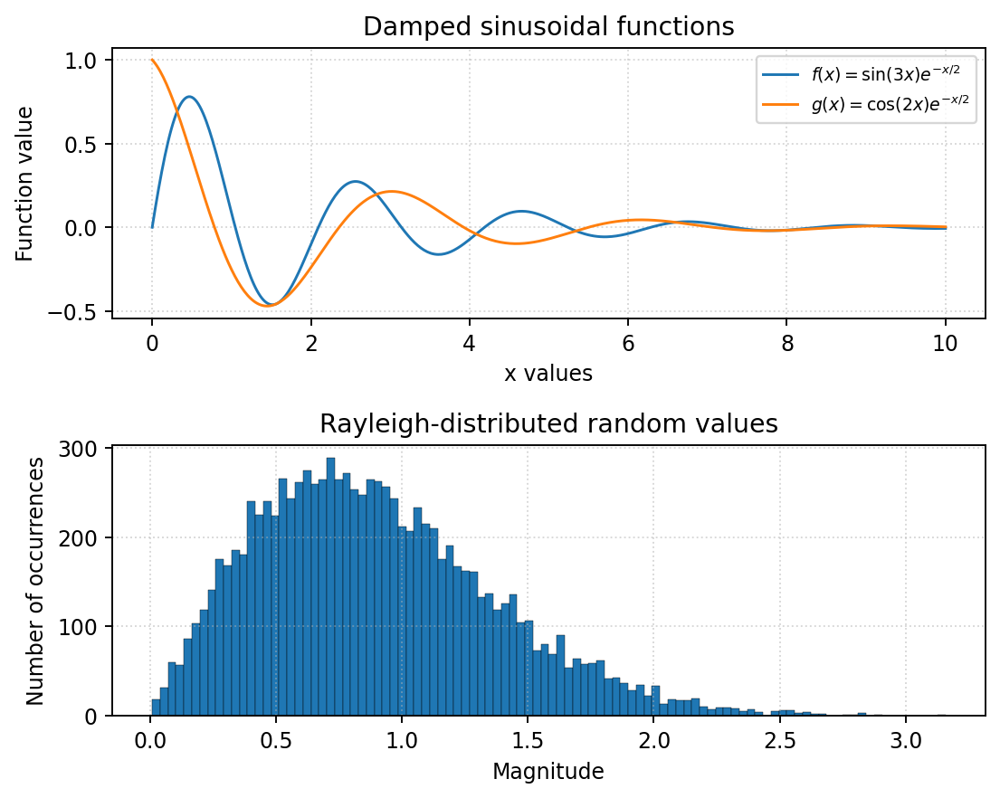
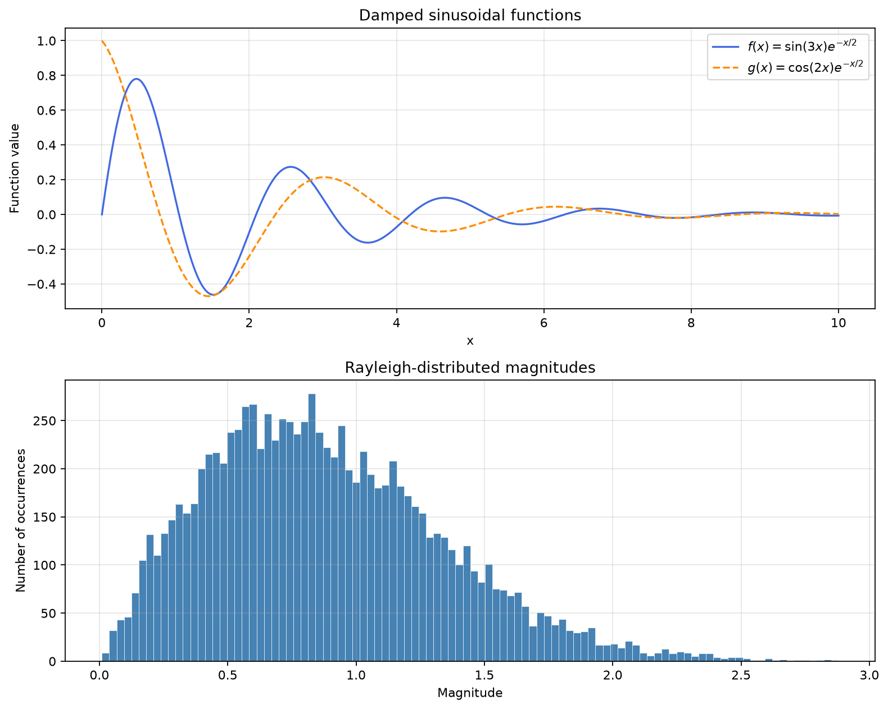

파일에서 값을 읽고 보고서를 만드는 문제, 센서 클래스를 상속하는 문제, NumPy로 계산하고 그래프를 그리는 문제. 세 문제는 소재가 같아도 **입력 검증 규칙과 반드시 써야 하는 문법이 서로 다르다.** 코드를 가져다 쓸 때는 숫자나 이름만 바꾸기 전에 요구조건부터 맞춰야 한다.

이 글은 제공된 **Practice Midterm — Set A의 비공식 연습문제**를 한 문제씩 풀어 본다. 각 문제는 **원문 → 요구조건과 접근 순서 → 한국어 주석 전체 코드와 실행 결과 → 헷갈리는 지점 → 변형 대응법** 순서다. 각 문제는 읽기 편한 영어 본문 바로 아래에 한국어 전체 번역을 배치했다. 문제 조건이 기억나면 목차에서 풀이·코드로 바로 이동하면 된다. 원문의 문구와 예제는 유지하되 반복 머리글·쪽 번호는 제외했다.

**처음 읽을 때:** 접근 순서를 이해한 뒤 전체 코드를 한 번 실행하고, 원문과 요구조건 표를 확인한다. **문제를 풀다가 막혔을 때:** 아래 유형별 표에서 필요한 부분으로 이동하거나 `Ctrl+F`로 `extend`, `classmethod`, `super`, `argmax`, `density` 같은 키워드를 찾는다.

<a id="toc"></a>

## 빠른 목차 — 문제 유형에서 코드로

| 문제에서 보이는 조건 | 원문 | 접근·해설 | 전체 코드 | 실수·변형 |
| --- | --- | --- | --- | --- |
| 텍스트 파일, 중복 센서, 딕셔너리, 평균·정렬·보고서 | [문제 1](#p1-original) | [처리 흐름](#p1-plan) | [problem_1.py](#p1-code) | [실수](#p1-traps) · [변형](#p1-variants) |
| private 필드, 리스트 복사, 고유 ID, 상속·보정 평균 | [문제 2](#p2-original) | [객체 설계](#p2-plan) | [problem_2.py](#p2-code) | [실수](#p2-traps) · [변형](#p2-variants) |
| linspace, 벡터화, view/copy, solve, 복소 난수, histogram | [문제 3](#p3-original) | [shape와 계산 순서](#p3-plan) | [problem_3.py](#p3-code) | [실수](#p3-traps) · [변형](#p3-variants) |
| 파일 배치·실행·필요 패키지 | [실행 준비](#setup) | 세 문제를 한 폴더에서 실행 | [전체 테스트](#tests) | [마지막 확인표](#final-check) |

<a id="setup"></a>

## 0. 실행 준비와 세 문제의 차이

### 0.1 파일 배치와 실행 명령

가장 빠른 방법은 [전체 연습 파일 ZIP](practice_set_a.zip)을 받아 한 폴더에 푸는 것이다. 개별 파일도 본문과 페이지 맨 아래에서 다운로드할 수 있다. `sensor_data.txt`의 내용은 문제 1 코드 바로 앞에도 그대로 제시했다.

```text
practice_set_a/
    problem_1.py
    problem_2.py
    problem_3.py
    test_practice.py
    sensor_data.txt
    sensor_data_extra.txt
```

```text
python problem_1.py sensor_data.txt
python problem_1.py sensor_data_extra.txt
python problem_2.py
python problem_3.py
python test_practice.py
```

1번은 코드 파일 옆에 `summary.txt`, 3번은 `simulation.png`를 만든다. 1번을 두 번째 파일로 다시 실행하면 `summary.txt`는 새 보고서로 덮어쓴다. 3번은 그림 창을 띄우므로 확인 후 창을 닫으면 실행이 끝난다. 1·2번은 표준 라이브러리만 사용하고, 3번과 전체 테스트에는 NumPy·Matplotlib이 필요하다. 설치가 필요하면 **실행에 쓸 같은 Python 환경에서** `python -m pip install numpy matplotlib`을 실행한다.

PowerShell에서 Python 실행 파일의 전체 경로를 따옴표로 감싸 실행할 때는 앞에 `&`를 붙인다. PyCharm·VS Code에서는 해당 환경의 인터프리터를 선택하고 파일을 실행하면 된다.

```text
& "C:\경로\.venv\Scripts\python.exe" "C:\경로\problem_1.py" "sensor_data.txt"
```

### 0.2 같은 센서 문제라도 검증 규칙은 다르다

| 항목 | 문제 1 | 문제 2 | 문제 3 |
| --- | --- | --- | --- |
| 주요 데이터 | `dict[str, list[float]]` | 인스턴스별 private 리스트 | `ndarray` |
| 음수 측정값 | 원문에 금지 조건 없음 | `ValueError`로 거부 | 정규 난수의 음수는 정상 |
| 잘못된 숫자 | 그 **줄 전체** 폐기·오류 줄 수 증가 | 예외 발생·기존 객체 상태 유지 | shape·계산 결과 검사 |
| 빈 데이터 | 빈 줄은 오류 아님; 숫자 없는 비빈 줄은 오류 | 빈 readings 리스트는 오류 | 지정된 배열 길이 생성 |
| 복사 이유 | 중복 센서에 값을 누적 | 외부 변경으로부터 private 저장값 보호 | view의 공유·copy의 독립성 실험 |
| 출력 정밀도 | 평균 `.2f` | `__str__`의 평균 `.2f` | 통계 예시는 `.6f`; 저장값은 원래 정밀도 |

<details>
<summary>공통 안내 · English / 한국어</summary>

<section class="problem-statement" lang="en">

#### English · 문제 원문

ENAI 607 Python Programming for Engineering AI

Fall 2026

Practice Midterm - Set A

UNOFFICIAL PRACTICE MATERIAL - NOT A UNIVERSITY EXAM OR AN ASSIGNED HOMEWORK

Instructions. Write and test Python programs for the three problems below. Each problem contains several related tasks; your program must satisfy all stated requirements, not only reproduce the example output. Where a specific Python construct is required (such as a list comprehension, lambda function, class method, or vectorized expression), use that construct explicitly. Include meaningful tests and show the resulting outputs. You may use built-in Python facilities, and NumPy / Matplotlib for Problem 3. No model answers are included.

Study scope: Lectures 1-6; lists, tuples, dictionaries, strings, control flow, functions, exception handling, files/modules, classes and inheritance, NumPy arrays, and basic plotting. The suggested point values are for self-assessment only (30 + 35 + 35 = 100 points).

</section>

<section class="problem-statement" lang="ko">

#### 한국어 · 전체 번역

**ENAI 607 — 공학 AI를 위한 Python 프로그래밍 / 2026년 가을 / 연습 중간고사 Set A**

**비공식 연습 자료이며, 대학 시험이나 배정된 과제가 아니다.**

**지침:** 아래 세 문제의 Python 프로그램을 작성하고 테스트하시오. 각 문제에는 서로 연관된 작업이 여러 개 있으므로, 예제 출력만 재현하는 데 그치지 말고 명시된 모든 요구사항을 충족해야 한다. list comprehension, lambda 함수, 클래스 메서드, 벡터화 표현식 등 특정 Python 문법을 요구하면 그 문법을 명시적으로 사용하시오. 의미 있는 테스트를 포함하고 실행 결과를 제시하시오. Python 내장 기능을 사용할 수 있으며, 문제 3에서는 NumPy와 Matplotlib을 사용할 수 있다. 원문에는 모범답안이 포함되어 있지 않다.

**학습 범위:** Lectures 1–6의 리스트·튜플·딕셔너리·문자열·제어 흐름·함수·예외 처리·파일과 모듈·클래스와 상속·NumPy 배열·기본 그래프. 제안된 배점은 자가 평가용이며, 30 + 35 + 35 = 총 100점이다.

</section>

</details>

<a id="problem-1"></a>

## 문제 1. 파일 처리와 센서별 요약 보고서

<a id="p1-original"></a>

### 1-1. 문제 원문

<section class="problem-statement" lang="en">

#### English · 문제 원문

##### Problem 1. Processing and Summarizing Sensor Measurements (30 points)

Write and test a Python script that reads measurement records from a CSV-formatted text file, organizes the measurements by sensor name, and produces a formatted report. A sensor may appear more than once in the input file. The file name shall be supplied to the program as an input string. Each nonempty input line is intended to contain the sensor name followed by one or more numeric readings, separated by commas. White-space characters may appear before and after individual fields. An input line containing an invalid numeric value must be ignored completely, and the number of invalid lines must be counted.

Create a text file named sensor_data.txt with the following content and use it to test your program:

```text
Ava,10,20,30
Ben,5,15,25
Ava,20,40
Cara,8,12,16
Bad,3,hello,4
```

##### P1.1. File input and data organization

Define a function `load_readings(filename)` that reads the file line by line using the with `open(...)` statement. Use the `strip()` and `split()` string methods, and convert each reading to a float. Store the readings in a dictionary: the keys shall be sensor names (strings), and the associated values shall be lists of numeric readings. If a sensor name appears on more than one line, append the new readings to the existing list. Ignore empty lines without counting them as errors. For any nonempty line having no numeric readings or an invalid numeric reading, increment an error counter, discard the entire line, and continue processing. Use try/except to handle numeric conversion errors. The function must return a tuple containing the completed dictionary and the number of invalid lines.

##### P1.2. Functions and comprehensions

Define a function `calculate_average(values)` that takes a nonempty list of numeric values and returns their arithmetic average. Then, using the dictionary returned by `load_readings()`, create a new dictionary that maps each sensor name to its average reading. You must use a dictionary comprehension for this task; an ordinary for-loop used to construct this second dictionary will not satisfy the requirement. Create a separate list containing the names of sensors whose average is at least 15.0. You must use a list comprehension with a filtering condition for this list.

##### P1.3. Sorting and conditional expressions

Sort the sensor names in decreasing order of their average readings. The sort operation must use `sorted()` with a lambda function supplied through the key parameter. For each sensor, assign the status string HIGH if its average is at least 20.0; otherwise assign LOW. Determine each status with a one-line conditional expression (the form value_if_true if condition else value_if_false).

##### P1.4. Formatted output

Write the sorted sensor report into a file named summary.txt. Use `enumerate()` to number the sensor entries starting at 1. Each entry shall show the sensor name, number of valid readings, average rounded to two decimal places, and status. At the end, output the number of invalid lines and the list of sensors whose averages are at least 15.0. For the input file above, the content of the output file must be:

```text
1. Ava: count = 5, average = 24.00, status = HIGH
2. Ben: count = 3, average = 15.00, status = LOW
3. Cara: count = 3, average = 12.00, status = LOW
Invalid lines: 1
Sensors with average >= 15.0: ['Ava', 'Ben']
```

Test your program with a second file containing a blank line, extra spaces, and a repeated sensor name. Your implementation must not depend on the order of the input records.

</section>

<section class="problem-statement" lang="ko">

#### 한국어 · 전체 번역

##### 문제 1. 센서 측정값 처리와 요약 (30점)

CSV 형식의 텍스트 파일에서 측정 기록을 읽어 센서 이름별로 정리하고, 지정된 형식의 보고서를 만드는 Python 스크립트를 작성하고 테스트하시오. 입력 파일에는 같은 센서가 여러 번 나타날 수 있다. 파일 이름은 문자열 입력으로 프로그램에 전달해야 한다.

비어 있지 않은 각 입력 줄은 센서 이름과 하나 이상의 숫자 측정값으로 구성되며, 각 항목은 쉼표로 구분된다. 항목 앞뒤에는 공백 문자가 있을 수 있다. **올바르지 않은 숫자 값이 들어 있는 줄은 전체를 무시하고, 잘못된 줄의 개수를 세어야 한다.**

다음 내용으로 `sensor_data.txt` 파일을 만들어 프로그램을 테스트하시오.

```text
Ava,10,20,30
Ben,5,15,25
Ava,20,40
Cara,8,12,16
Bad,3,hello,4
```

##### P1.1. 파일 입력과 데이터 구성

`with open(...)` 문으로 파일을 한 줄씩 읽는 함수 `load_readings(filename)`을 정의하시오.

- 문자열 메서드 `strip()`과 `split()`을 사용하고, 각 측정값을 `float`로 변환하시오.
- 측정값은 딕셔너리에 저장하시오. key는 센서 이름인 문자열, value는 숫자 측정값 리스트다.
- 같은 센서 이름이 여러 줄에 나타나면 새 측정값을 기존 리스트에 이어 붙이시오.
- 빈 줄은 무시하며 오류 개수에 포함하지 마시오.
- 비어 있지 않은 줄에 숫자 측정값이 없거나 잘못된 숫자 측정값이 있으면, 오류 카운터를 증가시키고 **그 줄 전체를 버린 뒤** 다음 줄을 처리하시오.
- 숫자 변환 오류는 `try/except`로 처리하시오.

이 함수는 완성된 딕셔너리와 잘못된 줄의 개수를 담은 **튜플**을 반환해야 한다.

##### P1.2. 함수와 comprehension

비어 있지 않은 숫자 리스트를 받아 산술평균을 반환하는 함수 `calculate_average(values)`를 정의하시오.

그다음 `load_readings()`가 반환한 딕셔너리를 사용해, 각 센서 이름을 해당 센서의 평균 측정값에 연결하는 새 딕셔너리를 만드시오. **반드시 dictionary comprehension을 사용해야 한다.** 일반 `for`문으로 이 두 번째 딕셔너리를 구성하면 요구사항을 충족하지 못한다.

평균이 **15.0 이상**인 센서 이름만 담은 별도 리스트도 만드시오. 이 리스트에는 **필터 조건을 포함한 list comprehension**을 사용해야 한다.

##### P1.3. 정렬과 조건 표현식

센서 이름들을 평균 측정값의 **내림차순**으로 정렬하시오. 정렬에는 `sorted()`를 사용하고, `key` 인자에 `lambda` 함수를 전달해야 한다.

각 센서의 평균이 **20.0 이상**이면 상태 문자열 `HIGH`, 그렇지 않으면 `LOW`를 부여하시오. 상태는 다음 형태의 한 줄 조건 표현식으로 결정해야 한다.

```text
value_if_true if condition else value_if_false
```

##### P1.4. 지정 형식의 출력

정렬된 센서 보고서를 `summary.txt` 파일에 쓰시오. `enumerate()`로 센서 항목에 **1부터 번호**를 붙이시오. 각 항목에는 다음 내용이 있어야 한다.

- 센서 이름
- 유효한 측정값의 개수
- 소수점 아래 두 자리로 반올림해 표시한 평균
- 상태

마지막에는 잘못된 줄의 개수와 평균이 15.0 이상인 센서 이름 리스트를 출력하시오. 위 입력 파일을 사용했을 때 출력 파일의 내용은 다음과 같아야 한다.

```text
1. Ava: count = 5, average = 24.00, status = HIGH
2. Ben: count = 3, average = 15.00, status = LOW
3. Cara: count = 3, average = 12.00, status = LOW
Invalid lines: 1
Sensors with average >= 15.0: ['Ava', 'Ben']
```

빈 줄, 추가 공백, 반복된 센서 이름이 포함된 두 번째 파일로도 테스트하시오. 구현이 입력 기록의 순서에 의존해서는 안 된다.

</section>

<a id="p1-plan"></a>

### 1-2. 접근 순서 — 읽기·검증·저장을 분리한다

핵심 자료구조는 `{"Ava": [10.0, 20.0, ...], "Ben": [...]}`다. 평균부터 저장하면 새 줄이 들어왔을 때 전체 측정값 개수와 합을 복원하기 어렵다. **유효한 원래 값들을 모은 뒤 평균을 계산한다.**

```text
한 줄 읽음
  ├─ 공백만 있거나 빈 줄 → 건너뜀, 오류 증가 없음
  └─ 내용이 있음 → split(',') → 각 필드 strip()
       ├─ 숫자 없음 / 숫자 변환 실패 → 오류 +1, 줄 전체 폐기
       └─ 전부 변환 성공 → 처음 이름이면 저장, 있던 이름이면 extend

파일 읽기 완료
  → 딕셔너리 comprehension으로 센서별 평균
  → sorted + lambda로 평균 내림차순
  → 리스트 comprehension으로 평균 15 이상 센서
  → enumerate(start=1), 조건 표현식, .2f로 보고서
```

**중요한 순서: 한 줄의 숫자를 전부 검사하기 전에는 저장된 딕셔너리를 바꾸지 않는다.** `Bad,3,hello,4`에서 `3`을 먼저 저장하고 `hello`에서 멈추면 “줄 전체 폐기” 조건을 어긴다.

| 원문의 필수 조건 | 코드에서 찾을 곳 |
| --- | --- |
| `with open(...)`, 줄 단위 읽기 | `load_readings`의 파일 블록과 `for line in fobj` |
| `strip`, `split`, `float`, `try/except` | 필드 정리와 `values` 생성 |
| 중복 이름 누적 | `data[name].extend(values)` |
| `(dictionary, invalid_count)` 반환 | `return data, invalid_lines` |
| 딕셔너리 comprehension | `average_data = {... for ...}` |
| 조건을 둔 리스트 comprehension | `selected_sensors = [... if ...]` |
| `sorted`의 `key`에 `lambda` | `sorted_names` 생성 |
| 한 줄 조건 표현식 | `"HIGH" if average >= 20.0 else "LOW"` |
| `enumerate`를 1부터, 평균 두 자리 | `enumerate(..., start=1)`, `{average:.2f}` |

이 풀이에서는 **빈 센서 이름도 오류로 처리하는 검증**을 추가했다. 원문이 별도 이름 규칙을 지정하지 않으므로 이름이 사람 이름인지·등록된 센서인지는 판단하지 않는다.

<a id="p1-code"></a>

### 1-3. 전체 정답 코드와 실행 결과

먼저 같은 폴더에 [sensor_data.txt](sensor_data.txt)를 만든다.

```text
Ava,10,20,30
Ben,5,15,25
Ava,20,40
Cara,8,12,16
Bad,3,hello,4
```

[problem_1.py 다운로드](problem_1.py). 아래 전체 코드는 다운로드 파일과 같다.

```python
"""예상문제 1: 센서 파일을 읽고 정렬된 summary.txt를 만든다."""
from pathlib import Path
import argparse

# 터미널의 현재 폴더가 아니라 이 코드 파일의 폴더를 기준으로 한다.
BASE_DIR = Path(__file__).resolve().parent


def load_readings(filename):
    data = {}        # 센서 이름 -> 유효한 실수 측정값 리스트
    invalid_lines = 0

    # filename이 절대 경로면 그대로 사용하고, 상대 경로면 BASE_DIR에 붙인다.
    with open(BASE_DIR / filename, "rt", encoding="utf-8") as fobj:
        for line in fobj:
            if not line.strip():
                continue  # 빈 줄과 공백만 있는 줄은 오류로 세지 않는다.

            fields = [field.strip() for field in line.split(",")]
            try:
                # 숫자 항목이 없으면 빈 리스트 평균이 생기므로 미리 거른다.
                # 빈 이름도 유효한 센서로 저장하지 않는 추가 검증이다.
                if len(fields) < 2 or not fields[0]:
                    raise ValueError("센서 이름과 숫자 한 개 이상이 필요함")

                # 이 줄의 숫자를 전부 바꾼 뒤에만 data에 반영한다.
                # 하나라도 실패하면 이 줄에서 앞서 바꾼 값도 저장되지 않는다.
                values = [float(field) for field in fields[1:]]
            except ValueError:
                invalid_lines += 1  # 잘못된 필드 수가 아니라 잘못된 줄 수
                continue

            name = fields[0]
            if name in data:
                data[name].extend(values)  # 반복된 이름은 기존 목록에 이어 붙임
            else:
                data[name] = values

    return data, invalid_lines  # 두 값을 튜플로 반환


def calculate_average(values):
    # 문제에서 비어 있지 않은 리스트를 받는다고 했으므로 그대로 계산한다.
    return sum(values) / len(values)


def write_summary(data, invalid_lines, output_filename="summary.txt"):
    # 요구사항: 딕셔너리 comprehension으로 센서별 평균을 만든다.
    average_data = {
        sensor: calculate_average(values) for sensor, values in data.items()
    }

    # 요구사항: sorted + key에 전달한 lambda.
    # 첫 키를 -평균으로 만들면 평균이 큰 것이 먼저 온다.
    # 평균이 같으면 이름 오름차순으로 정해 입력 순서에 영향받지 않게 한다.
    sorted_names = sorted(
        average_data, key=lambda sensor: (-average_data[sensor], sensor)
    )

    # 요구사항: 필터가 있는 리스트 comprehension. 보고서와 같은 순서로 나열.
    selected_sensors = [
        sensor for sensor in sorted_names if average_data[sensor] >= 15.0
    ]

    with open(BASE_DIR / output_filename, "wt", encoding="utf-8") as fobj:
        for number, sensor in enumerate(sorted_names, start=1):
            average = average_data[sensor]
            status = "HIGH" if average >= 20.0 else "LOW"  # 조건 표현식
            fobj.write(
                f"{number}. {sensor}: count = {len(data[sensor])}, "
                f"average = {average:.2f}, status = {status}\n"
            )
        fobj.write(f"Invalid lines: {invalid_lines}\n")
        # write()는 문자열 하나만 받으므로 리스트도 f-string 안에서 문자열화.
        fobj.write(f"Sensors with average >= 15.0: {selected_sensors}\n")


def main(filename):
    data, invalid_lines = load_readings(filename)
    write_summary(data, invalid_lines)
    print((BASE_DIR / "summary.txt").read_text(encoding="utf-8"), end="")


if __name__ == "__main__":
    parser = argparse.ArgumentParser(description="센서 파일에서 summary.txt 생성")
    # 실행 예: python problem_1.py sensor_data.txt
    # 인자를 생략하면 같은 폴더의 sensor_data.txt를 사용한다.
    parser.add_argument("filename", nargs="?", default="sensor_data.txt")
    main(parser.parse_args().filename)
```

`python problem_1.py sensor_data.txt`를 실행하면 다음 내용이 화면과 `summary.txt`에 출력된다. 마지막 `print(..., end="")`는 파일 내용을 화면에 보여 주면서 이미 파일에 있는 개행을 한 번 더 붙이지 않도록 한 것이다.

```text
1. Ava: count = 5, average = 24.00, status = HIGH
2. Ben: count = 3, average = 15.00, status = LOW
3. Cara: count = 3, average = 12.00, status = LOW
Invalid lines: 1
Sensors with average >= 15.0: ['Ava', 'Ben']
```

Ava의 측정값은 `[10, 20, 30, 20, 40]`으로 합이 120, 개수가 5다. 따라서 평균은 `120 / 5 = 24.0`이다. **각 줄의 평균을 다시 평균내면 안 된다.** 첫 줄 평균 20과 두 번째 줄 평균 30의 단순 평균은 25라서 틀린다.

두 번째 입력 [sensor_data_extra.txt](sensor_data_extra.txt)는 빈 줄·공백·중복 이름을 포함하고 기록 순서를 바꿨다. 같은 측정값을 가지므로 보고서도 위와 같다. 내부 리스트의 누적 순서는 달라질 수 있지만 개수·평균·최종 정렬은 올바르다.

<a id="p1-traps"></a>

### 1-4. 헷갈리는 지점 — 특히 데이터가 사라지는 코드

**① `extend()` 후에 다시 `data.update(...)`를 하면 앞의 누적을 덮어쓸 수 있다.** 기존 이름과 새 이름의 처리를 `if/else`로 나눈다. 위 코드처럼 `if name in data: extend`, `else: 새 리스트 저장`이면 된다.

**② `append(values)`는 리스트 안에 리스트를 넣는다.** `[10, 20]`에 `[30, 40]`을 이어 붙이려면 `extend([30, 40])`다. `append([30, 40])`이면 `[10, 20, [30, 40]]`이 되어 평균 계산이 깨진다.

**③ `fields[1]`은 문자열 하나, `fields[1:]`는 문자열 리스트다.** `float(fields[1:])`가 아니라 `[float(field) for field in fields[1:]]`다.

**④ `try`의 `else`는 오류가 없을 때 실행한다.** 여기서는 변환 성공 후에만 저장하도록 했고, 실패 경로에 `continue`를 써서 아래 저장 코드에 도달하지 않게 했다. 둘 중 어느 구조든 “실패한 줄은 저장하지 않는다”가 핵심이다.

**⑤ `error = 0`은 반복문 밖에 둔다.** 줄을 읽을 때마다 초기화하면 누적 오류 수가 아니라 마지막 반복의 값만 남는다. 여러 잘못된 항목이 한 줄에 있어도 오류 줄 수는 한 번만 증가한다.

**⑥ 빈 줄을 `split()` 뒤에만 판단하면 놓칠 수 있다.** `"".split(",")`는 `[""]`이며 리스트 자체는 비어 있지 않다. 먼저 `if not line.strip(): continue`로 처리한다.

**⑦ 파일을 못 여는 오류는 잘못된 데이터 줄이 아니다.** `FileNotFoundError`를 `except ValueError`로 해결할 수 없다. 이 코드의 상대 경로는 코드 파일 옆이 기준이다. 입력 파일 이름과 위치를 확인한다.

**⑧ `write()`는 문자열 하나를 받는다.** `fobj.write("Sensors...", selected_sensors)` 대신 f-string 하나로 합친다. 파일에 다음 줄을 만들려면 `\n`도 직접 넣는다.

#### 정렬 lambda를 읽는 방법

```text
key=lambda sensor: (-average_data[sensor], sensor)
                    첫 번째 비교값        동점 비교값
```

평균 24는 `-24`, 평균 15는 `-15`가 된다. 기본 오름차순에서 `-24`가 먼저이므로 원래 평균은 내림차순이다. 첫 값이 같으면 센서 이름을 오름차순으로 비교한다. 이 동점 규칙은 원문에 추가한 결정 규칙이다.

동점 순서가 중요하지 않으면 익숙한 `sorted(average_data, key=lambda sensor: average_data[sensor], reverse=True)`도 평균 내림차순 조건을 만족한다. 두 방식을 섞어 **음수 평균 키와 `reverse=True`를 동시에 쓰면** 의도와 반대가 된다.

<a id="p1-variants"></a>

### 1-5. 비슷한 문제에서는 어디를 바꿀까?

| 바뀐 요구 | 바꿀 부분 | 유지할 원칙 |
| --- | --- | --- |
| 평균 대신 합계·최댓값 | comprehension 값에 `sum(values)`·`max(values)` | 유효 값 누적 후 계산 |
| 평균 15 **초과**만 선택 | `>= 15.0` → `> 15.0` | 경계값 15.0을 별도 확인 |
| 오름차순 | 키의 음수 제거: `(average_data[sensor], sensor)` | 동점 규칙을 따로 정하기 |
| 정수 필드만 허용 | `float(field)` → `int(field)` | `int("3.0")`은 실패함 |
| 첫 필드가 없으면 오류 | 현재 코드의 `not fields[0]` | 숫자 변환 전에 구조 검사 |
| 등록된 센서만 허용 | 이름이 허용 집합에 있는지 검사 | 문자열이 비어 있지 않다는 것과 등록 여부는 다름 |
| 유한한 숫자만 허용 | 변환 후 `math.isfinite()` 검사 | `float("nan")`, `float("inf")`는 변환 자체는 성공 |
| 오류 줄을 별도 파일에 저장 | `except`에서 줄 번호와 원문 기록 | 잘못된 줄은 여전히 한 번만 집계 |
| 따옴표 안에도 쉼표가 있는 실제 CSV | `csv.reader`로 필드 파싱 | 단순 `split(',')`로는 인용부호 규칙을 처리 못 함 |

**전혀 다른 조건을 가져오지 않기:** 문제 1에는 음수 금지 조건이 없다. 문제 2의 비음수 검증을 그대로 복사하면 유효한 음수 입력을 버릴 수 있다.

<a id="problem-2"></a>

## 문제 2. Sensor 상속과 보정 평균

<a id="p2-original"></a>

### 2-1. 문제 원문

<section class="problem-statement" lang="en">

#### English · 문제 원문

##### Problem 2. Sensor Classes and Inheritance (35 points)

Write and test a Python script that defines two classes related by inheritance. The common superclass, Sensor, represents a measuring device storing a name, a list of numeric readings, and a unique nonnegative identification number. The derived class, CalibratedSensor, represents a sensor whose reported average is modified by a calibration scale and offset. Implement the following data fields and methods. Use instance methods for operations on one particular sensor object and class variables/methods for information shared by all sensor objects.

##### P2.1. The Sensor superclass

The class Sensor shall have a class variable next_id with an initial value of zero. Its constructor, `__init__(self, name, readings)`, receives a nonempty sensor name (string) and a nonempty list of numeric readings. Each new sensor object receives the current value of Sensor.next_id as its identification number; Sensor.next_id is then incremented by one. The readings must be stored in a private instance variable. The constructor must store a copy of the input list, rather than retaining a reference to the supplied mutable list. Check that all readings are numeric and nonnegative; raise TypeError for a nonnumeric reading and ValueError for a negative reading, empty readings list, or empty name. For this problem, you may assume that the input name and readings container have the required string and list types.

Implement the following methods:

- `get_id()`: return the identification number of the sensor.

- `get_name()`: return the sensor name as a string.

- `get_values()`: return a new list containing the stored readings. The caller must not be able to modify the private original list through the returned reference.

- `add_value(value)`: append a numeric, nonnegative reading; perform the same value validation as the constructor.

- `get_average()`: calculate and return the average of the stored readings.

- `__str__()`: return a human-readable string containing the sensor identification number, name, number of readings, and current average, with the average rounded to two decimal places.

- `get_sensor_count()`: return the total number of Sensor and CalibratedSensor instances created since the start of the script. This must be a class method defined with @classmethod, receiving the class as its first parameter (conventionally named cls).

##### P2.2. The CalibratedSensor subclass

Define a class CalibratedSensor that inherits from Sensor. Its constructor shall accept name, readings, scale and offset. The scale must be a positive numeric value; the offset may be any numeric value. Reject invalid parameters with suitable TypeError or ValueError exceptions. Use `super()`.`__init__()` to initialize the inherited instance fields.

The class shall override `get_average()` to compute the corrected average according to the following formula:

```python
corrected_average = scale * original_average + offset
```

Obtain the original average by invoking the superclass implementation, rather than duplicating the average calculation. The inherited `add_value()` and `get_values()` methods must remain usable on CalibratedSensor objects.

##### P2.3. Class tests and exception handling

Create Sensor and CalibratedSensor instances, call all implemented methods, and print the results. Demonstrate that assigning a new value to an element in the list returned by `get_values()` does not change the data stored in the object.

Verify that identification numbers are unique even when the objects belong to different subclasses. Use try/except to catch and display the exception when a negative reading is added. Include the following test cases in your script (you may add more):

```python
s1 = Sensor("Ava", [10, 20, 30])
s2 = CalibratedSensor("Ben", [4, 6], 1.5, 2.0)
print(s1.get_average())      # 20.0
print(s2.get_average())      # 9.5
s1.add_value(40)
print(s1.get_average())      # 25.0
print(Sensor.get_sensor_count())  # 2 (if only these were created)
```

The creation and calibration operations must never silently modify a previously created sensor object. Do not implement the two classes as unrelated, independent classes: the required inheritance relationship, class method, and superclass calls will be checked.

</section>

<section class="problem-statement" lang="ko">

#### 한국어 · 전체 번역

##### 문제 2. 센서 클래스와 상속 (35점)

상속 관계에 있는 두 클래스를 정의하는 Python 스크립트를 작성하고 테스트하시오. 공통 부모 클래스 `Sensor`는 이름, 숫자 측정값 리스트, 그리고 **고유한 0 이상의 식별 번호**를 저장하는 측정 장치를 나타낸다. 자식 클래스 `CalibratedSensor`는 보고할 평균을 보정 배율과 오프셋으로 수정하는 센서다.

아래 필드와 메서드를 구현하시오. 특정 센서 객체 하나에 대한 작업에는 인스턴스 메서드를 사용하고, 모든 센서 객체가 공유하는 정보에는 클래스 변수와 클래스 메서드를 사용하시오.

##### P2.1. 부모 클래스 Sensor

`Sensor` 클래스에는 초기값이 0인 클래스 변수 `next_id`가 있어야 한다. 생성자 `__init__(self, name, readings)`는 비어 있지 않은 센서 이름 문자열과 비어 있지 않은 숫자 측정값 리스트를 받는다.

새 센서 객체마다 현재 `Sensor.next_id` 값을 식별 번호로 부여하고, 이후 `Sensor.next_id`를 1 증가시키시오.

측정값은 **private 인스턴스 변수**에 저장해야 한다. 생성자는 전달받은 가변 리스트의 참조를 그대로 보관하지 말고 **입력 리스트의 복사본**을 저장해야 한다.

모든 측정값이 숫자이며 0 이상인지 검사하시오.

- 숫자가 아닌 측정값이면 `TypeError`를 발생시키시오.
- 음수 측정값, 빈 측정값 리스트, 빈 이름이면 `ValueError`를 발생시키시오.

이 문제에서는 입력 이름과 측정값 컨테이너가 각각 요구된 문자열 타입과 리스트 타입이라고 가정해도 된다.

다음 메서드를 구현하시오.

- `get_id()`: 센서의 식별 번호를 반환한다.
- `get_name()`: 센서 이름을 문자열로 반환한다.
- `get_values()`: 저장된 측정값이 들어 있는 **새 리스트**를 반환한다. 호출자가 반환된 참조를 통해 private 원본 리스트를 변경할 수 없어야 한다.
- `add_value(value)`: 숫자이며 0 이상인 측정값을 추가한다. 생성자와 같은 값 검증을 수행한다.
- `get_average()`: 저장된 측정값의 평균을 계산해 반환한다.
- `__str__()`: 센서 식별 번호, 이름, 측정값 개수, 현재 평균을 포함한 읽기 쉬운 문자열을 반환한다. 평균은 소수점 아래 두 자리로 반올림해 표시한다.
- `get_sensor_count()`: 스크립트 시작 이후 생성된 **Sensor와 CalibratedSensor 인스턴스의 전체 개수**를 반환한다. 반드시 `@classmethod`로 정의한 클래스 메서드여야 하며, 첫 매개변수로 클래스를 받는다. 이 매개변수의 관례적 이름은 `cls`다.

##### P2.2. 자식 클래스 CalibratedSensor

`Sensor`를 상속하는 `CalibratedSensor` 클래스를 정의하시오. 생성자는 `name`, `readings`, `scale`, `offset`을 받아야 한다.

- `scale`은 **양수인 숫자**여야 한다.
- `offset`은 어떤 숫자 값이든 가능하다.
- 잘못된 인자는 적절한 `TypeError` 또는 `ValueError`로 거부하시오.

`super().__init__()`로 상속받은 인스턴스 필드를 초기화하시오. `get_average()`를 재정의하여 다음 공식의 보정 평균을 계산하시오.

```text
corrected_average = scale * original_average + offset
```

원래 평균은 평균 계산을 중복 작성하지 말고 **부모 클래스의 구현을 호출해** 얻어야 한다. 상속받은 `add_value()`와 `get_values()`는 `CalibratedSensor` 객체에서도 계속 사용할 수 있어야 한다.

##### P2.3. 클래스 테스트와 예외 처리

`Sensor`와 `CalibratedSensor` 인스턴스를 만들고, 구현한 모든 메서드를 호출해 결과를 출력하시오.

- `get_values()`가 반환한 리스트의 원소에 새 값을 대입해도 객체 안에 저장된 데이터는 바뀌지 않음을 보여 주시오.
- 객체들이 서로 다른 자식 클래스에 속하더라도 식별 번호가 중복되지 않음을 확인하시오.
- 음수 측정값을 추가할 때 발생하는 예외를 `try/except`로 잡아 표시하시오.

아래 테스트 사례를 스크립트에 포함하시오. 더 추가해도 된다.

```python
s1 = Sensor("Ava", [10, 20, 30])
s2 = CalibratedSensor("Ben", [4, 6], 1.5, 2.0)
print(s1.get_average())           # 20.0
print(s2.get_average())           # 9.5
s1.add_value(40)
print(s1.get_average())           # 25.0
print(Sensor.get_sensor_count())  # 이 둘만 생성했다면 2
```

생성과 보정 연산이 이미 만들어진 센서 객체를 의도치 않게 변경해서는 안 된다. 두 클래스를 서로 무관한 독립 클래스로 구현하지 마시오. 요구된 **상속 관계·클래스 메서드·부모 클래스 호출**을 확인한다.

</section>

<a id="p2-plan"></a>

### 2-2. 접근 순서 — 객체별 상태와 공유 상태를 먼저 나눈다

| 저장할 것 | 속할 곳 | 이유 |
| --- | --- | --- |
| 다음 ID `next_id` | `Sensor` 클래스 | 부모·자식 전체에서 하나만 공유 |
| 현재 객체의 ID·이름·측정값 | 각 `Sensor` 인스턴스 | 객체마다 다른 값 |
| scale·offset | 각 `CalibratedSensor` 인스턴스 | 보정 센서마다 다른 계수 |

그다음 메서드를 세 그룹으로 나누면 구현 순서가 정해진다.

1. **보호할 값:** 생성자에서 검증하고 측정값 리스트를 복사한다. getter에서도 복사본을 반환한다.
2. **공통 동작:** ID·이름·측정값 조회, 측정값 추가, 원래 평균, 문자열 표시, 전체 개수를 부모에 구현한다.
3. **달라지는 동작:** 자식은 보정 계수만 추가하고 `get_average()`만 재정의한다. 부모 평균은 `super().get_average()`로 가져온다.

```text
Sensor
  클래스 상태: next_id
  인스턴스 상태: __id, __name, __values
  공통 동작: getter, add_value, get_average, __str__, get_sensor_count
       ↑ 상속
CalibratedSensor
  추가 상태: __scale, __offset
  평균 재정의: scale * super().get_average() + offset
```

| 필수 조건 | 코드에서 찾을 곳 |
| --- | --- |
| 고유 비음수 ID, 부모·자식 전체 공유 | `self.__id = Sensor.next_id`, `Sensor.next_id += 1` |
| private 리스트·입력 복사 | `self.__values = readings.copy()` |
| 반환 리스트를 통한 원본 변경 차단 | `get_values()`의 `.copy()` |
| 숫자 아니면 `TypeError`, 음수·빈 입력은 `ValueError` | 생성자와 `_validate_value` |
| 클래스 메서드, 첫 인자 `cls` | `@classmethod`, `get_sensor_count(cls)` |
| 상속·부모 생성자 호출 | `class CalibratedSensor(Sensor)`, `super().__init__()` |
| 부모 평균을 호출해서 보정 | `super().get_average()` |
| 평균 두 자리와 ID·이름·개수 | `__str__()` |

이 구현에서 측정값·보정 인자의 수치는 일반적인 Python `int`·`float`로 받는다. `bool`은 `int`의 하위 타입이지만 측정값으로 받지 않도록 명시적으로 제외했다. 원문의 컨테이너 타입 전제대로 이름은 문자열, readings는 리스트라고 가정한다.

<a id="p2-code"></a>

### 2-3. 전체 정답 코드와 실행 결과

[problem_2.py 다운로드](problem_2.py). 다른 풀이 파일 없이 단독 실행된다.

```python
"""예상문제 2: Sensor와 CalibratedSensor의 상속·복사·검증."""


class Sensor:
    # 부모·자식 전체가 함께 사용하는 '다음 ID'. 성공한 생성 수와 같다.
    next_id = 0

    def __init__(self, name, readings):
        # name과 readings의 컨테이너 타입은 문제의 전제를 따른다.
        if not name:
            raise ValueError("센서 이름은 비어 있으면 안 됨")
        if not readings:
            raise ValueError("측정값 리스트는 비어 있으면 안 됨")
        for value in readings:
            self._validate_value(value)

        # 두 개의 밑줄: private 인스턴스 필드(name mangling).
        # 원본을 복사해야 호출자가 입력 리스트를 바꿔도 저장값은 유지된다.
        self.__name = name
        self.__values = readings.copy()

        # 모든 검증이 끝난 뒤 ID를 부여하여 실패한 생성은 세지 않는다.
        # self.next_id 또는 type(self).next_id로 증가시키지 않는다.
        self.__id = Sensor.next_id
        Sensor.next_id += 1

    def _validate_value(self, value):
        # bool은 int의 하위 타입이지만 측정값으로는 받지 않는 정책이다.
        if isinstance(value, bool) or not isinstance(value, (int, float)):
            raise TypeError("측정값은 int 또는 float이어야 함")
        if not value >= 0:
            raise ValueError("측정값은 0 이상이어야 함")

    def get_id(self):
        return self.__id

    def get_name(self):
        return self.__name

    def get_values(self):
        # getter에서도 복사해야 외부에서 private 리스트를 변경할 수 없다.
        return self.__values.copy()

    def add_value(self, value):
        self._validate_value(value)  # 검사 실패 시 append까지 도달하지 않음
        self.__values.append(value)

    def get_average(self):
        return sum(self.__values) / len(self.__values)

    def __str__(self):
        # self.get_average()는 자식 객체에서 재정의한 메서드를 호출한다.
        return (
            f"Sensor {self.get_id()} ({self.get_name()}): "
            f"count = {len(self.__values)}, average = {self.get_average():.2f}"
        )

    @classmethod
    def get_sensor_count(cls):
        # cls 인자는 클래스 메서드 규약에 따라 받는다.
        # 반환할 값은 계층 전체의 공유 카운터이므로 부모 이름을 명시한다.
        return Sensor.next_id


class CalibratedSensor(Sensor):
    def __init__(self, name, readings, scale, offset):
        # 부모 생성자가 ID를 증가시키기 전에 보정 인자부터 검사한다.
        if isinstance(scale, bool) or not isinstance(scale, (int, float)):
            raise TypeError("scale은 숫자여야 함")
        if not scale > 0:
            raise ValueError("scale은 0보다 커야 함")
        if isinstance(offset, bool) or not isinstance(offset, (int, float)):
            raise TypeError("offset은 숫자여야 함")

        # 부모가 이름·측정값·ID를 초기화한다. 부모 로직을 중복 작성하지 않음.
        super().__init__(name, readings)
        self.__scale = scale
        self.__offset = offset

    def get_average(self):
        # 자기 자신을 다시 호출하면 재귀가 되므로 super()로 원래 평균을 구함.
        original_average = super().get_average()
        return self.__scale * original_average + self.__offset


def main():
    source = [10, 20, 30]
    s1 = Sensor("Ava", source)
    s2 = CalibratedSensor("Ben", [4, 6], 1.5, 2.0)
    print(s1.get_average())            # 20.0
    print(s2.get_average())            # 9.5
    s1.add_value(40)
    print(s1.get_average())            # 25.0
    print(Sensor.get_sensor_count())   # 2: 이 스크립트를 새로 실행했을 때

    print("IDs:", s1.get_id(), s2.get_id())
    print("Names:", s1.get_name(), s2.get_name())

    # 생성자 입력 리스트를 나중에 바꿔도 객체가 바뀌지 않는지 확인.
    source[0] = 999
    print("입력 리스트 변경 후:", s1.get_values())
    # getter 결과를 바꿔도 객체가 바뀌지 않는지 별도로 확인.
    exported = s1.get_values()
    exported[0] = -999
    print("반환 리스트 변경 후:", s1.get_values())

    s2.add_value(8)  # 부모의 add_value를 상속받아 그대로 사용한다.
    print("자식 측정값:", s2.get_values())
    print("자식 보정 평균:", s2.get_average())
    print(s1)  # __str__ 자동 호출
    print(s2)  # 부모 __str__ 안에서 자식의 get_average 호출
    print("자식 클래스로 조회한 전체 수:", CalibratedSensor.get_sensor_count())

    try:
        s1.add_value(-5)
    except ValueError as error:
        print(f"ValueError: {error}")
    print("추가 실패 후 원본:", s1.get_values())

    # 현재 객체 둘의 ID가 중복되지 않는지, 값이 유지되는지 실제 검증.
    assert s1.get_id() != s2.get_id()
    assert s1.get_values() == [10, 20, 30, 40]
    assert s2.get_values() == [4, 6, 8]
    assert s2.get_average() == 11.0


if __name__ == "__main__":
    main()
```

새 Python 프로세스에서 `python problem_2.py`를 실행한 출력이다.

```text
20.0
9.5
25.0
2
IDs: 0 1
Names: Ava Ben
입력 리스트 변경 후: [10, 20, 30, 40]
반환 리스트 변경 후: [10, 20, 30, 40]
자식 측정값: [4, 6, 8]
자식 보정 평균: 11.0
Sensor 0 (Ava): count = 4, average = 25.00
Sensor 1 (Ben): count = 3, average = 11.00
자식 클래스로 조회한 전체 수: 2
ValueError: 측정값은 0 이상이어야 함
추가 실패 후 원본: [10, 20, 30, 40]
```

처음 Ben의 원래 평균은 `(4 + 6) / 2 = 5`이므로 보정 평균은 `1.5 * 5 + 2 = 9.5`다. 이후 `8`을 추가하면 원래 평균은 `6`, 보정 평균은 `11.0`으로 바뀐다. Ava의 입력 리스트나 getter 반환 리스트를 바꾼 것은 객체의 측정값에 영향을 주지 않는다.

<a id="p2-traps"></a>

### 2-4. 헷갈리는 지점 — private만 붙여서는 보호되지 않는다

**① 리스트 복사는 두 군데에 필요하다.** 생성자의 `readings.copy()`는 입력 리스트를 통한 변경을 막는다. getter의 `self.__values.copy()`는 반환 리스트를 통한 변경을 막는다. 어느 한 군데만 복사하면 나머지 경로가 열려 있다. 여기서는 숫자가 불변 객체이므로 얕은 리스트 복사로 충분하다.

**② `__values`는 절대적인 접근 차단 장치가 아니다.** Python의 두 밑줄은 name mangling을 적용해 우발적 접근과 이름 충돌을 줄인다. 캡슐화가 유지되는 실제 이유에는 외부에 원본 리스트를 반환하지 않는 설계도 포함된다.

**③ `self.next_id += 1`은 인스턴스 속성을 만들 수 있다.** `type(self).next_id += 1` 또는 자식 클래스별 증가는 카운터를 분리할 수 있다. 이 문제는 모든 센서가 같은 번호줄을 쓰므로 증가시킬 대상은 `Sensor.next_id`다.

**④ 클래스 메서드인데 왜 `return Sensor.next_id`인가?** `cls`를 받는 것은 클래스 메서드 호출 규칙이다. 반환할 값의 소유자는 계층 전체의 공유 카운터이므로 부모 이름을 명시했다. 자식에서 `next_id`를 가려 버리는 상황에도 별도 카운터를 읽지 않는다. `CalibratedSensor.get_sensor_count()`도 전체 수를 반환한다.

**⑤ 생성 실패 전에는 카운터를 증가시키지 않는다.** 자식의 scale 검증을 `super().__init__()` 뒤에 두면, 부모가 ID를 발급한 다음 자식 검증이 실패할 수 있다. 위 코드는 보정 계수부터 검사하고 모든 기본값 검증을 마친 뒤 ID를 발급한다.

**⑥ 자식 평균에서 `self.get_average()`를 호출하면 재귀다.** 현재 자식 메서드를 다시 호출한다. 부모 버전으로 이동하려면 `super().get_average()`를 쓴다. 자식에서 다시 `sum/len`을 작성하면 “부모 구현 호출” 조건을 어긴다.

**⑦ 보정은 원본 측정값을 덮어쓰는 연산이 아니다.** 원래 측정값은 그대로 저장하고, 평균을 요청할 때만 `scale * original_average + offset`을 적용한다. 원본을 먼저 수정한 후 또 보정하면 중복 보정된다.

**⑧ 음수 offset은 허용된다.** scale만 양수여야 하고 offset은 음수여도 된다. 따라서 저장한 측정값이 모두 비음수여도 **보정 평균은 음수일 수 있다.** 보정 결과에 다시 측정값 검증을 적용하지 않는다.

**⑨ `__str__()` 안의 `self.get_average()`는 객체 타입을 따른다.** 자식 객체를 `print()`하면 부모의 `__str__()`을 상속받더라도 그 안에서 자식의 보정 평균이 사용된다. 부모 이름을 붙여 `Sensor.get_average(self)`로 고정하면 보정 평균이 출력되지 않는다.

**⑩ count는 현재 살아 있는 객체 수가 아니다.** 요구사항은 실행 시작 이후 생성한 인스턴스 수다. 객체를 삭제했다고 `next_id`를 감소시키거나, 테스트마다 무조건 0으로 초기화하면 고유 ID 의미가 깨진다. ID 0·1 및 개수 2라는 출력은 이 코드만 새로 실행한 경우다.

<a id="p2-variants"></a>

### 2-5. 클래스 문제가 바뀌었을 때의 대응

| 바뀐 요구 | 설계·코드에서 바꿀 곳 |
| --- | --- |
| 다른 보정 공식 | 자식의 `get_average()`만 수정; 부모 평균 재사용 |
| 객체마다 평균 대신 합계도 제공 | 부모에 공통 메서드 추가; private 값 접근은 부모 안에서 |
| 센서 유형별 생성 개수 | 전체 ID 카운터와 유형별 카운터를 분리; ID 공유 조건은 유지 |
| 중첩 리스트·가변 객체를 저장 | 얕은 복사만으로 충분한지 판단하고 필요하면 `deepcopy` |
| 빈 이름에 공백만 있는 이름도 포함 | `if not name.strip():`로 검사 |
| 유한한 실수만 허용 | `math.isfinite()`로 값·scale·offset 추가 검증 |
| scale이나 offset을 나중에 바꾸는 setter | 먼저 검증한 뒤 새 값을 대입; 실패 시 이전 값 유지 |
| 새 자식 클래스 추가 | 공통 필드는 `super().__init__()`, 달라지는 메서드만 override |
| 평균 이외의 출력 형식 변경 | `__str__()` 수정; 상태를 출력 과정에서 바꾸지 않기 |

`isinstance(value, (int, float))`만 사용하면 `True`도 통과한다. 반대로 다양한 수치 라이브러리의 실수 타입까지 받아야 하는 문제라면 허용 타입 정의를 넓혀야 한다. **무엇을 숫자로 인정할지와 무엇을 유효한 측정값으로 인정할지는 별도 규칙**이다.

<a id="problem-3"></a>

## 문제 3. 벡터화 수치 계산과 시각화

<a id="p3-original"></a>

### 3-1. 문제 원문

<section class="problem-statement" lang="en">

#### English · 문제 원문

##### Problem 3. Vectorized Numerical Simulation and Visualization (35 points)

Write and test a Python script that uses NumPy to perform array-based numerical computations and Matplotlib to visualize the calculated values. You must implement the numerical operations in a vectorized manner; do not use an explicit Python for-loop to calculate a function value for each individual array element. Use the numpy and matplotlib.pyplot modules.

##### P3.1. Numerical arrays and statistics

Create a one-dimensional NumPy array named x containing 500 equally spaced floating-point values from 0 to 10, including both endpoints. Create two more arrays by evaluating the following functions for every element of x using a single vectorized expression for each array:

```text
f(x) = sin(3x) exp(-x/2)      g(x) = cos(2x) exp(-x/2)
```

For `f(x)`, display the array shape, the arithmetic mean, the standard deviation (using the default NumPy definition), the largest value, and the index of the largest value. Also display the corresponding x coordinate of that maximum.

Use NumPy array methods/functions instead of manually accumulating individual values.

##### P3.2. Two-dimensional arrays, slicing, and copying

Take the first 12 elements of the `f(x)` array using slicing and reshape them into a 3 by 4 matrix. Print the matrix and its transpose, including their shapes. Create a slice selecting the last two rows and first two columns of the 3 by 4 matrix. Demonstrate with an assignment that modifying this slice also changes the original matrix. Then repeat the demonstration using an independent slice created with .`copy()` and show that changing the copied array does not modify the original matrix. Explain the difference between the two outcomes in a short comment.

##### P3.3. Elementary matrix computation

Use NumPy to construct the coefficient matrix A and vector b shown below. Solve the linear system Ax = b using `np.linalg.solve()` and verify the result using the @ matrix multiplication operator. Do not solve the system by hand and copy the solution into your program. The expected solution vector is [2.0, 3.0].

```python
A = np.array([[3.0, 1.0], [1.0, 2.0]])
b = np.array([9.0, 8.0])
```

##### P3.4. Random numbers and the Rayleigh distribution

Generate two independent NumPy arrays of 10,000 real Gaussian random values each, with mean zero and standard deviation 1/`sqrt(2)`. Use `np.random.randn()` or `np.random.normal()`. Use the first array as the real part and the second array as the imaginary part of 10,000 complex numbers. Combine them into a complex-valued array and compute its element-wise magnitudes by invoking `np.abs()`. These magnitudes will follow the Rayleigh distribution.

Do not use an explicit Python loop in any step of this generation process.

##### P3.5. Subplots and histogram

Create one Matplotlib figure containing two vertically arranged subplots. The upper subplot shall display both `f(x)` and `g(x)` versus x, using two distinguishable lines and a legend identifying the functions. The lower subplot shall display a histogram of the 10,000 Rayleigh-distributed magnitude values using 100 bins. Add a meaningful title, x-axis label, y-axis label, and grid to both subplots. The lower histogram must show the number of occurrences in each bin (not normalized relative frequencies). Adjust the layout so the subplot titles and axis labels do not overlap.

Save the figure as simulation.png before calling `plt.show()`.

Example figure. The individual histogram bar heights will change between program runs because the inputs are random. The overall distribution and the damped curves should resemble the plots below.

In addition to the example graph, test that the length of all 1D input arrays is correct and that the array operations produce no shape errors. Do not hard-code the numerical curve values or the histogram frequencies.



</section>

<section class="problem-statement" lang="ko">

#### 한국어 · 전체 번역

##### 문제 3. 벡터화 수치 시뮬레이션과 시각화 (35점)

NumPy로 배열 기반 수치 계산을 수행하고 Matplotlib으로 계산 결과를 시각화하는 Python 스크립트를 작성하고 테스트하시오.

수치 연산은 **벡터화된 방식**으로 구현해야 한다. 배열의 원소마다 함수 값을 하나씩 계산하는 명시적인 Python `for`문을 사용하지 마시오. `numpy`와 `matplotlib.pyplot` 모듈을 사용하시오.

##### P3.1. 수치 배열과 통계

0부터 10까지 **양 끝점을 모두 포함**하여, 동일한 간격의 부동소수점 값 **500개**를 담은 1차원 NumPy 배열 `x`를 만드시오.

다음 함수를 x의 모든 원소에 계산하여 배열 두 개를 추가로 만드시오. 각 배열에는 **벡터화 표현식 하나**를 사용해야 한다.

$$f(x)=\sin(3x)\exp(-x/2)$$

$$g(x)=\cos(2x)\exp(-x/2)$$

f(x)에 대해 다음을 표시하시오.

- 배열의 shape
- 산술평균
- **NumPy 기본 정의**에 따른 표준편차
- 최댓값
- 최댓값의 인덱스
- 그 최댓값에 대응하는 x 좌표

개별 값을 직접 누적하지 말고 NumPy 배열 메서드와 함수를 사용하시오.

##### P3.2. 2차원 배열, 슬라이싱과 복사

슬라이싱으로 f(x) 배열의 **처음 12개 원소**를 가져와 **3행 4열** 행렬로 reshape하시오. 행렬과 전치행렬을 각각 shape와 함께 출력하시오.

3행 4열 행렬의 **마지막 두 행과 처음 두 열**을 선택한 슬라이스를 만드시오. 이 슬라이스에 값을 대입했을 때 원본 행렬도 바뀐다는 것을 보여 주시오.

그다음 `.copy()`로 만든 독립적인 슬라이스를 사용해 같은 실험을 반복하고, 복사된 배열을 변경해도 원본 행렬이 바뀌지 않음을 보여 주시오. 두 결과가 다른 이유를 짧은 주석으로 설명하시오.

##### P3.3. 기본 행렬 계산

NumPy로 아래 계수 행렬 A와 벡터 b를 만드시오. `np.linalg.solve()`로 연립방정식 Ax = b를 풀고, 행렬 곱 연산자 `@`로 결과를 검증하시오.

손으로 해를 구한 뒤 프로그램에 그대로 적어 넣지 마시오. 예상 해 벡터는 `[2.0, 3.0]`이다.

```python
A = np.array([[3.0, 1.0], [1.0, 2.0]])
b = np.array([9.0, 8.0])
```

##### P3.4. 난수와 Rayleigh 분포

각각 **10,000개의 실수 정규 난수**가 들어 있는 독립적인 NumPy 배열 두 개를 생성하시오. 두 배열 모두 평균은 0, 표준편차는 **1/√2**여야 한다. `np.random.randn()` 또는 `np.random.normal()`을 사용하시오.

첫 배열을 실수부, 두 번째 배열을 허수부로 사용하여 복소수 10,000개를 만드시오. 두 배열을 하나의 복소수 배열로 합치고, `np.abs()`를 호출해 원소별 크기를 계산하시오. 이 크기들은 Rayleigh 분포를 따른다.

**이 생성 과정의 어느 단계에서도 명시적인 Python 반복문을 사용하지 마시오.**

##### P3.5. 서브플롯과 히스토그램

세로로 배치한 서브플롯 두 개가 들어 있는 Matplotlib figure 하나를 만드시오.

- 위쪽 서브플롯에는 x에 대한 f(x)와 g(x)를 구분 가능한 두 선으로 그리고, 함수를 식별하는 범례를 넣으시오.
- 아래쪽 서브플롯에는 Rayleigh 분포를 따르는 크기 10,000개의 히스토그램을 **100개 bin**으로 그리시오.
- 두 서브플롯 모두 의미 있는 제목, x축 이름, y축 이름, 격자를 넣으시오.
- 아래 히스토그램은 정규화된 상대도수가 아니라 **각 bin에 들어간 횟수인 도수**를 표시해야 한다.
- 제목과 축 이름이 겹치지 않도록 레이아웃을 조정하시오.
- **`plt.show()` 호출 전에** 그림을 `simulation.png`로 저장하시오.

**예제 그림:** 입력이 난수이므로 프로그램 실행마다 개별 막대 높이는 달라진다. 전체적인 분포와 감쇠 곡선의 모양은 위 영문 원문에 제시된 그림과 비슷해야 한다.

예제 그래프 외에도 모든 1차원 입력 배열의 길이가 올바른지, 배열 연산에서 shape 오류가 발생하지 않는지 테스트하시오. **함수의 수치 값이나 히스토그램 도수를 코드에 미리 고정해 넣지 마시오.**

</section>

<a id="p3-plan"></a>

### 3-2. 접근 순서 — 값보다 먼저 shape를 적는다

| 단계 | 만들어야 할 값 | shape / 의미 |
| --- | --- | --- |
| 격자 | `x = np.linspace(0, 10, 500)` | `(500,)`, 양 끝점 포함 |
| 두 함수 | `f`, `g` | 각각 `(500,)`, NumPy 배열 연산 |
| 통계·최대 | mean·std·max·argmax·대응 x | 스칼라 값과 정수 위치 |
| 행렬 | 첫 12개를 reshape | `(3, 4)`; 전치는 `(4, 3)` |
| 공유 슬라이스 | `matrix[-2:, :2]` | `(2, 2)`, 수정 시 matrix도 바뀜 |
| 복사 슬라이스 | `matrix[-2:, :2].copy()` | `(2, 2)`, 수정 시 원본 유지 |
| 연립방정식 | `solve(A, b)` | A `(2, 2)`, b·해 `(2,)` |
| 난수 | real·imag·z·magnitude | 각각 `(10000,)` |
| 히스토그램 | 100 bins | 도수 100개, 경계 101개 |

```text
x → f, g → 통계·최대 위치 ──────────────→ 위쪽 함수 그래프
       └→ 독립 실습용 3×4 행렬 → view/copy 변경 실험
A, b → solve → A @ solution으로 검증
real, imag → real + 1j * imag → abs ───→ 아래쪽 100-bin 도수 히스토그램
                                      → tight_layout → savefig → show
```

**수치 배열을 만드는 부분에는 원소별 Python `for`문이 없다.** `np.sin(3 * x)`처럼 배열 전체를 함수에 넣는다. `np.random.normal(..., size=10000)`도 한 번의 호출로 전체 배열을 만든다.

| 필수 조건 | 코드에서 찾을 곳 |
| --- | --- |
| 0·10 포함, 실수 500개 | `np.linspace(0, 10, 500)` |
| 함수마다 하나의 벡터화 표현식 | `f = ...`, `g = ...` |
| 기본 표준편차 | `f.std()`; 기본 `ddof=0` |
| 최댓값·위치·대응 x | `f.max()`, `np.argmax(f)`, `x[peak_index]` |
| 기본 slice와 `.copy()` 비교 | `make_slice_examples` |
| `solve`와 `@` 검증 | `solve_system`, `np.allclose(A @ solution, b)` |
| `randn` 또는 `normal`로 독립 정규 난수 | 서로 다른 두 번의 `np.random.normal` 호출 |
| 복소수 크기를 `np.abs`로 계산 | `magnitude = np.abs(z)` |
| 위·아래 두 subplot·범례·제목·축·grid | `make_figure` |
| 100 bins, 정규화하지 않은 도수 | `hist(..., bins=100, density=False)` |
| 저장 후 화면 표시 | `fig.savefig(...)` 다음 `plt.show()` |

<a id="p3-code"></a>

### 3-3. 전체 정답 코드와 실행 결과

[problem_3.py 다운로드](problem_3.py). NumPy·Matplotlib을 설치한 Python으로 실행한다.

```python
"""예상문제 3: 벡터화 계산, 배열 복사, 연립방정식, 난수와 그래프."""
from pathlib import Path
import numpy as np
import matplotlib.pyplot as plt


def create_curves():
    # 끝점 0과 10을 모두 포함하는 부동소수점 값 500개.
    x = np.linspace(0, 10, 500)
    # 배열 전체에 함수를 적용한다. 원소별 Python for문은 사용하지 않는다.
    f = np.sin(3 * x) * np.exp(-x / 2)
    g = np.cos(2 * x) * np.exp(-x / 2)
    return x, f, g


def make_slice_examples(f):
    # reshape만 하면 f와 메모리를 공유할 수 있다.
    # f의 통계·그래프를 오염시키지 않도록 실습용 행렬을 먼저 독립 복사한다.
    matrix = f[:12].reshape(3, 4).copy()
    initial = matrix.copy()       # 변경 전 출력용 스냅샷
    transpose = matrix.T.copy()   # 전치 결과도 변경 전 상태를 보존

    view = matrix[-2:, :2]        # 마지막 두 행, 처음 두 열: shape (2, 2)
    view[0, 0] = -1.0
    # 기본 슬라이스는 메모리를 공유하므로 matrix[1, 0]도 -1.0이 된다.

    independent = f[:12].reshape(3, 4).copy()
    copied = independent[-2:, :2].copy()
    copied[0, 0] = -999.0
    # .copy() 결과는 별도 데이터를 가지므로 independent는 변하지 않는다.
    return initial, transpose, matrix, view, independent, copied


def solve_system():
    A = np.array([[3.0, 1.0], [1.0, 2.0]])
    b = np.array([9.0, 8.0])
    solution = np.linalg.solve(A, b)  # 해를 직접 계산; [2, 3]을 대입하지 않음
    return A, b, solution


def generate_rayleigh(sample_count=10_000, seed=607):
    # 10_000은 숫자를 읽기 쉽게 쓴 정수 10000과 같다.
    if sample_count <= 0:
        raise ValueError("표본 수는 양수여야 함")
    np.random.seed(seed)  # 재현을 위해 두 난수 배열 생성 전에 한 번만 설정
    sigma = 1 / np.sqrt(2)  # scale에 넣는 값은 분산이 아니라 표준편차
    real = np.random.normal(0.0, sigma, sample_count)
    imag = np.random.normal(0.0, sigma, sample_count)
    z = real + 1j * imag    # 원소별 복소수 생성; j라는 별도 변수를 만들지 않음
    magnitude = np.abs(z)   # sqrt(real**2 + imag**2)와 같은 원소별 크기
    return real, imag, z, magnitude


def make_figure(x, f, g, magnitude):
    fig, axes = plt.subplots(2, 1, figsize=(10, 8))
    axes[0].plot(x, f, color="royalblue", label=r"$f(x)=\sin(3x)e^{-x/2}$")
    axes[0].plot(x, g, color="darkorange", linestyle="--",
                 label=r"$g(x)=\cos(2x)e^{-x/2}$")
    axes[0].set_title("Damped sinusoidal functions")
    axes[0].set_xlabel("x")
    axes[0].set_ylabel("Function value")
    axes[0].grid(True, alpha=0.3)
    axes[0].legend()

    # 요구사항은 도수(count). density=True나 정규화 weights를 쓰지 않는다.
    counts, edges, _ = axes[1].hist(
        magnitude, bins=100, density=False,
        color="steelblue", edgecolor="white", linewidth=0.3
    )
    axes[1].set_title("Rayleigh-distributed magnitudes")
    axes[1].set_xlabel("Magnitude")
    axes[1].set_ylabel("Number of occurrences")
    axes[1].grid(True, alpha=0.3)
    fig.tight_layout()  # 제목과 축 이름의 겹침 조정
    return fig, axes, counts, edges


def main():
    np.set_printoptions(precision=4, suppress=True)
    x, f, g = create_curves()
    peak_index = np.argmax(f)  # 최댓값 자체가 아니라 위치
    print("shape:", f.shape)
    print(f"mean: {f.mean():.6f}")
    print(f"std (ddof=0): {f.std():.6f}")
    print(f"maximum: {f.max():.6f}")
    print("maximum index:", int(peak_index))
    print(f"x at maximum: {x[peak_index]:.6f}")

    initial, transpose, changed, view, independent, copied = make_slice_examples(f)
    print("matrix shape:", initial.shape)
    print(initial)
    print("transpose shape:", transpose.shape)
    print(transpose)
    print("view shape:", view.shape)
    print("view 변경 후 matrix[1, 0]:", changed[1, 0])
    print("view 메모리 공유:", np.shares_memory(changed, view))
    print("copy 메모리 공유:", np.shares_memory(independent, copied))
    print("copy 변경 후 원본 유지:", np.array_equal(independent, initial))

    A, b, solution = solve_system()
    print("solution:", solution)
    print("A @ solution:", A @ solution)
    print("system verified:", np.allclose(A @ solution, b))

    real, imag, z, magnitude = generate_rayleigh()
    # shape가 잘못된 상태로 그래프를 그리지 않도록 수치 결과를 검사한다.
    assert x.shape == f.shape == g.shape == (500,)
    assert real.shape == imag.shape == z.shape == magnitude.shape == (10_000,)
    assert np.all(magnitude >= 0)
    assert np.allclose(magnitude, np.sqrt(real**2 + imag**2))
    assert np.allclose(A @ solution, b)

    fig, axes, counts, edges = make_figure(x, f, g, magnitude)
    assert len(counts) == 100 and len(edges) == 101
    assert np.isclose(counts.sum(), magnitude.size)
    print("random array shape:", magnitude.shape)
    print("histogram bins:", len(counts))
    print("histogram total count:", int(counts.sum()))

    output = Path(__file__).resolve().parent / "simulation.png"
    fig.savefig(output, dpi=160, bbox_inches="tight")  # show보다 먼저 저장
    print("Saved:", output.name)
    plt.show()
    plt.close(fig)


if __name__ == "__main__":
    main()
```

실제 실행 출력이다. 난수 seed를 고정했으므로 같은 환경에서 예제 그래프를 재현할 수 있다. 함수 통계는 난수가 아니라 고정된 500개 격자로 계산한다.

```text
shape: (500,)
mean: 0.032353
std (ddof=0): 0.217951
maximum: 0.780170
maximum index: 23
x at maximum: 0.460922
matrix shape: (3, 4)
[[0.     0.0595 0.1176 0.1741]
 [0.2288 0.2816 0.3324 0.3809]
 [0.427  0.4706 0.5117 0.5501]]
transpose shape: (4, 3)
[[0.     0.2288 0.427 ]
 [0.0595 0.2816 0.4706]
 [0.1176 0.3324 0.5117]
 [0.1741 0.3809 0.5501]]
view shape: (2, 2)
view 변경 후 matrix[1, 0]: -1.0
view 메모리 공유: True
copy 메모리 공유: False
copy 변경 후 원본 유지: True
solution: [2. 3.]
A @ solution: [9. 8.]
system verified: True
random array shape: (10000,)
histogram bins: 100
histogram total count: 10000
Saved: simulation.png
```

아래는 위 코드를 실행해서 저장한 `simulation.png`다. 원문의 예제 이미지가 아니라 **정답 코드의 실제 출력 그림**이다.



<a id="p3-traps"></a>

### 3-4. 헷갈리는 지점 — 숫자가 맞아도 배열 공유 때문에 틀릴 수 있다

**① `linspace`의 세 번째 인자는 간격이 아니라 개수다.** 이 문제의 간격은 `10 / 499`다. 500개 점이 만드는 사이 간격은 499개이기 때문이다. `np.arange(0, 10, 500)`이나 `range(500)`로 바꾸면 조건을 만족하지 않는다.

**② `max`·`argmax`·x 좌표는 서로 다르다.** 예제에서 최댓값은 약 `0.780170`, 인덱스는 `23`, 해당 x는 약 `0.460922`다. 인덱스 23을 x=23으로 해석하지 않는다. 또한 이 결과는 연속 함수의 수학적 극댓값이 아니라 **생성한 격자 위에서의 최댓값**이다.

**③ 기본 `.std()`는 `ddof=0`이다.** 표본 표준편차라고 생각해서 `ddof=1`을 넣으면 원문의 default NumPy definition 조건과 달라진다.

**④ `reshape`가 항상 데이터를 복사하는 것은 아니다.** 여기서 `f[:12].reshape(3, 4)`만 만들고 slice를 수정하면 원래 함수 배열 `f`까지 바뀔 수 있다. 위 코드는 행렬 생성 끝에 `.copy()`를 붙여 곡선은 보호하고, 그 행렬에서 다시 기본 슬라이스의 공유를 실험한다. **view가 공유하는 원본은 이 실습용 matrix다.**

**⑤ view의 위치를 원본 좌표로 바꿔 읽는다.** `matrix[-2:, :2]`는 3행 중 행 1·2, 열 0·1을 고른다. 따라서 `view[0, 0]`은 `matrix[1, 0]`이다. copy 실험에서는 새 원본을 준비해 앞 실험의 수정값과 섞이지 않게 했다.

**⑥ 전치와 reshape는 다르다.** `matrix.T`는 행과 열 축을 바꿔 원소 위치를 바꾼다. `matrix.reshape(4, 3)`는 같은 원소 순서로 다른 모양을 만들 뿐이므로 보통 전치와 값 배치가 다르다. `(500,)`인 1차원 배열은 `.T`만으로 열벡터가 되지 않는다.

**⑦ 행렬 곱은 `@`, 원소별 곱은 `*`다.** `A * solution`은 broadcasting을 사용한 원소별 곱이라 `Ax` 검증이 아니다. 검증은 `np.allclose(A @ solution, b)`다. 실수 계산에 `==`만 고집하지 말고 허용 오차 비교를 쓴다.

**⑧ 정규 난수의 `scale`은 표준편차다.** `sigma = 1 / sqrt(2)`를 넣어야 한다. 분산인 `1/2`를 넣으면 분포가 달라진다. 실수부·허수부의 평균은 0, 분산은 각각 1/2다.

**⑨ seed를 두 배열 사이에 다시 설정하면 독립성을 망칠 수 있다.** 같은 seed를 넣고 같은 크기로 생성하면 real과 imag가 같은 배열이 된다. 한 번 설정한 뒤 두 번 연속 생성한다. 표본 상관계수가 정확히 0이어야 하는 것은 아니며, 독립성의 증명으로 표본 상관계수 하나만 쓰지도 않는다.

**⑩ `np.abs(z)`는 원소별 복소수 크기다.** `real + imag`나 `abs(real) + abs(imag)`가 아니다. `z = real + 1j * imag`, 크기는 `sqrt(real**2 + imag**2)`와 같다. 독립적인 동일 표준편차의 평균 0 정규 성분 두 개에서 이 크기가 Rayleigh 분포를 따른다.

**⑪ `bins=100`은 막대 100개이며 도수 합은 10000이다.** 경계는 101개다. 이번 코드처럼 전체 표본을 포함하고 별도 range·정규화 weights가 없다면 도수 합이 표본 수와 같다. 각 막대 높이가 예제와 똑같아야 하는 것은 아니다.

**⑫ `density=True`는 상대도수 옵션이 아니다.** density는 전체 막대 **면적**이 1이 되도록 하는 밀도다. 상대도수는 각 도수를 전체 표본 수로 나눈 값이다. 이 문제는 둘 다 아닌 **횟수**를 요구한다.

<a id="p3-variants"></a>

### 3-5. 함수·shape·분포 조건이 바뀌었을 때

| 바뀐 요구 | 바꿀 코드·개념 |
| --- | --- |
| 구간 `[a, b]`, 점 N개, 양 끝 포함 | `np.linspace(a, b, N)` |
| 끝점 제외 | `np.linspace(a, b, N, endpoint=False)` |
| 함수 변경 | `np.sin`, `np.cos`, `np.exp` 등으로 배열 표현식 작성 |
| 임계값 초과만 추출 | Boolean mask: `f[f > threshold]` |
| 최댓값이 아니라 최솟값과 위치 | `f.min()`, `np.argmin(f)`, `x[index]` |
| 행별 평균·열별 합 | `matrix.mean(axis=1)`, `matrix.sum(axis=0)` |
| m×n 행렬 | `f[:m*n].reshape(m, n)`; 원소 수 일치 확인 |
| 마지막 두 열 | `matrix[:, -2:]` |
| 여러 우변의 연립방정식 | 우변들을 열로 둔 B에 `np.linalg.solve(A, B)` |
| 표준정규 난수 생성 함수를 요구 | `sigma * np.random.randn(N)` |
| Rayleigh의 다른 scale | real·imag 모두 같은 새 표준편차 sigma로 생성 |
| 매번 다른 난수 결과 | seed 고정을 제거; 난수 그래프 막대 높이 고정 비교 금지 |
| 상대도수 히스토그램 | `weights=np.ones_like(magnitude) / magnitude.size` |
| 확률밀도 히스토그램 | `density=True`; 도수 합이 아니라 면적 확인 |
| 비교 그래프를 좌우 배치 | `plt.subplots(1, 2)`; 축 번호와 레이아웃 확인 |

최신 난수 API인 `np.random.default_rng()`도 일반적으로 유용하다. 하지만 이 문제는 `np.random.randn()` 또는 `np.random.normal()`을 명시했으므로 정답에서는 요구한 함수를 썼다. **일반적으로 좋은 방법과 이번 문제에서 지정한 방법을 구분한다.**

<a id="tests"></a>

## 4. 검증 — 예제 출력 외에 무엇을 확인했나?

세 풀이를 같은 폴더에 두고 [test_practice.py](test_practice.py)를 실행한다. 입력 파일 둘도 함께 둔다. 테스트는 임시 폴더에 별도 파일을 만들고 삭제하므로 사용자가 만든 `summary.txt`를 덮어쓰지 않는다.

```text
python test_practice.py
```

**24개 테스트를 실제로 실행했고 모두 통과했다.** 원문의 예제만 흉내 내는 대신 다음 동작을 검사한다.

| 문제 | 검사한 내용 | 테스트 수 |
| --- | --- | --- |
| 1 | 예제 보고서 완전 일치, 공백·빈 줄·순서 변경, 잘못된 줄의 부분 저장 방지, 숫자 없는 줄, 음수 허용, 경계값·동점 정렬, 빈 보고서, 파일 누락 | 8 |
| 2 | 예제 평균, 입력·반환 리스트 복사, 다른 자식 클래스까지 ID 공유, 잘못된 생성·추가의 상태 보존, 클래스 메서드, 상속 메서드, 보정 평균 출력, 객체 독립성 | 8 |
| 3 | 끝점·간격·shape, 함수와 최대 좌표, view/copy와 원래 곡선 보존, 연립방정식, 복소수 크기, 난수의 평균·표준편차·기본 통계, bins·도수·PNG 저장 | 8 |

출력 마지막은 다음과 같다. 실행 시간은 환경에 따라 달라진다.

```text
Ran 24 tests in ...s

OK
```

난수 테스트는 고정 seed에서 표본 통계가 합리적인 허용 범위에 있는지를 확인한다. 표본 평균이 정확히 0, 표본 표준편차가 정확히 `1/sqrt(2)`이기를 요구하지 않는다. 이런 통계 점검은 생성 코드의 기본 오류를 찾기 위한 것으로, 난수의 독립성을 수학적으로 증명하는 검사는 아니다.

검증용 `assert`는 조건이 거짓이면 `AssertionError`를 발생시킨다. `python -O`로 실행하면 assert가 생략될 수 있으므로 입력값 검증에는 `assert` 대신 코드에서 사용한 `raise TypeError`·`raise ValueError`를 유지한다.

<a id="final-check"></a>

## 5. 비슷한 문제를 만났을 때 마지막으로 확인할 것

### 5.1 문제 1 — 숫자만 맞으면 끝이 아니다

- 같은 이름이 여러 번 나와도 앞의 측정값이 사라지지 않는가?
- 한 줄의 중간 숫자가 잘못되면 그 줄 앞부분도 저장하지 않는가?
- 빈 줄은 무시하고 숫자 없는 비빈 줄은 오류로 세는가?
- dict comprehension·필터 list comprehension·sorted/lambda·조건 표현식·enumerate를 실제로 썼는가?
- 필터와 HIGH 경계의 `>=`를 놓치지 않았는가?
- 평균은 각 줄의 평균이 아니라 전체 유효 측정값의 평균인가?

### 5.2 문제 2 — 같은 값을 출력해도 객체 공유가 틀릴 수 있다

- 생성자와 getter 모두 리스트를 복사하는가?
- private 값은 객체마다 다르고 ID 카운터만 공유하는가?
- 자식 생성자와 자식 평균이 부모 메서드를 실제 호출하는가?
- 부모·서로 다른 자식 클래스가 같은 ID 번호줄을 사용하는가?
- 실패한 생성·추가 때문에 카운터나 기존 데이터가 바뀌지 않는가?
- 음수 offset과 음수 보정 평균을 실수로 금지하지 않았는가?

### 5.3 문제 3 — shape와 정규화 조건을 먼저 본다

- 원소별 계산에 Python `for`를 쓰지 않았는가?
- 격자 끝점·원소 수·함수 식·표준편차 기본값이 맞는가?
- max 값·argmax 위치·해당 x를 구분했는가?
- view 실험이 원래 함수 곡선까지 바꾸지 않는가?
- 행렬 곱은 `@`, 검증은 허용 오차 비교인가?
- 두 난수 배열 사이에 seed를 초기화하지 않았는가?
- normal의 scale은 분산이 아니라 표준편차인가?
- 히스토그램이 문제에서 요구한 도수·상대도수·밀도 중 어느 것인가?
- `savefig`가 `show`보다 앞에 있는가?

개념을 더 자세히 확인하려면 [문자열·리스트](/enai607-lecture02/), [딕셔너리·comprehension·lambda](/enai607-lecture03/), [예외·파일](/enai607-lecture04/), [클래스·상속](/enai607-lecture05/), [NumPy·Matplotlib](/enai607-lecture06/) 글을 사용할 수 있다. 필요한 개념과 문제별 전체 코드는 이 글 안에서도 바로 찾을 수 있게 모았다.
