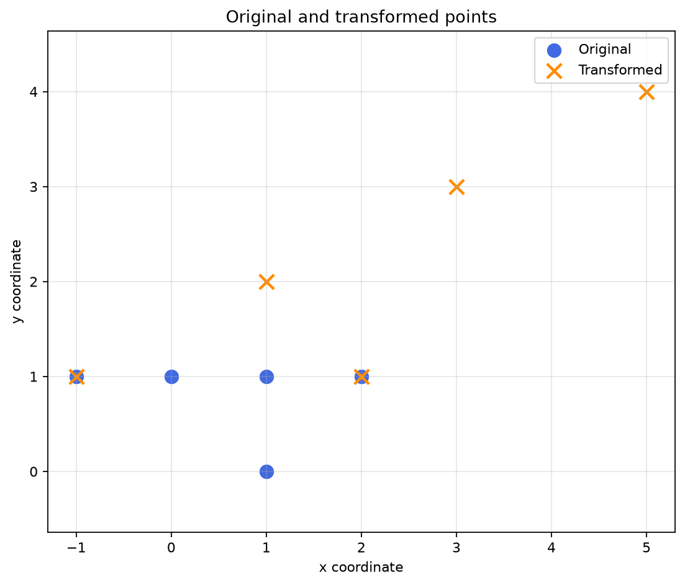
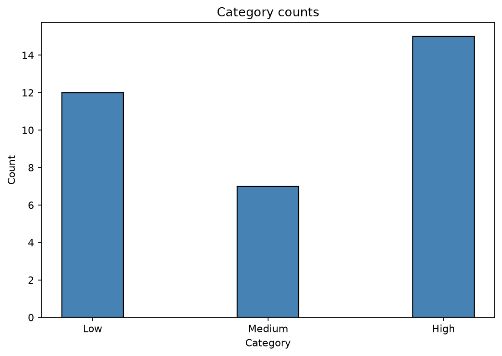

이 글은 비공식 연습문제 **Set B의 문제 4·5·6**을 푼다. 코드를 먼저 읽으며 “이 요구사항을 이렇게 구현했구나” 하고 이해할 수 있도록, **코드 주석에 문제 번호를 붙이고 그 번호별로 의미를 풀었다.**

예를 들어 `[P4.2-B]`를 찾으면 문자열을 삽입 위치 앞뒤로 나누는 코드가 나오고, `[P5.3-D]`를 찾으면 `break` 이후 통계를 출력하고 `sys.exit()`를 호출하는 코드가 나온다. 처음에는 전체 코드를 읽고 바로 뒤의 **코드 → 의미 → 요구사항 연결 해설**을 함께 보면 된다. 입력이나 행렬이 바뀌면 수정할 곳은 각 문제 끝에 모았다.

각 문제는 읽기 편한 영어 본문 바로 아래에 한국어 전체 번역을 배치했다. PDF의 영문 문구와 예시를 유지하되 반복 머리글·쪽 번호는 제외했고, 원문을 따로 열지 않아도 읽을 수 있다. 본문의 전체 풀이 코드와 다운로드 파일은 같은 내용이다.

## 빠른 목차 — 코드에서 필요한 설명 찾기

| 찾는 내용 | 원문 | 전체 코드 | 코드를 읽는 해설 | 실수·변형 |
| --- | --- | --- | --- | --- |
| 문자열 연결·삽입·회문·가운데 정렬 | [문제 4](#p4-original) | [my_strings.py](#p4-code) | [요구사항별 코드 해석](#p4-explain) | [점검표](#p4-variants) |
| 모듈 import와 독립 테스트 | [P4.4](#p4-testing) | [test_strings.py](test_strings.py) | [모듈 이름으로 함수 호출](#p4-testing) | [실행 준비](#setup) |
| 가위바위보 판정·입력 검증·통계 | [문제 5](#p5-original) | [tournament.py](#p5-code) | [입력 하나가 흐르는 순서](#p5-explain) | [점검표](#p5-variants) |
| dtype·행렬 곱·역행렬·산점도·bar | [문제 6](#p6-original) | [matrix_diagnostics.py](#p6-code) | [shape와 좌표로 코드 해석](#p6-explain) | [점검표](#p6-variants) |
| 테스트·실행 결과·전체 ZIP | [실행 준비](#setup) | [전체 파일 ZIP](practice_set_b.zip) | [검증 결과](#verification) | [마지막 확인](#final-check) |

<a id="setup"></a>

## 0. 파일을 준비하고 실행하는 방법

[전체 풀이·테스트 ZIP](practice_set_b.zip)을 받아 **같은 폴더에** 푼다. 문제 4·5는 외부 패키지가 필요 없다. 문제 6은 NumPy·Matplotlib이 필요하며, 필요할 때 해당 인터프리터에서 `python -m pip install numpy matplotlib`로 설치한다.

```text
practice_set_b/
    my_strings.py             # 문제 4: import해서 쓰는 함수 모듈
    test_strings.py           # 문제 4: 실행 예시와 자동 테스트
    tournament.py             # 문제 5: 실제 대화형 게임
    test_tournament.py        # 문제 5: 판정·입력 흐름·통계 검증
    matrix_diagnostics.py     # 문제 6: 계산과 두 그림 저장
    test_matrix.py            # 문제 6: 수치·배열·그림 검증
```

```text
python test_strings.py
python tournament.py
python test_tournament.py
python matrix_diagnostics.py
python test_matrix.py
```

`my_strings.py`는 함수를 정의한 모듈이므로 단독 실행해도 출력이 없는 것이 정상이다. `test_strings.py`에서 모듈을 가져와 함수를 호출한다. 그래프 프로그램은 산점도 창을 먼저 띄우고, 창을 닫으면 막대그래프 창을 띄운다. 두 PNG는 코드 파일 옆에 각각 저장된다.

VS Code·PyCharm에서는 위 파일을 실행할 **같은 Python 환경**을 선택한다. PowerShell에서 따옴표로 감싼 Python 전체 경로를 실행할 때는 앞에 `&`를 붙인다.

<details>
<summary>공통 안내 · English / 한국어</summary>

<section class="problem-statement" lang="en">

#### English · 문제 원문

ENAI 607 Python Programming for Engineering AI

Fall 2026 | Practice Midterm - Set B

UNOFFICIAL PRACTICE MATERIAL - NOT AN ACTUAL EXAM OR HOMEWORK

Instructions. Write and test Python programs for all three problems. Each problem deliberately emphasizes material appearing in Lectures 1-6, the Homework, and the Exercises that was not the focus of Practice Midterm - Set A. Read the entire problem before writing your program. A solution that produces one example result but violates an explicitly required Python construct does not fully satisfy the problem. Include meaningful tests. No solutions are provided.

Study conditions. For these practice problems, you may consult your lecture slides and your own notes. Try each requirement without generative-AI assistance before checking anything. Suggested scoring: 30 + 35 + 35 = 100 points. The problems are original practice questions, not predictions of the actual exam.

</section>

<section class="problem-statement" lang="ko">

#### 한국어 · 전체 번역

**ENAI 607 — 공학 AI를 위한 Python 프로그래밍 / 2026년 가을 / 연습 중간고사 Set B**

**비공식 연습 자료이며, 실제 시험이나 과제가 아니다.**

**지침:** 세 문제 모두의 Python 프로그램을 작성하고 테스트하시오. 각 문제는 Lectures 1–6, Homework, Exercises 중 Set A에서 중점적으로 다루지 않은 내용을 의도적으로 강조한다. 프로그램을 작성하기 전에 문제 전체를 읽으시오. 예제 결과 하나를 출력하더라도 명시적으로 요구한 Python 문법을 위반하면 문제를 완전히 충족하지 못한다. 의미 있는 테스트를 포함하시오. 원문에는 풀이가 제공되지 않는다.

**학습 조건:** 이 연습문제에서는 강의 슬라이드와 본인의 노트를 참고해도 된다. 풀이를 확인하기 전에 각 요구사항을 생성형 AI의 도움 없이 먼저 시도해 보시오. 제안 배점은 30 + 35 + 35 = 총 100점이다. 이 문제들은 새로 만든 연습문제이며 실제 시험의 출제 예측이 아니다.

</section>

</details>

## 문제 4. 작은 문자열 조작 모듈

<a id="p4-original"></a>

### 4-1. 문제 원문

<section class="problem-statement" lang="en">

#### English · 문제 원문

##### Problem 4. A Small String Manipulation Library (30 points)

Write and test a Python module that provides several functions operating on strings. Your implementation must pay attention to the fact that strings are immutable, list slicing creates a new list, and a function may have an optional parameter with a default value. You must create two Python source files, my_strings.py and test_strings.py, and follow all restrictions below. Do not use any third-party libraries.

##### P4.1. Joining strings with an optional parameter (8 points)

In my_strings.py, define a function with the exact header `str_join(strings, sep="")`. The first input parameter is a list of strings. The second input parameter is an optional separator string, with the empty string as its default value.

The function must return a single string containing every list item, in its original order, with the separator inserted only between adjacent items. Do not add a separator at the beginning or the end. For an empty list, return an empty string. You are not allowed to use the built-in string `join()` method; implement the joining process yourself using a loop and string concatenation.

```python
print(str_join(["red", "blue", "green"]))
# redbluegreen
print(str_join(["red", "blue", "green"], " / "))
# red / blue / green
print(str_join([], ":"))
# (empty string)
```

##### P4.2. String insertion using slicing (8 points)

Define the function `str_insert(dest_str, ins_str, pos)`. Insert the entire string ins_str into dest_str immediately before the character having index pos. Positions 0 through `len(dest_str)`, inclusive, are valid. An index of zero inserts at the beginning; an index equal to `len(dest_str)` appends at the end. For an invalid index, print the message `str_insert()`: position input parameter out of range. and return None. You must use slicing to separate the destination into two parts and must call your own `str_join()` to construct the output. Do not modify the original arguments.

```python
print(str_insert("abcdef", "XYZ", 3))   # abcXYZdef
print(str_insert("abcdef", "!", 6))     # abcdef!
print(str_insert("abcdef", "?", -1))    # error message, then None
```

##### P4.3. Type checking, reversal, and alignment (8 points)

Define `is_palindrome(text)`. First check that text is a string using `isinstance()`. For a non-string input, print `is_palindrome()`: the input parameter must be a string. and return None. Otherwise return True when the characters are identical in forward and reverse order, and False otherwise. Use slicing with a negative step to reverse the string. Compare the characters exactly as provided; do not ignore case or punctuation.

Also define `center_with_dots(text, width)`. Return a string of exactly width characters, containing text in the middle and period characters (.) on both sides. Do not call `str.center()`. You may assume width is at least `len(text)`. If an odd number of padding characters is required, place the extra period on the right.

```python
print(is_palindrome("level"))           # True
print(is_palindrome("Python"))          # False
print(is_palindrome(123))               # error message, then None
print(center_with_dots("Data", 9))      # ..Data...
```

##### P4.4. Module import and independent testing (6 points)

The file test_strings.py must import the my_strings module using import my_strings (not by copying the implementations into the test file). Invoke the functions through the module namespace, such as `my_strings.str_join(...)`. Demonstrate the use of the default separator, an explicitly supplied separator, insertion at both endpoints and in the middle, at least one invalid insertion position, a palindrome, and a non-string palindrome input. Add one brief comment explaining why changing a returned string cannot modify the original input string.

Source inspiration: Exercise 4, E4.1-E4.4; Homework 3, H3.3; Homework 4, H4.7; Lecture 2 (strings and slicing), Lecture 3 (functions), Lecture 4 (modules).

</section>

<section class="problem-statement" lang="ko">

#### 한국어 · 전체 번역

##### 문제 4. 작은 문자열 조작 라이브러리 (30점)

문자열을 다루는 함수 여러 개를 제공하는 Python 모듈을 작성하고 테스트하시오. 구현 시 문자열은 불변이라는 점, 리스트 슬라이싱은 새 리스트를 만든다는 점, 함수에는 기본값이 있는 선택 매개변수를 둘 수 있다는 점에 유의하시오.

Python 소스 파일 **`my_strings.py`와 `test_strings.py` 두 개**를 만들고 아래 제한을 모두 지키시오. **서드파티 라이브러리는 사용하지 마시오.**

##### P4.1. 선택 매개변수가 있는 문자열 연결 (8점)

`my_strings.py`에 다음과 **정확히 같은 함수 헤더**로 함수를 정의하시오.

```python
def str_join(strings, sep=""):
```

첫 번째 매개변수는 문자열 리스트다. 두 번째 매개변수는 선택적으로 전달하는 구분자 문자열이며, 기본값은 빈 문자열이다.

리스트의 모든 항목을 **원래 순서대로** 담은 문자열 하나를 반환하시오. 구분자는 인접한 두 항목 **사이에만** 넣고, 시작이나 끝에는 넣지 마시오. 빈 리스트이면 빈 문자열을 반환하시오.

**내장 문자열 `join()` 메서드를 사용하면 안 된다.** 반복문과 문자열 연결로 연결 과정을 직접 구현하시오.

```python
print(str_join(["red", "blue", "green"]))
# redbluegreen
print(str_join(["red", "blue", "green"], " / "))
# red / blue / green
print(str_join([], ":"))
# 빈 문자열
```

##### P4.2. 슬라이싱을 사용한 문자열 삽입 (8점)

`str_insert(dest_str, ins_str, pos)` 함수를 정의하시오. `dest_str`의 인덱스 pos에 있는 문자 **바로 앞에** `ins_str` 전체를 삽입하시오.

- **0부터 `len(dest_str)`까지 양 끝을 포함한 위치**가 유효하다.
- 0이면 맨 앞에 삽입한다.
- `len(dest_str)`이면 맨 뒤에 추가한다.
- 잘못된 인덱스이면 아래 메시지를 출력하고 `None`을 반환한다.

```text
str_insert(): position input parameter out of range.
```

반드시 슬라이싱으로 목적 문자열을 두 부분으로 나누고, **직접 만든 `str_join()`을 호출해** 결과를 구성해야 한다. 원래 인자들은 변경하지 마시오.

```python
print(str_insert("abcdef", "XYZ", 3))  # abcXYZdef
print(str_insert("abcdef", "!", 6))    # abcdef!
print(str_insert("abcdef", "?", -1))   # 오류 메시지 출력 후 None
```

##### P4.3. 타입 검사, 역순과 정렬 (8점)

`is_palindrome(text)`를 정의하시오. 먼저 `isinstance()`로 입력이 문자열인지 검사하시오. 문자열이 아니면 다음 메시지를 출력하고 `None`을 반환하시오.

```text
is_palindrome(): the input parameter must be a string.
```

문자열이면 정방향과 역방향의 문자가 같을 때 `True`, 그렇지 않으면 `False`를 반환하시오. **음수 간격 슬라이싱**으로 문자열을 뒤집으시오. 문자는 전달된 그대로 정확하게 비교하며, **대소문자나 문장부호를 무시하지 마시오.**

`center_with_dots(text, width)`도 정의하시오. text를 가운데에 넣고 양옆을 마침표 `.`로 채운, **정확히 width 글자**의 문자열을 반환하시오.

- `str.center()`를 호출하지 마시오.
- width는 `len(text)` 이상이라고 가정해도 된다.
- 필요한 채움 문자 수가 홀수이면 **남는 마침표 한 개는 오른쪽에** 넣으시오.

```python
print(is_palindrome("level"))       # True
print(is_palindrome("Python"))      # False
print(is_palindrome(123))           # 오류 메시지 출력 후 None
print(center_with_dots("Data", 9))  # ..Data...
```

##### P4.4. 모듈 import와 독립적인 테스트 (6점)

`test_strings.py`는 구현을 테스트 파일에 복사하지 말고 **`import my_strings`로 모듈을 가져와야 한다.** 함수는 `my_strings.str_join(...)`처럼 모듈 이름을 붙여 호출하시오.

다음 사례를 시연하시오.

- 기본 구분자 사용
- 구분자를 명시적으로 전달한 연결
- 양 끝 위치와 중간 위치의 삽입
- 잘못된 삽입 위치 한 개 이상
- 회문 문자열
- 문자열이 아닌 회문 검사 입력

반환된 문자열을 변경해도 원래 입력 문자열이 바뀌지 않는 이유를 짧은 주석 하나로 설명하시오.

**출제 참고 범위:** Exercise 4의 E4.1–E4.4, Homework 3의 H3.3, Homework 4의 H4.7, Lecture 2의 문자열·슬라이싱, Lecture 3의 함수, Lecture 4의 모듈.

</section>

<a id="p4-code"></a>

### 4-2. 전체 코드 — my_strings.py

파일 이름을 **`my_strings.py`로 저장한다.** 아래 함수 네 개가 요구하는 모듈의 구현이다. `join()`과 `center()`를 직접 호출하면 결과가 같아도 문제의 제한을 위반하므로 사용하지 않았다.

```python
"""문제 4: 문자열을 수정하지 않고 새 문자열을 만드는 작은 모듈."""


def str_join(strings, sep=""):
    # [P4.1-A] 인자를 생략하면 sep는 빈 문자열이므로 원소끼리 바로 연결된다.
    result = ""
    for index, item in enumerate(strings):
        # [P4.1-B] 첫 원소 앞에는 구분자를 넣지 않는다.
        # 두 번째 원소부터 '구분자 + 현재 원소'를 추가하면 끝에도 남지 않는다.
        if index > 0:
            result += sep
        result += item
    # [P4.1-C] 빈 리스트면 반복문이 0번 실행되어 빈 문자열을 반환한다.
    return result


def str_insert(dest_str, ins_str, pos):
    # [P4.2-A] 끝에 붙이는 위치 len(dest_str)도 유효하므로 <=를 쓴다.
    if not isinstance(pos, int) or not 0 <= pos <= len(dest_str):
        print("str_insert(): position input parameter out of range.")
        return None
    # [P4.2-B] 왼쪽은 pos 직전까지, 오른쪽은 pos부터다.
    left = dest_str[:pos]
    right = dest_str[pos:]
    # [P4.2-C] 내장 .join() 대신 위에서 직접 만든 함수를 호출해야 한다.
    return str_join([left, ins_str, right])


def is_palindrome(text):
    # [P4.3-A] 타입부터 확인해야 정수 등에 슬라이싱을 시도하지 않는다.
    if not isinstance(text, str):
        print("is_palindrome(): the input parameter must be a string.")
        return None
    # [P4.3-B] -1 간격으로 역순 문자열을 만들고 원문과 그대로 비교한다.
    return text == text[::-1]


def center_with_dots(text, width):
    # [P4.3-C] 문제의 전제: width는 len(text) 이상의 정수다.
    padding = width - len(text)
    left_count = padding // 2
    right_count = padding - left_count  # 홀수면 나머지 한 개가 오른쪽으로 간다.
    # [P4.3-D] str.center()를 호출하지 않고 반복·연결로 새 문자열 생성.
    return "." * left_count + text + "." * right_count
```

<a id="p4-explain"></a>

### 4-3. 코드를 읽는 해설 — 요구사항과 한 줄씩 연결

#### P4.1: `sep=""`와 구분자를 넣는 시점

| 코드 | 실제 의미 | 대응 요구사항 |
| --- | --- | --- |
| `def str_join(strings, sep=""):` | 두 번째 인자가 없으면 `sep`에 `""`를 사용 | optional parameter와 기본값 |
| `result = ""` | 반환할 문자열을 빈 값에서 시작 | 빈 리스트일 때 빈 문자열 반환 |
| `for index, item in enumerate(strings):` | 리스트를 원래 순서로 읽으며 0부터 번호를 붙임 | loop를 사용해 모든 원소 연결 |
| `if index > 0: result += sep` | 첫 원소를 제외하고 현재 원소 **앞에만** 구분자 추가 | 맨 앞·맨 뒤에 구분자가 없어야 함 |
| `result += item` | 현재 문자열을 결과 뒤에 연결 | 내장 join 없이 문자열 연결 |
| `return result` | 완성한 문자열을 호출자에게 돌려줌 | 함수 자체가 출력 대신 결과 반환 |

`strings = ["red", "blue", "green"]`, `sep = " / "`라면 변수는 다음처럼 변한다.

| 반복 | 구분자 추가 후 | 원소 추가 후 `result` |
| --- | --- | --- |
| 시작 전 | 해당 없음 | `""` |
| index 0, red | 첫 원소이므로 생략 | `"red"` |
| index 1, blue | `"red / "` | `"red / blue"` |
| index 2, green | `"red / blue / "` | `"red / blue / green"` |

빈 리스트는 반복을 한 번도 돌지 않아 처음의 `""`를 그대로 반환한다. 원소가 하나면 `index > 0`이 한 번도 참이 아니므로 구분자가 들어가지 않는다. 기본값인 `sep=""`를 쓰면 사이에 빈 문자열을 넣으므로 바로 이어진다.

여기서 `+=`는 입력 문자열의 글자를 고치는 명령이 아니다. `result`가 연결된 문자열을 가리키도록 하는 것이다. `strings.pop(0)`처럼 입력 리스트를 지우면서 순회하지 않았으므로 원래 리스트의 원소도 유지된다. `strings[1:]`를 사용한 다른 풀이도 새 바깥 리스트를 만들지만, 이 풀이에서는 번호로 첫 원소를 구분해 별도 슬라이스를 만들지 않았다.

#### P4.2: 삽입 위치는 “기존 글자의 인덱스”와 경계가 다르다

```text
dest_str = "abcdef", pos = 3
                    abc | def
dest_str[:3]  -> "abc"  |  dest_str[3:] -> "def"
                            ↓
str_join(["abc", "XYZ", "def"]) -> "abcXYZdef"
```

`[:pos]`는 `pos`를 **포함하지 않고**, `[pos:]`는 `pos`를 **포함한다.** 두 부분 사이에 `ins_str`를 넣으면 원래 pos번 글자 바로 앞에 삽입된다.

| pos | 왼쪽 `dest_str[:pos]` | 오른쪽 `dest_str[pos:]` | 결과 |
| --- | --- | --- | --- |
| 0 | `""` | `"abcdef"` | 맨 앞 삽입 |
| 3 | `"abc"` | `"def"` | 가운데 삽입 |
| 6 | `"abcdef"` | `""` | 맨 뒤 추가 |

길이 6인 문자열에서 `dest_str[6]`을 조회하면 오류지만 **삽입 경계 6은 유효하다.** 그래서 범위 검사에 `< len(...)`가 아닌 `<= len(...)`를 쓴다. `-1`은 Python 인덱싱에서는 특별한 의미가 있지만, 이 문제의 삽입 규칙에서는 허용하지 않는다.

잘못된 위치에서는 정해진 오류 문장을 `print()`하고 `return None`으로 함수를 끝낸다. 바깥에서 `print(str_insert(...))`를 실행하면 **함수 안의 오류 문장 다음에 바깥 print의 `None`이 나온다.** 정상 경로의 `str_join([left, ins_str, right])`는 필수 요구인 “자기가 만든 연결 함수 호출”을 만족한다. 정수 이외의 pos도 슬라이싱 전에 거르도록 검사했다.

#### P4.3: `isinstance` → 역순 → 비교

`isinstance(text, str)`를 **먼저** 확인한다. 정수 123에 `[::-1]`를 적용하려 하면 오류가 나므로, 잘못된 타입에는 안내 후 `None`을 반환하고 비교에 들어가지 않는다.

```text
"level"[::-1]  -> "level"   -> "level" == "level"  -> True
"Python"[::-1] -> "nohtyP"  -> "Python" == "nohtyP" -> False
```

`text == text[::-1]` 자체가 참·거짓 값이므로 다시 `if ...: return True`를 작성할 필요가 없다. 대소문자·공백·문장부호를 제거하거나 통일하지 않는다. `"Level"`은 거짓이고, 빈 문자열은 자기 자신의 역순과 같으므로 참이다. `None`은 거짓 회문이라는 뜻이 아니라 **검사할 입력 타입이 잘못됐다는 반환값**이다.

#### P4.3: `// 2`로 남는 점 하나를 오른쪽에 준다

`center_with_dots("Data", 9)`에서 글자 수는 4이고 전체 너비는 9다.

```text
padding = 9 - 4 = 5
left_count = 5 // 2 = 2
right_count = 5 - 2 = 3
"." * 2 + "Data" + "." * 3 = "..Data..."
```

`//`는 정수 나눗셈이다. 필요한 점 수가 홀수이면 왼쪽은 작은 몫을 받고 오른쪽이 한 개 더 받는다. 짝수이면 양쪽이 같다. `width == len(text)`면 점 수는 0이다. 문제에서 `width >= len(text)`를 전제했으므로 너비가 작은 입력을 임의로 잘라 내는 처리는 넣지 않았다.

<a id="p4-testing"></a>

### 4-4. test_strings.py — 모듈 이름을 통한 호출

아래는 실행 예시 부분을 모은 간단한 테스트 파일이다. [다운로드용 test_strings.py](test_strings.py)는 같은 호출에 자동 테스트 9개를 추가한 전체 버전이다.

```python
import my_strings

print(my_strings.str_join(["red", "blue", "green"]))
print(my_strings.str_join(["red", "blue", "green"], " / "))
print(repr(my_strings.str_join([], ":")))
print(my_strings.str_insert("abcdef", "!", 0))
print(my_strings.str_insert("abcdef", "XYZ", 3))
print(my_strings.str_insert("abcdef", "!", 6))
print(my_strings.str_insert("abcdef", "?", -1))
print(my_strings.is_palindrome("level"))
print(my_strings.is_palindrome("Python"))
print(my_strings.is_palindrome(123))
print(my_strings.center_with_dots("Data", 9))
```

`import my_strings`는 모듈을 가져오고, `my_strings.str_join`은 그 모듈의 함수를 찾는다. 테스트 파일에 구현을 다시 붙여 넣거나 `from my_strings import str_join`로 바꾸면 원문이 요구한 호출 방식과 달라진다. 모듈 내부의 `str_insert()`는 같은 모듈에 정의된 함수이므로 `str_join(...)`이라고 직접 부른다.

다운로드한 전체 테스트를 실행했을 때의 예시 출력이다. `repr()`를 사용한 빈 결과는 `''`로 표시했다.

```text
redbluegreen
red / blue / green
''
!abcdef
abcXYZdef
abcdef!
str_insert(): position input parameter out of range.
None
True
False
is_palindrome(): the input parameter must be a string.
None
..Data...
원본: abc / 새 결과: aXbc!
```

마지막 예시는 반환받은 문자열에 `"!"`를 붙여 새 변수값으로 바꿔도 원본 `"abc"`가 유지됨을 보여 준다. 함수 호출에 문자열 객체를 전달하는 것과 그 객체의 내용을 수정하는 것은 다르다.

<a id="p4-variants"></a>

### 4-5. 헷갈리는 코드와 변형 대응

| 상황 | 확인·수정할 코드 |
| --- | --- |
| 결과 끝에 구분자가 남음 | 원소 뒤에 무조건 붙이지 말고 첫 원소를 제외한 원소 앞에 추가 |
| pos=len일 때 삽입을 거부함 | `0 <= pos <= len(dest_str)`로 양쪽 경계 포함 |
| 입력 문자열의 글자를 대입으로 바꾸려 함 | 문자열은 불변. 슬라이싱한 두 조각과 삽입 문자열로 새 결과 생성 |
| 회문에서 대소문자를 무시하라는 변형 | 그때만 `text.casefold()` 등으로 정규화한 값을 비교 |
| 공백·문장부호 무시 변형 | 요구된 문자만 고르는 전처리를 먼저 추가; 원래 문제에는 넣지 않기 |
| 점 대신 다른 채움 문자를 요구 | 문자열 반복의 `"."`를 바꾸거나 기본 인자 `fill="."` 추가 |
| 남는 한 칸을 왼쪽에 배정 | `right_count = padding // 2`, `left_count = padding - right_count` |
| 여러 문자열의 성능이 중요하고 join 금지가 없음 | 일반적인 `sep.join(strings)` 사용을 검토; 이번 문제에서는 금지 |

## 문제 5. 반복형 가위바위보와 대회 통계

<a id="p5-original"></a>

### 5-1. 문제 원문

<section class="problem-statement" lang="en">

#### English · 문제 원문

##### Problem 5. An Interactive Rock-Paper-Scissors Tournament (35 points)

Write and test a Python script that plays repeated Rock-Paper-Scissors rounds against a computer opponent. The script must request an integer input from the user and randomly generate the computer's gesture for each valid round. In addition to determining the winner of a single round, it must maintain and display tournament statistics when the user exits. The main program shall execute in a loop until the user requests termination.

##### P5.1. Single-round decision function (10 points)

Define `judge_round(player, computer)`. Both arguments are integers: 0 represents Rock, 1 represents Paper, and 2 represents Scissors. Return one of the strings "WIN", "LOSS", or "TIE" based on the ordinary rules of the game (Rock beats Scissors, Scissors beats Paper, Paper beats Rock). Use conditional statements. Do not generate a random choice inside this function, and do not print a message from inside it; separating the rule calculation from user interaction makes the function independently testable.

```python
print(judge_round(0, 2))      # WIN
print(judge_round(1, 2))      # LOSS
print(judge_round(2, 2))      # TIE
print(judge_round(2, 1))      # WIN
```

##### P5.2. Input validation and control flow (12 points)

Define `main()`. Repeatedly prompt the user with Enter a gesture (0=Rock, 1=Paper, 2=Scissors, -1=Quit):.

You must use while True as the main game loop. Convert the entered string into an integer. Use try/except to handle a string that cannot be converted to an integer; in that case print "Invalid integer input." and start another iteration using the continue statement. Any integer other than -1, 0, 1, or 2 is an invalid choice; print "Invalid gesture." and start another iteration, again without playing a round. Invalid inputs must not change the tournament statistics.

For each valid choice 0, 1, or 2, generate the computer's gesture with `random.randrange(3)` from the standard random module. Call `judge_round()` to determine the result. Print both gesture names and the outcome. The printed names must be "Rock", "Paper", or "Scissors"; convert numeric choices using a list of gesture-name strings, not three independent print statements.

##### P5.3. Loop termination and tournament statistics (8 points)

Maintain separate integer counters for wins, losses, and ties, initialized to zero before the loop. Increment exactly one counter after each valid round. When the user enters -1, leave the main game loop using the break statement.

After the loop, print the three counters and the total number of valid rounds, then terminate the program by calling `sys.exit()` from the sys module. Both break and `sys.exit()` are required in this practice task. A valid round must not terminate the game.

##### P5.4. Tests and sample interaction (5 points)

Test `judge_round()` directly with the four calls above. Then run the interactive program and try at least one nonnumeric entry, an out-of-range integer, a valid gesture, and the quit command. Example interaction (the computer's valid-round gesture shown here is illustrative; its actual choice is random):

```text
Enter a gesture (0=Rock, 1=Paper, 2=Scissors, -1=Quit): hello
Invalid integer input.
Enter a gesture (0=Rock, 1=Paper, 2=Scissors, -1=Quit): 7
Invalid gesture.
Enter a gesture (0=Rock, 1=Paper, 2=Scissors, -1=Quit): 0
You: Rock; Computer: Scissors; Result: WIN
Enter a gesture (0=Rock, 1=Paper, 2=Scissors, -1=Quit): -1
Wins: 1, Losses: 0, Ties: 0, Total: 1
```

Source inspiration: Homework 4, H4.9; Exercise 3, E3.5; Homework 4, H4.5; Lecture 3 (control flow), Lecture 4 (exceptions and modules).

</section>

<section class="problem-statement" lang="ko">

#### 한국어 · 전체 번역

##### 문제 5. 대화형 가위바위보 대회 (35점)

컴퓨터를 상대로 가위바위보를 여러 번 진행하는 Python 스크립트를 작성하고 테스트하시오. 사용자에게 정수 입력을 요청하고, 유효한 라운드마다 컴퓨터의 동작을 무작위로 생성해야 한다.

한 라운드의 승자를 정하는 것 외에도 대회 통계를 유지하고, 사용자가 종료할 때 표시해야 한다. 메인 프로그램은 사용자가 종료를 요청할 때까지 반복문 안에서 실행되어야 한다.

##### P5.1. 한 라운드의 판정 함수 (10점)

`judge_round(player, computer)`를 정의하시오. 두 인자는 모두 정수이며, **0은 Rock(바위), 1은 Paper(보), 2는 Scissors(가위)를 뜻한다.**

일반적인 가위바위보 규칙에 따라 `"WIN"`, `"LOSS"`, `"TIE"` 중 하나를 반환하시오. 바위는 가위를 이기고, 가위는 보를 이기며, 보는 바위를 이긴다.

**조건문을 사용하시오.** 이 함수 안에서는 난수를 생성하거나 메시지를 출력하지 마시오. 규칙 계산을 사용자 상호작용과 분리하면 함수를 독립적으로 테스트할 수 있다.

```python
print(judge_round(0, 2))  # WIN
print(judge_round(1, 2))  # LOSS
print(judge_round(2, 2))  # TIE
print(judge_round(2, 1))  # WIN
```

##### P5.2. 입력 검증과 제어 흐름 (12점)

`main()`을 정의하시오. 사용자에게 다음 안내로 반복해서 입력을 요청하시오.

```text
Enter a gesture (0=Rock, 1=Paper, 2=Scissors, -1=Quit):
```

메인 게임 반복문은 **반드시 `while True`를 사용**해야 한다. 입력 문자열을 정수로 변환하시오.

- 정수로 바꿀 수 없는 문자열은 `try/except`로 처리한다. `"Invalid integer input."`을 출력하고 **`continue`로 다음 반복**을 시작한다.
- -1·0·1·2 이외의 정수는 잘못된 선택이다. `"Invalid gesture."`를 출력하고, 역시 라운드를 진행하지 않은 채 다음 반복을 시작한다.
- **잘못된 입력 때문에 대회 통계가 바뀌어서는 안 된다.**

유효한 선택인 0·1·2를 받으면 표준 `random` 모듈의 **`random.randrange(3)`으로** 컴퓨터의 동작을 생성하시오. `judge_round()`를 호출해 결과를 결정하고, 양쪽 동작 이름과 결과를 출력하시오.

출력 이름은 `"Rock"`, `"Paper"`, `"Scissors"`여야 한다. 숫자 선택을 이름으로 바꿀 때 **동작 이름 문자열 리스트**를 사용하고, 서로 독립된 출력문 세 개로 처리하지 마시오.

##### P5.3. 반복 종료와 대회 통계 (8점)

승리·패배·무승부 각각의 정수 카운터를 따로 두고, **반복문 시작 전에 0으로 초기화**하시오. 유효한 라운드마다 정확히 한 카운터만 증가시키시오.

사용자가 -1을 입력하면 **`break`로 메인 게임 반복문을 빠져나오시오.** 반복문이 끝난 뒤 세 카운터와 유효한 라운드의 총개수를 출력하고, `sys` 모듈의 **`sys.exit()`를 호출해 프로그램을 종료**하시오.

이 문제에서는 **`break`와 `sys.exit()`가 둘 다 필요하다.** 유효한 라운드를 한 번 진행했다고 게임이 종료되어서는 안 된다.

##### P5.4. 테스트와 상호작용 예시 (5점)

위의 네 호출로 `judge_round()`를 직접 테스트하시오. 그다음 대화형 프로그램을 실행해 다음을 각각 한 번 이상 입력하시오.

- 숫자가 아닌 입력
- 범위 밖의 정수
- 유효한 동작
- 종료 명령

다음은 상호작용 예시다. 예시의 컴퓨터 동작은 설명을 위한 것이며 실제 선택은 무작위다.

```text
Enter a gesture (0=Rock, 1=Paper, 2=Scissors, -1=Quit): hello
Invalid integer input.
Enter a gesture (0=Rock, 1=Paper, 2=Scissors, -1=Quit): 7
Invalid gesture.
Enter a gesture (0=Rock, 1=Paper, 2=Scissors, -1=Quit): 0
You: Rock; Computer: Scissors; Result: WIN
Enter a gesture (0=Rock, 1=Paper, 2=Scissors, -1=Quit): -1
Wins: 1, Losses: 0, Ties: 0, Total: 1
```

**출제 참고 범위:** Homework 4의 H4.9, Exercise 3의 E3.5, Homework 4의 H4.5, Lecture 3의 제어 흐름, Lecture 4의 예외·모듈.

</section>

<a id="p5-code"></a>

### 5-2. 전체 코드 — tournament.py

```python
"""문제 5: 판정 함수와 입력·통계를 분리한 가위바위보 대회."""
import random
import sys


def judge_round(player, computer):
    # [P5.1-A] main에서 검증한 0, 1, 2를 받는다. 여기서는 출력·난수 생성 금지.
    if player == computer:
        return "TIE"
    elif ((player == 0 and computer == 2)
          or (player == 1 and computer == 0)
          or (player == 2 and computer == 1)):
        return "WIN"
    else:
        return "LOSS"


def main():
    # [P5.2-A] 숫자 인덱스를 표시 이름으로 바꾸는 공통 목록.
    gesture_names = ["Rock", "Paper", "Scissors"]
    # [P5.3-A] 루프 밖에 두어 매 라운드마다 0으로 초기화되지 않게 한다.
    wins = 0
    losses = 0
    ties = 0

    while True:  # [P5.2-B] 종료 요청이 나올 때까지 반복
        try:
            player = int(input("Enter a gesture (0=Rock, 1=Paper, 2=Scissors, -1=Quit): "))
        except ValueError:
            print("Invalid integer input.")
            continue  # 숫자 변환 실패: 아래 난수·판정·카운터 코드는 실행하지 않음

        # [P5.3-B] -1을 먼저 처리해야 잘못된 동작으로 분류하지 않는다.
        if player == -1:
            break
        if player not in (0, 1, 2):
            print("Invalid gesture.")
            continue

        # [P5.2-C] 유효한 입력에만 컴퓨터 선택과 판정을 수행한다.
        computer = random.randrange(3)  # 0, 1, 2 중 하나. 3은 포함하지 않음.
        result = judge_round(player, computer)
        print(f"You: {gesture_names[player]}; Computer: {gesture_names[computer]}; Result: {result}")

        # [P5.3-C] 서로 배타적인 if/elif/else로 카운터 하나만 올린다.
        if result == "WIN":
            wins += 1
        elif result == "LOSS":
            losses += 1
        else:
            ties += 1

    # [P5.3-D] break는 위 while만 끝내므로 최종 통계를 출력할 수 있다.
    total = wins + losses + ties
    print(f"Wins: {wins}, Losses: {losses}, Ties: {ties}, Total: {total}")
    sys.exit()  # 통계 출력 후 프로그램 종료. import할 때는 호출되지 않는다.


if __name__ == "__main__":
    main()
```

<a id="p5-explain"></a>

### 5-3. 코드를 읽는 해설 — 입력 하나가 흐르는 순서

#### P5.1: 판정 함수에 출력과 난수를 넣지 않은 이유

`judge_round()`는 **입력 두 개 → 결과 문자열 하나**만 담당한다. 그러면 사용자 입력 없이도 `(player, computer)`를 직접 넣어 모든 경우를 확인할 수 있다. 승리하는 조합은 세 개뿐이다.

| player \ computer | 0 Rock | 1 Paper | 2 Scissors |
| --- | --- | --- | --- |
| 0 Rock | TIE | LOSS | WIN |
| 1 Paper | WIN | TIE | LOSS |
| 2 Scissors | LOSS | WIN | TIE |

코드에서는 같은 숫자면 먼저 `TIE`, 그다음 `(0,2)`·`(1,0)`·`(2,1)`이면 `WIN`, 남은 경우는 `LOSS`다. 괄호 안의 `and`는 한 조합의 두 조건을 함께 검사하고, 조합 사이의 `or`는 셋 중 하나라도 맞으면 된다는 뜻이다. `return`을 실행하면 **이 함수 호출만 끝나고 호출한 main으로 돌아간다.** 게임 프로그램 전체가 종료되는 것이 아니다.

`judge_round()`는 0·1·2가 들어온다는 전제다. 이 범위 검사와 정수 변환은 main에서 먼저 수행한다.

#### P5.2: `try`와 `continue`를 따라가 보기

```text
입력 문자열
  ├─ "hello" → int 변환 실패 → except → 안내 → continue → 다음 입력
  ├─ "7"     → int 7 → 범위 오류 → 안내 → continue → 다음 입력
  ├─ "-1"    → int -1 → break → 반복문 뒤 통계 출력 → sys.exit
  └─ "0"     → int 0 → 유효
                  → 컴퓨터 난수 → judge_round → 이름·결과 출력
                  → 카운터 하나 증가 → 다시 while의 처음
```

`int(input(...))`에서 `input()`이 먼저 문자열을 반환하고 그 문자열을 `int()`가 바꾼다. `"3.5"`는 정수 문자열이 아니므로 `ValueError`다. 이 문제에서 `int(float(input(...)))`로 바꾸면 소수 입력을 임의로 잘라 허용하게 되므로 적절하지 않다.

두 `continue`는 **현재 반복의 남은 코드를 건너뛰는 명령**이다. 이 때문에 잘못된 입력에서는 `random.randrange(3)`, `judge_round()`, 카운터 증가가 모두 실행되지 않는다. 단순히 오류 문장만 출력하고 계속 아래로 내려가게 두면 유효하지 않은 라운드가 통계에 섞인다.

#### P5.2: `-1`은 목록 인덱스로 쓰기 전에 처리해야 한다

`gesture_names = ["Rock", "Paper", "Scissors"]`에서 `gesture_names[0]`은 Rock, `[1]`은 Paper, `[2]`는 Scissors다. 숫자를 이름으로 바꾸기 위한 **목록 조회**다. 숫자마다 출력문을 세 번 만드는 방식 대신 이 목록을 공유한다.

Python에서 `gesture_names[-1]`은 Scissors다. 따라서 종료 입력을 목록 조회 전에 처리하지 않으면 `-1`을 가위처럼 취급할 수 있다. `if player == -1: break`를 먼저 두고, 나머지 숫자도 0·1·2인지 확인한 뒤에만 인덱싱한다.

`random.randrange(3)`은 0·1·2 중 하나를 만든다. 3은 포함되지 않는다. 난수 생성은 main 안의 **유효한 라운드 경로**에만 있고, 테스트할 판정 함수 안에는 없다.

#### P5.3: 카운터 위치와 `break`·`sys.exit()`의 차이

| 코드 위치·명령 | 의미 | 잘못 두었을 때 |
| --- | --- | --- |
| `wins = losses = ties = 0`에 해당하는 초기화 | 루프 시작 전에 한 번 | 루프 안이면 지난 라운드 통계가 사라짐 |
| 결과별 `if/elif/else` | 매 유효 라운드에 정확히 한 카운터 증가 | 여러 카운터를 올리면 total이 라운드 수와 달라짐 |
| `continue` | 현재 반복만 중단하고 다음 입력 | 게임 종료 명령이 아님 |
| `break` | 가장 가까운 while을 종료 | 뒤의 통계 출력은 계속 실행됨 |
| `sys.exit()` | `SystemExit`를 발생시켜 정상 실행 경로의 프로그램 종료 | 통계 전에 호출하면 최종 보고가 생략됨 |

따라서 **종료 입력 → break → 통계 계산·출력 → sys.exit() 순서로 실행한다.** 한 번 이겼다고 `sys.exit()`를 호출하면 “반복 게임”이라는 요구를 어긴다. 출력할 total은 `wins + losses + ties`로 구하므로 오류 입력 수는 들어가지 않는다.

`if __name__ == "__main__": main()`은 이 파일을 직접 실행할 때만 게임을 시작한다. 테스트 파일이 `import tournament`할 때 입력 루프가 시작되거나 프로그램이 종료되지 않도록 하는 장치다.

### 5-4. 실제 판정·반복 흐름의 실행 결과

[test_tournament.py](test_tournament.py)는 먼저 원문의 네 판정 호출을 실행한 뒤, 입력 `hello → 7 → 0 → -1`을 넣어 **실제 main**을 검증한다. 아래는 그 실행 결과다. 재현 가능한 테스트를 위해 컴퓨터 선택만 2로 고정했고, 실제 `tournament.py`의 선택은 매 유효 라운드마다 무작위다.

```text
WIN
LOSS
TIE
WIN
Enter a gesture (0=Rock, 1=Paper, 2=Scissors, -1=Quit): hello
Invalid integer input.
Enter a gesture (0=Rock, 1=Paper, 2=Scissors, -1=Quit): 7
Invalid gesture.
Enter a gesture (0=Rock, 1=Paper, 2=Scissors, -1=Quit): 0
You: Rock; Computer: Scissors; Result: WIN
Enter a gesture (0=Rock, 1=Paper, 2=Scissors, -1=Quit): -1
Wins: 1, Losses: 0, Ties: 0, Total: 1
```

테스트의 `patch()`는 입력 함수와 난수 함수가 반환할 값만 잠시 바꾼다. 판정·반복문·카운터 구현을 복제해서 테스트하는 방식이 아니다. `sys.exit()`가 일으키는 `SystemExit`는 테스트가 잡아서 전체 테스트 실행이 끝나지 않게 한다. 이 부분은 테스트 도구이며 게임 정답 코드에 추가할 필요는 없다.

<a id="p5-variants"></a>

### 5-5. 헷갈리는 코드와 변형 대응

| 상황·바뀐 조건 | 바꿀 위치·확인할 의미 |
| --- | --- |
| 잘못된 입력에도 라운드가 늘어남 | 난수 생성과 카운터보다 앞에서 검증 후 `continue` |
| 프로그램 시작 직후 통계가 0이 아님 | 초기화가 main 시작 시 한 번인지 검사 |
| 종료 입력만 오류로 표시됨 | -1 종료 분기를 일반 범위 검사보다 먼저 배치 |
| N번의 **유효한 라운드**만 진행 | 유효 라운드 종료 지점에서 total 조건 확인; 오류 입력은 횟수에 미포함 |
| 먼저 3승한 사람이 승리 | 카운터 갱신 후 승수 조건 검사; 무승부 처리 규칙을 별도로 읽기 |
| 승률 출력 | 총 0회일 때 나눗셈 방지 후 `wins / total`; 무승부를 분모에 넣는지 문제 확인 |
| 마지막 입력 종료가 아니라 q 종료 | 정수 변환 전에 문자열 종료 명령 검사 |
| 입력 파일의 EOF도 정상 종료 | 추가 요구가 있을 때 `EOFError` 처리 경로 설계 |

## 문제 6. 행렬 진단과 두 종류의 그래프

<a id="p6-original"></a>

### 6-1. 문제 원문

<section class="problem-statement" lang="en">

#### English · 문제 원문

##### Problem 6. Matrix Diagnostics and Two Plot Types (35 points)

Write and test a Python script using NumPy and Matplotlib. This problem intentionally emphasizes creation and conversion of array types, the matrix inverse and determinant, and visualization types that are different from a line graph or a histogram. Use the functions introduced in Lecture 6. Do not hard-code a computed inverse or determinant into your program.

##### P6.1. Constructing and converting arrays (8 points)

Create a NumPy integer array named points with the five two-dimensional sample points shown below, in the specified row order. Display its ndim, size, shape, and dtype. Create a second array points_float by converting points to a floating-point element type with `astype(float)`; print the new dtype. Leave the original integer array unchanged. Also create a one-dimensional array with the values 0, 2, 4, 6, and 8 by using `np.arange()`, not by writing a list containing those five numbers.

```python
points = np.array([[ 1,  0],
                   [ 0,  1],
                   [ 1,  1],
                   [ 2,  1],
                   [-1,  1]])
```

##### P6.2. Transformation and matrix operations (12 points)

Create the 2 by 2 matrix A shown below as a floating-point NumPy array. Its determinant is nonzero. Use NumPy matrix multiplication (the @ operator) to multiply points_float by A, obtaining a new five-row, two-column array named transformed. Print the result and its shape. The order of each row must be preserved.

```python
A = np.array([[2.0, 1.0],
              [1.0, 2.0]])
```

Use `np.linalg.det()` to calculate the determinant of A and `np.linalg.inv()` to calculate its inverse. Construct the 2 by 2 identity matrix with `np.eye()` and verify numerically that A @ inverse_A equals the identity matrix within floating-point rounding error. Also use the inverse to recover the original points from transformed; display whether the recovered coordinates agree with points_float up to ordinary floating-point precision. You may use `np.allclose()` for these numerical comparisons; if you use it, consult its documentation as needed.

```python
# Selected expected results (rounded for display):
# determinant(A) = 3.0
# transformed[0] = [2. 1.]
# transformed[1] = [1. 2.]
# transformed[2] = [3. 3.]
```

##### P6.3. Scatter plot (8 points)

Create a figure showing the original and transformed two-dimensional points. Use `plt.scatter()`, not `plt.plot()`. For the original data, the x coordinates are in the first column of points_float and the y coordinates are in the second column. Similarly, use the first and second columns of transformed for the transformed data. Put both sets of points on the same axes, using different marker colors and a legend. Add a title, x-axis label, y-axis label, and grid. Save the figure as points_scatter.png before displaying it.

##### P6.4. Bar chart (7 points)

Create a separate figure showing the following category counts. Use `plt.bar()` with bar width 0.35 and black bar edges; do not use `plt.hist()`. Let the bar-center positions be generated by `np.arange(3)`. Use `plt.xticks()` to display the category labels at the bar centers. Add a title and axis labels. Save this second figure as categories_bar.png before calling `plt.show()`.

```python
category_labels = ["Low", "Medium", "High"]
category_counts = [12, 7, 15]
# Display three bars with heights 12, 7, 15, respectively.
```

Source inspiration: Lecture 6 pp.3-10 (array metadata, arange, astype), pp.21-23 (matrix multiplication, inverse and determinant), pp.29-32 (scatter and bar plots); Exercise 2, E2.1 (two-dimensional data).

Self-check before finishing: Did you use the exact required constructs? Did you handle all specified edge cases? Did you test the functions independently? Are your plots saved before calling `plt.show()`?

</section>

<section class="problem-statement" lang="ko">

#### 한국어 · 전체 번역

##### 문제 6. 행렬 진단과 두 종류의 그래프 (35점)

NumPy와 Matplotlib을 사용하는 Python 스크립트를 작성하고 테스트하시오. 이 문제는 배열 타입의 생성·변환, 역행렬과 행렬식, 그리고 선 그래프·히스토그램과 다른 시각화 유형을 중점적으로 다룬다.

Lecture 6에서 소개한 함수를 사용하시오. **계산한 역행렬이나 행렬식을 프로그램에 직접 고정해 넣지 마시오.**

##### P6.1. 배열 생성과 변환 (8점)

아래 다섯 개의 2차원 표본 점으로, 이름이 `points`인 **NumPy 정수 배열**을 만드시오. 지정된 행 순서를 지키시오.

```python
points = np.array([[ 1,  0],
                   [ 0,  1],
                   [ 1,  1],
                   [ 2,  1],
                   [-1,  1]])
```

- 배열의 `ndim`, `size`, `shape`, `dtype`를 표시하시오.
- `astype(float)`로 points의 원소 타입을 부동소수점으로 변환한 두 번째 배열 `points_float`를 만들고, 새 dtype를 출력하시오.
- **원래 정수 배열은 변경하지 마시오.**
- 값이 0·2·4·6·8인 1차원 배열도 만드시오. 다섯 숫자를 적은 리스트를 사용하는 대신 **`np.arange()`를 사용**해야 한다.

##### P6.2. 변환과 행렬 연산 (12점)

아래 2행 2열 행렬 A를 NumPy 부동소수점 배열로 만드시오. 이 행렬의 행렬식은 0이 아니다.

```python
A = np.array([[2.0, 1.0],
              [1.0, 2.0]])
```

NumPy 행렬 곱 연산자 **`@`를 사용해** `points_float`에 A를 곱하고, 그 결과를 새 5행 2열 배열 `transformed`에 저장하시오. 결과와 shape를 출력하시오. **각 행의 순서는 유지**해야 한다.

다음을 수행하시오.

- `np.linalg.det()`로 A의 행렬식을 계산한다.
- `np.linalg.inv()`로 A의 역행렬을 계산한다.
- `np.eye()`로 2행 2열 단위행렬을 만든다.
- 부동소수점 반올림 오차를 고려했을 때 **`A @ inverse_A`가 단위행렬과 같은지 수치적으로 확인**한다.
- 역행렬을 사용해 transformed에서 원래 점들을 복원한다. 복원한 좌표가 통상적인 부동소수점 정밀도 내에서 points_float와 일치하는지 표시한다.

수치 비교에 `np.allclose()`를 사용해도 된다. 사용한다면 필요에 따라 문서를 참고하시오.

표시를 위해 반올림한 예상 결과 중 일부는 다음과 같다.

```text
determinant(A) = 3.0
transformed[0] = [2. 1.]
transformed[1] = [1. 2.]
transformed[2] = [3. 3.]
```

##### P6.3. 산점도 (8점)

원래 2차원 점과 변환된 점을 보여 주는 figure를 만드시오. **`plt.plot()`이 아니라 `plt.scatter()`를 사용**해야 한다.

원래 데이터의 x 좌표는 points_float의 첫 번째 열, y 좌표는 두 번째 열이다. 변환된 데이터도 transformed의 첫 번째 열과 두 번째 열을 각각 사용하시오.

두 점 집합을 같은 좌표축에 표시하고, 서로 다른 마커 색과 범례를 사용하시오. 제목, x축 이름, y축 이름, 격자를 추가하시오. **그림을 표시하기 전에 `points_scatter.png`로 저장**하시오.

##### P6.4. 막대그래프 (7점)

다음 범주별 개수를 나타내는 **별도의 figure**를 만드시오.

```python
category_labels = ["Low", "Medium", "High"]
category_counts = [12, 7, 15]
```

- **`plt.bar()`를 사용**하고 `plt.hist()`는 사용하지 마시오.
- 막대 너비는 **0.35**, 막대 테두리는 **검정색**이어야 한다.
- 막대 중심 위치는 **`np.arange(3)`으로** 생성하시오.
- `plt.xticks()`로 막대 중심에 범주 이름을 표시하시오.
- 제목과 축 이름을 추가하시오.
- **`plt.show()` 호출 전에** 이 두 번째 figure를 `categories_bar.png`로 저장하시오.

세 막대의 높이는 각각 12·7·15여야 한다.

**출제 참고 범위:** Lecture 6의 3–10쪽(배열 메타데이터·arange·astype), 21–23쪽(행렬 곱·역행렬·행렬식), 29–32쪽(scatter·bar 그래프), Exercise 2의 E2.1(2차원 데이터).

**완료 전 자가 점검:** 정확히 지정된 문법을 사용했는가? 명시된 경계 조건을 모두 처리했는가? 함수들을 독립적으로 테스트했는가? `plt.show()`를 호출하기 전에 그래프를 저장했는가?

</section>

<a id="p6-code"></a>

### 6-2. 전체 코드 — matrix_diagnostics.py

```python
"""문제 6: 행별 2차원 점의 변환·복원, 산점도와 범주별 막대그래프."""
from pathlib import Path
import numpy as np
import matplotlib.pyplot as plt


def create_arrays():
    # [P6.1-A] 한 행이 점 하나, 열 0이 x, 열 1이 y다. 지정 순서를 유지한다.
    points = np.array([[1, 0], [0, 1], [1, 1], [2, 1], [-1, 1]], dtype=int)
    # [P6.1-B] 변환 결과를 별도 변수에 받아 원래 정수 배열을 유지한다.
    points_float = points.astype(float)
    # [P6.1-C] 시작 0, 끝 10 제외, 간격 2. 직접 [0,2,4,6,8]을 쓰지 않는다.
    even_values = np.arange(0, 10, 2)
    return points, points_float, even_values


def transform_points(points_float):
    A = np.array([[2.0, 1.0], [1.0, 2.0]])
    # [P6.2-A] (5,2) @ (2,2) -> (5,2). 각 행의 점을 같은 순서로 변환.
    transformed = points_float @ A
    determinant = np.linalg.det(A)  # 결과 3을 코드에 직접 대입하지 않는다.
    inverse_A = np.linalg.inv(A)
    identity = np.eye(2)
    # [P6.2-B] 행벡터에 A를 오른쪽에서 곱했으므로 역행렬도 오른쪽에 곱한다.
    recovered = transformed @ inverse_A
    return A, transformed, determinant, inverse_A, identity, recovered


def make_scatter(points_float, transformed):
    fig = plt.figure(figsize=(7, 6))
    # [P6.3-A] [:,0]은 모든 점의 x, [:,1]은 모든 점의 y를 꺼낸다.
    plt.scatter(points_float[:, 0], points_float[:, 1], color="royalblue",
                marker="o", s=90, label="Original")
    plt.scatter(transformed[:, 0], transformed[:, 1], color="darkorange",
                marker="x", s=110, linewidths=2, label="Transformed")
    plt.title("Original and transformed points")
    plt.xlabel("x coordinate")
    plt.ylabel("y coordinate")
    plt.legend()
    plt.grid(True, alpha=0.3)
    plt.axis("equal")  # x와 y의 한 단위를 같은 길이로 보여 준다.
    fig.tight_layout()
    return fig


def make_bar():
    # [P6.4-A] scatter와 다른 figure를 만들어 그래프가 섞이지 않게 한다.
    fig = plt.figure(figsize=(7, 5))
    category_labels = ["Low", "Medium", "High"]
    category_counts = [12, 7, 15]
    positions = np.arange(3)  # 막대의 중심 위치: 0, 1, 2
    # [P6.4-B] 이미 센 빈도를 높이로 쓰므로 hist가 아니라 bar다.
    plt.bar(positions, category_counts, width=0.35, edgecolor="black", color="steelblue")
    plt.xticks(positions, category_labels)
    plt.title("Category counts")
    plt.xlabel("Category")
    plt.ylabel("Count")
    fig.tight_layout()
    return fig


def main():
    np.set_printoptions(precision=4, suppress=True)
    points, points_float, even_values = create_arrays()
    print("ndim:", points.ndim)
    print("size:", points.size)
    print("shape:", points.shape)
    print("original dtype:", points.dtype)
    print("converted dtype:", points_float.dtype)
    print("arange:", even_values)

    A, transformed, determinant, inverse_A, identity, recovered = transform_points(points_float)
    print("transformed:")
    print(transformed)
    print("transformed shape:", transformed.shape)
    print(f"determinant: {determinant:.4f}")
    print("inverse_A:")
    print(inverse_A)
    # [P6.2-C] ==가 아니라 부동소수점 허용 오차를 고려해 수치적으로 비교한다.
    print("A @ inverse_A is identity:", np.allclose(A @ inverse_A, identity))
    print("recovered agrees with original:", np.allclose(recovered, points_float))

    folder = Path(__file__).resolve().parent
    scatter = make_scatter(points_float, transformed)
    scatter.savefig(folder / "points_scatter.png", dpi=160, bbox_inches="tight")
    plt.show()  # [P6.3-B] 첫 번째 그림도 먼저 저장한 뒤 보여 준다.
    plt.close(scatter)

    bar = make_bar()
    bar.savefig(folder / "categories_bar.png", dpi=160, bbox_inches="tight")
    plt.show()  # [P6.4-C] 두 번째 그림도 저장 후 표시한다.
    plt.close(bar)
    print("Saved: points_scatter.png, categories_bar.png")


if __name__ == "__main__":
    main()
```

<a id="p6-explain"></a>

### 6-3. 코드를 읽는 해설 — shape와 좌표로 계산을 해석한다

#### P6.1: 점 다섯 개와 원소 열 개는 다른 말이다

```text
points = [[ 1, 0],   # 점 0: x=1, y=0
          [ 0, 1],   # 점 1: x=0, y=1
          [ 1, 1],
          [ 2, 1],
          [-1, 1]]

ndim  = 2          축이 두 개: 행 축, 열 축
shape = (5, 2)     점 5개 × 좌표 2개
size  = 10         숫자 원소 총개수
len(points) = 5    첫 번째 축의 길이, 즉 행 개수
```

`points.astype(float)`는 실수 타입으로 바꾼 **새 배열**을 반환한다. 그 결과를 `points_float`에 저장하므로 원래 `points`는 정수 배열로 유지된다. 출력의 `int64`·`float64` 같은 구체적인 dtype 이름은 환경에 따라 다를 수 있으므로 정수형인지·실수형인지가 핵심이다.

`np.arange(0, 10, 2)`는 0부터 시작해 간격 2로 증가시키되 10은 제외한다. 따라서 `[0, 2, 4, 6, 8]`이 된다. Set A의 `linspace`와 달리 **세 번째 인자는 개수가 아니라 간격**이다.

#### P6.2: `points_float @ A`는 한 점을 어떻게 바꿀까?

```text
shape: (5, 2) @ (2, 2) -> (5, 2)
             ↑ 안쪽 크기 2가 맞아야 함

한 행 [u, v] @ [[2, 1],
                [1, 2]] = [2*u + v, u + 2*v]

점 0: [1, 0] -> [2*1+0, 1+2*0] -> [2, 1]
점 1: [0, 1] -> [2*0+1, 0+2*1] -> [1, 2]
점 2: [1, 1] -> [3, 3]
점 3: [2, 1] -> [5, 4]
점 4: [-1,1] -> [-1,1]
```

행 하나가 점 하나이므로 같은 행 순서로 결과가 나온다. `points_float[0]`을 변환한 결과가 `transformed[0]`이다. **원소별 곱 `*`는 이 연산이 아니다.** 또 `A @ points_float`는 `(2,2) @ (5,2)`라 안쪽 크기가 맞지 않는다.

#### P6.2: 역행렬은 왜 오른쪽에 곱할까?

`transformed = points_float @ A`이므로 오른쪽에 역행렬을 곱하면 다음 관계가 된다.

```text
transformed @ inverse_A
= points_float @ A @ inverse_A
≈ points_float @ I
= points_float
```

`np.eye(2)`는 2×2 단위행렬 I다. `np.linalg.inv(A)`는 역행렬을 계산하고, `np.linalg.det(A)`는 행렬식을 계산한다. 이 문제에서는 행렬식이 0이 아니라고 주어졌으므로 역행렬이 존재한다. 출력에 쓸 숫자 3이나 역행렬 원소를 프로그램에 직접 대입하지 않았다.

`np.allclose(A @ inverse_A, identity)`는 역행렬이 제대로 작동하는지 확인하고, `np.allclose(recovered, points_float)`는 점을 제대로 복원했는지 확인한다. 두 검사는 대상이 다르다. 부동소수점 계산에는 작은 오차가 있으므로 원소가 모두 정확히 같은지 `==`로 비교하는 대신 허용 오차를 고려한다. 같은 이유로 행렬식이 출력 전에 정확한 실수 3.0 형태가 아닐 수도 있어 표시에는 `.4f`를 썼다.

#### P6.3: `[:, 0]`과 `[:, 1]`이 scatter의 x·y가 된다

| 코드 | 선택하는 값 | shape |
| --- | --- | --- |
| `points_float[0]` | 첫 번째 점의 x·y | `(2,)` |
| `points_float[:, 0]` | 모든 점의 x 좌표 | `(5,)` |
| `points_float[:, 1]` | 모든 점의 y 좌표 | `(5,)` |

`plt.scatter(x_values, y_values)`는 같은 순서의 x와 y를 짝지어 점을 찍는다. 원본과 변환 결과를 같은 figure에서 두 번 호출해 같은 좌표축에 겹쳐 표시한다. 색과 마커, `label`을 다르게 하고 `legend()`로 구분한다. **`plt.plot(..., "o")`도 점처럼 보일 수 있지만 이 문제는 `plt.scatter()`를 명시했으므로 그 함수를 사용한다.**

`plt.axis("equal")`은 선택적으로 덧붙인 표시 설정이다. x 한 단위와 y 한 단위를 화면에서 같은 길이로 그려 좌표 변화가 왜곡되어 보이지 않게 한다. `savefig()`는 `show()` 전에 호출한다.

#### P6.4: bar는 이미 정해진 개수, hist는 원자료에서 구간별 개수

```text
positions       = [0, 1, 2]       np.arange(3)
category_labels = [Low, Medium, High]
category_counts = [12, 7, 15]

중심 0에 높이 12, 중심 1에 높이 7, 중심 2에 높이 15
폭은 모두 0.35, 가장자리는 검정
```

`plt.bar(positions, category_counts, ...)`는 이미 주어진 개수를 막대 높이로 그린다. `plt.hist(category_counts)`를 쓰면 숫자 12·7·15 자체가 어느 구간에 들어가는지 다시 세므로 완전히 다른 그래프다.

`plt.xticks(positions, category_labels)`는 x축의 0·1·2 위치를 Low·Medium·High라는 이름으로 보이게 한다. 막대 위치를 바꾸는 것이 아니라 **그 위치의 표시 이름을 지정하는 것**이다. 막대그래프 함수에서 별도의 `plt.figure()`를 호출했으므로 산점도와 같은 figure에 섞이지 않는다.

### 6-4. 실제 실행 결과와 저장된 그림

```text
ndim: 2
size: 10
shape: (5, 2)
original dtype: int64
converted dtype: float64
arange: [0 2 4 6 8]
transformed:
[[ 2.  1.]
 [ 1.  2.]
 [ 3.  3.]
 [ 5.  4.]
 [-1.  1.]]
transformed shape: (5, 2)
determinant: 3.0000
inverse_A:
[[ 0.6667 -0.3333]
 [-0.3333  0.6667]]
A @ inverse_A is identity: True
recovered agrees with original: True
Saved: points_scatter.png, categories_bar.png
```

산점도에서 일부 원본 점과 변환 점이 겹치는 것은 오류가 아니다. 예를 들어 `[-1, 1]`은 이 A에 의해 같은 좌표로 변환된다. 겹친 곳도 보이도록 원본은 파란 원, 변환은 주황색 x로 표시했다.





<a id="p6-variants"></a>

### 6-5. 헷갈리는 코드와 변형 대응

| 상황·바뀐 조건 | 바꿀 코드·확인할 의미 |
| --- | --- |
| 점을 N개로 변경 | `points`의 행 수만 바뀜. 좌표가 2개면 A는 여전히 `(2,2)` |
| 3차원 좌표 변환 | points `(N,3)`, A `(3,3)`, identity는 `np.eye(3)` |
| 다른 A로 변경 | 직접 해·역행렬 원소를 바꾸지 말고 NumPy 계산을 그대로 재사용 |
| 역행렬이 없는 행렬도 입력됨 | 추가 요구일 때 `np.linalg.LinAlgError` 처리·특이 행렬 대응 |
| 숫자를 0.5씩 증가시키고 싶음 | 실수 간격의 arange 끝값 오차를 고려; 개수·끝점이 중요하면 linspace 검토 |
| 모든 점의 y 좌표만 필요 | `points[:, 1]` |
| 원본과 변환을 다른 figure에 표시 | figure 생성과 scatter 호출을 각각 분리 |
| 막대 범주 수가 달라짐 | `np.arange(len(category_labels))`로 일반화하고 개수 목록 길이 확인 |
| 가로 막대 요구 | `plt.barh()`와 y축의 범주 이름 사용 |

<a id="verification"></a>

## 7. 검증 — 무엇을 실제로 확인했나?

세 테스트 파일을 실행해 **20개 테스트가 모두 통과했다.** 4번 9개, 5번 5개, 6번 6개다. 각 테스트 안에서 여러 경계 입력을 추가로 검사한다.

| 문제 | 검사 내용 |
| --- | --- |
| 4 | 기본·명시 구분자, 빈/한 원소/빈 문자열 원소 목록, 입력 리스트 유지, 삽입 양끝·중간·빈 문자열, 잘못된 위치의 정확한 문장과 None, 사용자 정의 str_join 호출, 대소문자 구분 회문, 잘못된 타입, 홀수·짝수·0 패딩 |
| 5 | 승·패·무 9가지 조합, judge_round의 출력·난수 호출 없음, 숫자 아닌 입력·범위 오류 후 계속, 유효 라운드만 난수 생성, 여러 판의 통계, 즉시 종료와 총 0회, sys.exit 호출 |
| 6 | 배열의 차원·원소 수·shape·타입·독립성, arange 결과, 변환된 다섯 행의 값과 순서, 행렬식·단위행렬·복원, scatter 데이터와 범례, bar 높이·폭·검정 테두리·tick 이름, 독립 figure와 PNG 저장 |

소스 구조에서도 4번에 내장 `.join()`·`.center()` 호출이 없는지, 5번에 `while True`·`continue`·`break`가 있는지, 6번에 지정한 NumPy·Matplotlib 함수가 있는지 확인했다. **예제 출력 일치와 지정 문법 준수는 서로 다른 검증**이다.

자동 테스트는 그래픽 창이 뜨지 않는 Matplotlib backend를 사용하지만, 정답 파일의 `plt.show()`는 유지했다. 테스트 파일의 도구 사용법을 외우는 것보다 본문의 정답 코드와 요구사항 연결을 먼저 이해하면 된다.

<a id="final-check"></a>

## 8. 코드로 되짚는 마지막 확인표

- **P4.1:** `index > 0`일 때만 구분자를 더했는가? 빈 입력이면 result가 무엇인가?
- **P4.2:** `[:pos]`·`[pos:]` 경계와 pos=len 허용을 설명할 수 있는가? 직접 만든 str_join을 호출했는가?
- **P4.3:** isinstance 검사 다음에 역순 슬라이싱을 했는가? 점 수의 홀수 나머지를 어디에 배정했는가?
- **P4.4:** test_strings는 `import my_strings`와 `my_strings.함수` 형태인가?
- **P5.1:** judge_round가 출력·난수 없이 결과만 반환하는가?
- **P5.2:** 잘못된 입력의 continue가 어떤 줄들을 건너뛰는가? -1을 이름 목록에 넣기 전에 검사했는가?
- **P5.3:** 카운터는 루프 밖에서 초기화했는가? break 다음 통계, 그 다음 sys.exit 순서인가?
- **P6.1:** ndim·size·shape·dtype를 구분하고 원래 정수 배열을 유지했는가?
- **P6.2:** 행으로 저장한 점에 A와 역행렬을 어느 쪽에서 곱했는가? 두 allclose는 각각 무엇을 검증하는가?
- **P6.3·P6.4:** scatter의 열 선택, bar의 높이·폭·중심·표시 이름을 설명할 수 있는가? 저장이 show보다 앞인가?

기초 문법을 더 찾아보고 싶으면 [문자열·슬라이싱](/enai607-lecture02/), [함수·제어문](/enai607-lecture03/), [예외·모듈](/enai607-lecture04/), [NumPy·Matplotlib](/enai607-lecture06/) 글로 이어진다. [Set A 풀이](/enai607-practice-set-a/)는 파일 처리·상속·벡터화 시뮬레이션을 다룬다.
